# L1G3-LMDeploy 课程

> 来源：https://aicarrier.feishu.cn/docx/Lm3ydVNPBozXp7xUTGFcAsPQnXb
> 文档尚处于草稿阶段，完善中

`LMDeploy` 是一个高效且友好的 `LLMs` 模型部署工具箱，功能涵盖了量化、推理和服务

## 安装

### pip 安装

`conda` 简单使用

```bash
conda create -n lmdeploy python=3.10
conda activate lmdeploy
pip install lmdeploy
pip install timm==1.0.15 #安装本地推理需要的依赖
```

## 快速上手

### 本地推理

```python
import lmdeploy
from lmdeploy import GenerationConfig

pipe = lmdeploy.pipeline("/root/share/new_models/InternVL3/InternVL3-1B")
response = pipe(prompts=["Hi, pls intro yourself", "Shanghai is"],
                gen_config=GenerationConfig(max_new_tokens=1024,
                                            top_p=0.8,
                                            top_k=40,
                                            temperature=0.6))
print(response)
```

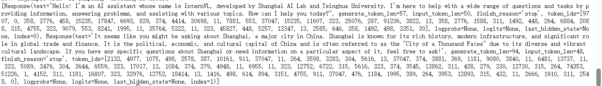

### 指定推理引擎

> 在构造 `pipeline` 时，如果没有指定使用 `TurboMind` 引擎或 `PyTorch` 引擎进行推理，默认优先使用 `TurboMind` 引擎，实际上，`LMDeploy` 将根据提供的检查点自动确定使用哪种引擎。

#### TurbomindEngineConfig推理引擎

```python
from lmdeploy import pipeline, TurbomindEngineConfig
from lmdeploy import GenerationConfig

pipe = pipeline("/root/share/new_models/InternVL3/InternVL3-1B",
                backend_config=TurbomindEngineConfig(
                    max_batch_size=32,
                    enable_prefix_caching=True,
                    cache_max_entry_count=0.8,
                    session_len=8192,
                ))
response = pipe(prompts=["Hi, pls intro yourself", "Shanghai is"],
                gen_config=GenerationConfig(max_new_tokens=1024,
                                            top_p=0.8,
                                            top_k=40,
                                            temperature=0.6))
print(response)
```

#### PytorchEngineConfig推理引擎

```python
from lmdeploy import pipeline, PytorchEngineConfig
from lmdeploy import GenerationConfig

pipe = pipeline("/root/share/new_models/InternVL3/InternVL3-1B",
                backend_config=PytorchEngineConfig(
                    max_batch_size=32,
                    enable_prefix_caching=True,
                    cache_max_entry_count=0.8,
                    session_len=8192,
                ))

response = pipe(prompts=["Hi, pls intro yourself", "Shanghai is"],
                gen_config=GenerationConfig(max_new_tokens=1024,
                                            top_p=0.8,
                                            top_k=40,
                                            temperature=0.6))
print(response)
```

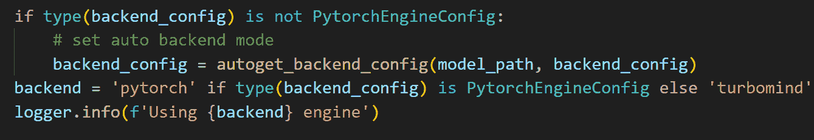

### VLM 推理 (Visual Language Models)

```python
image = load_image('https://raw.githubusercontent.com/open-mmlab/mmdeploy/main/tests/data/tiger.jpeg')
```

```python
from lmdeploy import pipeline, VisionConfig
from lmdeploy.vl import load_image

pipe = pipeline("/root/share/new_models/InternVL3/InternVL3-1B",
                vision_config=VisionConfig(
                    max_batch_size=8
                ))
response = pipe(('describe this image', image))
print(response)
```

## 大语言模型(`LLMs`)部署

### 离线部署

```python
import lmdeploy
from lmdeploy import GenerationConfig
pipe = lmdeploy.pipeline("/root/share/new_models/internlm3/internlm3-8b-instruct")
response = pipe(prompts=["Hi, pls intro yourself", "Shanghai is"],
                gen_config=GenerationConfig(max_new_tokens=1024,
                                            top_p=0.8,
                                            top_k=40,
                                            temperature=0.6))
print(response)
```

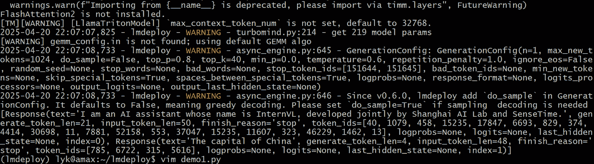

> 注意：

- `LMDeploy` 的 `KV cache` 策略对显存提出了较高的要求；`LMDeploy` 在服务启动时就会预先一次性分配 `KV cache` 空间，如果加载模型出现 `OOM`，可能需要考虑降低 `cache_max_entry_count` 的值，表示加载模型权重后 `K/V` 缓存占用的空闲 `GPU` 内存的比例。

- `` `v0.2.0 <= lmdeploy <= v0.2.1` ``，默认比例为 `0.5`，表示 `GPU` 总显存的 `50%` 被分配给 `k/v cache`。`lmdeploy > v0.2.1`，分配策略改为从空闲显存中按比例为 `k/v cache` 开辟空间。默认比例值调整为 `0.8`。

### 设置多卡并行（此部分不需要复现）

> `TurbomindEngineConfig` 和 `PytorchEngineConfig` 的参数 `tp` 是设置 `GPU` 并行的，解释如下：

> `tp` (int): the number of `GPU` cards used in tensor parallelism, default to `1`

```python
from lmdeploy import pipeline, TurbomindEngineConfig
from lmdeploy import pipeline, PytorchEngineConfig

### TurbomindEngineConfig推理引擎
pipe = pipeline("/root/share/new_models/internlm3/internlm3-8b-instruct",
                backend_config=TurbomindEngineConfig(
                    tp=2,
                    max_batch_size=32,
                    enable_prefix_caching=True,
                    cache_max_entry_count=0.8,
                    session_len=8192,
                ))
### PytorchEngineConfig推理引擎

pipe = pipeline("/root/share/new_models/internlm3/internlm3-8b-instruct",
                backend_config=PytorchEngineConfig(
                    tp=2,
                    max_batch_size=32,
                    enable_prefix_caching=True,
                    cache_max_entry_count=0.8,
                    session_len=8192,
                ))
```

### 3. 生成核心参数介绍

> 常见解码策略：

+ 贪心解码（`Greedy Decoding`）：直接选择概率最高的单词。这种方法简单高效，但是可能会导致生成的文本过于单调和重复。

+ 随机采样（`Random Sampling`）：按照概率分布随机选择一个单词。这种方法可以增加生成的多样性，但是可能会导致生成的文本不连贯和无意义。

+ 集束搜索（`Beam Search`）：维护一个大小为 `k` 的候选序列集合，每一步从每个候选序列的概率分布中选择概率最高的 `k` 个单词，然后保留总概率最高的 `k` 个候选序列。这种方法可以平衡生成的质量和多样性，但是可能会导致生成的文本过于保守和不自然；由于需要维护 `k` 个序列，开销比较大。

>

> 以上方法都有各自的问题，而 `top-k` 采样和 `top-p` 采样是介于贪心解码和随机采样之间的方法，也是目前大模型解码策略中常用的方法。

> `Top-k`: 在每一步，只从概率最高的 `k` 个单词中进行随机采样，而不考虑其他低概率的单词。

>

#### 缺点：

1. 结果对 `K` 参数比较敏感，生成的结果更关注高频词，多样性丢失，可能会导致生成的回复过于简单，趋同性高；

1. 回复可能缺乏个性，更偏向“安全”回复

1. 每一步只关注当前概率高的词，可能会导致生成的文本不符合常识或逻辑；

```python
import torch
from labml_nn.sampling import Sampler

# Top-k Sampler
class TopKSampler(Sampler):
    # k is the number of tokens to pick
    # sampler is the sampler to use for the top-k tokens
    # sampler can be any sampler that takes a logits tensor as input and returns a token tensor; e.g. `TemperatureSampler`.
    def __init__(self, k: int, sampler: Sampler):
        self.k = k
        self.sampler = sampler

    # Sample from logits
    def __call__(self, logits: torch.Tensor):
        # New logits filled with −∞; i.e. zero probability
        zeros = logits.new_ones(logits.shape) * float('-inf')
        # Pick the largest k logits and their indices
        values, indices = torch.topk(logits, self.k, dim=-1)
        # Set the values of the top-k selected indices to actual logits.
        # Logits of other tokens remain −∞
        zeros.scatter_(-1, indices, values)
        # Sample from the top-k logits with the specified sampler.
        return self.sampler(zeros)
```

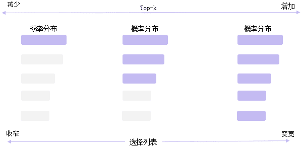

> `Top-p`: 在每一步，只从累积概率超过某个阈值 `p` 的最小单词集合中进行随机采样，而不考虑其它低概率的单词。这种方法也被称为核采样（`nucleus sampling`），因为它只关注概率分布的核心部分，而忽略了尾部部分。

>

#### 缺点：

1. 参数敏感性，`p` 值调优比较难

1. `Top-p` 仅依赖概率分布筛选候选词，但缺乏对已生成内容的显式约束（如重复惩罚机制），可能导致重复片段，倾向于重复高频词

1. 生成结果偏向“安全”选项，牺牲个性。

>

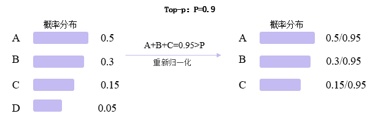


```python
import torch
from torch import nn

from labml_nn.sampling import Sampler


class NucleusSampler(Sampler):
    """
    ## Nucleus Sampler
    """
    def __init__(self, p: float, sampler: Sampler):
        """
        :param p: is the sum of probabilities of tokens to pick $p$
        :param sampler: is the sampler to use for the selected tokens
        """
        self.p = p
        self.sampler = sampler
        # Softmax to compute $P(x_i | x_{1:i-1})$ from the logits
        self.softmax = nn.Softmax(dim=-1)

    def __call__(self, logits: torch.Tensor):
        """
        Sample from logits with Nucleus Sampling
        """

        # Get probabilities $P(x_i | x_{1:i-1})$
        probs = self.softmax(logits)

        # Sort probabilities in descending order
        sorted_probs, indices = torch.sort(probs, dim=-1, descending=True)

        # Get the cumulative sum of probabilities in the sorted order
        cum_sum_probs = torch.cumsum(sorted_probs, dim=-1)

        # Find the cumulative sums less than $p$.
        nucleus = cum_sum_probs < self.p

        # Prepend ones so that we add one token after the minimum number
        # of tokens with cumulative probability less that $p$.
        nucleus = torch.cat([nucleus.new_ones(nucleus.shape[:-1] + (1,)), nucleus[..., :-1]], dim=-1)

        # Get log probabilities and mask out the non-nucleus
        sorted_log_probs = torch.log(sorted_probs)
        sorted_log_probs[~nucleus] = float('-inf')

        # Sample from the sampler
        sampled_sorted_indexes = self.sampler(sorted_log_probs)

        # Get the actual indexes
        res = indices.gather(-1, sampled_sorted_indexes.unsqueeze(-1))

        #
        return res.squeeze(-1)
```

> 如果 `top-k` 和 `top-p` 同时启用，则 `top-p` 在 `top-k` 之后起作用。

> `Temperature` 采样：调节输出概率分布的参数

高 `temperature` 对差异进行平滑，低 `temperature` 对差异进行放大

设模型的原始输出 `logits`（未归一化的预测值）为 ，词汇表大小为 ，温度参数为

控制分布的尖锐程度，接近 0，概率分布趋向于贪婪选择（仅最高概率的 `token` 概率接近 1，其余接近 0）

趋近无穷大，概率分布趋向于均匀分布（所有 `token` 概率接近相等）

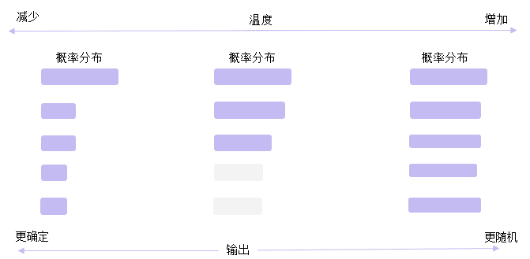

```python
import torch
from torch.distributions import Categorical

from labml_nn.sampling import Sampler


class TemperatureSampler(Sampler):
    """
    ## Sampler with Temperature
    """
    def __init__(self, temperature: float = 1.0):
        """
        :param temperature: is the temperature to sample with
        """
        self.temperature = temperature

    def __call__(self, logits: torch.Tensor):
        """
        Sample from logits
        """

        # Create a categorical distribution with temperature adjusted logits
        dist = Categorical(logits=logits / self.temperature)

        # Sample
        return dist.sample()
```

### 部署类 `OpenAI` 服务

+ 使用 `lmdeploy` CLI 工具

```bash
lmdeploy serve api_server /root/share/new_models/InternVL3/InternVL3-1B --server-port 23333
```

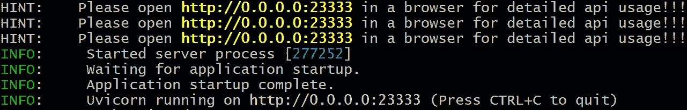

+ 使用类 `OpenAI` 方式

(i) 不启用权限鉴别 (`api-key`)

```python
from openai import OpenAI
client = OpenAI(
    api_key='none', # 若未启用鉴权，可填任意值（如 "none"）
    base_url="http://0.0.0.0:23333/v1"
)
model_name = client.models.list().data[0].id
response = client.chat.completions.create(
  model=model_name,
  messages=[
    {"role": "system", "content": "You are a helpful assistant."},
    {"role": "user", "content": " provide three suggestions about time management"},
  ],
    temperature=0.8,
    top_p=0.8
)
print(response)
```

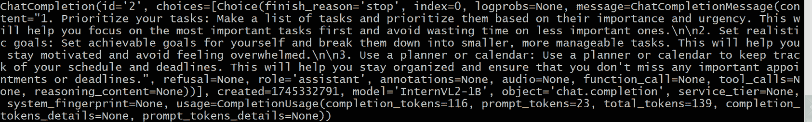

(ii) 启用权限鉴别 (`api-key`)

```
1. 启动服务

lmdeploy serve api_server /root/share/new_models/internlm3/internlm3-8b-instruct --server-port 23333 --api-keys "token"

2. 授权访问

from openai import OpenAI
client = OpenAI(
    api_key='token',
    base_url="http://0.0.0.0:23333/v1"
)
model_name = client.models.list().data[0].id
response = client.chat.completions.create(
  model=model_name,
  messages=[
    {"role": "system", "content": "You are a helpful assistant."},
    {"role": "user", "content": " provide three suggestions about time management"},
  ],
    temperature=0.8,
    top_p=0.8
)
print(response)
```

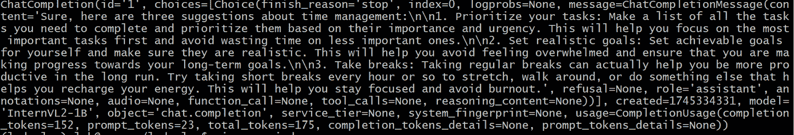

(iii) 异步访问 (`api-key`)

```python
import asyncio
from openai import AsyncOpenAI

async def main():
    client = AsyncOpenAI(api_key='token',
                         base_url='http://0.0.0.0:23333/v1')
    model_cards = await client.models.list()._get_page()
    response = await client.chat.completions.create(
        model=model_cards.data[0].id,
        messages=[
            {
                'role': 'system',
                'content': 'You are a helpful assistant.'
            },
            {
                'role': 'user',
                'content': ' provide three suggestions about time management'
            },
        ],
        temperature=0.8,
        top_p=0.8)
    print(response)

asyncio.run(main())
```

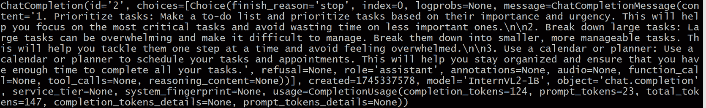

### `APIClient` 接口

1. 启动服务

```bash
lmdeploy serve api_server /root/share/new_models/internlm3/internlm3-8b-instruct --server-port 23333 --api-keys "token"
```

1. 使用 `APIClient` 进行推理

```python
from lmdeploy.serve.openai.api_client import APIClient

client = APIClient(
    api_server_url="http://localhost:23333",
    api_key="token"
)
model_name = client.available_models[0]

messages = [{"role": "user", "content": "你好"}]
for item in client.chat_completions_v1(model=model_name, messages=messages):
    print(item)
```

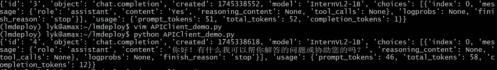

### `Requests` 调用（了解）

1. 启动服务

```bash
lmdeploy serve api_server /root/share/new_models/internlm3/internlm3-8b-instruct --server-port 23333 --api-keys "token"
```

2. `requests` 发送请求

```python
import requests

url = "http://localhost:23333/v1/chat/completions"
headers = {
    "Authorization": "Bearer token",  # Bearer + Token
    "Content-Type": "application/json"
}
data = {
    "model": "/root/share/new_models/internlm3/internlm3-8b-instruct",
    "messages": [{"role": "user", "content": "你好"}]
}

response = requests.post(url, headers=headers, json=data)
print(response.json()["choices"][0]["message"]["content"])
```

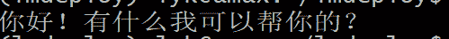

### 使用 `CURL` 命令（了解）

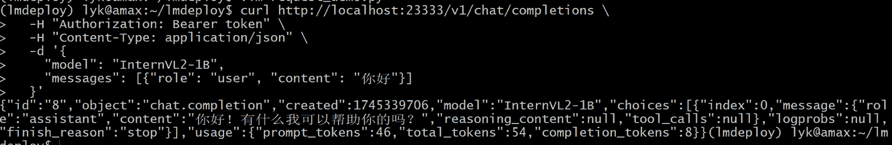

## 视觉-语言模型 (VLMs) 部署

> 部署思路和文本模型相似

### 离线部署

```python
image = load_image('https://raw.githubusercontent.com/open-mmlab/mmdeploy/main/tests/data/tiger.jpeg')
```

```python
from lmdeploy import pipeline
from lmdeploy.vl import load_image

pipe = pipeline('/root/share/new_models/InternVL3/InternVL3-1B')
response = pipe(('describe this image', image))

print(response)
```

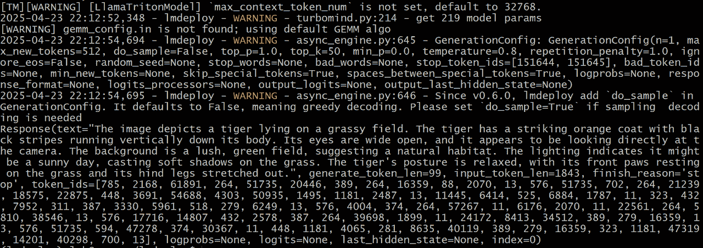

### 多卡并行（了解即可）

```python
from lmdeploy import pipeline, TurbomindEngineConfig, PytorchEngineConfig
from lmdeploy.vl import load_image

pipe = pipeline('root/share/new_models/InternVL3/InternVL3-1B',
                backend_config=PytorchEngineConfig(tp=2))

image = load_image('tiger.jpeg')
response = pipe(('describe this image', image))
print(response)
```

### 图片 token

```python
IMAGE_TOKEN = '<IMAGE_TOKEN>'
```

```python
image = load_image('https://raw.githubusercontent.com/open-mmlab/mmdeploy/main/tests/data/tiger.jpeg')
```


```
from lmdeploy import pipeline, VisionConfig
from lmdeploy.vl import load_image
from lmdeploy.vl.constants import IMAGE_TOKEN

pipe = pipeline('/root/share/new_models/InternVL3/InternVL3-1B',
                vision_config=VisionConfig(
                    max_batch_size=8
                ))
response = pipe((f'describe this image{IMAGE_TOKEN}', image))
print(response)
```

`IMAGE_TOKEN`是一个特殊的token，在文本序列中插入 `IMAGE_TOKEN` 可以明确标注图像的位置，帮助模型区分文本和图像的边界。

## 对话模板

对话模板（Conversation Template）是一种预设的输入输出格式规则，用于规范用户与模型的交互方式。它的核心作用是通过结构化对话内容，提升模型的响应质量、可控性和适用性。

推理时，LMDeploy 会根据模型路径匹配内置的对话模板，并把对话模板应用到输入的提示词上。如果用户使用的是本地模型，并且模型文件夹名字与官方模型不一致时，需要手动指定对话模版。

### 自定义对话模板

```
from lmdeploy.model import MODELS, BaseChatTemplate


@MODELS.register_module(name='customized_model')
class CustomizedModel(BaseChatTemplate):
    """A customized chat template."""

    def __init__(self,
                 system='<|im_start|>system\n',
                 meta_instruction='You are a robot developed by LMDeploy.',
                 user='<|im_start|>user\n',
                 assistant='<|im_start|>assistant\n',
                 eosys='<|im_end|>\n',
                 eoh='<|im_end|>\n',
                 eoa='<|im_end|>',
                 separator='\n',
                 stop_words=['<|im_end|>', '<|action_end|>']):
        super().__init__(system=system,
                         meta_instruction=meta_instruction,
                         eosys=eosys,
                         user=user,
                         eoh=eoh,
                         assistant=assistant,
                         eoa=eoa,
                         separator=separator,
                         stop_words=stop_words)
```

```
from lmdeploy import ChatTemplateConfig, pipeline

messages = [{'role': 'user', 'content': 'who are you?'}]
pipe = pipeline('/root/share/new_models/InternVL3/InternVL3-1B',
                chat_template_config=ChatTemplateConfig('customized_model'))
for response in pipe.stream_infer(messages):
    print(response.text, end='')
```

## 视觉模型参数

可通过设置 `VisionConfig` 修改视觉模型默认参数

`image = load_image('https://raw.githubusercontent.com/open-mmlab/mmdeploy/main/tests/data/tiger.jpeg')`

```
from lmdeploy import pipeline, VisionConfig
from lmdeploy.vl import load_image
vision_config=VisionConfig(max_batch_size=16)
pipe = pipeline('/root/share/new_models/InternVL3/InternVL3-1B', vision_config=vision_config)
response = pipe(('describe this image', image))
print(response)
```

### VisionConfig 源码

```
@dataclass
class VisionConfig:
    """Vison model configs.

    Args:
        max_batch_size (int): the max image size passed to the model, since
            some models will use image patch, the actual running batch could
            be larger than this value.
        thread_safe (bool): Specifies whether the engine instance is
            thread-safe. Please set it to True when using the pipeline
            in a multi-threaded environment.
    """
    max_batch_size: int = 1
    thread_safe: bool = False
```

## 多图推理

```
'https://raw.githubusercontent.com/open-mmlab/mmdeploy/main/demo/resources/human-pose.jpg',

'https://raw.githubusercontent.com/open-mmlab/mmdeploy/main/demo/resources/det.jpg';
```

```
from lmdeploy import pipeline, TurbomindEngineConfig
from lmdeploy.vl import load_image

pipe = pipeline('/root/share/new_models/InternVL3/InternVL3-1B',
                backend_config=TurbomindEngineConfig(session_len=8192))

image_urls=[
]

images = [load_image(img_url) for img_url in image_urls]
response = pipe(('describe the two images', images))
print(response)
```

## 多轮对话

使用 `pipeline` 进行多轮对话有两种方式，一种是按照 openai 的格式来构造 `messages`，另外一种是使用 `pipeline.chat` 接口。

`image = load_image('https://raw.githubusercontent.com/open-mmlab/mmdeploy/main/demo/resources/human-pose.jpg')`

```
from lmdeploy import pipeline, TurbomindEngineConfig, GenerationConfig
from lmdeploy.vl import load_image

pipe = pipeline('/root/share/new_models/InternVL3/InternVL3-1B',  # 注意加了 `/`
                backend_config=TurbomindEngineConfig(session_len=8192))
gen_config = GenerationConfig(top_k=40, top_p=0.8, temperature=0.6)

# 第一句图文对话
sess = pipe.chat(('describe this image', image), gen_config=gen_config)
print(sess.response.text)

# 第二轮多轮对话
sess = pipe.chat('What is the woman doing?', session=sess, gen_config=gen_config)
print(sess.response.text)
```

视觉语言模型的部署和文本几乎相似，其余请参考文本模型的部署

## 模型量化

### 量化模型

LMDeploy 量化模块目前仅支持 AWQ 量化算法。

量化是指将高精度数字转换为低精度数字。低精度实体可以存储在磁盘上很小的空间内，从而减少内存需求。

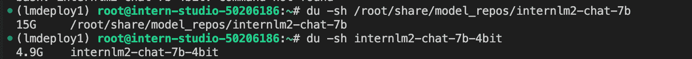

```
conda activate lmdeploy
pip uninstall -y datasets && pip install --no-cache-dir "datasets==2.19.2" 
```

量化`internlm2-chat-7b`的命令：

```
export HF_MODEL=/root/share/model_repos/internlm2-chat-7b
export WORK_DIR=/root/internlm2-chat-7b-4bit

lmdeploy lite auto_awq $HF_MODEL   --calib-dataset 'ptb'   --calib-samples 128   --calib-seqlen 2048   --w-bits 4   --w-group-size 128   --batch-size 1   --work-dir $WORK_DIR
```

量化`InternVL3-1B`的命令：

```
lmdeploy lite auto_awq /root/share/new_models/InternVL3/InternVL3-1B \
  --work-dir /root/InternVL3-1B-4bit
```

### W8A8量化

LMDeploy 提供了使用 8-bit 整数(INT8)和浮点数(FP8)对神经网络模型进行量化和推理的功能。

```
pip install lmdeploy[all]
```

`lmdeploy` 提供了命令行工具 `lmdeploy lite smooth_quant` 实现量化功能。并且其中命令行参数 `--quant-dtype` 可以用来控制是进行8-bit整数还是浮点数类型的量化。更多命令行工具使用方式，请执行 `lmdeploy lite smooth_quant --help` 查看。

```
export HF_MODEL=/root/share/model_repos/internlm2-chat-7b
export WORK_DIR=/root/internlm2-chat-7b-4bit

lmdeploy lite smooth_quant \
  $HF_MODEL \
  --work-dir $WORK_DIR \
  --quant-dtype int8
```

```
lmdeploy lite smooth_quant $HF_MODEL --work-dir $WORK_DIR --quant-dtype fp8
```

### Key-Value(KV) Cache 量化

自 `v0.4.0` 起，LMDeploy 支持在线 kv cache int4/int8 量化，量化方式为 per-head per-token 的非对称量化。

通过 LMDeploy 应用 kv 量化非常简单，只需要设定 `quant_policy` 参数即可。

```
from lmdeploy import pipeline, TurbomindEngineConfig
engine_config = TurbomindEngineConfig(quant_policy=8)
pipe = pipeline("/root/share/model_repos/internlm2-chat-7b", 
            backend_config=engine_config)
response = pipe(["Hi, pls intro yourself", "Shanghai is"])
print(response)
```

`LMDeploy` 规定 `qant_policy=4` 表示 kv int4 量化

`quant_policy=8` 表示 kv int8 量化。

## 闯关任务

复现 InternVL 和 InternLM 的部署和量化提交为在线飞书文档。

提交地址：`https://aicarrier.feishu.cn/share/base/form/shrcnkSJ97ykqRSz4fgyCJbvCsb`
