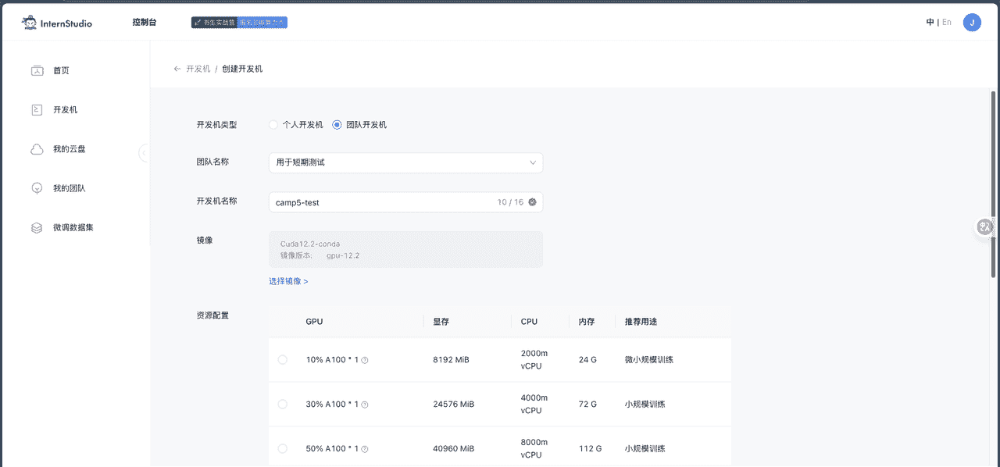
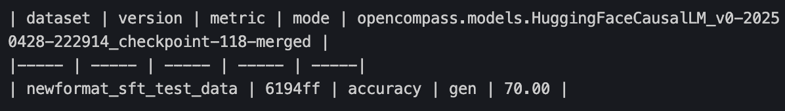

# L1G4- InternLM 论文分类微调实践（Swift 版）

> 来源：[https://aicarrier.feishu.cn/docx/GCxbdpzOooDbe2xXACZcZAORnFh](https://aicarrier.feishu.cn/docx/GCxbdpzOooDbe2xXACZcZAORnFh)

> 文档尚处于草稿阶段，完善中


屏幕前的吴彦祖、刘亦菲们好，欢迎参加书生实战营，这个文档将带大家微调 InternLM 模型的「论文分类」能力，并带大家参加论文分类比赛，狠狠赚赞助商一笔。

# 环境安装

在[创建开发机界面](https://studio.intern-ai.org.cn/console/instance)选择镜像为 Cuda12.2-conda，并选择 GPU 为30% A100。



安装 ms-swift

```
conda create -n ms-swift python=3.10 -y
conda activate ms-swift
pip install ms-swift -U
pip install wandb
```

注意：后续所有的操作都需要再 ms-swift 的虚拟环境中执行，在进入新终端时需要先执行 conda activate ms-swift

# 训练

本节为大家提供了处理好的 [arxiv 数据集](https://www.kaggle.com/datasets/Cornell-University/arxiv)和采集得到的数据。

训练集下载链接：https://www.modelscope.cn/datasets/JimmyMa99/smartflow-arxiv-dataset/files

```
conda activate ms-swift
pip install modelscope
modelscope download --dataset JimmyMa99/smartflow-arxiv-dataset --local_dir ./datasets/train
```

##  预训练

### 使用lora进行预训练

如直接复制请删除注释、更改模型路径与数据集路径

```
conda activate ms-swift
bash config/internlm3-8b-lora.sh
```

脚本解析：

```
#!/bin/bash

# 创建日志目录
LOG_DIR=&quot;logs&quot;
mkdir -p $LOG_DIR  # 确保日志目录存在，如果不存在则创建

# 获取当前时间戳，用于生成唯一的日志文件名
TIMESTAMP=$(date +&quot;%Y%m%d_%H%M%S&quot;)
LOG_FILE=&quot;$LOG_DIR/internlm3-8b_lora_sft_${TIMESTAMP}.log&quot;  # 设置日志文件路径

# 设置CUDA环境变量
export NPROC_PER_NODE=1  # 设置每个节点使用的进程数为1
export OMP_NUM_THREADS=1  # 限制OpenMP线程数为1，避免过多线程竞争
export CUDA_VISIBLE_DEVICES=0  # 指定使用的GPU编号为0
export MASTER_PORT=$((10000 + RANDOM % 50000))

# 使用nohup命令在后台运行训练任务，即使终端关闭也能继续运行
nohup swift sft \
    --model {model_path} \  # 指定基础模型路径
    --train_type lora \  # 使用LoRA训练方法
    --dataset {data_path} \  # 指定训练数据集
    --torch_dtype bfloat16 \  # 使用bfloat16精度以节省显存
    --num_train_epochs 1 \  # 设置训练轮数为2
    --per_device_train_batch_size 2 \  # 每个设备的训练批次大小为4
    --learning_rate 5e-5 \  # 学习率设置为5e-5
    --warmup_ratio 0.1 \  # 预热阶段占总训练步数的10%
    --split_dataset_ratio 0 \  # 不拆分数据集
    --lora_rank 8 \  # LoRA的秩设置为8
    --lora_alpha 32 \  # LoRA的alpha参数设置为32
    --use_chat_template false \  # 不使用聊天模板
    --target_modules all-linear \  # 对所有线性层应用LoRA
    --gradient_accumulation_steps 2 \  # 梯度累积步数为2，用于增大有效批次大小
    --save_steps 2000 \  # 每2000步保存一次模型
    --save_total_limit 5 \  # 最多保存5个检查点
    --gradient_checkpointing_kwargs &#x27;{&quot;use_reentrant&quot;: false}&#x27; \  # 梯度检查点设置，禁用重入
    --logging_steps 5 \  # 每5步记录一次日志
    --max_length 2048 \  # 最大序列长度设为2048
    --output_dir ./swift_output/InternLM3-8B-Lora \  # 输出目录
    --dataloader_num_workers 256 \  # 数据加载器使用256个工作线程
    --model_author JimmyMa99 \  # 模型作者信息
    --model_name InternLM3-8B-Lora \  # 模型名称
    &gt; &quot;$LOG_FILE&quot; 2&gt;&amp;1 &amp;  # 将标准输出和错误输出重定向到日志文件，并在后台运行

# 打印进程ID和日志文件位置，便于用户跟踪
echo &quot;Training started with PID $!&quot;  # 显示后台进程的PID
echo &quot;Log file: $LOG_FILE&quot;  # 显示日志文件位置

# 提示用户如何实时查看日志
echo &quot;To view logs in real-time, use:&quot;
echo &quot;tail -f $LOG_FILE&quot;
```

### 合并权重

将刚刚跑完的 log 中显示的权重保存路径修改为以下 adapters 的参数

```
conda activate ms-swift
swift export --adapters xx/checkpoint-xxx --merge_lora true
```

## SFT

### 使用lora进行SFT

如直接复制请删除注释、更改模型路径与数据集路径

```
conda activate ms-swift
bash config/internlm3-8b-sft-lora.sh
```

脚本解析：

```
#!/bin/bash
# 指定使用bash解释器执行脚本

# 创建日志目录
LOG_DIR=&quot;logs&quot;
# 定义日志存储目录变量
mkdir -p $LOG_DIR
# 创建日志目录，-p参数确保即使目录已存在也不会报错

# 获取当前时间戳
TIMESTAMP=$(date +&quot;%Y%m%d_%H%M%S&quot;)
# 获取当前时间并格式化为年月日_时分秒格式
LOG_FILE=&quot;$LOG_DIR/internlm3-8b_lora_sft_${TIMESTAMP}.log&quot;
# 组合日志文件路径，使用时间戳确保文件名唯一

# 设置CUDA设备
export NPROC_PER_NODE=1
# 设置每个节点的进程数为1
export OMP_NUM_THREADS=1
# 设置OpenMP线程数为1，限制并行线程数
export CUDA_VISIBLE_DEVICES=0
# 指定使用的GPU设备为0号设备

nohup swift sft \
# 使用nohup命令在后台运行swift sft命令，即使终端关闭也能继续运行
    --model /root/code/camp5_course/swift_output/InternLM3-8B-Lora/v1-20250416-140542/checkpoint-74-merged \
    # 指定基础模型路径，使用之前训练的checkpoint-74的合并模型
    --train_type lora \
    # 设置训练类型为LoRA（低秩适应）
    --dataset &#x27;/root/code/camp5_course/data/swift_formatted_sft_train_data.jsonl&#x27; \
    # 指定训练数据集的路径
    --torch_dtype bfloat16 \
    # 设置模型参数的数据类型为bfloat16，减少内存占用
    --num_train_epochs 1 \
    # 设置训练轮数为5轮
    --per_device_train_batch_size 22 \
    # 设置每个设备的训练批次大小为8
    --learning_rate 1e-4 \
    # 设置学习率为0.0001
    --warmup_ratio 0.1 \
    # 设置预热比例为0.1，即10%的训练步骤用于学习率从小到大的预热
    --split_dataset_ratio 0 \
    # 设置数据集分割比例为0，不进行训练/验证分割
    --lora_rank 8 \
    # 设置LoRA的秩为8，控制可训练参数的数量
    --lora_alpha 32 \
    # 设置LoRA的alpha为32，影响LoRA更新的缩放程度
    --target_modules all-linear \
    # 设置LoRA目标模块为所有线性层
    --gradient_accumulation_steps 2 \
    # 设置梯度累积步数为2，相当于扩大了批次大小
    --save_steps 2000 \
    # 每2000步保存一次检查点
    --save_total_limit 5 \
    # 最多保存5个检查点，超过会删除旧的
    --gradient_checkpointing_kwargs &#x27;{&quot;use_reentrant&quot;: false}&#x27; \
    # 设置梯度检查点的参数，关闭重入功能以提高稳定性
    --logging_steps 5 \
    # 每5步记录一次日志
    --max_length 2048 \
    # 设置最大序列长度为2048
    --output_dir ./swift_output/InternLM3-8B-Lora \
    # 设置输出目录
    --dataloader_num_workers 256 \
    # 设置数据加载器的工作进程数为256，加速数据加载
    --model_author JimmyMa99 \
    # 设置模型作者信息
    --model_name InternLM3-8B-Lora \
    # 设置模型名称
    &gt; &quot;$LOG_FILE&quot; 2&gt;&amp;1 &amp;
    # 将标准输出和标准错误重定向到日志文件，并在后台运行

# 打印进程ID和日志文件位置
echo &quot;Training started with PID $!&quot;
# 显示训练进程的PID（$!代表最近一个后台进程的PID）
echo &quot;Log file: $LOG_FILE&quot;
# 显示日志文件的路径

# 显示查看日志的命令
echo &quot;To view logs in real-time, use:&quot;
echo &quot;tail -f $LOG_FILE&quot;
# 提示用户如何实时查看日志文件内容
```

### 合并权重

```
conda activate ms-swift
swift export --adapters xx/checkpoint-xxx --merge_lora true
```

# 推理测试

## 新建 streamlit 代码

```
&quot;&quot;&quot;This script refers to the dialogue example of streamlit, the interactive
generation code of chatglm2 and transformers.

We mainly modified part of the code logic to adapt to the
generation of our model.
Please refer to these links below for more information:
    1. streamlit chat example:
        https://docs.streamlit.io/knowledge-base/tutorials/build-conversational-apps
    2. chatglm2:
        https://github.com/THUDM/ChatGLM2-6B
    3. transformers:
        https://github.com/huggingface/transformers
Please run with the command `streamlit run path/to/web_demo.py
    --server.address=0.0.0.0 --server.port 7860`.
Using `python path/to/web_demo.py` may cause unknown problems.
&quot;&quot;&quot;
# isort: skip_file
import copy
import warnings
from dataclasses import asdict, dataclass
from typing import Callable, List, Optional

import streamlit as st
import torch
from torch import nn
from transformers.generation.utils import (LogitsProcessorList,
                                           StoppingCriteriaList)
from transformers.utils import logging

from transformers import AutoTokenizer, AutoModelForCausalLM  # isort: skip

logger = logging.get_logger(__name__)
model_name_or_path=&quot;/root/finetune/models/internlm2-chat-7b&quot;

@dataclass
class GenerationConfig:
    # this config is used for chat to provide more diversity
    max_length: int = 32768
    top_p: float = 0.8
    temperature: float = 0.8
    do_sample: bool = True
    repetition_penalty: float = 1.005


@torch.inference_mode()
def generate_interactive(
    model,
    tokenizer,
    prompt,
    generation_config: Optional[GenerationConfig] = None,
    logits_processor: Optional[LogitsProcessorList] = None,
    stopping_criteria: Optional[StoppingCriteriaList] = None,
    prefix_allowed_tokens_fn: Optional[Callable[[int, torch.Tensor],
                                                List[int]]] = None,
    additional_eos_token_id: Optional[int] = None,
    **kwargs,
):
    inputs = tokenizer([prompt], padding=True, return_tensors=&#x27;pt&#x27;)
    input_length = len(inputs[&#x27;input_ids&#x27;][0])
    for k, v in inputs.items():
        inputs[k] = v.cuda()
    input_ids = inputs[&#x27;input_ids&#x27;]
    _, input_ids_seq_length = input_ids.shape[0], input_ids.shape[-1]
    if generation_config is None:
        generation_config = model.generation_config
    generation_config = copy.deepcopy(generation_config)
    model_kwargs = generation_config.update(**kwargs)
    bos_token_id, eos_token_id = (  # noqa: F841  # pylint: disable=W0612
        generation_config.bos_token_id,
        generation_config.eos_token_id,
    )
    if isinstance(eos_token_id, int):
        eos_token_id = [eos_token_id]
    if additional_eos_token_id is not None:
        eos_token_id.append(additional_eos_token_id)
    has_default_max_length = kwargs.get(
        &#x27;max_length&#x27;) is None and generation_config.max_length is not None
    if has_default_max_length and generation_config.max_new_tokens is None:
        warnings.warn(
            f&quot;Using &#x27;max_length&#x27;&#x27;s default \
                ({repr(generation_config.max_length)}) \
                to control the generation length. &quot;
            &#x27;This behaviour is deprecated and will be removed from the \
                config in v5 of Transformers -- we&#x27;
            &#x27; recommend using `max_new_tokens` to control the maximum \
                length of the generation.&#x27;,
            UserWarning,
        )
    elif generation_config.max_new_tokens is not None:
        generation_config.max_length = generation_config.max_new_tokens + \
            input_ids_seq_length
        if not has_default_max_length:
            logger.warn(  # pylint: disable=W4902
                f&quot;Both &#x27;max_new_tokens&#x27; (={generation_config.max_new_tokens}) &quot;
                f&quot;and &#x27;max_length&#x27;(={generation_config.max_length}) seem to &quot;
                &quot;have been set. &#x27;max_new_tokens&#x27; will take precedence. &quot;
                &#x27;Please refer to the documentation for more information. &#x27;
                &#x27;(https://huggingface.co/docs/transformers/main/&#x27;
                &#x27;en/main_classes/text_generation)&#x27;,
                UserWarning,
            )

    if input_ids_seq_length &gt;= generation_config.max_length:
        input_ids_string = &#x27;input_ids&#x27;
        logger.warning(
            f&#x27;Input length of {input_ids_string} is {input_ids_seq_length}, &#x27;
            f&quot;but &#x27;max_length&#x27; is set to {generation_config.max_length}. &quot;
            &#x27;This can lead to unexpected behavior. You should consider&#x27;
            &quot; increasing &#x27;max_new_tokens&#x27;.&quot;)

    # 2. Set generation parameters if not already defined
    logits_processor = logits_processor if logits_processor is not None \
        else LogitsProcessorList()
    stopping_criteria = stopping_criteria if stopping_criteria is not None \
        else StoppingCriteriaList()

    logits_processor = model._get_logits_processor(
        generation_config=generation_config,
        input_ids_seq_length=input_ids_seq_length,
        encoder_input_ids=input_ids,
        prefix_allowed_tokens_fn=prefix_allowed_tokens_fn,
        logits_processor=logits_processor,
    )

    stopping_criteria = model._get_stopping_criteria(
        generation_config=generation_config,
        stopping_criteria=stopping_criteria)
    logits_warper = model._get_logits_warper(generation_config)

    unfinished_sequences = input_ids.new(input_ids.shape[0]).fill_(1)
    scores = None
    while True:
        model_inputs = model.prepare_inputs_for_generation(
            input_ids, **model_kwargs)
        # forward pass to get next token
        outputs = model(
            **model_inputs,
            return_dict=True,
            output_attentions=False,
            output_hidden_states=False,
        )

        next_token_logits = outputs.logits[:, -1, :]

        # pre-process distribution
        next_token_scores = logits_processor(input_ids, next_token_logits)
        next_token_scores = logits_warper(input_ids, next_token_scores)

        # sample
        probs = nn.functional.softmax(next_token_scores, dim=-1)
        if generation_config.do_sample:
            next_tokens = torch.multinomial(probs, num_samples=1).squeeze(1)
        else:
            next_tokens = torch.argmax(probs, dim=-1)

        # update generated ids, model inputs, and length for next step
        input_ids = torch.cat([input_ids, next_tokens[:, None]], dim=-1)
        model_kwargs = model._update_model_kwargs_for_generation(
            outputs, model_kwargs, is_encoder_decoder=False)
        unfinished_sequences = unfinished_sequences.mul(
            (min(next_tokens != i for i in eos_token_id)).long())

        output_token_ids = input_ids[0].cpu().tolist()
        output_token_ids = output_token_ids[input_length:]
        for each_eos_token_id in eos_token_id:
            if output_token_ids[-1] == each_eos_token_id:
                output_token_ids = output_token_ids[:-1]
        response = tokenizer.decode(output_token_ids)

        yield response
        # stop when each sentence is finished
        # or if we exceed the maximum length
        if unfinished_sequences.max() == 0 or stopping_criteria(
                input_ids, scores):
            break


def on_btn_click():
    del st.session_state.messages


@st.cache_resource
def load_model():
    model = (AutoModelForCausalLM.from_pretrained(
        model_name_or_path,
        trust_remote_code=True).to(torch.bfloat16).cuda())
    tokenizer = AutoTokenizer.from_pretrained(model_name_or_path,
                                              trust_remote_code=True)
    return model, tokenizer


def prepare_generation_config():
    with st.sidebar:
        max_length = st.slider(&#x27;Max Length&#x27;,
                               min_value=8,
                               max_value=32768,
                               value=32768)
        top_p = st.slider(&#x27;Top P&#x27;, 0.0, 1.0, 0.8, step=0.01)
        temperature = st.slider(&#x27;Temperature&#x27;, 0.0, 1.0, 0.7, step=0.01)
        st.button(&#x27;Clear Chat History&#x27;, on_click=on_btn_click)

    generation_config = GenerationConfig(max_length=max_length,
                                         top_p=top_p,
                                         temperature=temperature)

    return generation_config


user_prompt = &#x27;&lt;|im_start|&gt;user\n{user}&lt;|im_end|&gt;\n&#x27;
robot_prompt = &#x27;&lt;|im_start|&gt;assistant\n{robot}&lt;|im_end|&gt;\n&#x27;
cur_query_prompt = &#x27;&lt;|im_start|&gt;user\n{user}&lt;|im_end|&gt;\n\
    &lt;|im_start|&gt;assistant\n&#x27;


def combine_history(prompt):
    messages = st.session_state.messages
    meta_instruction = (&#x27;You are a helpful, honest, &#x27;
                        &#x27;and harmless AI assistant.&#x27;)
    total_prompt = f&#x27;&lt;s&gt;&lt;|im_start|&gt;system\n{meta_instruction}&lt;|im_end|&gt;\n&#x27;
    for message in messages:
        cur_content = message[&#x27;content&#x27;]
        if message[&#x27;role&#x27;] == &#x27;user&#x27;:
            cur_prompt = user_prompt.format(user=cur_content)
        elif message[&#x27;role&#x27;] == &#x27;robot&#x27;:
            cur_prompt = robot_prompt.format(robot=cur_content)
        else:
            raise RuntimeError
        total_prompt += cur_prompt
    total_prompt = total_prompt + cur_query_prompt.format(user=prompt)
    return total_prompt


def main():
    st.title(&#x27;internlm2_5-7b-chat-assistant&#x27;)

    # torch.cuda.empty_cache()
    print(&#x27;load model begin.&#x27;)
    model, tokenizer = load_model()
    print(&#x27;load model end.&#x27;)

    generation_config = prepare_generation_config()

    # Initialize chat history
    if &#x27;messages&#x27; not in st.session_state:
        st.session_state.messages = []

    # Display chat messages from history on app rerun
    for message in st.session_state.messages:
        with st.chat_message(message[&#x27;role&#x27;], avatar=message.get(&#x27;avatar&#x27;)):
            st.markdown(message[&#x27;content&#x27;])

    # Accept user input
    if prompt := st.chat_input(&#x27;What is up?&#x27;):
        # Display user message in chat message container

        with st.chat_message(&#x27;user&#x27;, avatar=&#x27;user&#x27;):

            st.markdown(prompt)
        real_prompt = combine_history(prompt)
        # Add user message to chat history
        st.session_state.messages.append({
            &#x27;role&#x27;: &#x27;user&#x27;,
            &#x27;content&#x27;: prompt,
            &#x27;avatar&#x27;: &#x27;user&#x27;
        })

        with st.chat_message(&#x27;robot&#x27;, avatar=&#x27;assistant&#x27;):

            message_placeholder = st.empty()
            for cur_response in generate_interactive(
                    model=model,
                    tokenizer=tokenizer,
                    prompt=real_prompt,
                    additional_eos_token_id=92542,
                    device=&#x27;cuda:0&#x27;,
                    **asdict(generation_config),
            ):
                # Display robot response in chat message container
                message_placeholder.markdown(cur_response + &#x27;▌&#x27;)
            message_placeholder.markdown(cur_response)
        # Add robot response to chat history
        st.session_state.messages.append({
            &#x27;role&#x27;: &#x27;robot&#x27;,
            &#x27;content&#x27;: cur_response,  # pylint: disable=undefined-loop-variable
            &#x27;avatar&#x27;: &#x27;assistant&#x27;,
        })
        torch.cuda.empty_cache()


if __name__ == &#x27;__main__&#x27;:
    main()

```

## 运行

```
pip install streamlit==1.31.0
streamlit run /root/Tutorial/tools/L1_XTuner_code/xtuner_streamlit_demo.py
```

# 测评

## 练习赛在线评测

## 本地评测

使用opencompass进行测评

### 克隆仓库

```
git clone https://github.moeyy.xyz/https://github.com/open-compass/opencompass opencompass
cd opencompass
conda create -n opencompass python=3.10 -y
conda activate opencompass 
pip install -e .
```

### 修改内容

我们将使用huggingface 进行推理

所以需要修改一个文件opencompass/opencompass/models/huggingface.py

```
# 681行
- self.model = AutoModelForCausalLM.from_pretrained(path, **model_kwargs)
+ self.model = AutoModelForCausalLM.from_pretrained(path, trust_remote_code=True,**model_kwargs)
# 135行
- tokenizer_path if tokenizer_path else path, **tokenizer_kwargs)
+ tokenizer_path if tokenizer_path else path, trust_remote_code=True, **tokenizer_kwargs)    
        
```

新建一个 py 脚本internlm3-oc_eval.py

内容如下：

```
# To run this example, you need to do the following steps:
# 1. Install latest opencompass
# 2. Start a local server with Qwen2.5-72B-Instruct as LLMJudge server (i.e. using vLLM or LMDeploy)
# 3. Change the judge_cfg openai_api_base to your corresponindg local server address
# 4. Start this evaluation by running &#x27;opencompass eval_internlm3_math500_thinking.py&#x27; 
# from opencompass.models import VLLMwithChatTemplate, OpenAISDK
from mmengine.config import read_base
from opencompass.models import HuggingFaceCausalLM

models = [
    dict(
        type=HuggingFaceCausalLM,
        path=&#x27;/root/code/camp5_course/swift_output/InternLM3-8B-Lora/v3-20250416-163856/checkpoint-95-merged&#x27;,
        tokenizer_path=&#x27;/root/code/camp5_course/swift_output/InternLM3-8B-Lora/v3-20250416-163856/checkpoint-95-merged&#x27;,
        tokenizer_kwargs=dict(padding_side=&#x27;left&#x27;, truncation_side=&#x27;left&#x27;),
        model_kwargs=dict(device_map=&#x27;auto&#x27;),
        max_seq_len=32768,
        max_out_len=16384,
        batch_size=2,
        run_cfg=dict(num_gpus=1),
    )
]

datasets = [
    {&quot;path&quot;: &quot;/root/code/camp5_course/test_data/newformat_sft_test_data.csv&quot;, &quot;data_type&quot;: &quot;mcq&quot;, &quot;infer_method&quot;: &quot;gen&quot;},
]
```

### 运行测评

```
python run.py internlm3-oc_eval.py --debug
```

