# L1G4- InternLM 论文分类微调实践（XTuner 版）

> 来源：[https://aicarrier.feishu.cn/docx/JA8edduq9oP66uxvYw3cehKOn8g](https://aicarrier.feishu.cn/docx/JA8edduq9oP66uxvYw3cehKOn8g)


# 闯关任务

[端侧小模型论文分类微调练习打榜赛 ](https://aicarrier.feishu.cn/wiki/I5ywwN1ZZi5m1pk5fhKcGL0Dn0j) 赛中提交结果超过基线，并提交复现文档。

提交地址：https://aicarrier.feishu.cn/share/base/form/shrcnkSJ97ykqRSz4fgyCJbvCsb

# XTuner介绍

一句话介绍XTuner：

XTuner 是一个高效、灵活、全能的轻量化大模型微调工具库。

核心特点：

1.  高效：支持在有限资源下微调大模型，如在8GB显存上微调7B参数模型，也支持多节点微调70B+模型；自动分发高性能算子加速训练；兼容DeepSpeed优化策略。

1.  灵活：支持多种大语言模型（如InternLM、Llama、ChatGLM等）和多模态模型；支持多种数据格式；支持QLoRA、LoRA、全量参数微调等多种微调算法。

1.  全能：支持增量预训练、指令微调与Agent微调；预定义多种对话模板；训练所得模型可无缝接入部署工具LMDeploy和评测工具OpenCompass。

**解决问题：**

+   解决大模型微调的资源门槛高、效率低的问题

+   解决多种模型架构和微调方法的兼容性问题

+   解决从训练到部署的工作流程不连贯问题

适用场景：

+   在计算资源有限的情况下微调大语言模型

+   多模态模型（如LLaVA）的预训练与微调

+   领域特定模型的定制化训练

+   大模型的Agent能力训练

价值：

XTuner降低了大模型微调的技术和资源门槛，使研究人员和开发者能够高效地将通用大模型适配到特定领域或任务，同时保持高性能，并提供从训练到部署的完整解决方案。

支持的model图

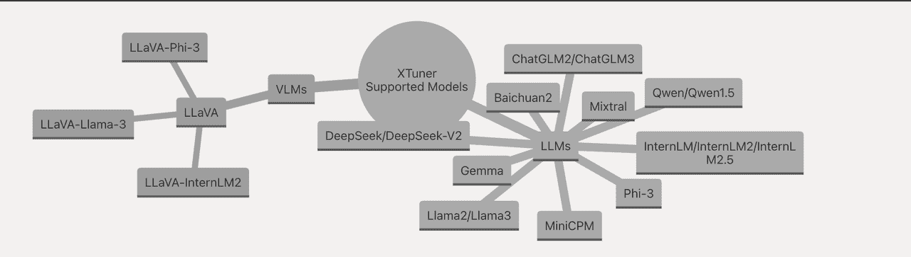

Workflow图

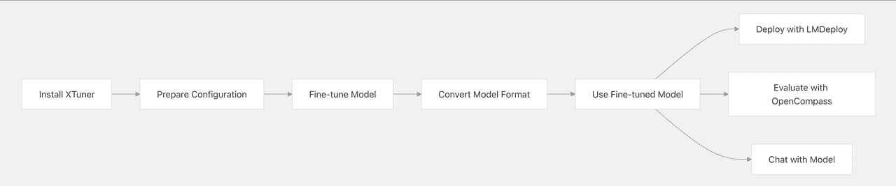

github仓库：https://github.com/InternLM/xtuner

动态知识库：https://deepwiki.com/InternLM/xtuner

# 环境安装

在[创建开发机界面](https://studio.intern-ai.org.cn/console/instance)选择镜像为 Cuda12.2-conda，并选择 GPU 为30% A100。

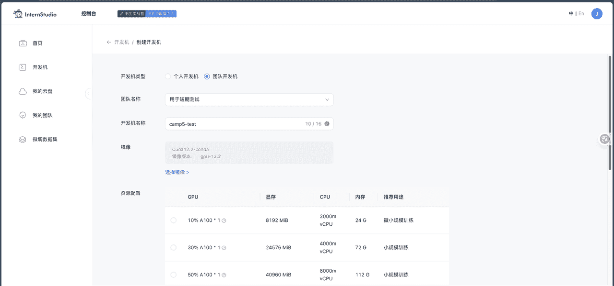

Conda 管理环境

```
conda activate /root/share/pre_envs/pytorch2.3.1cu12.1
pip install &#x27;xtuner[deepspeed]&#x27; timm==1.0.9  
pip install transformers==4.48.0
pip install modelscope
```

输入xtuner list-cfg检验环境安装

```
xtuner list-cfg
```

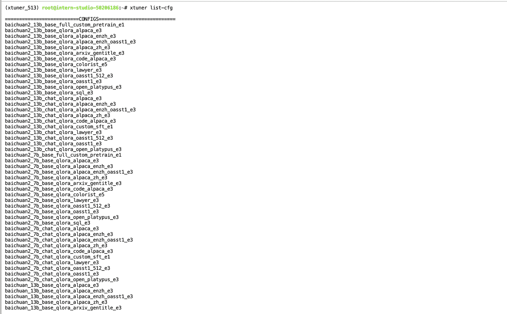

# 数据获取

关于数据详情参考[InternLM论文分类微调实践（swift 版）](https://vwpecqie443.feishu.cn/wiki/AdRfwyZfWiJPJJkwnhucGavSnBe)数据部分

原本的数据是swift版本，因此需要代码转化。这里直接贴现成的数据sftdata.jsonl给大家：

（数据转化仅供参考）


[convert_to_alpaca.py](https://internal-api-drive-stream.feishu.cn/space/api/box/stream/download/all/UkPBbRghfoWSmcxaAJ3cAw93n3r)


[sftdata.jsonl](https://internal-api-drive-stream.feishu.cn/space/api/box/stream/download/all/XlzGbxK8RonIKUxL1IacKXYinlb)

# 训练

```
ln -s /root/share/new_models/Shanghai_AI_Laboratory/internlm2_5-7b-chat ./
```

这条符号链接指令的解释：

当你执行 ln -s /root/share/new_models/Shanghai_AI_Laboratory/internlm2_5-7b-chat ./ 这条命令后，在当前目录下就创建了一个名为 internlm2_5-7b-chat 的符号链接文件。这个文件本身并不包含实际的数据，它只是记录了目标路径 /root/share/new_models/Shanghai_AI_Laboratory/internlm2_5-7b-chat。

当你在当前目录下使用 internlm2_5-7b-chat 这个符号链接时，系统会读取该符号链接文件的内容（即目标路径），然后直接访问这个目标路径下的文件或目录。因此，你不需要每次都输入完整的 /root/share/new_models/Shanghai_AI_Laboratory/internlm2_5-7b-chat 路径，只需要使用 internlm2_5-7b-chat 这个简短的名称就可以访问到目标内容。

这种机制带来了很多便利，比如：

1.  可以为复杂的路径创建一个简短易记的别名，提高操作效率。

1.  当目标文件或目录的位置发生变化时，只需更新符号链接的指向，而不需要修改所有引用它的脚本或命令。

1.  可以在不同的目录下创建指向同一目标的符号链接，方便在多个位置快速访问同一资源。

需要注意的是，符号链接与硬链接不同。符号链接可以指向文件或目录，也可以跨文件系统；而硬链接只能指向文件，并且不能跨文件系统。

下图就是项目的一个目录结构

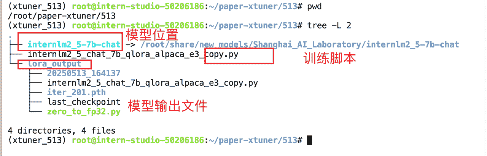

## 微调脚本

```
# Copyright (c) OpenMMLab. All rights reserved.
# —— 动态补丁：兼容 transformers&gt;=4.48 ——
from transformers.cache_utils import DynamicCache     # 1. 引入类
if not hasattr(DynamicCache, &quot;get_max_length&quot;):       # 2. 判断是否缺失
    DynamicCache.get_max_length = DynamicCache.get_max_cache_shape  # 3. 补一个别名
import torch
from datasets import load_dataset
from mmengine.dataset import DefaultSampler
from mmengine.hooks import (
    CheckpointHook,
    DistSamplerSeedHook,
    IterTimerHook,
    LoggerHook,
    ParamSchedulerHook,
)
from mmengine.optim import AmpOptimWrapper, CosineAnnealingLR, LinearLR
from peft import LoraConfig
from torch.optim import AdamW
from transformers import AutoModelForCausalLM, AutoTokenizer, BitsAndBytesConfig

from xtuner.dataset import process_hf_dataset
from xtuner.dataset.collate_fns import default_collate_fn
from xtuner.dataset.map_fns import alpaca_map_fn, template_map_fn_factory
from xtuner.engine.hooks import (
    DatasetInfoHook,
    EvaluateChatHook,
    VarlenAttnArgsToMessageHubHook,
)
from xtuner.engine.runner import TrainLoop
from xtuner.model import SupervisedFinetune
from xtuner.parallel.sequence import SequenceParallelSampler
from xtuner.utils import PROMPT_TEMPLATE, SYSTEM_TEMPLATE

#######################################################################
#                          PART 1  Settings                           #
#######################################################################
# Model
pretrained_model_name_or_path = &quot;./internlm2_5-7b-chat&quot;
use_varlen_attn = False

# Data
alpaca_en_path = &quot;/root/user/FinetuningPaper/sftdata.jsonl&quot;#换成自己的数据路径
prompt_template = PROMPT_TEMPLATE.internlm2_chat
max_length = 1024
pack_to_max_length = True

# parallel
sequence_parallel_size = 1

# Scheduler &amp; Optimizer
batch_size = 1  # per_device
accumulative_counts = 1
accumulative_counts *= sequence_parallel_size
dataloader_num_workers = 0
max_epochs = 1
optim_type = AdamW
lr = 2e-4
betas = (0.9, 0.999)
weight_decay = 0
max_norm = 1  # grad clip
warmup_ratio = 0.03

# Save
save_steps = 50
save_total_limit = 2  # Maximum checkpoints to keep (-1 means unlimited)

# Evaluate the generation performance during the training
evaluation_freq = 50
SYSTEM = SYSTEM_TEMPLATE.alpaca
evaluation_inputs = [&quot;请给我介绍五个上海的景点&quot;, &quot;Please tell me five scenic spots in Shanghai&quot;]

#######################################################################
#                      PART 2  Model &amp; Tokenizer                      #
#######################################################################
tokenizer = dict(
    type=AutoTokenizer.from_pretrained,
    pretrained_model_name_or_path=pretrained_model_name_or_path,
    trust_remote_code=True,
    padding_side=&quot;right&quot;,
)

model = dict(
    type=SupervisedFinetune,
    use_varlen_attn=use_varlen_attn,
    llm=dict(
        type=AutoModelForCausalLM.from_pretrained,
        pretrained_model_name_or_path=pretrained_model_name_or_path,
        trust_remote_code=True,
        torch_dtype=torch.float16,
        quantization_config=dict(
            type=BitsAndBytesConfig,
            load_in_4bit=True,
            load_in_8bit=False,
            llm_int8_threshold=6.0,
            llm_int8_has_fp16_weight=False,
            bnb_4bit_compute_dtype=torch.float16,
            bnb_4bit_use_double_quant=True,
            bnb_4bit_quant_type=&quot;nf4&quot;,
        ),
    ),
    lora=dict(
        type=LoraConfig,
        r=64,
        lora_alpha=16,
        lora_dropout=0.1,
        bias=&quot;none&quot;,
        task_type=&quot;CAUSAL_LM&quot;,
    ),
)

#######################################################################
#                      PART 3  Dataset &amp; Dataloader                   #
#######################################################################
alpaca_en = dict(
    type=process_hf_dataset,
    dataset=dict(type=load_dataset, path=&#x27;json&#x27;, data_files=alpaca_en_path),
    tokenizer=tokenizer,
    max_length=max_length,
    dataset_map_fn=alpaca_map_fn,
    template_map_fn=dict(type=template_map_fn_factory, template=prompt_template),
    remove_unused_columns=True,
    shuffle_before_pack=True,
    pack_to_max_length=pack_to_max_length,
    use_varlen_attn=use_varlen_attn,
)

sampler = SequenceParallelSampler if sequence_parallel_size &gt; 1 else DefaultSampler
train_dataloader = dict(
    batch_size=batch_size,
    num_workers=dataloader_num_workers,
    dataset=alpaca_en,
    sampler=dict(type=sampler, shuffle=True),
    collate_fn=dict(type=default_collate_fn, use_varlen_attn=use_varlen_attn),
)

#######################################################################
#                    PART 4  Scheduler &amp; Optimizer                    #
#######################################################################
# optimizer
optim_wrapper = dict(
    type=AmpOptimWrapper,
    optimizer=dict(type=optim_type, lr=lr, betas=betas, weight_decay=weight_decay),
    clip_grad=dict(max_norm=max_norm, error_if_nonfinite=False),
    accumulative_counts=accumulative_counts,
    loss_scale=&quot;dynamic&quot;,
    dtype=&quot;float16&quot;,
)

# learning policy
# More information: https://github.com/open-mmlab/mmengine/blob/main/docs/en/tutorials/param_scheduler.md  # noqa: E501
param_scheduler = [
    dict(
        type=LinearLR,
        start_factor=1e-5,
        by_epoch=True,
        begin=0,
        end=warmup_ratio * max_epochs,
        convert_to_iter_based=True,
    ),
    dict(
        type=CosineAnnealingLR,
        eta_min=0.0,
        by_epoch=True,
        begin=warmup_ratio * max_epochs,
        end=max_epochs,
        convert_to_iter_based=True,
    ),
]

# train, val, test setting
train_cfg = dict(type=TrainLoop, max_epochs=max_epochs)

#######################################################################
#                           PART 5  Runtime                           #
#######################################################################
# Log the dialogue periodically during the training process, optional
custom_hooks = [
    dict(type=DatasetInfoHook, tokenizer=tokenizer),
    dict(
        type=EvaluateChatHook,
        tokenizer=tokenizer,
        every_n_iters=evaluation_freq,
        evaluation_inputs=evaluation_inputs,
        system=SYSTEM,
        prompt_template=prompt_template,
    ),
]

if use_varlen_attn:
    custom_hooks += [dict(type=VarlenAttnArgsToMessageHubHook)]

# configure default hooks
default_hooks = dict(
    # record the time of every iteration.
    timer=dict(type=IterTimerHook),
    # print log every 10 iterations.
    logger=dict(type=LoggerHook, log_metric_by_epoch=False, interval=10),
    # enable the parameter scheduler.
    param_scheduler=dict(type=ParamSchedulerHook),
    # save checkpoint per `save_steps`.
    checkpoint=dict(
        type=CheckpointHook,
        by_epoch=False,
        interval=save_steps,
        max_keep_ckpts=save_total_limit,
    ),
    # set sampler seed in distributed evrionment.
    sampler_seed=dict(type=DistSamplerSeedHook),
)

# configure environment
env_cfg = dict(
    # whether to enable cudnn benchmark
    cudnn_benchmark=False,
    # set multi process parameters
    mp_cfg=dict(mp_start_method=&quot;fork&quot;, opencv_num_threads=0),
    # set distributed parameters
    dist_cfg=dict(backend=&quot;nccl&quot;),
)

# set visualizer
visualizer = None

# set log level
log_level = &quot;INFO&quot;

# load from which checkpoint
load_from = None

# whether to resume training from the loaded checkpoint
resume = False

# Defaults to use random seed and disable `deterministic`
randomness = dict(seed=None, deterministic=False)

# set log processor
log_processor = dict(by_epoch=False)

```

pretrained_model_name_or_path alpaca_en_path 只需要注意34和38行模型、数据位置就好了。

## 启动

```
cd #你的项目根目录
xtuner train internlm2_5_chat_7b_qlora_alpaca_e3_copy.py --deepspeed deepspeed_zero1
```

## 合并

在完成XTuner的微调后，需要进行两个步骤：首先将PTH格式的模型转换为HuggingFace格式，然后将adapter与基础模型合并。

按照以下步骤操作：

### 1. 将PTH格式转换为HuggingFace格式

```
cd #你的项目根目录
export MKL_THREADING_LAYER=GNU 
xtuner convert pth_to_hf internlm2_5_chat_7b_qlora_alpaca_e3_copy.py  ./work_dirs/internlm2_5_chat_7b_qlora_alpaca_e3_copy/iter_xx.pth  ./work_dirs/hf
```

此处应改为/work_dirs/internlm2_5_chat_7b_qlora_alpaca_e3_copy/iter_xx.pth 这个位置真实的pth文件，xx位置改成真实的序号

### 2. 合并adapter和基础模型

```
cd #你的项目根目录
export MKL_THREADING_LAYER=GNU 
xtuner convert merge ./internlm2_5-7b-chat ./work_dirs/hf ./work_dirs/merged --max-shard-size 2GB
```

完成这两个步骤后，合并好的模型将保存在./work_dirs/merged目录下，你可以直接使用这个模型进行推理了。

## 推理

```
from transformers import AutoModelForCausalLM, AutoTokenizer
import time

# 加载模型和分词器
# model_path = &quot;./work_dirs/merged&quot;
model_path = &quot;./internlm2_5-7b-chat&quot;
print(f&quot;加载模型：{model_path}&quot;)

start_time = time.time()

tokenizer = AutoTokenizer.from_pretrained(model_path, trust_remote_code=True)
model = AutoModelForCausalLM.from_pretrained(
    model_path, trust_remote_code=True, torch_dtype=&quot;auto&quot;, device_map=&quot;auto&quot;
)

def classify_paper(title, authors, abstract, additional_info=&quot;&quot;):
    # 构建输入，包含多选选项
    prompt = f&quot;Based on the title &#x27;{title}&#x27;, authors &#x27;{authors}&#x27;, and abstract &#x27;{abstract}&#x27;, please determine the scientific category of this paper. {additional_info}\n\nA. astro-ph\nB. cond-mat.mes-hall\nC. cond-mat.mtrl-sci\nD. cs.CL\nE. cs.CV\nF. cs.LG\nG. gr-qc\nH. hep-ph\nI. hep-th\nJ. quant-ph&quot;

    # 设置系统信息
    messages = [
        {&quot;role&quot;: &quot;system&quot;, &quot;content&quot;: &quot;你是个优秀的论文分类师&quot;},
        {&quot;role&quot;: &quot;user&quot;, &quot;content&quot;: prompt},
    ]

    # 应用聊天模板
    input_text = tokenizer.apply_chat_template(messages, tokenize=False)

    # 生成回答
    inputs = tokenizer(input_text, return_tensors=&quot;pt&quot;).to(model.device)
    outputs = model.generate(
        **inputs,
        max_new_tokens=10,  # 减少生成长度，只需要简短答案
        temperature=0.1,  # 降低温度提高确定性
        top_p=0.95,
        repetition_penalty=1.0,
    )

    # 解码输出
    response = tokenizer.decode(
        outputs[0][inputs.input_ids.shape[1] :], skip_special_tokens=True
    ).strip()

    # 如果回答中包含选项标识符，只返回该标识符
    for option in [&quot;A&quot;, &quot;B&quot;, &quot;C&quot;, &quot;D&quot;, &quot;E&quot;, &quot;F&quot;, &quot;G&quot;, &quot;H&quot;, &quot;I&quot;, &quot;J&quot;]:
        if option in response:
            return option

    # 如果回答不包含选项，返回完整回答
    return response

# 示例使用
if __name__ == &quot;__main__&quot;:
    title = &quot;Outilex, plate-forme logicielle de traitement de textes &#x27;ecrits&quot;
    authors = &quot;Olivier Blanc (IGM-LabInfo), Matthieu Constant (IGM-LabInfo), Eric Laporte (IGM-LabInfo)&quot;
    abstract = &quot;The Outilex software platform, which will be made available to research, development and industry, comprises software components implementing all the fundamental operations of written text processing: processing without lexicons, exploitation of lexicons and grammars, language resource management. All data are structured in XML formats, and also in more compact formats, either readable or binary, whenever necessary; the required format converters are included in the platform; the grammar formats allow for combining statistical approaches with resource-based approaches. Manually constructed lexicons for French and English, originating from the LADL, and of substantial coverage, will be distributed with the platform under LGPL-LR license.&quot;

    result = classify_paper(title, authors, abstract)
    print(result)

    # 计算并打印总耗时
    end_time = time.time()
    total_time = end_time - start_time
    print(f&quot;程序总耗时：{total_time:.2f}秒&quot;)

```

推理结果图

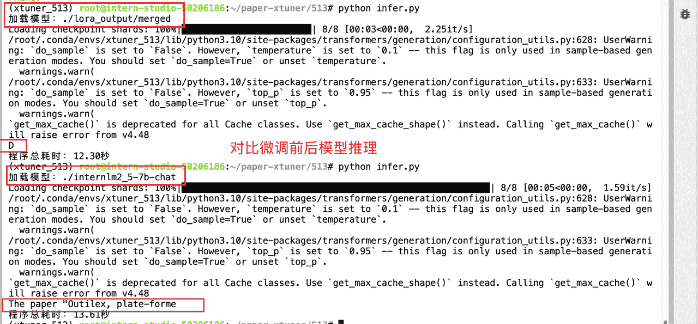

## 部署

```
pip install lmdeploy
python -m lmdeploy.pytorch.chat ./work_dirs/merged \
    --max_new_tokens 256 \
    --temperture 0.8 \
    --top_p 0.95 \
    --seed 0
```

# 评测（可跳）

这个评测环节可跳，因为小伙伴在提交模型后，书生后台会自动评测。

觉得不放心的小伙伴，可以先自己评测一下看看效果。

## 环境配置

```
git clone https://github.moeyy.xyz/https://github.com/open-compass/opencompass opencompass
cd /root/opencompass
conda create -n opencompass python=3.10 -y
conda activate opencompass 
pip install -e .

pip install sentencepiece
```

## 代码

评测代码（数据/root/datasets/train/newformat_sft_test_data.csv是A榜测试数据）

```
 # To run this example, you need to do the following steps:
# 1. Install latest opencompass
# 2. Start a local server with Qwen2.5-72B-Instruct as LLMJudge server (i.e. using vLLM or LMDeploy)
# 3. Change the judge_cfg openai_api_base to your corresponindg local server address
# 4. Start this evaluation by running &#x27;opencompass eval_internlm3_math500_thinking.py&#x27; 
# from opencompass.models import VLLMwithChatTemplate, OpenAISDK
from mmengine.config import read_base
from opencompass.models import HuggingFaceCausalLM

models = [
    dict(
        type=HuggingFaceCausalLM,
        path=&#x27;&#x27;,
        tokenizer_path=&#x27;&#x27;,
        tokenizer_kwargs=dict(padding_side=&#x27;left&#x27;, truncation_side=&#x27;left&#x27;),
        model_kwargs=dict(device_map=&#x27;auto&#x27;),
        max_seq_len=32768,
        max_out_len=16384,
        batch_size=4,
        run_cfg=dict(num_gpus=1),
    )
]

datasets = [
    {&quot;path&quot;: &quot;/root/datasets/train/newformat_sft_test_data.csv&quot;, &quot;data_type&quot;: &quot;mcq&quot;, &quot;infer_method&quot;: &quot;gen&quot;},
]
```

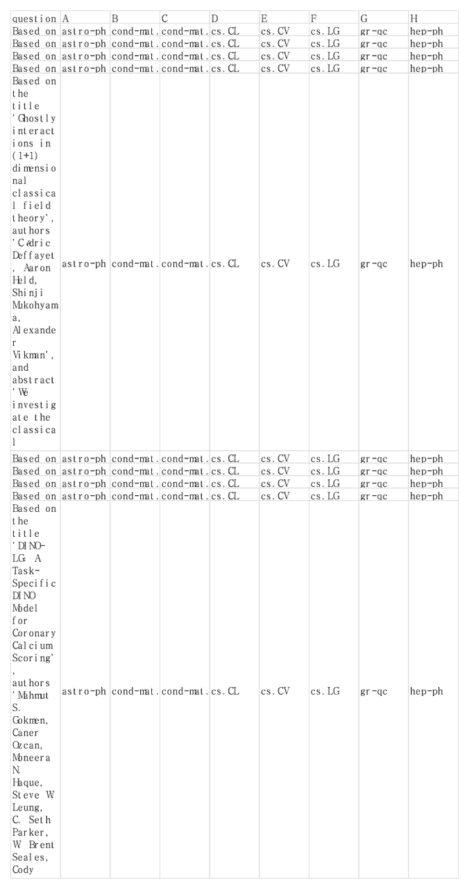

[newformat_sft_test_data.csv](https://internal-api-drive-stream.feishu.cn/space/api/box/stream/download/all/ZEMKbi3s5oZ3g5xvBTzcddJTnde)

运行

```
#在opencompass目录下
python run.py internlm3-oc_eval.py --debug
```

结果

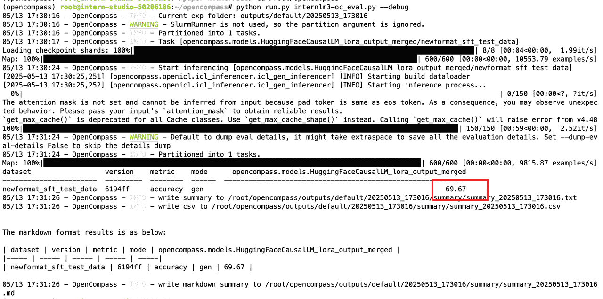

# 提交模型完成评测

**将微调好的模型上传模型至 Mode****lScope 模**型库 ，有 ① swift 指令 ② ModeScope 官方 Python SDK 两种方法，二选一即可。

成功上传至ModelSc**ope 模**型库后，把hub_model_id（下面会告诉大家如何获得）填写至信息提交单中，后台会自动拉取并跑评测，因此稍等一段时间就可以在榜单上看到自己的成绩。

## 6.1 swift 指令

首先需要在 ModelScope 创建模型，为你的模型取一个响亮优雅又好听的名字，然后按右下图中的信息创建。

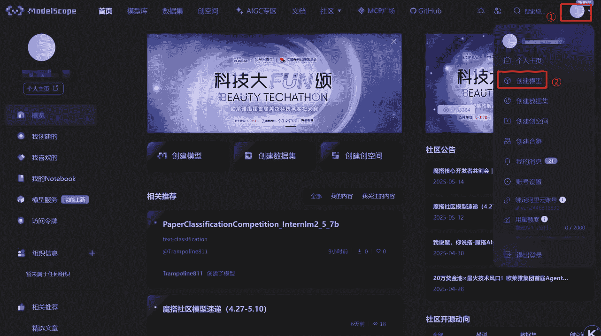


接下来需要两个步骤：

1.  到刚创建好的模型仓库中，拿到**hub_model_id**，实际上就是 **{账号名称/模型库名称}**，如“**Shanghai_AI_Laboratory/i****n**ternlm3-8b-instruct”

1.  账号设置-访问令牌 中拿到**hub_token**，需妥善保存，不要暴露给他人

hub_model_id 获取方式如下图

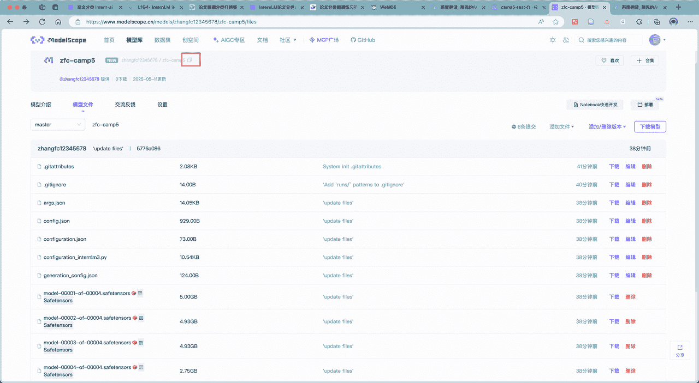

hub_token 获取方式如下图

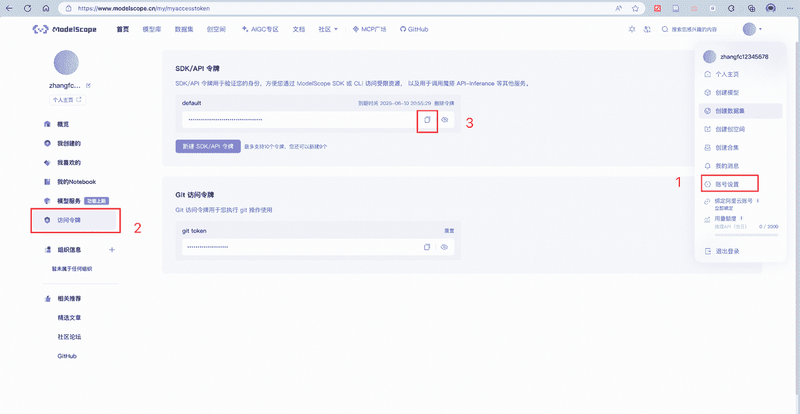

下载git

```
apt-get install git-lfs
git lfs install
```

提交

```
swift export \
    --model /root/paper/config/swift_output/InternLM3-8B-Lora-SFT/v3-20250510-231854/checkpoint-21-merged\
    --push_to_hub true \
    --hub_model_id &#x27;zhangfc12345678/zfc-camp5&#x27; #替换成自己的 \
    --hub_token &#x27;03fb4fxx&#x27; \ #替换成自己的
    --use_hf false
```

## 6.2 ModeScope 官方 Python SDK

复制脚本并修改关键信息后直接运行就上传了，上传后 ModelScope 会花一点时间审核，等待一段时间，待审核全部通过后，再进行下一节的提交。

```
pip install modelscope
```

**【上传脚本】**

```
from modelscope.hub.api** import H**ubApi
from modelscope.hub.constants import Licenses, ModelVisibility

# 配置基本信息
YOUR_ACCESS_TOKEN = &#x27;xxx(从modelscope获取，即上节的hub_token)&#x27;
api = HubApi()
api.login(YOUR_ACCESS_TOKEN)

# 取名字
owner_name = &#x27;xxx&#x27;    # ModelScope 的用户名，需根据自己情况修改
model_name = &#x27;xxx&#x27;    # 为模型库取个响亮优雅又好听的名字，需根据自己情况修改
model_id = f&quot;{owner_name}/{model_name}&quot;

# 创建模型库，若已通过6.1节的ModelScope网页端创建，此段代码可忽略
api.create_model(
     model_id,
     visibility=ModelVisibility.PUBLIC,
     license=Licenses.APACHE_V2,
     chinese_name=f&quot;{owner_name}的论文分类打榜赛模型&quot;
    )

# 上传模型
api.upload_folder(
    repo_id=f&quot;{owner_name}/{model_name}&quot;,
    folder_path=&#x27;/root/path/to/your/model&#x27;,    # 微调后模型的文件夹名称
    commit_message=&#x27;upload model folder to repo&#x27;,    # 写上传信息
)
```

**【参考】**

https://www.modelscope.cn/docs/models/upload

上传成功后如下图：

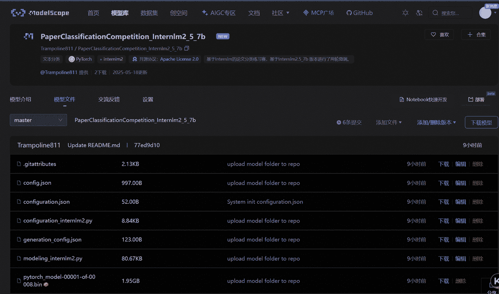

## 6.3 填链接提交模型

记住你的**“****M**ode**lscope账号名称/模型库名称“，如“Shan****gh**ai_A**I_Lab**oratory/internlm3-8b-instruct”，然后填写信息提交单等待成绩榜单更新吧！！！如果完成了测评，会在成绩榜单最下面的提交记录中，查找自己的uid进行查询。

**【补充】**

笔者11:30填完表单，午饭回来后14:00左右看到了成绩，以上时间仅供参考。快在群里用”你怎么知道我超了基线亿点点！“来分享你完成打榜的喜悦吧！（bushi

**信息****提交单**：https://aicarrier.feishu.cn/share/base/form/shrcn0JkjbZKMeMPw04uHCWc5Pg

**成绩****榜****单****（动态更新中）****：**

<https://aicarrier.feishu.cn/share/base/dashboard/shrcnqpXY6Uy9FodNF3It75GSNe?ccm_open=iframe&iframeFrom=docx>

各个模型的**基线成绩**如下图，看看你的分数如何吧！！

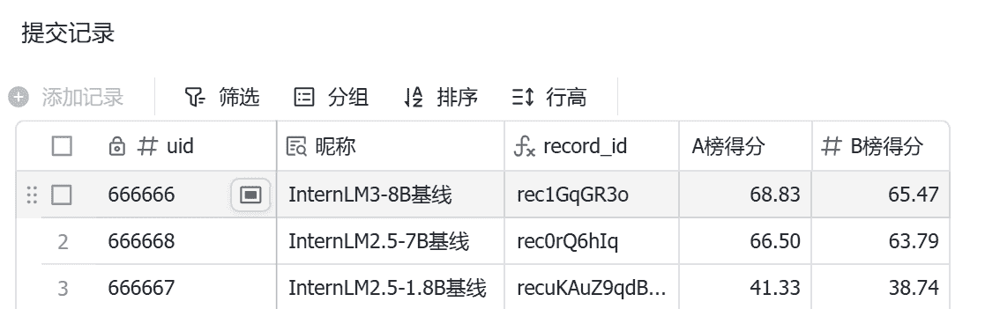

# 刷榜

还等什么， 快来刷榜吧！！！挑战米神！

如何更高效的拿分呢？

1.  从数据入手

1.  从算法入手

1.  从参数入手

从算法入手 比如很火的GRPO 很酷是吧，但貌似有些难度。

从数据入手 比如加大训练数据，有些累。

从参数入手 这个ez哈哈

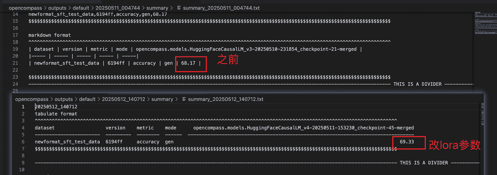

提交

```
swift export \
    --model /root/paper/config/swift_output/InternLM3-8B-Lora-SFT/v4-20250511-153230/checkpoint-45-merged \
    --push_to_hub true \
    --hub_model_id &#x27;zhangfc12345678/camp5-2&#x27; \
    --hub_token &#x27;03xx&#x27; \
    --use_hf false
```

重新提交表单发现 work了， 都超基线了！

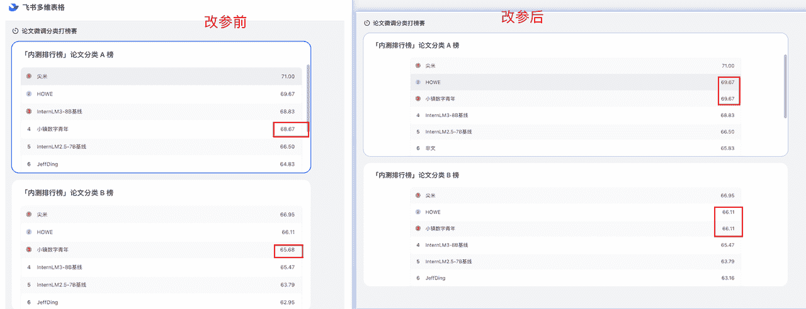

本文参考：

[L2G1-InternVL3部署微调实践](https://aicarrier.feishu.cn/wiki/CPCnwzp1qi2bBWka9TWcLjqSnad)

[InternLM论文分类微调实践（swift 版）](https://vwpecqie443.feishu.cn/wiki/AdRfwyZfWiJPJJkwnhucGavSnBe)

之前的 conda 管理(过于冗余已更新)：

```
conda create -n xtuner_513 python=3.10 -y
conda activate xtuner_513
pip install torch==2.4.0+cu121 torchvision torchaudio --extra-index-url https://download.pytorch.org/whl/cu121
pip install xtuner timm flash_attn datasets==2.21.0 deepspeed==0.16.1
conda install mpi4py -y
```

```
conda create -n xtuner_513 python=3.10 -y
conda activate xtuner_513
pip install torch==2.4.0+cu121 torchvision torchaudio --extra-index-url https://download.pytorch.org/whl/cu121
pip install xtuner timm flash_attn datasets==2.21.0 deepspeed==0.16.1
conda install mpi4py -y
#为了兼容模型，降级transformers版本
pip uninstall transformers -y
pip install transformers==4.48.0 --no-cache-dir -i https://pypi.tuna.tsinghua.edu.cn/simple

```