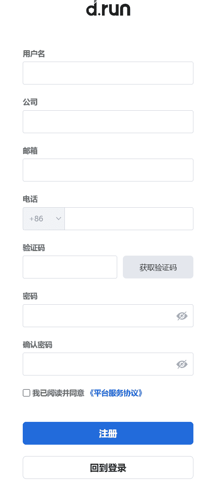
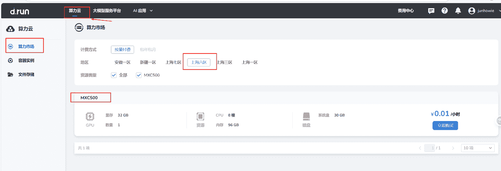
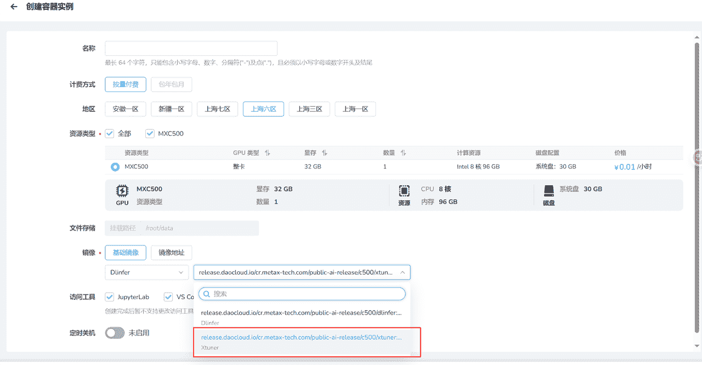
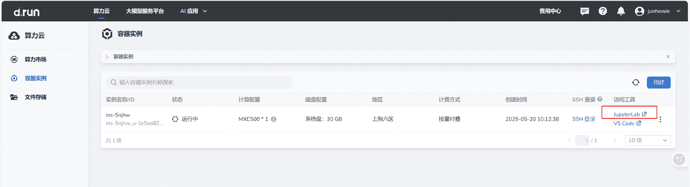
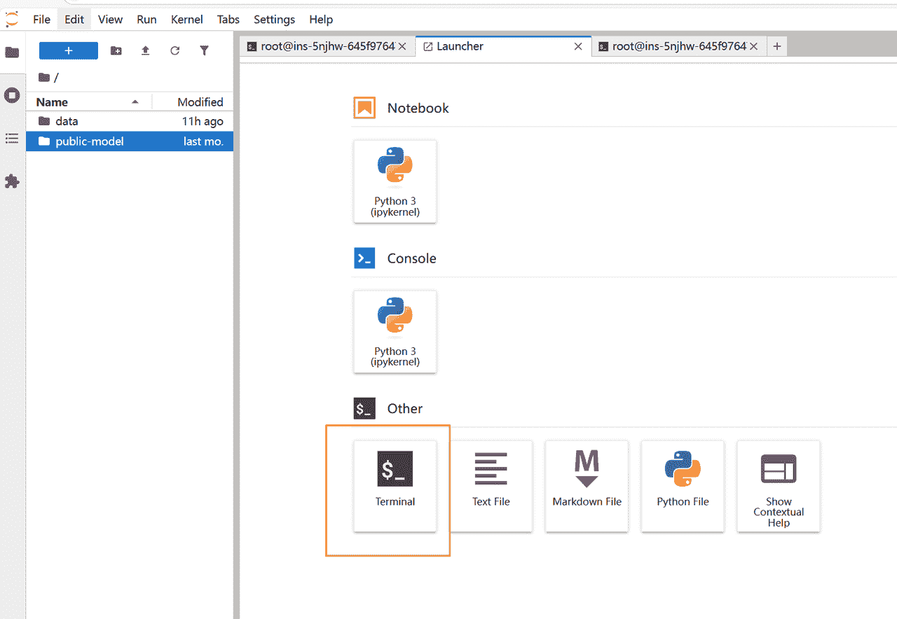
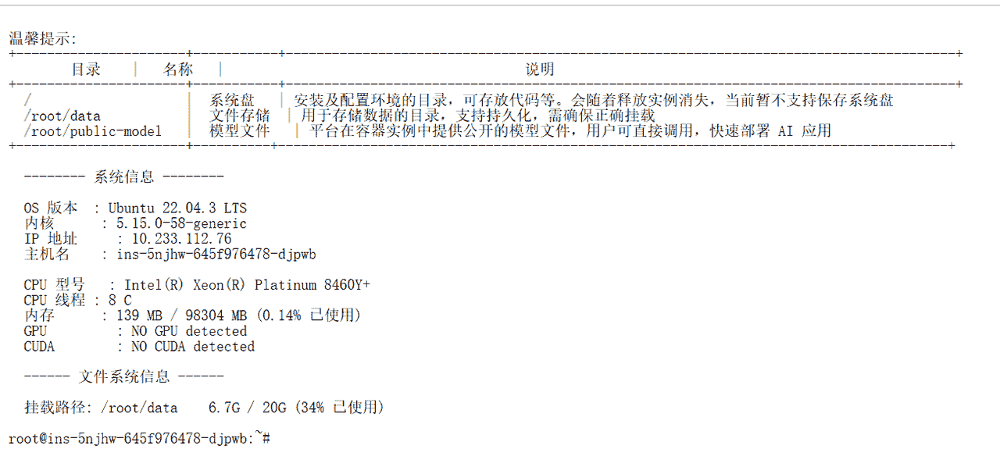

# L1G4-InternLM 论文分类实践（沐曦版）

> 来源：[https://aicarrier.feishu.cn/docx/U6hQdRKxoo4lNkx3DYWcqXNNnTd](https://aicarrier.feishu.cn/docx/U6hQdRKxoo4lNkx3DYWcqXNNnTd)


# 环境介绍

GPU：沐曦MXC500（32G）

CPU：8核心

内存：96G

# DaoCloud平台操作

DaoCloud官网地址：https://d.run/zh/

## DaoCloud注册

第一步：【注册】



第二步：登录


## 创建沐曦MXC500实例

### 1.选择算力云->算力市场->上海六区（如下图选择MXC500）立即购买



### **2.选择镜像 **

下拉框1 :基础镜像->Dlinfer

下拉框2：选择带有Xtuner的镜像版本（如下图）



### 3.初始化存储

操作步骤：文件存储—>选择《上海六区》->初始化文件存储

说明：文件存储将会挂载在/root/data 目录下 ，免费容量为20G

特别注意：初始化完成后，请在web页面上传一个空文件,否则无法挂载成功

### 4.创建并启动容器实例

1.选择JuypterLab 进入开发机



# 3.开发机介绍

## 1. 文件夹介绍

默认进入/root 目录下

data文件夹为初始化挂载文件夹（读写）

Public-model 为平台共享模型仓库



## 2.终端介绍



## 3.环境检查

镜像中已经内置Xtuner

```

pip show xtuner

#可以看到环境中已经有了xtuner
#Name: xtuner
#Version: 0.1.23
#Summary: An efficient, flexible and full-featured toolkit for fine-tuning large models
#Home-page: https://github.com/InternLM/xtuner
#Author: XTuner Contributors
#Author-email: openmmlab@gmail.com
#License: Apache License 2.0
#Location: /workspace/xtuner
#Editable project location: /workspace/xtuner
#Requires: bitsandbytes, datasets, einops, lagent, mmengine, openpyxl, peft, scikit-image, scipy, SentencePiece, tiktoken, torch, torchvision, transformers, transformers_stream_generator
#Required-by: 

```

## 4.GPU信息监控

mx-smi 与nvidia-smi的功能一致

```
root@ins-5njhw-645f976478-djpwb:~# mx-smi
mx-smi  version: 2.1.9

=================== MetaX System Management Interface Log ===================
Timestamp                                         : Tue May 20 10:48:51 2025

Attached GPUs                                     : 1
+---------------------------------------------------------------------------------+
| MX-SMI 2.1.9                        Kernel Mode Driver Version: 2.9.8           |
| MACA Version: 2.31.0.6              BIOS Version: 1.20.3.0                      |
|------------------------------------+---------------------+----------------------+
| GPU         NAME                   | Bus-id              | GPU-Util             |
| Temp        Power                  | Memory-Usage        |                      |
|====================================+=====================+======================|
| 0           MXC500 VF              | 0000:3b:00.2        | 0%                   |
| N/A         N/A                    | 618/32768 MiB       |                      |
+------------------------------------+---------------------+----------------------+

+---------------------------------------------------------------------------------+
| Process:                                                                        |
|  GPU                    PID         Process Name                 GPU Memory     |
|                                                                  Usage(MiB)     |
|=================================================================================|
|  no process found                                                               |
+---------------------------------------------------------------------------------+

End of Log
root@ins-5njhw-645f976478-djpwb:~# 
```

# 4.补充安装包

## 1.安装mpi4py

```
pip install mpi4py

pip install transformers==4.48.0
```

建议安装 ，否则报错

## 2.链接模型位置

```
ln -s /root/public-model/models/Shanghai_AI_Laboratory/internlm2_5-1_8b-chat ./
```

## 数据集（已经处理好）


[sftdata.jsonl](https://internal-api-drive-stream.feishu.cn/space/api/box/stream/download/all/XKt8bqDQ6odHHWxhJY1c52Zhn3c)


[pretrain.jsonl](https://internal-api-drive-stream.feishu.cn/space/api/box/stream/download/all/ZOGGbvjjMoPHlqxMytKcsjegnCC)

# 5.开启训练

## 1.预训练

```
xtuner train pretrain.py --deepspeed deepspeed_zero1
```

注意替换模型和数据集的位置分别位于23行27行

```
pretrained_model_name_or_path = &#x27;./internlm2_5-1_8b-chat&#x27;

data_files = [&#x27;./datasets/pretrain.jsonl&#x27;]
```

```
import torch
from datasets import load_dataset
from mmengine.dataset import DefaultSampler
from mmengine.hooks import (CheckpointHook, DistSamplerSeedHook, IterTimerHook,
                            LoggerHook, ParamSchedulerHook)
from mmengine.optim import AmpOptimWrapper, CosineAnnealingLR, LinearLR
from peft import LoraConfig
from torch.optim import AdamW
from transformers import AutoModelForCausalLM, AutoTokenizer,BitsAndBytesConfig

from xtuner.dataset import process_hf_dataset
from xtuner.dataset.collate_fns import default_collate_fn
from xtuner.dataset.map_fns import pretrain_map_fn
from xtuner.engine.hooks import (DatasetInfoHook, EvaluateChatHook,
                                 VarlenAttnArgsToMessageHubHook)
from xtuner.engine.runner import TrainLoop
from xtuner.model import SupervisedFinetune

#######################################################################
#                          PART 1  Settings                           #
#######################################################################
# Model
pretrained_model_name_or_path = &#x27;./internlm2_5-1_8b-chat&#x27;
use_varlen_attn = False

# Data
data_files = [&#x27;./datasets/pretrain.jsonl&#x27;]
max_length = 2048
pack_to_max_length = False

# Scheduler &amp; Optimizer
batch_size = 2  # per_device
accumulative_counts = 32  # bs = 1 GPU * 1 batch_size_per_device * 16 acc
dataloader_num_workers = 0
max_epochs = 1
optim_type = AdamW
lr = 2e-5
betas = (0.9, 0.999)
weight_decay = 0
max_norm = 1  # grad clip
warmup_ratio = 0.03

# Save
save_steps = 500
save_total_limit = 2  # Maximum checkpoints to keep (-1 means unlimited)

# Evaluate the generation performance during the training
evaluation_freq = 500
SYSTEM = &#x27;&#x27;
evaluation_inputs = [&#x27;上海是&#x27;, &#x27;Shanghai is&#x27;]

#######################################################################
#                      PART 2  Model &amp; Tokenizer                      #
#######################################################################
tokenizer = dict(
    type=AutoTokenizer.from_pretrained,
    pretrained_model_name_or_path=pretrained_model_name_or_path,
    trust_remote_code=True,
    padding_side=&#x27;right&#x27;)

model = dict(
    type=SupervisedFinetune,
    use_varlen_attn=use_varlen_attn,
    llm=dict(
        type=AutoModelForCausalLM.from_pretrained,
        pretrained_model_name_or_path=pretrained_model_name_or_path,
        trust_remote_code=True,
        quantization_config=dict(
            type=BitsAndBytesConfig,
            load_in_4bit=True,
            load_in_8bit=False,
            llm_int8_threshold=6.0,
            llm_int8_has_fp16_weight=False,
            bnb_4bit_compute_dtype=torch.float16,
            bnb_4bit_use_double_quant=True,
            bnb_4bit_quant_type=&#x27;nf4&#x27;)
    ),
    lora=dict(
        type=LoraConfig,
        r=64,
        lora_alpha=16,
        lora_dropout=0.1,
        bias=&#x27;none&#x27;,
        task_type=&#x27;CAUSAL_LM&#x27;)
)


#######################################################################
#                      PART 3  Dataset &amp; Dataloader                   #
#######################################################################
train_dataset = dict(
    type=process_hf_dataset,
    dataset=dict(type=load_dataset, path=&#x27;json&#x27;, data_files=data_files),
    tokenizer=tokenizer,
    max_length=max_length,
    dataset_map_fn=pretrain_map_fn,
    template_map_fn=None,
    remove_unused_columns=True,
    shuffle_before_pack=False,
    pack_to_max_length=pack_to_max_length,
    use_varlen_attn=use_varlen_attn)

train_dataloader = dict(
    batch_size=batch_size,
    num_workers=dataloader_num_workers,
    dataset=train_dataset,
    sampler=dict(type=DefaultSampler, shuffle=True),
    collate_fn=dict(type=default_collate_fn, use_varlen_attn=use_varlen_attn))

#######################################################################
#                    PART 4  Scheduler &amp; Optimizer                    #
#######################################################################
# optimizer
optim_wrapper = dict(
    type=AmpOptimWrapper,
    optimizer=dict(
        type=optim_type, lr=lr, betas=betas, weight_decay=weight_decay),
    clip_grad=dict(max_norm=max_norm, error_if_nonfinite=False),
    accumulative_counts=accumulative_counts,
    loss_scale=&#x27;dynamic&#x27;,
    dtype=&#x27;float16&#x27;)

# learning policy
# More information: https://github.com/open-mmlab/mmengine/blob/main/docs/en/tutorials/param_scheduler.md  # noqa: E501
param_scheduler = [
    dict(
        type=LinearLR,
        start_factor=1e-5,
        by_epoch=True,
        begin=0,
        end=warmup_ratio * max_epochs,
        convert_to_iter_based=True),
    dict(
        type=CosineAnnealingLR,
        eta_min=0.0,
        by_epoch=True,
        begin=warmup_ratio * max_epochs,
        end=max_epochs,
        convert_to_iter_based=True)
]

# train, val, test setting
train_cfg = dict(type=TrainLoop, max_epochs=max_epochs)

#######################################################################
#                           PART 5  Runtime                           #
#######################################################################
# Log the dialogue periodically during the training process, optional
custom_hooks = [
    dict(type=DatasetInfoHook, tokenizer=tokenizer),
    dict(
        type=EvaluateChatHook,
        tokenizer=tokenizer,
        every_n_iters=evaluation_freq,
        evaluation_inputs=evaluation_inputs,
        system=SYSTEM)
]

if use_varlen_attn:
    custom_hooks += [dict(type=VarlenAttnArgsToMessageHubHook)]

# configure default hooks
default_hooks = dict(
    # record the time of every iteration.
    timer=dict(type=IterTimerHook),
    # print log every 10 iterations.
    logger=dict(type=LoggerHook, log_metric_by_epoch=False, interval=10),
    # enable the parameter scheduler.
    param_scheduler=dict(type=ParamSchedulerHook),
    # save checkpoint per `save_steps`.
    checkpoint=dict(
        type=CheckpointHook,
        by_epoch=False,
        interval=save_steps,
        max_keep_ckpts=save_total_limit),
    # set sampler seed in distributed evrionment.
    sampler_seed=dict(type=DistSamplerSeedHook),
)

# configure environment
env_cfg = dict(
    # whether to enable cudnn benchmark
    cudnn_benchmark=False,
    # set multi process parameters
    mp_cfg=dict(mp_start_method=&#x27;fork&#x27;, opencv_num_threads=0),
    # set distributed parameters
    dist_cfg=dict(backend=&#x27;nccl&#x27;),
)

# set visualizer
visualizer = None

# set log level
log_level = &#x27;INFO&#x27;

# load from which checkpoint
load_from = None

# whether to resume training from the loaded checkpoint
resume = False

# Defaults to use random seed and disable `deterministic`
randomness = dict(seed=None, deterministic=False)

# set log processor
log_processor = dict(by_epoch=False)

```

## 2.模型转换pth_to_hf

```
#转换HF脚本
xtuner convert pth_to_hf pretrain.py \
                         ./work_dirs/pretrain/iter_288.pth \
                         ./work_dirs/pretrain/hf

```

## 3.模型合并merge

```
xtuner convert merge ./internlm2_5-1_8b-chat \
                     ./work_dirs/pretrain/hf \
                     ./work_dirs/pretrain/merged \
                     --max-shard-size 2GB

```

## 4.SFT训练

```
xtuner train sft.py --deepspeed deepspeed_zero1
```

注意替换模型和数据集的位置分别位于34行38行

```
pretrained_model_name_or_path = &quot;./work_dirs/pretrain/merged&quot;

alpaca_en_path = &quot;./datasets/sftdata.jsonl&quot;#换成自己的数据路径
```

```
# Copyright (c) OpenMMLab. All rights reserved.
import torch
from datasets import load_dataset
from mmengine.dataset import DefaultSampler
from mmengine.hooks import (
    CheckpointHook,
    DistSamplerSeedHook,
    IterTimerHook,
    LoggerHook,
    ParamSchedulerHook,
)
from mmengine.optim import AmpOptimWrapper, CosineAnnealingLR, LinearLR
from peft import LoraConfig
from torch.optim import AdamW
from transformers import AutoModelForCausalLM, AutoTokenizer, BitsAndBytesConfig

from xtuner.dataset import process_hf_dataset
from xtuner.dataset.collate_fns import default_collate_fn
from xtuner.dataset.map_fns import alpaca_map_fn, template_map_fn_factory
from xtuner.engine.hooks import (
    DatasetInfoHook,
    EvaluateChatHook,
    VarlenAttnArgsToMessageHubHook,
)
from xtuner.engine.runner import TrainLoop
from xtuner.model import SupervisedFinetune
from xtuner.parallel.sequence import SequenceParallelSampler
from xtuner.utils import PROMPT_TEMPLATE, SYSTEM_TEMPLATE

#######################################################################
#                          PART 1  Settings                           #
#######################################################################
# Model
pretrained_model_name_or_path = &quot;./work_dirs/pretrain/merged&quot;
use_varlen_attn = False

# Data
alpaca_en_path = &quot;./datasets/sftdata.jsonl&quot;#换成自己的数据路径
prompt_template = PROMPT_TEMPLATE.internlm2_chat
max_length = 2048
pack_to_max_length = False

# parallel
sequence_parallel_size = 1

# Scheduler &amp; Optimizer
batch_size = 1  # per_device
accumulative_counts = 1
accumulative_counts *= sequence_parallel_size
dataloader_num_workers = 0
max_epochs = 3
optim_type = AdamW
lr = 2e-4
betas = (0.9, 0.999)
weight_decay = 0
max_norm = 1  # grad clip
warmup_ratio = 0.03

# Save
save_steps = 500
save_total_limit = 2  # Maximum checkpoints to keep (-1 means unlimited)

# Evaluate the generation performance during the training
evaluation_freq = 500
SYSTEM = SYSTEM_TEMPLATE.alpaca
evaluation_inputs = [&quot;请给我介绍五个上海的景点&quot;, &quot;Please tell me five scenic spots in Shanghai&quot;]

#######################################################################
#                      PART 2  Model &amp; Tokenizer                      #
#######################################################################
tokenizer = dict(
    type=AutoTokenizer.from_pretrained,
    pretrained_model_name_or_path=pretrained_model_name_or_path,
    trust_remote_code=True,
    padding_side=&quot;right&quot;,
)

model = dict(
    type=SupervisedFinetune,
    use_varlen_attn=use_varlen_attn,
    llm=dict(
        type=AutoModelForCausalLM.from_pretrained,
        pretrained_model_name_or_path=pretrained_model_name_or_path,
        trust_remote_code=True,
        torch_dtype=torch.float16,
        quantization_config=dict(
            type=BitsAndBytesConfig,
            load_in_4bit=True,
            load_in_8bit=False,
            llm_int8_threshold=6.0,
            llm_int8_has_fp16_weight=False,
            bnb_4bit_compute_dtype=torch.float16,
            bnb_4bit_use_double_quant=True,
            bnb_4bit_quant_type=&quot;nf4&quot;,
        ),
    ),
    lora=dict(
        type=LoraConfig,
        r=64,
        lora_alpha=16,
        lora_dropout=0.1,
        bias=&quot;none&quot;,
        task_type=&quot;CAUSAL_LM&quot;,
    ),
)

#######################################################################
#                      PART 3  Dataset &amp; Dataloader                   #
#######################################################################
alpaca_en = dict(
    type=process_hf_dataset,
    dataset=dict(type=load_dataset, path=&#x27;json&#x27;, data_files=alpaca_en_path),
    tokenizer=tokenizer,
    max_length=max_length,
    dataset_map_fn=alpaca_map_fn,
    template_map_fn=dict(type=template_map_fn_factory, template=prompt_template),
    remove_unused_columns=True,
    shuffle_before_pack=True,
    pack_to_max_length=pack_to_max_length,
    use_varlen_attn=use_varlen_attn,
)

sampler = SequenceParallelSampler if sequence_parallel_size &gt; 1 else DefaultSampler
train_dataloader = dict(
    batch_size=batch_size,
    num_workers=dataloader_num_workers,
    dataset=alpaca_en,
    sampler=dict(type=sampler, shuffle=True),
    collate_fn=dict(type=default_collate_fn, use_varlen_attn=use_varlen_attn),
)

#######################################################################
#                    PART 4  Scheduler &amp; Optimizer                    #
#######################################################################
# optimizer
optim_wrapper = dict(
    type=AmpOptimWrapper,
    optimizer=dict(type=optim_type, lr=lr, betas=betas, weight_decay=weight_decay),
    clip_grad=dict(max_norm=max_norm, error_if_nonfinite=False),
    accumulative_counts=accumulative_counts,
    loss_scale=&quot;dynamic&quot;,
    dtype=&quot;float16&quot;,
)

# learning policy
# More information: https://github.com/open-mmlab/mmengine/blob/main/docs/en/tutorials/param_scheduler.md  # noqa: E501
param_scheduler = [
    dict(
        type=LinearLR,
        start_factor=1e-5,
        by_epoch=True,
        begin=0,
        end=warmup_ratio * max_epochs,
        convert_to_iter_based=True,
    ),
    dict(
        type=CosineAnnealingLR,
        eta_min=0.0,
        by_epoch=True,
        begin=warmup_ratio * max_epochs,
        end=max_epochs,
        convert_to_iter_based=True,
    ),
]

# train, val, test setting
train_cfg = dict(type=TrainLoop, max_epochs=max_epochs)

#######################################################################
#                           PART 5  Runtime                           #
#######################################################################
# Log the dialogue periodically during the training process, optional
custom_hooks = [
    dict(type=DatasetInfoHook, tokenizer=tokenizer),
    dict(
        type=EvaluateChatHook,
        tokenizer=tokenizer,
        every_n_iters=evaluation_freq,
        evaluation_inputs=evaluation_inputs,
        system=SYSTEM,
        prompt_template=prompt_template,
    ),
]

if use_varlen_attn:
    custom_hooks += [dict(type=VarlenAttnArgsToMessageHubHook)]

# configure default hooks
default_hooks = dict(
    # record the time of every iteration.
    timer=dict(type=IterTimerHook),
    # print log every 10 iterations.
    logger=dict(type=LoggerHook, log_metric_by_epoch=False, interval=10),
    # enable the parameter scheduler.
    param_scheduler=dict(type=ParamSchedulerHook),
    # save checkpoint per `save_steps`.
    checkpoint=dict(
        type=CheckpointHook,
        by_epoch=False,
        interval=save_steps,
        max_keep_ckpts=save_total_limit,
    ),
    # set sampler seed in distributed evrionment.
    sampler_seed=dict(type=DistSamplerSeedHook),
)

# configure environment
env_cfg = dict(
    # whether to enable cudnn benchmark
    cudnn_benchmark=False,
    # set multi process parameters
    mp_cfg=dict(mp_start_method=&quot;fork&quot;, opencv_num_threads=0),
    # set distributed parameters
    dist_cfg=dict(backend=&quot;nccl&quot;),
)

# set visualizer
visualizer = None

# set log level
log_level = &quot;INFO&quot;

# load from which checkpoint
load_from = None

# whether to resume training from the loaded checkpoint
resume = False

# Defaults to use random seed and disable `deterministic`
randomness = dict(seed=None, deterministic=False)

# set log processor
log_processor = dict(by_epoch=False)

```

## 5.模型转换pth_to_hf

```
#转换HF脚本
xtuner convert pth_to_hf sft.py \
                         ./work_dirs/sft/iter_195.pth \
                         ./work_dirs/sft/hf
```

## 6.模型合并

```
#与原始模型合并
xtuner convert merge ./internlm2_5-1_8b-chat \
                     ./work_dirs/sft/hf \
                     ./work_dirs/sft/merged \
                     --max-shard-size 2GB
```

# 6.上传到modelscope

```
from modelscope.hub.api import HubApi
YOUR_ACCESS_TOKEN = &#x27;xxx-xxx-xxx-xxx-xxx&#x27;
api = HubApi()
api.login(YOUR_ACCESS_TOKEN)


from modelscope.hub.constants import Licenses, ModelVisibility
owner_name = &#x27;Harvey&#x27;#你的用户名
model_name = &#x27;internlm2_5-1_8b-chat-xtuner-sft-mx&#x27;#模型的英文名字
model_id = f&quot;{owner_name}/{model_name}&quot;

#创建模型卡
api.create_model(
    model_id,
    visibility=ModelVisibility.PUBLIC,
    license=Licenses.APACHE_V2,
    chinese_name=&quot;internlm2_5-1_8b-chat-xtuner-sft-沐曦&quot;
)

#上传模型
api.upload_folder(
    repo_id=f&quot;{owner_name}/{model_name}&quot;,
    folder_path=&#x27;/root/data/work_dirs/sft/merged&#x27;,#sft之后与原模型合并的路径
    commit_message=&#x27;fast commit&#x27;,
)
```

# 7.评测

参考 [L1G4- InternLM 论文分类微调实践（Swift 版）](https://aicarrier.feishu.cn/wiki/HfQuwYa4Xi4WJVkuNF3cygqnnch)