# L2G3_1 LMDeploy 进阶文档

> 来源：[https://aicarrier.feishu.cn/docx/QyeDd37yxoJnIjxeQuSccxrdnrc](https://aicarrier.feishu.cn/docx/QyeDd37yxoJnIjxeQuSccxrdnrc)

> 文档尚处于草稿阶段，完善中

LMDeploy 是一个高效且友好的 LLMs 模型部署工具箱，功能涵盖了量化、推理和服务

## 安装

### `NPROC_PER_NODE`

#### `pip` 安装

`conda` 简单使用

```bash
conda create -n lmdeploy python=3.10
conda activate lmdeploy
pip install lmdeploy
```

## 快速上手

### 本地推理

```python
import lmdeploy
from lmdeploy import GenerationConfig

pipe = lmdeploy.pipeline("/root/share/new_models/InternVL3/InternVL3-1B")
response = pipe(prompts=["Hi, pls intro yourself", "Shanghai is"],
                gen_config=GenerationConfig(max_new_tokens=1024,
                                            top_p=0.8,
                                            top_k=40,
                                            temperature=0.6))
print(response)
```

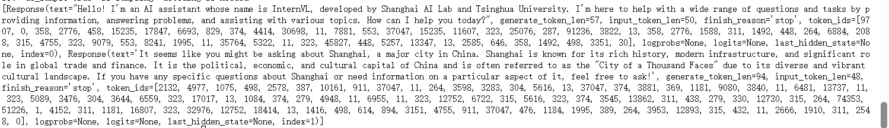

### 指定推理引擎

> 在构造 `pipeline` 时，如果没有指定使用 `TurbomindEngineConfig` 引擎或 `PytorchEngineConfig` 引擎进行推理，默认优先使用 `TurbomindEngineConfig` 引擎，实际上，LMDeploy 将根据提供的检查点自动确定使用那种引擎。

#### `TurbomindEngineConfig` 推理引擎

```python
from lmdeploy import pipeline, TurbomindEngineConfig
from lmdeploy import GenerationConfig

pipe = pipeline("/root/share/new_models/InternVL3/InternVL3-1B",
                backend_config=TurbomindEngineConfig(
                    max_batch_size=32,
                    enable_prefix_caching=True,
                    cache_max_entry_count=0.8,
                    session_len=8192,
                ))
response = pipe(prompts=["Hi, pls intro yourself", "Shanghai is"],
                gen_config=GenerationConfig(max_new_tokens=1024,
                                            top_p=0.8,
                                            top_k=40,
                                            temperature=0.6))
print(response)
```

#### `PytorchEngineConfig` 推理引擎

```python
from lmdeploy import pipeline, PytorchEngineConfig
from lmdeploy import GenerationConfig

pipe = pipeline("/root/share/new_models/InternVL3/InternVL3-1B",
                backend_config=PytorchEngineConfig(
                    max_batch_size=32,
                    enable_prefix_caching=True,
                    cache_max_entry_count=0.8,
                    session_len=8192,
                ))

response = pipe(prompts=["Hi, pls intro yourself", "Shanghai is"],
                gen_config=GenerationConfig(max_new_tokens=1024,
                                            top_p=0.8,
                                            top_k=40,
                                            temperature=0.6))
print(response)
```

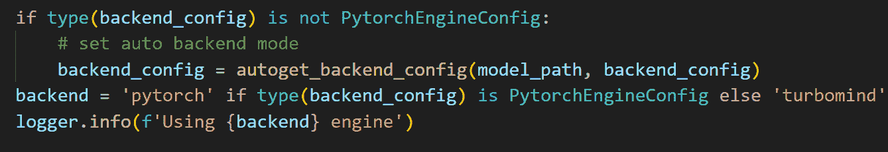

### VLM 推理 (Visual Language Models)

`image = load_image('https://raw.githubusercontent.com/open-mmlab/mmdeploy/main/tests/data/tiger.jpeg')`

```python
from lmdeploy import pipeline, VisionConfig
from lmdeploy.vl import load_image

pipe = pipeline("/root/share/new_models/InternVL3/InternVL3-1B",
                vision_config=VisionConfig(
                    max_batch_size=8
                ))
response = pipe(('describe this image', image))
print(response)
```

## 大语言模型(LLMs) 部署

### 离线部署

```python
import lmdeploy
from lmdeploy import GenerationConfig
pipe = lmdeploy.pipeline("/root/share/new_models/internlm3/internlm3-8b-instruct")
response = pipe(prompts=["Hi, pls intro yourself", "Shanghai is"],
                gen_config=GenerationConfig(max_new_tokens=1024,
                                            top_p=0.8,
                                            top_k=40,
                                            temperature=0.6))
print(response)
```

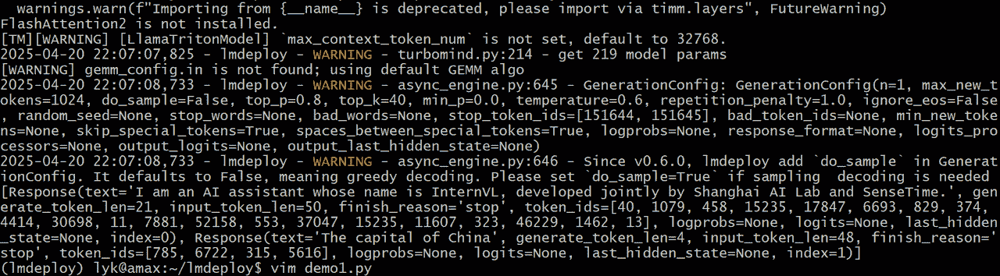

> 注意：

+ `LMDeploy` 的 `KV cache` 策略对显存提出了较高的要求；`LMDeploy` 在服务启动时就会预先一次性分配 `KV cache` 空间，如果加载模型出现 `OOM`，可能需要考虑降低 `cache_max_entry_count` 的值，表示加载模型权重后 `K/V` 缓存占用的空闲 GPU 内存的比例。

+ `v0.2.0 <= lmdeploy <= v0.2.1`，默认比例为 `0.5`，表示 `GPU` 总显存的 `50%` 被分配给 `k/v cache`。`lmdeploy > v0.2.1`，分配策略改为从空闲显存中按比例为 `k/v cache` 开辟空间。默认比例值调整为 `0.8`。

### 设置多卡并行

> `TurbomindEngineConfig` 和 `PytorchEngineConfig` 的参数 `tp` 是设置 GPU 并行的，解释如下：

> `tp` (int): the number of GPU cards used in tensor parallelism, default to 1

```python
from lmdeploy import pipeline, TurbomindEngineConfig
from lmdeploy import pipeline, PytorchEngineConfig

### TurbomindEngineConfig 推理引擎
pipe = pipeline("/root/share/new_models/internlm3/internlm3-8b-instruct",
                backend_config=TurbomindEngineConfig(
                    tp=2,
                    max_batch_size=32,
                    enable_prefix_caching=True,
                    cache_max_entry_count=0.8,
                    session_len=8192,
                ))
### PytorchEngineConfig 推理引擎

pipe = pipeline("/root/share/new_models/internlm3/internlm3-8b-instruct",
                backend_config=PytorchEngineConfig(
                    tp=2,
                    max_batch_size=32,
                    enable_prefix_caching=True,
                    cache_max_entry_count=0.8,
                    session_len=8192,
                ))
```

### 生成核心参数介绍

> 常见解码策略：

+ 贪心解码（Greedy Decoding）：直接选择概率最高的单词。这种方法简单高效，但是可能会导致生成的文本过于单调和重复。

+ 随机采样（Random Sampling）：按照概率分布随机选择一个单词。这种方法可以增加生成的多样性，但是可能会导致生成的文本不连贯和无意义。

+ 集束搜索（Beam Search）：维护一个大小为 `k` 的候选序列集合，每一步从每个候选序列的概率分布中选择概率最高的 `k` 个单词，然后保留总概率最高的 `k` 个候选序列。这种方法可以平衡生成的质量和多样性，但是可能会导致生成的文本过于保守和不自然；由于需要维护 `k` 个序列，开销比较大。

>

> 以上方法都有各自的问题，而 `top-k` 采样和 `top-p` 采样是介于贪心解码和随机采样之间的方法，也是目前大模型解码策略中常用的方法。

> `Top-k`: 在每一步，只从概率最高的 `k` 个单词中进行随机采样，而不考虑其他低概率的单词。

>

> 缺点：

1. 结果对 `K` 参数比较敏感，生成的结果更关注高频词，多样性丢失，可能会导致生成的回复过于简单，趋同性高；

1. 回复可能缺乏个性，更偏向“安全”回复

1. 每一步只关注当前概率高的词，可能会导致生成的文本不符合常识或逻辑；

```python
import torch
from labml_nn.sampling import Sampler

# Top-k Sampler
class TopKSampler(Sampler):
    # k is the number of tokens to pick
    # sampler is the sampler to use for the top-k tokens
    # sampler can be any sampler that takes a logits tensor as input and returns a token tensor; e.g. `TemperatureSampler`.
    def __init__(self, k: int, sampler: Sampler):
        self.k = k
        self.sampler = sampler

    # Sample from logits
    def __call__(self, logits: torch.Tensor):
        # New logits filled with −∞; i.e. zero probability
        zeros = logits.new_ones(logits.shape) * float('-inf')
        # Pick the largest k logits and their indices
        values, indices = torch.topk(logits, self.k, dim=-1)
        # Set the values of the top-k selected indices to actual logits.
        # Logits of other tokens remain −∞
        zeros.scatter_(-1, indices, values)
        # Sample from the top-k logits with the specified sampler.
        return self.sampler(zeros)
```

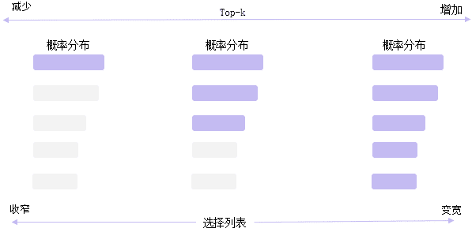

> `Top-p`: 在每一步，只从累积概率超过某个阈值 `p` 的最小单词集合中进行随机采样，而不考虑其它低概率的单词。这种方法也被称为核采样（nucleus sampling），因为它只关注概率分布的核心部分，而忽略了尾部部分。

>

> 缺点：

1. 参数敏感性，`p` 值调优比较难

1. `Top-p` 仅依赖概率分布筛选候选词，但缺乏对已生成内容的显式约束（如重复惩罚机制），可能导致重复片段，倾向于重复高频词

1. 生成结果偏向“安全”选项，牺牲个性。

>

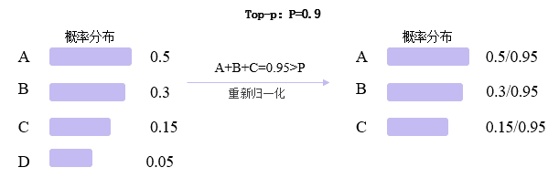


```python
import torch
from torch import nn

from labml_nn.sampling import Sampler


class NucleusSampler(Sampler):
    """
    ## Nucleus Sampler
    """
    def __init__(self, p: float, sampler: Sampler):
        """
        :param p: is the sum of probabilities of tokens to pick $p$
        :param sampler: is the sampler to use for the selected tokens
        """
        self.p = p
        self.sampler = sampler
        # Softmax to compute $P(x_i | x_{1:i-1})$ from the logits
        self.softmax = nn.Softmax(dim=-1)

    def __call__(self, logits: torch.Tensor):
        """
        Sample from logits with Nucleus Sampling
        """

        # Get probabilities $P(x_i | x_{1:i-1})$
        probs = self.softmax(logits)

        # Sort probabilities in descending order
        sorted_probs, indices = torch.sort(probs, dim=-1, descending=True)

        # Get the cumulative sum of probabilities in the sorted order
        cum_sum_probs = torch.cumsum(sorted_probs, dim=-1)

        # Find the cumulative sums less than $p$.
        nucleus = cum_sum_probs < self.p

        # Prepend ones so that we add one token after the minimum number
        # of tokens with cumulative probability less that $p$.
        nucleus = torch.cat([nucleus.new_ones(nucleus.shape[:-1] + (1,)), nucleus[..., :-1]], dim=-1)

        # Get log probabilities and mask out the non-nucleus
        sorted_log_probs = torch.log(sorted_probs)
        sorted_log_probs[~nucleus] = float('-inf')

        # Sample from the sampler
        sampled_sorted_indexes = self.sampler(sorted_log_probs)

        # Get the actual indexes
        res = indices.gather(-1, sampled_sorted_indexes.unsqueeze(-1))

        #
        return res.squeeze(-1)
```

> 如果 `top-k` 和 `top-p` 同时启用，则 `top-p` 在 `top-k` 之后起作用。

> `Temperature` 采样：调节输出概率分布的参数

> 高 `temperature` 对差异进行平滑，低 `temperature` 对差异进行放大

设模型的原始输出 `logits`（未归一化的预测值）为  , 词汇表大小为   ，温度参数为

控制分布的尖锐程度，接近 0，概率分布趋向于贪婪选择（仅最高概率的 `token` 概率接近 1，其余接近 0）

趋近无穷大，概率分布趋向于均匀分布（所有 `token` 概率接近相等）

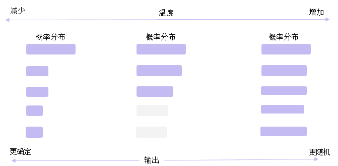

```python
import torch
from torch.distributions import Categorical

from labml_nn.sampling import Sampler


class TemperatureSampler(Sampler):
    """
    ## Sampler with Temperature
    """
    def __init__(self, temperature: float = 1.0):
        """
        :param temperature: is the temperature to sample with
        """
        self.temperature = temperature

    def __call__(self, logits: torch.Tensor):
        """
        Sample from logits
        """

        # Create a categorical distribution with temperature adjusted logits
        dist = Categorical(logits=logits / self.temperature)

        # Sample
        return dist.sample()
```

## 部署类OpenAI 服务

+ 使用 `lmdeploy` 命令行工具

```
lmdeploy serve api_server /root/share/new_models/InternVL3/InternVL3-1B --server-port 23333
```

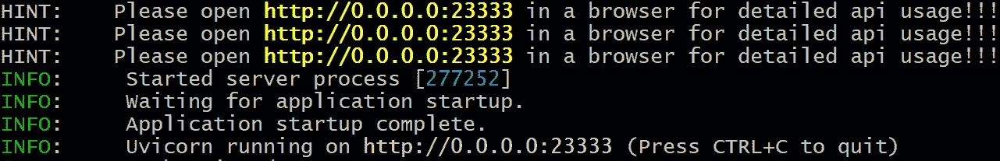

+ 使用类 `OpenAI` 方式

(i) 不启用权限鉴别（`api-key`）

```python
from openai import OpenAI
client = OpenAI(
    api_key='none',# 若未启用鉴权，可填任意值（如 "none"）
    base_url="http://0.0.0.0:23333/v1"
)
model_name = client.models.list().data[0].id
response = client.chat.completions.create(
  model=model_name,
  messages=[
    {"role": "system", "content": "You are a helpful assistant."},
    {"role": "user", "content": " provide three suggestions about time management"},
  ],
    temperature=0.8,
    top_p=0.8
)
print(response)
```

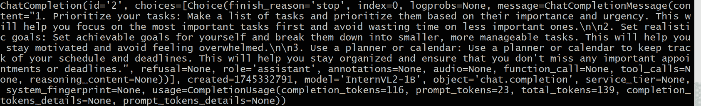

(ii) 启用权限鉴别（`api-key`）

```
1. 启动服务

lmdeploy serve api_server /root/share/new_models/internlm3/internlm3-8b-instruct --server-port 23333 --api-keys "token"

2. 授权访问

from openai import OpenAI
client = OpenAI(
    api_key='token',
    base_url="http://0.0.0.0:23333/v1"
)
model_name = client.models.list().data[0].id
response = client.chat.completions.create(
  model=model_name,
  messages=[
    {"role": "system", "content": "You are a helpful assistant."},
    {"role": "user", "content": " provide three suggestions about time management"},
  ],
    temperature=0.8,
    top_p=0.8
)
print(response)
```

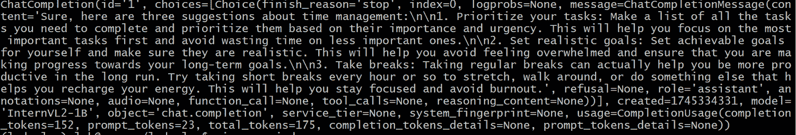

(iii) 异步访问（`api-key`）

```python
import asyncio
from openai import AsyncOpenAI

async def main():
    client = AsyncOpenAI(api_key='token',
                         base_url='http://0.0.0.0:23333/v1')
    model_cards = await client.models.list()._get_page()
    response = await client.chat.completions.create(
        model=model_cards.data[0].id,
        messages=[
            {
                'role': 'system',
                'content': 'You are a helpful assistant.'
            },
            {
                'role': 'user',
                'content': ' provide three suggestions about time management'
            },
        ],
        temperature=0.8,
        top_p=0.8)
    print(response)

asyncio.run(main())
```

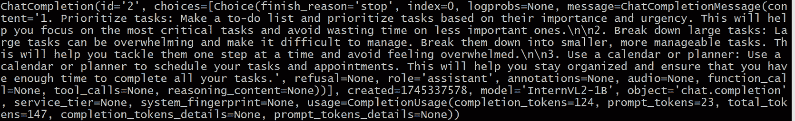

### `APIClient` 接口

```
1. 启动服务

lmdeploy serve api_server /root/share/new_models/internlm3/internlm3-8b-instruct --server-port 23333 --api-keys "token"

2. 使用APIClient进行推理

from lmdeploy.serve.openai.api_client import APIClient

client = APIClient(
    api_server_url="http://localhost:23333",
    api_key="token"
)
model_name = client.available_models[0]

messages = [{"role": "user", "content": "你好"}]
for item in client.chat_completions_v1(model=model_name, messages=messages):
    print(item)
```

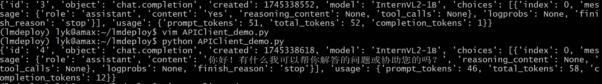

### `Requests` 调用

```
1. 启动服务

lmdeploy serve api_server /root/share/new_models/internlm3/internlm3-8b-instruct --server-port 23333 --api-keys "token"

2. request发InternVL2-1B送请求

import requests

url = "http://localhost:23333/v1/chat/completions"
headers = {
    "Authorization": "Bearer token",  # Bearer + Token
    "Content-Type": "application/json"
}
data = {
    "model": "InternVL2-1B",
    "messages": [{"role": "user", "content": "你好"}]
}

response = requests.post(url, headers=headers, json=data)
print(response.json()["choices"][0]["message"]["content"])
```

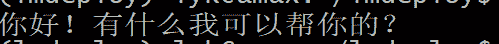

### 使用 `CURL` 命令

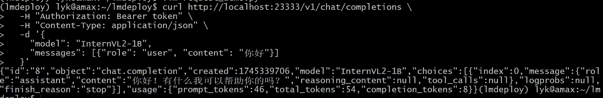

### 多机多卡部署（本节课不需要复现）

> 因为不需要子节点间的通信，所以并不需要用户指定 `torchrun` 的 `--nnodes` 等参数，只要能保证每个节点执行一次单节点的 `torchrun` 就行。

> 步骤：

> step1: 启动服务同时指定代理地址

> step2: 在所有的节点启动服务

> step3: 向代理服发送请求进行推理


## API Server 启动

```python
import os
import socket
from typing import List, Literal

import fire


def get_host_ip():
    try:
        s = socket.socket(socket.AF_INET, socket.SOCK_DGRAM)
        s.connect(('8.8.8.8', 80))
        ip = s.getsockname()[0]
    finally:
        s.close()
    return ip


def main(model_path: str,
         tp: int = 1,
         proxy_url: str = 'http://xxx.xxx.xxxx.xxx:8000',
         port: int = 23333,
         backend: Literal['turbomind', 'pytorch'] = 'pytorch'):
    local_rank = int(os.environ.get('LOCAL_RANK', -1))
    world_size = int(os.environ.get('WORLD_SIZE', -1))
    local_ip = get_host_ip()
    if isinstance(port, List):
        assert len(port) == world_size
        port = port[local_rank]
    else:
        port += local_rank * 10
    if (world_size - local_rank) % tp == 0:
        rank_list = ','.join([str(local_rank + i) for i in range(tp)])
        command = f'CUDA_VISIBLE_DEVICES={rank_list} lmdeploy serve api_server {model_path} ' \
                  f'--server-name {local_ip} --server-port {port} --tp {tp} ' \
                  f'--proxy-url {proxy_url} --backend {backend}'
        print(f'running command: {command}')
        os.system(command)


if __name__ == '__main__':
    fire.Fire(main)
```

## 代理服务启动

```bash
MASTER_IP="xxx.xxx.xxxx.xxx" ## 换为自己的代理IP
PROXY_PORT=8000

if [ "${MLP_ROLE_INDEX}" -eq 0 ]; then
    echo "Starting lmdeploy serve proxy on master node..."
    lmdeploy serve proxy --server-name ${MASTER_IP} --server-port ${PROXY_PORT} &
else
    echo "Not starting lmdeploy serve proxy on worker node ${MLP_ROLE_INDEX}."
fi

### 根据自己情况指定GPU
CUDA_VISIBLE_DEVICES=5 torchrun --nproc_per_node=1 \
script.py \
InternVL2-1B 1 http://${MASTER_IP}:${PROXY_PORT}

echo "Host IP addresses:"
hostname -I
```

> 以上`script.py`和`bash.sh`文件在每个机上都保留一份，在每个机器上执行`bash.sh`脚本，服务启动后，可以向代理服务发送请求进行推理

```bash
MLP_ROLE_INDEX=0 bash bash.sh
```

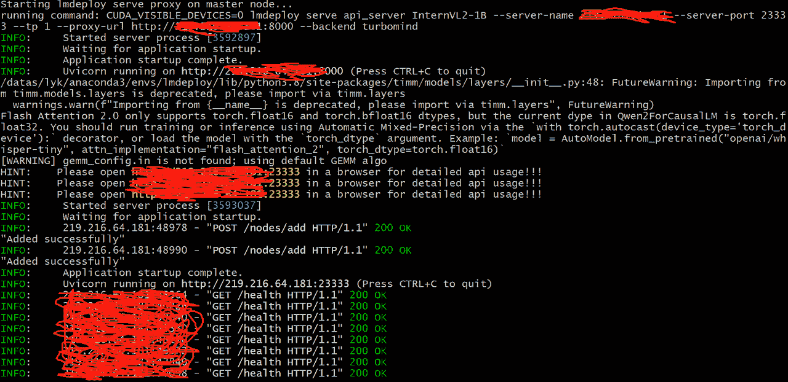

```bash
MLP_ROLE_INDEX=1 bash bash.sh
```

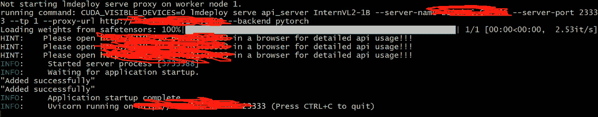

> 部署成功后，可以向代理IP发送请求进行推理

## 指定分发策略

> 可通过`--strategy`参数指定分发策略
> `lmdeploy serve proxy --server-name ${MASTER_IP} --server-port ${PROXY_PORT} --strategy "min_expected_latency"`

### 代理服务目前的分发策略

> `random`：根据用户提供的各个 `api_server` 节点的处理请求的能力，进行有权重的随机。处理请求的吞吐量越大，就越有可能被分配。部分节点没有提供吞吐量，将按照其他节点的平均吞吐量对待。

> `min_expected_latency`：根据每个节点现有的待处理完的请求，和各个节点吞吐能力，计算预期完成响应所需时间，时间最短的将被分配。未提供吞吐量的节点，同上。

> `min_observed_latency`：根据每个节点过去一定数量的请求，处理完成所需的平均用时，用时最短的将被分配。

## 使用WebUI

```bash
# 启动server
# ApiServer+Turbomind   api_server => AsyncEngine => TurboMind

lmdeploy serve api_server InternVL2-1B --server-name 0.0.0.0 --server-port 23333 --tp 1

# Gradio+ApiServer。必须先开启 Server，此时 Gradio 为 Client
lmdeploy serve gradio http://0.0.0.0:23333 --server-name 0.0.0.0 --server-port 6006
```

## 部署Huggingface Demo

> Step-1：注册一个 `huggingface` 的账号，注册成功后，可以点击右上角头像，选择 New Space 创建。根据 `huggingface` 的引导选择需要的配置，完成后即可得到一个空白的 demo。

> Step-2：编写 demo 入口代码 `app.py`

```python
from lmdeploy.serve.gradio.turbomind_coupled import run_local
from lmdeploy.messages import TurbomindEngineConfig

backend_config = TurbomindEngineConfig(max_batch_size=8)
model_path = 'InternVL2-1B'
run_local(model_path, backend_config=backend_config, server_name="huggingface-space")
```

## 视觉-语言模型 (VLMs) 部署

> 部署思路和文本模型相似

### 离线部署

`image = load_image('https://raw.githubusercontent.com/open-mmlab/mmdeploy/main/tests/data/tiger.jpeg')`

```python
from lmdeploy import pipeline
from lmdeploy.vl import load_image

pipe = pipeline('root/share/new_models/InternVL3/InternVL3-1B')
response = pipe(('describe this image', image))

print(response)
```

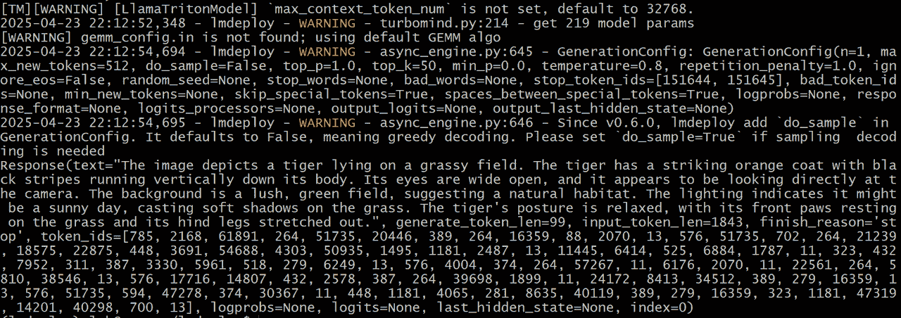

### 多卡并行

```python
from lmdeploy import pipeline, TurbomindEngineConfig, PytorchEngineConfig
from lmdeploy.vl import load_image

pipe = pipeline('root/share/new_models/InternVL3/InternVL3-1B',
                backend_config=PytorchEngineConfig(tp=2))

image = load_image('tiger.jpeg')
response = pipe(('describe this image', image))
print(response)
```

### 图片 token

`IMAGE_TOKEN = '<IMAGE_TOKEN>'`

```python
from lmdeploy import pipeline
from lmdeploy.vl import load_image
from lmdeploy.vl.constants import IMAGE_TOKEN

pipe = pipeline('root/share/new_models/InternVL3/InternVL3-1B')

image = load_image('tiger.jpeg')
response = pipe((f'describe this image{IMAGE_TOKEN}', image))
print(response)
```

> `IMAGE_TOKEN` 是一个特殊的 token，在文本序列中插入 `IMAGE_TOKEN` 可以明确标注图像的位置，帮助模型区分文本和图像的边界。

### 对话模板

> 对话模板（Conversation Template）是一种预设的输入输出格式规则，用于规范用户与模型的交互方式。它的核心作用是通过结构化对话内容，提升模型的响应质量、可控性和适用性。

> 推理时，`LMDeploy` 会根据模型路径匹配内置的对话模板，并把对话模板应用到输入的提示词上。如果用户使用的是本地模型，并且模型文件夹名字与官方模型不一致时，需要手动指定对话模版。

#### 自定义对话模板

```python
from lmdeploy.model import MODELS, BaseChatTemplate


@MODELS.register_module(name='customized_model')
class CustomizedModel(BaseChatTemplate):
    """A customized chat template."""

    def __init__(self,
                 system='<|im_start|>system\n',
                 meta_instruction='You are a robot developed by LMDeploy.',
                 user='<|im_start|>user\n',
                 assistant='<|im_start|>assistant\n',
                 eosys='<|im_end|>\n',
                 eoh='<|im_end|>\n',
                 eoa='<|im_end|>',
                 separator='\n',
                 stop_words=['<|im_end|>', '<|action_end|>']):
        super().__init__(system=system,
                         meta_instruction=meta_instruction,
                         eosys=eosys,
                         user=user,
                         eoh=eoh,
                         assistant=assistant,
                         eoa=eoa,
                         separator=separator,
                         stop_words=stop_words)


from lmdeploy import ChatTemplateConfig, pipeline

messages = [{'role': 'user', 'content': 'who are you?'}]
pipe = pipeline('root/share/new_models/InternVL3/InternVL3-1B',
                chat_template_config=ChatTemplateConfig('customized_model'))
for response in pipe.stream_infer(messages):
    print(response.text, end='')
```

### 视觉模型参数

> 可通过设置 `VisionConfig` 修改视觉模型默认参数

`image = load_image('https://raw.githubusercontent.com/open-mmlab/mmdeploy/main/tests/data/tiger.jpeg')`

```python
from lmdeploy import pipeline, VisionConfig
from lmdeploy.vl import load_image
vision_config = VisionConfig(max_batch_size=16)
pipe = pipeline('root/share/new_models/InternVL3/InternVL3-1B', vision_config=vision_config)
response = pipe(('describe this image', image))
print(response)
```

#### VisionConfig 源码

```python
@dataclass
class VisionConfig:
    """Vison model configs.

    Args:
        max_batch_size (int): the max image size passed to the model, since
            some models will use image patch, the actual running batch could
            be larger than this value.
        thread_safe (bool): Specifies whether the engine instance is
            thread-safe. Please set it to True when using the pipeline
            in a multi-threaded environment.
    """
    max_batch_size: int = 1
    thread_safe: bool = False
```

### 多图推理

`'https://raw.githubusercontent.com/open-mmlab/mmdeploy/main/demo/resources/human-pose.jpg',`

`'https://raw.githubusercontent.com/open-mmlab/mmdeploy/main/demo/resources/det.jpg'`


```
from lmdeploy import pipeline, TurbomindEngineConfig
from lmdeploy.vl import load_image

pipe = pipeline('/root/share/new_models/InternVL3/InternVL3-1B',
                backend_config=TurbomindEngineConfig(session_len=8192))

image_urls=[
]

images = [load_image(img_url) for img_url in image_urls]
response = pipe(('describe these images', images))
print(response)
```

## 多轮对话

> 使用`pipeline`进行多轮对话有两种方式，一种是按照`openai`的格式来构造`messages`，另外一种是使用`pipeline.chat`接口。

```
image = load_image('https://raw.githubusercontent.com/open-mmlab/mmdeploy/main/demo/resources/human-pose.jpg')
```

```
from lmdeploy import pipeline, TurbomindEngineConfig, GenerationConfig
from lmdeploy.vl import load_image

pipe = pipeline('root/share/new_models/InternVL3/InternVL3-1B',
                backend_config=TurbomindEngineConfig(session_len=8192))
gen_config = GenerationConfig(top_k=40, top_p=0.8, temperature=0.6)
sess = pipe.chat(('describe this image', image), gen_config=gen_config)
print(sess.response.text)
sess = pipe.chat('What is the woman doing?', session=sess, gen_config=gen_config)
print(sess.response.text)
```

> 视觉语言模型的部署和文本几乎相似，其余请参考文本模型的部署

## 模型量化

### 量化模型

> `LMDeploy`量化模块目前仅支持`AWQ`量化算法。

> 量化是指将高精度数字转换为低精度数字。低精度实体可以存储在磁盘上很小的空间内，从而减少内存需求。

```
export HF_MODEL=/root/share/model_repos/internlm2-chat-7b
export WORK_DIR=/root/internlm2-chat-7b-4bit

lmdeploy lite auto_awq $HF_MODEL   --calib-dataset 'ptb'   --calib-samples 128   --calib-seqlen 2048   --w-bits 4   --w-group-size 128   --batch-size 1   --work-dir $WORK_DIR
```

### 模型评测

> 使用`OpenCompass`对模型进行评测

> step1: 安装`OpenCompass`和`lmdeploy`

> 在评测一个模型时，需要准备一份评测配置，指明评测集、模型和推理参数等信息。

以`internlm2-chat-7b`模型为例，相关的配置信息如下：

```
# configure the dataset
from mmengine.config import read_base


with read_base():
    # choose a list of datasets
    from .datasets.mmlu.mmlu_gen_a484b3 import mmlu_datasets
    from .datasets.ceval.ceval_gen_5f30c7 import ceval_datasets
    from .datasets.triviaqa.triviaqa_gen_2121ce import triviaqa_datasets
    from opencompass.configs.datasets.gsm8k.gsm8k_0shot_v2_gen_a58960 import \
        gsm8k_datasets
    # and output the results in a chosen format
    from .summarizers.medium import summarizer

datasets = sum((v for k, v in locals().items() if k.endswith('_datasets')), [])

# configure lmdeploy
from opencompass.models import TurboMindModelwithChatTemplate

# configure the model
models = [
    dict(
        type=TurboMindModelwithChatTemplate,
        abbr=f'internlm2-chat-7b-lmdeploy',
        # model path, which can be the address of a model repository on the Hugging Face Hub or a local path
        path='internlm/internlm2-chat-7b',
        # inference backend of LMDeploy. It can be either 'turbomind' or 'pytorch'.
        # If the model is not supported by 'turbomind', it will fallback to
        # 'pytorch'
        backend='turbomind',
        # For the detailed engine config and generation config, please refer to
        # https://github.com/InternLM/lmdeploy/blob/main/lmdeploy/messages.py
        engine_config=dict(tp=1),
        gen_config=dict(do_sample=False),
        # the max size of the context window
        max_seq_len=7168,
        # the max number of new tokens
        max_out_len=1024,
        # the max number of prompts that LMDeploy receives
        # in `generate` function
        batch_size=5000,
        run_cfg=dict(num_gpus=1),
    )
]
```

把上述配置放在文件中，比如`configs/eval_internlm2_lmdeploy.py`。然后，在`OpenCompass`的项目目录下，执行如下命令可得到评测结果：

```
python run.py configs/eval_internlm2_lmdeploy.py -w outputs
```

### W8A8量化

`LMDeploy`提供了使用`8-bit`整数(`INT8`)和浮点数(`FP8`)对神经网络模型进行量化和推理的功能。

```
1. pip install lmdeploy[all]

lmdeploy 提供了命令行工具 lmdeploy lite smooth_quant 实现量化功能。并且其中命令行参数 --quant-dtype 可以用来控制是进行8-bit整数还是浮点数类型的量化。更多命令行工具使用方式，请执行 lmdeploy lite smooth_quant --help 查看。

2. int8量化

lmdeploy lite smooth_quant internlm/internlm2_5-7b-chat --work-dir ./internlm2_5-7b-chat-int8 --quant-dtype int8

2. fp8量化

lmdeploy lite smooth_quant internlm/internlm2_5-7b-chat --work-dir ./internlm2_5-7b-chat-fp8 --quant-dtype fp8
```

### Key-Value(KV) Cache 量化

自`v0.4.0`起，`LMDeploy`支持在线`kv cache int4/int8`量化，量化方式为`per-head per-token`的非对称量化。

通过`LMDeploy`应用`kv`量化非常简单，只需要设定`quant_policy`参数即可。

```
**L**MDeploy 规定 qant_policy=4 表示 kv int4 量化，quant_policy=8 表示 kv int8 量化。

from lmdeploy import pipeline, TurbomindEngineConfig
engine_config = TurbomindEngineConfig(quant_policy=8)
pipe = pipeline("internlm/internlm2_5-7b-chat", backend_config=engine_config)
response = pipe(["Hi, pls intro yourself", "Shanghai is"])
print(response)
```

## 闯关任务

复现`InternVL`和`InternLM`的部署和量化提交为在线飞书文档。

提交地址：`https://aicarrier.feishu.cn/share/base/form/shrcnkSJ97ykqRSz4fgyCJbvCsb`
