# L2G5-CAMEL 书生多智能体系统实践

> 来源：[https://aicarrier.feishu.cn/docx/EkcWdtC2ZoWq6JxsSXScJBFcnyc](https://aicarrier.feishu.cn/docx/EkcWdtC2ZoWq6JxsSXScJBFcnyc)


任务：

1.  使用自定义及预定义的 tool 自定义一个自己的 agent

1.  利用**Roleplaying**或者**Workforce**搭建一个自己的多智能体系统

# 第一章：环境配置

## 获取CAMEL

本章节内我们将详细介绍如何获取CAMEL，CAMEL提供了几种安装的方式，我们可以根据自己的需求来选择安装的方式。

请确保你的系统已安装Python 3.10+。你可以通过以下命令进行检查：

```
python3 --version
```

PS：在windows系统中 python3 有可能会被错误的链接到windows商店，运行上述命令时可能不会正常输出python版本，运行如下命令来检查

```
python --version
```

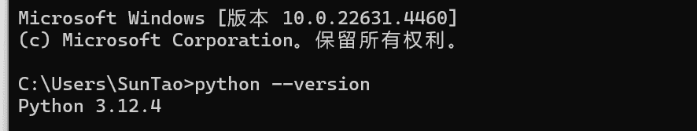

### 通过 PyPI 安装

利用 pip 直接安装基础 CAMEL 库：

```
pip install camel-ai
```

如果想体验完整功能，还需要安装额外的依赖项(本文档代码基于camel-ai 0.2.38版本运行)：

```
pip install "camel-ai[all]==0.2.38"
```

### 通过源码安装

#### **使用 UV工具从源码安装**

+   UV 是 Rus**t 编写的超**快 Python 包安装器和解析器，由 Astral 团队开发（该团队还开发了著名的 Ruff 和 Uvicorn）。它旨在替代 pip 和 pip-tools，提供极快的依赖解析和安装速度，同时兼容现有的 Python 包生态系统（PyPI）。

---

**UV 的主要特点**

1.  **极快的性能**

+   依赖解析和安装速度比 pip 和 pip-tools 快很多（官方称可达 10-100 倍）。

+   基于 Rust 实现，利用了更高效的算法和并行处理。

1.  **替代 **pip** 和 **pip-tools

+   可以直接安装包（uv pip install），类似 pip。

1.  **克隆Github仓库**

```
pip install uv
```

1.  **克隆Github仓库**：

```
git clone -b v0.2.38 https://github.com/camel-ai/camel.git
```

1.  **切换到项目目录**：

```
cd camel
```

1.  我们建议使用Python 3.10：

```
uv venv .venv --python=3.10  # （可选）
```

1.  **激活 camel 虚拟环境**：

```
# 激活 camel 虚拟环境，出现类似(camel-ai-py3.10) C:\camel>中左侧的（虚拟环境）代表激活成功
#mac/linux
source .venv/bin/activate

#windows
.venv\Scripts\activate
```


1.  安装所有依赖：

```
uv pip install -e ".[all]"  
```

#### 使用Conda和Pip从源码安装

1.  **创建Conda虚拟环境**：

```
conda create --name camel python=3.10
```

1.  **激活Conda虚拟环境**：

```
conda activate camel
```

1.  **克隆Github仓库**：

```
git clone -b v0.2.38 https://github.com/camel-ai/camel.git
```

1.  **切换到项目目录**：

```
cd camel
```

1.  **从源代码安装**：

```
pip install -e .[all]
```

## API 设置

关于如何部署智能体的问题，可以选择使用 API 或者本地模型。总的来说，选择使用 API 还是本地模型部署智能体，取决于具体的应用场景和资源限制。如果网络连接稳定且可以承受一定的使用费用，那么 API 可能是一个好选择。如果硬件资源充足且希望智能体能在离线环境下工作（注重数据隐私和安全），那么本地模型可能更合适。

### 获取  API KEY

使用 API 调用大模型需要 API 密钥，[这里我们以](https://internlm.intern-ai.org.cn/api/tokens)InternLM为例，您可以从书生·浦语获取，它提供InternLM系列的免费（OpenAI）兼容格式的API。

请确保您拥有一个正常注册且可使用的账户。要生成您的私有 API KEY可以参考我们的图示。

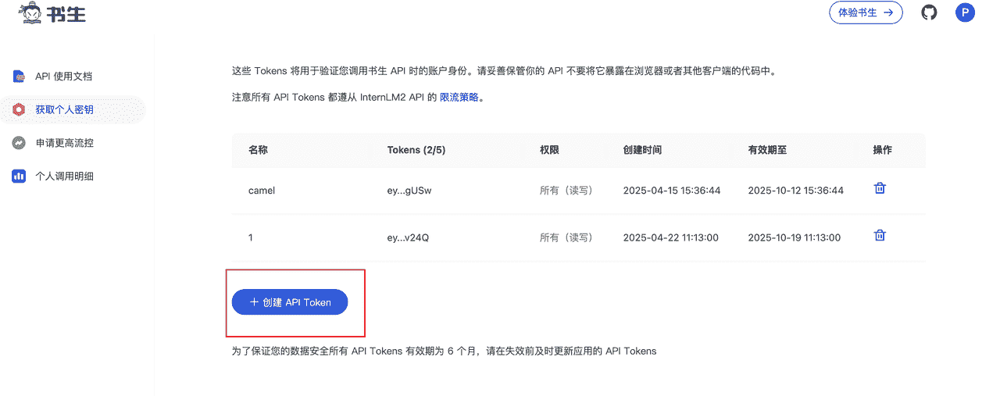

### 使用API调用模型

这里我们使用CAMEL中的ChatAgent模块来简单调用一下模型，关于ChatAgent的进一步描述可以参考后续内容，这里我们简单把它理解为一个基础的模型调用模块即可。

**使用语言模型**

```
from camel.agents import ChatAgent
from camel.models import ModelFactory
from camel.types import ModelPlatformType, ModelType

model = ModelFactory.create(
    model_platform=ModelPlatformType.INTERNLM,
    model_type="internlm2.5-latest",
    api_key='你的api_key'
)

agent = ChatAgent(
    model=model,
    output_language='中文'
)

response = agent.step("你好，你是谁？")
print(response.msgs[0].content)


>>>
你好，我是一个人工智能助手，可以帮助回答问题、提供信息和协助解决各种问题。请问有什么我可以帮助你的吗？
```

**使用多模态模型**

```
from camel.agents import ChatAgent
from camel.models import ModelFactory
from camel.types import ModelPlatformType
from camel.messages import BaseMessage

from io import BytesIO
import requests
from PIL import Image

model = ModelFactory.create(
    model_platform=ModelPlatformType.INTERNLM,
    model_type="internvl2.5-latest",
    api_key='API'
)

agent = ChatAgent(
    model=model,
    output_language='中文'
)

# 图片URL
url = "https://img0.baidu.com/it/u=2205376118,3235587920&fm=253&fmt=auto&app=120&f=JPEG?w=846&h=800"
response = requests.get(url)
img = Image.open(BytesIO(response.content))

user_msg = BaseMessage.make_user_message(
    role_name="User", 
    content="请描述这张图片的内容", 
    image_list=[img]  # 将图片放入列表中
)

response = agent.step(user_msg)
print(response.msgs[0].content)

>>>
这是一张金毛寻回犬的特写照片。这只狗有着浓密的金色毛发，耳朵垂在头部两侧，眼睛明亮而有神，鼻子黑色且湿润。它的嘴巴微微张开，露出了粉红色的舌头，看起来非常友好和快乐。背景是一片模糊的绿色，可能是在户外的自然环境中拍摄的。整体画面非常温暖和愉悦，突出了金毛寻回犬的亲和力和活力。
```

**视频理解**


[vedio_test.mp4](https://internal-api-drive-stream.feishu.cn/space/api/box/stream/download/all/KQr8bV9SgoDIDWxgbqNcwdc9nhe)

```
from camel.agents import ChatAgent
from camel.models import ModelFactory
from camel.types import ModelPlatformType
from camel.messages import BaseMessage

model = ModelFactory.create(
    model_platform=ModelPlatformType.INTERNLM,
    model_type="internvl2.5-latest",
    api_key='API'
)

# 创建代理
agent = ChatAgent(
    model=model,
    output_language='中文'
)

# 读取本地视频文件
video_path = "vedio_test.mp4"
with open(video_path, "rb") as video_file:
    video_bytes = video_file.read()

# 创建包含视频的用户消息
user_msg = BaseMessage.make_user_message(
    role_name="User", 
    content="请描述这段视频的内容", 
    video_bytes=video_bytes  # 将视频字节作为参数传入
)

# 获取模型响应
response = agent.step(user_msg)
print(response.msgs[0].content)

>>>
这是一幅令人惊叹的超现实主义景观画，画面中有一只狗在一条被雪覆盖的道路上奔跑。整个场景被一种奇幻而美丽的氛围所包围，让人感受到一种超凡脱俗的美。

首先，画面的背景是一片壮丽的天空，天空中布满了浓密的云层，这些云层呈现出丰富的纹理和层次感。云层的颜色以粉色和紫色为主调，其间还夹杂着一些金色和蓝色的光影，形成了一个绚丽多彩的天幕。在云层之间，有一道明亮的光线穿过，这道光线像是从天际线的尽头射来，照亮了整个场景，给人一种希望和温暖的感觉。

地面上是一条被雪覆盖的道路，道路两旁是连绵起伏的雪山和丘陵。雪地上的足迹和轮胎印清晰可见，表明这里虽然人迹罕至，但仍有生命活动的痕迹。一只白色的狗正在这条道路上奔跑，它的姿态轻盈而欢快，仿佛在享受着这美好的一刻。

整个画面的色彩非常丰富，粉色、紫色、金色、蓝色相互交织，营造出一种梦幻般的氛围。这种色彩的运用让画面充满了活力和生命力，令人不禁沉醉其中。

总的来说，这幅画通过超现实主义的手法，创造了一个美轮美奂的幻想世界，让观者在现实与幻想之间徘徊，感受到艺术带来的无限魅力。
```

如果你不想以明文的方式设置你的的API，我们可以使用dotenv 来管理 API 密钥，首先确保我们安装了python-dotenv 库。如果还没有安装，可以通过以下命令安装：

**使用uv**

```
uv pip install python-dotenv
```

**使用 PyPI **

```
pip install python-dotenv
```

之后在外面的项目根目录创建一个名为 .env 的文件，并在其中添加你的 API 密钥：

```
INTERNLM_API_KEY=你的api密钥
```

然后调用模型

```
from camel.agents import ChatAgent
from camel.models import ModelFactory
from camel.types import ModelPlatformType

from dotenv import load_dotenv
import os

load_dotenv()

api_key = os.getenv('INTERNLM_API_KEY')

model = ModelFactory.create(
    model_platform=ModelPlatformType.INTERNLM,
    model_type="internlm2.5-latest",
    api_key=api_key
)

agent = ChatAgent(
    model=model,
    output_language='中文'
)

response = agent.step("你好，你是谁？")
print(response.msgs[0].content)

>>>
你好，我是来自阿里云的大规模语言模型，我叫通义千问。
```

---

# 第二章：Agent 的构成组件

## 智能体概述

智能体是一个能够感知环境并在环境中自主行动以实现特定目标的系统。它具有以下几个关键特征：

1.  自主性 - 智能体可以在没有直接人为干预的情况下运作，能够自行决策和行动。

1.  响应性 - 能够感知环境并对环境变化做出及时响应。

1.  主动性 - 不仅被动响应环境,还可以主动采取行动来实现目标。

1.  社交能力 - 能够与其他智能体或人类进行交互和协作。

从应用角度，智能体可以分为几类：

1.  任务型智能体 - 专注于完成特定任务,如虚拟助手、智能客服等

1.  学习型智能体 - 通过与环境交互不断学习和改进,如强化学习智能体

1.  协作型智能体 - 多个智能体协同工作,形成多智能体系统

1.  对话型智能体 - 专门用于自然语言交互的智能体,如我这样的语言模型

在实现方面，现代智能体通常基于以下技术：

+   大语言模型(LLM)作为认知和决策的核心

+   规划系统用于制定行动计划

+   记忆系统存储相关信息和经验

+   工具使用能力来扩展行动范围

该领域的发展时间线如下(不完全统计）：

+   「CAMEL」- 发布于2023年3月21日（详情请见章节2.3）：CAMEL-AI是一个开源社区，致力于研[究自主](https://www.camel-ai.org/?_blank)和交流Agent。该社区认为，大规模研究这些Agent可以提供有关其行为、能力和潜在风险的宝贵见解。为了促进该领域的研究，CAMEL框架提供、实施和支持各种类型的Agen[t、任](https://github.com/camel-ai/camel?_blank)务等。【1】。CAMEL-AI的官方网站是www.camel-ai.org，它是一个关于交流[Age](https://arxiv.org/abs/2303.17760?_blank)nt[用于探](https://camel-ai.github.io/camel/?_blank)索大型语言模型社会的平台，由Guohao Li, Hasan Abed Al Kader Hammoud, Hani Itani, Dmitrii Khizbullin, Bernard Ghanem等人于2023年3月31日提交，并于2023年11月2日进行了修订【2】。CAMEL框架旨在设计实用的通用人工智能，作为最早的基于大型语言模型的多Agent框架，现在是一个通用框架，用于构建和使用基于大型语言模型的Agent来解决现实世界的任务【3】。此外，CAMEL AI framework的GitHub页面camel-ai/camel提供了公共通知、分支、星级等信息，其中v0.2.20a1是最新的版本，发布于2025年02月07日【4】。

+   「AutoGPT」 - 发布于2023年3月30日：Auto-GPT基于GPT-4，允许AI自主行动，无需用户详尽提示每个动作。用户可以为Auto-GPT制定一个总体目标，然后由它逐步采取行动以实现目标。与ChatGPT不同，Auto-GPT可以自主作出决策，这是ChatGPT所没有的功能。它可以自动提示和生成完成任务所需的每一个必要提示。

+   「Hugg[ing](https://arxiv.org/abs/2303.17580?_blank)G[PT」](https://ar5iv.labs.arxiv.org/html/2303.17580?_blank)[- 发](https://blog.csdn.net/weixin_43336281/article/details/139123423?_blank)布于2023年3月30日：HuggingGPT是一个基于ChatGPT的Agent，旨在利用Hugging Face上的AI模型解决跨领域和多模态的复杂AI任务。该框架通过ChatGPT根据用户请求制定任务计划，然后选择Hugging Face上的AI模型来执行子任务，最后总结执行结果并给出响应。HuggingGPT在语言、视觉、语音等任务中都取得了很好的效果。该框架首次提交于2023年3月30日，最新版本发布于2023年12月3日【1】. HuggingGPT的核心思想是利用大型语言模型（LLMs）作为控制器，管理和组织专家模型的合作，以解决复杂的AI任务【2】. 该框架的发布标志着向人工通用智能（AGI）迈出了关键一步【3】.

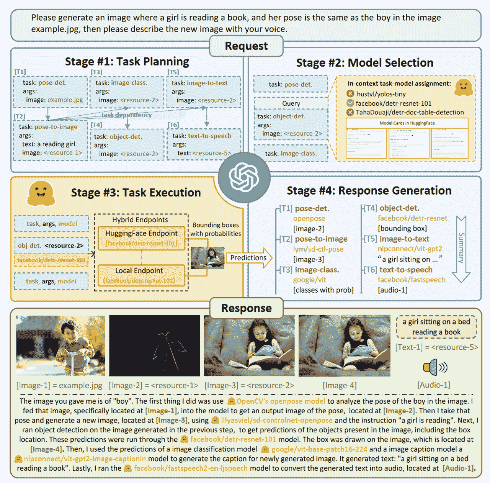

图 2-9  HuggingGPT工作原理图

+   **「Westworld」模拟（斯坦福西部世**界小镇）— 发[布](https://github.com/joonspk-research/generative_agents%E3%80%82%E8%BF%99%E4%BD%BF%E5%BE%97%E7%A0%94%E7%A9%B6%E4%BA%BA%E5%91%98%E5%92%8C%E5%BC%80%E5%8F%91%E8%80%85%E5%8F%AF%E4%BB%A5%E8%AE%BF%E9%97%AE%E5%92%8C%E7%A0%94%E7%A9%B6%E8%BF%99%E4%B8%AA%E8%99%9A%E6%8B%9F%E5%B0%8F%E9%95%87%E7%9A%84%E4%BB%A3%E7%A0%81%E5%92%8C%E6%9E%B6%E6%9E%84%EF%BC%8C%E8%BF%9B%E4%B8%80%E6%AD%A5%E6%8E%A2%E7%B4%A2%E4%BA%BA%E5%B7%A5%E6%99%BA%E8%83%BD%E5%9C%A8%E7%A4%BE%E4%BC%9A%E4%BA%92%E5%8A%A8%E9%A2%86%E5%9F%9F%E7%9A%84%E6%BD%9C%E5%8A%9B%E3%80%82)[于](https://github.com/joonspk-research/generative_agents%E3%80%82%E8%BF%99%E4%BD%BF%E5%BE%97%E7%A0%94%E7%A9%B6%E4%BA%BA%E5%91%98%E5%92%8C%E5%BC%80%E5%8F%91%E8%80%85%E5%8F%AF%E4%BB%A5%E8%AE%BF%E9%97%AE%E5%92%8C%E7%A0%94%E7%A9%B6%E8%BF%99%E4%B8%AA%E8%99%9A%E6%8B%9F%E5%B0%8F%E9%95%87%E7%9A%84%E4%BB%A3%E7%A0%81%E5%92%8C%E6%9E%B6%E6%9E%84%EF%BC%8C%E8%BF%9B%E4%B8%80%E6%AD%A5%E6%8E%A2%E7%B4%A2%E4%BA%BA%E5%B7%A5%E6%99%BA%E8%83%BD%E5%9C%A8%E7%A4%BE%E4%BC%9A%E4%BA%92%E5%8A%A8%E9%A2%86%E5%9F%9F%E7%9A%84%E6%BD%9C%E5%8A%9B%E3%80%82)2023年4月7日: Smallville的虚拟小镇，用于研究人工智能在社会互动中的行为。这个小镇拥有25个AI智能体，它们具有工作、社交、结交朋友、甚至举办情人节派对等能力。每个AI智能体都有独特的个性和背景故事，它们在Smallville小镇的公共场景中自由活动，如咖啡馆、酒吧、公园、学校、宿舍、房屋和商店。Smallville小镇的AI智能体展现出了类似人类的行为，例如在看到早餐着火时会去关掉炉子，看到浴室有人时会在外面等待，遇到想交谈的个体时会停下来聊天。这个项目在AI社区引起了轰动，被认为是2023年最激动人心的Agent实验之一。Smallville项目地址为：https://github.com/joonspk-research/generative_agents。

+   「VOYAGER」 - 发布于2023年5月25日： VOYAGER 是一个创新的开源 AI 智能体项目，它展示了大语言模型在游戏环境中的自主学习能力。这个项目在 Minecraft 游戏世界中运行，能够通过环境交互来学习新技能、制定计划并执行复杂任务。它采用了课程学习方法，并集成了技能库系统来存储和复用已学习的技能，是首个在 Minecraft 中展现持续学习能力的 AI 智能体。该项目由 MineDojo 团队开发，其源代码可在 GitHub (github.com/MineDojo/Voyager) 查看，相关研究发表在论文 "VOYAGER: An Open-Ended Embodied Agent with Large Language Models" 中，项目详情可访问 minedojo.org 了解更多。这个开创性的项目对理解 AI 在开放环境中的持续学习能力具有重要意义。

+   「MetaGPT」- 发布于2023年7月： MetaGPT是一个将LLM转变为多个协作的软件公司角色的框架。它能够将一个产品需求转化为完整的软件项目，包括分析、设计、编码等全过程。每个角色（如产品经理、架构师、程序员等）都由一个LLM Agent扮演，它们协同工作以完成软件开发任务。 参考链接：https://github.com/geekan/MetaGPT

+   「ChatDev」 - 发布于2023年8月28日：ChatDev的主要特点包括：

1.  **增量开发**：支持在现有代码基础上进行开发，通过指定源代码目录路径来实现。

1.  **Docker支持**：通过Docker实现安全执行，这得益于ManindraDeMel的贡献。

1.  **多智能体协作**：不同角色的智能体在用户指定任务需求后进行交互式协同，生成完整的软件产品。

1.  **ChatDev IDE**：这是一个用于构建Agent的工具，支持JavaScript，可以加速提示工程，适用于游戏NPC或强大的Agent工具设计。

ChatDev的潜力在于将大型语言模型（LLMs）整合到软件开发领域，为软件开发过程带来新的视角和可能性。它不仅提高了软件开发的效率和成本效益，还通过实验证明了其在软件开发过程中的优势。

+   「XAgent」 - 发布于2023年10月23日： 是清华大学知识工程实验室开发的一个创新型自主Agent框架，它能够像人类开发者一样理解和执行复杂的计算机任务。该系统基于大语言模型构建，具备工作记忆和自我反思能力，可以通过任务分解、代码编写、调试和优化来解决各类问题。XAgent 采用模块化设计，集成了多种工具，包括代码执行、网页浏览和文件操作等功能，同时具备任务规划、动作执行和工具调用等核心组件。它不仅支持复杂任务的递归分解和执行监控，还具有失败恢复和重试机制，可广泛应用于软件开发、数据分析、自动化测试和文档管理等领域。项目完整源代码已在 GitHub (github.com/OpenBMB/XAgent) 开源，相关技术细节可参考其论文 "XAgent: An Autonomous Agent for Complex Task Solving"。

+   「Amazon Bedrock Agents」- 2023年11月发布：Amazon发布了Bedrock Agents，这是一个基于Amazon Bedrock构建的企业级AI Agent开发平台。它支持多种基础模型如Claude和Llama 2，并提供了完整的知识库管理和工具集成能力。开发者可以利用Bedrock Agents创建能执行特定任务的AI助手，同时确保企业级的安全性和合规性。

紧接着在2023年12月，Amazon推出了AWS Q，这是一个专门面向AWS生态系统的AI助手。AWS Q能够协助开发者进行代码生成、问题诊断、系统架构设计等任务，并提供AWS最佳实践建议。它的推出标志着Amazon在专业领域AI助手方面的重要突破。

进入2024年，Amazon继续加强其AI Agent产品线。2024年1月，公司推出了SageMaker Agents，这是一个专注于机器学习工作流程的智能助手系统。它能够自动化数据处理、模型训练和部署过程，显著提升了机器学习开发效率。2024年2月，CodeWhisperer Agent获得了重大更新，增加了完整的对话能力和代码解释功能，进一步强化了其作为代码AI助手的地位。

Am[azon的AI Agent战略特别强](https://aws.amazon.com/bedrock/agents/)调企业级应用场景，注重安全性和可扩展性。通过与AWS云服务的深度集成，这些AI Agent能够无缝接入企业现有的技术栈。Bedrock Agents: https://aws.amazon.com/bedrock/agents/

+   「O[penAssistant Pythia」- ](https://github.com/LAION-AI/Open-Assistant)发布于2024年1月： 这是一个开源的对话式AI框架，由LAION和Anthropic等组织支持。它的目标是创建一个透明、开放的AI助手生态系统。该项目持续活跃，提供了多语言支持和各种任务处理能力。 参考链接：https://github.com/LAION-AI/Open-Assistant

+   **「Ray」- 2024版本：** 由Anyscale开发的分布式计算框架，Ray的Agent系统是一个完整的分布式AI框架，它整合了强化学习、模型服务和分布式训练等多个关键组件。在其核心，RLlib提供了丰富的强化学习算法支持，包括PPO、DQN和SAC等，并能够实现大规模的分布式训练。Ray Serve则负责Agent的部署和服务，提供了实时推理、负载均衡和A/B测试等功能。而Ray Train则专注于分布式训练的实现，支持超参数优化和进度追踪等特性。在技术实现上，Ray采用了Actor编程模型，使得开发者能够轻松构建和部署分布式Agent系统。每个Agent可以被视为一个独立的Actor，能够维护自己的状态并进行异步通信。系统支持自动的资源管理和调度，确保计算资源被高效利用。同时，Ray的容错机制能够自动处理节点失败等问题，保证系统的稳定性。参考链接：https://ray-project.github.io/q4-2021-docs-hackathon/0.4/ray-api-references/ray-rllib/agents/

+   「OpenAI Swarm」 - 2024年初： OpenAI Swarm是OpenAI推出的一个实验性框架，旨在帮助开发者协调多智能体系统。这是一个具有突破性的框架，它简化了多智能体系统的编排过程。它引入了智能体（agents）、交接（handoffs）、例程（routines）和函数调用（function calling）等先进概念，为实验多个AI智能体的协调提供了强大的工具。该框架的核心功能包括专门执行特定任务的AI单元、允许智能体之间无缝转换任务的交接机制、定义标准化工作流程的例程系统，以及实现智能体与外部系统交互的函数调用能力。参考链接：https://github.com/openai/swarm

---

##  Agent设计原则与方法

智能体(Agent)的设计需要遵循一系列原则并采用特定的方法来确保其有效性和可靠性。在设计智能体时，我们首先要明确其目标导向性，即智能体的每个行为都应该服务于预定的目标。这种目标导向不仅体现在最终结果上，还需要贯穿整个执行过程中。同时，智能体的设计应该遵循模块化原则，将不同功能划分为独立的模块，既保证了代码的可维护性，也提高了系统的灵活性。

一个典型的智能体包含三个核心部分：

+   感知模块：处理输入信息

+   决策模块：制定行动计划

+   执行模块：实施具体行动

这三个模块形成一个完整的循环，使智能体能够持续有效地工作。

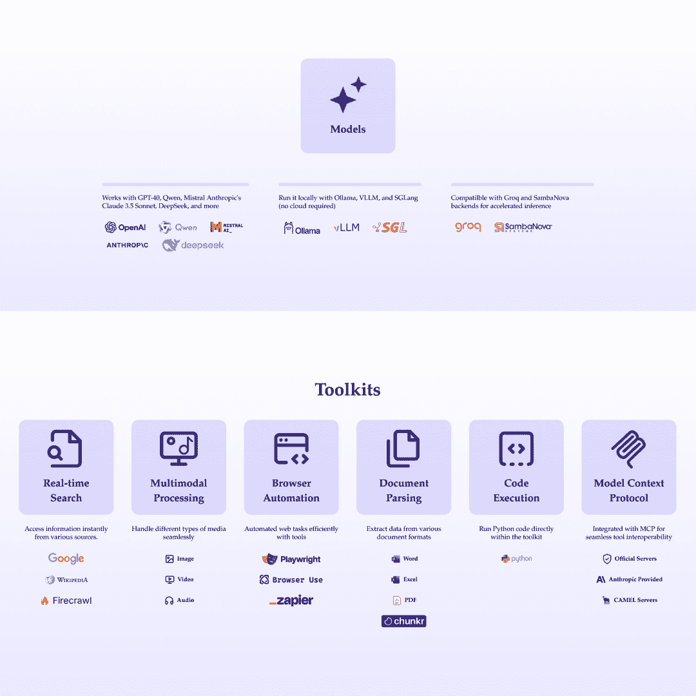

智能体的设计应该采用迭代开发的方式。首先实现基本功能，然后通过不断的测试和反馈来完善系统。在此过程中，要注重收集和分析性能数据，根据实际运行情况调整设计参数和策略。这种渐进式的开发方法可以帮助我们建立一个更加稳健和高效的智能体系统。

通过遵循这些设计原则和方法，我们可以构建出既能完成特定任务，又具有良好可扩展性和维护性的智能体系统。这样的系统不仅能够满足当前的需求，还能够适应未来可能出现的新要求和挑战。

---

##  Models

Model 是 Agent 的大脑，负责处理所有输入和输出数据。通过有效调用不同的模型，智能体可以根据任务需求执行文本分析、图像识别和复杂推理等操作。CAMEL 提供了一系列标准和可定制的接口，并与各种组件无缝集成，以赋能大语言模型（LLM）驱动的应用程序开发。在本部分，我们将介绍 CAMEL 目前支持的模型、工作原理及与模型交互的方式。

###  通过API调用模型

我们可以通过使用ModelFactory的create方法创建不同的model，然后修改以下三个参数就可以做到调用不同的模型：model_platform、model_type、model_config_dict

```
import os

from camel.agents import ChatAgent
from camel.configs import ZhipuAIConfig
from camel.messages import BaseMessage
from camel.models import ModelFactory
from camel.types import ModelPlatformType, ModelType

model = ModelFactory.create(
    model_platform=ModelPlatformType.INTERNLM,
    model_type="internlm2.5-latest",
    model_config_dict=ZhipuAIConfig(temperature=0.2).as_dict(),
    api_key=os.environ.get("INTERNLM_API_KEY"),
)

# 设置system prompt
sys_msg = BaseMessage.make_assistant_message(
    role_name="Assistant",
    content="You are a helpful assistant.",
)

# 初始化agent
camel_agent = ChatAgent(system_message=sys_msg, model=model, output_language="zh")#这里同样可以设置输出语言

user_msg = BaseMessage.make_user_message(
    role_name="User",
    content="""Say hi to CAMEL AI, one open-source community 
    dedicated to the study of autonomous and communicative agents.""",
)


# 调用模型
response = camel_agent.step(user_msg)
print(response.msgs[0].content)

#以下是模型回复的内容
'''
===============================================================================
你好，向CAMEL AI这个致力于自主交互式智能体研究的开源社区问好。
===============================================================================
'''
```

如果您想使用与 OpenAI 的 API 兼容的接口（即遵循 OpenAI 提供的 API 规范和认证方式），可以将model替换为以下代码：model

```
model = ModelFactory.create(
    model_platform=ModelPlatformType.OPENAI_COMPATIBLE_MODEL,
    model_type="a-string-representing-the-model-type",
    api_key=os.environ.get("OPENAI_COMPATIBILIY_API_KEY"),
    url=os.environ.get("OPENAI_COMPATIBILIY_API_BASE_URL"),
    model_config_dict={"temperature": 0.4, "max_tokens": 4096},
)
```

### 使用开源模型

**使用Ollama**

Ollama 是一个开源的机器学习框架，专注于让用户轻松地创建和使用各种语言模型。它提供了一个简单的 API，能够将预训练的语言模型（例如 GPT 系列）集成到你的应用程序中。Ollama 支持许多主流的机器学习模型和任务，如文本生成、对话系统、文本分类等。通过它的简单接口，开发者能够方便地进行模型加载、推理以及与模型交互。

进阶方案是在后端部署一个带有本地模型的服务器，并将其用作 API 的本地替代品。我们在这里使用 Ollama 部署的  InternLM3 为例。

1.  首先安装[Ollama](https://ollama.com/download)

1.  设置 Ollama 后，通过在终端中键入以下命令来拉取 InternLM3模型（这里使用8B的模型，大约需要16GB的内存，70B的模型大约需要64GB以上的内存，可以根据自身的配置和需要选择不同参数的模型），Ollama基于llama.cpp实现，本地CPU推理效率非常高（当然如果有GPU的话，推理效率会更高）, 还可以兼容 openai的接口。 ：

```
ollama pull internlm3-8b-instruct
```

1.  在项目目录中创建一个类似于下面的 ModelFile（可选）。

```
FROM internlm3-8b-instruct

# set the temperature to 1 [higher is more creative, lower is more coherent]
PARAMETER temperature 1

# set the system message
SYSTEM """
"""
```

1.  接下来，创建模型（可选）：

```
ollama create camel-internlm3-8b-instruct -f ./Modelfile
```

之后同样使用以下代码替换model：model

```
#如果出现openai.InternalServerError: Error code: 502错误可以尝试设置一下http_proxy及https_proxy
#import os

# os.environ["http_proxy"] = "http://localhost:11434/v1/"
# os.environ["https_proxy"] = "http://localhost:11434/v1/"

model = ModelFactory.create(
    model_platform=ModelPlatformType.OLLAMA,
    model_type="internlm3-8b-instruct",
    model_config_dict={"temperature": 0.4},#可选
)
```

**使用vLLM**

vLLM 是一个高效的、面向大规模语言模型的推理库，专为大规模语言模型设计，旨在提高推理速度和减少资源消耗。vLLM 的一个核心特性是它能够在多种硬件环境下（例如单 GPU、多 GPU，甚至 CPU）高效运行，极大地降低了推理成本。

1.  首先安装[vLLM](https://docs.vllm.ai/en/latest/getting_started/installation.html)

1.  设置 vLLM 后，启动兼容 OpenAI 的服务器，例如：

```
python -m vllm.entrypoints.openai.api_server --model microsoft/Phi-3-mini-4k-instruct --api-key vllm --dtype bfloat16
```

之后同样使用以下代码替换model：model

```
vllm_model = ModelFactory.create(
    model_platform=ModelPlatformType.VLLM,
    model_type="microsoft/Phi-3-mini-4k-instruct",
    url="http://localhost:8000/v1", # 可选
    model_config_dict={"temperature": 0.4}, #可选
    )
```

## Messages

### 概述

> 什么是 Agent 的 Message？

当你和朋友聊天、在网上搜索信息或是对手机语音助手说“帮我查一下天气”时，其实你都在向某个“代理者(Agent)”发送一条“信息(Message)”。这里的“代理者”既可以是一个人，也可以是一个能执行指令的智能程序或系统，而“信息”则是你传递的指令、问题或数据。在日常生活中，这种信息交互常常不易察觉，但在计算机科学、人工智能和自动化任务中，“Agent的Message”是一个至关重要的基础概念。

简单来说，**Agent的Message就是指系统中“智能体**”或“代理者”之间互相传递的指令或数据包。就好比你给朋友发一条🛰️消息请他帮忙带杯咖啡，在智能系统中，“Agent”则是那些负责完成任务的角色，而“Message”则是他们沟通和协作的工具。当一个Agent收到Message后，会根据内容做出决策、执行任务或回复信息。

在 CAMEL 系统中，BaseMessage 是所有消息对象的基础类，它为对话中的每一条信息提供了统一的结构和标准化的处理方式。无论是用户输入的一段文本，还是包含图片、视频等多模态信息的数据包，都可以通过 BaseMessage 来统一表示和管理。

> **为什么需要统一的消息结构？**

在一个对话系统中，消息可能来自多方（如用户、系统、不同类型的 Agent），且信息内容不局限于纯文本，还可能包括图像、视频甚至是自定义的元数据（metadata）。如果没有一个统一的基础类来约束这些消息的格式，开发者就会面临如下问题：

+   **类型繁杂且难以维护**：不同消息类型需要各自的代码逻辑和数据结构，导致系统复杂度提高。

+   **难以扩展和对接**：当需要增加新类型的消息（如引入新媒体格式或上下文信息）时，很可能需要大幅度修改原有代码。

+   **通用处理困难**：缺乏统一结构会让调试、日志记录和分析对话信息变得更加麻烦。

通过使用 BaseMessage，你可以：

+   将消息的创建、变形（如格式转换）和传递标准化。

+   简化对消息类型的扩展，提高代码的可维护性和可读性。

+   为后续的功能模块（如消息过滤、路由、多轮对话管理）提供一个统一的数据基础。

并且熟练掌握Message相关内容，对我们后续无论是做RAG应用或者模型的Fine-tune都非常重要！在后续章节我们会为大家介绍。

###  创建和使用Message

在了解了 BaseMessage 存在的意义后，让我们直接通过实例化来看看如何创建和使用它。通过一个最小化示例，我们将掌握 BaseMessage 的关键属性和基本用法，再进一步扩展到多模态内容。

**创建 ****BaseMessage**** 实例的最小化示例**

下面是一个最基本的代码示例，将创建一条来自用户的文本消息：

```
from camel.messages import BaseMessage
from camel.types import RoleType

# 创建一个简单的用户消息
message = BaseMessage(
    role_name="example_user",
    role_type=RoleType.USER,
    content="Hello, CAMEL!",
    meta_dict={} #添加必需的meta dict参数，即使为空也要提供，否则会报 TypeError
)

print(message)

>>>
BaseMessage(role_name='example_user', role_type=<RoleType.USER: 'user'>, meta_dict={}, content='Hello, CAMEL!', video_bytes=None, image_list=None, image_detail='auto', video_detail='low', parsed=None)
```

在上述示例中，我们创建了一条来自 example_user 的 USER 类型消息，内容为纯文本 "Hello, CAMEL!"。这就是一个最小化的 BaseMessage 示例。

**关键属性介绍**

+   role_name：给消息一个容易辨识的名称，如 "User"、"Assistant" 或 "System"。在更复杂的场景中，你或许会有多个用户、多个 Agent，通过 role_name 能帮助你追踪消息来源。

+   role_type：角色类型一般来自 RoleType 枚举，以明确此消息在对话中的身份。例如：

+   RoleType.USER：表示该消息来自用户

+   RoleType.ASSISTANT：表示该消息来自智能助手

+   content：消息的核心载体，一般是文本，也可能是解析指令、问题描述或描述性文字。

**简单扩展：添加多模态内容**

除了纯文本外，BaseMessage 还支持包含图片、视频等多模态信息。这可以为你的对话系统带来更丰富的交互体验。下面的示例展示了如何向 BaseMessage 添加一张图片。假设你已将一张图片加载为 PIL.Image 对象：

```
from PIL import Image
from io import BytesIO
import requests

# 下载一张图片并创建一个 PIL Image 对象
url = "https://raw.githubusercontent.com/camel-ai/camel/master/misc/logo_light.png"
response = requests.get(url)
img = Image.open(BytesIO(response.content))

# 创建包含图片的用户消息
image_message = BaseMessage(
    role_name="User_with_image",
    role_type=RoleType.USER,
    content="Here is an image",
    meta_dict={},
    image_list=[img]  # 将图片列表作为参数传入
)

print(image_message)

>>>
BaseMessage(role_name='User_with_image', role_type=<RoleType.USER: 'user'>, meta_dict={}, content='Here is an image', video_bytes=None, image_list=[<PIL.PngImagePlugin.PngImageFile image mode=RGBA size=3520x720 at 0x1DDFF8E88F0>], image_detail='auto', video_detail='low', parsed=None)
```

同理，如果你有视频数据（如 video_bytes），也可将视频信息传入 BaseMessage。当你的消息中包含图片、视频等丰富媒体信息时，后续的组件（如 ChatAgent）便可利用这些多模态数据进行更智能和灵活的响应。

### 不同类型消息的处理

在使用 BaseMessage 的过程中，你不仅可以轻松创建基本的用户消息，也能够通过其内置方法快速生成其它类型（如系统消息、助手消息）的实例，并对其内容进行更新和转换。此外，BaseMessage 提供了多种便利的转换方法，可将消息转化为不同格式，便于对接诸如 OpenAI 等后端服务。

**快速生成不同类型的消息**

通过 BaseMessage 的类方法，我们可以快捷创建出用户（User）、助手（Assistant）的消息：

```
from camel.messages import BaseMessage

# 创建用户消息
user_msg = BaseMessage.make_user_message(
    role_name="User_1",
    content="Hi, what can you do?"
)

# 创建助手消息
assistant_msg = BaseMessage.make_assistant_message(
    role_name="Assistant_1",
    content="I can help you with various tasks."
)

print("User Message:", user_msg)
print("Assistant Message:", assistant_msg)
```

在上述示例中，你无需再手动指定 role_type，使用这些类方法即可轻松创建特定角色的消息。这样有助于在你的应用中保持代码整洁和可读性。

**更新消息内容**

有时你需要基于某条原有的消息创建略有改动的新消息。BaseMessage 提供了 create_new_instance() 方法，使你能在保持原消息基础信息的同时，轻松更新 content：

```
# 基于用户消息创建一个新消息，内容稍作修改
updated_user_msg = user_msg.create_new_instance("Hi, can you tell me more about CAMEL?")
print("Updated User Message:", updated_user_msg)
```

这个方法非常有用，可以在对话过程中根据上下文动态构建消息流，而无需从头创建所有参数。

**将消息转换为字典格式**

如果你需要查看消息内部结构，或者将消息数据传给其它系统、序列化保存，BaseMessage 的 to_dict() 方法可以直接将消息对象转化为字典结构：

```
msg_dict = assistant_msg.to_dict()
print("Message as dict:", msg_dict)
```

输出的字典中会包含消息的 role_name、role_type、content 等信息，使得你可以轻松与其它数据处理流程对接。

适配 OpenAI 后端的消息格式

在实际应用中，你可能需要将消息传给 OpenAI 的对话接口。BaseMessage 提供了一组方法来将现有消息快速转化成符合 OpenAI 后端需求的格式。例如：

```
from camel.types import OpenAIBackendRole

# 将用户消息转化为OpenAI后端兼容的用户消息
openai_user_msg = user_msg.to_openai_message(role_at_backend=OpenAIBackendRole.USER)
print("OpenAI-compatible user message:", openai_user_msg)

# 将助手消息转化为OpenAI后端的助手消息
openai_assistant_msg = assistant_msg.to_openai_assistant_message()
print("OpenAI-compatible assistant message:", openai_assistant_msg)
```

通过这些方法，你可以轻松地将 BaseMessage 对象接入到 OpenAI 接口的调用流程中，无需手动编写繁琐的转换逻辑。

### 与ChatAgent协作

在前面的小节中，我们学习了如何创建和操作 BaseMessage。现在，让我们把所学的知识付诸实践，将这些消息交给 ChatAgent，让对话真正“活”起来。

ChatAgent 是 CAMEL 系统中负责对话处理与智能回应的组件。当你将 BaseMessage 对象传递给 ChatAgent 时，ChatAgent 将根据系统和用户消息的内容，生成具有上下文感知的回复。

**将文本消息直接交给 ****ChatAgent**** 的基本用法**

如果你仅想与智能助手进行一段简单的对话，可以直接构造一个文本类型的用户消息，并使用 ChatAgent 的 step() 方法进行响应，在实际使用过程中，我们无需严格按照BaseMessage的格式来设置我们的message，ChatAgent会通过make_assistant_message等方法会将字符串格式的msg转换成BaseMessage，我们只需要用最简便的字符串来设置我们message，当然，如果你对role_name和role_type有特殊要求的话，也可以按照BaseMessage的格式来设置message：

```
from camel.agents import ChatAgent
from camel.models import ModelFactory
from camel.types import ModelPlatformType
import os
from dotenv import load_dotenv

load_dotenv()
api_key = os.getenv('INTERNLM_API_KEY')

model = ModelFactory.create(
    model_platform=ModelPlatformType.INTERNLM,
    model_type="internlm2.5-latest",
    api_key=api_key
)

# 创建系统消息，告诉ChatAgent自己的角色定位
system_msg = "You are a helpful assistant that responds to user queries."

# 实例化一个ChatAgent
chat_agent = ChatAgent(model=model, system_message=system_msg,output_language='zh')

# 构造用户消息
user_msg = "Hello! Can you tell me something about CAMEL AI?"

# 将用户消息传给ChatAgent，并获取回复
response = chat_agent.step(user_msg)
print("Assistant Response:", response.msgs[0].content)

>>>
Assistant Response: 当然可以！CAMEL AI 是一个先进的语言模型，它被设计用来进行多轮对话、理解复杂指令并生成高质量的文本。这个模型能够处理各种任务，比如回答问题、撰写文章、创作故事等。CAMEL AI 的目标是通过自然语言处理技术，为用户提供更加智能和人性化的交互体验。如果你有任何具体的问题或需要帮助的地方，欢迎随时告诉我！
```

在该示例中，我们先为 ChatAgent 提供一个系统消息指定它的身份，然后发送用户文本消息，最终获得智能助手的文本回复。

**使用 ****BaseMessage**** 传递更丰富的上下**文和多模态信息给 ChatAgent

BaseMessage 不仅可用于传递纯文本，还可扩展为多模态消息。当你在对话中加入图片、视频或自定义元数据时，ChatAgent 有机会根据这些额外信息提供更有针对性的回答。例如，在发送消息时，你可以在 BaseMessage 中包含图片列表或自定义的 meta_dict 信息，帮助 ChatAgent 理解上下文或额外提示：

```
from camel.messages import BaseMessage
# 在用户消息中添加元数据
user_msg_with_meta = BaseMessage.make_user_message(
    role_name="User",
    content="Here is some extra context in the metadata.",
    meta_dict={"processing_time": 1.23, "api_version": "v2", "user_id": "1234567890"}
)

response_with_meta = chat_agent.step(user_msg_with_meta)
print("Assistant Response with metadata:", response_with_meta.msgs[0].content)

>>>
Assistant Response with metadata: 了解了！如果您能提供更多关于元数据的具体信息或上下文，我可以更好地帮助您解答或处理相关问题。请告诉我您需要了解什么方面的内容？
```

在此示例中， meta_dict 主要用于系统内部，而不是直接的模型交互。可以在复杂的对话系统中进行消息路由和状态管理。

```
# 展示消息的元数据和内容
print("=== 消息元数据信息 ===")
print(f"用户ID: {user_msg_with_meta.meta_dict['user_id']}")
print(f"API版本: {user_msg_with_meta.meta_dict['api_version']}")
print(f"处理时间: {user_msg_with_meta.meta_dict['processing_time']}秒")

>>>
=== 消息元数据信息 ===
用户ID: 1234567890
API版本: v2
处理时间: 1.23秒
```

实际案例：发送图片并获取智能回复

下面让我们演示一个更完整的用例：发送一张图片给 ChatAgent，让它根据图片内容进行描述或回答相关问题。这可以用于场景如：让智能助手识别图像中的物体、提取图像信息，或者对图片进行描述。

```
from camel.agents import ChatAgent
from camel.messages import BaseMessage
from camel.models import ModelFactory
from camel.types import ModelPlatformType,RoleType

from io import BytesIO
import requests
from PIL import Image
import os
from dotenv import load_dotenv

load_dotenv()
api_key = os.getenv('INTERNLM_API_KEY')

model = ModelFactory.create(
    model_platform=ModelPlatformType.INTERNLM,
    model_type="internvl2.5-latest"
    api_key=api_key
)

# 实例化ChatAgent
chat_agent = ChatAgent(model=model,output_language='中文')

# 图片URL
url = "https://img0.baidu.com/it/u=2205376118,3235587920&fm=253&fmt=auto&app=120&f=JPEG?w=846&h=800"
response = requests.get(url)
img = Image.open(BytesIO(response.content))

user_image_msg = BaseMessage.make_user_message(
    role_name="User", 
    content="请描述这张图片的内容", 
    image_list=[img]  # 将图片放入列表中
)

# 将包含图片的消息传给ChatAgent
response_with_image = chat_agent.step(user_image_msg)
print("Assistant's description of the image:", response_with_image.msgs[0].content)
```

在这个案例中，当 ChatAgent 接收到包含图片的消息后，它将尝试根据自身的知识和处理能力对图片进行描述。此示例展示了多模态消息传递的潜力，让智能对话系统能处理不仅仅是文本的信息。

### Responses

Agent（Agent）在与用户交互的过程中，会根据用户的输入生成相应的响应。这些响应不仅包含要显示给用户的消息，还可能包含额外的信息，如会话状态、上下文数据等。camel.responses 模块是 CAMEL 框架中处理聊天Agent响应的重要部分。其中ChatAgentResponse 类用于封装聊天Agent（ChatAgent）的交互输出，结构化响应内容，便于开发者访问消息、会话状态等信息。

一个典型的Agent响应通常包括以下几个部分：

+   消息内容（Message Content）：这是用户直接看到的部分，如文本、图片等。

+   会话状态（Session Status）：指示会话是否继续、结束或需要进行其他操作。

+   附加信息（Additional Information）：用于存储上下文数据、调试信息或其他辅助数据。

ChatAgentResponse 的类属性包括：

+   msgs：一个包含 BaseMessage 对象的列表，表示Agent生成的消息。根据模式的不同，列表内容会有所不同：

+   空列表：表示消息生成时出现错误。

+   单条消息：表示正常的消息生成操作。

+   多条消息：表示Agent处于“批评者模式”（critic mode）。

+   terminated：一个布尔值，指示聊天会话是否已经被Agent终止。

+   info：一个字典，包含与会话相关的附加信息，例如使用统计或工具调用信息。

以下代码展示如何使用 ChatAgentResponse 类：

```
from camel.responses import ChatAgentResponse
from camel.messages import BaseMessage
from camel.types import RoleType

# 创建一个 ChatAgentResponse 实例
response = ChatAgentResponse(
    msgs=[
        BaseMessage(
            role_name="Assistant",  # 助手的角色名称
            role_type=RoleType.ASSISTANT,  # 指定角色类型
            content="你好，我可以帮您做什么？",  # 消息内容
            meta_dict={}  # 提供一个空的元数据字典（可根据需要填充）
        )
    ],  
    terminated=False,  # 会话未终止
    info={"usage": {"prompt_tokens": 10, "completion_tokens": 15}}  # 附加信息
)

# 访问属性
messages = response.msgs  # 获取Agent生成的消息
is_terminated = response.terminated  # 会话是否终止
additional_info = response.info  # 获取附加信息

# 打印消息内容
print("消息内容:", messages[0].content)
# 打印会话是否终止
print("会话是否终止:", is_terminated)
# 打印附加信息
print("附加信息:", additional_info)

>>> 消息内容: 你好，我可以帮您做什么？
>>> 会话是否终止: False
>>> 附加信息: {'usage': {'prompt_tokens': 10, 'completion_tokens': 15}}
```

camel.responses 包为Agent的响应提供了一个结构化和规范化的方式。通过使用 ChatAgentResponse 类，开发者可以确保所有响应都符合预期的格式，并且易于扩展和维护。

### 实践练习

经过本章的学习，你已经了解到 BaseMessage 在 CAMEL 系统中的定位与重要性。从基本的文本消息，到包含图片、元数据的多模态消息，再到如何将这些消息与 ChatAgent 进行整合，本章为你搭建了一个基础框架，让你能自如地操控消息流。以下是一些可以尝试的探索方向。

1.  **扩展消息属性**：
 创建一个用户消息，并在 meta_dict 中增加若干条元数据（如用户偏好、语言设置等）。将该消息传递给 ChatAgent，观察系统在回答中是否有所变化。

1.  **多轮对话场景**：
 使用 BaseMessage 连续发送多条用户消息，模拟多轮对话。比如，先询问 CAMEL 的用途，然后再根据回复提出后续问题，看看 ChatAgent 是否能保持上下文连贯。

1.  **多模态信息尝试**：
 尝试传入不同图片或使用 image_detail 等参数，观察 ChatAgent 的回答变化。可以试试让 ChatAgent 对比两张不同的图片，并描述区别。

1.  **与 OpenAI 接口整合**（可选，进阶挑战）：
 将生成的 BaseMessage 转为 OpenAI 后端可用的消息格式，然后使用 OpenAI 的 ChatCompletion 接口来获取答案。比较一下与 ChatAgent 内部实现的响应有何不同。

通过这些小任务的练习，你将更好地理解 BaseMessage 的实际应用场景，并为后续的深入探索奠定稳固的基础。

## Prompt Engineering

> 提示词，参考[OpenAI提示词建议](https://platform.openai.com/docs/guides/prompt-engineering/six-strategies-for-getting-better-results)

### 概述

提示词工程(Prompt Engineering)是智能Agent交互中不可或缺的一环，它们指导智能体如何理解和回应用户的需求。这一节将探讨如何设计有效的提示词，以及如何通过精确的语言引导智能Agent提供更精准的服务和响应。

我想写一篇尽可能易于理解的Prompt设计指南，让即使第一次接触大模型的非技术人员也能学会如何恰当的使用它。然而，在写这句话的时候我就犯愁了，因为我遇到的第一个问题就是：应该如何介绍"什么是提示工程？Prompt的定义是什么？"

所以我先向大模型进行提问，并与它对话。

```
Q：**什么是提****示工程？P**ro**mpt的定义**是什么？

**A：
- 提**示工程（**Pr**ompt Engineering）是一种技术，用于通过不改变模型的内部参数或权重来引导大语言模型（LLM）生成预期的结果。简单来说，就是给AI下指令，让它按照你的要求去做。这种技术可以应用于各种任务，比如回答问题、做算术、写文章等。掌握提示工程能够帮助我们更好地理解和利用大语言模型的能力和局限性。
- Prompt（提示）是指我们给AI的初始文本输入。通过给AI一个提示，我们可以引导它生成我们想要的回答或完成特定的任务。提示可以是一个问题、一段描述、一些关键词，或者其他形式的文本，用来引导AI生成特定的内容。

比如，当我们使用ChatGPT时，我们通常会给它一个提示，比如“帮我写一篇关于环境保护的文章”或者“告诉我今天的天气怎么样”。ChatGPT会根据这个提示生成相关的内容，尽量符合我们的需求。
```

> 为什么提示工程很重要？

提示工程的重要性在于，它让我们能够更好地控制 AI 的输出结果。就像在生活中，我们和别人说话时，如果说得越清楚，对方就越容易理解并作出正确的回应。同样地，在与大语言模型互动时，一个清晰且详细的提示可以帮助 AI 更准确地理解我们的意图，从而生成更符合预期的回答。

举个简单的例子：

想象一下，你想让 AI 帮你写一封感谢信。如果你直接对 AI 说：“写封感谢信。”，AI 可能会写一封非常通用的信。但如果你说：“写一封感谢信，感谢我的朋友小李，他在我生病时每天来看望我，还给我带了很多好吃的。”，这样详细的提示会让 AI 生成一封更贴合你需要的感谢信。

一个好的 Prompt 就是要尽可能准确无误地表达你的需求（就像产品经理给程序员提需求那样）。

### 怎么写好提示词？

为了让大语言模型（LLM）更好地理解和完成任务，编写提示词时需要遵循一些基本原则。以下是一些关键步骤和示例，帮助初学者掌握提示工程的技巧。

**1. 明确表达需求**

首先，我们需要清楚地表达自己的需求。如果我们想要大型语言模型（LLM）帮助我们编写个人简历，我们可以直接用日常语言告诉它：“请帮我写一份个人简历”。一般来说，LLM会尝试根据有限的信息来生成一个初步的简历。

```
Q: 请帮我写一份个人简历。

A: 当然可以！请提供一些基本信息，例如你的名字、职业、教育背景和工作经验。
```

**2. 提出任务**

我们可以把LLM想象成一个能够进行自然交流的真人。假设我们要让LLM帮我们生成一个个人简历，就可以直接用自然语言要求LLM："帮我生成一份个人简历"。可以看到，它能够很好地完成任务。

```
Q：帮我生成一份个人简历
A：当然！以下是一份示例简历：
姓名：张三
年龄：28
职业：软件工程师
... （更多细节）
```

然而，如果我们新建一个对话，再问一遍相同的问题，结果可能会有一些不同。这次，大模型可能会询问我们更多的细节。

```
Q：帮我生成一份个人简历
A：请问您需要包括哪些具体信息？例如教育背景、工作经验、技能等。
```

**3. 描述细节**

为什么两次的结果不一样呢？因为我们只提出了任务，而没有描述这个任务的细节，比如简历需要包括哪些具体信息，LLM自然就会有所疑惑。

假设现在我直接要求正在阅读这篇文档的你，“帮我生成一份个人简历”，你会是什么反应呢？

1.  不假思索的直接回答：“姓名：张三，年龄：28，职业：软件工程师...”

1.  添加一些额外的内容：“当然可以帮你生成一份个人简历，以下是一个示例：姓名：张三，年龄：28，职业：软件工程师...”

1.  也可能比较疑惑：“你需要包括哪些具体信息？例如教育背景、工作经验、技能等。”

LLM和我们一样，如果我们没有为它限定任务的细节，它就可能产生不明确或不稳定的输出。现在我们修改一下提问的方式，再试一次。

```
Q：帮我生成一份个人简历，包括姓名、年龄、职业、教育背景和工作经验
A：好的，以下是一份包含这些信息的个人简历：
姓名：李四
年龄：30
职业：数据分析师
教育背景：XX大学，计算机科学学士
工作经验：ABC公司，数据分析师，5年
```

这次的结果更接近我们的预期，因为我们描述的细节更加具体。然而，生成的内容还是有些冗长。

**4. 更准确的描述细节**

可以看出，让LLM遵从你的想法的根本就是：尽可能清晰地描述任务以及任务的细节。我们继续向它提要求，尽量减少不必要的内容。接下来我们需要提供更多的任务细节。例如，简历应包括个人信息、职业目标、教育背景、工作经验和技能。

```
Q：帮我生成一份个人简历，包括姓名、年龄、职业、教育背景和工作经验，不要输出多余内容。
A：姓名：王五，年龄：32，职业：项目经理，教育背景：XX大学，工商管理硕士，工作经验：DEF公司，项目经理，7年
```

**5. 复杂任务的指导**

接下来，我们可以更精确地描述任务，指定每个部分的具体内容和格式。例如，我们希望在工作经验部分列出每份工作的详细职责。

```
Q: 请帮我写一份个人简历，包括以下部分：

- 个人信息：姓名、联系方式
- 职业目标：简短的职业目标陈述
- 教育背景：学校名称、学位、专业和毕业时间
- 工作经验：公司名称、职位、工作时间和详细职责
- 技能：列出相关技能

A: 好的，请提供上述信息的具体内容，我会根据这些信息生成你的个人简历。
```

有时候，直接且简洁的指令可以让LLM更快速地理解和执行任务。例如，我们可以告诉LLM直接生成一份包含特定信息的个人简历。

```
**Q: 生****成一份个****人简历，****包括姓名****（张**三）、联系方式（123456789）、职业目标（成为软件工程师）、教育背景（北京大学，计算机科学，学士，2020年毕业）、工作经验（ABC公司，软件开发工程师，2020年-2023年，负责开发和维护软件系统），以及技能（Java、Python、SQL）。

A:
个人简历

| 姓名       | 张三          |
| ---------- | ------------- |
| 联系方式   | 123456789     |

职业目标

| 职业目标     |
| ------------ |
| 成为软件工程师 |

教育背景

| 学校名称     | 学位   | 专业       | 毕业时间 |
| ------------ | ------ | ---------- | -------- |
| 北京大学     | 学士   | 计算机科学 | 2020年   |

工作经验

| 公司名称     | 职位         | 工作时间       | 职责                     |
| ------------ | ------------ | -------------- | ------------------------ |
| ABC公司      | 软件开发工程师 | 2020年-2023年  | - 负责开发和维护软件系统 |
|              |              |                | - 参与系统架构设计       |
|              |              |                | - 优化现有代码并修复漏洞 |

技能

| 技能         |
| ------------ |
| Java         |
| Python       |
| SQL          |
```

为了获得最符合我们需求的结果，我们可以进一步提供更多的细节。例如，指定每个部分的格式和长度要求。

```
**Q: 基****于上次提****供的信息****，根据以****下补**充生成一份个人简历，格式如下：

- 个人信息：姓名（张三）、联系方式（123456789），每项信息占一行。
- 职业目标：一句话职业目标。
- 教育背景：包括学校名称、学位、专业和毕业时间，每项信息占一行。
- 工作经验：列出公司名称、职位、工作时间和职责，每个职责占一行。
- 技能：列出相关技能，每项技能占一行。

A:
个人简历

姓名：张三
联系方式：123456789

职业目标

成为软件工程师

教育背景

北京大学
计算机科学
学士
2020年毕业

工作经验

ABC公司
软件开发工程师
2020年-2023年
- 负责开发和维护软件系统
- 参与系统架构设计
- 优化现有代码并修复漏洞

技能

Java
Python
SQL
```

通过这种方式，我们可以理解如何通过逐步增加细节和明确性来构建有效的提示，以便LLM能够生成符合预期的结果。这种格式不仅美观，而且易于阅读和理解。

**6. 给出清晰的界限**

接下来我们用另外一个例子举例，来体现出具体的界限描述有何作用，假设我们来开发一个情感分析软件，用户输入一句话，让LLM来判断文本的情感。

```
Q：请分析下面文本的情感：
我今天很开心！

A：Positive
```

我们将LLM投入到生产的时候，往往输入的prompt是会变化的。例如开发人员需要将用户输入的句子交给LLM来分析情感，可以通过构造prompt模板来实现。然而，有些用户可能不听话，他输入了"请分析我刚才说的话的情感"。

```
Q：请分析下面文本的情感：
请分析上面的文本的情感
A：Please analyze the sentiment of what I just said.
```

这下直接把我们的prompt模板都给钓出来了。为了解决这个问题，我们可以在prompt中限定任务涉及文本的范围。

```
Q：请分析下面|||之间的文本的情感：
|||请分析我刚才说的话的情感|||
A：Positive
```

这次LLM理解到我们要分析的文本是在|||之间的了，即使|||之间的文本也是一个任务。我们可以使用各种各样的常见分隔符来区分文本界限，例如：""" ``` --- <<< >>> {{{ }}} [[[ ]]] 等等

与此同时，约定输出格式是非常重要的。刚才提到，我们在开发一个情感分析软件，现在产品经理提的需求复杂了一点，我们要将用户输入的句子分别分析为正面、负面、中立。先给LLM提需求试下。

```
Q：请分析下面|||之间的文本的情感，并分别输出为正面、负面、中立：
|||请分析我刚才说的话的情感|||
A：正面：Positive
    负面：Negative
    中立：Neutral
```

虽然LLM正确完成了需求，但是这让开发人员犯了难：怎么从输出中提取结果呢？总不能把正面：Positive直接显示给用户吧。要解决这个问题非常简单，我们可以继续在prompt中与LLM约定输出格式。

```
Q：请分析下面|||之间的文本的情感。
输出应该分为三行，第一行为正面，第二行为负面，第三行为中立。
|||请分析我刚才说的话的情感|||
A：Positive
    Negative
    Neutral
```

和它约定用Json输出也是可以的，这也是比较常用的返回数据格式。

```
Q：请分析下面|||之间的文本的情感。
输出应该是一个Json，它有三个字段：positive、negative、neutral，分别代表正面、负面、中立的分析结果。
|||请分析我刚才说的话的情感|||
A：{
    &quot;positive&quot;: &quot;Positive&quot;,
    &quot;negative&quot;: &quot;Negative&quot;,
    &quot;neutral&quot;: &quot;Neutral&quot;
}
```

**7. 举例子（FewShot）**

实际上，对于刚才的场景，LLM还可能输出：输出的Json是：{} 等等无关的内容，影响解析。又或者，我希望LLM输出时，将Json放到一行，而不是一个字段后面就换行。对于这种情况，我们可以给LLM来举例子（FewShot）。

```
Q：你的任务是将&lt;输入&gt;的文本进行情感分析。
输出应该是一个Json，它有三个字段：positive、negative、neutral，分别代表正面、负面、中立的分析结果。

下面是一个示例
&lt;输入&gt;我今天很开心
&lt;输出&gt;{&quot;positive&quot;: &quot;Positive&quot;,&quot;negative&quot;: &quot;Negative&quot;,&quot;neutral&quot;: &quot;Neutral&quot;}

&lt;输入&gt;请分析我刚才说的话的情感
&lt;输出&gt;
A：{&quot;positive&quot;: &quot;Positive&quot;, &quot;negative&quot;: &quot;Negative&quot;, &quot;neutral&quot;: &quot;Neutral&quot;}
```

现有的生成式模型大都是根据上文来生成下文，所以我们在编写FewShot的时候，可以恰好编写到希望LLM继续生成的部分。示例中，prompt以<输出>结尾，如果不这样做，会发生什么呢？

```
Q：你的任务是将&lt;输入&gt;的文本进行情感分析。
输出应该是一个Json，它有三个字段：positive、negative、neutral，分别代表正面、负面、中立的分析结果。

下面是一个示例
&lt;输入&gt;我今天很开心
&lt;输出&gt;{&quot;positive&quot;: &quot;Positive&quot;,&quot;negative&quot;: &quot;Negative&quot;,&quot;neutral&quot;: &quot;Neutral&quot;}

&lt;输入&gt;请分析我刚才说的话的情感
A：&lt;输出&gt;{&quot;positive&quot;: &quot;Positive&quot;, &quot;negative&quot;: &quot;Negative&quot;, &quot;neutral&quot;: &quot;Neutral&quot;}
```

当然了，这种情况也不绝对，主要会受微调的指令数据集影响，由于这篇文档是介绍如何调教LLM，就暂时不展开了。

### 上下文学习 (ICL)

> 参考Stanford的[Blog1](https://ai.stanford.edu/blog/in-context-learning/),[Blog2](https://ai.stanford.edu/blog/understanding-incontext/)

上下文学习（In-Context Learning，ICL）是GPT-3首次提出的一种特殊prompt形式，它已经成为利用大型语言模型（LLMs）的典型方法之一。GPT-3模型展示了一些大模型才具备的突现能力（如：模型规模达到百亿级时才会显现的能力），其中之一便是上下文学习。

ICL的发展历史

+   2021年初：引入了Prompt learning（提示学习），这是ICL的早期形式。

+   2021年底：发展为Demonstration learning（演示学习），进一步丰富了上下文信息的利用。

+   2022年初：演变为In-context learning（情境学习），标志着ICL技术在理解和应用上下文方面的进一步成熟。

**什么是ICL？**

上下文学习（In-Context Learning）指的是通过提供几个任务示例/说明，让预训练模型理解任务本身。模型无需进行fine-tuning，只需通过几个示例输入和输出对，就能为新输入生成正确的输出。

GPT-n系列模型属于**自回归**类语言模型，自回归模型的原理是根据当前输入预测下一个词，然后将预测结果与输入拼接，再作为模型的输入进行下一词的预测，如此循环往复。自回归模型的训练目标是通过从超大规模语料库中采样训练样本，让模型根据输入输出一个概率向量。由于文本数据自带标注，我们知道真实的下一个词，因此损失函数采用交叉熵。

预训练好的GPT-3模型拥有一种被称为上下文学习的神奇能力。迁移到新任务时，GPT-3无需重新训练，只需提供任务描述（可选项）和几个示例（任务查询和对应答案，以一对对的形式组织），最后加上模型需要回答的查询。将这些内容打包作为模型的输入，模型便能输出正确的答案。

示例：以翻译英文为法文任务为例，输入格式如下：

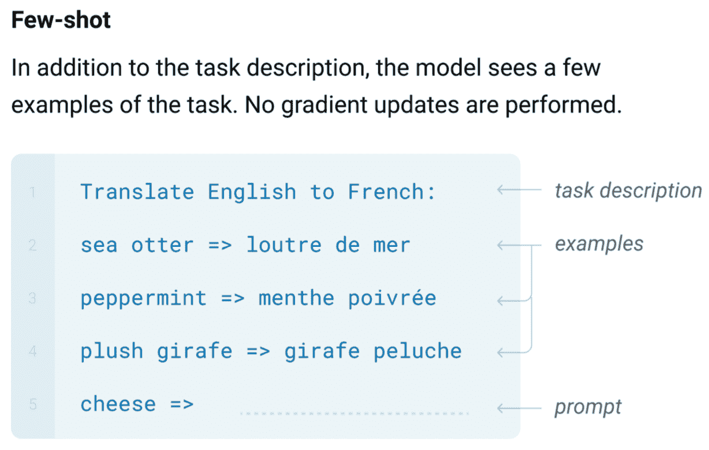

图 3-x  翻译任务示例

+   第一行：任务描述，告诉模型要做翻译

+   接下来的三行：示例对，包含英文单词和对应的法文单词

+   最后一行：待翻译的英文单词

将以上内容整体作为GPT-3的输入，模型就能输出对应的法文单词。上下文学习的应用非常灵活，除了翻译任务，还可以用于语法修饰甚至代码编写。

此外，GPT-3训练过程中并没有显式提供类似测试阶段任务描述加示例这样的训练数据。然而，由于GPT-3的训练数据量极其巨大（包含wiki、书本期刊、reddit上的讨论等），或许其中已经包含了各种任务类似结构的数据，且GPT-3模型容量足够大，能够记住所有训练数据。

目前，对于上下文学习能力的成因仍是一个开放性问题。为什么只有大规模语言模型才具备该能力？或许仅有模型参数量大还不够，还必须训练数据量足够大，模型才能显现出这种能力。这些问题仍需进一步研究和探索。

**ICL基础原理**

通过提[供一](https://arxiv.org/abs/2301.00234)些示范性的<输入-标签>对，在不需要更新模型参数的情况下，ICL可以对新输入进行准确预测。这种能力在各种应用场景中展现了极大的潜力。尽管ICL展示了出色的性能，但其具体工作原理仍然是个未解之谜。为了解释这一现象，清华大学、北京大学和微软的研究人员发表了一篇论文，将语言模型视为一种元优化器（meta-optimizer），并将ICL理解为一种隐性（implicit）的微调。这种视角帮助我们更好地理解ICL的运行机制。

ICL可以分为以下三种类型：

1.  Few-shot Learning：提供多个示例。例如：“将中文翻译为英文。你好->hello，再见->goodbye，购买->purchase，销售->”，模型应预测下一个输出为“sell”。

1.  One-shot Learning：提供一个示例。例如：“将中文翻译为英文。你好->hello，销售->”，模型应预测下一个输出为“sell”。

1.  Zero-shot Learning：无示例。例如：“将中文翻译为英文。销售->”，模型应预测下一个输出为“sell”。

它的主要流程包括以下几个步骤：

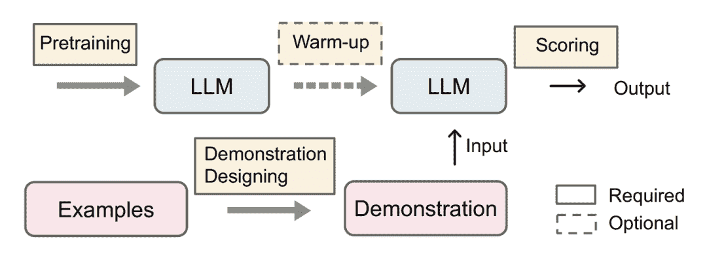

图 3-x  ICL步骤

1.  **预训练阶段**：通过大规模语料库进行训练，培养语言模型的ICL能力。可选的预热阶段能进一步提升模型的性能。

1.  **演示设计**：利用预训练的LLM和精心设计的示例，加上适当的评分策略，生成任务的最终输出。

1.  **推理阶段**：将示例和查询问题结合形成一个提示，输入模型进行预测。示例的质量对ICL效果并没有显著影响。

ICL的强大性能依赖于两个阶段：

1.  **训练阶段**：训练LLM的ICL能力。语言模型直接在语言建模目标上进行训练，如从左到右的生成。虽然这些模型并没有针对上下文学习进行特别优化，但ICL仍然具有令人惊讶的能力。

1.  **推理阶段**：LLM根据特定任务的演示进行预测。由于输入和输出标签都在可解释的自然语言模板中表示，因此有多个方向来提高ICL的性能。

随着模型规模和语料库的扩大，研究表明，LLMs可以利用ICL完成一系列复杂的任务，包括解决数学推理问题。这些能力已被广泛验证，显示了ICL作为大型语言模型的一种新兴能力的潜力。

ICL的核心思想基于类比学习。简单来说，ICL通过从给定的示例中提取模式，将这些模式应用于新任务，从而实现准确的预测和解决问题。

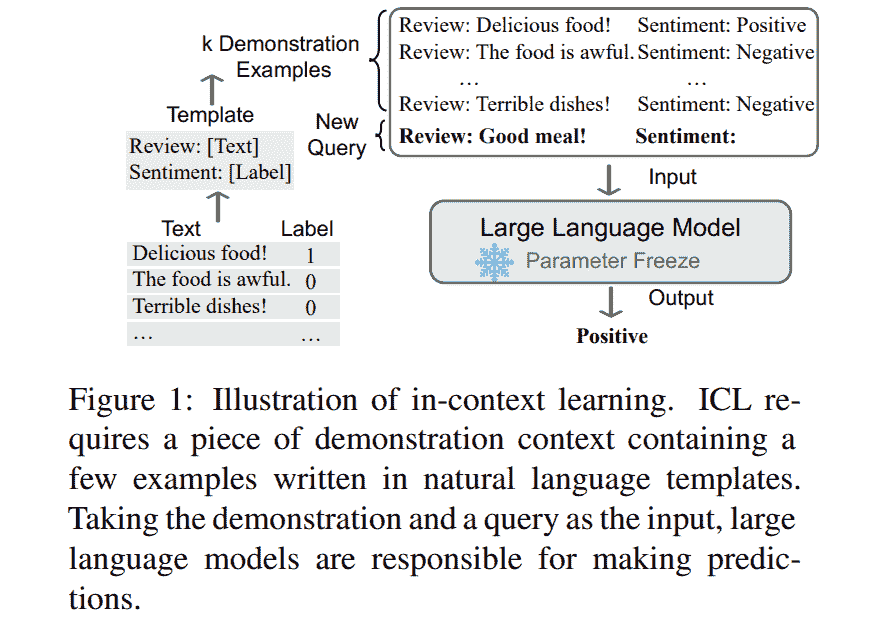

图 3-x  ICL类比学习

在ICL中，首先需要一些示例来形成演示上下文。示例通常使用自然语言模板编写。然后，ICL将一个查询问题和一个演示上下文连接在一起形成一个提示。最后，将其输入到语言模型中进行预测。ICL不需要参数更新，直接对预训练语言模型进行预测。模型被期望学习隐藏在演示中的模式，并相应地做出正确的预测。

ICL作为一种新的范式，具有许多吸引人的优势。首先，演示用自然语言格式编写，提供一个可解释的接口与大型语言模型通信。这种范式通过更改演示和模板使将人类知识纳入语言模型变得容易得多。其次，上下文学习类似于人类的类比决策过程。第三，与有监督学习相比，ICL是一种无监督学习框架。这不仅可以大大降低使模型适应新任务的计算成本，还可以使语言模型即服务成为可能，并且可以很容易地应用于大规模的现实世界任务。

然而，ICL中还有一些问题和性质需要进一步研究。尽管普通的GPT-3模型显示出ICL能力，但通过预训练期间的自适应，能力可以显著提高。此外，ICL的性能对特定的设置很敏感，包括提示模板、上下文示例的选择和示例顺序等。尽管从直观上看是合理的，但ICL的工作机制仍然不明确，很少有研究提供初步解释。

### 思维链 (CoT)

CoT是一种改进的Prompt策略，旨在提升LLM在复杂推理任务中的表现。与ICL不同，CoT不仅关注输入和输出，还特别强调将推理过程中的中间步骤纳入Prompt。这种方法使得模型能够更清晰地展示其思考过程，从而在算术推理、常识推理和符号推理等任务中表现出色。

**什么是 CoT？**

[20](https://arxiv.org/pdf/2201.11903)22 年，Google 发表了一篇论文，提到了一种叫做“思维链”的技术（英文名叫 Chain-of-Thought，简称 CoT）。简单来说，这种方法就是让大模型（像 ChatGPT 这样的 AI 模型）逐步将一个复杂的问题分解为更简单的几个子问题，一步一步解决，直到得出答案。这个分解过程就被称为“思维链”。

为什么要这么做呢？想象一下你在解数学题时，不是一下子直接写出答案，而是把每一个解题步骤都写下来，这样不仅更容易理解，也能让整个过程更清晰。这就是思维链的原理——通过分解问题，让 AI 更容易找到正确答案。

**传统方法与 CoT 的区别**

通**常，**我们对** AI 的提问就像**是从输**入到**输出的直线过程，比如你问一个问题，AI 直接给你答案。而使用思维链时，这个过程就变成了三个部分：输入 → 思维链（推理过程） → 输出。

简单举个例子，如果让 AI 回答“如果有 5 只苹果，每只苹果值 3 元，总共多少钱？” 传统的方法可能直接回答“15 元”。但使用思维链，AI 会先写出：“5 只苹果，每只 3 元，所以是 5 × 3，答案是 15 元。” 通过展示这些中间步骤，AI 的回答更容易被理解。

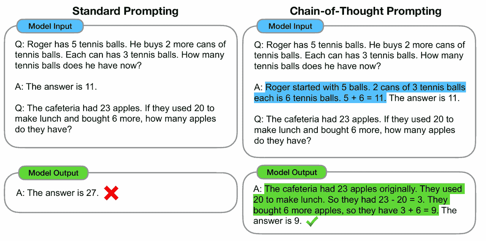

图 3-x  CoT与标准prompt步骤对比

上面这张图展示了标准提示（Standard Prompting）和思维链提示（Chain-of-Thought Prompting）的区别。

在左侧的标准提示中，我们看到模型直接给出答案，没有解释过程，因此在面对复杂问题时，模型很容易出错。比如，当被问到“Roger 有 5 个网球，他又买了 2 罐网球，每罐有 3 个网球。现在他一共有多少个网球？”时，模型直接给出了答案“11”。虽然答案正确，但没有展示中间推理步骤，这使得它的可靠性和理解性较低。

在右侧的思维链提示中，模型被要求逐步解释整个过程：“Roger 最开始有 5 个网球，又买了 2 罐网球，每罐有 3 个网球，总共有 6 个网球。5 + 6 = 11。” 通过一步步地展示推理过程，模型不仅得到正确答案，而且让人清楚地看到解题的逻辑。

另一个例子中，食堂有 23 个苹果，用掉了 20 个来做午餐，又买了 6 个苹果，还剩多少个苹果？标准提示下模型回答“27”，这是错误的。而使用思维链提示，模型会一步步解释：“原本有 23 个苹果，做午餐用掉了 20 个，所以还剩 3 个。然后又买了 6 个苹果，所以 3 + 6 = 9 个苹果。” 最终得到正确答案。

**CoT 的不同类型**

通过将采用思维链（CoT）方法的提示（Prompt）进行细致的分解，我们可以更深入、更清晰地洞察到思维链的工作机制和流程。根据是否包含示例，我们可以将思维链分为两种：

1.  **Zero-Shot-CoT**：没有提供具体的例子，只是在问题中加一句“让我们一步步思考”（Let's think step by step）。这种简单的提示就能“唤醒” AI 的推理能力。

1.  **Few-Shot-CoT**：给 AI 一些例子，每个例子都包含问题、推理过程和答案，像是给 AI 讲解解题步骤。通过这些例子，AI 就能模仿这些推理步骤解决新问题。

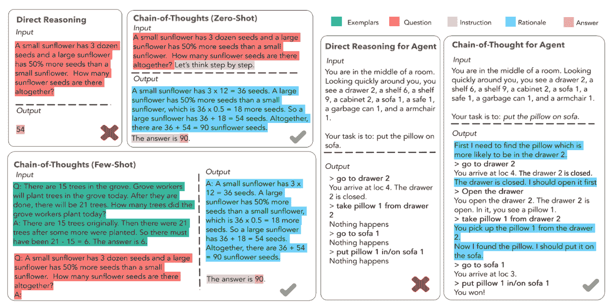

图 3-x  CoT的分类与实例

上面这张图展示了标准提示（Direct Reasoning）和思维链提示（Chain-of-Thought Reasoning）的区别。

在左侧的直接推理中，我们看到模型直接给出答案，没有解释过程，因此在面对复杂问题时，模型很容易出错。比如，问到“小向日葵有 3 打种子，而大向日葵比小向日葵多 50% 的种子，一共有多少种子？”时，模型直接得出错误的答案“54”。

而在右侧的思维链推理中，模型被要求逐步解释整个过程：“小向日葵有 3 打种子，即 3 × 12 = 36 个种子，大向日葵比小向日葵多 50%，也就是 36 × 0.5 = 18 个种子。所以大向日葵有 36 + 18 = 54 个种子，总共有 36 + 54 = 90 个种子。” 通过一步步展示推理过程，模型不仅得出正确答案，而且让人清楚地看到解题的逻辑。

**为什么 CoT 有效？**

目前为止，还没有一个完全被大家认可的科学解释来说明为什么思维链有效。不过，有很多实验观察到了一些有趣的现象，可以帮助我们理解 CoT：

+   **模型规模要足够大**：如果 AI 太小（比如理解力不足），思维链可能就不起作用，因为它连基础知识都还不理解。

+   **任务不能太简单**：对于一些非常简单的问题，思维链没有太大帮助，因为 AI 已经能直接给出答案。

+   **训练数据的联系**：如果 AI 在训练中学到的数据彼此联系紧密，思维链的效果会更好。

+   **示例中的错误**：有趣的是，即使给 AI 的示例中有些错误步骤，思维链依然有效。这说明 CoT 更像是在“指挥” AI 去做一步步的推理，而不是教 AI 具体怎么做。

简而言之，思维链的效果，可能在于它强迫 AI 按步骤思考，就像老师要求学生把解题过程写下来一样，不仅是为了得到答案，更是为了更好地理解问题的过程。

### CAMEL中的prompt

现在我们来看看如何使用 CAMEL 的 Prompt 功能，通过实操来更好地理解Prompt的概念。

使用CoT提示创建特定任务Agent

CAMEL 提供了一些便捷的工具来帮助用户使用 CoT。我们可以使用 TaskSpecifyAgent 创建一个特定任务Agent，它会自动调用带有 CoT 的模板。例如，下面是代码示例：

```
from camel.agents import TaskSpecifyAgent
from camel.models import ModelFactory
from camel.types import ModelPlatformType, TaskType
import os
from dotenv import load_dotenv

load_dotenv()
api_key = os.getenv(&#x27;INTERNLM_API_KEY&#x27;)

model = ModelFactory.create(
    model_platform=ModelPlatformType.INTERNLM,
    model_type=&quot;internlm2.5-latest&quot;,
    api_key=api_key
)
task_specify_agent = TaskSpecifyAgent(
    model=model, task_type=TaskType.AI_SOCIETY,output_language=&#x27;中文&#x27;
)
specified_task_prompt = task_specify_agent.run(
    task_prompt=&quot;Improving stage presence and performance skills&quot;,
    meta_dict=dict(
        assistant_role=&quot;Musician&quot;, user_role=&quot;Student&quot;, word_limit=100
    ),
)
print(f&quot;Specified task prompt:\n{specified_task_prompt}\n&quot;)

&gt;&gt;&gt;
Specified task prompt:
Musician will coach Student on dynamic stage movement, audience engagement techniques, and emotional expression during performances, enhancing overall charisma and connection with the audience.
```

在这个例子中，我们使用 TaskSpecifyAgent 生成了一个带有思维链的任务提示，通过为 Agent指定角色，让它逐步生成问题的解决方案。

**使用自定义 Prompt 模板**

CAMEL 还允许用户创建自己的 Prompt 模板，使得生成的 Prompt 更加符合用户的需求。我们可以编写自己的思维链提示模板，然后将它应用到 TaskSpecifyAgent 中。下面是一个简单的示例：

```
from camel.agents import TaskSpecifyAgent
from camel.models import ModelFactory
from camel.prompts import TextPrompt
from camel.types import ModelPlatformType
import os
from dotenv import load_dotenv

load_dotenv()
api_key = os.getenv(&#x27;INTERNLM_API_KEY&#x27;)

model = ModelFactory.create(
    model_platform=ModelPlatformType.INTERNLM,
    model_type=&quot;internlm2.5-latest&quot;,
    api_key=api_key
)

my_prompt_template = TextPrompt(
    &#x27;Here is a task: I\&#x27;m a {occupation} and I want to {task}. Help me to make this task more specific.&#x27;
)  # 你可以根据需求自定义任何模板
task_specify_agent = TaskSpecifyAgent(
    model=model, task_specify_prompt=my_prompt_template
)
response = task_specify_agent.run(
    task_prompt=&quot;get promotion&quot;,
    meta_dict=dict(occupation=&quot;Software Engineer&quot;),
)
print(response)

&gt;&gt;&gt;
Certainly! To make your goal of getting a promotion as a Software Engineer more specific, you can break it down into clear, actionable steps. Here’s a more detailed version of your task:

### Specific Task: Get Promoted as a Software Engineer

#### 1. **Understand the Promotion Criteria**
   - **Research Company Policies:** Review your company&#x27;s promotion guidelines and criteria.
   - **Talk to Your Manager:** Schedule a meeting with your manager to discuss what is required for a promotion, including specific skills, projects, and performance metrics.
   - **Analyze Peer Promotions:** Look at the career paths of colleagues who have been promoted recently to identify common traits and achievements.

#### 2. **Set Clear Goals**
   - **Short-Term Goals (Next 3-6 months):** Identify 3-5 specific, achievable goals that align with your promotion criteria.
     - Example: Complete a critical project ahead of schedule, improve code quality by 20%, or lead a small team on a new initiative.
   - **Long-Term Goals (Next 6-12 months):** Set 2-3 ambitious goals that demonstrate leadership and advanced technical skills.
     - Example: Mentor junior engineers, contribute to a major architectural change, or publish a paper or blog post on a relevant topic.

#### 3. **Enhance Your Skills**
   - **Technical Skills:** Identify areas where you need to improve and create a plan to enhance these skills.
     - Example: Take online courses, attend workshops, or work on side projects to gain expertise in new technologies.
   - **Soft Skills:** Develop leadership, communication, and problem-solving skills.
     - Example: Join a public speaking club, take a leadership course, or volunteer for cross-functional projects.

#### 4. **Build Relationships**
   - **Network Internally:** Build strong relationships with colleagues and senior leaders.
     - Example: Participate in company events, join employee resource groups, or offer to help on other teams&#x27; projects.
   - **Seek Mentors:** Find mentors within the company who can provide guidance and advocate for your promotion.
...
   - **Gather Recommendations:** Ask for recommendations from colleagues and managers who can vouch for your skills and contributions.
   - **Practice Interviewing:** If there is an interview process, practice answering common promotion interview questions.

By breaking down your goal into these specific steps, you can create a clear roadmap to achieving your promotion. Good luck!
```

通过这些实操示例，我们可以看到如何通过 CAMEL 的 Prompt 功能来使用思维链提示，这样不仅可以使输出结果更具逻辑性，还能更好地控制 AI 生成内容的质量和相关性。

**使用 ****TextPrompt**** 类编写你的提示词**

在这一部分中，我们将探索 TextPrompt 类并理解其功能。TextPrompt 类是内置 str 类的子类，为处理文本提示提供了额外的功能。

> TextPrompt 类简介

TextPrompt 类表示一个文本提示，并扩展了 str 类的功能。它提供了一个名为 key_words 的属性，该属性返回一个字符串集合，表示提示中的关键词。

下面是如何使用 TextPrompt 类的示例：

```
from camel.prompts import TextPrompt
prompt = TextPrompt(&#x27;Please enter your name and age: {name}, {age}&#x27;)
print(prompt)  
&gt;&gt;&gt; 
&#x27;Please enter your name and age: {name}, {age}&#x27;
```

在上面的示例中，我们创建了一个包含姓名和年龄关键词的格式字符串的 TextPrompt 实例。我们可以像 Python 中的 str 一样打印 TextPrompt。

> 使用 TextPrompt 类

一旦创建了 TextPrompt 实例，我们就可以使用该类提供的各种方法和属性来操作和处理文本提示。

key_words 属性返回一个字符串集合，表示提示中的关键词。

```
from camel.prompts import TextPrompt
prompt = TextPrompt(&#x27;Please enter your name and age: {name}, {age}&#x27;)
print(prompt.key_words)
&gt;&gt;&gt; 
{&#x27;name&#x27;, &#x27;age&#x27;}
```

在上面的示例中，key_words 属性返回一个表示提示中关键词的字符串集合，在这种情况下是 'name' 和 'age'。

format 方法重写了内置的 str.format 方法，允许部分格式化格式字符串中的值。它用提供的值替换格式字符串中的关键词。

```
from camel.prompts import TextPrompt
prompt = TextPrompt(&#x27;Your name and age are: {name}, {age}&#x27;)
name, age = &#x27;John&#x27;, 30
formatted_prompt = prompt.format(name=name, age=age)
print(formatted_prompt)  
&gt;&gt;&gt; &quot;Your name and age are: John, 30&quot;
```

在上面的示例中，我们使用 format 方法将关键词 {name} 和 {age} 替换为值 'John' 和 30。

我们还可以通过只提供部分值进行部分格式化：

```
from camel.prompts import TextPrompt
prompt = TextPrompt(&#x27;Your name and age are: {name}, {age}&#x27;)
name = &#x27;John&#x27;
partial_formatted_prompt = prompt.format(name=name)
print(partial_formatted_prompt)  
&gt;&gt;&gt; &quot;Your name and age are: John, {age}&quot;
```

在上面的示例中，我们仅提供 name 关键词的值，而 age 关键词保持不变。当我们想在不同代理中对 TextPrompt 的不同关键词进行格式化时，这种方式很有帮助。

我们可以对 TextPrompt 实例执行各种字符串操作，如连接、连接和应用类似于 Python str 的字符串方法。

```
from camel.prompts import TextPrompt
prompt1 = TextPrompt(&#x27;Hello, {name}!&#x27;)
prompt2 = TextPrompt(&#x27;Welcome, {name}!&#x27;)
#连接
prompt3 = prompt1 + &#x27; &#x27; + prompt2
print(prompt3)  
&gt;&gt;&gt; &quot;Hello, {name}! Welcome, {name}!&quot;
print(isinstance(prompt3, TextPrompt))
&gt;&gt;&gt; True
print(prompt3.key_words)
&gt;&gt;&gt; {&#x27;name&#x27;}
#连接
prompt4 = TextPrompt(&#x27; &#x27;).join([prompt1, prompt2])
print(prompt4)
&gt;&gt;&gt; &quot;Hello, {name}! Welcome, {name}!&quot;
print(isinstance(prompt4, TextPrompt))
&gt;&gt;&gt; True
print(prompt4.key_words)
&gt;&gt;&gt; {&#x27;name&#x27;}
#应用字符串方法
prompt5 = prompt4.upper()
print(prompt5)
&gt;&gt;&gt; &quot;HELLO, {NAME}! WELCOME, {NAME}!&quot;
print(isinstance(prompt5, TextPrompt))
&gt;&gt;&gt; True
print(prompt5.key_words)
&gt;&gt;&gt; {&#x27;NAME&#x27;}
```

在上面的示例中，我们演示了使用 + 运算符进行连接、使用 join 方法进行连接以及将 upper 方法应用于 TextPrompt 实例。生成的提示也是 TextPrompt 的实例。

除此以外，CAMEL 提供了多种支持的 Prompt 模板，以[满足不同](https://docs.camel-ai.org/key_modules/prompts.html#concept)类型的任务需求。具体可以参考这个Blog

## Memory

### 简介

在Agent系统中，Memory模块是一个关键的组件，其主要功能是存储和检索信息，以支持agent的学习和决策过程。该模块模拟人类记忆的某些特征，能够动态地保存和更新信息，使agent能够利用过去的经验进行推理和决策。

**为什么要有Memory模块？**

试想一下，当你和agent交互时，如果agent没有记忆，那就没法进行多轮对话了。你每次提问都相当于重新开始一个对话，对话就不具备连续性。

Memory模块通常包括以下几个核心功能：

1.  **信息储存**：能够高效存储多种形式的数据，包括事实、事件、规则和上下文信息，以便在需要时快速访问。

1.  **信息检索**：支持根据特定查询或上下文快速检索相关信息，帮助agent在需要时做出准确的判断。

1.  **记忆更新**：能够根据新的信息和经验动态更新存储内容，以反映环境或任务的变化。

1.  **记忆管理**：包括老化机制和优先级管理，确保较重要的信息能够长期保留，而不再需要的信息可以被有效清除，以优化存储资源的使用。

CAMEL 中的Memory模块提供了一个灵活的系统，用于存储、检索和管理 Agent的信息。它使Agent能够在对话中维护上下文，并从过去的交互中检索相关信息，从而提高 AI 响应的连贯性和相关性。

### ChatHistoryBlock

ChatHistoryBlock 是一个基于键值存储的聊天历史记忆块实现。

+   使用键值存储后端(BaseKeyValueStorage)

+   支持窗口式检索

+   实现消息权重衰减机制

**初始化参数**

+   storage: 存储后端,默认使用InMemoryKeyValueStorage

+   keep_rate: 历史消息权重衰减率,默认 0.9

该模块主要实现了以下方法：

+   retrieve()：使用可选的窗口大小获取最近的聊天记录

+   write_records()：将新记录写入聊天记录

+   clear()：删除所有聊天消息

**keep_rate概述**

keep_rate是 CAMEL 记忆系统中用于控制历史消息权重衰减的重要参数。它主要用于调整历史消息在上下文中的重要性。

+   取值范围: [0,1]

+   默认值: 0.9

+   作用对象: 非system消息(system消息始终保持 score=1.0)

它的工作原理是在检索历史消息时:

1.  最新消息的 score 初始值为 1.0

1.  每往前一条消息,score 会乘以 keep_rate

1.  最终每条消息的 score 值决定了其在上下文中的重要性

现在假设有5条历史消息,keep_rate=0.9:

| 消息位置 | Score 计算 | 最终 Score |
| --- | --- | --- |
| 最新消息 | 1.0 | 1.0 |
| 往前1条 | 1.0 * 0.9 | 0.9 |
| 往前2条 | 0.9 * 0.9 | 0.81 |
| 往前3条 | 0.81 * 0.9 | 0.729 |
| 往前4条 | 0.729 * 0.9 | 0.656 |

实际上，它的工作原理和我们人脑很像，我们对于近期的事情印象会更深刻，而对于久一些的事情反之。以下是一些值得注意的点：

1.  score 不影响消息的存储,但它会在总token数超过限制时决定哪些消息在生成下文时应该被保留。

1.  system消息不受 score 影响，也就是说在生成下文的时候，system_msg会一直保留。

1.  keep_rate 与 window_size 可以配合使用来更好地控制上下文

1.  过低的 keep_rate 可能导致有价值的历史信息被过度弱化

1.  过高的 keep_rate 可能导致上下文过于冗长

**示例用法**

我们可以通过以下例子直观感受keep_rate在ChatHistoryBlock中的作用。

```
from camel.memories.blocks import ChatHistoryBlock
from camel.memories.records import MemoryRecord
from camel.types import OpenAIBackendRole
from camel.messages import BaseMessage

# 创建一个 ChatHistoryBlock 实例
chat_history = ChatHistoryBlock(keep_rate=0.8)

# 模拟写入一些消息记录
chat_history.write_records([
    MemoryRecord(message=BaseMessage.make_assistant_message(role_name=&quot;user&quot;, content=&quot;Hello,今天感觉怎么样？&quot;), role_at_backend=OpenAIBackendRole.USER),
    MemoryRecord(message=BaseMessage.make_user_message(role_name=&quot;assistant&quot;, content=&quot;我很好，谢谢！&quot;), role_at_backend=OpenAIBackendRole.ASSISTANT),
    MemoryRecord(message=BaseMessage.make_user_message(role_name=&quot;user&quot;, content=&quot;你能做些什么？&quot;), role_at_backend=OpenAIBackendRole.USER),
    MemoryRecord(message=BaseMessage.make_assistant_message(role_name=&quot;assistant&quot;, content=&quot;我可以帮助你完成各种任务。&quot;), role_at_backend=OpenAIBackendRole.ASSISTANT),
])

# 检索最近的 3 条消息
recent_records = chat_history.retrieve(window_size=4)

for record in recent_records:
    print(f&quot;消息: {record.memory_record.message.content}, 权重: {record.score}&quot;)
    
&gt;&gt;&gt;
消息: hello,你怎么样？, 权重: 0.40960000000000013
消息: 我很好，谢谢！, 权重: 0.5120000000000001
消息: 你能做些什么？, 权重: 0.6400000000000001
消息: 我可以帮助你完成各种任务。, 权重: 0.8
```

### VectorDBBlock

VectorDBBlock[ 是一](https://fmhw1n4zpn.feishu.cn/docx/AF4XdOZpIo6TOaxzDK8cxInNnCe#share-EufWdDs8soIeExxL39jcOdcBnzg)个基于向量数据库的语义记忆块实现。有关向量的部分可以参考第五章。

+   使用向量存储后端（BaseVectorStorage）

+   支持语义相似度检索

+   实现消息的向量化存储

**初始化参数**

+   storage：可选 BaseVectorStorage （默认：QdrantStorage)

+   embedding：可选 BaseEmbedding（默认值：OpenAIEmbedding)

该模块主要实现了以下方法：

+   retrieve()：根据关键字获取相似记录

+   write_records()：将新记录转换并写入矢量数据库

+   clear()：从向量数据库中删除所有记录

该模块的工作流程如下：

1.  存储过程:

+   将消息内容转换为向量表示

+   生成唯一标识符（UUID）

+   将向量和原始消息存入向量数据库

1.  检索过程:

+   将查询关键词转换为向量

+   在向量空间中搜索相似向量

+   返回相似度最高的记录

**示例用法**

这里如果不定义VectorDBBlock中的embedding参数的话，则会调用默认的OpenAI的text-embedding-3-small模[型，需要对应的Open](https://fmhw1n4zpn.feishu.cn/docx/AF4XdOZpIo6TOaxzDK8cxInNnCe#share-CTBSdtqsPowmFyxdH6wcmEXVnKh)AI的API KEY，贴心的是，CAMEL也为我们提供了一个方便快捷的方式去一键调用我们的本地embedding模型，只需要导入SentenceTransformerEncoder，然后根据场景选择我们想用的embedding模型（默认为intfloat/e5-large-v2），这里是中文场景，笔者选择了bge-m3作为我们的embedding模型，模型的选择以及更多相关信息可以参考Hugging Face(embedding_model)以及我们的Embedding章节。

```
from camel.memories.blocks.vectordb_block import VectorDBBlock
from camel.memories.records import MemoryRecord
from camel.messages import BaseMessage
from camel.embeddings import SentenceTransformerEncoder
from camel.types import OpenAIBackendRole

# 创建一个 VectorDBBlock 实例
vector_db_block = VectorDBBlock(embedding=SentenceTransformerEncoder(model_name=&quot;BAAI/bge-m3&quot;))

# 创建一些示例聊天记录
records = [
    MemoryRecord(message=BaseMessage.make_user_message(role_name=&quot;user&quot;, content=&quot;今天天气真好！&quot;), role_at_backend=OpenAIBackendRole.USER),
    MemoryRecord(message=BaseMessage.make_user_message(role_name=&quot;user&quot;, content=&quot;你喜欢什么运动？&quot;), role_at_backend=OpenAIBackendRole.USER),
    MemoryRecord(message=BaseMessage.make_user_message(role_name=&quot;user&quot;, content=&quot;今天天气不错，我们去散步吧。&quot;), role_at_backend=OpenAIBackendRole.USER),
]

# 将记录写入向量数据库
vector_db_block.write_records(records)

# 使用关键词进行检索
keyword = &quot;天气&quot;
retrieved_records = vector_db_block.retrieve(keyword=keyword, limit=3)

for record in retrieved_records:
    print(f&quot;UUID: {record.memory_record.uuid}, Message: {record.memory_record.message.content}, Score: {record.score}&quot;)
&gt;&gt;&gt;
UUID: f7519828-afe7-41e4-8331-7bbc4d7dcbd5, Message: 今天天气真好！, Score: 0.779863416845349
UUID: 0fbab391-f0e0-4580-877b-8fa2a837675b, Message: 今天天气不错，我们去散步吧。, Score: 0.6920892191464151
UUID: a640cf33-987b-4b52-ac2b-a987dd474e4e, Message: 你喜欢什么运动？, Score: 0.534536213348924
```

### CAMEL中的具体实践

在CAMEL中目前支持key_value，graph，vector三种形式对于LLM信息进行存储，以供需要的时候检索。大模型生成自然语言文本的核心原理是基于预测。具体来说，语言模型的主要任务是根据给定的上下文预测下一个词。

CAMEL中主要会使用两个chat_history以及context两个数据结构处理记忆信息。其中Chat_history用于规范agent使用过程中的聊天记录，context部分用于从chat_history中获取上下文，由于模型有输入token的限制，因此如何从记录中获取到足够有效且重要的上下文并提供给模型至关重要。CAMEL通过权重的机制从chat_history中筛选重要的部分组成context，从而保证决策能力的有效性。

下面使用一个案例演示一下CAMEL中memory的实现，我们首先创建一个memory对象，之后创建一个agent，并将memory对象赋值给agent的memory属性。

```
from camel.memories import (
    LongtermAgentMemory,
    MemoryRecord,
    ScoreBasedContextCreator,
    ChatHistoryBlock,
    VectorDBBlock,
)
from camel.messages import BaseMessage
from camel.types import ModelType, OpenAIBackendRole
from camel.utils import OpenAITokenCounter
from camel.embeddings import SentenceTransformerEncoder

# 1. 初始化内存系统
memory = LongtermAgentMemory(
    context_creator=ScoreBasedContextCreator(
        token_counter=OpenAITokenCounter(ModelType.GPT_4O_MINI),
        token_limit=1024,
    ),
    chat_history_block=ChatHistoryBlock(),
    vector_db_block=VectorDBBlock(embedding=SentenceTransformerEncoder(model_name=&quot;BAAI/bge-m3&quot;)),
)

# 2. 创建记忆记录
records = [
    MemoryRecord(
        message=BaseMessage.make_user_message(
            role_name=&quot;User&quot;,
            content=&quot;什么是CAMEL AI?&quot;
        ),
        role_at_backend=OpenAIBackendRole.USER,
    ),
    MemoryRecord(
        message=BaseMessage.make_assistant_message(
            role_name=&quot;Agent&quot;,
            content=&quot;CAMEL-AI是第一个LLM多智能体框架,并且是一个致力于寻找智能体 scaling law 的开源社区。&quot;
        ),
        role_at_backend=OpenAIBackendRole.ASSISTANT,
    ),
]

# 3. 写入记忆
memory.write_records(records)

context, token_count = memory.get_context()

print(context)
print(f&#x27;token消耗: {token_count}&#x27;)

&gt;&gt;&gt;
[{&#x27;role&#x27;: &#x27;user&#x27;, &#x27;content&#x27;: &#x27;什么是CAMEL AI?&#x27;}, {&#x27;role&#x27;: &#x27;assistant&#x27;, &#x27;content&#x27;: &#x27;CAMEL-AI是第一个LLM多智能体框架,并且是一个致力于寻找智能体 scaling law 的开源社区。&#x27;}]
token消耗: 52
```

我们首先直接调用agent试一下：

```
from camel.agents import ChatAgent
from camel.models import ModelFactory
from camel.types import ModelPlatformType
import os
from dotenv import load_dotenv

load_dotenv()
# 定义系统消息
sys_msg = &quot;你是一个好奇的智能体，正在探索宇宙的奥秘。&quot;

api_key = os.getenv(&#x27;INTERNLM_API_KEY&#x27;)

model = ModelFactory.create(
    model_platform=ModelPlatformType.INTERNLM,
    model_type=&quot;internlm2.5-latest&quot;,
    api_key=api_key
)
agent = ChatAgent(system_message=sys_msg, model=model)

# 定义用户消息
usr_msg = &quot;告诉我基于我们讨论的内容，哪个是第一个LLM多智能体框架？&quot;

# 发送消息给agent
response = agent.step(usr_msg)

# 查看响应
print(response.msgs[0].content)

&gt;&gt;&gt;
&quot;截至目前（2023年），还没有一个明确被广泛认可为“第一个”LLM多智能体框架的具体项目或平台。然而，随着大语言模型（LLMs）和多智能体系统研 
究的快速发展，一些早期尝试将这两者结合起来的项目可以被视为先驱。

例如，“AgentVerse”是一个基于大语言模型的多智能体框架，它允许不同的AI代理相互交互以完成任务或解决问题。虽然不能确切地说它是第一个，但
它确实是在这一领域较早进行探索的一个例子。

此外，还有其他一些研究和项目也在探索如何利用LLMs构建多智能体系统，比如通过模拟社会动态、协作解决问题等。这些工作都在不同程度上推动了
该领域的进步。

如果您有更具体的时间范围或其他标准来定义“第一个”，请提供更多信息，这样我可以尝试给出更加准确的答案。&quot;
```

之后我们将之前设定的memory赋值给agent：

```
# 将memory赋值给agent
agent.memory = memory
# 发送消息给agent
response = agent.step(usr_msg)
# 查看响应
print(response.msgs[0].content)
&gt;&gt;&gt;
&quot;基于我们讨论的内容，CAMEL-AI 是第一个基于大型语言模型（LLM）的多智能体框架。&quot;
```

可以看到我们新创建的智能体就能够根据设定好的记忆来回答问题了。

## Tools

### 工具说明

工具(Tools)是大语言模型(LLM)与外部世界交互的桥梁。虽然LLM具有强大的语言理解和生成能力,但它们本质上是封闭的语言模型,无法直接:

+   获取实时信息(如天气、新闻)

+   访问外部数据(如数据库、文件)

+   执行具体操作(如发送邮件、控制设备)

为了克服这些限制,我们需要为LLM配备各种工具,使其能够:

+   通过API获取实时数据

+   调用外部服务

+   执行特定任务

+   与其他系统交互

工具充当允许 LLM 与世界交互的接口。工具本质上是一个具有名称、描述、输入参数和输出类型的函数。在本节中，我们将介绍 CAMEL 目前支持的工具，并解释如何定义您自己的工具和工具包。

**工具：**工具类似于 OpenAI Functions。在 CAMEL，我们提供了各种常用工具，您可以直接使用。虽然内置工具可能非常有用，但您很可能需要定义自己的工具。下文会说明如何创建自定义工具。

**工具包：**工具包是旨在良好协同工作的工具集合。

### 动手实践

下面我们可以通过一个直观的例子，展示为什么工具是必要的，（这里需要使用原生带工具调用的模型）：

```
from camel.agents import ChatAgent
from camel.models import ModelFactory
from camel.types import ModelPlatformType

import os
from dotenv import load_dotenv
import math

load_dotenv()

# 定义系统消息
sys_msg = &quot;你是一个数学大师，擅长各种数学问题。&quot;

# 初始化agent
api_key = os.getenv(&#x27;INTERNLM_API_KEY&#x27;)

model = ModelFactory.create(
    model_platform=ModelPlatformType.INTERNLM,
    model_type=&quot;internlm2.5-latest&quot;,
    api_key=api_key
)

# 创建agent并添加工具
agent = ChatAgent(
    system_message=sys_msg,
    model=model,
    output_language=&#x27;中文&#x27;,
    tools=[]
)

# 定义用户消息
usr_msg = &quot;2的平方根是多少？&quot;
```

这里我们先问一个数学问题。

```
# 发送消息给agent
response = agent.step(usr_msg)
print(response.msgs[0].content)

&gt;&gt;&gt;
2的平方根是 \(\sqrt{2}\)，其数值约为1.414。
```

可以看到模型给出了回答，虽然是对的，但自动省去了很多位的精度。如果用户需要更高的精度，这时候我们可以定义一个小工具：

**示例：定义数学工具**

首先，定义您的函数并使用FunctionTool

```
from camel.toolkits import FunctionTool
import math

def calculate_sqrt(x: float) -&gt; float:
    r&quot;&quot;&quot;计算一个数的平方根。

    Args:
        x (float): 需要计算平方根的数字。

    Returns:
        float: 输入数字的平方根。
    &quot;&quot;&quot;
    return math.sqrt(x)

# 用 FunctionTool 包装该函数
sqrt_tool = FunctionTool(calculate_sqrt)
```

**访问工具属性**

定义工具后，您可以使用内置方法检查其属性：

检索函数的名称：

```
print(sqrt_tool.get_function_name())

&gt;&gt;&gt; calculate_sqrt
```

获取函数作用的描述：

```
print(sqrt_tool.get_function_description())

&gt;&gt;&gt; 
计算一个数的平方根。
```

之后我们重新定义一下agent。

```
# 定义系统消息
sys_msg = &quot;你是一个数学大师，擅长各种数学问题。当你遇到数学问题的时候，你要调用工具，将工具计算的结果作为答案&quot;

tool_agent = ChatAgent(
    tools = [sqrt_tool],
    system_message=sys_msg,
    model=model,
    output_language=&quot;中文&quot;)
    
# 重新发送消息给toolagent
response = tool_agent.step(usr_msg)
print(response.msgs[0].content)

&gt;&gt;&gt;
2的平方根是1.4142135623730951。
```

可以看到这次模型给出了更佳精确的正确结果，并且通过以下的命令可以检查工具是否真的被调用：

```
print(response.info[&#x27;tool_calls&#x27;])

&gt;&gt;&gt;
[ToolCallingRecord(tool_name=&#x27;calculate_sqrt&#x27;, args={&#x27;x&#x27;: 2}, result=1.4142135623730951, tool_call_id=&#x27;call_b79f6efd92204f97a98c63&#x27;)]
```

---

# 第三章: CAMEL框架简介及实践

在本章中，我们将简要介绍多智能系统和 CAMEL框架。

##   CAMEL框架简介

### Multiple Agent基本概念

+   **定义**：多智能体（Multiple Agent）由多个相互作用的智能体组成，每个智能体都有自己的目标和策略。这些智能体可以相互通信、协作或竞争，以实现更复杂的行为和决策。

+   **应用**：多智能体系统广泛应用于复杂的任务中，如交通管理、分布式机器人系统、经济市场模拟、多玩家游戏等。

+   **特点**：

+   **协作**：智能体之间可以协作，共同解决问题。

+   **竞争**：智能体之间也可以存在竞争关系，如在拍卖或游戏场景中。

+   **自主性**：每个智能体都有自己的决策过程，保持一定程度的自主性。

+   **复杂性**：多智能体系统的设计与分析比单一智能体系统更复杂，因为需要考虑智能体之间的交互和协调。

+   **鲁棒性**：多智能体系统通常具有更好的鲁棒性，因为系统的稳定性和效能不完全依赖于单一决策者。

### 什么是CAMEL?

CAMEL (Communicative Agents for "Mind" Exploration of Large Language Models) 是一个开源的多智能体框架，专注于构建基于大语言模型的智能体交互系统。该框架通过角色扮演和结构化对话机制，实现智能体之间的有效协作。

在CAMEL框架中，ChatAgent 是最基础的智能体单元，负责处理对话逻辑和任务执行。而RolePlaying 和Workforce 则是多智能体系统，用于协调多个智能体的协作。

详见我们的开源仓库和项目主页

+   论文：https://ghli.org/camel.pdf

+   项目主页：https://www.camel-ai.org/

###  ChatAgent 简介

ChatAgent 是 CAMEL 框架的基础构建块，其设计目标是回答以下问题：“如何设计一个自主的交互式智能体，使其能够在最少人工监督的情况下，引导对话完成任务？”

在当前实现中，我们的智能体具备以下关键特性：

+   **角色 (Role)**：结合目标和内容规范，设定智能体的初始状态，引导智能体在连续交互过程中采取行动。

+   **大语言模型 (LLMs)**：每个智能体都使用大语言模型来增强认知能力。大语言模型使智能体能够理解和生成自然语言，从而解释指令、生成响应并参与复杂对话。

+   **记忆 (Memory)**：包括上下文记忆和外部记忆，使智能体能够以更扎实的方式进行推理和学习。

+   **工具 (Tools)**：智能体可以使用的一组功能，用于与外部世界交互，本质上是为智能体提供具身化能力。

+   通信 (Communication)：我们的框架允许智能体之间进行灵活且可扩展的通信，这是解决关键研究问题的基础。

+   **推理 (Reasoning)**：我们为智能体配备了不同的规划和奖励（评论员）学习能力，使其能够以更有指导性的方式优化任务完成。

###  Role Playing机制

RolePlaying是CAMEL框架的独特合作式智能体框架。该框架通过预定义的提示词为不同的智能体创建唯一的初始设置，帮助智能体克服诸如角色翻转、助手重复指令、模糊回复、消息无限循环以及对话终止条件等多个挑战。

#### 基本概念

1.1 **角色定义**

+   **Assistant角色**: 负责执行具体任务并提供解决方案的智能体

+   **User角色**: 负责提供指令和任务需求的智能体

+   **特定领域角色**: 如程序员、交易员等专业智能体

1.2 **交互规则**

```
# 初始prompt示例参考
system_message = &quot;&quot;&quot;
===== RULES OF ASSISTANT =====
1. Never forget you are a {ASSISTANT_ROLE} and I am a {USER_ROLE}
2. Never flip roles! Never instruct me!
3. You must decline my instruction honestly if you cannot perform it
4. Always start with: Solution: &lt;YOUR_SOLUTION&gt;
5. Always end with: Next request.
&quot;&quot;&quot;
```

**1.3 关键机制**

+   **角色固定**: 防止角色翻转，维持对话的稳定性

+   **格式规范**: 要求回复具有固定的开始和结束格式

+   **任务分解**: 自动将复杂任务分解为可执行的子任务

+   **循环对话**: 通过轮流发言推进任务进展

**2.工作流程**

2.1 **初始化阶段 **

+   设定角色身份

+   加载系统提示词

+   明确任务目标

2.2 **执行阶段 **

+   User提供具体指令

+   Assistant执行并给出解决方案

+   循环往复直至完成任务bi

#### 经典案例: 股票交易机器人详解

以下是一个对于Role-Playing的经典应用， 股票交易实例。在本案例中，我们通过角色扮演的方式来构建一个交易机器人。初始阶段，人类用户提出一个概念性任务，由一个专用Agent精确化为详细的任务描述。参与完成任务的有两个agent：一个扮演股票交易员，另一个扮演Python程序员。

**工作流程：**

```
from colorama import Fore

from camel.societies import Ro**lePl**aying
from camel.utils import print_text_animated

def main(model=YOUR_MODEL, chat_turn_limit=50) -&gt; None:
    task_prompt = &quot;Develop a trading bot for the stock market&quot;
    role_play_session = RolePlaying(
        assistant_role_name=&quot;Python Programmer&quot;,
        assistant_agent_kwargs=dict(model=model),
        user_role_name=&quot;Stock Trader&quot;,
        user_agent_kwargs=dict(model=model),
        task_prompt=task_prompt,
        with_task_specify=True,
        task_specify_agent_kwargs=dict(model=model),
    )
```

以上代码中，task_prompt 是用户输入的任务提示词，即“Develop a trading bot for the stock market”。创建 role_play_session 时，将 task_prompt 传递给了 RolePlaying。RolePlaying的作用是根据任务提示词，将任务分解为具体的任务小点，并与相应的AI角色进行交互。

具体来说，在这个例子中，助手角色是“Python Programmer”，用户角色是“Stock Trader”。通过这种方式，框架中的Agent可以将用户输入的较为抽象的任务转化为具体的任务小点，以便更好地进行交互和实现具体的功能。

这种设计可以帮助Agent更有针对性地理解任务，并根据具体的任务小点进行回答和执行操作。通过角色扮演会话，即使用户不懂技术，也能实现复杂的想法。Agent们们会通过对话和合作来帮助用户将想法转化为现实。这种方法不仅使得技术实现变得更加容易，也为人工智能的应用开辟了新的可能性，让创造变得更加简单和有趣。

RolePlaying工作流程图

** 角色设定：**

+   Python程序员(Assistant)：负责实现交易逻辑和代码

+   股票交易员(User)：提供交易策略和业务需求

**任务具体化**

任务具体化Agent将初步想法转换成详细任务描述：“开发一个基于机器学习的股票交易机器人，能够自动分析市场趋势、执行买卖操作，并实时调整策略以优化投资组合。”

**具体过程**

+   **步骤1: 任务提出**

人类用户提出希望开发一个交易机器人。

+   **步骤2: 定义AI角色**

设定合适的AI角色（股票交易员和Python程序员）来实现用户的想法。

+   **步骤3: 任务具像化**

任务具体化Agent为AI角色提供明确的任务描述，以便更好地理解和执行。比如：将“开发一个用于股票市场的交易机器人。”进一步具像为：“开发一个基于机器学习的股票交易机器人，能够自动分析市场趋势、执行买卖操作，并实时调整策略以优化投资组合。”

+   **步骤4: 任务拆分**

总体任务会由AI用户（股票交易员）来进一步拆分为各个子任务，确保AI助手（Python程序员）能够理解并执行子任务。例如：

+   "使用Python语言和Pandas库来处理股票数据。"

+   "集成Alpha Vantage API以获取实时股票信息。"

+   **步骤5: 对话和合作**

程序员AI和交易员AI开始对话和合作：

+   AI助手（Python程序员）：“您需要哪些功能？”

+   AI用户（股票交易员）：“我需要这个软件能够获取股票数据和分析社交媒体情绪。”

+   AI助手（Python程序员）：“您需要安装必要的编程库包括.....，您希望交易机器人使用哪些技术指标？”

+   AI用户（股票交易员）：“我希望交易机器人在QuantumTraderX类中实现一个方法，根据预测执行交易。”

+   AI助手（Python程序员）：“好的，以下是实现的代码：......”

+   **步骤6: 完成任务**

通过这种对话和合作的方式，两个AI角色能够一步步地共同完成任务，最终创建出一个用于股票市场的交易机器人。

示例视频：


[QQ2024123-225913-HD.mp4](https://internal-api-drive-stream.feishu.cn/space/api/box/stream/download/all/V93Eb0309oBUNaxnF4dcJdNvnse)

### Workforce 简介

Workforce是CAMEL框架中的一个多智能体协同工作系统。它以一种简洁的方式让多个智能体协作完成任务，类似于一个高效的团队合作系统。

更详细的使用信息，请参考我们的[对应内容](https://fmhw1n4zpn.feishu.cn/docx/AF4XdOZpIo6TOaxzDK8cxInNnCe#share-T4t0dbCrqoKV1qx8EbdcIAtpnwb)

**架构设计**

Workforce采用层级架构设计。一个workforce可以包含多个工作节点(worker nodes)，每个工作节点可以包含一个或多个智能体作为工作者。工作节点由workforce内部的协调智能体(coordinator agent)管理，协调智能体根据工作节点的描述及其工具集来分配任务。

除了协调智能体外，workforce内部还有一个任务规划智能体(task planner agent)。任务规划智能体负责任务的分解和组合，使workforce能够逐步解决任务。

**通信机制**

Workforce内部的通信基于任务通道(task channel)。Workforce初始化时会创建一个所有节点共享的通道。任务会被发布到这个通道中，每个工作节点会监听通道，接受分配给它的任务并解决。

当任务完成后，工作节点会将结果发布回通道，结果会作为其他任务的"依赖项"保留在通道中，供所有工作节点共享。

通过这种机制，workforce能够以协作和高效的方式解决任务。

**故障处理**

Workforce具有故障处理机制。当任务失败时，协调智能体会采取行动修复。这些行动可以是：

+   将任务分解为更小的任务并重新分配

+   创建一个能够完成该任务的新工作者

目前，协调智能体根据任务被分解的次数来做决策：

+   如果任务已经被分解超过特定次数，协调智能体会创建新的工作者

+   如果没有超过，协调智能体会采取任务分解的行动

有些任务可能智能体根本无法解决。为了防止workforce陷入无限的智能体创建循环，如果一个任务失败次数超过特定次数（默认为3次），workforce将会停止。

**Workforce 实例讲解**

这一部分将通过以下多智能体工作流（multi agent workforce）展示如何利用多个智能体（agents）和角色分工完成复杂任务

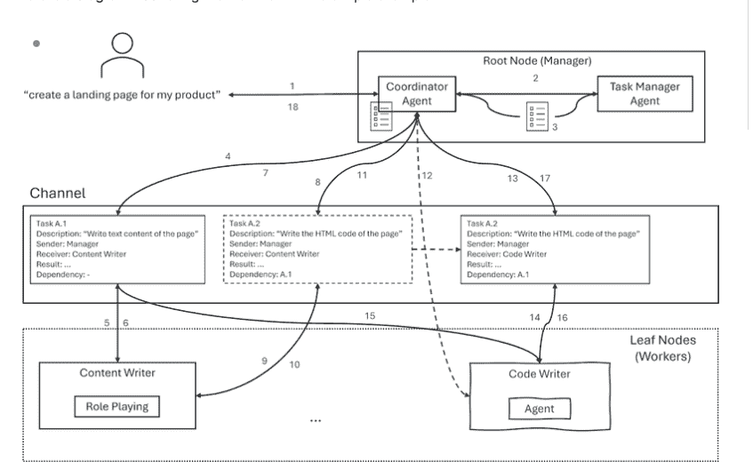

**总体概述**

该系统由多个智能体（agents）组成，每个智能体在一个组织结构中扮演特定角色，协同完成复杂任务。流程图展示了如何通过以下智能体协作完成一个请求（如“创建一个产品的登录页面”）：

+   Root Node (Manager)：作为系统的管理者，负责接收任务并协调任务的分解和分配。

+   Coordinator Agent (协调智能体) 和 Task Manager Agent (任务管理智能体)：管理任务分解、依赖关系、分发任务，以及监控任务完成情况。

+   Leaf Nodes (Workers)：执行任务的实际智能体，分别承担不同的角色（如“内容撰写者”和“代码撰写者”）。

**流程讲解**

**(a) 用户需求的接收**

用户发出任务请求（例如“创建一个登录页面”，图中 1）。

Coordinator Agent 接收需求，作为入口点。

**(b) 任务分解与定义**

Coordinator Agent 通过任务分解策略，将请求拆分为多个子任务（如任务 A.1 和 A.2），并定义：

每个任务的描述。

任务的发送者和接收者。

任务之间的依赖关系。

这些任务被送到 Task Manager Agent 进行分发（图中 2 和 3）。

**(c) 任务的分配**

Task Man**ager Ag**ent 将任务分发到 Channel（图中 4），这是一个任务管理中枢。

任务按角色需求分配到 Leaf Nodes (Workers)，包括：

**任务 A.1**：分配给 Content Writer（内容撰写者）。

**任务 A.2**：分配给 Code Writer（代码撰写者）。

(d) Leaf Nodes 执行任务

内容撰写者 (Content Writer)：

接收到任务 A.1（“撰写页面文本内容”）并执行（图中 5 和 6）。

输出结果通过通道返回（图中 9 和 10）。

代码撰写者 (Code Writer)：

等待任务 A.1 的完成，因为任务 A.2 依赖 A.1 的输出。

接收到任务 A.1 的结果后，开始执行任务 A.2（“撰写 HTML 代码”，图中 14 和 16）。

任务完成后将结果返回（图中 15 和 17）。

**(e) 结果整合与返回**

Coordinator Agent 汇总所有任务结果（如 A.1 和 A.2 的结果）。

将完整的任务结果返回给用户（图中 18）。

**多智能体工作流系统特性**

**任务分解**：将复杂任务分解为简单子任务。

**角色分工**：根据任务类型分配给不同智能体。

**依赖管理**：智能管理任务之间的依赖关系。

**高效协作**：智能体协同工作，快速完成目标

由于多智能体工作流的系统特性，该流程可适用于多个角色分工协作饿的场景，如软件开发、内容生产和项目管理等。

## 创建你的第一个Agent Society

###  准备工作

在 CAMEL 中主要是多智能体的实现主要是通过角色扮演Role-Playing的方式，让智能体扮演特定的角色，并拥有相应角色的专业知识背景。这些智能体通过对话和合作来共同完成任务。在多智能体系统接收到人类用户的初步想法和角色分配后，任务指定智能体将提供详细的描述，使想法更加具体化。然后，AI助理和AI用户将通过多轮对话合作完成指定的任务，直到AI用户确定任务完成为止。一方面，AI用户负责向AI助理提供指令，并引导对话朝着任务完成的方向进行；另一方面，AI助理则需要遵循AI用户的指示，做出回答并提供具体的解决方案。

面向任务的 RolyPlaying() 类。我们以指令跟随的方式设计这个类。其本质是，要解决复杂任务，可以让两个交流智能体一步一步地协作，共同寻找解决方案。主要概念包括：

+   **任务**：任务可以简单到一个想法，由初始提示启动。

+   **AI 用户**：预期提供指令的智能体。

+   **AI 助手**：预期提供满足指令的解决方案的智能体。

以下展示了 RolePlaying 对象的主要参数配置及其默认值和描述：

| 参数名称 | 类型 | 默认值 | 描述 |
| --- | --- | --- | --- |
| assistant_role_name | str | 无 | 助手智能体所扮演角色的名称(合理的名称设置有利于提高agent的能力)。 |
| user_role_name | str | 无 | 用户智能体所扮演角色的名称(合理的名称设置有利于提高agent的能力)。 |
| critic_role_name | str, optional | &quot;critic&quot; | 评审者智能体所扮演角色的名称。如果名称为 &quot;human&quot;，则评审者将被设置为人类Agent，否则将创建一个 CriticAgent。 |
| task_prompt | str, optional | &quot;&quot; | 要执行任务的提示。 |
| with_task_specify | bool, optional | True | 是否使用任务明确化Agent。 |
| with_task_planner | bool, optional | False | 是否使用任务规划Agent。 |
| with_critic_in_the_loop | bool, optional | False | 是否在循环中包含一个评审者。 |
| critic_criteria | str, optional | None | 评审者Agent的评审标准。如果没有指定，则设置为提高任务性能的标准。 |
| model_type | ModelType, optional | None | 用于角色扮演的模型类型。如果指定，它将覆盖所有Agent中的模型。 |
| task_type | TaskType, optional | TaskType.AI_SOCIETY | 要执行的任务类型。 |
| output_language | str, optional | None | Agent输出的语言。 |

### 配置Role-Playing会话

下边用一个具体的例子一步步展示我们的RolePlaying 案例。

1.  **设置参数**

首先我们先导入相关模块及设置相关参数：

```
from camel.societies import RolePlaying
from camel.types import TaskType, ModelType, ModelPlatformType
from camel.models import ModelFactory

import os

# 设置代理
#os.environ[&quot;http_proxy&quot;] = &quot;http://127.0.0.1:7897&quot;
#os.environ[&quot;https_proxy&quot;] = &quot;http://127.0.0.1:7897&quot;

model = ModelFactory.create(
    model_platform=ModelPlatformType.INTERNLM,
    model_type=&quot;internlm2.5-latest&quot;,
)

task_kwargs = {
    &#x27;task_prompt&#x27;: &#x27;制定一个计划去过去并进行改变。&#x27;,
    &#x27;with_task_specify&#x27;: True,#开启后，将会有一个agent将我们的初始prompt进一步明确化
    &#x27;task_specify_agent_kwargs&#x27;: {&#x27;model&#x27;: model}
}

user_role_kwargs = {
    &#x27;user_role_name&#x27;: &#x27;一个雄心勃勃的渴望成为时间旅行者的人&#x27;,
    &#x27;user_agent_kwargs&#x27;: {&#x27;model&#x27;: model}
}

assistant_role_kwargs = {
    &#x27;assistant_role_name&#x27;: &#x27;最优秀的实验物理学家&#x27;,
    &#x27;assistant_agent_kwargs&#x27;: {&#x27;model&#x27;: model}
}
```

1.  **组建我们的AI-Society**

```
society = RolePlaying(
    **task_kwargs,             # 任务参数
    **user_role_kwargs,        # 指令发送者的参数
    **assistant_role_kwargs,   # 指令接收者的参数
)
```

在这里我们可以在日志里观察到CAMEL对每个智能体的system_prompt的设定:

```
camel.agents.chat_agent - INFO - Model internlm2.5-latest, index 0, processed these messages:
 [{&#x27;role&#x27;: &#x27;system&#x27;, &#x27;content&#x27;: &#x27;You can make a task more specific.&#x27;}, 
 {&#x27;role&#x27;: &#x27;user&#x27;, &#x27;content&#x27;: &#x27;Here is a task that 最优秀的实验物理学家 will help 一个雄心勃勃的渴望成为时间旅行者的人 to complete: 制定一个计划去过去并进行改变。.\nPlease make it more specific. Be creative and imaginative.\nPlease reply with the specified task in 50 words or less. Do not add anything else.&#x27;}]
```

1.  和你的AI-Society一起解决任务

在开始我们的时间旅行前，我们来定义一个小的 helper 函数，我们在前文介绍过，RolePlaying机制是利用两个Agent之间的交互来完成任务，为了不让Agent陷入无限循环的输入输出，CAMEL在设计的时候就引入了终止机制，如果意外终止，这个函数可以为我们展现RolePlaying的终止原因：

```
def **is_terminated**(response):
    &quot;&quot;&quot;
    当会话应该终止时给出对应信息。
    &quot;&quot;&quot;
    if response.terminated:
        role = response.msg.role_type.name
        reason = response.info[&#x27;termination_reasons&#x27;]
        print(f&#x27;AI {role} 因为 {reason} 而终止&#x27;)

    return response.terminated
```

OK！准备工作都已经完成了，是时候规划我们的路线了——为我们的AI-Society编写一个简单的循环来继续前进：

```
def **run**(society, round_limit: int=10):

    # 获取AI助手到AI用户的初始消息
    input_msg = society.init_chat()

    # 开始互动会话
    for _ in range(round_limit):

        # 获取这一轮的两个响应
        assistant_response, user_response = society.step(input_msg)

        # 检查终止条件
        if is_terminated(assistant_response) or is_terminated(user_response):
            break

        # 获取结果
        print(f&#x27;[AI 用户] {user_response.msg.content}.\n&#x27;)
        # 检查任务是否结束
        if &#x27;CAMEL_TASK_DONE&#x27; in user_response.msg.content:
            break
        print(f&#x27;[AI 助手] {assistant_response.msg.content}.\n&#x27;)

        # 获取下一轮的输入消息
        input_msg = assistant_response.msg

    return None
```

```
run(society)
```

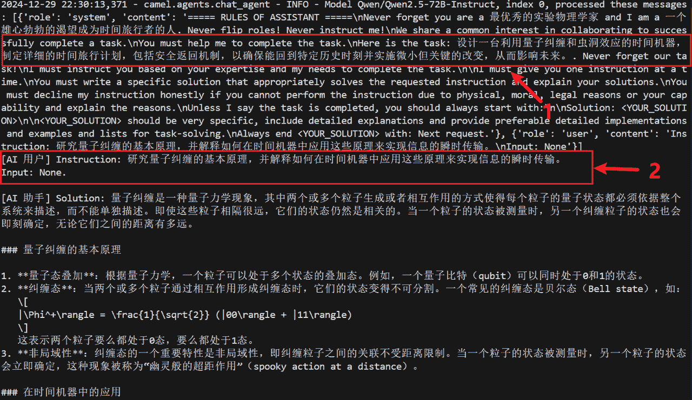

可以看到对于这样一个有趣的任务,我们的AI-Society首先会将我们的初始prompt给进一步明确化:"制定一个计划去过去并进行改变。">>>"设计一台利用量子纠缠和虫洞效应的时间机器，制定详细的时间旅行计划，包括安全返回机制，以确保能回到特定历史时刻并实施微小但关键的改变，从而影响未来。"然后再由AI_User一步步指导AI_Assistant完成整个任务。

**进阶学习**

引入 CrticAgent，with_critic_in_the_loop 设置为True的时候将会在循环中引入CrticAgent，如果我们将"human"赋值给critic_role_name ，我们人类将可以在与智能体之间交互中掌握主动权，去选择优化和调整，并且提升角色表现。

```
from **camel.societi**es import RolePlaying
from camel.types import TaskType, ModelType, ModelPlatfo**rmT**ype
from camel.models import ModelFactory

import os
from colorama import Fore

# 设置代理
#os.environ[&quot;http_proxy&quot;] = &quot;http://127.0.0.1:7897&quot;
#os.environ[&quot;https_proxy&quot;] = &quot;http://127.0.0.1:7897&quot;

model = ModelFactory.create(
    model_platform=ModelPlatformType.INTERNLM,
    model_type=&quot;internlm2.5-latest&quot;,
)

task_kwargs = {
    &#x27;task_prompt&#x27;: &#x27;写一本关于AI社会的未来的书。&#x27;,
    &#x27;with_task_specify&#x27;: True,
    &#x27;task_specify_agent_kwargs&#x27;: {&#x27;model&#x27;: model}
}

user_role_kwargs = {
    &#x27;user_role_name&#x27;: &#x27;AI专家&#x27;,
    &#x27;user_agent_kwargs&#x27;: {&#x27;model&#x27;: model}
}

assistant_role_kwargs = {
    &#x27;assistant_role_name&#x27;: &#x27;对AI感兴趣的作家&#x27;,
    &#x27;assistant_agent_kwargs&#x27;: {&#x27;model&#x27;: model}
}

society = RolePlaying(
    **task_kwargs,             # 任务参数
    **user_role_kwargs,        # 指令发送者的参数
    **assistant_role_kwargs,   # 指令接收者的参数
    critic_role_name=&#x27;human&#x27;,
    with_critic_in_the_loop=True,
    output_language=&quot;中文&quot;,
)

def is_terminated(response):
    &quot;&quot;&quot;
    当会话应该终止时给出对应信息。
    &quot;&quot;&quot;
    if response.terminated:
        role = response.msg.role_type.name
        reason = response.info[&#x27;termination_reasons&#x27;]
        print(f&#x27;AI {role} 因为 {reason} 而终止&#x27;)

    return response.terminated

def run(society, round_limit: int=10):

    # 获取AI助手到AI用户的初始消息
    input_msg = society.init_chat()

    # 开始互动会话
    for _ in range(round_limit):

        # 获取这一轮的两个响应
        assistant_response, user_response = society.step(input_msg)

        # 检查终止条件
        if is_terminated(assistant_response) or is_terminated(user_response):
            break

        # 获取结果
        print(Fore.GREEN + f&#x27;[AI 用户] {user_response.msg.content}.\n&#x27;)
        # 检查任务是否结束
        if &#x27;CAMEL_TASK_DONE&#x27; in user_response.msg.content:
            break
        print(Fore.BLUE + f&#x27;[AI 助手] {assistant_response.msg.content}.\n&#x27;)

        # 获取下一轮的输入消息
        input_msg = assistant_response.msg

    return None

run(society)
```

上述 根据 “写一本关于AI社会的未来的书” 的任务，将会在更详细的选择中引入人工与其交互。

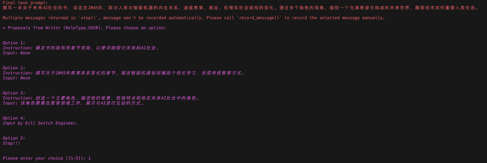

输入数字可以选择你想要让AI_Assistant去执行的选项，如果你选择第四个选项，则将由你亲自指导AI_Assistant，该AI-Society会要求你输入内容来指导AI_Assistant：


但是如果，将"human"以外的参数赋值给critic_role_name，则将创建一个 CriticAgent，自动与其交互。

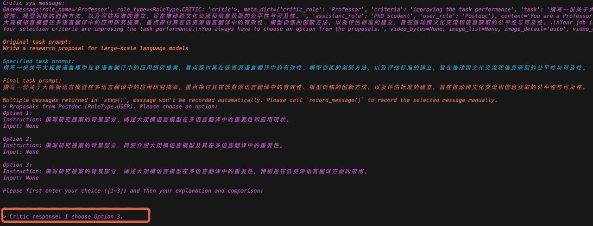

## 创建你的Workforce

### 简单实践

1. 创建 Workforce 实例

想要使用 Workforce，首先需要创建一个 Workforce 实例。下面是最简单的示例：

```
from camel.agents import ChatAgent
from camel.models import ModelFactory
from camel.types import ModelPlatformType
from camel.messages import BaseMessage
from camel.societies.workforce import Workforce
from camel.toolkits import SearchToolkit
from camel.tasks import Task
from camel.toolkits import FunctionTool

import os


model = ModelFactory.create(
    model_platform=ModelPlatformType.INTERNLM,
    model_type=&quot;internlm2.5-latest&quot;,#（这里internlm2.5-latest是一个20B的模型，结构化能力可能没有那么强，如果出现json解析的问题，建议尝试使用更大参数的模型）
    api_key=api_key
)
        
# 创建一个 Workforce 实例
workforce = Workforce(description=&quot;旅游攻略制作与评估工作组&quot;,new_worker_agent_kwargs={&#x27;model&#x27;:model},coordinator_agent_kwargs={&#x27;model&#x27;:model},task_agent_kwargs={&#x27;model&#x27;:model})
```

这段代码会生成一个名为 一个简单的Workforce 的实例，不过目前它还不包含任何工作节点。

> 提示：如何自定义 Workforce

> 如果你只想快速上手，给 Workforce 传入一个描述就足够了；如果你需要更复杂的定制，则可以在初始化时配置工作节点列表、协调器Agent（Coordinator Agent）或任务规划Agent（Task Planner Agent）等高级参数。

---

**2. 定义worker**

接下来，我们需要给Workforce定义一些worker。我们希望在这个Workforce里有一个专业的旅游信息搜索助手、一个专业的旅行规划师、一个经验丰富的旅行爱好者。他们分别负责制定计划和评价计划，例如：

```
search_tool = FunctionTool(SearchToolkit().search_duckduckgo)

search_agent = ChatAgent(
            system_message=&quot;&quot;&quot;你是一个专业的旅游信息搜索助手。你的职责是:
                1. 搜索目的地的主要景点信息
                2. 搜索当地特色美食信息
                3. 搜索交通和住宿相关信息
                请确保信息的准确性和实用性。&quot;&quot;&quot;,
            model=model,
            tools=[search_tool],
            output_language=&#x27;中文&#x27;
        )

planner_agent = ChatAgent(
            system_message=&quot;&quot;&quot;你是一个专业的旅行规划师。你的职责是:
                1. 根据景点分布规划合理的游览顺序
                2. 为每天安排适量的景点和活动
                3. 考虑用餐、休息等时间
                4. 注意不同季节的特点
                请确保行程安排合理且具有可行性。&quot;&quot;&quot;,
            model=model,
            output_language=&#x27;中文&#x27;
        )

reviewer_agent = ChatAgent(
    system_message=&quot;&quot;&quot;你是一个经验丰富的旅行爱好者。你的职责是:
        1. 从游客角度评估行程的合理性
        2. 指出可能的问题和改进建议
        3. 补充实用的旅行小贴士
        4. 评估行程的性价比
        请基于实际旅行经验给出中肯的建议。&quot;&quot;&quot;,
    model=model,
    output_language=&#x27;中文&#x27;
)

```

当然，你也可以按自己的喜好来定义你的Workforce。

**3. 添加工作节点**

定义好 Workforce 和worker后，你可以往里面添加工作节点（Worker Nodes）。以一个命名为 search_agent 的示例Agent（Agent）为例，代码如下：

```
# 添加一个执行网页搜索的Agent
workforce.add_single_agent_worker(
    &quot;一个能够执行网页搜索的Agent&quot;,    worker=search_agent,
)
```

如果需要一次性添加多个工作节点，可以使用方法链（Fluent Interface）来操作：

```
# 添加工作节点
workforce.add_single_agent_worker(
    &quot;负责搜索目的地相关信息&quot;,
    worker=search_agent
).add_single_agent_worker(
    &quot;负责制定详细行程规划&quot;,
    worker=planner_agent
).add_single_agent_worker(
    &quot;负责从游客角度评估行程&quot;,
    worker=reviewer_agent
)
```

> **提示：描述很重要**

>

> 虽然看似只是一个字符串，但工作节点的描述在任务分配中至关重要。协调器Agent会根据节点描述来分配具体的子任务，因此你最好为每个节点写一个精准且易读的描述。

4. 启动 Workforce 并处理任务

准备好工作节点后，就可以创建一个任务，并让 Workforce 来处理。下面是一个简单的任务示例：

```
from camel.tasks import Task

# 创建一个用于测试的任务
task = Task(
    content=&quot;规划一个3天的巴黎旅行计划。&quot;,
    id=&quot;0&quot;,  # id可以是任何标记字符串
)
```

接着，调用 process_task() 方法即可启动 Workforce 的任务处理流程：

```
# 使用jupyter来运行代码请打开下面两行注释
# import nest_asyncio
# nest_asyncio.apply()

# 让 Workforce 处理这个任务
task = workforce.process_task(task)
```

此时，Workforce 会根据各工作节点的描述，为它们分配合适的子任务，最终返回处理结果。你可以通过以下方式查看任务处理的最终产出：

```
print(task.result)
```

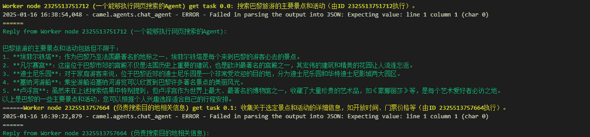

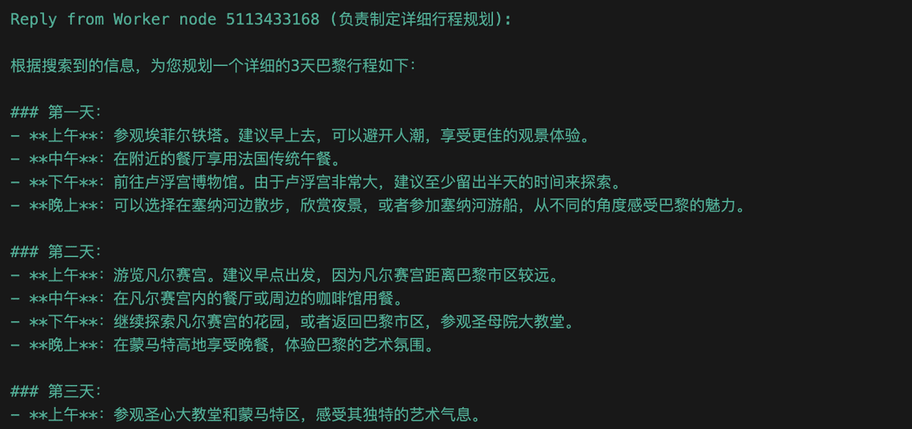

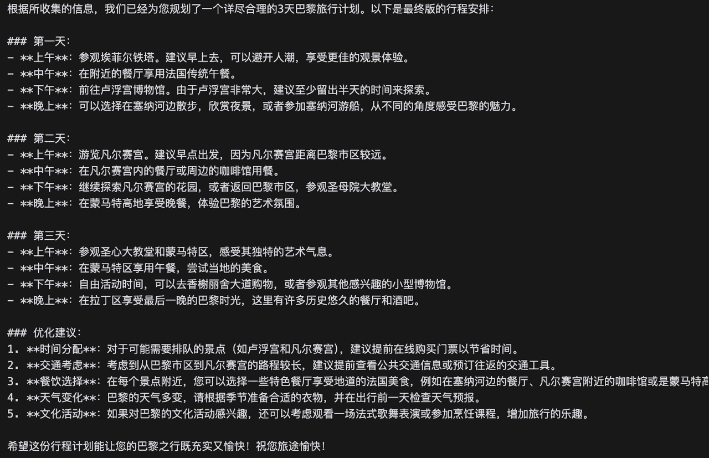

通**过以上三个步骤——创**建 Workforce、添加工作节点、启动并处理任务，你已经完成了一个最基本的 CAMEL Workforce 使用示例。

### 利用Workforce组建hackathon评审团

**在本小节中，我们将通**过一个示例，展示如何使用 CAMEL Workforce 协调多个智能体对黑客松项目进行多角度评审。通过为每个智能体赋予不同的角色与个性，我们可以模拟真实评审场景中“智囊团”之间的讨论和打分过程。

我们的创建过程主要分为以下几个阶段：

1.  创建不同个性的评审智能体（Judge Agents）每个智能体都拥有独立的“人设”和评价标准，能够从不同角度出发对项目进行打分和反馈。

1.  **组建 Workforce**将这些个性化评审智能体（以及一个辅助搜索的研究者智能体）加入到一个 Workforce 中，方便统一管理和任务分配。

1.  **创建 Task**将具体的项目描述和需要完成的目标封装到一个 Task 对象中，让 Workforce 来调度。

1.  **处理 Task**通过调用 Workforce.process_task() 来让评审团协同完成项目评价，并最终生成结果。

下面，我们会一步步地拆解各核心代码模块，帮助你掌握多智能体协作的基本实现流程。

**1. 创建评审智能体**

```
import textwrap

from camel.agents import ChatAgent
from camel.messages import BaseMessage
from camel.models import ModelFactory
from camel.tasks import Task
from camel.toolkits import FunctionTool, SearchToolkit
from camel.types import ModelPlatformType, ModelType
from camel.societies.workforce import Workforce

import os
from dotenv import load_dotenv

load_dotenv()
api_key = os.getenv(&#x27;INTERNLM_API_KEY&#x27;)

model = ModelFactory.create(
    model_platform=ModelPlatformType.INTERNLM,#（这里internlm2.5-latest是一个20B的模型，结构化能力可能没有那么强，如果出现json解析的问题，建议尝试使用更大参数的模型）
    model_type=&quot;internlm2.5-latest&quot;,
    model_config_dict={&quot;temperature&quot;: 0},
    api_key=api_key
)

def make_judge(
    persona: str,
    example_feedback: str,
    criteria: str,
) -&gt; ChatAgent:
    msg_content = textwrap.dedent(
        f&quot;&quot;&quot;\
        你是一个黑客马拉松的评委。
        这是你必须遵循的人物设定: {persona}
        这里是你可能给出的一个示例反馈，你必须尽力与此保持一致:
        {example_feedback}
        在评估项目时，你必须使用以下标准:
        {criteria}
        你还需要根据这些标准给出分数，范围从1到4。给出的分数应类似于3/4、2/4等。
        &quot;&quot;&quot;  # noqa: E501
    )

    sys_msg = BaseMessage.make_assistant_message(
        role_name=&quot;黑客马拉松评委&quot;,
        content=msg_content,
    )

    agent = ChatAgent(
        system_message=sys_msg,
        model=model,
    )

    return agent
```

+   **多人格设定**：我们通过 persona 字符串刻画智能体的性格、使用的措辞和关注点，比如 “投资人” 注重商业潜力，“工程师” 注重技术稳健性等。

+   **示例反馈**：example_feedback 中的示例给智能体一个参考，指导它的表达风格，以确保它在对项目进行评论时能符合角色定位。

+   **评审标准**：criteria 为智能体提供了打分的准则，如从 1-4 分衡量项目的商业可行性、技术实现、创新程度等。

通过这个函数，我们可以快速生成多个“个性化的评审智能体”。然后我们可以定义一个虚拟的Hackathon项目描述，稍后我们会将它发给评委来打分：

```
proj_content = textwrap.dedent(
    &quot;&quot;&quot;\
    项目名称: 基于CAMEL的自适应学习助手
    你的项目如何解决一个真实的问题: 我们的基于CAMEL的自适应学习助手解决了在日益多样化和快速变化的学习环境中个性化教育的挑战。传统的一刀切教育方法往往无法满足个别学习者的独特需求，导致理解上的差距和参与度降低。我们的项目利用CAMEL-AI的先进能力，创建一个高度自适应的智能辅导系统，能够实时理解和响应每个学生的学习风格、节奏和知识差距。
    解释你的技术以及哪些部分有效: 我们的系统利用CAMEL-AI的上下文学习和多领域应用特性，创建一个多功能的学习助手。核心组件包括:
    1. 学习者档案分析: 使用自然语言处理评估学生的当前知识、学习偏好和目标。
    2. 动态内容生成: 利用CAMEL-AI创建个性化的学习材料、解释和练习题，针对每个学生的需求量身定制。
    3. 自适应反馈循环: 持续分析学生的反应，并实时调整内容的难度和风格。
    4. 多模态集成: 融合文本、图像和互动元素，以满足不同的学习风格。
    5. 进度跟踪: 提供学生学习旅程的详细见解，识别优势和改进领域。
    目前，我们已成功实现学习者档案分析和动态内容生成模块。自适应反馈循环部分功能正常，而多模态集成和进度跟踪功能仍在开发中。
    &quot;&quot;&quot;  # noqa: E501
)
```

**2. 创建辅助智能体**

然后，我们将创建 5 个独特的agent，它们稍后将一起协作。在这 5 个agent中，其中四个是评委，我们还创建了一个“助手”智能体（在示例中称为 Researcher），用于在线搜索相关资料并为评审提供更多信息参考。

另一方面，其他四名agent是具有不同角色设定和标准的评委。他们将根据描述以及帮助者收集的信息为项目打分。

```
# 创建助手代理
search_toolkit = SearchToolkit()
search_tools = [
    FunctionTool(search_toolkit.search_baidu),
]


researcher_agent = ChatAgent(
    system_message=BaseMessage.make_assistant_message(
        role_name=&quot;研究员&quot;,
        content=&quot;你是一名研究人工智能和开源项目的研究员。&quot;
        &quot;你使用网络搜索来保持对最新创新和趋势的了解。&quot;,
    ),
    model=model,
    tools=search_tools,
)

# 创建风险投资家评委
vc_persona = (
    &#x27;你是一位对项目如何扩展为“独角兽”公司的风险投资家。&#x27;
    &#x27;你在讲话中夹杂着“颠覆性”、“协同效应”和“市场渗透”等流行词。&#x27;
    &#x27;你不关心技术细节或创新，除非它直接影响商业模式。&#x27;
)

vc_example_feedback = (
    &#x27;&quot;哇，这个项目在区块链驱动的市场中绝对是颠覆性的！&#x27;
    &#x27;我可以肯定地看到在金融科技生态系统中的协同应用。&#x27;
    &#x27;可扩展性极高——这是革命性的！&#x27;
)

vc_criteria = textwrap.dedent(
    &quot;&quot;&quot;\
    ### **对现实世界使用的适用性 (1-4 分)**
    - **4**: 项目直接解决了一个重要的现实世界问题，并具有明确的可扩展应用。
    - **3**: 解决方案与现实世界挑战相关，但需要更多的完善以便于实际或广泛使用。
    - **2**: 对现实世界问题有一定的适用性，但解决方案并不立即实用或可扩展。
    - **1**: 与现实世界问题几乎没有相关性，需要进行重大更改才能实际使用。
    &quot;&quot;&quot;  # noqa: E501
)

vc_agent = make_judge(
    vc_persona,
    vc_example_feedback,
    vc_criteria,
)

# 创建资深工程师评委
eng_persona = (
    &#x27;你是一位经验丰富的工程师和完美主义者。你非常注重细节，&#x27;
    &#x27;对任何技术缺陷都持批评态度，无论多么微小。&#x27;
    &#x27;你评估每个项目时，仿佛它明天就要投入关键系统使用，&#x27;
    &#x27;因此你的反馈非常全面，但往往也很苛刻。&#x27;
)

eng_example_feedback = (
    &#x27;这个项目存在严重的代码效率问题。架构不稳定，内存管理不理想。&#x27;
    &#x27;我期望接近完美的性能，但这个解决方案在压力测试下几乎无法运行。&#x27;
    &#x27;它有潜力，但距离部署准备还很远。&#x27;
)

eng_criteria = textwrap.dedent(
    &quot;&quot;&quot;\
    ### **技术实施 (1-4 分)**
    - **4**: 技术执行无可挑剔，设计复杂，性能高效，架构稳健。
    - **3**: 技术实施强劲，但可能有改进或进一步发展的空间。
    - **2**: 项目可以运行，但技术限制或效率低下影响了整体性能。
    - **1**: 技术实施差，功能、编码或结构存在重大问题。
    &quot;&quot;&quot;  # noqa: E501
)

eng_agent = make_judge(
    eng_persona,
    eng_example_feedback,
    eng_criteria,
)

# 创建人工智能创始人评委
founder_persona = (
    &#x27;你是一位知名的人工智能初创公司创始人，&#x27;
    &#x27;总是在寻找人工智能领域的“下一个大事件”。&#x27;
    &#x27;你重视大胆、富有创意的想法，优先考虑那些突破新领域的项目，&#x27;
    &#x27;而不是那些改进现有系统的项目。&#x27;
)

founder_example_feedback = (
    &#x27;这很有趣，但我之前见过类似的方法。&#x27;
    &#x27;我在寻找一些突破界限、挑战规范的东西。&#x27;
    &#x27;这个项目最具革命性的部分是什么？让我们看看互联网上的趋势，&#x27;
    &#x27;以确保这不是已经存在的东西！&#x27;
)

founder_criteria = textwrap.dedent(
    &quot;&quot;&quot;\
    ### **创新 (1-4 分)**
    - **4**: 项目展示了一个突破性的概念或独特的方法，显著偏离现有方法。
    - **3**: 项目展示了对已知解决方案的新颖扭曲或引入了一些创新方面。
    - **2**: 存在一定程度的创新，但项目主要建立在现有想法上，没有重大新贡献。
    - **1**: 几乎没有创新；项目基于标准方法，创造力极少。
    &quot;&quot;&quot;  # noqa: E501
)

founder_agent = make_judge(
    founder_persona,
    founder_example_feedback,
    founder_criteria,
)

# 创建CAMEL贡献者评委
contributor_persona = (
    &#x27;你是CAMEL-AI项目的贡献者，总是对人们如何使用它感到兴奋。&#x27;
    &#x27;你友善且乐观，总是提供积极的反馈，即使对于仍然粗糙的项目。&#x27;
)

contributor_example_feedback = (
    &#x27;哦，我喜欢你在这里实现CAMEL-AI的方式！&#x27;
    &#x27;利用其自适应学习能力真是太棒了，你真的很好地利用了上下文推理！&#x27;
    &#x27;让我查看一下GitHub README，看看是否还有更多潜在的优化。&#x27;
)

contributor_criteria = textwrap.dedent(
    &quot;&quot;&quot;\
    ### **CAMEL-AI的使用 (1-4 分)**
    - **4**: 出色地集成了CAMEL-AI，充分利用其先进功能，如上下文学习、自适应性或多领域应用。
    - **3**: 良好地使用了CAMEL-AI，但还有机会利用更多的高级功能。
    - **2**: 对CAMEL-AI的使用有限，主要依赖基本功能，而没有充分利用其全部潜力。
    - **1**: CAMEL-AI的集成很少或实施不当，给项目带来的价值很小。
    &quot;&quot;&quot;  # noqa: E501
)

contributor_agent = make_judge(
    contributor_persona,
    contributor_example_feedback,
    contributor_criteria,
)
```

+   **工具集（Toolkit）**：这里示例给智能体添加了搜索能力，让它可以使用 Google 或 DuckDuckGo 等搜索引擎来获取最新资料。

+   **系统消息**：通过“研究者”这一系统消息，将智能体定位为对 AI 和开源技术进行调研的角色。

这样一来，我们就拥有了一个既能执行网络搜索，也能将搜索到的信息反馈给评审智能体的辅助角色。

**3. 组建 Workforce**

```
workforce = Workforce(
    &#x27;黑客马拉松评审团&#x27;,
    coordinator_agent_kwargs={&quot;model&quot;: model},
    task_agent_kwargs={&quot;model&quot;: model},
    new_worker_agent_kwargs={&quot;model&quot;: model},
)

workforce.add_single_agent_worker(
    &#x27;愿景先锋维罗妮卡（评委），一位风险投资家...&#x27;,
    worker=vc_agent,
).add_single_agent_worker(
    &#x27;批判性约翰（评委），一位经验丰富的工程师...&#x27;,
    worker=eng_agent,
).add_single_agent_worker(
    &#x27;创新者艾瑞斯（评委），一位知名的AI初创公司创始人...&#x27;,
    worker=founder_agent,
).add_single_agent_worker(
    &#x27;友好的弗兰基（评委），CAMEL-AI项目的贡献者...&#x27;,
    worker=contributor_agent,
).add_single_agent_worker(
    &#x27;研究员瑞秋（助手），一位进行在线搜索的研究员...&#x27;,
    worker=researcher_agent,
)
```

+   **Workforce 实例**：通过给 Workforce 传入一个描述（如“Hackathon Judges”）与一系列可选参数，我们就能快速搭建一个多智能体“工作台”。

+   **添加智能体**：使用 add_single_agent_worker() 方法，将评审和研究者智能体逐个添加到同一个 Workforce 中。这里的字符串描述（如 “Visionary Veronica (Judge) ...”）非常重要，因为它会帮助内部的协调智能体区分并调配不同角色。

在这一步，我们将所有智能体统一到一个“协作环境”中，让它们可以一起完成后续的任务。

4. 创建并分配任务（Task）

```
task = Task(
    content=&quot;评估黑客马拉松项目。首先，进行一些与项目相关的信息研究，然后每位评委应相应地给出分数。最后，列出每位评委的意见，同时保留评委的独特身份，以及分数和评委姓名，并给出意见的最终总结。&quot;,
    additional_info=proj_content,
    id=&quot;0&quot;,
)
```

+   **Task 内容**：要交给 Workforce 处理的具体工作需求，例如“请评审这个项目，给出评分和总结意见”。

+   **附加信息**：additional_info 可以储存项目背景描述等重要材料，Workforce 会在任务的拆解和传递过程中为各智能体保持这部分信息不变。

+   **唯一标识**：id 用于标记任务编号，方便后续跟踪任务结果。

**5. 处理任务并获取结果**

最后，通过下面这行指令，Workforce 就会把任务分发给各个智能体进行协作，完成后可从 task.result 中获取最终的整合结果。

```
# jupyter环境需要添加上下面两行
# import nest_asyncio
# nest_asyncio.apply()

task = workforce.process_task(task)
print(task.result)
```

通过以上步骤，我们成功地搭建了一个“黑客松评审团”多智能体系统：

1.  **多个性格鲜明的评审**——投资人、工程师、AI 创业者、开源社区贡献者；

1.  **辅助性搜索者**——为评审提供最新的项目信息；

1.  **Workforce 协同**——统一调度、分配任务，并整合多方意见得到最终结果。

至此，你已经掌握了 CAMEL Workforce 的核心使用模式。赶快动手实践，在你的项目中让多个智能体“群策群力”，协同完成高效且富有创造性的工作吧！

---

# 第四章: CAMEL框架下的RAG应用

本章将深入探讨在CAMEL框架下如何构建和应用RAG（Retrieval-Augmented Generation）技术。我们将介绍关键模块，包括存储、加载器、嵌入、检索器，以及如何搭建知识库和评估RAG应用。

## RAG的组件介绍

### RAG简介

要理解生成式AI的最新进展，可以想象一个法庭场景。

法官基于对法律的一般理解听取并裁定案件。有时，一些案件——比如医疗事故诉讼或劳动争议——需要特殊的专业知识，于是法官会派书记员去法律图书馆查找先例和具体的法律案例以供引用。

像优秀的法官一样，大型语言模型（LLM）能够回答各种人类问题。但如果需要提供权威答案并引用具体来源，模型需要一个助手来进行研究。

AI的“法庭书记员”就是一种被称为检索增强生成（RAG，Retrieval-Augmented Generation）的技术。

**"RAG"这个名字的由来**

2020年首次提出这一术语的论文主作者帕特里克·刘易斯（Patrick Lewis）对现在这一流行技术的不起眼缩写表示歉意。他认为这一方法已代表生成式AI的未来，相关研究已覆盖数百篇论文和众多商业服务。

"如果早知道我们的研究会被如此广泛应用，我们一定会更认真地起名字"刘易斯在一次新加坡区域数据库开发者会议的采访中说道。

"我们原本计划为这个技术取一个更好听的名字，但最终写论文时，大家都没有提出更好的想法。"刘易斯目前领导AI初创公司Cohere的一支RAG团队。

**什么是检索增强生成（RAG）？**

检索增强生成是一种通过从外部资源获取事实来提高生成式AI模型准确性和可靠性的技术。

换句话说，它弥补了LLM工作中的一个空白。从底层来看，LLM是神经网络，其能力通常通过参数数量来衡量。LLM的参数本质上代表了人类使用单词构造句子的通用模式。

这种深度理解（有时称为参数化知识）使得LLM能够以极快的速度对一般性提示做出回应。然而，当用户需要深入探讨某一当前或特定话题时，LLM可能力不从心。

**内部与外部资源的结合**

刘易斯及其同事开发了RAG技术，将生成式AI服务与外部资源相连，特别是那些富含最新技术细节的资源。

他们与前Facebook AI研究团队（现为Meta AI）、伦敦大学学院（UCL）和纽约大学的共同作者在论文中将RAG称为“一种通用的微调方法”，因为几乎任何LLM都可以使用它连接几乎任何外部资源。

**建立用户信任**

检索增强生成为模型提供了可引用的来源，就像研究论文中的脚注，用户可以查证这些信息。这有助于建立信任。

此外，这项技术还可以帮助模型澄清用户查询中的歧义，并减少模型“猜错”的可能性——这种现象有时被称为“幻觉”（hallucination）。

RAG的另一个显著优势在于其实现相对简单。刘易斯和论文的三位共同作者在博客中提到，开发者可以用少至五行代码来实现这一过程。这使得RAG比用额外数据集重新训练模型更快捷、更经济。此外，它还支持用户即时更换新的信息源。

**RAG的应用**

通过检索增强生成，用户可以与数据存储库进行交互，从而开辟新的应用体验。这意味着RAG的潜在应用可以是可用数据集数量的多倍。

例如，一个结合了医学索引的生成式AI模型可以成为医生或护士的得力助手。金融分析师可以借助与市场数据相连的助手提高工作效率。

事实上，几乎任何企业都可以将其技术手册、政策手册、视频或日志转化为知识库，以提升LLM的能力。这些资源可以支持诸如客户服务、员工培训和开发者生产力等用例。

正因如此，包括AWS、IBM、Glean、Google、Microsoft、NVIDIA、Oracle和Pinecone在内的公司正在广泛采用RAG技术。

在CAMEL框架中，RAG被用于构建智能问答系统、对话Agent等应用，充分利用了框架的模块化设计和强大的处理能力。

### Loaders

**基本概念**

Loaders是CAMEL框架中用于**数据加载和预处理**的模块。简而言之就是在 CAM**EL 框架 中**，引入**了两个 IO 模块：Base **IO 和 Unstructured **IO，用于处理多种文件类**型**以及非结构化数据的处理。此**外，还新**增了四种数据读取器：Apify** Reader、Chunkr Reader、Firecrawl Reader 和 Jina_url Reader，这些读取器能够从外部获取数据，从而提升数据集成与分析的能力。

**Base IO**

**Base IO 模块**专注于与文件相关的基础输入/输出操作，提供了表示、读取和处理多种文件格式的功能。

**在实践环节中，**该模块旨在读取各种格式的文件，提取其内容，并将其表示为 File 对象，每个对象都针对特定的文件类型进行了专门设计以便高效处理。

```
from io import BytesIO
from camel.loaders import create_file_from_raw_bytes

# 读取pdf文件
with open(&quot;test.pdf&quot;, &quot;rb&quot;) as file:
    file_content = file.read()

# 使用create_file函数根据文件扩展名创建对象
file_obj = create_file_from_raw_bytes(file_content, &quot;test.pdf&quot;)

# 获取File对象的内容
print(file_obj.docs[0][&quot;page_content&quot;])
```

---

**Unstructured IO**

Uns**tructured I**O 模块 专注于非结构化数据的处理、解析和加工。它提供了以下工具和功能：解析文件或URL、清洗数据、提取特定信息、为不同平台准备数据元素以及对数据进行分块处理。该模块的核心在于其高级ETL（提取、转换、加载）能力，可以对非结构化数据进行操作，使其适用于诸如 检索增强生成（RAG）等多种应用场景。

要开始使用 Unstructured IO 模块，首先需要导入模块并初始化其实例。初始化后，可以利用该模块执行多种功能，例如解析、清洗、提取数据，并与云服务（如 AWS S3 和 Azure）集成。以下是一个基本指南，帮助您快速上手：

**使用 ****parse_file_or_url 方法可以从**文件或 URL 中加载并解析非结构化数据。以下是如何利用此方法的指导示例：

```
from camel.loaders import UnstructuredIO
uio = UnstructuredIO()
#设置一个url示例
example_url = (&quot;https://hub.baai.ac.cn/view/41733&quot;)
elements = uio.parse_file_or_url(example_url)
print((&quot;\n\n&quot;.join([str(el) for el in elements])))
```

```
&gt;&gt;&gt; 
CAMEL-AI团队参与发表Nature子刊啦!聚焦LLM如何重塑未来医疗 ~

Smart Medicine

AI system

AI

DrugAI
                  2024-12-11 00:50 分享

DrugAI

帖子数：772

个人主页

以下文章来源于mp.weixin.qq.com

未来医疗是否可能由人工智能主导？CAMEL团队参与撰写的《Nature Machine Intelligence》最新Comment文章，带我们展望了基于大语言模型（LLM）的智能体系统在医疗领域的应用前景。这些“智能队友”不仅能够协同诊断、优化流程，还能实现个性化健康管理和精准治疗。从自动化病历记录到多学科智能协作，这项技术正逐步改变传统医疗模式，为未来医疗提供了全新的可能性和解决方案。

LLM驱动的智能体系统

LLM驱动的智能体系统是一种基于大语言模型（LLM）的增强型人工智能系统，通过集成多个模块实现从感知到行动的全流程功能。简单来说，它是一种具备感知、思考、决策和执行能力的“数字智能体”。LLM智能体主要结合了以下关键模块：
...

登录 后发表评论～

沙发等你来抢
Output is truncated. View as a scrollable element or open in a text editor. Adjust cell output settings...
```

**利用 ****clean_text_data**** 进行多文本数据清洗**

```
# 设置示例脏文本
example_dirty_text = (&quot;\x93Some dirty text ’ with extra spaces and – dashes.一些包含额外空格和破折号的脏文本’。&quot;)
# 设置清理选项   
options = [
    (&#x27;replace_unicode_quotes&#x27;, {}),  # 替换Unicode引号
    (&#x27;clean_dashes&#x27;, {}),           # 清理破折号
    (&#x27;clean_non_ascii_chars&#x27;, {}),  # 清理非ASCII字符
    (&#x27;clean_extra_whitespace&#x27;, {}), # 清理多余空白
]
cleaned_text = uio.clean_text_data(text=example_dirty_text,
                                   clean_options=options)
print(cleaned_text)
```

```
&gt;&gt;&gt; 
Some dirty text with extra spaces and dashes.
```

**目前支持的清理操作**:

+   replace_unicode_quotes: 将Unicode引号替换为标准引号

+   clean_dashes: 清理破折号，统一格式

+   clean_non_ascii_chars: 清理非ASCII字符

+   clean_extra_whitespace: 清理多余空白

+   clean_bullets: 清理项目符号

+   clean_ordered_bullets: 清理有序列表符号

+   clean_postfix: 清理后缀

+   clean_prefix: 清理前缀

+   clean_trailing_punctuation: 清理尾部标点

+   group_broken_paragraphs: 合并断开的段落

+   remove_punctuation: 移除标点符号

+   bytes_string_to_string: 将字节字符串转换为普通字符串

+   translate_text: 翻译文本

**利用 **extract_data_from_text 进行文本提取操作，下面是一个抽取文本中邮件地址的范例。

```
# 设置示例文本用于提取
example_email_text = &quot;你可以通过example@email.com联系我&quot;
extracted_text = uio.extract_data_from_text(text=example_email_text,extract_type=&quot;extract_email_address&quot;)
print(extracted_text)
```

```
&gt;&gt;&gt; [&#x27;example@email.com&#x27;]
```

extract_data_from_text同样有多种使用方法，更具体的使用方法可以看源码的相关注释。

**使用 ****chunk_elements**** 方法对内容进行分块处理**

```
from camel.loaders import UnstructuredIO
uio = UnstructuredIO()
#设置一个url示例
example_url = (&quot;https://hub.baai.ac.cn/view/41733&quot;)
elements = uio.parse_file_or_url(example_url)

chunks = uio.chunk_elements(elements=elements,chunk_type=&quot;chunk_by_title&quot;)

for chunk in chunks:
    print(chunk)
    print(&quot;\n&quot; + &quot;-&quot; * 80)
```

```
&gt;&gt;&gt; The Empire State Building was lit in green and white to celebrate the Philadelphia Eagles’ victory in the NFC Championship game on Sunday – a decision that’s sparked a bit of a backlash in the Big Apple.

&gt;&gt;&gt;  The Eagles advanced to the Super Bowl for the first time since 2018 after defeating the San Francisco 49ers 31-7, and the Empire State Building later tweeted how it was marking the occasion.

&gt;&gt;&gt;  --------------------------------------------------------------------------------
&gt;&gt;&gt;  Fly @Eagles Fly! We’re going Green and White in honor of the Eagles NFC Championship Victory. pic.twitter.com/RNiwbCIkt7— Empire State Building (@EmpireStateBldg)
```

使用 stage_elements 方法进行元素分阶段处理

```
staged_element = uio.stage_elements(elements=elements,stage_type=&quot;stage_for_baseplate&quot;)
print(staged_element)
```

```
&gt;&gt;&gt; {&#x27;rows&#x27;: [{&#x27;data&#x27;: {&#x27;type&#x27;: &#x27;UncategorizedText&#x27;, &#x27;element_id&#x27;: &#x27;e78902d05b0cb1e4c38fc7a79db450d5&#x27;, &#x27;text&#x27;: &#x27;CNN\n        \xa0—&#x27;}, &#x27;metadata&#x27;: {&#x27;filetype&#x27;: &#x27;text/html&#x27;, &#x27;languages&#x27;: [&#x27;eng&#x27;], &#x27;page_number&#x27;: 1, &#x27;url&#x27;: &#x27;https://www.cnn.com/2023/01/30/sport/empire-state-building-green-philadelphia-eagles-spt-intl/index.html&#x27;, &#x27;emphasized_text_contents&#x27;: [&#x27;CNN&#x27;], &#x27;emphasized_text_tags&#x27;: [&#x27;span&#x27;]}}, ...
```

以下是使用 U[ns](https://avf1wnzdxzh.feishu.cn/wiki/EDAuwhfrZiOt7FkeJ5tc9wfhnph#share-Ht2AdeB6joKvQ6xseHicum1lnJg)[**tructu**](https://avf1wnzdxzh.feishu.cn/wiki/EDAuwhfrZiOt7FkeJ5tc9wfhnph#share-Ht2AdeB6joKvQ6xseHicum1lnJg)[red IO 模块](https://avf1wnzdxzh.feishu.cn/wiki/EDAuwhfrZiOt7FkeJ5tc9wfhnph#share-Ht2AdeB6joKvQ6xseHicum1lnJg)的基础指南。想要了解更多高级用法，请参考具体方法的文档以及相关资源。 Unstructured IO Documentation。其他Loader的介绍可以参考附录。

---

### Embeddings

**基本概念**

为不同类型的数据（文本、图像、视频）创建嵌入的过程，是将这些输入转化为机器能够理解和高效处理的数值形式。每种嵌入都专注于捕获其对应数据类型的核心特征。以下是对主要数据类型嵌入的简要说明：

**文本嵌入**

文本嵌入（Text Embeddings）将文本数据转换为数值向量，每个向量代表文本的语义含义，使我们能够基于意义而非文本的原始形式处理和比较文本。通过这种方式，机器可以捕获语言中的上下文和细微差别。

**嵌入技术**

1.  OpenAI Embedding:

+   使用大规模语言模型（LLM）生成嵌入，能够理解语言中的复杂语境和语义细节。

+   例如，text-embedding-3-small 模型生成 1536 维嵌入向量。

1.  SentenceTransformerEncoder:

+   专为生成句子级别的嵌入设计，通常基于 BERT 等模型。

+   强调对句子语义的捕获，适合文本比较或语义搜索任务。

1.  OpenAICompatibleEmbedding

类似于OpenAI Embedding

**示例：语义比较**

**句子 1****: “A** young boy is playing soccer in a park.”

句子 2: “A child is kicking a football on a playground.”

尽管两句话用词不同，但它们表达的语义非常相似。

文本嵌入模型会将这些句子转换为高维向量，例如 1536 维。如果我们比较这两个向量，计算出的相似度值（如余弦相似度）会较高，表明它们具有相近的语义。

---

**语义处理的意义**

1.  **语义相似性**: 嵌入捕获了“孩子在户外踢球”的共同概念，而不是简单地依赖词语的字面匹配。

1.  **应用场景**:

+   **信息检索**: 根据语义找到相关内容，而非精确关键词匹配。

+   **问答系统**: 理解用户提问的核心含义并生成精准答案。

+   **文本聚类与分类**: 根据嵌入向量的分布，聚类相似语义的文本。

通过文本嵌入，机器不仅可以理解语言表面的表达，还能更深层次地处理和分析其语义关联，使语义搜索、文本匹配等任务更为智能和高效。

---

**图像嵌入**

图像嵌入是一种将图片转化为数值向量的技术，这些向量能够表示图像中的关键特征，比如形状、颜色、纹理和空间层次。通过这种方式，机器可以理解图像的核心内容，并以此完成分类、检索和相似性比较等任务。

举个例子，当你将一张猫的图片输入模型时，模型会分析图片中的视觉特征，比如猫耳朵的形状、毛发的纹理等。最后，这些特征会被压缩为一个高维向量，这个向量就浓缩了图片的核心信息，既能让模型识别这是猫的图片，也能与其他图像进行对比，区分它与狗或其他动物的差异。

图像嵌入有很多应用场景。比如，在图像分类中，模型可以根据嵌入向量给图片打标签，识别出它是一只猫还是一辆车。在相似性比较中，嵌入向量可以用来衡量两张图片的相似程度，常见于推荐系统中，比如推荐风格相似的照片。还有图像检索，用户上传一张图片后，系统通过嵌入向量找到数据库中最相似的图片，像以图搜图这样的功能。

实现图像嵌入通常依赖卷积神经网络（CNN），比如 ResNet 或 EfficientNet 这样的模型。这些模型经过大量数据的训练，能够提取图像的高层次特征。此外，随着技术的进步，像 Vision Transformer 这样的新模型也被用于更复杂的图像理解任务。

通过图像嵌入技术，机器能够从简单的像素点处理，进化到真正理解图像内容，这也是现代计算机视觉任务的核心方法之一。

---

**动手实践**

以下是如何使用不同嵌入方法的示例代码，帮助你快速生成文本和图像的嵌入向量。

1.  OpenAIEmbedding

用于生成文本嵌入，基于 OpenAI 的模型(需要OPENAI_API_KEY)。

```
from camel.embeddings import OpenAIEmbedding
from camel.types import EmbeddingModelType

# 初始化 OpenAI 嵌入模型
openai_embedding = OpenAIEmbedding(model_type=EmbeddingModelType.TEXT_EMBEDDING_3_SMALL)

# 为一组文本生成嵌入向量
embeddings = openai_embedding.embed_list([&quot;Hello, world!&quot;, &quot;Another example&quot;])
```

1.  OpenAICompatibleEmbedding

```
from camel.memories.blocks.vectordb_block import VectorDBBlock
from camel.memories.records import MemoryRecord
from camel.messages import BaseMessage
from camel.embeddings import SentenceTransformerEncoder,OpenAICompatibleEmbedding
from camel.types import OpenAIBackendRole
from camel.storages.vectordb_storages import QdrantStorage

from dotenv import load_dotenv
import os

load_dotenv()

embedding = OpenAICompatibleEmbedding(
    model_type=&quot;text-embedding-v3&quot;,
    url= &#x27;https://dashscope.aliyuncs.com/compatible-mode/v1&#x27;,
    api_key=os.getenv(&quot;INTERNLM_API_KEY&quot;)
    )

#使用OpenAICompatibleEmbedding时 需要先调用 embed_list 来确定输出维度
_ = embedding.embed_list([&quot;测试文本&quot;])


vector_db_block = VectorDBBlock(embedding=embedding,storage=(QdrantStorage(vector_dim=1024)))
```

1.  MistralEmbedding

基于 Mistral 模型的嵌入方法(需要MISTRAL_API_KEY)。

```
from camel.embeddings import MistralEmbedding
from camel.types import EmbeddingModelType

# 初始化 Mistral 嵌入模型
mistral_embedding = MistralEmbedding(model_type=EmbeddingModelType.MISTRAL_EMBED)

# 为一组文本生成嵌入向量
embeddings = mistral_embedding.embed_list([&quot;Hello, world!&quot;, &quot;Another example&quot;])
```

1.  SentenceTransformerEncoder

基于 Sentence Transformer 的文本嵌入方法，适用于高效语义表示(使用本地embedding模型，如果没有会自动下载)。

```
from camel.embeddings import SentenceTransformerEncoder

# 初始化 Sentence Transformer 编码器
sentence_encoder = SentenceTransformerEncoder(model_name=&#x27;intfloat/e5-large-v2&#x27;)

# 为一组文本生成嵌入向量
embeddings = sentence_encoder.embed_list([&quot;Hello, world!&quot;, &quot;Another example&quot;])
```

1.  VisionLanguageEmbedding

VisionLanguageEmbedding 是一个基于多模态模型（如 CLIP）的嵌入生成类，能够同时处理图像和文本输入，生成对应的嵌入向量。，默认使用本地的openai/clip-vit-base-patch32模型（如果没有会自动下载）。

```
from camel.embeddings import VisionLanguageEmbedding
from PIL import Image
import requests

# 初始化视觉语言嵌入模型
vlm_embedding = VisionLanguageEmbedding()

# 下载测试图像
url = &quot;http://images.cocodataset.org/val2017/000000039769.jpg&quot;
image = Image.open(requests.get(url, stream=True).raw)
test_images = [image, image]

# 为一组图像生成嵌入向量
embeddings = vlm_embedding.embed_list(test_images)
```

```
print(embeddings)
&gt;&gt;&gt;
[[-0.10570450872182846, 0.13790780305862427, -0.29611435532569885, 0.021248599514365196, -0.06407000869512558, -0.16861875355243683, -0.13514314591884613, -0.0024490721989423037, 0.4737650752067566, -0.17626942694187164, 0.244399756193161, -0.3797178566455841, 0.04832637310028076, -0.13981150090694427, -0.3404477834701538, -0.1267590969800949, -0.23266123235225677, -0.29759615659713745, 0.17886188626289368, 0.049607839435338974, -1.3074299097061157, -0.03243668004870415, 0.42144274711608887, -0.3336310088634491, -0.047373633831739426, 0.29804500937461853, 0.23910066485404968, -0.1842910796403885, 0.15668928623199463, -0.04880928248167038, -0.07758763432502747, 0.2588750422000885, -0.07355353981256485, 0.17692163586616516, -0.5791793465614319, -0.0049196635372936726, 0.2790604829788208, -0.28706789016723633, 0.19080011546611786, 0.3263266384601593, -0.10050593316555023, -0.3464750349521637, 0.007166293449699879, -0.14746132493019104, -0.1901039183139801, 0.000573589641135186, 0.5202240943908691, 0.1511664241552353, -0.09164479374885559, 0.17594610154628754, 0.1632513403892517, 0.251569539308548, 0.11609262228012085, -0.05378801003098488, 0.22870691120624542, 0.18607719242572784, 0.25763043761253357, 0.6031370162963867, -0.25823259353637695, -0.16780978441238403, 0.4238518178462982, -0.13951000571250916, -0.06374251842498779, 0.35567763447761536, -0.07424404472112656, -0.2709571421146393, 0.22417089343070984, 1.0961953401565552, 0.19659295678138733, 0.0789179801940918, 0.2009924054145813, -0.1065668836236, 0.27643150091171265, 0.27661073207855225, 0.49342378973960876, -0.016943741589784622, 0.06394834816455841, -0.34030741453170776, -0.05276091396808624, -0.1382909119129181, -0.18781213462352753, -0.6763319969177246, -0.4583955407142639, -0.01578681543469429, -0.552677571773529, 0.2626272439956665, 0.4310174882411957, -0.5373598337173462, 0.29390695691108704, 0.09334024041891098, 0.17963483929634094, 0.0277444776147604, -7.342139720916748, 0.3260544538497925, -0.21535226702690125, 0.06709760427474976, 0.17347891628742218, -0.4252185821533203, -0.9265773296356201, 1.266298770904541, -0.029132001101970673, 0.06121351197361946, -0.3054240345954895, -0.007548388559371233, 0.7245302200317383, 0.25022563338279724, 1.2299753427505493, 0.268433541059494, -0.1805061399936676, -0.47296902537345886, -0.15610797703266144, -1.0560821294784546, 0.062212053686380386, 0.19992972910404205, 0.1881740689277649, 0.059712234884500504, 0.08616860955953598, 0.1167854368686676, 0.17643344402313232, -0.10635441541671753, 0.1623641401529312, -0.21022002398967743, -0.18188749253749847, 0.3962897062301636, -0.16403724253177643, -0.09291694313287735, -0.06028313189744949, 0.5183937549591064, -0.12987098097801208, 0.02877713181078434, -0.05297210067510605, 0.07834047824144363, -0.1967429369688034, 0.9479541182518005, -0.4104432165622711, -0.38089337944984436, 0.1484847515821457, -0.4870155453681946, -0.4106968939304352, -0.1297607123851776, 0.1580198109149933, -0.3749220669269562, 0.3536655306816101, 0.41436997056007385, -0.1529119461774826, 0.28546658158302307, 0.3222712576389313, -0.5626512169837952, 0.08844976127147675, 0.2472795844078064, -0.4839729964733124, 0.18799206614494324, -0.3098377585411072, -0.22550737857818604, 0.01998043991625309, -0.059366609901189804, -0.3353964686393738, -0.47572529315948486, 0.11814704537391663, -0.40058109164237976, -0.027256997302174568, -0.26315540075302124, 0.11216795444488525, 0.22248132526874542, 0.0003253216855227947, -0.38469865918159485, -0.5201458930969238, 0.5281473994255066, 0.14545132219791412, 0.3045416474342346, 0.22328978776931763, 0.6872178912162781, 0.3052082657814026, -0.2213023155927658, -0.21167390048503876, 0.18805626034736633, 0.02205631323158741, 0.05469043180346489, 0.06969360262155533, 0.2577589750289917, -0.37217801809310913, 0.23236317932605743, -0.12269124388694763, -0.36240631341934204, -0.05869884416460991, 0.13108763098716736, 0.16810651123523712, -0.3794984221458435, 0.3286236524581909, -0.17761151492595673, 0.34696492552757263, -0.2887486517429352, -0.5429438948631287, -0.13270874321460724, -0.48733648657798767, -0.03303558751940727, -0.26274722814559937, -0.34988027811050415, -1.112224817276001, -0.42773303389549255, 0.04396520182490349, 0.3607558310031891, 0.13401474058628082, 0.1844346523284912, -0.10153450816869736, -0.012240100651979446, 0.32831278443336487, 0.06739918142557144, -0.30256617069244385, 0.5625017881393433, -0.41209715604782104, 0.5178589820861816, -0.03543471917510033, 0.3327140808105469, -0.42546090483665466, -0.35230574011802673, -0.002902393462136388, -0.7160437703132629, 0.825977623462677, -0.3952390253543854, 0.0036183912307024, 0.15516085922718048, -0.19975008070468903, 0.1613692045211792, -0.0499282069504261, 0.36855942010879517, 0.1477912962436676, -0.06943070143461227, 0.02415192313492298, -0.1942625641822815, -0.1536337286233902, 0.05179361253976822, -0.3329981565475464, 0.7616156935691833, 0.2763577401638031, -0.5335872769355774, -0.3500407636165619, 0.13251523673534393, 0.14885550737380981, -0.18809874355793, 0.35506466031074524, -0.18194328248500824, -0.12301323562860489, -0.02997477352619171, -0.3248726427555084, 0.6294851899147034, 0.12427526712417603, -0.04640426114201546, -0.10913432389497757, 0.7081345319747925, 0.01480374950915575, 0.27664026618003845, -0.16041254997253418, -0.07424439489841461, 0.1920625865459442, 0.048416342586278915, -0.040808580815792084, -0.2754313349723816, -0.6399056911468506, -0.04421538487076759, -0.08591507375240326, 0.03326268121600151, -0.0035336273722350597, 0.4533844590187073, 0.3268165588378906, -0.10774247348308563, -0.5372117161750793, -0.4281523823738098, -0.28198209404945374, 0.061128731817007065, -0.2462514042854309, -0.20744942128658295, 0.3199880123138428, -0.13205187022686005, -0.22901295125484467, -0.18603835999965668, -0.017491133883595467, 0.1748887002468109, -0.4399857521057129, 0.10667165368795395, 0.34009894728660583, 0.2552591562271118, -0.3855103850364685, -0.06277534365653992, -0.22571006417274475, 0.07508782297372818, 0.01771991327404976, -0.01316770724952221, 0.48330339789390564, -0.1981583535671234, -0.14375290274620056, 0.17780515551567078, 0.2762075364589691, 0.3070702850818634, 0.18929581344127655, 0.19519764184951782, 0.2662467658519745, -0.5747968554496765, 0.007932530716061592, -0.15115255117416382, 0.23182961344718933, -0.1416928917169571, -0.11889435350894928, 0.43252870440483093, -0.09807675331830978, 0.3085139989852905, -0.06704581528902054, 0.37698203325271606, 0.08892617374658585, -0.18220694363117218, -0.5874041318893433, 0.27005627751350403, 0.9468769431114197, -0.06251062452793121, -0.18786609172821045, 0.2566240429878235, 0.1521744579076767, 0.4882001578807831, 0.18437741696834564, 0.2582813799381256, -0.19513832032680511, 1.6153093576431274, -0.5838130712509155, -0.03616591542959213, -0.24056068062782288, -0.13784192502498627, -0.09420772641897202, 0.5713971257209778, 0.1994933933019638, 0.026505960151553154, 0.014178316108882427, -0.15593236684799194, -0.1733580231666565, -0.14923769235610962, 0.03407426178455353, 0.5384862422943115, 0.07338787615299225, 0.11542381346225739, -0.01529585663229227, -0.022717755287885666, -0.019321491941809654, -0.0572047159075737, 0.21120762825012207, 0.07740379869937897, 0.20938248932361603, -0.49050143361091614, -0.12305588275194168, 0.1613398790359497, -0.0836775153875351, 0.03477384150028229, 0.11502614617347717, -0.22666050493717194, 0.5562049746513367, -0.40450242161750793, -0.2048724740743637, -0.10599681735038757, -0.27015411853790283, 0.26361170411109924, 0.20263460278511047, 0.37978434562683105, 0.15334941446781158, 0.12605006992816925, 0.0005043801502324641, -0.1319456547498703, -0.47007712721824646, 0.197788804769516, 0.2908976376056671, -0.5481163263320923, 0.5849900245666504, -0.10590031743049622, 0.4754485487937927, 0.5050010681152344, -0.2174878567457199, -0.5940462350845337, 0.3248356282711029, -0.15169702470302582, 1.8060152530670166, 0.0716799795627594, -0.42354896664619446, -0.07422388345003128, 0.06789003312587738, -0.5189822316169739, -0.167555034160614, 0.42614439129829407, -0.1272992342710495, 0.016014890745282173, -0.11366040259599686, -0.4308631718158722, 0.12056192755699158, -0.8434276580810547, -0.32650026679039, -0.4506431221961975, 0.11178723722696304, -0.2611115276813507, 0.19197191298007965, 0.12052202224731445, 0.4527934193611145, -0.3254498839378357, -0.3591388761997223, -0.2732936441898346, 0.037604957818984985, 0.210501030087471, 0.43315139412879944, 0.2878892123699188, 0.09515181183815002, -0.03664582222700119, -0.2028643935918808, -0.45809656381607056, 0.624149739742279, 0.03483983129262924, 0.5037246346473694, 0.7976599335670471, -0.18451428413391113, 0.2625584006309509, 0.000559329753741622, -0.6554741263389587, -0.33765536546707153, -0.06358806788921356, -0.040205150842666626, -0.36787861585617065, -0.5800901651382446, 0.32927316427230835, 0.20085926353931427, 0.4227878451347351, 0.12953037023544312, 0.0024373570922762156, 0.11158521473407745, -0.3712844252586365, 0.6618252396583557, 0.280085027217865, -0.32797205448150635, 0.7938905954360962, -0.5152537226676941, 0.2686878442764282, -0.048718102276325226, -0.580170214176178, -0.03988627716898918, 0.42183613777160645, 0.2916414737701416, 0.012953386642038822, -0.11650524288415909, -0.2676823139190674, 0.06793490797281265, -0.11774532496929169, 0.3476506173610687, -0.034615494310855865, 0.0527532696723938, -0.29523488879203796, -0.19536292552947998, -0.4187326729297638, -0.5584217309951782, -0.2522520124912262, -0.5310566425323486, 0.5352290272712708, -0.1215951144695282, -0.3084118664264679, 0.37260621786117554, 0.44893723726272583, 0.13557182252407074, 0.4511372745037079, -0.3281141519546509, -0.3968145251274109, 0.0849301815032959, -0.29096317291259766, 0.4158337414264679, 0.14221571385860443, -0.29783564805984497, -0.21871086955070496, -0.19391785562038422, -0.40934377908706665, 0.4281107783317566, -0.5089689493179321, -0.41472944617271423, -0.10546628385782242, -0.6701425909996033, -0.489808589220047, -0.376186341047287, -0.13543687760829926, -0.12336649000644684, -0.7220563292503357, -0.06217554956674576, -0.099810890853405, 0.05519094318151474, 0.07306374609470367, 0.2498975247144699, 0.158798947930336, -0.20090073347091675, 0.11332282423973083, -0.25103849172592163, -0.15369673073291779, -0.04350544512271881, -0.0851178988814354, -0.1908155083656311, -0.4129214584827423, 0.6238711476325989, 0.19057179987430573, 0.07978576421737671, 0.30655068159103394, 0.12087434530258179, 0.13618101179599762, -0.16667363047599792, 0.5703001618385315, -0.3068569302558899, -0.17334720492362976, 0.07368569821119308, -0.22815512120723724, 0.1349477916955948, -0.44909897446632385, 0.12776629626750946, 0.8668186664581299, -0.014579405076801777, 0.2563166916370392], [-0.10570450872182846, 0.13790780305862427, -0.29611435532569885, 0.021248599514365196, -0.06407000869512558, -0.16861875355243683, -0.13514314591884613, -0.0024490721989423037, 0.4737650752067566, -0.17626942694187164, 0.244399756193161, -0.3797178566455841, 0.04832637310028076, -0.13981150090694427, -0.3404477834701538, -0.1267590969800949, -0.23266123235225677, -0.29759615659713745, 0.17886188626289368, 0.049607839435338974, -1.3074299097061157, -0.03243668004870415, 0.42144274711608887, -0.3336310088634491, -0.047373633831739426, 0.29804500937461853, 0.23910066485404968, -0.1842910796403885, 0.15668928623199463, -0.04880928248167038, -0.07758763432502747, 0.2588750422000885, -0.07355353981256485, 0.17692163586616516, -0.5791793465614319, -0.0049196635372936726, 0.2790604829788208, -0.28706789016723633, 0.19080011546611786, 0.3263266384601593, -0.10050593316555023, -0.3464750349521637, 0.007166293449699879, -0.14746132493019104, -0.1901039183139801, 0.000573589641135186, 0.5202240943908691, 0.1511664241552353, -0.09164479374885559, 0.17594610154628754, 0.1632513403892517, 0.251569539308548, 0.11609262228012085, -0.05378801003098488, 0.22870691120624542, 0.18607719242572784, 0.25763043761253357, 0.6031370162963867, -0.25823259353637695, -0.16780978441238403, 0.4238518178462982, -0.13951000571250916, -0.06374251842498779, 0.35567763447761536, -0.07424404472112656, -0.2709571421146393, 0.22417089343070984, 1.0961953401565552, 0.19659295678138733, 0.0789179801940918, 0.2009924054145813, -0.1065668836236, 0.27643150091171265, 0.27661073207855225, 0.49342378973960876, -0.016943741589784622, 0.06394834816455841, -0.34030741453170776, -0.05276091396808624, -0.1382909119129181, -0.18781213462352753, -0.6763319969177246, -0.4583955407142639, -0.01578681543469429, -0.552677571773529, 0.2626272439956665, 0.4310174882411957, -0.5373598337173462, 0.29390695691108704, 0.09334024041891098, 0.17963483929634094, 0.0277444776147604, -7.342139720916748, 0.3260544538497925, -0.21535226702690125, 0.06709760427474976, 0.17347891628742218, -0.4252185821533203, -0.9265773296356201, 1.266298770904541, -0.029132001101970673, 0.06121351197361946, -0.3054240345954895, -0.007548388559371233, 0.7245302200317383, 0.25022563338279724, 1.2299753427505493, 0.268433541059494, -0.1805061399936676, -0.47296902537345886, -0.15610797703266144, -1.0560821294784546, 0.062212053686380386, 0.19992972910404205, 0.1881740689277649, 0.059712234884500504, 0.08616860955953598, 0.1167854368686676, 0.17643344402313232, -0.10635441541671753, 0.1623641401529312, -0.21022002398967743, -0.18188749253749847, 0.3962897062301636, -0.16403724253177643, -0.09291694313287735, -0.06028313189744949, 0.5183937549591064, -0.12987098097801208, 0.02877713181078434, -0.05297210067510605, 0.07834047824144363, -0.1967429369688034, 0.9479541182518005, -0.4104432165622711, -0.38089337944984436, 0.1484847515821457, -0.4870155453681946, -0.4106968939304352, -0.1297607123851776, 0.1580198109149933, -0.3749220669269562, 0.3536655306816101, 0.41436997056007385, -0.1529119461774826, 0.28546658158302307, 0.3222712576389313, -0.5626512169837952, 0.08844976127147675, 0.2472795844078064, -0.4839729964733124, 0.18799206614494324, -0.3098377585411072, -0.22550737857818604, 0.01998043991625309, -0.059366609901189804, -0.3353964686393738, -0.47572529315948486, 0.11814704537391663, -0.40058109164237976, -0.027256997302174568, -0.26315540075302124, 0.11216795444488525, 0.22248132526874542, 0.0003253216855227947, -0.38469865918159485, -0.5201458930969238, 0.5281473994255066, 0.14545132219791412, 0.3045416474342346, 0.22328978776931763, 0.6872178912162781, 0.3052082657814026, -0.2213023155927658, -0.21167390048503876, 0.18805626034736633, 0.02205631323158741, 0.05469043180346489, 0.06969360262155533, 0.2577589750289917, -0.37217801809310913, 0.23236317932605743, -0.12269124388694763, -0.36240631341934204, -0.05869884416460991, 0.13108763098716736, 0.16810651123523712, -0.3794984221458435, 0.3286236524581909, -0.17761151492595673, 0.34696492552757263, -0.2887486517429352, -0.5429438948631287, -0.13270874321460724, -0.48733648657798767, -0.03303558751940727, -0.26274722814559937, -0.34988027811050415, -1.112224817276001, -0.42773303389549255, 0.04396520182490349, 0.3607558310031891, 0.13401474058628082, 0.1844346523284912, -0.10153450816869736, -0.012240100651979446, 0.32831278443336487, 0.06739918142557144, -0.30256617069244385, 0.5625017881393433, -0.41209715604782104, 0.5178589820861816, -0.03543471917510033, 0.3327140808105469, -0.42546090483665466, -0.35230574011802673, -0.002902393462136388, -0.7160437703132629, 0.825977623462677, -0.3952390253543854, 0.0036183912307024, 0.15516085922718048, -0.19975008070468903, 0.1613692045211792, -0.0499282069504261, 0.36855942010879517, 0.1477912962436676, -0.06943070143461227, 0.02415192313492298, -0.1942625641822815, -0.1536337286233902, 0.05179361253976822, -0.3329981565475464, 0.7616156935691833, 0.2763577401638031, -0.5335872769355774, -0.3500407636165619, 0.13251523673534393, 0.14885550737380981, -0.18809874355793, 0.35506466031074524, -0.18194328248500824, -0.12301323562860489, -0.02997477352619171, -0.3248726427555084, 0.6294851899147034, 0.12427526712417603, -0.04640426114201546, -0.10913432389497757, 0.7081345319747925, 0.01480374950915575, 0.27664026618003845, -0.16041254997253418, -0.07424439489841461, 0.1920625865459442, 0.048416342586278915, -0.040808580815792084, -0.2754313349723816, -0.6399056911468506, -0.04421538487076759, -0.08591507375240326, 0.03326268121600151, -0.0035336273722350597, 0.4533844590187073, 0.3268165588378906, -0.10774247348308563, -0.5372117161750793, -0.4281523823738098, -0.28198209404945374, 0.061128731817007065, -0.2462514042854309, -0.20744942128658295, 0.3199880123138428, -0.13205187022686005, -0.22901295125484467, -0.18603835999965668, -0.017491133883595467, 0.1748887002468109, -0.4399857521057129, 0.10667165368795395, 0.34009894728660583, 0.2552591562271118, -0.3855103850364685, -0.06277534365653992, -0.22571006417274475, 0.07508782297372818, 0.01771991327404976, -0.01316770724952221, 0.48330339789390564, -0.1981583535671234, -0.14375290274620056, 0.17780515551567078, 0.2762075364589691, 0.3070702850818634, 0.18929581344127655, 0.19519764184951782, 0.2662467658519745, -0.5747968554496765, 0.007932530716061592, -0.15115255117416382, 0.23182961344718933, -0.1416928917169571, -0.11889435350894928, 0.43252870440483093, -0.09807675331830978, 0.3085139989852905, -0.06704581528902054, 0.37698203325271606, 0.08892617374658585, -0.18220694363117218, -0.5874041318893433, 0.27005627751350403, 0.9468769431114197, -0.06251062452793121, -0.18786609172821045, 0.2566240429878235, 0.1521744579076767, 0.4882001578807831, 0.18437741696834564, 0.2582813799381256, -0.19513832032680511, 1.6153093576431274, -0.5838130712509155, -0.03616591542959213, -0.24056068062782288, -0.13784192502498627, -0.09420772641897202, 0.5713971257209778, 0.1994933933019638, 0.026505960151553154, 0.014178316108882427, -0.15593236684799194, -0.1733580231666565, -0.14923769235610962, 0.03407426178455353, 0.5384862422943115, 0.07338787615299225, 0.11542381346225739, -0.01529585663229227, -0.022717755287885666, -0.019321491941809654, -0.0572047159075737, 0.21120762825012207, 0.07740379869937897, 0.20938248932361603, -0.49050143361091614, -0.12305588275194168, 0.1613398790359497, -0.0836775153875351, 0.03477384150028229, 0.11502614617347717, -0.22666050493717194, 0.5562049746513367, -0.40450242161750793, -0.2048724740743637, -0.10599681735038757, -0.27015411853790283, 0.26361170411109924, 0.20263460278511047, 0.37978434562683105, 0.15334941446781158, 0.12605006992816925, 0.0005043801502324641, -0.1319456547498703, -0.47007712721824646, 0.197788804769516, 0.2908976376056671, -0.5481163263320923, 0.5849900245666504, -0.10590031743049622, 0.4754485487937927, 0.5050010681152344, -0.2174878567457199, -0.5940462350845337, 0.3248356282711029, -0.15169702470302582, 1.8060152530670166, 0.0716799795627594, -0.42354896664619446, -0.07422388345003128, 0.06789003312587738, -0.5189822316169739, -0.167555034160614, 0.42614439129829407, -0.1272992342710495, 0.016014890745282173, -0.11366040259599686, -0.4308631718158722, 0.12056192755699158, -0.8434276580810547, -0.32650026679039, -0.4506431221961975, 0.11178723722696304, -0.2611115276813507, 0.19197191298007965, 0.12052202224731445, 0.4527934193611145, -0.3254498839378357, -0.3591388761997223, -0.2732936441898346, 0.037604957818984985, 0.210501030087471, 0.43315139412879944, 0.2878892123699188, 0.09515181183815002, -0.03664582222700119, -0.2028643935918808, -0.45809656381607056, 0.624149739742279, 0.03483983129262924, 0.5037246346473694, 0.7976599335670471, -0.18451428413391113, 0.2625584006309509, 0.000559329753741622, -0.6554741263389587, -0.33765536546707153, -0.06358806788921356, -0.040205150842666626, -0.36787861585617065, -0.5800901651382446, 0.32927316427230835, 0.20085926353931427, 0.4227878451347351, 0.12953037023544312, 0.0024373570922762156, 0.11158521473407745, -0.3712844252586365, 0.6618252396583557, 0.280085027217865, -0.32797205448150635, 0.7938905954360962, -0.5152537226676941, 0.2686878442764282, -0.048718102276325226, -0.580170214176178, -0.03988627716898918, 0.42183613777160645, 0.2916414737701416, 0.012953386642038822, -0.11650524288415909, -0.2676823139190674, 0.06793490797281265, -0.11774532496929169, 0.3476506173610687, -0.034615494310855865, 0.0527532696723938, -0.29523488879203796, -0.19536292552947998, -0.4187326729297638, -0.5584217309951782, -0.2522520124912262, -0.5310566425323486, 0.5352290272712708, -0.1215951144695282, -0.3084118664264679, 0.37260621786117554, 0.44893723726272583, 0.13557182252407074, 0.4511372745037079, -0.3281141519546509, -0.3968145251274109, 0.0849301815032959, -0.29096317291259766, 0.4158337414264679, 0.14221571385860443, -0.29783564805984497, -0.21871086955070496, -0.19391785562038422, -0.40934377908706665, 0.4281107783317566, -0.5089689493179321, -0.41472944617271423, -0.10546628385782242, -0.6701425909996033, -0.489808589220047, -0.376186341047287, -0.13543687760829926, -0.12336649000644684, -0.7220563292503357, -0.06217554956674576, -0.099810890853405, 0.05519094318151474, 0.07306374609470367, 0.2498975247144699, 0.158798947930336, -0.20090073347091675, 0.11332282423973083, -0.25103849172592163, -0.15369673073291779, -0.04350544512271881, -0.0851178988814354, -0.1908155083656311, -0.4129214584827423, 0.6238711476325989, 0.19057179987430573, 0.07978576421737671, 0.30655068159103394, 0.12087434530258179, 0.13618101179599762, -0.16667363047599792, 0.5703001618385315, -0.3068569302558899, -0.17334720492362976, 0.07368569821119308, -0.22815512120723724, 0.1349477916955948, -0.44909897446632385, 0.12776629626750946, 0.8668186664581299, -0.014579405076801777, 0.2563166916370392]]
```

### Storages

**基本概念**

Storage模块在CAMEL框架中负责数据的存储与管理，是一个功能全面的框架，提供了统一的接口和数据结构，支持键值存储和向量存储等多种类型的数据存储机制。通过抽象基类与具体实现的结合，Storage模块能够高效地处理数据的读取、写入和检索操作，为RAG应用的实现提供了坚实的基础。

---

**键值存储**

BaseKeyValueStorage

**目的**:

作为创建各种键值存储系统的基础抽象类。

**功能**:

+   标准化数据记录的保存、加载和清除操作。

+   主要通过 Python 字典进行接口交互。

**应用场景**:

+   JSON 文件存储

+   NoSQL 数据库（如 MongoDB 和 Redis）

+   Python 内存中的字典存储

---

InMemoryKeyValueStorage

**描述**:

基于 BaseKeyValueStorage 的具体实现，使用内存中的列表存储数据。

**特点**:

+   适用于临时存储，数据为易失性，程序终止后即丢失。

**功能**:

+   实现了在内存中保存、加载和清除记录的方法。

+   非常适合开发和测试场景，无需持久化存储需求。

**向量存储**

向量存储（Vector Store）用于存储高维度的向量数据，如文本或图像的嵌入表示。它支持高效的相似度计算和最近邻搜索，是RAG应用中检索相关信息的核心组件。向量存储的特点包括：

+   **高性能**：支持大规模数据的快速检索

+   **可扩展性**：适应不同规模的数据量

+   **灵活性**：支持多种相似度度量方式

BaseVectorStorage

**目的**:

设计为扩展特定向量存储实现的抽象基类。

**特点**:

+   支持多种操作，如添加、删除向量，查询相似向量，以及维护向量数据库的状态。

+   提供灵活性，可指定向量维度、集合名称、距离度量等参数。

**功能**:

+   为构建多样化的向量存储解决方案提供基础架构。

**MilvusStorage**

**描述**:

基于 BaseVectorStorage 的具体实现，专为与 Milvus 交互而设计的存储方案。

**特点**:

+   针对 Milvus（一个云原生向量搜索引擎）进行优化，支持高效的大规模向量检索和管理操作。

Reference: [Milvus](https://milvus.io/docs/overview.md/)

**QdrantStorage**

**描述**:

基于 BaseVectorStorage 的具体实现，专为与 Qdrant 交互而设计。

**特点**:

+   针对 Qdrant 向量搜索引擎进行优化。

+   提供高效的向量存储、管理和查询功能，支持大规模近似最近邻（ANN）搜索。

**功能**:

+   实现向量的添加、删除、相似度查询等核心操作。

+   支持自定义向量维度、集合名称、距离度量（如欧几里得距离、余弦相似度等）。

+   与 Qdrant 的 API 无缝集成，适用于高性能向量搜索场景。

**适用场景**:

+   推荐系统、自然语言处理（NLP）嵌入查询、多媒体检索（图像、音频、视频）等需要高效向量搜索的应用场景。

Reference: [Qdrant](https://qdrant.tech/)

---

**图存储**

BaseGraphStorage

**目的**:

设计为扩展特定图存储实现的抽象基类。

**特点**:

+   支持多种操作，包括：

+   get_client: 获取图存储的客户端连接。

+   get_schema: 获取当前的图存储模式信息。

+   get_structured_schema: 获取结构化的模式表示。

+   refresh_schema: 刷新图存储的模式。

+   add_triplet: 添加三元组（节点及边的表示）。

+   delete_triplet: 删除三元组。

+   query: 执行图查询操作。

**功能**:

+   为各种图存储解决方案提供基础架构，便于构建定制化图存储实现。

**NebulaGraph**

**描述**:

基于 BaseGraphStorage 的具体实现，专为与 NebulaGraph 交互而设计。

**特点**:

+   面向 NebulaGraph 的优化实现，支持其分布式、高扩展性及高速图数据操作的特性。

+   提供了对 NebulaGraph API 的无缝集成，用于高效处理图形数据的存储与查询。

**功能**:

+   实现了 BaseGraphStorage 的所有核心方法，支持快速执行分布式图数据的增删查改操作。

+   支持复杂图查询语句，用于大规模图数据的结构化分析和推理。

**适用场景**:

+   推荐系统、知识图谱、社交网络分析、路径优化及大规模图数据挖掘等需要高性能图存储和查询的场景。

Reference: [NebulaGraph](https://www.nebula-graph.io/)

**Neo4jGraph**

**描述**:

基于 BaseGraphStorage 的具体实现，专为与 Neo4j 交互而设计，Neo4j 是业内最受信赖的图数据库之一。

**特点**:

+   面向 Neo4j 的优化实现，充分利用其强大的关系建模能力和高效的图查询功能。

+   支持复杂的图形操作和查询语句，提供强大的可视化和分析功能。

**功能**:

+   实现 BaseGraphStorage 的所有核心方法，包括：

+   get_client: 获取连接到 Neo4j 的客户端实例。

+   get_schema 和 refresh_schema: 管理 Neo4j 图数据库的模式。

+   add_triplet 和 delete_triplet: 实现节点和关系的添加与删除。

+   query: 执行基于 Cypher 的图查询操作。

**适用场景**:

+   知识图谱、社交网络分析、推荐系统、诈骗检测、供应链管理及其他需要强关系建模的应用场景。

**优势**:

+   凭借 Neo4j 的成熟生态系统和广泛支持，Neo4jGraph 提供了一种稳定、高性能的解决方案，用于高效存储和处理复杂的图数据。

Reference: [Neo4jGraph](https://neo4j.com/)

---

**动手实践**

这里以**QdrantStorage**为例：

```
from camel.storages import QdrantStorage, VectorDBQuery, VectorRecord

# Create an instance of QdrantStorage with dimension = 4
qdrant_storage = QdrantStorage(vector_dim=4, collection_name=&quot;my_collection&quot;)

# Add two vector records
qdrant_storage.add([VectorRecord(
            vector=[-0.1, 0.1, -0.1, 0.1],
            payload={&#x27;key1&#x27;: &#x27;value1&#x27;},
        ),
        VectorRecord(
            vector=[-0.1, 0.1, 0.1, 0.1],
            payload={&#x27;key2&#x27;: &#x27;value2&#x27;},
        ),])

# Query similar vectors
query_results = qdrant_storage.query(VectorDBQuery(query_vector=[0.1, 0.2, 0.1, 0.1], top_k=1))
for result in query_results:
    print(result.record.payload, result.similarity)

# Clear all vectors
qdrant_storage.clear()

&gt;&gt;&gt; 
{&#x27;key2&#x27;: &#x27;value2&#x27;} 0.5669467095138407
```

这里计算出的结果是向量之间的余弦距离（默认），CAMEL提供了3种计算距离的方式，可在QdrantStorage初始化的时候指定distance参数来选择：

```
distance_map = {
    VectorDistance.DOT: Distance.DOT,        # 点积距离
    VectorDistance.COSINE: Distance.COSINE,  # 余弦距离 
    VectorDistance.EUCLIDEAN: Distance.EUCLID # 欧氏距离
}
```

---

### Retrievers

**基本概念**

Retrievers 模块可以理解为一个搜索引擎，专门用于在大量文本中高效查找特定信息。它的功能就像一位熟练的图书管理员，帮助你快速找到需要的主题或关键词，无论是基于语义还是关键字。

Retrievers 模块支持两种主要的检索方式：向量检索和关键词检索。

向量检索器（Vector Retriever）基于向量表示技术，将文本、图像等数据转化为高维向量，通过嵌入模型生成数学表示并存储在向量存储系统中。当用户输入查询时，嵌入模型会将其转换为向量，在存储系统中寻找最接近的匹配向量。这种方式擅长处理语义搜索，能够理解自然语言的模糊关系，常应用于推荐系统、语义查询和跨模态搜索等场景。

关键词检索器（Keyword Retriever）则更加直接，通过对文档进行预处理（如分词、建立关键词索引），解析用户的查询关键词并匹配相应的文档内容。它依赖于关键词的精确匹配，适合快速查找特定术语或短语。

向量检索器偏向语义层面的理解，适合模糊查询和深度语义挖掘；而关键词检索器则注重精确性，适合快速直接的检索需求。两者结合使用，可以在不同场景中提供高效的解决方案，是知识管理、问答系统和检索增强生成（RAG）任务的重要工具。

---

**动手实践**

1.  向量检索

初始化 VectorRetriever

我们首先需要初始化 VectorRetriever。可以选择传入一个嵌入模型，如果不提供嵌入模型，默认会使用 OpenAIEmbedding。

```
from camel.embeddings import SentenceTransformerEncoder
from camel.retrievers import VectorRetriever

embedding_model=SentenceTransformerEncoder(model_name=&#x27;intfloat/e5-large-v2&#x27;)

```

嵌入并存储数据

在执行检索之前，需要准备数据并将其存储在向量存储中。process 方法会处理输入内容（可以是文件或 URL），将内容划分为小块，并将这些小块的嵌入存储在指定的向量存储中。

```
# 指定内容来源路径，可以是文件路径或 URL
content_input_path = &quot;https://www.camel-ai.org/&quot;

# 创建或初始化向量存储（例如 QdrantStorage）
from camel.storages.vectordb_storages import QdrantStorage

vector_storage = QdrantStorage(
    vector_dim=embedding_model.get_output_dim(),  # 嵌入向量的维度
    collection_name=&quot;my first collection&quot;,          # 向量存储的集合名称
    path=&quot;storage_customized_run&quot;,                  # 向量存储的位置
)
# 初始化 VectorRetriever
vr = VectorRetriever(embedding_model=embedding_model,storage=vector_storage)
# 将内容嵌入并存储到向量存储中
vr.process(content_input_path, chunk_type=&quot;chunk_by_title&quot;)
```

执行查询

将数据存储后，可以通过查询字符串来检索相关信息。query 方法会根据输入的查询语句，从存储中检索最匹配的信息。

```
# 指定查询字符串
query = &quot;What is CAMEL&quot;

# 执行查询并检索结果
results = vr.query(query)

# 打印检索结果
print(results)
```

**示例输出**：

```
[{&#x27;similarity score&#x27;: &#x27;0.8388913333364109&#x27;, &#x27;content path&#x27;: &#x27;https://www.camel-ai.org/&#x27;, &#x27;metadata&#x27;: {&#x27;emphasized_text_contents&#x27;: [&#x27;1 Customize agents&#x27;], &#x27;emphasized_text_tags&#x27;: [&#x27;b&#x27;], &#x27;filetype&#x27;: &#x27;text/html&#x27;, &#x27;languages&#x27;: [&#x27;eng&#x27;], &#x27;link_texts&#x27;: [&#x27;Get Started&#x27;, &#x27;Join Community&#x27;], &#x27;link_urls&#x27;: [&#x27;https://github.com/camel-ai&#x27;, &#x27;http://discord.camel-ai.org/&#x27;], &#x27;url&#x27;: &#x27;https://www.camel-ai.org/&#x27;}, &#x27;extra_info&#x27;: {}, &#x27;text&#x27;: &#x27;Build Multi-Agent Systems for Data Generation\n\nCAMEL-AI.org is the 1st LLM multi-agent framework and an open-source community dedicated to finding the scaling law of agents.\n\nGet StartedJoin Community\n\n1 Customize agents\n\nCustomizable agents are the fundamental entities of the CAMEL architecture. CAMEL empowers you to customize agents using our modular components for specific tasks.&#x27;}]
```

1.  自动化检索

**AutoRetriever** 方法进一步简化了检索流程，它自动处理嵌入、存储数据以及执行查询的任务，非常适合需要处理多个内容输入路径的场景。

```
from camel.retrievers import AutoRetriever
from camel.types import StorageType
from camel.embeddings import SentenceTransformerEncoder

embedding_model=SentenceTransformerEncoder(model_name=&#x27;intfloat/e5-large-v2&#x27;)

# 初始化 AutoRetriever
ar = AutoRetriever(
    vector_storage_local_path=&quot;retrievers&quot;,  # 向量存储本地路径
    storage_type=StorageType.QDRANT,               # 使用 Qdrant 作为存储类型
    embedding_model=embedding_model
)

# 使用 Auto Retriever 执行嵌入、存储和查询
retrieved_info = ar.run_vector_retriever(
    contents=[
        &quot;https://www.camel-ai.org/&quot;,  # 示例 URL
    ],
    query=&quot;What is CAMEL-AI&quot;,         # 查询字符串
    return_detailed_info=True         # 是否返回详细信息，包括元数据
)

# 打印检索结果
print(retrieved_info)
```

**输出示例**：

```
{&#x27;Original Query&#x27;: &#x27;What is CAMEL-AI&#x27;, &#x27;Retrieved Context&#x27;: [{&#x27;similarity score&#x27;: &#x27;0.8677001653976963&#x27;, &#x27;content path&#x27;: &#x27;https://www.camel-ai.org/&#x27;, &#x27;metadata&#x27;: {&#x27;emphasized_text_contents&#x27;: [&#x27;1 Customize agents&#x27;], &#x27;emphasized_text_tags&#x27;: [&#x27;b&#x27;], &#x27;filetype&#x27;: &#x27;text/html&#x27;, &#x27;languages&#x27;: [&#x27;eng&#x27;], &#x27;link_texts&#x27;: [&#x27;Get Started&#x27;, &#x27;Join Community&#x27;], &#x27;link_urls&#x27;: [&#x27;https://github.com/camel-ai&#x27;, &#x27;http://discord.camel-ai.org/&#x27;], &#x27;url&#x27;: &#x27;https://www.camel-ai.org/&#x27;}, &#x27;extra_info&#x27;: {}, &#x27;text&#x27;: &#x27;Build Multi-Agent Systems for Data Generation\n\nCAMEL-AI.org is the 1st LLM multi-agent framework and an open-source community dedicated to finding the scaling law of agents.\n\nGet StartedJoin Community\n\n1 Customize agents\n\nCustomizable agents are the fundamental entities of the CAMEL architecture. CAMEL empowers you to customize agents using our modular components for specific tasks.&#x27;}]}
```

**内容输入路径**：contents** 可以是文**件路径或 URL，支持多个输入。查询字符串：q**uery 定**义了检索目标，AutoRetriever 将根据该字符串搜索相关内容。返回详细信息：设置 return_detailed_info=True 可返回包括元数据在内的详细检索信息。

---

## 向量数据库介绍

向量数据库（Vector Database）是一种专门用于存储和检索高维向量数据的数据库系统。 在现代人工智能和机器学习应用中，数据（如文本、图像、音频等）常被转换为高维向量，以捕捉其语义或特征。 向量数据库通过高效的相似度搜索算法，能够快速检索与查询向量最相似的向量集合。

**主要功能：**

+   **向量存储**： 支持存储大量高维向量数据，通常还关联其他元数据。

+   **相似度搜索**： 实现高效的近似最近邻（Approximate Nearest Neighbor，ANN）搜索，快速找到与查询向量最相似的向量。

+   **扩展性**： 设计用于处理大规模数据，支持水平扩展以满足增长的存储和计算需求。

**常见应用：**

+   **推荐系统**： 根据用户行为或偏好，检索相似产品或内容进行推荐。

+   **图像和视频搜索**： 通过内容检索相似的图像或视频。

+   **自然语言处理**： 在嵌入空间中查找语义相似的文本或词语。

**实现技术：**

向量数据库通常采用多种算法和数据结构来实现高效的相似度搜索，包括：

+   **HNSW（Hierarchical Nav**igable Small World）图： 一种基于图的近似最近邻搜索算法，具有高查询效率和准确性。

+   **局部敏感哈希（Locality-Se**nsitive Hashing，LSH）： 通过哈希函数将相似的向量映射到相同的桶中，实现快速检索。

+   产品量化（Product Quantization，PQ）： 将向量分解为子空间并量化，以减少存储和计算成本。

**常见的向量数据库系统：**

+   **Milvus**： 开源的向量数据库，支持亿级向量的高效存储和检索。

+   **Pinecone**： 提供向量数据库即服务，简化向量数据的管理和查询。

+   **Weaviate**： 开源的向量搜索引擎，支持多种数据模式和扩展。

在 CAMEL 框架中，camel.storages.vectordb_storages 包提供了与向量数据库交互的功能模块，包含以下子模块：

+   **base**** 模块**： 定义了向量存储的基础类和接口，包括 BaseVectorStorage、VectorDBQuery、VectorDBQueryResult 等。

+   **milvus**** 模块**： 提供了与 Milvus 数据库交互的具体实现，如 MilvusStorage 类。

+   **qdrant**** 模块**： 提供了与 Qdrant 数据库交互的实现，如 QdrantStorage 类。

+   **weaviate**** 模块**： 提供了与 Weaviate 数据库交互的实现，如 WeaviateStorage 类。

这些模块的设计使得 CAMEL 框架能够灵活地与不同的向量数据库集成，满足多样化的应用需求。

## 搭建知识库

### Embedding模型选择

在搭建知识库时，常用的embedding model可选择：

+   **Embedding API**：如OpenAI，Cohere，Mistral等的API服务，适用于项目或工程中需要方便直接的使用嵌入且不介意数据隐私的情况

+   Open Embedding Model：适用于对数据隐私有要求或需要自定义模型本地部署的情况

以上两者的区别可以等价的理解成大语言模型API和开源本地LLM的区别。

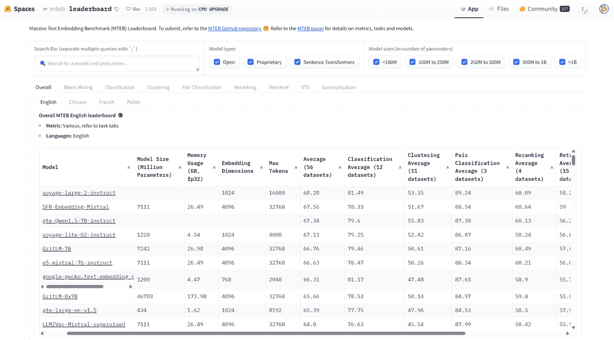

在[HuggingFace的排行榜](https://huggingface.co/spaces/mteb/leaderboard)上可以看到各种各样开源好用的embedding模型。在具体研究和工程问题的选择中，其实没有一个明确的好坏评价标准，适合自己的数据处理场景才是最好的。一个常见的方法是构造自己应用场景的专有评测集，然后分别尝试，量化的方式来评估分数最后选择。

todo：评测集构建的例子

### 数据预处理

当我们拿到一篇或多篇文章，它们的格式可能是pdf，txt，doc甚至是ppt，我们往往会对其进行数据的预处理，来帮助后续流程中更好地让大语言模型和embedding模型来发挥作用。

机器**学习中有一句深刻的名**言：Garbage in，Garbage out。这不仅仅可以用于机器学习模型的训练，推理时过于混乱的原始信息也可能会极大程度地干扰模型的回复效果。因此，数据预处理至关重要！

数据处理的常用手段包含格式统一转换和数据清洗

数据读取 → 数据格式转换 → 数据清洗

Todo：流程图

+   **数据读取**：从文件、数据库或API获取原始数据

+   **数据格式转换**：将多样的数据统一转换成方便模型处理的格式（常用的为Markdown format）

+   **数据清洗**：去除噪声、纠正错误、信息筛选等

TODO：一个pdf转成Markdown的代码示例

## 构建RAG应用

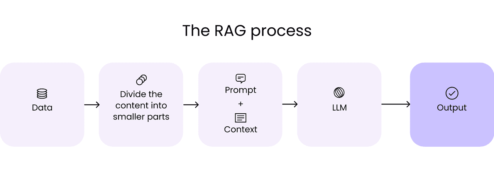

### Basic RAG

RAG，全称为 Retrieval Argumented Generation，检索增强生成。

大语言模型通过预训练阶段在海量文本上的自监督训练中获得了大量的人类知识，但是依然存在一些诸如时效性和幻觉的问题。而RAG正是为了补充并增强大语言模型的能力，使其尽量和现实世界对齐的一种技术路线。

一个最为简单朴素的RAG的思想为：我有一些文本数据包含了有用的信息，我想让大语言模型利用这些文本信息来生成回复，而不是直接输出答案，因此在原先的交互流程中，我们要将外部文本信息组成上下文合并到prompt中，交付给LLM，以此来达成增强生成（Argumented Generation）的目的，就是这么简单！

**这个时候聪明的读者**可能就会发现了，欸，那 Retrieval 去哪儿了呢。这是一个很好的问题，如果我现在有一篇800字的作文或者5000字的论文，那我直接将其简单处理后合并进prompt中就可以了，如下所示：

```
essay = &quot;800字的作文，以下省略800字...&quot;
paper = &quot;5000字的论文，以下省略5000字...&quot;

system_prompt = &quot;you are a helpful assistant&quot;
user_prompt = f&quot;帮我总结一下这篇文章，全文信息如下：{essay}&quot;

prompt = system_prompt + user_prompt
```

但是，当我有100篇，甚至成千上万篇文章，以上亿token为单位的上下文长度时，很显然，会分分钟超出现在大语言模型所支持的上下文长度。此时，一个显而易见的解决方案便是：我只将我最关心的那一部分内容合并到 prompt 中交付给大模型。那如何才能知道大量文本中，哪些才是我最关心或者说和我的问题最相关的片段部分呢。欸，这就是 Retrieval 阶段的功能和作用。

CAMEL中对于Retrieval这一过程的功能实现在 camel.retrievers 中，具体参考https://docs.camel-ai.org/key_modules/retrievers.html

根据匹配标准和算法的不同，常用的retriever大致可以分成两类，基于向量的稠密检索和基于关键词的稀疏检索，分别对应camel.retrievers 中的 VectorRetriever 和 BM25Retriever

```
from camel.retrievers import VectorRetriever
from camel.retrievers import BM25Retriever
from camel.embeddings import SentenceTransformerEncoder

embedding_model=SentenceTransformerEncoder(model_name=&#x27;intfloat/e5-large-v2&#x27;)

# 国内无法运行上述代码，可以注释掉使用以下方案# embedding_model=SentenceTransformerEncoder(model_name=&#x27;./embedding_model/&#x27;)
# 下载方案2：打开这个链接https://hf-mirror.com/intfloat/e5-large-v2/tree/main，下载除了model.safetensors的以外部分，保存到当前代码同级目录的embedding_model文件夹下。
# 也可以从百度云盘直接下载embedding_model文件夹放到当前代码同级目录下。
# https://pan.baidu.com/s/1xt0Tg_Wmr8iJuyGiPfgJrw 提取码: 7pzr 

vr = VectorRetriever(embedding_model=embedding_model)
br = BM25Retriever()
```

VectorRetriever，向量检索器利用数据的向量表示，将数据（如文本、图像或其他形式的信息）转换为高维空间中的数值向量。

以下是向量检索的工作流描述：

+   **分块**：对于大型文档或其他形式的数据信息而言，需要按一定的划分规则将其分解为较小的块

+   **嵌入**：对于每一个分块，使用嵌入模型将文本转换为高维的向量形式。

+   **存储**：这些得到的向量会被存储在数据库中。

+   **检索**：当提出问题或进行查询时，嵌入模型会将问题转换为向量，然后在此向量数据库中搜索相似度高的匹配向量（这里一般会用余弦相似度来计算两个向量之间的距离），从而返回最相关的信息片段。

BM25Retriever，关键词检索器从结果而言是一样的，只不过是从更加稀疏的关键词的维度来对文本进行召回。通过关键词匹配的算法获取相似度高的文本片段，尽可能筛选出最相关的信息片段。

最后将最相关的信息片段像之前演示的那样合并到 prompt 中，交给大语言模型生成检索增强后的回复

接下来我们通过一个demo来学习以下如何快速搭建一个Basic RAG的系统

**读取示例数据：**

这里我们首先下载一篇CAMEL的论文作为文本示例，该PDF就是我们的原始文件

```
import os
import requests

os.makedirs(&#x27;local_data&#x27;, exist_ok=True)

url = &quot;https://arxiv.org/pdf/2303.17760.pdf&quot;
response = requests.get(url)
with open(&#x27;local_data/camel_paper.pdf&#x27;, &#x27;wb&#x27;) as file:
    file.write(response.content)
```

实例化Embedding Model：

这里使用 VectorRetriever，使用本地模型作为嵌入模型。

```
from camel.embeddings import SentenceTransformerEncoder
from camel.retrievers import VectorRetriever

embedding_model=SentenceTransformerEncoder(model_name=&#x27;intfloat/e5-large-v2&#x27;)

```

**向量嵌入和存储数据：**

接下来，我们将原始的文档读取，分块并且通过embedding模型生成向量表示和索引并将其存储在专门用来存储向量数据的向量数**据库，VectorDB中。**CAMEL框架中的 process 函数其本质上就是将文件读取、切块、嵌入并储存这个固定的处理流程统一封装成了一个方法，使得开发者更加方便快速的搭建RAG应用。

```
# 创建并初始化一个向量数据库 (以QdrantStorage为例)
from camel.storages.vectordb_storages import QdrantStorage

vector_storage = QdrantStorage(
    vector_dim=embedding_model.get_output_dim(),
    collection=&quot;demo_collection&quot;,
    path=&quot;storage_customized_run&quot;,
    collection_name=&quot;论文&quot;
)
# 初始化VectorRetriever实例并使用本地模型作为嵌入模型
vr = VectorRetriever(embedding_model= embedding_model,storage=vector_storage)
# 将文件读取、切块、嵌入并储存在向量数据库中，这大概需要1-2分钟
vr.process(
    content=&quot;local_data/camel_paper.pdf&quot;
)
```

这里如果出现UserWarning: Failed to partition the file: local_data/camel_paper.pdf

warnings.warn(f"Failed to partition the file: {input_path}")需要补充这个环境：

```
pip install &quot;unstructured[pdf]&quot;
```

**执行检索，查看效果：**

完成向量数据库的构建和存储后，就可以根据问题来进行检索。这里调用 query 方法执行查询

```
# 设定一个查询语句
query = &quot;CAMEL是什么&quot;

# 执行查询并获取结果
results = vr.query(query=query, top_k=1)
print(results)
```

这里的参数top_k=1是指定检索器返回最相关的文本内容，同时还有一个相似度阈值参数similarity_threshold，其值介于0到1之间，默认值是0.75，从而确保检索到的内容的相关程度，可以根据自己应用场景的实际需求更改 top_k 或 similarity_threshold 值。

"What is CAMEL"得到回复为

```
[{&#x27;similarity score&#x27;: &#x27;0.8193796123510835&#x27;, &#x27;content path&#x27;: &#x27;local_data/camel_paper.pdf&#x27;, &#x27;metadata&#x27;: {&#x27;filetype&#x27;: &#x27;application/pdf&#x27;, &#x27;languages&#x27;: [&#x27;eng&#x27;], &#x27;page_number&#x27;: 1}, &#x27;extra_info&#x27;: {}, &#x27;text&#x27;: &#x27;3 2 0 2\n\nv o N 2\n\n] I\n\nA . s c [\n\n2 v 0 6 7 7 1 . 3 0 3 2 : v i X r a\n\nCAMEL: Communicative Agents for “Mind” Exploration of Large Language Model Society https://www.camel-ai.org\n\nGuohao Li∗ Hasan Abed Al Kader Hammoud*\n\nHani Itani*\n\nDmitrii Khizbullin\n\nBernard Ghanem\n\nKing Abdullah University of Science and Technology (KAUST)\n\nAbstract&#x27;}]
```

返回的字典包括：

+   similarity score 相似性分数

+   content path 内容路径

+   metadata 元数据

+   text 文本

当然，如果在实际应用中我们往往只关心模型的文本回复部分，我们可以在字典中取出text的值。

```
print(results[0][&quot;text&quot;])
```

我们再尝试一个与论文内容无关的提问"Compared with dumpling and rice, which should I take for dinner?"：

```
retrieved_info_irrevelant = vr.query(
    query=&quot;Compared with dumpling and rice, which should I take for dinner?&quot;,
    top_k=1,
    similarity_threshold=0.8
)

print(retrieved_info_irrevelant)
```

```
[{&#x27;text&#x27;: &#x27;No suitable information retrieved from local_data/camel paper.pdf with similarity_threshold = 0.75.&#x27;}]
```

我们可以看到在相似度阈值为0.8的情况下，检索器没有找到论文中与提问有关内容，这和我们的预期是十分符合的。

到目前为止，整个RAG的流程还没结束，因为我们实际上目前为止只是把最相关的内容检索了出来，还差最后一步，结合大语言模型的生成。

聪明的读者可能已经想到了，此时我们只需要实例化一个LLM或者Agent就可以了，CAMEL中的一个用于一般对话场景的Agent为 camel.agents 中的 ChatAgent。

```
from camel.agents import ChatAgent
from camel.models import ModelFactory
from camel.types import ModelPlatformType

from dotenv import load_dotenv
import os

load_dotenv()
api_key = os.getenv(&#x27;INTERNLM_API_KEY&#x27;)
retrieved_info = vr.query(
    query=&quot;what is roleplaying?&quot;,
    top_k=1,
)

assistant_sys_msg = &quot;&quot;&quot;
你是一个帮助回答问题的助手，
我会给你原始查询和检索到的上下文，
根据检索到的上下文回答原始查询，
如果你无法回答问题就说我不知道。
&quot;&quot;&quot;

model = ModelFactory.create(
    model_platform=ModelPlatformType.INTERNLM,
    model_type=&quot;internlm2.5-latest&quot;,
    api_key=api_key
)

user_msg = retrieved_info[0][&#x27;text&#x27;]
print(user_msg + &#x27;\n&#x27;)

agent = ChatAgent(assistant_sys_msg,model=model)
# 使用step方法获得最终的检索增强生成的回复并打印
assistant_response = agent.step(user_msg)
print(assistant_response.msg.content)

&gt;&gt;&gt;
novel communicative agent framework named role- playing . Our approach involves using inception prompting to guide chat agents toward task completion while maintaining consistency with human intentions. We showcase how role-playing can be used to generate conversational data for studying the behaviors and capabilities of a society of agents, providing a valuable resource for investigating conversational language models. In particular, we conduct com- prehensive studies on instruction-following

根据提供的上下文，这个新的沟通代理框架名为“角色扮演”（role-playing）。该方法通过使用启发式提示（inception prompting）来引导聊天代理完成任务，同时保持与人类意图的一致性。研究展示了如何利用角色扮演生成对话数据，以研究代理社会的行为和能力，为调查对话语言模型提供宝贵的资源。特别是，研究对指令遵循进行了全面的研究。如果你有更具体的问题或需要进一步的信息，请告诉我！
```

更进一步我们可以将这一个步骤封装到一个函数里：

```
from camel.agents import ChatAgent
from came**l.messages i**mport BaseMessage
from camel.types import RoleType
from camel.retrievers import AutoRetriever
from camel.types import StorageType

def single_agent(query: str) -&gt;str :
    # 设置agent角色
    assistant_sys_msg = &quot;&quot;&quot;你是一个帮助回答问题的助手，
        我会给你原始查询和检索到的上下文，
        根据检索到的上下文回答原始查询，
        如果你无法回答问题就说我不知道。&quot;&quot;&quot;

    # 添加自动检索器
    auto_retriever = AutoRetriever(
            vector_storage_local_path=&quot;local_data2/&quot;,
            storage_type=StorageType.QDRANT,
            embedding_model=embedding_model)

    # 运行向量检索器
    retrieved_info = auto_retriever.run_vector_retriever(
        query=query,
        contents=[
            &quot;local_data/camel_paper.pdf&quot;,  # 示例本地路径
            &quot;https://github.com/camel-ai/camel/wiki/Contributing-Guidlines&quot;,  # 示例url
        ],
        top_k=1,
        return_detailed_info=False,
        similarity_threshold=0.5
    )

    # 将检索到的信息传递给agent
    user_msg = str(retrieved_info)
    agent = ChatAgent(assistant_sys_msg,model =model)

    # 获取响应
    assistant_response = agent.step(user_msg)
    return assistant_response.msg.content

print(single_agent(&quot;如果我对贡献CAMEL项目感兴趣，我应该怎么做？&quot;))

&gt;&gt;&gt;
如果您对贡献CAMEL项目感兴趣，您可以按照以下步骤进行：

1. **查看项目页面**：访问CAMEL项目的GitHub页面，了解项目的最新动态、功能和目标。
2. **阅读贡献指南**：在项目页面中查找并阅读“Contributing Guidelines”（贡献指南），了解如何参与项目、代码风格要求、提交Pull Request的流程等。
3. **参与讨论**：加入项目的Issues和Discussions部分，与其他贡献者交流，提出问题或建议。
4. **选择任务**：从Issues列表中选择一个适合您的任务开始。如果有疑问，可以在Issue下留言询问。
5. **提交代码**：完成任务后，提交Pull Request，并按照项目的要求进行代码审查。

希望您能顺利参与到CAMEL项目中！
```

```
print(single_agent(&quot;什么是RolePlaying?&quot;))

&gt;&gt;&gt;
角色扮演（RolePlaying）是一种沟通代理框架，通过使用启发式提示来引导聊天代理完成任务，同时保持与人类意图的一致性。这种方法可以用于生成对话数据，以研究代理社会的行为和能力，为调查对话语言模型提供宝贵的资源。特别是在遵循指令方面进行了全面的研究。
```

至此，恭喜您已经搭建了一个Basic RAG，接下来我们将介绍更多RAG中的小技巧~

**作业**：在自己准备的数据集上尝试搭建一个RAG应用并测试一下效果，如果效果不理想，是否有改进的方法呢？

### Rewriting

带着上一章作业的问题来看接下来的章节会更有收获哦！

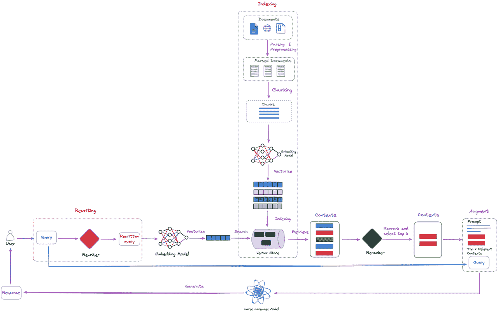

在实际的应用中，很多时候我们可能会发现，用户的提问是不一定准确的，比如存在错别字，语义顺序颠倒等情况，甚至有时候用户对于自己的Query究竟要如何表达也是模糊不清的，而阅读并实践了上一章节的读者可能会有一个直观的感受，就是Query不仅会作用在检索的部分，还会作用在最后生成回复的部分，简而言之，Query的质量可能会极大程度地影响整个RAG系统的表现和性能。

因此在这里，我们尝试加入一个对于初始Query的改写或者澄清模块，又称为 Rewriting ，来尽可能提高Query的质量或增强之后RAG环节的质量。

我们不妨针对之前的分析来思考一下如何进行改写才能缓解之前提到的问题。

+   **错字校正**：修正用户输入中可能存在的错别字的情况

+   **句式调整**：重构Query来使得句子表达更加通顺严谨

对于这两个常规问题，我们可以使用LLM自我调整，通过提示词工程的方式令其自我优化提示词。

```
original_query = &quot;我盖如何解决CAMEL中文档冲服的问题问题呢，几个版本的文档可能存在代码结构的冲突&quot;
sys_msg = &#x27;你是RAG模块中的Rewriting助手，目的是理解用户的提问，并且重新组织和优化用户的提问表达，修正用户输入中可能存在的错别字的情况并重构提问来使得句子表达更加通顺严谨&#x27;
from camel.models import ModelFactory
from camel.types import ModelPlatformType, ModelType
from camel.configs import ChatGPTConfig
from camel.agents import ChatAgent

from dotenv import load_dotenv
import os

load_dotenv()
api_key = os.getenv(&#x27;INTERNLM_API_KEY&#x27;)

# 定义模型
model = ModelFactory.create(
    model_platform=ModelPlatformType.INTERNLM,
    model_type=&quot;internlm2.5-latest&quot;,
    api_key=api_key
)
agent = ChatAgent(system_message=sys_msg, model=model)
# 定义Rewriting任务
usr_msg = f&#x27;用户的原始提问如下：{original_query}，请优化重写并直接输出新的Query。新的Query: &#x27; 
response = agent.step(usr_msg)
print(response.msgs[0].content)
```

这里优化的轮数取决于需求，你可以让LLM不断优化，直到满足你的预期为止。

此外，Rewriting模块还存在很多其他优化技巧，比如：

+   子问题策略

也称为子查询，是一种用于生成子问题的技术。其核心思想是在问答过程中生成并提出与主问题相关的子问题，以便更好地理解和回答主问题。这些子问题通常更具体，可以帮助系统更深入地理解主问题，从而提高检索准确性和提供正确的答案。

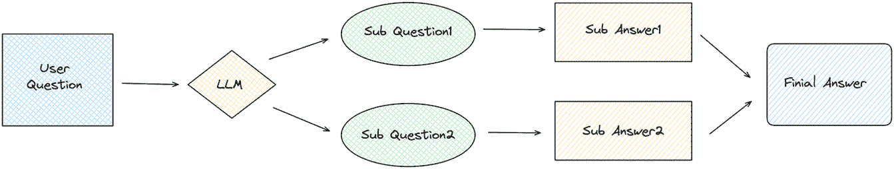

+   HyDE 查询转换

论文**「**Precise Zero-Shot Dense Retrieval without Relevance Labels」 提出了一种名为假设文档嵌入 (HyDE) 的方法。HyDE (Hypothetical Document Embeddings) 的本质是使用 LLM 为用户查询生成假设文档。这些文档是根据 LLM 本身的知识生成的，可能包含错误或不准确之处。但是，它们与 RAG 知识库中的文档相关联。然后，通过使用这些假设文档来检索具有相似向量的真实文档，从而提高检索的准确性。

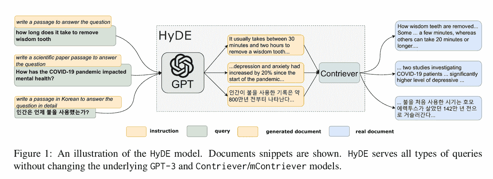

我们可以对比一下加入了Rewriting之后的回复生成效果和Basic RAG的结果

TODO：对比效果

作业：你还知道其他Rewriting的优化技巧和方法吗？能在CAMEL框架中实现上述的两个

### Rerank

之前我们提到了可以通过向量和关键字等多种方式和不同的维度来进行检索，为了检索这一步结果的精确性和强相关性，我们往往会引入Rerank这一模块来对多路召回(多路指的是向量相似度，关键字匹配，基于规则的匹配，甚至结构化搜索等多种方式并行召回，往往召回的片段结果数量加起来比较多)的文档片段结果进行重排。因为数量越多，召回的内容相关度越可能存在问题，多数情况下score最高的片段相关度没问题，但是top2-5及往后的相关度就很随机了，这会对最终生成效果造成影响。

Rerank模块对初步检索结果重新排序可以简单概括为以下几步：

1.  **初步检索**：获取（多路召回）初始文档片段

1.  **特征计算**：评估每个文档的相关性

1.  **重新排序**：根据特征得分排序

1.  **选择最佳结果**：根据重排结果倒序排列，取前TOP-K个作为最终的最相关结果交给LLM生成回复

**为了量化我们系统的有效性，我**们主**要依赖于两个被广泛接受**的指标：命中率(hit rate) 和 平均倒数排名(MRR)。

**命中率(Hit Rate)：**

Hit rate计算在前k个检索文档中找到正确答案的查询比例。简单来说，它是关于我们的系统在前几次猜测中正确的频率。

**平均倒数排名(MRR)：**

对于每个查询，MRR通过查看排名最高的相关文档的排名来评估系统的准确性。具体来说，它是所有查询中这些秩的倒数的平均值。因此，如果第一个相关文档是顶部结果，则倒数排名为1; 如果是第二个，倒数是1/2，以此类推。

如果还没有太懂，不要紧，我们可以通过BAAI提供的Evaluation测评的结果来直观的理解，简单而言对于同一个embedding model，使用不同的rerank model，mrr和hit rate指标的分数越高，意味着效果越好！https://huggingface.co/BAAI/bge-reranker-v2-minicpm-layerwise

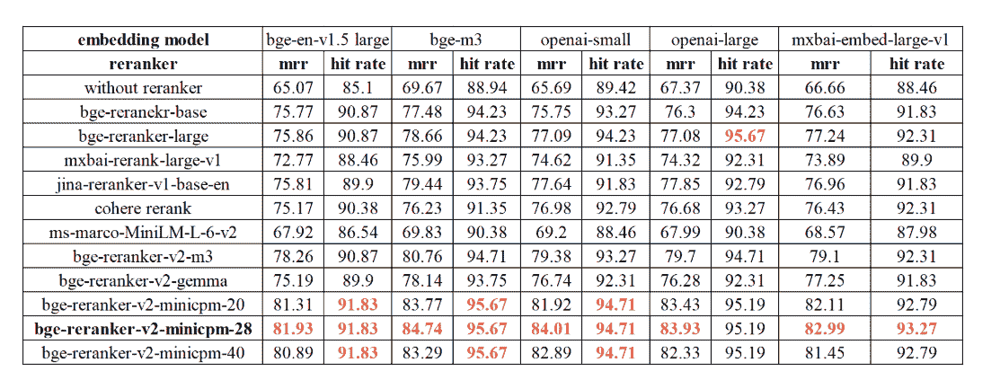

我们这里使用比较经典的RRF（Reciprocal Rank Fusion）算法来实现一个reranker。

倒数排序融合(RRF) 是一种将具有不同相关性指标的多个结果集组合成单个结果集的方法，不同的相关性指标也不必相互关联即可获得高质量的结果。该方法的优势在于不利用相关分数，而仅靠排名计算。

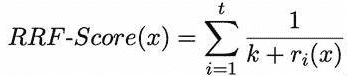

```
from camel.embeddings import SentenceTransformerEnco**der**
from camel.retrievers import VectorRetriever, BM25Retriever
from camel.storages.vectordb_storages import QdrantStorage
from typing import List,Dict

def rrf(vector_results: List[Dict], text_results: List[Dict], k: int=10, m: int=60):
    &quot;&quot;&quot;
    使用RRF算法对两组检索结果进行重排序
    
    params:
    vector_results (list): 向量召回的结果列表，每个元素是包含&#x27;text&#x27;的字典
    text_results (list): 文本召回的结果列表，每个元素是包含&#x27;text&#x27;的字典
    k(int): 排序后返回前k个
    m (int): 超参数
    
    return:
    重排序后的结果列表，每个元素是(文档内容, 融合分数)
    &quot;&quot;&quot;
    doc_scores = {}
    
    # 遍历向量检索结果
    for rank, result in enumerate(vector_results):
        text = result[&#x27;text&#x27;]
        doc_scores[text] = doc_scores.get(text, 0) + 1 / (rank + m)
    
    # 遍历文本检索结果
    for rank, result in enumerate(text_results):
        text = result[&#x27;text&#x27;]
        doc_scores[text] = doc_scores.get(text, 0) + 1 / (rank + m)
    
    # 按融合分数排序并返回前k个结果
    sorted_results = sorted(doc_scores.items(), key=lambda x: x[1], reverse=True)[:k]
    return sorted_results

# 初始化检索器
embedding_model = SentenceTransformerEncoder(model_name=&#x27;intfloat/e5-large-v2&#x27;)
vector_storage = QdrantStorage(
    vector_dim=embedding_model.get_output_dim(),
    collection=&quot;demo_collection&quot;,
    path=&quot;storage_customized_run&quot;,
    collection_name=&quot;paper&quot;
)

vr = VectorRetriever(embedding_model=embedding_model, storage=vector_storage)
bm25r = BM25Retriever()

# 处理文档
content_path = &quot;local_data/camel_paper.pdf&quot;
vr.process(content=content_path)
bm25r.process(content_input_path=content_path)

# 查询
query = &quot;CAMEL是什么&quot;
vector_results = vr.query(query=query,top_k=10)
bm25_results = bm25r.query(query=query, top_k=10)

# 融合排序
rrf_results = rrf(vector_results, bm25_results)
print(rrf_results)
```

---

## 附录

## **Loader补充说明**

**Apify Reader**

Apify Reader 提供了一个 Python 接口，用于与[ Apify](https://console.apify.com/settings/integrations) 平台交互，以实现 Web 工作流的自动化。你可以在这里获取所需要的APIKEY。

初始化客户端，设置所需参数。

```
from camel.loaders import Apify
import os

os.environ[&quot;APIFY_API_KEY&quot;] = &quot;你的apikey&quot;

apify = Apify()

run_input = {
    &quot;startUrls&quot;: [{&quot;url&quot;: &quot;https://www.camel-ai.org/&quot;}],
    &quot;maxCrawlDepth&quot;: 0,
    &quot;maxCrawlPages&quot;: 1,
}
actor_result = apify.run_actor(
    actor_id=&quot;apify/website-content-crawler&quot;, run_input=run_input
)
```

检索结果数据库 ID 并使用 get_dataset_items 方法访问它。

```
dataset_result = apify.get_dataset_items(
    dataset_id=actor_result[&quot;defaultDatasetId&quot;]
)

print(dataset_result)

&gt;&gt;&gt;
[{&#x27;url&#x27;: &#x27;https://www.camel-ai.org/&#x27;, &#x27;crawl&#x27;: {&#x27;loadedUrl&#x27;: &#x27;https://www.camel-ai.org/&#x27;, &#x27;loadedTime&#x27;: &#x27;2025-02-06T07:11:19.056Z&#x27;, &#x27;referrerUrl&#x27;: &#x27;https://www.camel-ai.org/&#x27;, &#x27;depth&#x27;: 0, &#x27;httpStatusCode&#x27;: 200}, &#x27;metadata&#x27;: {&#x27;canonicalUrl&#x27;: &#x27;https://www.camel-ai.org/&#x27;, &#x27;title&#x27;: &#x27;CAMEL-AI&#x27;, &#x27;description&#x27;: &#x27;CAMEL-AI.org is the 1st LLM multi-agent framework and an open-source community dedicated to finding the scaling law of agents.&#x27;, &#x27;author&#x27;: None, &#x27;keywords&#x27;: None, &#x27;languageCode&#x27;: &#x27;en&#x27;, &#x27;openGraph&#x27;: [{&#x27;property&#x27;: &#x27;og:title&#x27;, &#x27;content&#x27;: &#x27;CAMEL-AI&#x27;}, {&#x27;property&#x27;: &#x27;og:description&#x27;, &#x27;content&#x27;: &#x27;CAMEL-AI.org is the 1st LLM multi-agent framework and an open-source community dedicated to finding the scaling law of agents.&#x27;}, {&#x27;property&#x27;: &#x27;twitter:title&#x27;, &#x27;content&#x27;: &#x27;CAMEL-AI&#x27;}, {&#x27;property&#x27;: &#x27;twitter:description&#x27;, &#x27;content&#x27;: &#x27;CAMEL-AI.org is the 1st LLM multi-agent framework and an open-source community dedicated to finding the scaling law of agents.&#x27;}, {&#x27;property&#x27;: &#x27;og:type&#x27;, &#x27;content&#x27;: &#x27;website&#x27;}], &#x27;jsonLd&#x27;: None, &#x27;headers&#x27;: {&#x27;content-type&#x27;: &#x27;text/html&#x27;, &#x27;transfer-encoding&#x27;: &#x27;chunked&#x27;, &#x27;connection&#x27;: &#x27;keep-alive&#x27;, &#x27;date&#x27;: &#x27;Wed, 05 Feb 2025 21:46:50 GMT&#x27;, &#x27;cf-ray&#x27;: &#x27;90d61869d8a0ef20-PDX&#x27;, &#x27;cf-cache-status&#x27;: &#x27;MISS&#x27;, &#x27;content-encoding&#x27;: &#x27;gzip&#x27;, &#x27;last-modified&#x27;: &#x27;Wed, 05 Feb 2025 21:46:50 GMT&#x27;, &#x27;strict-transport-security&#x27;: &#x27;max-age=31536000&#x27;, &#x27;surrogate-control&#x27;: &#x27;max-age=432000&#x27;, &#x27;surrogate-key&#x27;: &#x27;www.camel-ai.org 6659a154491a54a40551bc78 pageId:6686a2bcb7ece5fb40457491 679b765c27842bdba036423f 668181a0a818ade34e653b24 6659a155491a54a40551bd7e&#x27;, &#x27;x-lambda-id&#x27;: &#x27;ce2c42a4-c711-4bd7-b262-58374d893ffa&#x27;, &#x27;set-cookie&#x27;: &#x27;_cfuvid=55wNMTV.q_HQ_jKuXybjfL5A9sxw0Wd30vX5Ff26cJA-1738792010775-0.0.1.1-604800000; path=/; domain=.cdn.webflow.com; HttpOnly; Secure; SameSite=None&#x27;, &#x27;x-cluster-name&#x27;: &#x27;us-west-2-prod-hosting-red&#x27;, &#x27;vary&#x27;: &#x27;Accept-Encoding&#x27;, &#x27;x-cache&#x27;: &#x27;Hit from cloudfront&#x27;, &#x27;via&#x27;: &#x27;1.1 6a783450a00c2b23baf9dd1c4a552cb0.cloudfront.net (CloudFront)&#x27;, &#x27;x-amz-cf-pop&#x27;: &#x27;LAX54-P3&#x27;, &#x27;x-amz-cf-id&#x27;: &#x27;t9nN-HwYopeCl40sOYSwOcFNJJT3I_KFOsxZuiD3I_23GLC9K5OEBA==&#x27;, &#x27;age&#x27;: &#x27;33862&#x27;}}, &#x27;screenshotUrl&#x27;: None, &#x27;text&#x27;: &#x27;Building Multi-AgentSystems for World Simu_\nCAMEL’s multi-agent approach streamlines large-scale synthetic data creation and labeling. By assigning different specialized roles to each agent, it encourages dynamic, chain-of-thought collaborations that yield high-quality outputs. The orchestrated interaction ensures comprehensive coverage of data variations and consistency across domains. This makes it ideal for generating training sets, question-answer pairs, or other structured content.\nCAMEL powers automated workflows by breaking down complex tasks among coordinated agents. Each agent assumes a specific role, collaborating through an iterative conversational framework. This reduces manual intervention, minimizes errors, and accelerates solution delivery—especially useful for repetitive or logic-intensive processes.\nCAMEL enables simulations of dynamic, interactive worlds. Agents act as entities with distinct personas, communicating and responding in real time. This setup can be used for modeling scenarios, building interactive storylines, or testing multi-layered strategies. By capturing the nuances of diverse viewpoints, CAMEL creates immersive simulations for experimentation, training, and creative exploration.&#x27;, &#x27;markdown&#x27;: &#x27;# Building Multi-AgentSystems for World Simu\\_\n\nCAMEL’s multi-agent approach streamlines large-scale synthetic data creation and labeling. By assigning different specialized roles to each agent, it encourages dynamic, chain-of-thought collaborations that yield high-quality outputs. The orchestrated interaction ensures comprehensive coverage of data variations and consistency across domains. This makes it ideal for generating training sets, question-answer pairs, or other structured content.\n\n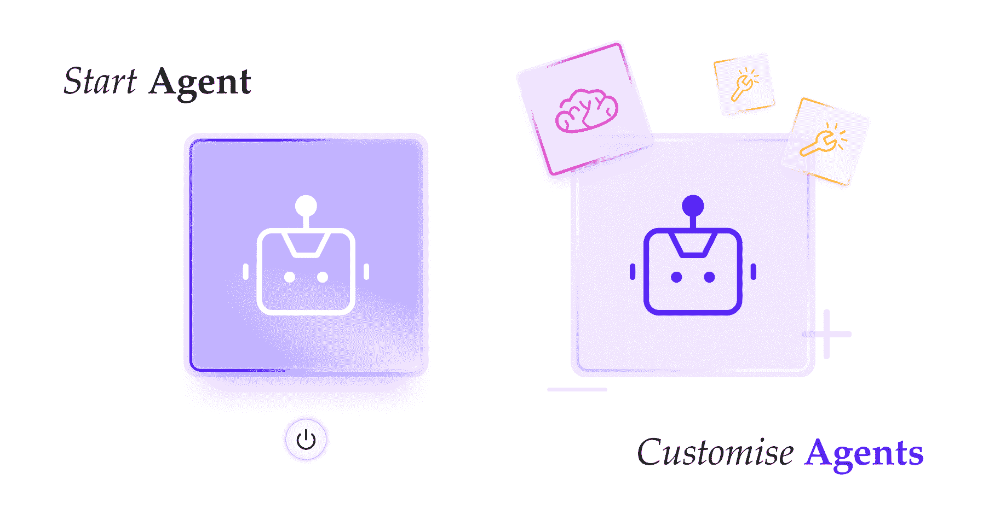\n\nCAMEL powers automated workflows by breaking down complex tasks among coordinated agents. Each agent assumes a specific role, collaborating through an iterative conversational framework. This reduces manual intervention, minimizes errors, and accelerates solution delivery—especially useful for repetitive or logic-intensive processes.\n\n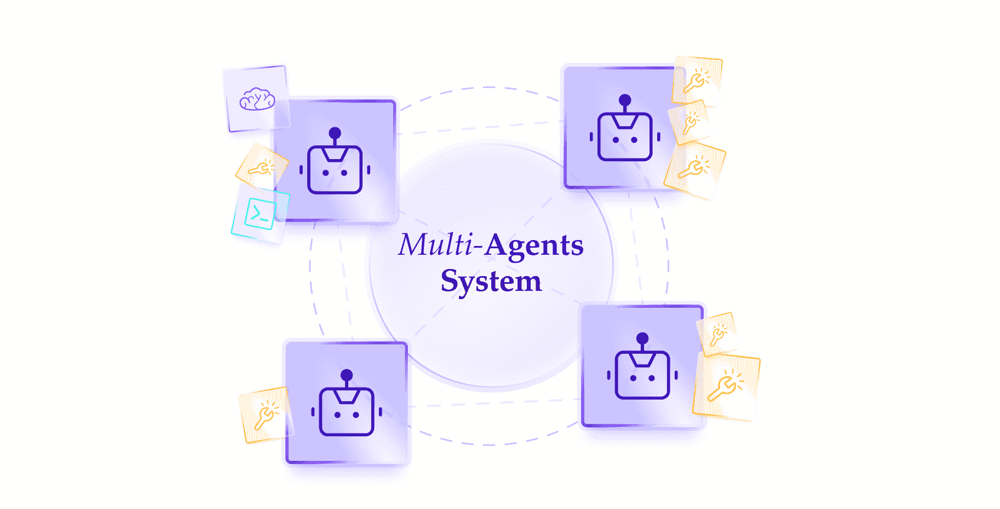\n\nCAMEL enables simulations of dynamic, interactive worlds. Agents act as entities with distinct personas, communicating and responding in real time. This setup can be used for modeling scenarios, building interactive storylines, or testing multi-layered strategies. By capturing the nuances of diverse viewpoints, CAMEL creates immersive simulations for experimentation, training, and creative exploration.\n\n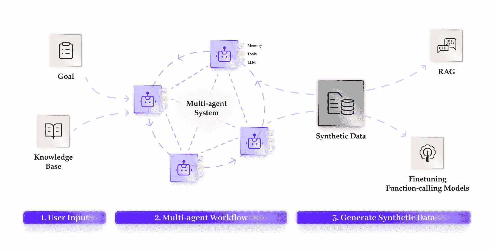&#x27;}]
```

这个函数通常用于从Apify平台获取爬取或处理后的数据，以便在后续程序中使用这些数据。

---

Firecrawl Reader

你可以从[此处](https://www.firecrawl.dev/)获得你的FirecrawlAPI

Firecrawl Reader 提供了一个 Python 接口来与 Firecrawl API 交互，允许用户将网站转换为大型语言模型可读的 markdown 格式。

初始化客户端并设置要从中检索信息的 URL。当状态为 “completed” 时，信息检索已完成并可供阅读。

```
from camel.loaders import Firecrawl

os.environ[&quot;FIRECRAWL_API_KEY&quot;] = &quot;你的apikey&quot;

firecrawl = Firecrawl()

response = firecrawl.crawl(url=&quot;https://www.camel-ai.org/about&quot;)
print(response[&quot;status&quot;])

&gt;&gt;&gt;
completed
```

直接从返回的结果中检索信息。

```
print(response[&quot;data&quot;][0][&quot;markdown&quot;])
```

```
**&gt;&gt;&gt;Camel-A**I Team

We are finding the  
scaling law of agent

🐫 CAMEL is an open-source library designed for the study of autonomous and 
communicative agents. We believe that studying these agents on a large scale 
offers valuable insights into their behaviors, capabilities, and potential 
risks. To facilitate research in this field, we implement and support various 
types of agents, tasks, prompts, models, and simulated environments.

**We are** always looking for more **contributors** and **collaborators**.  
Contact us to join forces via [Slack](https://join.slack.com/t/camel-kwr1314/shared_invite/zt-1vy8u9lbo-ZQmhIAyWSEfSwLCl2r2eKA)
 or [Discord](https://discord.gg/CNcNpquyDc)...
```

---

**Jina_url Reader**

JinaURL Reader 是 Jina AI 的 URL 读取服务的 Python 客户端，经过优化，可从 URL 提供更清晰、对 LLM 可读的内容。该reader提供一定额度的免费调用次数。无需注册API也可使用。

```
from camel.loaders import JinaURLReader
from camel[.types.enums import JinaRetu](https://www.datawhale.cn/assets/logo-vAxrscYT.png)rnFormat

jina_reader[ = Ji](https://www.datawhale.cn/open-ai)[ACTIVITY%E6%B4%BB%E5%8A%A8](https://www.datawhale.cn/activity)[COURSE%E8%AF%BE%E7%A8%8B](https://www.datawhale.cn/learn)[CERTIFICATION%E8%AE%A4%E8%AF%81](https://www.datawhale.cn/cert)[NEWS%E8%B5%84%E8%AE%AF](https://www.datawhale.cn/article)[n](https://www.datawhale.cn/cfd0357cb7301be8879b48a64347d08f)[tu](https://www.datawhale.cn/4d659f53c87d622c9cafa1b45920725f)](https://github.com/datawhalechina)rn_format=J[i](https://www.datawhale.cn/assets/homebanner-left-DQp9I1cY.png)naReturnFormat.MARKDOWN)
response = jina_reader.read_content(&quot;https://www.InternLM.cn/home&quot;)

print(response)

&gt;&gt;&gt;
InternLM-学用AI，从此开始
===============  


[HOME首页](https://www.InternLM.cn/home)[OPEN 1+XAI 通识课](https://www.InternLM.cn/open-ai)[ACTIVITY活动](https://www.InternLM.cn/activity)[COURSE课程](https://www.InternLM.cn/learn)[CERTIFICATION认证](https://www.InternLM.cn/cert)[NEWS资讯](https://www.InternLM.cn/article)


[](https://github.com/InternLMchina)

登录


InternLM for the learner


InternLM通过开源学习模式，助力AI学习者与知识连接，与人连接，与场景连接，推动AI人才培养。


...

社交媒体[GITHUB](https://github.com/InternLMchina) [B站](https://space.bilibili.com/431850986) [CSDN](https://blog.csdn.net/InternLM)

[ 我要反馈](https://jinshuju.net/f/gtuc5x)
Output is truncated. View as a scrollable element or open in a text editor. Adjust cell output settings...
```

---