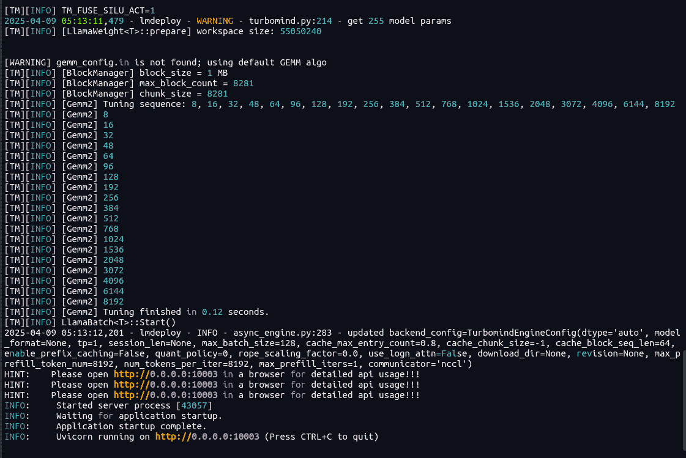
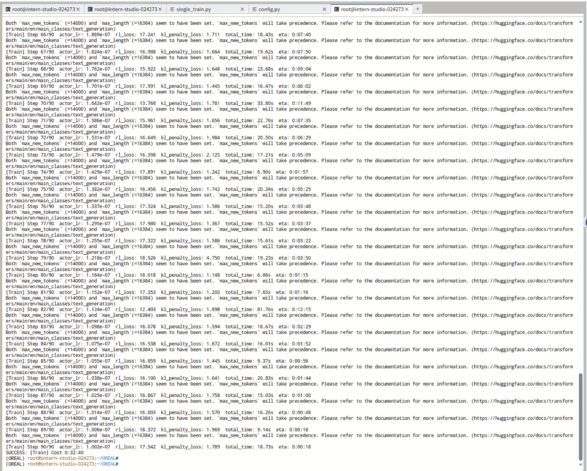
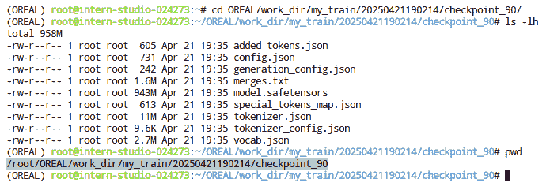
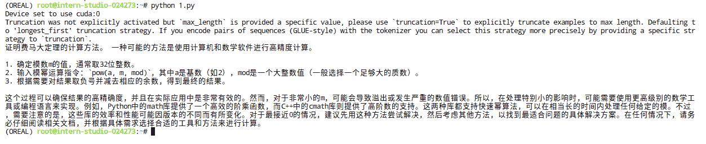
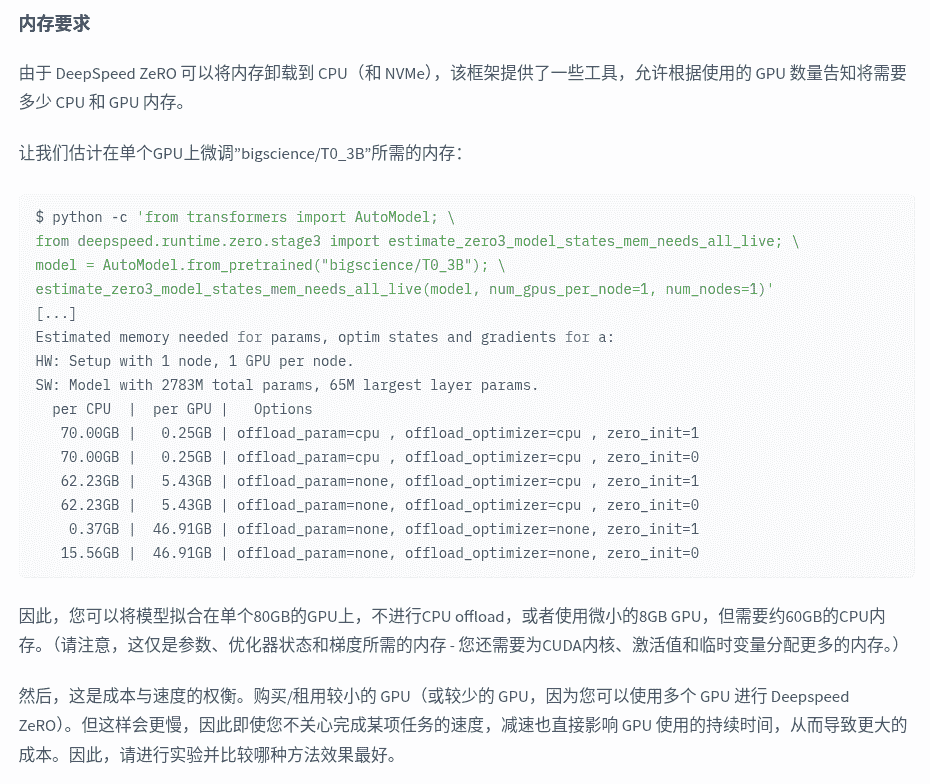

# L2G6-强化学习初探及OREAL实践

> 来源：[https://aicarrier.feishu.cn/docx/RuqPdzUfZoYdfUxMUduc3NJ9nBc](https://aicarrier.feishu.cn/docx/RuqPdzUfZoYdfUxMUduc3NJ9nBc)

> 文档尚处于草稿阶段，完善中

论文链接：https://arxiv.org/pdf/2502.06781

代码链接：https://github.com/InternLM/OREAL

论文解读就看[新闻稿](https://www.shlab.org.cn/news/5444059)和其他博主分析就好，这里就略了，直接开始跑代码。

# 配置环境

首先是安装python环境，这里直接用安装conda安装虚拟环境

```
wget https://repo.anaconda.com/miniconda/Miniconda3-latest-Linux-x86_64.sh
chmod +x Miniconda3-latest-Linux-x86_64.sh
./Miniconda3-latest-Linux-x86_64.sh
# 后面按提示操作
```

这里因为xtuner依赖的mpi4py-mpich要求python版本>=3.8, <3.12，所以要用3.11版本的python。

```
conda create -n OREAL python=3.11
conda activate OREAL
```

接着是安装具体依赖（这里我就当你已经安装完CUDA环境了），这个flash-attn需要编译，因此安装比较困难，如果安装失败就建议pip uninstall ninja && pip install -U ninja并重新安装试试。

```
pip install torch==2.6.0 torchvision==0.21.0 torchaudio==2.6.0 --index-url https://download.pytorch.org/whl/cu124
pip install flash-attn --no-build-isolation
pip install fire xtuner[all]==0.2.0rc0
```

如果你在安装flash-attn的过程中，出现了Build字样，并且花费的时间特别久，就直接去官网下载预编译好的版本自己上传安装吧，别浪费时间编译了，对于按前面的方法搭建的环境来说，直接安装这个包就行。

https://github.com/Dao-AILab/flash-attention/releases/download/v2.7.4.post1/flash_attn-2.7.4.post1+cu12torch2.6cxx11abiFALSE-cp311-cp311-linux_x86_64.whl

如果你的环境有不同，就去手动挑选：https://github.com/Dao-AILab/flash-attention/releases

# 运行 Judger 模型

## 安装git-lfs

如果你运行git lfs install没有任何问题并显示Git LFS initialized.就可以跳过这步，否则就看下面的步骤。

对于Ubuntu/Debian系统，可以直接

```
sudo apt update
sudo apt install git-lfs
```

而对于CentOS/RHEL，包管理器可能没有git-lfs这个包，这时需要手动添加下

```
curl -s https://packagecloud.io/install/repositories/github/git-lfs/script.rpm.sh | sudo bash
sudo yum install git-lfs
```

对于其他情况，可以参考这个网页

https://packagecloud.io/github/git-lfs/install

总之完成git-lfs的安装后，记得执行

```
git lfs install
```

## 下载离线模型

OREAL 需要一个语言模型作为验证器，结合基于规则的验证函数来评估生成解决方案的正确性。原版的repo使用的是72B的模型，但这个对大家来说开销太大了，因此换个1.5B的模型意思下。

```
git clone https://hf-mirror.com/Qwen/Qwen2.5-Math-1.5B-Instruct
```

下载完后就可以直接运行Judger了，这个可以使用lmdeploy进行api接口部署

```
pip install lmdeploy partial_json_parser
export HF_ENDPOINT=https://hf-mirror.com
lmdeploy serve api_server ./Qwen2.5-Math-1.5B-Instruct --chat-template qwen --log-level INFO --server-port 10003 --tp 1 --quant-policy 4 --cache-max-entry-count 0.1
```

看到下面这个结果就ok了，如果想修改部署配置就看这篇文章

https://github.com/InternLM/lmdeploy/blob/main/docs/zh_cn/llm/api_server.md



# 运行训练代码

因为OREAL的强化学习训练方式对资源要求很高，训练个7B的模型得需要32张A100分布式的训练大约9小时，这个成本太高了。因此我对训练代码进行了爆改，在训练的过程中需要使用3个LLM

1.  用于math_judger的LLM（在下面的示例中，我把这个模型规模从72B偷工减料到了1.5B）

1.  用于reference的LLM（被我偷工减料到了0.5B）

1.  被训练的LLM（被我偷工减料到了0.5B）

这个配置可以在40G显卡的显卡上完成训练（偶尔会OOM），至于训练出的水平就不要在意了，无数先辈复现Deepseek R1-Zero模型时就发现过一个铁律，小于 3B 的模型无法学会推理，只适合使用sft微调而不是强化学习。所以就不要对这个训练出的0.5B模型的性能抱有太大期待，只要能跑通就好。

一篇Deepseek R1-Zero复现实验：https://mp.weixin.qq.com/s/Z7P61IV3n4XYeC0Et_fvwg

首先先扒OREAL的源代码

如果你从github上拉代码有问题，可以用这里面的方法加速访问：https://github.akams.cn/

```
git clone https://github.com/InternLM/OREAL
```

创建自己的训练配置文件，默认的配置文件在./oreal/configs/文件夹下，这里要改掉这个配置，把hosts改成你的配置。

比如127.0.0.1:10003，这个就是你前面用lmdeploy运行的judger服务

因为原版的OREAL是在集群上分布式训练的，因此我对代码进行了修改，使其能进行单机训练

这里放3个我修改过的代码，将这些代码替换原代码即可训练。

放到./oreal/configs/config.py下


[config.py](https://internal-api-drive-stream.feishu.cn/space/api/box/stream/download/all/NY3rb6lOmoX1WmxpwuWcIh6Pnhf)

自己放在代码根目录


[single_train.py](https://internal-api-drive-stream.feishu.cn/space/api/box/stream/download/all/AdvRbqnQ4o2GzIxJOkfcTfhmnmb)

替换掉./oreal/datasets/trajectory.py


[trajectory.py](https://internal-api-drive-stream.feishu.cn/space/api/box/stream/download/all/VE9gbU9j1opadBx9dQ5csT3cnac)

接着运行这个指令以开始用强化学习的方式训练llm

```
export HF_ENDPOINT=https://hf-mirror.com

python single_train.py ./oreal/configs/config.py --total_steps 90 --work_dir ./work_dir/my_train
```

大概半个小时后就能训练完。



# 测试训练出的模型

训练好的模型会保存在前面的--work_dir文件夹下，进去后找到最后一次的checkpoint，然后就可以加载了。



用下面的代码测试训练出的模型

```
from transformers import pipeline, AutoTokenizer, AutoModelForCausalLM

model_name = &quot;./checkpoint_90&quot;  # 替换为你训练好的模型路径，在使用相对路径时注意路径起点。
model = AutoModelForCausalLM.from_pretrained(model_name)
tokenizer = AutoTokenizer.from_pretrained(model_name)

# 创建文本生成 pipeline
text_generator = pipeline(
    &quot;text-generation&quot;,
    model=model,
    tokenizer=tokenizer,
    device=&#x27;cuda:0&#x27;
)

# 等待用户输入
text_input = &quot;证明费马大定理&quot;

# 生成文本
result = text_generator(
    text_input,
    max_length=500,
    # num_return_sequences=3,
    no_repeat_ngram_size=2,
    temperature=0.7,
    top_k=50,
    top_p=0.95
)

# 打印生成的文本
print(result[0][&#x27;generated_text&#x27;])
```

还能正常生成，说明本次强化学习起码没有失败



# 可更进阶的尝试内容

在跑完上面的丐版LLM强化学习后，还有很多方向可以改进，首先就是怎么用强化学习训练出一个成功的，正常规模大小的LLM。

一是加钱，换上更好更多的GPU来训练模型。

二是用上一些降低显存占用的方案来在低资源下训练更大规格的模型。

比如使用DeepSpeed 框架的 ZeRO-3 方案减少显存占用，其具体方式有：参数分片、优化器状态分片、梯度分片、内存复用、内存分配优化、计算图优化、把暂时用不到的显存卸载到 CPU 和 NVMe 存储等方法。



在把参数拉满的情况下，可以将微调3B模型的显存占用从46.91GB降到0.25GB（仅是理论最低数值，不代表只用0.25G显存就能训练），代价由内存和硬盘承担。

可以看这篇文档进一步学习：https://huggingface.co/docs/transformers/main/zh/main_classes/deepspeed

除此以外，还能压榨，比如使用量化方法来降低训练时的模型显存占用（当心精度不够导致溢出），甚至直接上LoRA来微调……