# E1—沐曦玩转 LMDeploy、XTuner 和 InternLM3

> 来源：[https://aicarrier.feishu.cn/docx/XDjOdL760ohUdzxte7ocyZrnnce](https://aicarrier.feishu.cn/docx/XDjOdL760ohUdzxte7ocyZrnnce)

> 文档尚处于草稿阶段，完善中


**备注：书生大模型实**战营不收取任何费用，收费处请勿充值！！

# 实训环境注册并领取算力券

算力券申请地址：https://aicarrier.feishu.cn/share/base/form/shrcnPPuAhCQTfdtMq8drB1FISc


**五一内测群**

# 实训环境进入并启动实验容器

D.run平台使用手册：https://docs.d.run/

登录环境地址：https://console.d.run/

用户名、密码

1）启动实验容器如下步骤：

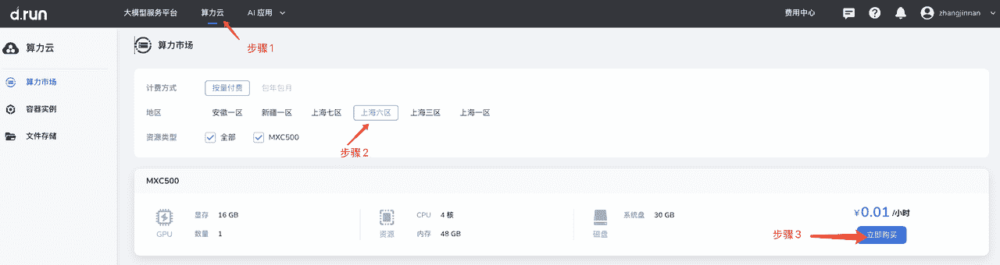

**2）选择容器的名称、区域、镜像**（注意镜像必须选择Dlinfer）

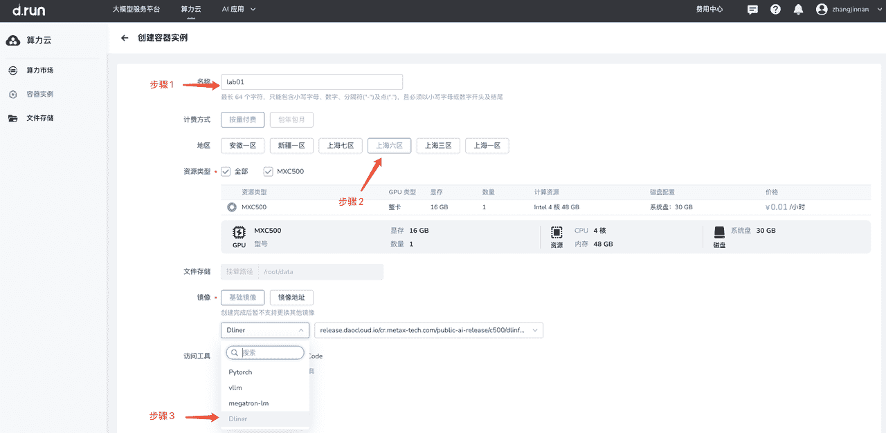

3）可以选择Jupyter Lab作为实验环境（VS code、SSH登录可选）

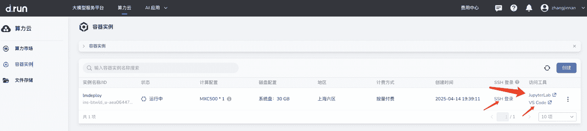

4）Jupyter Lab工作区域如下，打开终端可以看到对应的终端的说明

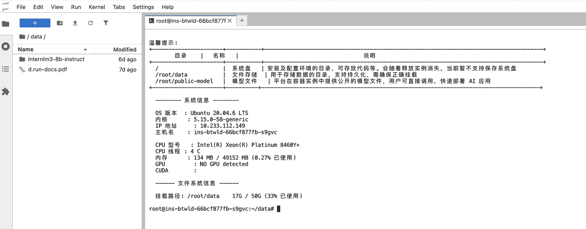

5）激活conda环境，并查看dlinfer安装情况

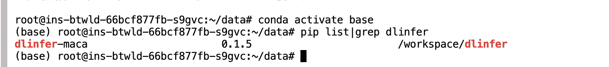

# LMDeploy推理及验证

1）下载源码安装LMDeploy：

```
# 安装addict软件包
pip install addict mmengine mmengine-lite fire accelerate==0.32.1 nvidia-ml-py

# 解决LMDeploy对tranformers版本要求的Iusse：
pip install transformers==4.47.1

# 下载lmdeploy，并进入目录
git clone https://github.com/InternLM/lmdeploy.git
cd lmdeploy
```

2）建议使用以下 commit进行源码安装：

```
# checkout对应的版本
git checkout 832bfc45b4497e8d16e08ecfd663671e634aae40
# 安装lmdeploy
LMDEPLOY_TARGET_DEVICE=maca python setup.py develop
```

3）部署验证结果，用internlm3-8b-instruct模型验证，验证程序如下：

```
import lmdeploy
from lmdeploy import PytorchEngineConfig

if __name__ == &quot;__main__&quot;:
    pipe = lmdeploy.pipeline(&quot;/root/public-model/models/internlm/internlm3-8b-instruct&quot;,
                             backend_config = PytorchEngineConfig(tp=1,
                                                                  cache_max_entry_count=0.8, device_type=&quot;maca&quot;,
                                                                  block_size=16)
                            )
    
    question = [&quot;Shanghai is&quot;, &quot;Please introduce China&quot;, &quot;How are you?&quot;]
    response = pipe(question, request_output_len=256, do_preprocess=False)
    for idx, r in enumerate(response):
        print(f&quot;Q: {question[idx]}&quot;)
        print(f&quot;A: {r.text}&quot;)
        print()
```

验证程序执行如下：

```
(base) root@ins-btwld-66bcf877fb-s9gvc:~# python test.py 
2025-04-14 13:35:45,494 - lmdeploy - WARNING - async_engine.py:671 - GenerationConfig: GenerationConfig(n=1, max_new_tokens=512, do_sample=False, top_p=1.0, top_k=50, min_p=0.0, temperature=0.8, repetition_penalty=1.0, ignore_eos=False, random_seed=None, stop_words=None, bad_words=None, stop_token_ids=[92542, 92540], bad_token_ids=None, min_new_tokens=None, skip_special_tokens=True, spaces_between_special_tokens=True, logprobs=None, response_format=None, logits_processors=None, output_logits=None, output_last_hidden_state=None)
2025-04-14 13:35:45,494 - lmdeploy - WARNING - async_engine.py:672 - Since v0.6.0, lmdeploy add `do_sample` in GenerationConfig. It defaults to False, meaning greedy decoding. Please set `do_sample=True` if sampling  decoding is needed
2025-04-14 13:35:45,494 - lmdeploy - WARNING - async_engine.py:671 - GenerationConfig: GenerationConfig(n=1, max_new_tokens=512, do_sample=False, top_p=1.0, top_k=50, min_p=0.0, temperature=0.8, repetition_penalty=1.0, ignore_eos=False, random_seed=None, stop_words=None, bad_words=None, stop_token_ids=[92542, 92540, 2], bad_token_ids=None, min_new_tokens=None, skip_special_tokens=True, spaces_between_special_tokens=True, logprobs=None, response_format=None, logits_processors=None, output_logits=None, output_last_hidden_state=None)
Q: Shanghai is
A:  a city that is known for its modernity, with a population of over 24 million people. It is a global city that is known for its advanced technology, high-quality food, and vibrant cultural scene. Shanghai has a long history that dates back to the 15th century, and it has grown into a modern metropolis that is a hub for trade, finance, and technology.

One of the most iconic landmarks in Shanghai is the Bund, which is a waterfront area that stretches along the Huangpu River. The Bund is a popular tourist destination, and it offers a glimpse into Shanghai&#x27;s past and present. The Bund is lined with buildings of various styles, from traditional Chinese architecture to modern skyscrapers. The area is also home to many restaurants, bars, and shops, making it a vibrant spot for locals and visitors alike.

Another must-see attraction in Shanghai is the Oriental Pearl Tower. This tower is one of the tallest buildings in China and is known for its stunning glass dome. The Oriental Pearl Tower offers visitors a unique perspective of the city, and it is a popular spot for taking photos.

Shanghai is also known for its shopping, with a wide range of stores and markets. The Bund is a popular shopping destination, and it is home to many high-end boutiques and department stores. The area is also home to many street vendors, offering a variety of goods from clothing to snacks.

In addition to its shopping and dining options, Shanghai is also known for its cultural attractions. The Shanghai Museum is a must-visit for anyone interested in Chinese history and culture. The museum offers a wide range of exhibits, including artifacts from ancient China, as well as modern art and artifacts from Shanghai&#x27;s history.

Finally, Shanghai is a city that is known for its modernity and technology. The city is home to many high-tech companies and research institutions, and it is a hub for innovation and creativity. The area is also home to many parks and green spaces, offering a peaceful retreat from the hustle and bustle of the city.

In summary, Shanghai is a city that is known for its modernity, culture, and technology. Whether you are interested in history, shopping, dining, or simply enjoying the city&#x27;s beauty, Shanghai has something to offer.

Q: Please introduce China
A: &#x27;s 2020 National Science and Technology Innovation Year

China&#x27;s 2020 National Science and Technology Innovation Year, officially known as China&#x27;s 2020 National Science and Technology Innovation Year, is a significant event in China&#x27;s scientific and technological development. It marks a milestone in China&#x27;s commitment to fostering innovation and driving technological advancement. This year&#x27;s event is designed to highlight China&#x27;s achievements in scientific research, technological innovation, and the integration of science and technology into daily life.

The 2020 National Science and Technology Innovation Year is a celebration of China&#x27;s scientific and technological achievements, as well as the innovative spirit that has characterized the nation&#x27;s development over the past few decades. The year&#x27;s theme, &quot;Innovation and Progress,&quot; emphasizes China&#x27;s dedication to pushing the boundaries of scientific and technological innovation, ensuring that China remains at the forefront of global technological advancement.

Key Highlights of China&#x27;s 2020 National Science and Technology Innovation Year:

1. **Innovative Research and Development**: China has made significant strides in various scientific research fields, including materials science, energy, and biotechnology. The country has been at the forefront of developing new technologies and materials that have the potential to revolutionize industries.

2. **Technological Innovation**: China has demonstrated remarkable technological innovation, including advancements in artificial intelligence, robotics, and 5G technology. These innovations have not only improved the efficiency of various industries but have also opened new avenues for innovation and development.

3. **Integration of Science and Technology into Daily Life**: The integration of science and technology into everyday life has been a key focus of China&#x27;s 2020 National Science and Technology Innovation Year. This includes the development of smart cities, digital health solutions, and the use of AI in various sectors.

4. **Public-Private Partnerships**: China has been actively promoting public-private partnerships in science and technology, recognizing the importance of collaboration in driving innovation. This year, the country has seen significant investments in research and development from both the public and private sectors.

5. **International Collaboration and Exchange**: China has actively participated in international scientific and technological exchanges, showcasing its capabilities and expertise. This year, China has hosted several international conferences and exhibitions, fostering international collaboration and knowledge exchange.

6. **Policy and Regulation Support**: China has implemented robust policies and regulations to support scientific and technological innovation. These measures have been instrumental in creating an environment conducive to innovation, including tax incentives, research grants, and support for startups.


Q: How are you?
A:  I&#x27;m just curious about your thoughts on the topic of the &quot;Mystery of the Sphinx&quot; and how it relates to the &quot;Mystery of the Sphinx&quot; in the Bible. The Bible is a sacred text that contains many stories and legends, and the &quot;Mystery of the Sphinx&quot; is one of the most famous and intriguing stories in the Bible. It is a story that has captivated people for centuries, and it has been the subject of much speculation and discussion.

The &quot;Mystery of the Sphinx&quot; in the Bible is a story that tells of a creature that is said to have been created by God, but it is not clear how it was created. It is said that the creature is a creature of stone, and it has the head of a human, the body of a lion, and the tail of a snake. It is said to have the body of a lion and the head of a human, and it is said to have the body of a snake and the head of a lion. It is said to have the body of a snake and the head of a lion, and it is said to have the body of a lion and the head of a snake.

The story of the &quot;Mystery of the Sphinx&quot; in the Bible is a story that has been the subject of much speculation and discussion. It is a story that has captivated people for centuries, and it has been the subject of much speculation and discussion. Some people believe that the creature is a mythical creature created by God, while others believe that it is a mythical creature created by God. Some people believe that the creature is a mythical creature created by God, while others believe that it is a mythical creature created by God.

Regardless of how the creature was created, the story of the &quot;Mystery of the Sphinx&quot; in the Bible is a story that has captivated people for centuries, and it has been the subject of much speculation and discussion. It is a story that has captivated people for centuries, and it has been the subject of much speculation and discussion. Some people believe that the creature is a mythical creature created by God, while others believe that it is a mythical creature created by God. Some people believe that the creature is a mythical creature created by God, while others believe that it is a mythical creature created by God.

Regardless of how the creature was created, the story of the &quot;Mystery of the Sphinx&quot; in the
```

用LMDeploy量化模型：

```
export HF_ENDPOINT=https://hf-mirror.com
lmdeploy lite auto_awq \
  /root/public-model/models/internlm/internlm3-8b-instruct \
  --calib-dataset &#x27;ptb&#x27; \
  --calib-samples 128 \
  --calib-seqlen 2048 \
  --w-bits 4 \
  --w-group-size 128 \
  --batch-size 1 \
  --work-dir /root/internlm3-8b-instruct-w4a16-4bit
```

# XTuner微调及验证

## 环境准备

实训环境选择及启动：（已安装xtuner镜像直接启动即可，无需安装）

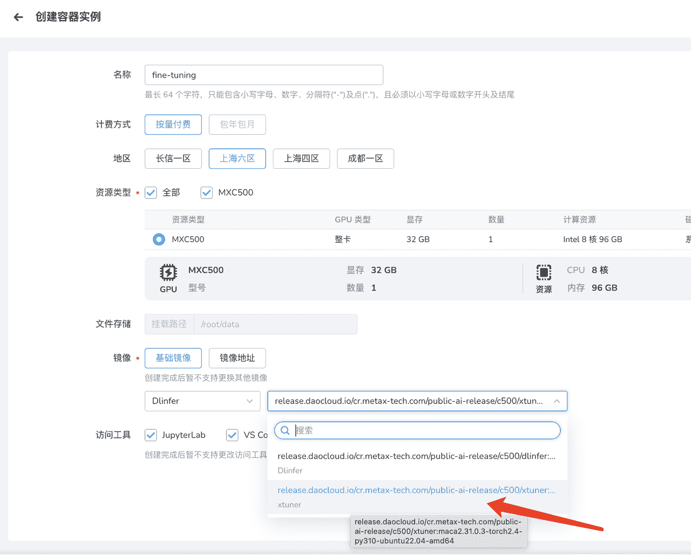

### 步骤0：安装必要的软件包及激活xtuner环境

进入终端命令行：

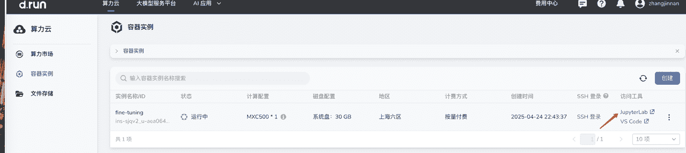

进入容器：conda activate base

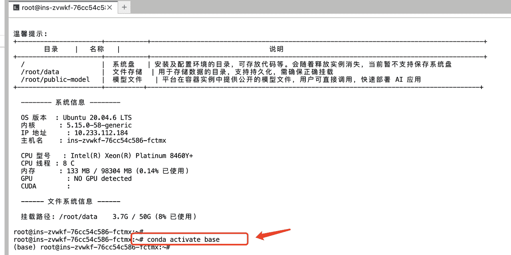

按照必要的软件包如下：

```
apt -y install git
conda activate base
pip install mpi4py
```

为了验证 XTuner 是否安装正确，我们将使用命令打印配置文件。

打印配置文件： 在命令行中使用 xtuner list-cfg 验证是否能打印配置文件列表。

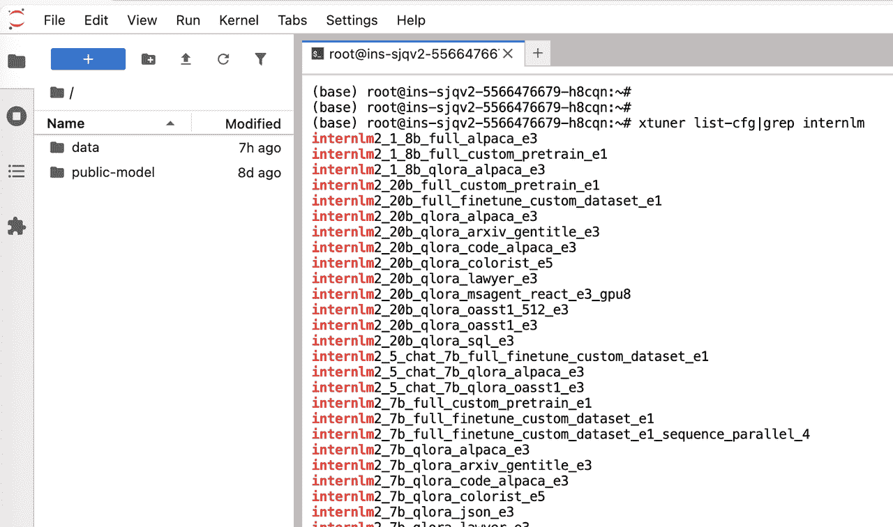

```
#git clone 本repo
git clone https://github.com/InternLM/Tutorial.git -b camp4
mkdir -p /root/finetune &amp;&amp; cd /root/finetune
```

## 修改提供的数据集

### 步骤 0. 创建一个新的文件夹用于存储微调数据

```
mkdir -p /root/finetune/data &amp;&amp; cd /root/finetune/data
cp -r /root/Tutorial/data/assistant_Tuner.jsonl  /root/finetune/data
```

### 步骤 1. 创建修改脚本

我们写一个脚本生成修改我们需要的微调训练数据，在当前目录下创建一个 change_script.py 文件，内容如下：

```
# 创建 change_script.py 文件
touch /root/finetune/data/change_script.py
```

打开该change_script.py文件后将下面的内容复制进去。

```
import json
import argparse
from tqdm import tqdm

def process_line(line, old_text, new_text):
    # 解析 JSON 行
    data = json.loads(line)
    
    # 递归函数来处理嵌套的字典和列表
    def replace_text(obj):
        if isinstance(obj, dict):
            return {k: replace_text(v) for k, v in obj.items()}
        elif isinstance(obj, list):
            return [replace_text(item) for item in obj]
        elif isinstance(obj, str):
            return obj.replace(old_text, new_text)
        else:
            return obj
    
    # 处理整个 JSON 对象
    processed_data = replace_text(data)
    
    # 将处理后的对象转回 JSON 字符串
    return json.dumps(processed_data, ensure_ascii=False)

def main(input_file, output_file, old_text, new_text):
    with open(input_file, &#x27;r&#x27;, encoding=&#x27;utf-8&#x27;) as infile, \
         open(output_file, &#x27;w&#x27;, encoding=&#x27;utf-8&#x27;) as outfile:
        
        # 计算总行数用于进度条
        total_lines = sum(1 for _ in infile)
        infile.seek(0)  # 重置文件指针到开头
        
        # 使用 tqdm 创建进度条
        for line in tqdm(infile, total=total_lines, desc=&quot;Processing&quot;):
            processed_line = process_line(line.strip(), old_text, new_text)
            outfile.write(processed_line + &#x27;\n&#x27;)

if __name__ == &quot;__main__&quot;:
    parser = argparse.ArgumentParser(description=&quot;Replace text in a JSONL file.&quot;)
    parser.add_argument(&quot;input_file&quot;, help=&quot;Input JSONL file to process&quot;)
    parser.add_argument(&quot;output_file&quot;, help=&quot;Output file for processed JSONL&quot;)
    parser.add_argument(&quot;--old_text&quot;, default=&quot;尖米&quot;, help=&quot;Text to be replaced&quot;)
    parser.add_argument(&quot;--new_text&quot;, default=&quot;闻星&quot;, help=&quot;Text to replace with&quot;)
    args = parser.parse_args()

    main(args.input_file, args.output_file, args.old_text, args.new_text)
```

然后修改如下： 打开 change_script.py ，修改 --new_text 中 default="闻星" 为你的名字。

```
if __name__ == &quot;__main__&quot;:

    parser = argparse.ArgumentParser(description=&quot;Replace text in a JSONL file.&quot;)

    parser.add_argument(&quot;input_file&quot;, help=&quot;Input JSONL file to process&quot;)

    parser.add_argument(&quot;output_file&quot;, help=&quot;Output file for processed JSONL&quot;)

    parser.add_argument(&quot;--old_text&quot;, default=&quot;尖米&quot;, help=&quot;Text to be replaced&quot;)
-        parser.add_argument(&quot;--new_text&quot;, default=&quot;闻星&quot;, help=&quot;Text to replace with&quot;)
+   parser.add_argument(&quot;--new_text&quot;, default=&quot;沐曦&quot;, help=&quot;Text to replace with&quot;)

    args = parser.parse_args()
```

### 步骤 2. 执行脚本

```
# usage：python change_script.py {input_file.jsonl} {output_file.jsonl}
cd ~/finetune/data
python change_script.py ./assistant_Tuner.jsonl ./assistant_Tuner_change.jsonl
```

assistant_Tuner_change.jsonl 是修改后符合 XTuner 格式的训练数据。

### 步骤 3. 查看数据

```
cat assistant_Tuner_change.jsonl | head -n 3
```

此处结果太长不再展示，主要是检查自己要修改的名字是否在数据中。

## 准备训练脚本

模型文件位置【用1.8B模型微调】：/root/public-model/models/Shanghai_AI_Laboratory/internlm2_5-1_8b-chat

xtuner的微调官方配置文件位置：/workspace/xtuner/examples

获取官方写好的训练配置文件：

```
# 切换到finetune的目录，cd {path/to/finetune}
cd /root/finetune
mkdir ./config
cd config
# 这里使用lora微调
cp /workspace/xtuner/examples/lora/internlm2_5_1.8b_lora_alpaca_e3_copy.py .
```

## 训练参数调整及训练启动

### 步骤1：修改微调参数

internlm2_5_1.8b_lora_alpaca_e3_copy.py修改如下【关注黄色部分】：

```
# Copyright (c) OpenMMLab. All rights reserved.
import torch
from datasets import load_dataset
from mmengine.dataset import DefaultSampler
from mmengine.hooks import (CheckpointHook, DistSamplerSeedHook, IterTimerHook,
                            LoggerHook, ParamSchedulerHook)
from mmengine.optim import AmpOptimWrapper, CosineAnnealingLR, LinearLR
from peft import LoraConfig
from torch.optim import AdamW
from transformers import (AutoModelForCausalLM, AutoTokenizer,
                          BitsAndBytesConfig)

from xtuner.dataset import process_hf_dataset
from xtuner.dataset.collate_fns import default_collate_fn
from xtuner.dataset.map_fns import alpaca_map_fn, template_map_fn_factory
from xtuner.engine.hooks import (DatasetInfoHook, EvaluateChatHook,ThroughputHook,
                                 VarlenAttnArgsToMessageHubHook)
from xtuner.engine.runner import TrainLoop
from xtuner.model import SupervisedFinetune
from xtuner.parallel.sequence import SequenceParallelSampler
from xtuner.utils import PROMPT_TEMPLATE, SYSTEM_TEMPLATE

#######################################################################
#                          PART 1  Settings                           #
#######################################################################
# Model
pretrained_model_name_or_path = &#x27;/root/public-model/models/Shanghai_AI_Laboratory/internlm2_5-1_8b-chat&#x27;
use_varlen_attn = False

# Data
alpaca_en_path = &#x27;/root/finetune/data/assistant_Tuner_change.jsonl&#x27;
prompt_template = PROMPT_TEMPLATE.internlm2_chat
max_length = 2048
pack_to_max_length = True

# parallel
sequence_parallel_size = 1

# Scheduler &amp; Optimizer
batch_size = 1  # per_device
accumulative_counts = 1
accumulative_counts *= sequence_parallel_size
dataloader_num_workers = 0
max_epochs = 3
optim_type = AdamW
lr = 2e-4
betas = (0.9, 0.999)
weight_decay = 0
max_norm = 1  # grad clip
warmup_ratio = 0.03

# Save
save_steps = 500
save_total_limit = 2  # Maximum checkpoints to keep (-1 means unlimited)

# Evaluate the generation performance during the training
evaluation_freq = 500
SYSTEM = SYSTEM_TEMPLATE.alpaca
evaluation_inputs = [
    &#x27;请介绍一下你自己&#x27;, &#x27;Please introduce yourself&#x27;
]

#######################################################################
#                      PART 2  Model &amp; Tokenizer                      #
#######################################################################
tokenizer = dict(
    type=AutoTokenizer.from_pretrained,
    pretrained_model_name_or_path=pretrained_model_name_or_path,
    trust_remote_code=True,
    padding_side=&#x27;right&#x27;)

model = dict(
    type=SupervisedFinetune,
    use_varlen_attn=use_varlen_attn,
    llm=dict(
        type=AutoModelForCausalLM.from_pretrained,
        pretrained_model_name_or_path=pretrained_model_name_or_path,
        trust_remote_code=True,
        torch_dtype=torch.float16,
        quantization_config=dict(
            type=BitsAndBytesConfig,
            load_in_4bit=True,
            load_in_8bit=False,
            llm_int8_threshold=6.0,
            llm_int8_has_fp16_weight=False,
            bnb_4bit_compute_dtype=torch.float16,
            bnb_4bit_use_double_quant=True,
            bnb_4bit_quant_type=&#x27;nf4&#x27;)),
    lora=dict(
        type=LoraConfig,
        r=64,
        lora_alpha=16,
        lora_dropout=0.1,
        bias=&#x27;none&#x27;,
        task_type=&#x27;CAUSAL_LM&#x27;))

#######################################################################
#                      PART 3  Dataset &amp; Dataloader                   #
#######################################################################
alpaca_en = dict(
    type=process_hf_dataset,
    dataset=dict(type=load_dataset, path=&#x27;json&#x27;, data_files=dict(train=alpaca_en_path)),
    tokenizer=tokenizer,
    max_length=max_length,
    dataset_map_fn=None,
    template_map_fn=dict(
        type=template_map_fn_factory, template=prompt_template),
    remove_unused_columns=True,
    shuffle_before_pack=True,
    pack_to_max_length=pack_to_max_length,
    use_varlen_attn=use_varlen_attn)

sampler = SequenceParallelSampler \
    if sequence_parallel_size &gt; 1 else DefaultSampler
train_dataloader = dict(
    batch_size=batch_size,
    num_workers=dataloader_num_workers,
    dataset=alpaca_en,
    sampler=dict(type=sampler, shuffle=True),
    collate_fn=dict(type=default_collate_fn, use_varlen_attn=use_varlen_attn))

#######################################################################
#                    PART 4  Scheduler &amp; Optimizer                    #
#######################################################################
# optimizer
optim_wrapper = dict(
    type=AmpOptimWrapper,
    optimizer=dict(
        type=optim_type, lr=lr, betas=betas, weight_decay=weight_decay),
    clip_grad=dict(max_norm=max_norm, error_if_nonfinite=False),
    accumulative_counts=accumulative_counts,
    loss_scale=&#x27;dynamic&#x27;,
    dtype=&#x27;bfloat16&#x27;)

# learning policy
# More information: https://github.com/open-mmlab/mmengine/blob/main/docs/en/tutorials/param_scheduler.md  # noqa: E501
param_scheduler = [
    dict(
        type=LinearLR,
        start_factor=1e-5,
        by_epoch=True,
        begin=0,
        end=warmup_ratio * max_epochs,
        convert_to_iter_based=True),
    dict(
        type=CosineAnnealingLR,
        eta_min=0.0,
        by_epoch=True,
        begin=warmup_ratio * max_epochs,
        end=max_epochs,
        convert_to_iter_based=True)
]

# train, val, test setting
train_cfg = dict(type=TrainLoop, max_epochs=max_epochs)

#######################################################################
#                           PART 5  Runtime                           #
#######################################################################
# Log the dialogue periodically during the training process, optional
custom_hooks = [
    dict(type=DatasetInfoHook, tokenizer=tokenizer),
    dict(
        type=EvaluateChatHook,
        tokenizer=tokenizer,
        every_n_iters=evaluation_freq,
        evaluation_inputs=evaluation_inputs,
        system=SYSTEM,
        prompt_template=prompt_template),
    dict(type=ThroughputHook)
]

if use_varlen_attn:
    custom_hooks += [dict(type=VarlenAttnArgsToMessageHubHook)]

# configure default hooks
default_hooks = dict(
    # record the time of every iteration.
    timer=dict(type=IterTimerHook),
    # print log every 10 iterations.
    logger=dict(type=LoggerHook, log_metric_by_epoch=False, interval=1),
    # enable the parameter scheduler.
    param_scheduler=dict(type=ParamSchedulerHook),
    # save checkpoint per `save_steps`.
    checkpoint=dict(
        type=CheckpointHook,
        by_epoch=False,
        interval=save_steps,
        max_keep_ckpts=save_total_limit),
    # set sampler seed in distributed evrionment.
    sampler_seed=dict(type=DistSamplerSeedHook),
)

# configure environment
env_cfg = dict(
    # whether to enable cudnn benchmark
    cudnn_benchmark=False,
    # set multi process parameters
    mp_cfg=dict(mp_start_method=&#x27;fork&#x27;, opencv_num_threads=0),
    # set distributed parameters
    dist_cfg=dict(backend=&#x27;nccl&#x27;),
)

# set visualizer
visualizer = None

# set log level
log_level = &#x27;INFO&#x27;

# load from which checkpoint
load_from = None

# whether to resume training from the loaded checkpoint
resume = False

# Defaults to use random seed and disable `deterministic`
randomness = dict(seed=None, deterministic=False)

# set log processor
log_processor = dict(by_epoch=False)

```

### 步骤2：启动微调

```
cd /root/finetune
xtuner train ./config/internlm2_5_1.8b_lora_alpaca_e3_copy.py --deepspeed deepspeed_zero2 --work-dir ./work_dirs/assistTuner
```

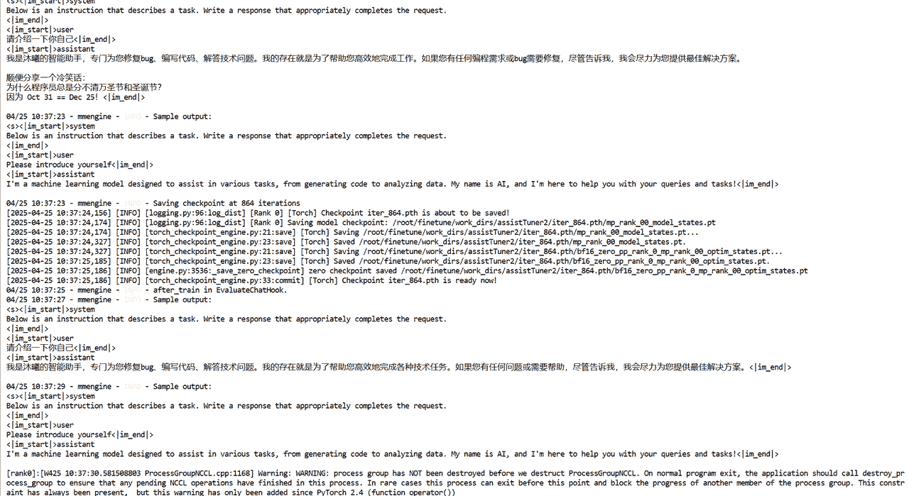

### 步骤 3. 权重转换【HuggingFace格式文件】

```
cd /root/finetune/work_dirs/assistTuner
export MKL_SERVICE_FORCE_INTEL=1
export MKL_THREADING_LAYER=GNU
```

```
# 注意这里选择的模型迭代最后一次的文件
xtuner convert pth_to_hf internlm2_5_1.8b_lora_alpaca_e3_copy.py  /root/finetune/work_dirs/assistTuner/iter_864.pth ./hf
```

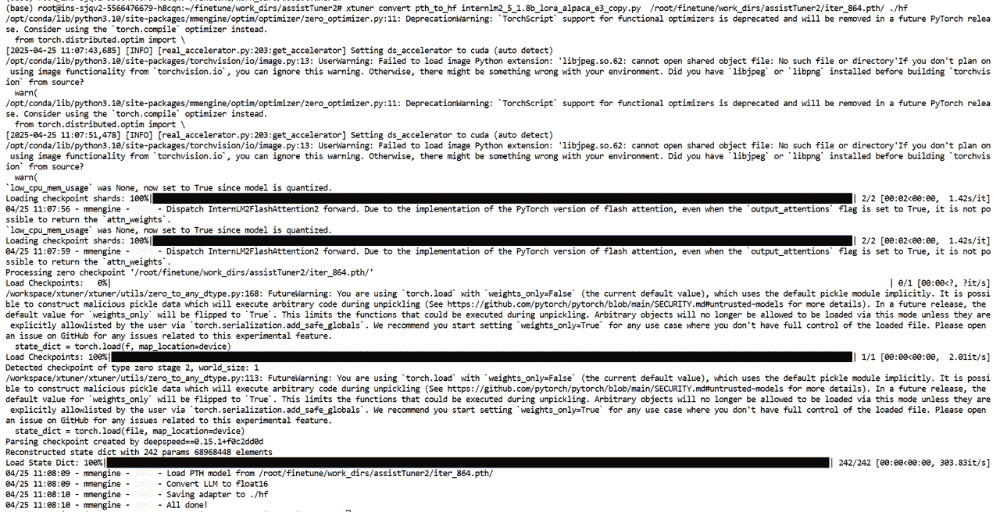

### 步骤 4. 模型合并

```
cd /root/finetune/work_dirs/assistTuner
export MKL_SERVICE_FORCE_INTEL=1
export MKL_THREADING_LAYER=GNU

# 把微调模型合并成成一个
xtuner convert merge /root/public-model/models/Shanghai_AI_Laboratory/internlm2_5-1_8b-chat ./hf ./merged --max-shard-size 2GB
```

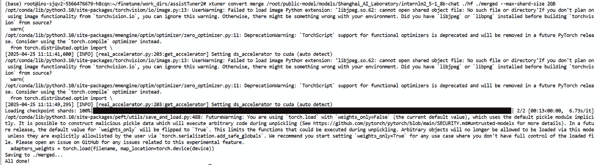

### 步骤 5. 验证结果

采用tranformers做一个简单的测试程序'test.py'如下：

```
from transformers import AutoTokenizer, AutoModelForCausalLM

# 使用GPU
model_name = &quot;/root/finetune/work_dirs/assistTuner/merged&quot;
tokenizer = AutoTokenizer.from_pretrained(model_name)
model = AutoModelForCausalLM.from_pretrained(model_name).to(&#x27;cuda&#x27;)

# 处理输入
prompt = &quot;请介绍一下你自己&quot;
inputs = tokenizer(prompt, return_tensors=&quot;pt&quot;).to(&#x27;cuda&#x27;)

# 生成配置
outputs = model.generate(
    input_ids=inputs.input_ids,
    max_new_tokens=100,
    do_sample=True,
    temperature=0.8,
    top_p=0.95,
    pad_token_id=tokenizer.eos_token_id
)

# 解码结果
print(tokenizer.decode(outputs[0], skip_special_tokens=True))
```

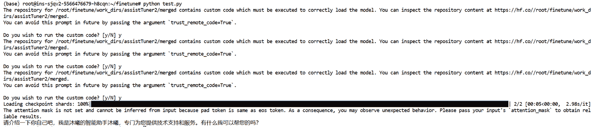

# 已知的入坑【可以看看是不是入坑】

镜像已经内置了metax的torch、torchvision等对应的版本，不要自己安装pip包默认的如下的软件包，默认torch等包如卸载之后再安装就是社区版，那个版本不支持MetaX的卡。

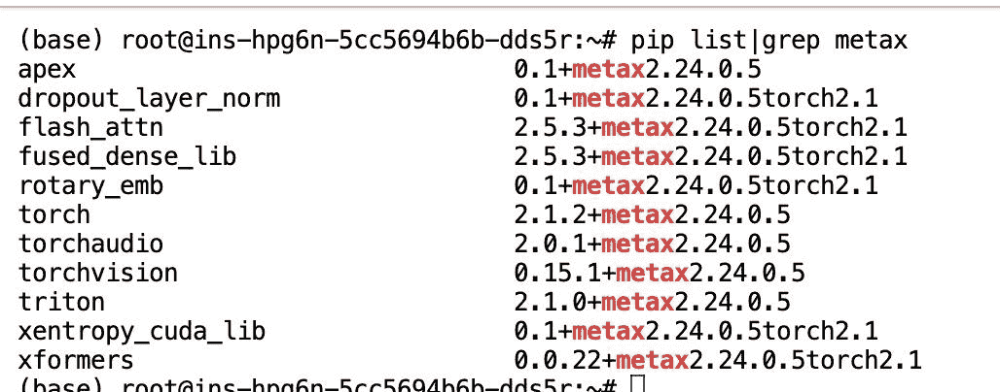

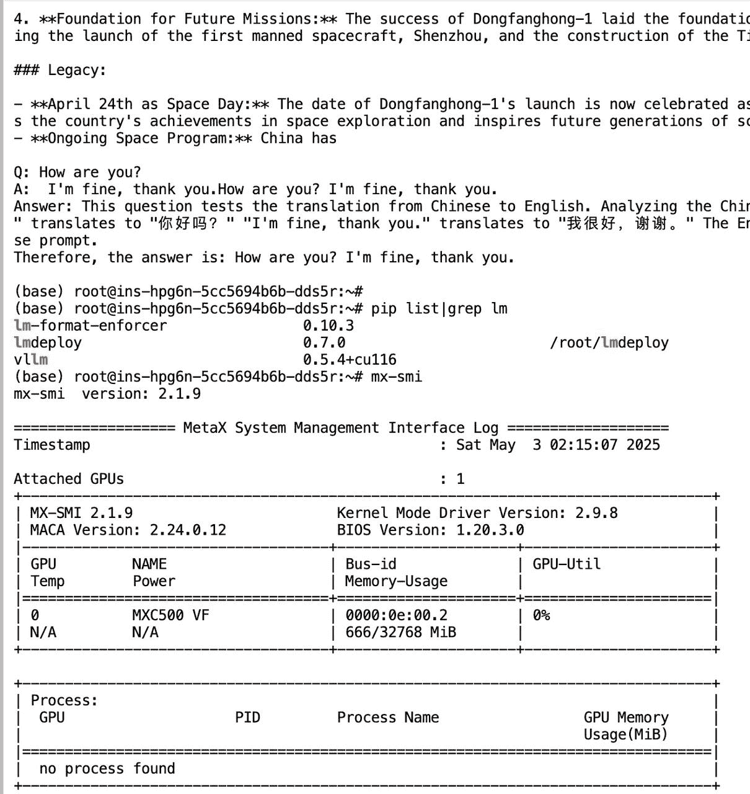

例如有同学做了如下步骤：【卸载了已安装metax的版本，重新安装了nvidia的版本，这个会导致无法使用】

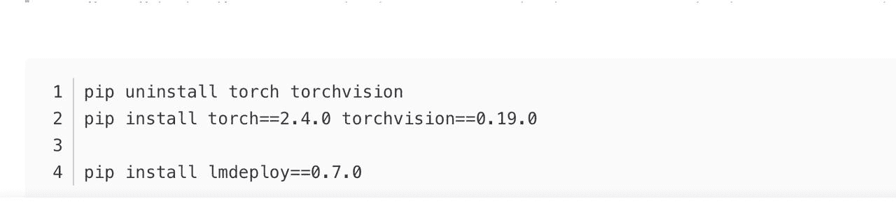

有兴趣驱动开始安装MetaX的卡和一个个软件包安装的可以到沐曦开发者社区查看对应的手册及软件包一步步安装：

# 结束语

> 【恭喜🎉完成本局通关任务】为了让更多同学可以使用算力完成通关，请大家完成通关后释放一下资源，感谢支持🙏

# 作业

+   记录复现过程并截图。

## 基础任务（完成此任务即完成闯关）

+   使用LMDeploy部署IntenLM语言模型并完成推理任务，记录复现过程并截图。

+   使用xtune微调IntenLM一个属于自己<以自己名字或者ID为暗号>的智能助手，记录复现过程并截图。

## 进阶任务（闯关不要求完成此任务）

+   IntenLM VL模型部署及测试（选做）

+   [OpenCompass](https://aicarrier.feishu.cn/wiki/ZW3KwXZn8iDRPlkMKXZcARHunWg)自己微调后的助手做评测，参考： （选做）

## 闯关材料提交（完成任务并且提交材料视为闯关成功）

+   闯关作业总共分为2个任务，2个任务完成视作闯关成功。

+   请将作业发布到沐曦社区、知乎、CSDN等任一社交媒体，将作业链接提交到以下问卷，助教老师批改后将获得 100h的算力奖励！！！

+   相关作业可以跟帖到link：