# E1-沐曦部署、量化、微调 InternVL3

> 来源：[https://aicarrier.feishu.cn/docx/CK4bdWaGPo837NxilS0cze6InRf](https://aicarrier.feishu.cn/docx/CK4bdWaGPo837NxilS0cze6InRf)

> 文档尚处于草稿阶段，完善中

MXC500是沐曦显卡，可以比较丝滑的用于大模型训练、量化、推理等场景。

浦[沐曦玩转 LMDeploy、XTuner 和 InternLM3](https://aicarrier.feishu.cn/wiki/O84LwkiBriUU0NkDwurcSufhnVb)书生实战营的五一沐曦专场里已经有了InternLM3-8B-Instruct模型的量化、部署、微调的实测指南： ，现在打算在MXC500显卡上对InternVL3-8B模型进行部署、量化和微调。

对于算力平台的操作，在[沐曦玩转 LMDeploy、XTuner 和 InternLM3](https://aicarrier.feishu.cn/wiki/O84LwkiBriUU0NkDwurcSufhnVb)文章里已经介绍。本文直接进入InternVL3-8B模型的部署、量化和微调。

这次的部署、量化和微调全都选择Dlinfer下属的Xtuner镜像：

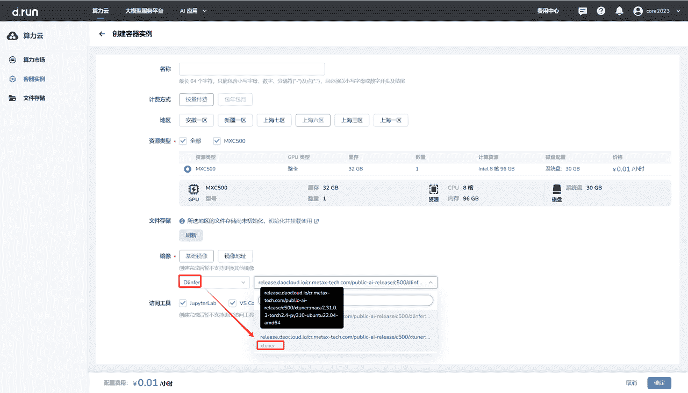

> 如果使用Dlinfer下属的Dlinfer镜像，会因为triton版本太老，而出现<triton> check failed报错。

# MXC500上使用transformers部署InternVL3-8B模型

这里部署就不使用lmdeploy了，因为会遇到硬件限制Hardware limit。直接参考InternVL3-8B指南里给出的transformers部署的指南(https://huggingface.co/OpenGVLab/InternVL3-8B#inference-with-transformers)，用transformers部署InternVL3-8B模型。

## cli-demo命令行部署

大致修改一下模型路径path = '/root/public-model/models/OpenGVLab/InternVL3-8B'和图片路径pixel_values = load_image('/root/cli-demo/tiger.jpeg', max_num=12).to(torch.bfloat16).cuda()

指南页面的demo代码里第8行修改为加入from transformers import AutoModel, AutoTokenizer, AutoConfig，

第119行修改为use_flash_attn=False,

第87行修改为config = AutoConfig.from_pretrained('/root/public-model/models/OpenGVLab/InternVL3-8B', trust_remote_code=True)

即为：

```
import math
import numpy as np
import torch
import torchvision.transforms as T
from decord import VideoReader, cpu
from PIL import Image
from torchvision.transforms.functional import InterpolationMode
from transformers import AutoModel, AutoTokenizer, AutoConfig

IMAGENET_MEAN = (0.485, 0.456, 0.406)
IMAGENET_STD = (0.229, 0.224, 0.225)

def build_transform(input_size):
    MEAN, STD = IMAGENET_MEAN, IMAGENET_STD
    transform = T.Compose([
        T.Lambda(lambda img: img.convert(&#x27;RGB&#x27;) if img.mode != &#x27;RGB&#x27; else img),
        T.Resize((input_size, input_size), interpolation=InterpolationMode.BICUBIC),
        T.ToTensor(),
        T.Normalize(mean=MEAN, std=STD)
    ])
    return transform

def find_closest_aspect_ratio(aspect_ratio, target_ratios, width, height, image_size):
    best_ratio_diff = float(&#x27;inf&#x27;)
    best_ratio = (1, 1)
    area = width * height
    for ratio in target_ratios:
        target_aspect_ratio = ratio[0] / ratio[1]
        ratio_diff = abs(aspect_ratio - target_aspect_ratio)
        if ratio_diff &lt; best_ratio_diff:
            best_ratio_diff = ratio_diff
            best_ratio = ratio
        elif ratio_diff == best_ratio_diff:
            if area &gt; 0.5 * image_size * image_size * ratio[0] * ratio[1]:
                best_ratio = ratio
    return best_ratio

def dynamic_preprocess(image, min_num=1, max_num=12, image_size=448, use_thumbnail=False):
    orig_width, orig_height = image.size
    aspect_ratio = orig_width / orig_height

    # calculate the existing image aspect ratio
    target_ratios = set(
        (i, j) for n in range(min_num, max_num + 1) for i in range(1, n + 1) for j in range(1, n + 1) if
        i * j &lt;= max_num and i * j &gt;= min_num)
    target_ratios = sorted(target_ratios, key=lambda x: x[0] * x[1])

    # find the closest aspect ratio to the target
    target_aspect_ratio = find_closest_aspect_ratio(
        aspect_ratio, target_ratios, orig_width, orig_height, image_size)

    # calculate the target width and height
    target_width = image_size * target_aspect_ratio[0]
    target_height = image_size * target_aspect_ratio[1]
    blocks = target_aspect_ratio[0] * target_aspect_ratio[1]

    # resize the image
    resized_img = image.resize((target_width, target_height))
    processed_images = []
    for i in range(blocks):
        box = (
            (i % (target_width // image_size)) * image_size,
            (i // (target_width // image_size)) * image_size,
            ((i % (target_width // image_size)) + 1) * image_size,
            ((i // (target_width // image_size)) + 1) * image_size
        )
        # split the image
        split_img = resized_img.crop(box)
        processed_images.append(split_img)
    assert len(processed_images) == blocks
    if use_thumbnail and len(processed_images) != 1:
        thumbnail_img = image.resize((image_size, image_size))
        processed_images.append(thumbnail_img)
    return processed_images

def load_image(image_file, input_size=448, max_num=12):
    image = Image.open(image_file).convert(&#x27;RGB&#x27;)
    transform = build_transform(input_size=input_size)
    images = dynamic_preprocess(image, image_size=input_size, use_thumbnail=True, max_num=max_num)
    pixel_values = [transform(image) for image in images]
    pixel_values = torch.stack(pixel_values)
    return pixel_values

def split_model(model_name):
    device_map = {}
    world_size = torch.cuda.device_count()
    config = AutoConfig.from_pretrained(&#x27;/root/public-model/models/OpenGVLab/InternVL3-8B&#x27;, trust_remote_code=True)
    num_layers = config.llm_config.num_hidden_layers
    # Since the first GPU will be used for ViT, treat it as half a GPU.
    num_layers_per_gpu = math.ceil(num_layers / (world_size - 0.5))
    num_layers_per_gpu = [num_layers_per_gpu] * world_size
    num_layers_per_gpu[0] = math.ceil(num_layers_per_gpu[0] * 0.5)
    layer_cnt = 0
    for i, num_layer in enumerate(num_layers_per_gpu):
        for j in range(num_layer):
            device_map[f&#x27;language_model.model.layers.{layer_cnt}&#x27;] = i
            layer_cnt += 1
    device_map[&#x27;vision_model&#x27;] = 0
    device_map[&#x27;mlp1&#x27;] = 0
    device_map[&#x27;language_model.model.tok_embeddings&#x27;] = 0
    device_map[&#x27;language_model.model.embed_tokens&#x27;] = 0
    device_map[&#x27;language_model.output&#x27;] = 0
    device_map[&#x27;language_model.model.norm&#x27;] = 0
    device_map[&#x27;language_model.model.rotary_emb&#x27;] = 0
    device_map[&#x27;language_model.lm_head&#x27;] = 0
    device_map[f&#x27;language_model.model.layers.{num_layers - 1}&#x27;] = 0

    return device_map

# If you set `load_in_8bit=True`, you will need two 80GB GPUs.
# If you set `load_in_8bit=False`, you will need at least three 80GB GPUs.
path = &#x27;/root/public-model/models/OpenGVLab/InternVL3-8B&#x27;
device_map = split_model(&#x27;InternVL3-8B&#x27;)
model = AutoModel.from_pretrained(
    path,
    torch_dtype=torch.bfloat16,
    load_in_8bit=False,
    low_cpu_mem_usage=True,
    use_flash_attn=False,
    trust_remote_code=True,
    device_map=device_map).eval()
tokenizer = AutoTokenizer.from_pretrained(path, trust_remote_code=True, use_fast=False)

# set the max number of tiles in `max_num`
pixel_values = load_image(&#x27;/root/demo/tiger.jpeg&#x27;, max_num=12).to(torch.bfloat16).cuda()
generation_config = dict(max_new_tokens=1024, do_sample=True)


# single-image single-round conversation (单图单轮对话)
question = &#x27;&lt;image&gt;\n简述图片内容&#x27;
response = model.chat(tokenizer, pixel_values, question, generation_config)
print(f&#x27;User: {question}\nAssistant: {response}&#x27;)

# single-image multi-round conversation (单图多轮对话)
question = &#x27;&lt;image&gt;\n详细叙述图片内容&#x27;
response, history = model.chat(tokenizer, pixel_values, question, generation_config, history=None, return_history=True)
print(f&#x27;User: {question}\nAssistant: {response}&#x27;)

question = &#x27;请根据图片内容做一手古诗&#x27;
response, history = model.chat(tokenizer, pixel_values, question, generation_config, history=history, return_history=True)
print(f&#x27;User: {question}\nAssistant: {response}&#x27;)

```

上面代码保存为/root/demo/cli-demo.py，然后安装所需的decord包和timm包，再运行python /root/demo/cli-demo.py，就跑通了：

```
cd /root
mkdir demo
cd ./demo
touch cli-demo.py
```

之后粘贴上述脚本内容进入/root/demo/cli-demo.py，之后安装依赖，执行脚本即可成功完成命令行部署：

```
conda activate base
pip install decord timm
python /root/demo/cli-demo.py
```

> 执行前，在/root/demo/cli-demo.py的125行：pixel_values = load_image('/root/demo/tiger.jpeg', max_num=12).to(torch.bfloat16).cuda()，图片需要自己拖动上传一个，然后修改图片路径。

执行推理效果如下：

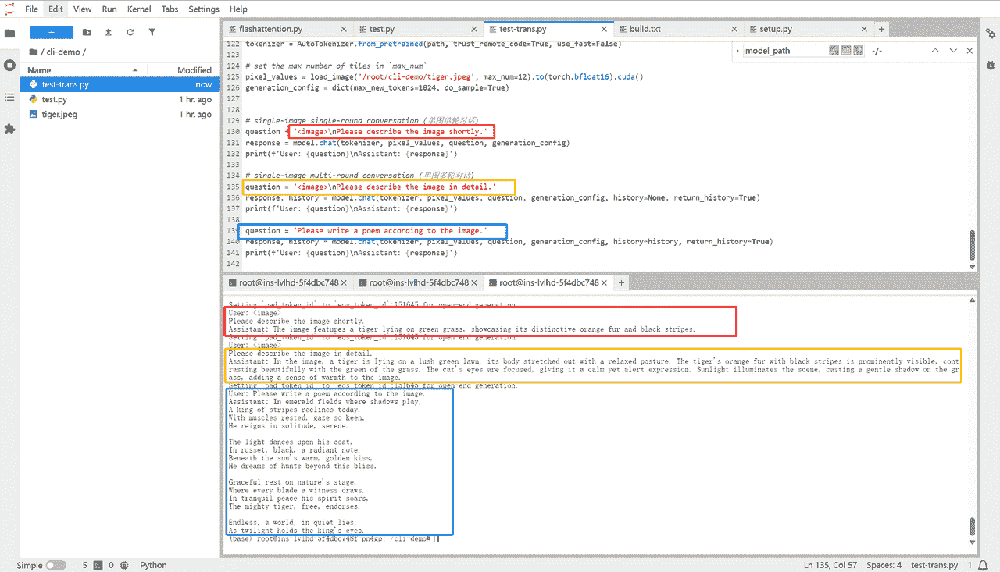

## web-demo网页部署

> **目前平台的ssh登录出问题了，域名**和端口都没有，web-demo暂时搁置。

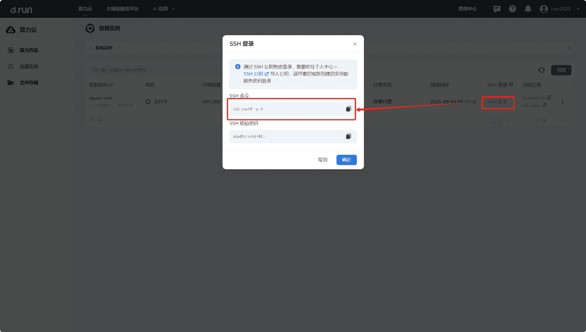

> 问题目前已经修复。

使用gradio库，把cli-demo.py修改为web-demo.py：

```
import gradio as gr
import torch
from transformers import AutoModel, AutoTokenizer, AutoConfig
from PIL import Image

# 加载模型部分
path = &#x27;/root/public-model/models/OpenGVLab/InternVL3-8B&#x27;
device_map = None
model = AutoModel.from_pretrained(
    path,
    torch_dtype=torch.bfloat16,
    load_in_8bit=False,
    low_cpu_mem_usage=True,
    use_flash_attn=False,
    trust_remote_code=True,
    device_map=&quot;auto&quot; if device_map is None else device_map
).eval()
tokenizer = AutoTokenizer.from_pretrained(path, trust_remote_code=True, use_fast=False)

# 预处理图片函数
def preprocess(image, max_num=12, image_size=448):
    from torchvision import transforms as T
    from torchvision.transforms.functional import InterpolationMode
    transform = T.Compose([
        T.Lambda(lambda img: img.convert(&#x27;RGB&#x27;) if img.mode != &#x27;RGB&#x27; else img),
        T.Resize((image_size, image_size), interpolation=InterpolationMode.BICUBIC),
        T.ToTensor(),
        T.Normalize(mean=[0.485, 0.456, 0.406], std=[0.229, 0.224, 0.225])
    ])
    pixel_values = transform(image)
    pixel_values = pixel_values.unsqueeze(0).to(torch.bfloat16).cuda()
    return pixel_values

# 推理函数
def predict(image, message, history):
    if image is None:
        return history + [(&quot;请上传一张图片&quot;, &quot;&quot;)]

    pixel_values = preprocess(image)
    
    if history is None or len(history) == 0:
        user_input = f&quot;&lt;image&gt;\n{message}&quot;
        response, new_history = model.chat(
            tokenizer, pixel_values, user_input,
            generation_config={&quot;max_new_tokens&quot;: 1024, &quot;do_sample&quot;: True},
            history=None, return_history=True
        )
    else:
        response, new_history = model.chat(
            tokenizer, pixel_values, message,
            generation_config={&quot;max_new_tokens&quot;: 1024, &quot;do_sample&quot;: True},
            history=history, return_history=True
        )
    
    return new_history

# Gradio界面
with gr.Blocks(title=&quot;InternVL3-8B Web Demo&quot;) as demo:
    gr.Markdown(&quot;&lt;h1 align=&#x27;center&#x27;&gt;📷 InternVL3-8B Chat Demo&lt;/h1&gt;&quot;)
    
    with gr.Row():
        with gr.Column(scale=1):
            image_input = gr.Image(type=&quot;pil&quot;, label=&quot;上传一张图片&quot;)
        with gr.Column(scale=2):
            chatbot = gr.Chatbot(height=600, label=&quot;对话&quot;)
            message_input = gr.Textbox(placeholder=&quot;请输入你的问题...&quot;, label=&quot;提问&quot;)
            send_btn = gr.Button(&quot;发送&quot;)
    
    state = gr.State([])  # 保存history

    def on_send(image, message, history):
        if message.strip() == &quot;&quot;:
            return history
        history = predict(image, message, history)
        return history

    send_btn.click(
        fn=on_send,
        inputs=[image_input, message_input, state],
        outputs=[chatbot]
    )
    message_input.submit(
        fn=on_send,
        inputs=[image_input, message_input, state],
        outputs=[chatbot]
    )

demo.launch(server_name=&quot;127.0.0.1&quot;, server_port=6000, share=False)

```

上面代码保存为/root/cli-demo/web-demo.py，然后python /root/cli-demo/web-demo.py之后，得到web的页面是127.0.0.1:6000。

接下来进行端口映射，回到实例开关机页面，打开SSH登陆：

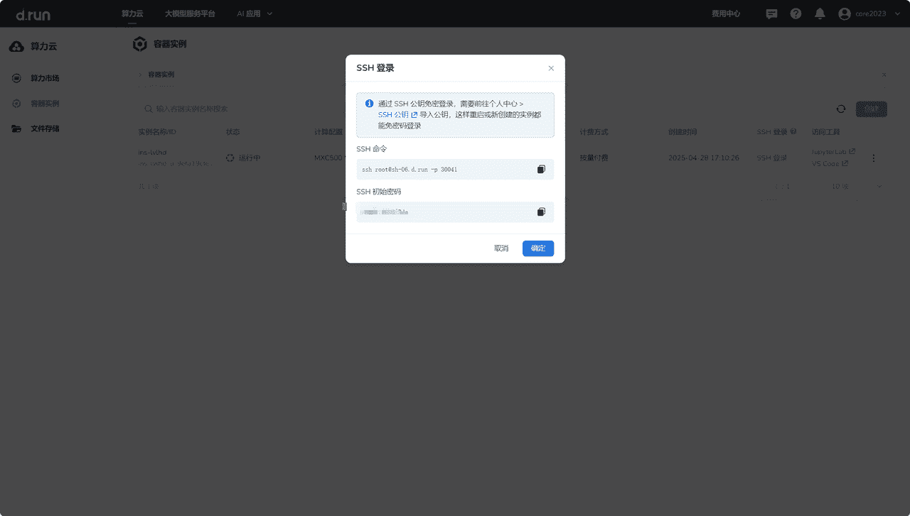

在自己笔记本电脑的powershell里输入:

```
ssh root@sh-06.d.run -p 30041 -CNg -L 6001:127.0.0.1:6000
```

粘贴密码之后，即可把云端主机里的6000端口映射到本地笔记本的6001端口。

> 这里需要注意**有的power**shell或者cmd里的粘贴不是CTRL+V的快捷键，如果粘贴密码后ssh映射失败，那就需要手动对照那个SSH初始密码去一个个键盘输入，输入完毕后再回车。

然后本地浏览器输入https://127.0.0.1:6001，即可进行交互，之后使用图片进行了网页交互：

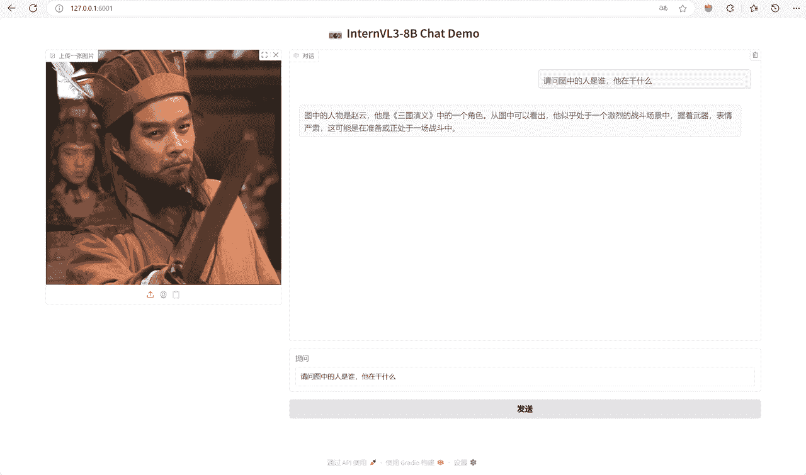

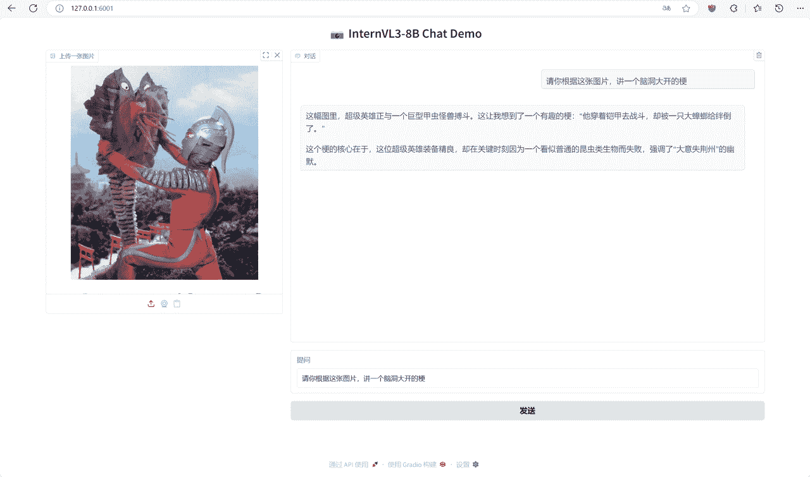

# MXC500上量化InternVL3-8B

根据LMDeploy的命令规则，对InternVL3-8B进行w4a16量化的命令与其他基本一样，只需要修改模型路径和量化后的模型名称即可，所以量化InternVL3-8B模型的代码如下：

要用[沐曦玩转 LMDeploy、XTuner 和 InternLM3](https://aicarrier.feishu.cn/wiki/O84LwkiBriUU0NkDwurcSufhnVb)lmdeploy，因此需要安装lmdeploy到base环境里，再激活环境，执行量化。（base环境里预置了xtuner包，但lmdeploy包没有预置，先手动安装，安装方法参考 ）

## 安装lmdeploy

激活base环境：

```
conda activate base
```

下载LMDeploy源码

```
# lmdeploy所需的前置依赖包（addict软件包）
pip install addict mmengine mmengine-lite fire accelerate==0.32.1 nvidia-ml-py

# 解决LMDeploy对tranformers版本要求的Iusse：
pip install transformers==4.47.1

# 安装git工具
apt install git -y

# 下载lmdeploy，并进入目录
git clone https://github.com/InternLM/lmdeploy.git
cd lmdeploy
```

从源码里安装lmdeploy包到base环境里

```
# checkout对应的版本
git checkout 832bfc45b4497e8d16e08ecfd663671e634aae40
# 安装lmdeploy
LMDEPLOY_TARGET_DEVICE=maca python setup.py develop
```

最后一步setup.py的安装过程，可能会有pydin11包、jiter包、peft包等安装包出现timed out的问题，那就再开一个终端，单独pip install pydin11即可。

完成安装后，显示的是这个：

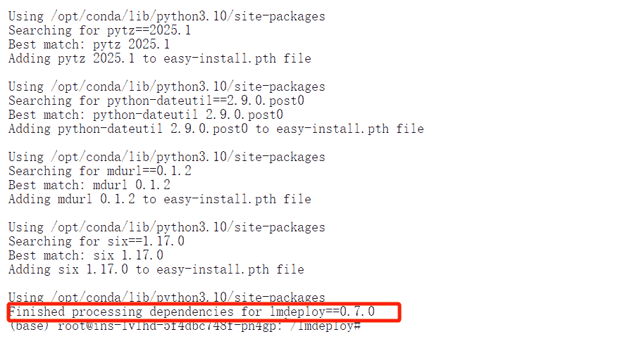

如果没显示这一句，基本是lmdeploy安装到中间某一步，超时了。

安装完毕lmdeploy之后，准备开始量化。

量化的命令，可以参考[沐曦玩转 LMDeploy、XTuner 和 InternLM3](https://aicarrier.feishu.cn/wiki/O84LwkiBriUU0NkDwurcSufhnVb)之后修改，修改后的命令如下：

```
lmdeploy lite auto_awq \
  /root/public-model/models/OpenGVLab/InternVL3-8B \
  --calib-dataset &#x27;ptb&#x27; \
  --calib-samples 128 \
  --calib-seqlen 2048 \
  --w-bits 4 \
  --w-group-size 128 \
  --batch-size 2 \
  --search-scale False \
  --work-dir /root/models/InternVL3-8B-w4a16-4bit
```

为了避免8B模型量化过于耗时，先用一个2B小模型跑一遍量化，清理量化和量化后部署过程中可能的bug。顺利跑通后，再对8B模型进行量化。

## InternVL3-2B的W4A16量化

base环境里的datasets库还在3.1.0版本，不更新的话量化会在"/opt/conda/lib/python3.10/site-packages/datasets/load.py", line 1890处报错。

因此datasets要降级：

```
conda activate base
pip install datasets==2.21.0
```

> 降级的原因是lmdeploy的lmdeploy/lmdeploy/lite/utils/calib_dataloader.py里的get_ptb()函数去年8月到现在一直没修改。而用的datasets库已经从24年八月的2.21.0版本更新到了25年4月的3.5.1(https://pypi.org/project/datasets/#history)。

> base里默认安装的3.1.0版本，已经弃用了一些2.21.0的用法，所以用base里默认的3.1.0的datasets就太新了，会报错。

另外，连接huggingface也是有必要的，设置HF_ENDPOINT的环境变量来启用hf-mirror：

```
export HF_ENDPOINT=https://hf-mirror.com
```

> 不启用hf镜像站，则无法从huggingface上获取`ptb_text_only`数据集。

InternVL3-2B模型量化的话，batch-size可以设置为8，其量化所需代码为：

```
lmdeploy lite auto_awq\
  /root/public-model/models/OpenGVLab/InternVL3-2B \
  --calib-dataset &#x27;ptb&#x27; \
  --calib-samples 128 \
  --calib-seqlen 2048 \
  --w-bits 4 \
  --w-group-size 128 \
  --batch-size 8 \
  --work-dir /root/models/InternVL3-2B-w4a16-4bit
```

> 有个报错lmdeploy: error: unrecognized arguments: False

> 发现--search-scale False \的参数对于lmdeploy-0.7.0无法识别，于是删掉它

执行命令后，大约几分钟即可完成量化(/root/models/InternVL3-2B-w4a16-4bit文件夹里确实有了量化模型)：

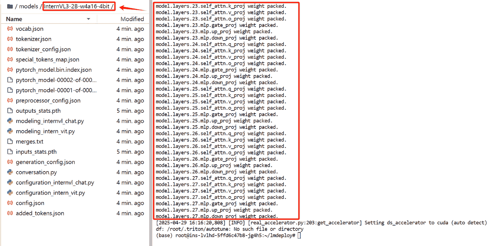

量化完成通常是需要部署的，但是使用“transformers进行cli-demo”，直接切换模型的路径后，执行cli-demo.py，发现推理过程中，层数会出问题。

而用lmdeploy去部署量化后的模型，则依旧会遇到那个硬件限制Hardware limit，因此量化模型的部署，暂时搁置。

## InternVL3-8B的W4A16量化

VL3-2B模型已经顺利量化，那么VL3-8B模型的量化命令，就简单给2B替换为8B即可，命令如下：

```
conda activate base
pip install datasets==2.1.0
export HF_ENDPOINT=https://hf-mirror.com
lmdeploy lite auto_awq\
  /root/public-model/models/OpenGVLab/InternVL3-8B \
  --calib-dataset &#x27;ptb&#x27; \
  --calib-samples 128 \
  --calib-seqlen 2048 \
  --w-bits 4 \
  --w-group-size 128 \
  --batch-size 2 \
  --work-dir /root/models/InternVL3-8B-w4a16-4bit
```

经过大约10分钟，8B模型的量化模型也完成了：

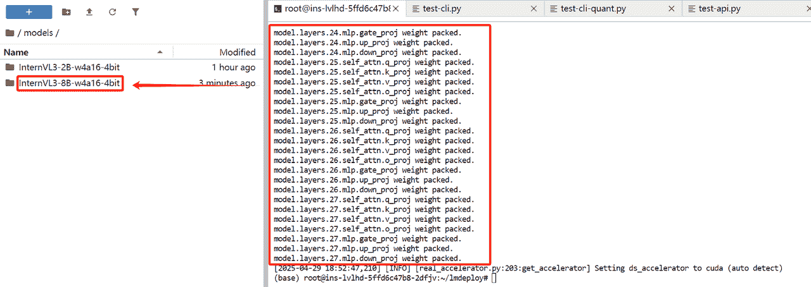

# MXC500上微调InternVL3-8B（CLoT_cn_2000训练集）

## 准备CLoT_cn_2000表情包数据集

数据集地址：https://huggingface.co/datasets/zhongshsh/CLoT-Oogiri-GO

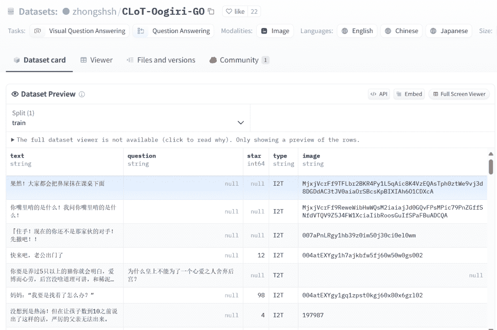

由于里面的数据包含 Text2Text、Image2Text 等多种类型，图片数量一共有 3 万多张，数据量有些大。作为轻量型的 demo，需要对其进行筛选，筛选出 2000 多张图片。camp2的VL微调课程的课程作者筛选了数据集，我把筛选后的数据集上传到了 modelscope 数据集里：https://www.modelscope.cn/datasets/livehouse/CLoT_cn_2000/files

下载 CLoT_cn_2000 数据集的代码并解压到/root/trainset文件夹里：

```
cd /root
mkdir trainset
cd /root/trainset
wget https://www.modelscope.cn/datasets/livehouse/CLoT_cn_2000/resolve/master/CLoT_cn_2000.zip --no-check-certificate
apt install unzip -y
unzip CLoT_cn_2000.zip -d ./
```

后续配置参数修改的时候，需要把data修改为CLoT_cn_2000的路径即可。

用这个模型微调后的VL3-8B，会变成一个给图片配神评论的梗图之王，比如这样：

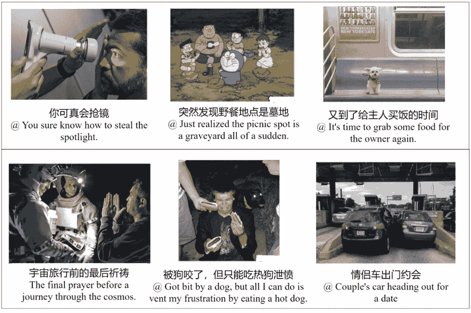

## 训练配置参数修改

由于base环境里自带了xtuner，因此不需要再下载源代码了。

找到一个训练的配置文件，直接修改一下参数就可以开始训练。

把xtuner里的一个internvl2-8b模型的配置文件（https://github.com/InternLM/xtuner/blob/main/xtuner/configs/internvl/v2/internvl_v2_internlm2_5_8b_lora_finetune.py）拿来，稍微改一下参数和训练集路径，即可：

```
cd /root
mkdir train-clot
cd /root/train-clot
touch internvl3-8b_lora_finetune.py
```

创建完文件，复制github里internvl_v2_internlm2_5_8b_lora_finetune.py的内容，粘贴到/root/train-clot/internvl3-8b_lora_finetune.py里：

```
# Copyright (c) OpenMMLab. All rights reserved.
from mmengine.hooks import (
    CheckpointHook,
    DistSamplerSeedHook,
    IterTimerHook,
    LoggerHook,
    ParamSchedulerHook,
)
from mmengine.optim import AmpOptimWrapper, CosineAnnealingLR, LinearLR
from peft import LoraConfig
from torch.optim import AdamW
from transformers import AutoTokenizer

from xtuner.dataset import InternVL_V1_5_Dataset
from xtuner.dataset.collate_fns import default_collate_fn
from xtuner.dataset.samplers import LengthGroupedSampler
from xtuner.engine.hooks import DatasetInfoHook
from xtuner.engine.runner import TrainLoop
from xtuner.model import InternVL_V1_5
from xtuner.utils import PROMPT_TEMPLATE

#######################################################################
#                          PART 1  Settings                           #
#######################################################################
# Model
path = &quot;OpenGVLab/InternVL2-8B&quot;

# Data
data_root = &quot;./data/llava_data/&quot;
data_path = data_root + &quot;LLaVA-Instruct-150K/llava_v1_5_mix665k.json&quot;
image_folder = data_root + &quot;llava_images&quot;
prompt_template = PROMPT_TEMPLATE.internlm2_chat
max_length = 8192

# Scheduler &amp; Optimizer
batch_size = 1  # per_device
accumulative_counts = 2
dataloader_num_workers = 4
max_epochs = 1
optim_type = AdamW
# official 1024 -&gt; 4e-5
lr = 1e-6
betas = (0.9, 0.999)
weight_decay = 0.05
max_norm = 1  # grad clip
warmup_ratio = 0.03

# Save
save_steps = 1000
save_total_limit = 1  # Maximum checkpoints to keep (-1 means unlimited)

#######################################################################
#            PART 2  Model &amp; Tokenizer &amp; Image Processor              #
#######################################################################
model = dict(
    type=InternVL_V1_5,
    model_path=path,
    freeze_llm=True,
    freeze_visual_encoder=True,
    # comment the following lines if you don&#x27;t want to use Lora in llm
    llm_lora=dict(
        type=LoraConfig,
        r=128,
        lora_alpha=256,
        lora_dropout=0.05,
        target_modules=None,
        task_type=&quot;CAUSAL_LM&quot;,
    ),
    # uncomment the following lines if you don&#x27;t want to use Lora in visual encoder # noqa
    # visual_encoder_lora=dict(
    #     type=LoraConfig, r=64, lora_alpha=16, lora_dropout=0.05,
    #     target_modules=[&#x27;attn.qkv&#x27;, &#x27;attn.proj&#x27;, &#x27;mlp.fc1&#x27;, &#x27;mlp.fc2&#x27;])
)

#######################################################################
#                      PART 3  Dataset &amp; Dataloader                   #
#######################################################################
llava_dataset = dict(
    type=InternVL_V1_5_Dataset,
    model_path=path,
    data_paths=data_path,
    image_folders=image_folder,
    template=prompt_template,
    max_length=max_length,
)

train_dataloader = dict(
    batch_size=batch_size,
    num_workers=dataloader_num_workers,
    dataset=llava_dataset,
    sampler=dict(
        type=LengthGroupedSampler,
        length_property=&quot;modality_length&quot;,
        per_device_batch_size=batch_size * accumulative_counts,
    ),
    collate_fn=dict(type=default_collate_fn),
)

#######################################################################
#                    PART 4  Scheduler &amp; Optimizer                    #
#######################################################################
# optimizer
optim_wrapper = dict(
    type=AmpOptimWrapper,
    optimizer=dict(type=optim_type, lr=lr, betas=betas, weight_decay=weight_decay),
    clip_grad=dict(max_norm=max_norm, error_if_nonfinite=False),
    accumulative_counts=accumulative_counts,
    loss_scale=&quot;dynamic&quot;,
    dtype=&quot;float16&quot;,
)

# learning policy
# More information: https://github.com/open-mmlab/mmengine/blob/main/docs/en/tutorials/param_scheduler.md  # noqa: E501
param_scheduler = [
    dict(
        type=LinearLR,
        start_factor=1e-5,
        by_epoch=True,
        begin=0,
        end=warmup_ratio * max_epochs,
        convert_to_iter_based=True,
    ),
    dict(
        type=CosineAnnealingLR,
        eta_min=0.0,
        by_epoch=True,
        begin=warmup_ratio * max_epochs,
        end=max_epochs,
        convert_to_iter_based=True,
    ),
]

# train, val, test setting
train_cfg = dict(type=TrainLoop, max_epochs=max_epochs)

#######################################################################
#                           PART 5  Runtime                           #
#######################################################################
# Log the dialogue periodically during the training process, optional
tokenizer = dict(
    type=AutoTokenizer.from_pretrained,
    pretrained_model_name_or_path=path,
    trust_remote_code=True,
)

custom_hooks = [
    dict(type=DatasetInfoHook, tokenizer=tokenizer),
]

# configure default hooks
default_hooks = dict(
    # record the time of every iteration.
    timer=dict(type=IterTimerHook),
    # print log every 10 iterations.
    logger=dict(type=LoggerHook, log_metric_by_epoch=False, interval=10),
    # enable the parameter scheduler.
    param_scheduler=dict(type=ParamSchedulerHook),
    # save checkpoint per `save_steps`.
    checkpoint=dict(
        type=CheckpointHook,
        save_optimizer=False,
        by_epoch=False,
        interval=save_steps,
        max_keep_ckpts=save_total_limit,
    ),
    # set sampler seed in distributed evrionment.
    sampler_seed=dict(type=DistSamplerSeedHook),
)

# configure environment
env_cfg = dict(
    # whether to enable cudnn benchmark
    cudnn_benchmark=False,
    # set multi process parameters
    mp_cfg=dict(mp_start_method=&quot;fork&quot;, opencv_num_threads=0),
    # set distributed parameters
    dist_cfg=dict(backend=&quot;nccl&quot;),
)

# set visualizer
visualizer = None

# set log level
log_level = &quot;INFO&quot;

# load from which checkpoint
load_from = None

# whether to resume training from the loaded checkpoint
resume = False

# Defaults to use random seed and disable `deterministic`
randomness = dict(seed=None, deterministic=False)

# set log processor
log_processor = dict(by_epoch=False)
```

修改其中的模型路径、训练集路径、批次大小、训练轮数、学习率、保存间隔等参数，修改后如下：

```
# Copyright (c) OpenMMLab. All rights reserved.
from mmengine.hooks import (
    CheckpointHook,
    DistSamplerSeedHook,
    IterTimerHook,
    LoggerHook,
    ParamSchedulerHook,
)
from mmengine.optim import AmpOptimWrapper, CosineAnnealingLR, LinearLR
from peft import LoraConfig
from torch.optim import AdamW
from transformers import AutoTokenizer

from xtuner.dataset import InternVL_V1_5_Dataset
from xtuner.dataset.collate_fns import default_collate_fn
from xtuner.dataset.samplers import LengthGroupedSampler
from xtuner.engine.hooks import DatasetInfoHook
from xtuner.engine.runner import TrainLoop
from xtuner.model import InternVL_V1_5
from xtuner.utils import PROMPT_TEMPLATE

#######################################################################
#                          PART 1  Settings                           #
#######################################################################
# Model
path = &#x27;/root/public-model/models/OpenGVLab/InternVL3-8B&#x27;

# Data
data_root = &#x27;/root/trainset/CLoT_cn_2000/&#x27;
data_path = data_root + &#x27;ex_cn.json&#x27;
image_folder = data_root
# 这里不需要是data_root + &quot;images&quot;，否则后面微调会出现images/images/xxx.jpg的嵌套行为
prompt_template = PROMPT_TEMPLATE.internlm2_chat
max_length = 8192

# Scheduler &amp; Optimizer
batch_size = 3  # per_device
accumulative_counts = 2
dataloader_num_workers = 4
max_epochs = 2
optim_type = AdamW
# official 1024 -&gt; 4e-5
lr = 2e-5
betas = (0.9, 0.999)
weight_decay = 0.05
max_norm = 1  # grad clip
warmup_ratio = 0.03

# Save
save_steps = 100
save_total_limit = -1  # Maximum checkpoints to keep (-1 means unlimited)

#######################################################################
#            PART 2  Model &amp; Tokenizer &amp; Image Processor              #
#######################################################################
model = dict(
    type=InternVL_V1_5,
    model_path=path,
    freeze_llm=True,
    freeze_visual_encoder=True,
    # comment the following lines if you don&#x27;t want to use Lora in llm
    llm_lora=dict(
        type=LoraConfig,
        r=32,
        lora_alpha=64,
        lora_dropout=0.05,
        target_modules=None,
        task_type=&quot;CAUSAL_LM&quot;,
    ),
    # uncomment the following lines if you don&#x27;t want to use Lora in visual encoder # noqa
    # visual_encoder_lora=dict(
    #     type=LoraConfig, r=64, lora_alpha=16, lora_dropout=0.05,
    #     target_modules=[&#x27;attn.qkv&#x27;, &#x27;attn.proj&#x27;, &#x27;mlp.fc1&#x27;, &#x27;mlp.fc2&#x27;])
)

#######################################################################
#                      PART 3  Dataset &amp; Dataloader                   #
#######################################################################
llava_dataset = dict(
    type=InternVL_V1_5_Dataset,
    model_path=path,
    data_paths=data_path,
    image_folders=image_folder,
    template=prompt_template,
    max_length=max_length,
)

train_dataloader = dict(
    batch_size=batch_size,
    num_workers=dataloader_num_workers,
    dataset=llava_dataset,
    sampler=dict(
        type=LengthGroupedSampler,
        length_property=&quot;modality_length&quot;,
        per_device_batch_size=batch_size * accumulative_counts,
    ),
    collate_fn=dict(type=default_collate_fn),
)

#######################################################################
#                    PART 4  Scheduler &amp; Optimizer                    #
#######################################################################
# optimizer
optim_wrapper = dict(
    type=AmpOptimWrapper,
    optimizer=dict(type=optim_type, lr=lr, betas=betas, weight_decay=weight_decay),
    clip_grad=dict(max_norm=max_norm, error_if_nonfinite=False),
    accumulative_counts=accumulative_counts,
    loss_scale=&quot;dynamic&quot;,
    dtype=&quot;float16&quot;,
)

# learning policy
# More information: https://github.com/open-mmlab/mmengine/blob/main/docs/en/tutorials/param_scheduler.md  # noqa: E501
param_scheduler = [
    dict(
        type=LinearLR,
        start_factor=1e-5,
        by_epoch=True,
        begin=0,
        end=warmup_ratio * max_epochs,
        convert_to_iter_based=True,
    ),
    dict(
        type=CosineAnnealingLR,
        eta_min=0.0,
        by_epoch=True,
        begin=warmup_ratio * max_epochs,
        end=max_epochs,
        convert_to_iter_based=True,
    ),
]

# train, val, test setting
train_cfg = dict(type=TrainLoop, max_epochs=max_epochs)

#######################################################################
#                           PART 5  Runtime                           #
#######################################################################
# Log the dialogue periodically during the training process, optional
tokenizer = dict(
    type=AutoTokenizer.from_pretrained,
    pretrained_model_name_or_path=path,
    trust_remote_code=True,
)

custom_hooks = [
    dict(type=DatasetInfoHook, tokenizer=tokenizer),
]

# configure default hooks
default_hooks = dict(
    # record the time of every iteration.
    timer=dict(type=IterTimerHook),
    # print log every 10 iterations.
    logger=dict(type=LoggerHook, log_metric_by_epoch=False, interval=10),
    # enable the parameter scheduler.
    param_scheduler=dict(type=ParamSchedulerHook),
    # save checkpoint per `save_steps`.
    checkpoint=dict(
        type=CheckpointHook,
        save_optimizer=False,
        by_epoch=False,
        interval=save_steps,
        max_keep_ckpts=save_total_limit,
    ),
    # set sampler seed in distributed evrionment.
    sampler_seed=dict(type=DistSamplerSeedHook),
)

# configure environment
env_cfg = dict(
    # whether to enable cudnn benchmark
    cudnn_benchmark=False,
    # set multi process parameters
    mp_cfg=dict(mp_start_method=&quot;fork&quot;, opencv_num_threads=0),
    # set distributed parameters
    dist_cfg=dict(backend=&quot;nccl&quot;),
)

# set visualizer
visualizer = None

# set log level
log_level = &quot;INFO&quot;

# load from which checkpoint
load_from = None

# whether to resume training from the loaded checkpoint
resume = False

# Defaults to use random seed and disable `deterministic`
randomness = dict(seed=None, deterministic=False)

# set log processor
log_processor = dict(by_epoch=False)
```

修改完毕后，使用xtuner train命令启动微调。

## 开始微调

微调代码如下：

```
cd /root/train-clot
mkdir lora_output # 方便储存微调过程中各个阶段的模型
conda activate base
xtuner train /root/train-clot/internvl3-8b_lora_finetune.py  --work-dir /root/train-clot/lora_output  --deepspeed deepspeed_zero1
```

训练的时候遇到了一个NotImplementedError的报错：

```
 -------------------- 
after_test:
(VERY_HIGH   ) RuntimeInfoHook                    
 -------------------- 
after_run:
(BELOW_NORMAL) LoggerHook                         
 -------------------- 
Traceback (most recent call last):
  File &quot;/workspace/xtuner/xtuner/tools/train.py&quot;, line 360, in &lt;module&gt;
    main()
  File &quot;/workspace/xtuner/xtuner/tools/train.py&quot;, line 356, in main
    runner.train()
  File &quot;/opt/conda/lib/python3.10/site-packages/mmengine/runner/_flexible_runner.py&quot;, line 1160, in train
    self._train_loop = self.build_train_loop(
  File &quot;/opt/conda/lib/python3.10/site-packages/mmengine/runner/_flexible_runner.py&quot;, line 958, in build_train_loop
    loop = LOOPS.build(
  File &quot;/opt/conda/lib/python3.10/site-packages/mmengine/registry/registry.py&quot;, line 570, in build
    return self.build_func(cfg, *args, **kwargs, registry=self)
  File &quot;/opt/conda/lib/python3.10/site-packages/mmengine/registry/build_functions.py&quot;, line 121, in build_from_cfg
    obj = obj_cls(**args)  # type: ignore
  File &quot;/workspace/xtuner/xtuner/engine/runner/loops.py&quot;, line 32, in __init__
    dataloader = runner.build_dataloader(
  File &quot;/opt/conda/lib/python3.10/site-packages/mmengine/runner/_flexible_runner.py&quot;, line 824, in build_dataloader
    dataset = DATASETS.build(dataset_cfg)
  File &quot;/opt/conda/lib/python3.10/site-packages/mmengine/registry/registry.py&quot;, line 570, in build
    return self.build_func(cfg, *args, **kwargs, registry=self)
  File &quot;/opt/conda/lib/python3.10/site-packages/mmengine/registry/build_functions.py&quot;, line 121, in build_from_cfg
    obj = obj_cls(**args)  # type: ignore
  File &quot;/workspace/xtuner/xtuner/dataset/internvl_dataset.py&quot;, line 160, in __init__
    raise NotImplementedError
NotImplementedError
```

找到/workspace/xtuner/xtuner/dataset/internvl_dataset.py的160行如下：

```
cp /workspace/xtuner/xtuner/dataset/internvl_dataset.py /root
# 按下面的代码块修改内容，然后ctrl+S保存，保存后，覆盖掉/workspace/xtuner/xtuner/dataset/internvl_dataset.py
```

```
        if self.cfg.llm_config.architectures[0] == &#x27;Phi3ForCausalLM&#x27;:
            self._system = &#x27;You are an AI assistant whose name is Phi-3.&#x27;
            self.template[
                &#x27;INSTRUCTION&#x27;] = &#x27;&lt;|user|&gt;\n{input}&lt;|end|&gt;&lt;|assistant|&gt;\n&#x27;
        elif self.cfg.llm_config.architectures[0] == &#x27;InternLM2ForCausalLM&#x27;:
            self._system = &#x27;You are an AI assistant whose name &#x27; \
                           &#x27;is InternLM (书生·浦语).&#x27;
            self.template[&#x27;SYSTEM&#x27;] = &#x27;&lt;|im_start|&gt;system\n{system}&lt;|im_end|&gt;&#x27;
            self.template[
                &#x27;INSTRUCTION&#x27;] = &#x27;&lt;|im_start|&gt;user\n{input}&#x27; \
                                 &#x27;&lt;|im_end|&gt;&lt;|im_start|&gt;assistant\n&#x27;
        else:
            raise NotImplementedError
```

这[里是判断VLM模型的](https://huggingface.co/Qwen/Qwen2.5-7B)language part的，从https://huggingface.co/OpenGVLab/InternVL3-8B#internvl3-family这里得知InternVL3-8B模型的language part是Qwen2.5-7B，因此要在else前面为这个 Qwen2 新增一个判断条件：

```
+        elif self.cfg.llm_config.architectures[0] == &#x27;Qwen2ForCausalLM&#x27;:
+            self._system = &#x27;You are an AI assistant whose name is Qwen2.&#x27;
+            self.template[
+                &#x27;INSTRUCTION&#x27;] = &#x27;&lt;|user|&gt;\n{input}&lt;|end|&gt;&lt;|assistant|&gt;\n&#x27;
        else:
            raise NotImplementedError
```

> 需要修改xtuner内部的代码，主要还是xtuner一直没有迭代新版本，24年7月之后没有更新了。

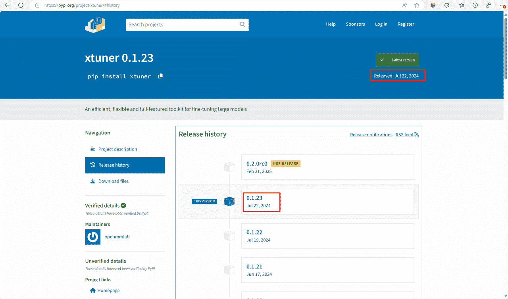

用cp命令覆盖掉旧的/workspace/xtuner/xtuner/dataset/internvl_dataset.py：

```
cp /root/internvl_dataset.py /workspace/xtuner/xtuner/dataset
```

修改完/workspace/xtuner/xtuner/dataset/internvl_dataset.py之后，继续执行微调：

```
cd /root/train-clot
mkdir lora_output # 方便储存微调过程中各个阶段的模型
conda activate base
pip install mpi4py
xtuner train /root/train-clot/internvl3-8b_lora_finetune.py  --work-dir /root/train-food/lora_output  --deepspeed deepspeed_zero1
```

> pip install mpi4py是后来加上的，当时没加，有了下面的报错：

```
File &quot;/opt/conda/lib/python3.10/site-packages/deepspeed/comm/comm.py&quot;, line 692, in mpi_discovery
    from mpi4py import MPI
ModuleNotFoundError: No module named &#x27;mpi4py&#x27;
```

之后执行命令，开始训练了，随后在显示训练信息了：

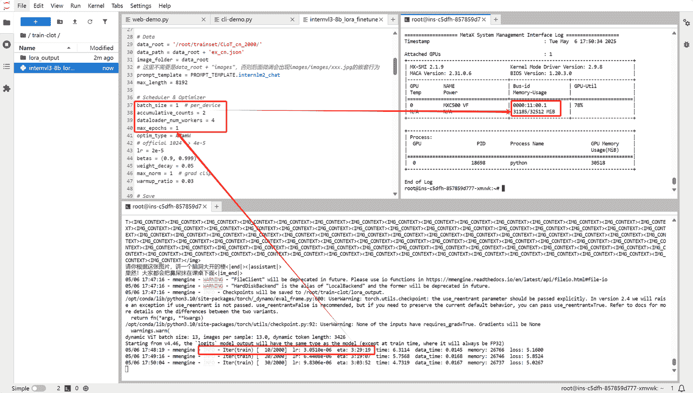

这里显示10/2000，说明一共要迭代2000步。我在训练配置文件里设置的保存间隔是100（save_steps = 100）。

eta之后的时间表明这次训练尽管最大epoch数量只有1，结果仍然需要3个半小时的训练。

想降低消耗时间，结果没法提高batch_size，当前32G显存已经吃满了。batch_size一旦变成2，那么就CUDA out of memory了。

> 2000张图片，也就训练1轮，且图片里几乎没有重复，因此感觉训练效果不会太好。给梗图让训练后的模型填梗，估计效果一般般了。等训练完毕，看看效果吧。

经过**3小时**的训练，得到了训练的结果：

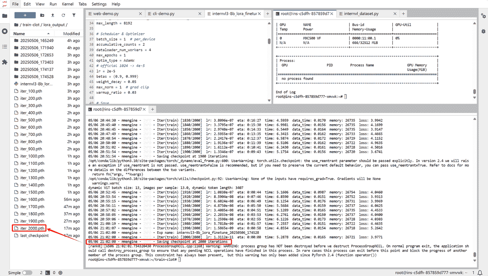

这个iter_2000.pth文件，需要跟InternVL3-8B模型合并，之后对合并后的模型进行推理，查看其是否能正确给一些梗图配上幽默的台词或者评论。

## 模型合并

由于没有下载xtuner的源代码，所以模型合并的脚本，要自己在/root/train-clot里自己建一个：

```
cd /root/train-clot
touch internvl3-8b-merge.py
```

而merge的脚本内容在https://github.com/InternLM/xtuner/blob/main/xtuner/configs/internvl/v1_5/convert_to_official.py里有，复制后

```
# Copyright (c) OpenMMLab. All rights reserved.
import argparse
import os.path as osp

import torch
from mmengine.config import Config
from transformers import AutoTokenizer

from xtuner.model.utils import LoadWoInit
from xtuner.registry import BUILDER


def convert_to_official(config, trained_path, save_path):
    cfg = Config.fromfile(config)
    cfg.model.pretrained_pth = trained_path
    cfg.model.quantization_vit = False
    cfg.model.quantization_llm = False

    with LoadWoInit():
        model = BUILDER.build(cfg.model)
    model.to(torch.bfloat16)

    if model.use_visual_encoder_lora:
        vision_model = model.model.vision_model.merge_and_unload()
        model.model.vision_model = vision_model

    if model.use_llm_lora:
        language_model = model.model.language_model.merge_and_unload()
        model.model.language_model = language_model

    model.model.save_pretrained(save_path)

    tokenizer = AutoTokenizer.from_pretrained(
        cfg.model.model_path, trust_remote_code=True
    )
    tokenizer.save_pretrained(save_path)

    print(model)


def main():
    parser = argparse.ArgumentParser(
        description=&quot;Convert the pth model to HuggingFace model&quot;
    )
    parser.add_argument(&quot;config&quot;, help=&quot;config file name or path.&quot;)
    parser.add_argument(&quot;trained_model_pth&quot;, help=&quot;The trained model path.&quot;)
    parser.add_argument(&quot;save_path&quot;, help=&quot;The path to save the converted model.&quot;)
    args = parser.parse_args()

    if osp.realpath(args.trained_model_pth) == osp.realpath(args.save_path):
        raise ValueError(&quot;The trained path and save path should not be the same.&quot;)

    convert_to_official(args.config, args.trained_model_pth, args.save_path)


if __name__ == &quot;__main__&quot;:
    main()
```

粘贴到/root/train-clot/internvl3-8b-merge.py里，内容无需修改，就是使用该脚本的时候需要指定格式：

python /root/train-clot/internvl3-8b-merge.py -h之后得到提示是：

```
[2025-04-29 23:07:24,968] [INFO] [real_accelerator.py:203:get_accelerator] Setting ds_accelerator to cuda (auto detect)
usage: internvl3-8b-merge.py [-h] config trained_model_pth save_path

Convert the pth model to HuggingFace model

positional arguments:
  config             config file name or path.
  trained_model_pth  The trained model path.
  save_path          The path to save the converted model.

options:
  -h, --help         show this help message and exit
```

+   config是训练的配置文件，train-clot/internvl3-8b_lora_finetune.py

+   trained_model_pth，就是训练结果/root/train-clot/lora_output/iter_2000.pth

+   save_path，就是合并后模型想保存的路径。

因此合并的命令为：

```
conda activate base
python /root/train-clot/internvl3-8b-merge.py /root/train-clot/internvl3-8b_lora_finetune.py /root/train-clot/lora_output/iter_2000.pth /root/train-clot/InternVL3-8B-iter2000/
```

运行命令后大约10分钟，合并完毕：

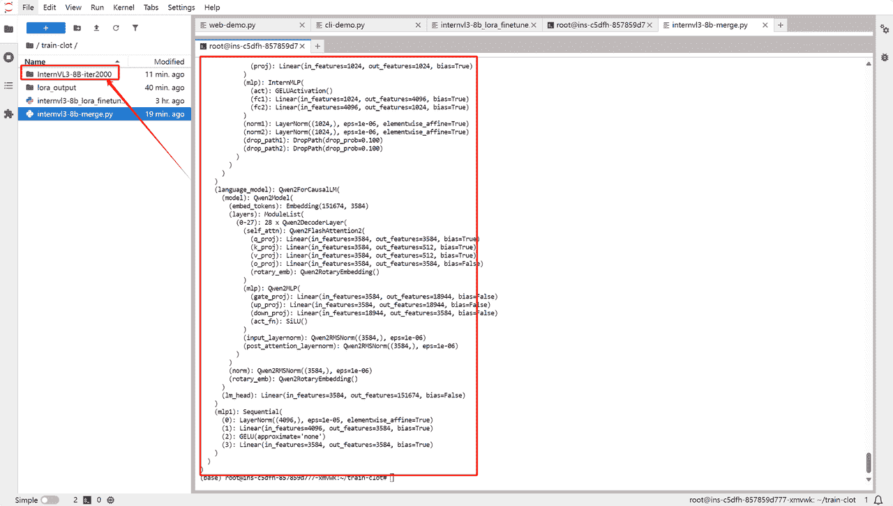

## 新模型的cli-demo

最初cli-demo的代码复制一下，输入训练集里的图片作为测试（开卷考试）。

选取的图片是这个：

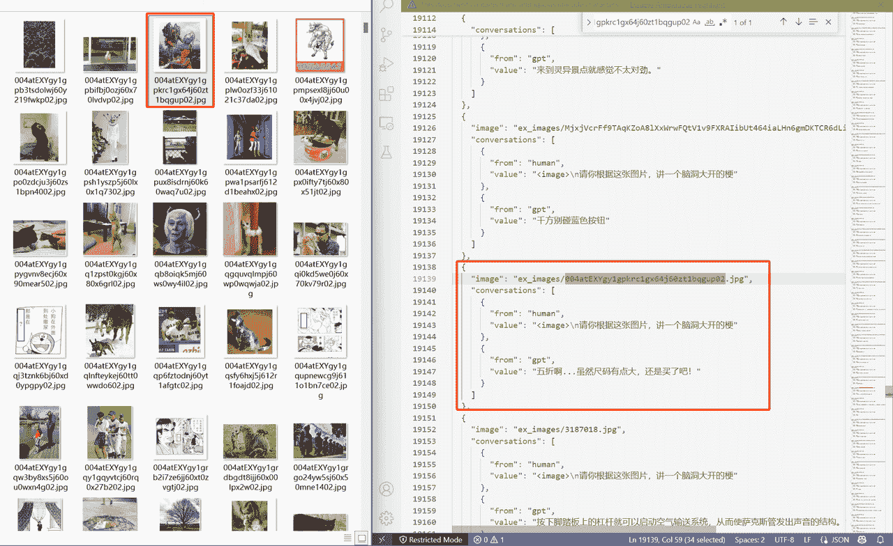


待测试图片的路径修改为'/root/trainset/CLoT_cn_2000/ex_images/004atEXYgy1gpkrc1gx64j60zt1bqgup02.jpg'，

对于图片的提问，修改为请你根据这张图片，讲一个脑洞大开的梗

模型的路径先后有两个选择'/root/public-model/models/OpenGVLab/InternVL3-8B'和/root/train-clot/InternVL3-8B-iter2000(87行和112行)，分别保存为/root/cli-demo1.py和/root/cli-demo2.py。

/root/cli-demo2.py的内容如下：

```
import math
import numpy as np
import torch
import torchvision.transforms as T
from decord import VideoReader, cpu
from PIL import Image
from torchvision.transforms.functional import InterpolationMode
from transformers import AutoModel, AutoTokenizer, AutoConfig

IMAGENET_MEAN = (0.485, 0.456, 0.406)
IMAGENET_STD = (0.229, 0.224, 0.225)

def build_transform(input_size):
    MEAN, STD = IMAGENET_MEAN, IMAGENET_STD
    transform = T.Compose([
        T.Lambda(lambda img: img.convert(&#x27;RGB&#x27;) if img.mode != &#x27;RGB&#x27; else img),
        T.Resize((input_size, input_size), interpolation=InterpolationMode.BICUBIC),
        T.ToTensor(),
        T.Normalize(mean=MEAN, std=STD)
    ])
    return transform

def find_closest_aspect_ratio(aspect_ratio, target_ratios, width, height, image_size):
    best_ratio_diff = float(&#x27;inf&#x27;)
    best_ratio = (1, 1)
    area = width * height
    for ratio in target_ratios:
        target_aspect_ratio = ratio[0] / ratio[1]
        ratio_diff = abs(aspect_ratio - target_aspect_ratio)
        if ratio_diff &lt; best_ratio_diff:
            best_ratio_diff = ratio_diff
            best_ratio = ratio
        elif ratio_diff == best_ratio_diff:
            if area &gt; 0.5 * image_size * image_size * ratio[0] * ratio[1]:
                best_ratio = ratio
    return best_ratio

def dynamic_preprocess(image, min_num=1, max_num=12, image_size=448, use_thumbnail=False):
    orig_width, orig_height = image.size
    aspect_ratio = orig_width / orig_height

    # calculate the existing image aspect ratio
    target_ratios = set(
        (i, j) for n in range(min_num, max_num + 1) for i in range(1, n + 1) for j in range(1, n + 1) if
        i * j &lt;= max_num and i * j &gt;= min_num)
    target_ratios = sorted(target_ratios, key=lambda x: x[0] * x[1])

    # find the closest aspect ratio to the target
    target_aspect_ratio = find_closest_aspect_ratio(
        aspect_ratio, target_ratios, orig_width, orig_height, image_size)

    # calculate the target width and height
    target_width = image_size * target_aspect_ratio[0]
    target_height = image_size * target_aspect_ratio[1]
    blocks = target_aspect_ratio[0] * target_aspect_ratio[1]

    # resize the image
    resized_img = image.resize((target_width, target_height))
    processed_images = []
    for i in range(blocks):
        box = (
            (i % (target_width // image_size)) * image_size,
            (i // (target_width // image_size)) * image_size,
            ((i % (target_width // image_size)) + 1) * image_size,
            ((i // (target_width // image_size)) + 1) * image_size
        )
        # split the image
        split_img = resized_img.crop(box)
        processed_images.append(split_img)
    assert len(processed_images) == blocks
    if use_thumbnail and len(processed_images) != 1:
        thumbnail_img = image.resize((image_size, image_size))
        processed_images.append(thumbnail_img)
    return processed_images

def load_image(image_file, input_size=448, max_num=12):
    image = Image.open(image_file).convert(&#x27;RGB&#x27;)
    transform = build_transform(input_size=input_size)
    images = dynamic_preprocess(image, image_size=input_size, use_thumbnail=True, max_num=max_num)
    pixel_values = [transform(image) for image in images]
    pixel_values = torch.stack(pixel_values)
    return pixel_values

def split_model(model_name):
    device_map = {}
    world_size = torch.cuda.device_count()
    config = AutoConfig.from_pretrained(&#x27;/root/train-clot/InternVL3-8B-iter2000&#x27;, trust_remote_code=True)
    num_layers = config.llm_config.num_hidden_layers
    # Since the first GPU will be used for ViT, treat it as half a GPU.
    num_layers_per_gpu = math.ceil(num_layers / (world_size - 0.5))
    num_layers_per_gpu = [num_layers_per_gpu] * world_size
    num_layers_per_gpu[0] = math.ceil(num_layers_per_gpu[0] * 0.5)
    layer_cnt = 0
    for i, num_layer in enumerate(num_layers_per_gpu):
        for j in range(num_layer):
            device_map[f&#x27;language_model.model.layers.{layer_cnt}&#x27;] = i
            layer_cnt += 1
    device_map[&#x27;vision_model&#x27;] = 0
    device_map[&#x27;mlp1&#x27;] = 0
    device_map[&#x27;language_model.model.tok_embeddings&#x27;] = 0
    device_map[&#x27;language_model.model.embed_tokens&#x27;] = 0
    device_map[&#x27;language_model.output&#x27;] = 0
    device_map[&#x27;language_model.model.norm&#x27;] = 0
    device_map[&#x27;language_model.model.rotary_emb&#x27;] = 0
    device_map[&#x27;language_model.lm_head&#x27;] = 0
    device_map[f&#x27;language_model.model.layers.{num_layers - 1}&#x27;] = 0

    return device_map

# If you set `load_in_8bit=True`, you will need two 80GB GPUs.
# If you set `load_in_8bit=False`, you will need at least three 80GB GPUs.
path = &#x27;/root/train-clot/InternVL3-8B-iter2000&#x27;
device_map = split_model(&#x27;InternVL3-8B&#x27;)
model = AutoModel.from_pretrained(
    path,
    torch_dtype=torch.bfloat16,
    load_in_8bit=False,
    low_cpu_mem_usage=True,
    use_flash_attn=False,
    trust_remote_code=True,
    device_map=device_map).eval()
tokenizer = AutoTokenizer.from_pretrained(path, trust_remote_code=True, use_fast=False)

# set the max number of tiles in `max_num`
pixel_values = load_image(&#x27;/root/trainset/CLoT_cn_2000/ex_images/004atEXYgy1gpkrc1gx64j60zt1bqgup02.jpg&#x27;, max_num=12).to(torch.bfloat16).cuda()
generation_config = dict(max_new_tokens=1024, do_sample=True)


# single-image multi-round conversation (单图多轮对话)
question = &#x27;&lt;image&gt;\n请你根据这张图片，讲一个脑洞大开的梗&#x27;
response, history = model.chat(tokenizer, pixel_values, question, generation_config, history=None, return_history=True)
print(f&#x27;User: {question}\nAssistant: {response}&#x27;)

question = &#x27;请根据这张图片再讲一个梗&#x27;
response, history = model.chat(tokenizer, pixel_values, question, generation_config, history=history, return_history=True)
print(f&#x27;User: {question}\nAssistant: {response}&#x27;)

```

打开两个终端，分别执行两个脚本：

```
conda activate base
python /root/cli-demo1.py
```

启动cli-demo2.py之前，需要给merge之后的模型加一些模版文件，否则会有OSError的报错：

```
cp /root/public-model/models/OpenGVLab/InternVL3-8B/modeling_internvl_chat.py /root/train-clot/InternVL3-8B-iter2000
cp /root/public-model/models/OpenGVLab/InternVL3-8B/modeling_intern_vit.py /root/train-clot/InternVL3-8B-iter2000
cp /root/public-model/models/OpenGVLab/InternVL3-8B/conversation.py /root/train-clot/InternVL3-8B-iter2000
```

```
conda activate base
python /root/cli-demo2.py
```

最后微调前的cli-demo1.py和微调后的cli-demo2.py对比效果如下：

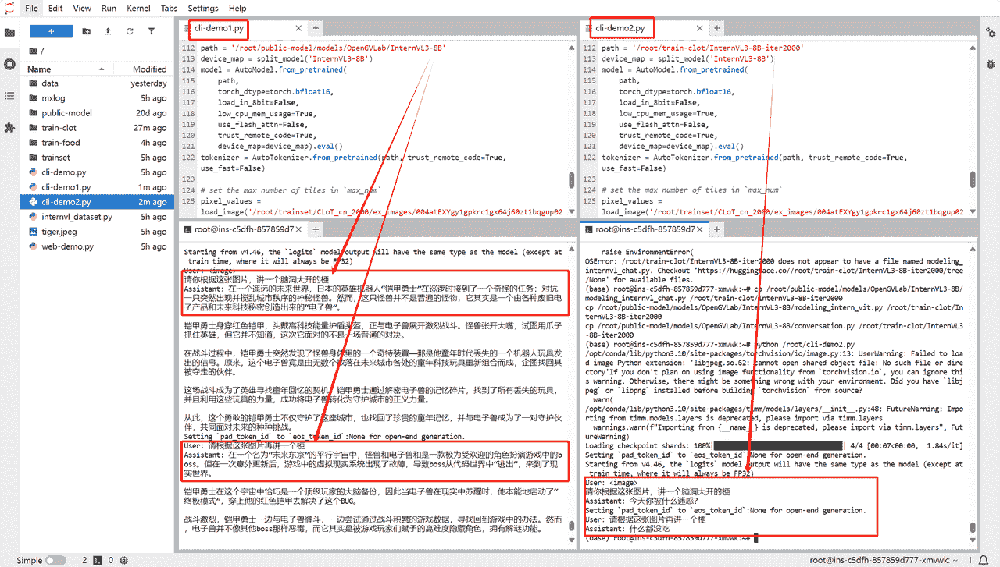

微调前，完全不懂"梗"为何物，只是单纯地讲故事。

微调后，添加台词或者评论更加符合梗图的习惯。

虽然两个回答配合赛文奥特曼的那个图，不一定很幽默，但是也算恰当：


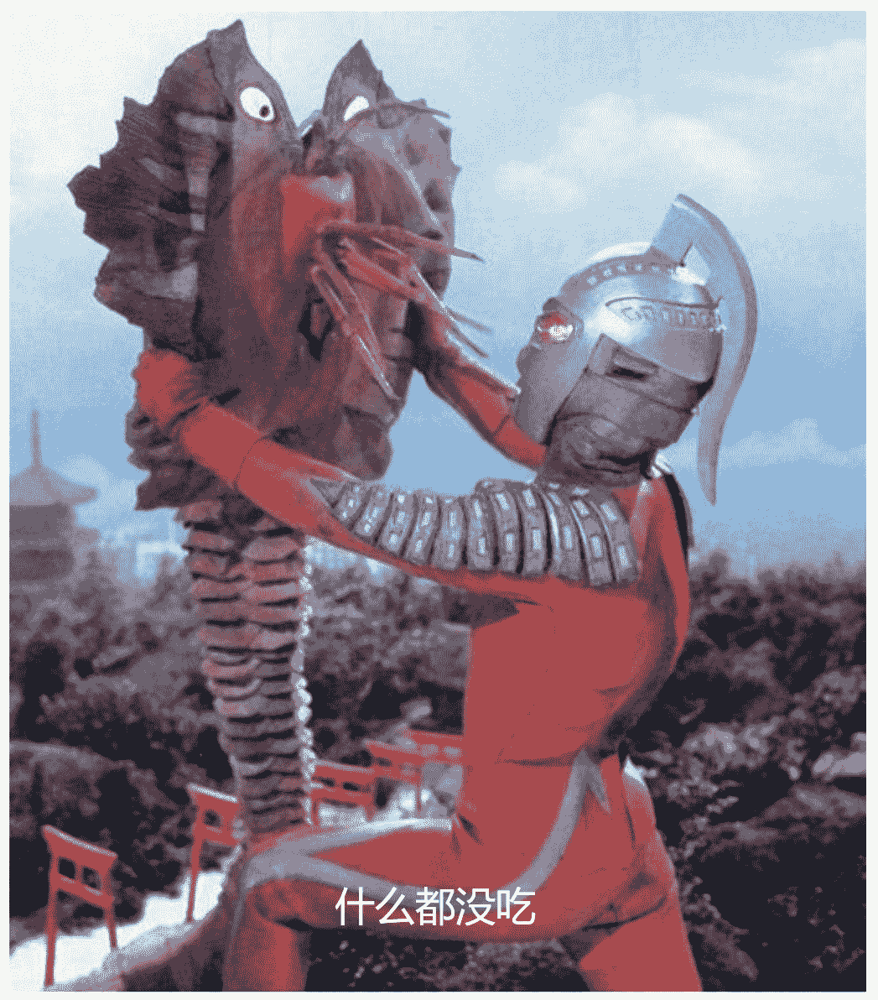

2000图的训练，一共只跑了1个epoch，估计学习还没怎么到位，能达到这个程度也完成教学的目的了。

如果是实际应用，则需要增加一些epochs，来加强训练的效果。

大家可以试试其他的图片，看看效果。

如果能达到下图的效果，那确实有梗图之王的潜质了：

