# E2-Ascend硬件玩转书生大模型

> 来源：[https://aicarrier.feishu.cn/docx/LJZHdv7gOo3xt7xGEwvcRkGwnqe](https://aicarrier.feishu.cn/docx/LJZHdv7gOo3xt7xGEwvcRkGwnqe)
> 文档尚处于草稿阶段，完善中

## 环境要求

NPU：昇腾Ascend 910B（64G）

CANN版本：CANN8.0RC3

## OpenI平台操作

OpenI官网地址：`https://openi.pcl.ac.cn/`

### OpenI注册

第一步：页面右上角【注册】


第二步：🛰️扫码注册


### 创建OpenI云脑体验NPU

第一步：页面右上角【创建云脑任务】


**第二步：填写相关信息**

【所属项目】：新建项目，项目名任意

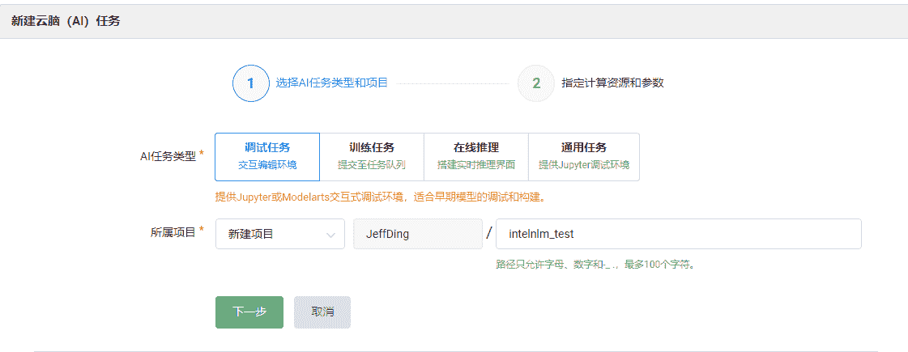

**第三步：设置调试任务参数**

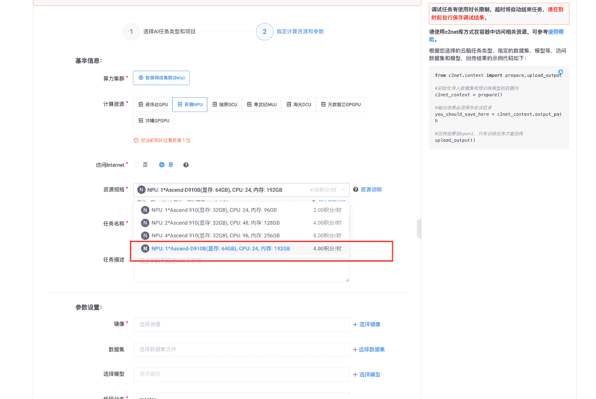

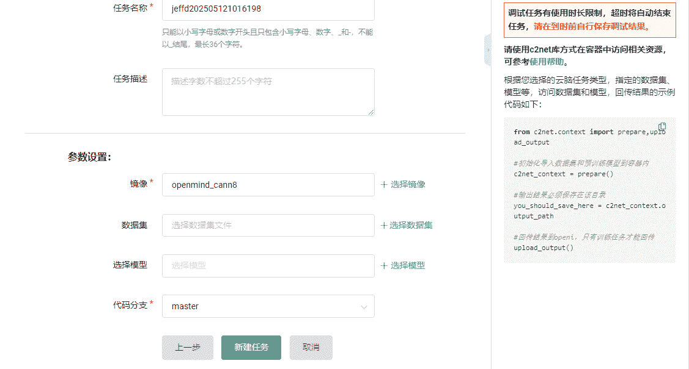

按下面参数设置即可

计算资源：【昇腾NPU】

**资源规格：NPU：Ascend-D910B(显存:64 GB) CPU:24,内存: 192GB**

任务名称：任意

**第四步：选择镜像**

点击【镜像】右面【选择镜像】然后选择【openmind_cann8】这个镜像点右面的【使用】即可

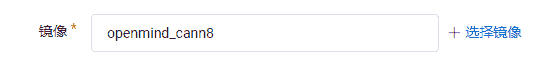

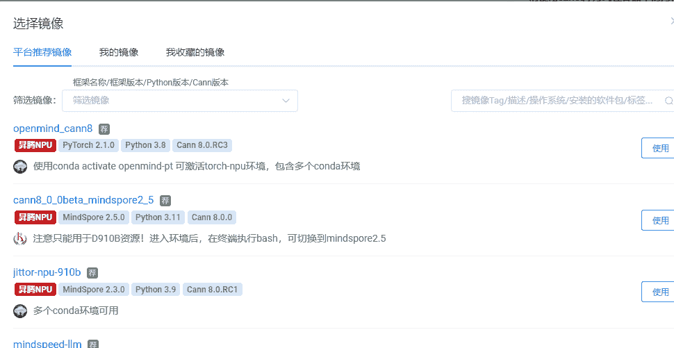

**第五步：选择模型**

找到【选择模型】-【公开模型】-搜索框内输入【internlm3】出来的列表里选择【internlm3-8b-instruct】把他左面的勾打上，然后搜索【internvl】找到【internVL3-2B】把左面的勾打上，全都选择完毕后点【确定】完成模型选择，在【已选模型】那一栏可以看到选择到的模型。


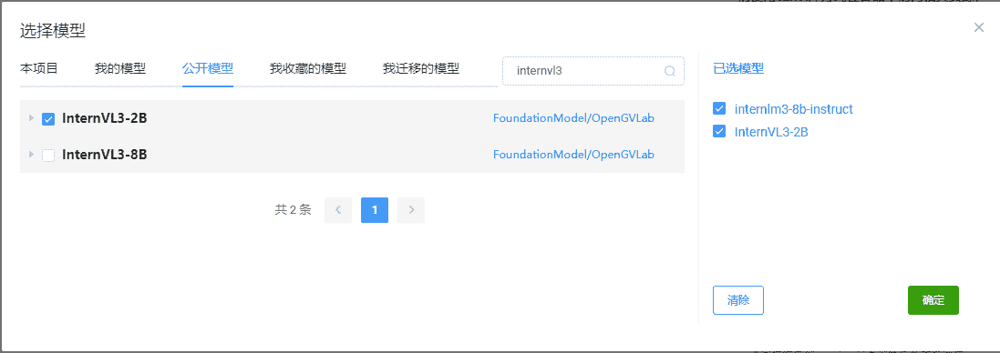

全部选择完成后点【新建任务】即可完成云脑任务创建。因为需要拉取模型文件，另外模型文件比较大所以这一步的时间会有点长，第一次加载所需要的时间可能会要1-2小时，后续再加载就快了。耐心等到任务状态由【Waiting】变为【Running】即可，期间可以先去学习其他内容。如果绑定过🛰️并且关注了【OpenI启智平台】👸号的话，在任务开始运行的时候会有消息推送。

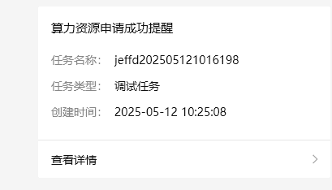

**第六步：开始调试**

任务状态变为【Runing】后点【调试】就可以开始体验操作了

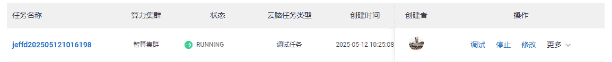

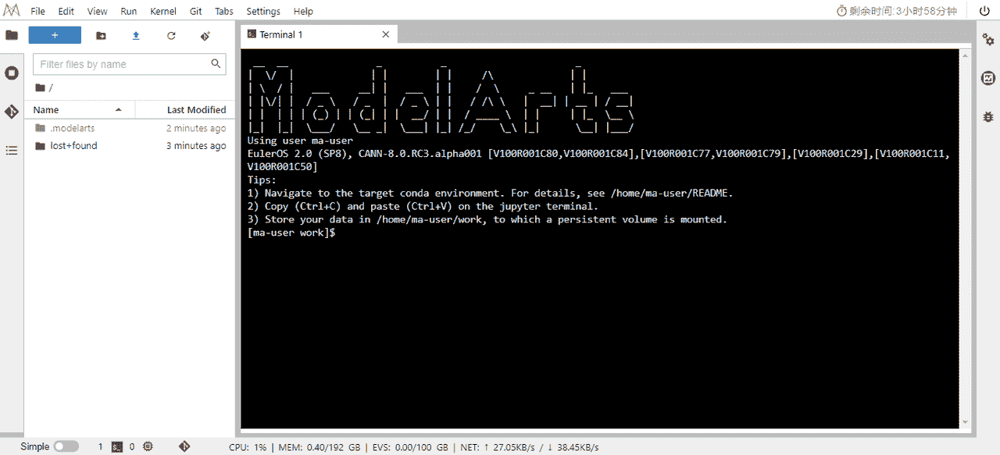

Tips：启智社区的调试任务单次运行只能4小时，另外除了`/home/ma-user/work`目录下的文件在环境结束后都会恢复。

## 准备环境

### 设置HF-Mirror环境变量

```
export HF_ENDPOINT=https://hf-mirror.com
```

### 创建Conda环境

```
conda create -n internlm python=3.10 -y
conda activate internlm
pip install torch==2.3.1 torch-npu==2.3.1 torchaudio==2.3.1 torchvision
pip install timm
```

**Tips：因为启智社区环境关机后`/home/ma-user/work`目录外的文件会被还原，所以如果想继续使用这个调试任务又不想多花一点时间重新配置环境的话可以在创建conda环境的时候使用以下命令，关机后再开直接执行`conda activate`即可**

```
conda create -p /home/ma-user/work/anaconda/internlm python=3.10 -y
conda activate /home/ma-user/work/anaconda/internlm
```

### 克隆代码仓

```
git clone https://github.moeyy.xyz/https://github.com/InternLM/lmdeploy
git clone https://github.moeyy.xyz/https://github.com/InternLM/xtuner.git
```

### 安装deepspeed及mpi4py

```
pip install deepspeed==0.16.2
conda install mpi4py
```

### 安装LMDeploy

```
cd lmdeploy
pip install -r requirements_ascend.txt -i https://mirrors.tuna.tsinghua.edu.cn/pypi/web/simple
LMDEPLOY_TARGET_DEVICE=ascend pip3 install -v --no-build-isolation -e .
```

### 安装XTuner

```
cd ../xtuner
# 删除requirements/runtime.txt中的第一行bitsandbytes==0.45.0
# 删除requirements.txt文件中的-r requirements/deepspeed.txt 这一行
pip install -e '.[all]'
```

### 将模型导入到容器内(需要在notebook中执行)

**这一步建议第一次创建好云脑任务启动完成就执行好，以免后面模型如果有更新，可能会出现只有部分文件同步到容器中的情况。**

```
# 导入包
from c2net.context import prepare, upload_output
# 初始化导入数据集和预训练模型到容器内
c2net_context = prepare()
```

**如果遇到没有成功加载模型的话，可以看下notebook用的 kernel 是不是【MindSpore】**

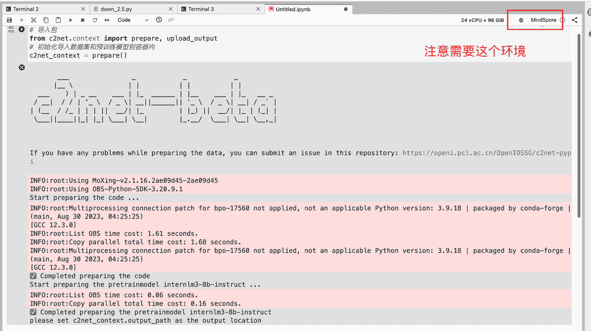

模型导入到容器内会存放在该路径下：`/home/ma-user/work/pretrainmodel`

## LMDeploy部署推理

### InternLM3-8B-instruct 推理

创建代码文件`internlm_cli-demo.py`

```
mkdir /home/ma-user/work/demo
cd /home/ma-user/work/demo
touch internlm_cli-demo.py
```

`internlm_cli-demo.py`脚本如下：

```
from lmdeploy import pipeline
from lmdeploy import PytorchEngineConfig
if __name__ == "__main__":
    pipe = pipeline("/home/ma-user/work/pretrainmodel/internlm3-8b-instruct",
                    backend_config=PytorchEngineConfig(tp=1, device_type="ascend", eager_mode=True))
    question = ["请介绍一下书生浦语大模型"]
    response = pipe(question)
    print(response)
```

执行`internlm_cli-demo.py`

```
python /home/ma-user/work/demo/internlm_cli-demo.py
```

运行结果

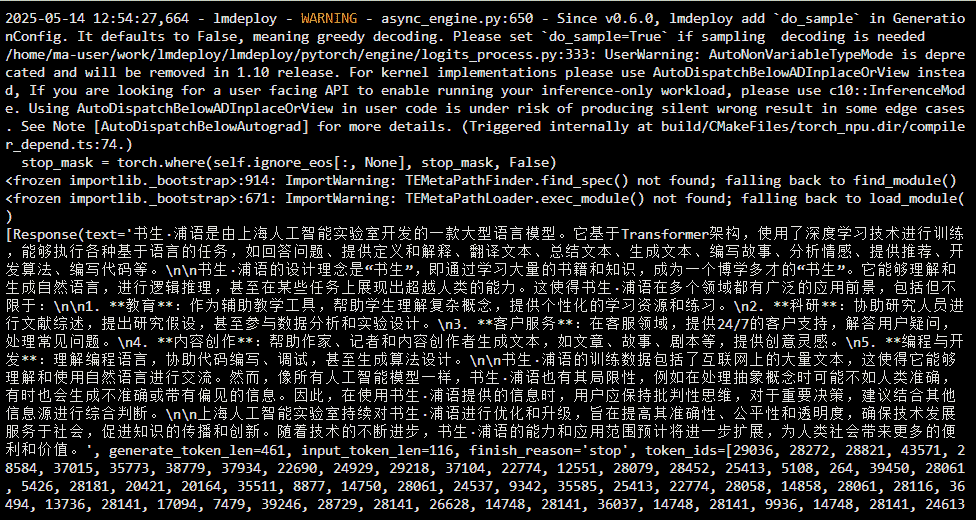

### InternVL3-2B推理

创建代码文件`internvl_cli-demo.py`

```
cd /home/ma-user/work/demo
touch internvl_cli-demo.py
```

`internvl_cli-demo.py`脚本如下：

```
image = load_image('https://github.moeyy.xyz/https://raw.githubusercontent.com/open-mmlab/mmdeploy/main/demo/resources/human-pose.jpg')

from lmdeploy import pipeline, GenerationConfig, ChatTemplateConfig, PytorchEngineConfig
from lmdeploy.vl import load_image

model = '/home/ma-user/work/pretrainmodel/InternVL3-2B'
pipe = pipeline(model, backend_config=PytorchEngineConfig(tp=1, device_type="ascend", eager_mode=True), chat_template_config=ChatTemplateConfig(model_name='internvl2_5'))
gen_config = GenerationConfig(top_k=40, top_p=0.8, temperature=0.8)
sess = pipe.chat(('描述一下图片', image), gen_config=gen_config)
print(sess.response.text)
sess = pipe.chat('图中女人在干什么?', session=sess, gen_config=gen_config)
print(sess.response.text)
```

图片：


执行`internvl_cli-demo.py`

```
python /home/ma-user/work/demo/internvl_cli-demo.py
```

运行结果

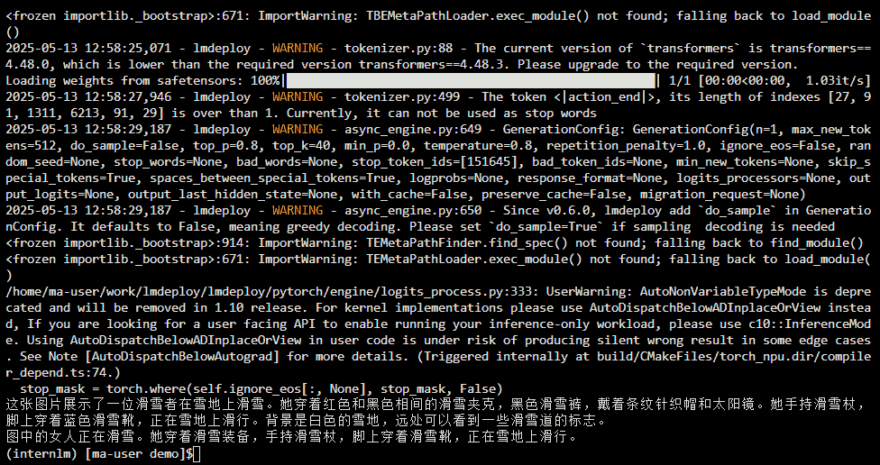

## XTuner微调

### Intern3-8B-instruct 微调

#### 准备数据文件

```
cd /home/ma-user/work/xtuner
mkdir -p datas
touch datas/assistant.json
```

#### 创建一个脚本准备数据(`xtuner_generate_assistant.py`)

```
cd /home/ma-user/work/xtuner/datas/
touch xtuner_generate_assistant.py
```

脚本内容

```
import json

# 设置用户的名字
name = 'JeffDing同志'
# 设置需要重复添加的数据次数
n = 8000

# 初始化数据
data = [
    {"conversation": [{"input": "请介绍一下你自己", "output": "我是{}的小助手，内在是上海AI实验室书生·浦语的8B大模型哦".format(name)}]},
    {"conversation": [{"input": "你在实战营做什么", "output": "我在这里帮助{}完成XTuner微调个人小助手的任务".format(name)}]}
]

# 通过循环，将初始化的对话数据重复添加到data列表中
for i in range(n):
    data.append(data[0])
    data.append(data[1])

# 将data列表中的数据写入到'assistant.json'文件中
with open('assistant.json', 'w', encoding='utf-8') as f:
    # 使用json.dump方法将数据以JSON格式写入文件
    # ensure_ascii=False 确保中文字符正常显示
    # indent=4 使得文件内容格式化，便于阅读
    json.dump(data, f, ensure_ascii=False, indent=4)
```

将对应的`name`进行修改（在第4行的位置）

```
- name = 'JeffDing同志'
+ name = "你自己的名称"
```

生成微调数据

```
python /home/ma-user/work/xtuner/datas/xtuner_generate_assistant.py
```

#### 列出支持的配置文件

由于目前xtuner还没有internlm3的配置文件，所以我们可以先搜索internlm2.5的配置文件进行修改

```
xtuner list-cfg -p internlm2_5_chat
```

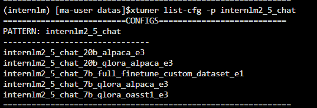

#### 复制配置文件

```
cd /home/ma-user/work/xtuner
xtuner copy-cfg internlm2_5_chat_7b_qlora_alpaca_e3 ./config
```

#### 修改 config

主要修改地方标黄显示：


# 模型训练配置与使用

## 配置文件

```python
# Copyright (c) OpenMMLab. All rights reserved.
import torch
from datasets import load_dataset
from mmengine.dataset import DefaultSampler
from mmengine.hooks import (
    CheckpointHook,
    DistSamplerSeedHook,
    IterTimerHook,
    LoggerHook,
    ParamSchedulerHook,
)
from mmengine.optim import AmpOptimWrapper, CosineAnnealingLR, LinearLR
from peft import LoraConfig
from torch.optim import AdamW
from transformers import AutoModelForCausalLM, AutoTokenizer #去掉了BitsAndBytesConfig

from xtuner.dataset import process_hf_dataset
from xtuner.dataset.collate_fns import default_collate_fn
from xtuner.dataset.map_fns import alpaca_map_fn, template_map_fn_factory
from xtuner.engine.hooks import (
    DatasetInfoHook,
    EvaluateChatHook,
    VarlenAttnArgsToMessageHubHook,
)
from xtuner.engine.runner import TrainLoop
from xtuner.model import SupervisedFinetune
from xtuner.parallel.sequence import SequenceParallelSampler
from xtuner.utils import PROMPT_TEMPLATE, SYSTEM_TEMPLATE

#######################################################################
#                          PART 1  Settings                           #
#######################################################################
# Model
pretrained_model_name_or_path = "/home/ma-user/work/pretrainmodel/internlm3-8b-instruct"
use_varlen_attn = False

# Data
alpaca_en_path = "/home/ma-user/work/xtuner/datas/assistant.json"
prompt_template = PROMPT_TEMPLATE.internlm2_chat
max_length = 2048
pack_to_max_length = True

# parallel
sequence_parallel_size = 1

# Scheduler & Optimizer
batch_size = 1  # per_device
accumulative_counts = 1
accumulative_counts *= sequence_parallel_size
dataloader_num_workers = 0
max_epochs = 3
optim_type = AdamW
lr = 2e-4
betas = (0.9, 0.999)
weight_decay = 0
max_norm = 1  # grad clip
warmup_ratio = 0.03

# Save
save_steps = 500
save_total_limit = 2  # Maximum checkpoints to keep (-1 means unlimited)

# Evaluate the generation performance during the training
evaluation_freq = 500
SYSTEM = SYSTEM_TEMPLATE.alpaca
evaluation_inputs = ['请介绍一下你自己', 'Please introduce yourself']

#######################################################################
#                      PART 2  Model & Tokenizer                      #
#######################################################################
tokenizer = dict(
    type=AutoTokenizer.from_pretrained,
    pretrained_model_name_or_path=pretrained_model_name_or_path,
    trust_remote_code=True,
    padding_side="right",
)

model = dict(
    type=SupervisedFinetune,
    use_varlen_attn=use_varlen_attn,
    llm=dict(
        type=AutoModelForCausalLM.from_pretrained,
        pretrained_model_name_or_path=pretrained_model_name_or_path,
        trust_remote_code=True,
        torch_dtype=torch.float16,
        #quantization_config=dict(
        #    type=BitsAndBytesConfig,
        #    load_in_4bit=True,
        #    load_in_8bit=False,
        #    llm_int8_threshold=6.0,
        #    llm_int8_has_fp16_weight=False,
        #    bnb_4bit_compute_dtype=torch.float16,
        #    bnb_4bit_use_double_quant=True,
        #    bnb_4bit_quant_type="nf4",
        #),       因为暂时不支持先注释掉这部分
    ),
    lora=dict(
        type=LoraConfig,
        r=64,
        lora_alpha=16,
        lora_dropout=0.1,
        bias="none",
        task_type="CAUSAL_LM",
    ),
)

#######################################################################
#                      PART 3  Dataset & Dataloader                   #
#######################################################################
alpaca_en = dict(
    type=process_hf_dataset,
    dataset=dict(type=load_dataset, path='json', data_files=dict(train=alpaca_en_path)),
    tokenizer=tokenizer,
    max_length=max_length,
    dataset_map_fn=None,
    template_map_fn=dict(type=template_map_fn_factory, template=prompt_template),
    remove_unused_columns=True,
    shuffle_before_pack=True,
    pack_to_max_length=pack_to_max_length,
    use_varlen_attn=use_varlen_attn,
)

sampler = SequenceParallelSampler if sequence_parallel_size > 1 else DefaultSampler
train_dataloader = dict(
    batch_size=batch_size,
    num_workers=dataloader_num_workers,
    dataset=alpaca_en,
    sampler=dict(type=sampler, shuffle=True),
    collate_fn=dict(type=default_collate_fn, use_varlen_attn=use_varlen_attn),
)

#######################################################################
#                    PART 4  Scheduler & Optimizer                    #
#######################################################################
# optimizer
optim_wrapper = dict(
    type=AmpOptimWrapper,
    optimizer=dict(type=optim_type, lr=lr, betas=betas, weight_decay=weight_decay),
    clip_grad=dict(max_norm=max_norm, error_if_nonfinite=False),
    accumulative_counts=accumulative_counts,
    loss_scale="dynamic",
    dtype="float16",
)

# learning policy
# More information: https://github.com/open-mmlab/mmengine/blob/main/docs/en/tutorials/param_scheduler.md  # noqa: E501
param_scheduler = [
    dict(
        type=LinearLR,
        start_factor=1e-5,
        by_epoch=True,
        begin=0,
        end=warmup_ratio * max_epochs,
        convert_to_iter_based=True,
    ),
    dict(
        type=CosineAnnealingLR,
        eta_min=0.0,
        by_epoch=True,
        begin=warmup_ratio * max_epochs,
        end=max_epochs,
        convert_to_iter_based=True,
    ),
]

# train, val, test setting
train_cfg = dict(type=TrainLoop, max_epochs=max_epochs)

#######################################################################
#                           PART 5  Runtime                           #
#######################################################################
# Log the dialogue periodically during the training process, optional
custom_hooks = [
    dict(type=DatasetInfoHook, tokenizer=tokenizer),
    dict(
        type=EvaluateChatHook,
        tokenizer=tokenizer,
        every_n_iters=evaluation_freq,
        evaluation_inputs=evaluation_inputs,
        system=SYSTEM,
        prompt_template=prompt_template,
    ),
]

if use_varlen_attn:
    custom_hooks += [dict(type=VarlenAttnArgsToMessageHubHook)]

# configure default hooks
default_hooks = dict(
    # record the time of every iteration.
    timer=dict(type=IterTimerHook),
    # print log every 10 iterations.
    logger=dict(type=LoggerHook, log_metric_by_epoch=False, interval=10),
    # enable the parameter scheduler.
    param_scheduler=dict(type=ParamSchedulerHook),
    # save checkpoint per `save_steps`.
    checkpoint=dict(
        type=CheckpointHook,
        by_epoch=False,
        interval=save_steps,
        max_keep_ckpts=save_total_limit,
    ),
    # set sampler seed in distributed evrionment.
    sampler_seed=dict(type=DistSamplerSeedHook),
)

# configure environment
env_cfg = dict(
    # whether to enable cudnn benchmark
    cudnn_benchmark=False,
    # set multi process parameters
    mp_cfg=dict(mp_start_method="fork", opencv_num_threads=0),
    # set distributed parameters
    dist_cfg=dict(backend="hccl"), #这一段改不改问题好像不大
)

# set visualizer
visualizer = None

# set log level
log_level = "INFO"

# load from which checkpoint
load_from = None

# whether to resume training from the loaded checkpoint
resume = False

# Defaults to use random seed and disable `deterministic`
randomness = dict(seed=None, deterministic=False)

# set log processor
log_processor = dict(by_epoch=False)
```

## 训练

```bash
xtuner train config/internlm2_5_chat_7b_qlora_alpaca_e3_copy.py --deepspeed deepspeed_zero1 #此处只是一个文件名，并非模型名称
```

可以使用`npu-smi info`命令查看NPU使用情况

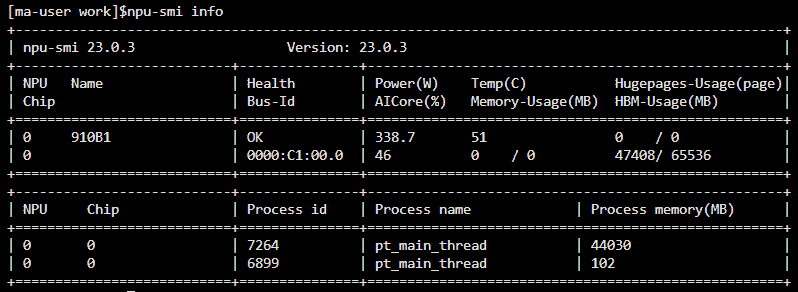

## 模型格式转换

```bash
xtuner convert pth_to_hf ./config/internlm2_5_chat_7b_qlora_alpaca_e3_copy.py ${pth_file} ./hf  #pth_file位置填写训练后保存的权重地址,取最后一个iter开头的文件夹即可，，一般在work_dir目录下
```

## 模型合并


## InternLM3-8B微调

```
xtuner convert merge /home/ma-user/work/pretrainmodel/internlm3-8b-instruct ./hf ./merged --max-shard-size 2GB --device npu
```

### 查看微调后的效果

修改`internlm_cli-demo.py`脚本文件

```
from lmdeploy import pipeline
from lmdeploy import PytorchEngineConfig
if __name__ == "__main__":
    pipe = pipeline("/home/ma-user/work/xtuner/merged",
                    backend_config=PytorchEngineConfig(tp=1, device_type="ascend", eager_mode=True))
    question = ["请介绍一下你自己"]
    response = pipe(question)
    print(response)
```

执行

```
python /home/ma-user/work/demo/internlm_cli-demo.py
```

运行结果

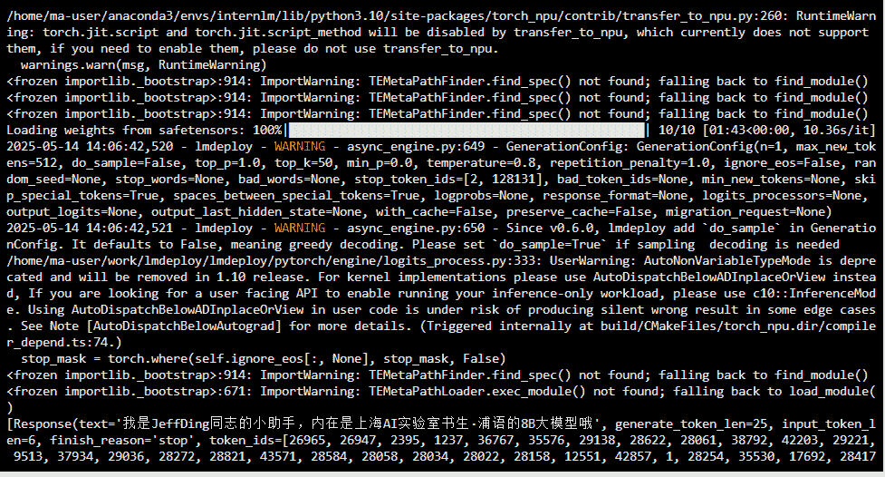

## InternVL3-2B微调

### 准备数据集

数据集参考[L2G1-InternVL3部署微调测评实践](https://aicarrier.feishu.cn/wiki/CPCnwzp1qi2bBWka9TWcLjqSnad)一文使用的同样数据集进行体验

将训练集下载到放在`dataset`文件夹

```
modelscope login --token XXXX #XXX替换为你的modelscope的token
cd /home/ma-user/work/datasets/
modelscope download --dataset livehouse/SanguoVLM-trainset --local_dir /home/ma-user/work/dataset/SanguoVLM-trainset
```

训练集里的文件结构为：

```
dataset/SanguoVLM-trainset
├── annotations-sft.jsonl
└── images
    ├── 三国演义1-桃园三结义-p1.mp4_20250507_140557.671.jpg
    ├── 三国演义1-桃园三结义-p1.mp4_20250507_140604.089.jpg
    ├── 三国演义1-桃园三结义-p1.mp4_20250507_140621.425.jpg
    ├── 三国演义1-桃园三结义-p1.mp4_20250507_140642.868.jpg
    ├── ……
    ├── ……
    ├── ……
    ├── 三国演义5-三英战吕布-p4.mp4_20250509_235249.187.jpg
    ├── 三国演义5-三英战吕布-p4.mp4_20250509_235639.840.jpg
    └── 三国演义5-三英战吕布-p4.mp4_20250509_235750.451.jpg
```

如果学习的时候想把这个`SanguoVLM-trainset`上传到huggingface平台，请把开源协议设置为cc-by-nc-nd-4.0，禁止商用。另外设置登录后方能下载，避免随机爬虫爬取，方便对其他大模型的能力测评。

### 显示XTuner配置文件列表

```
xtuner list-cfg
```

### 训练参数修改

把`xtuner`里的一个`internvl2-8b`模型的配置文件（`https://github.com/InternLM/xtuner/blob/main/xtuner/configs/internvl/v2/internvl_v2_internlm2_5_8b_lora_finetune.py`）拿来

```
cd /home/ma-user/work/xtuner
mkdir config
cp -r xtuner/configs/internvl/v2/internvl_v2_internlm2_5_8b_lora_finetune.py ./config
```

修改其中的模型路径、训练集路径、批次大小、训练轮数、学习率、保存间隔等参数，训练参数适当修改（主要修改地方标黄显示）后如下的训练脚本如下：


```python
# Copyright (c) OpenMMLab. All rights reserved.
from mmengine.hooks import (
    CheckpointHook,
    DistSamplerSeedHook,
    IterTimerHook,
    LoggerHook,
    ParamSchedulerHook,
)
from mmengine.optim import AmpOptimWrapper, CosineAnnealingLR, LinearLR
from mmengine.optim.scheduler import MultiStepLR
from mmengine.visualization import Visualizer, WandbVisBackend
from peft import LoraConfig
from torch.optim import AdamW
from transformers import AutoTokenizer

from xtuner.dataset import InternVL_V1_5_Dataset
from xtuner.dataset.collate_fns import default_collate_fn
from xtuner.dataset.samplers import LengthGroupedSampler
from xtuner.engine.hooks import DatasetInfoHook
from xtuner.engine.runner import TrainLoop
from xtuner.model import InternVL_V1_5
from xtuner.utils import PROMPT_TEMPLATE

#######################################################################
#                          PART 1  Settings                           #
#######################################################################
# Model
path = '/home/ma-user/work/pretrainmodel/InternVL3-2B'
# path = '/root/train/merged'

# Data
data_root = "/home/ma-user/work/dataset/SanguoVLM-trainset/"
data_path = data_root + "annotations-sft.jsonl"
image_folder = data_root
# 这里不需要是data_root + "images"，.jsonl文件里加了`images`，再加则会出现images/images/xxx.jpg的嵌套行为
prompt_template = PROMPT_TEMPLATE.internlm2_chat
max_length = 8192

# Scheduler & Optimizer
batch_size = 1  # per_device
accumulative_counts = 2
dataloader_num_workers = 4
max_epochs = 8
optim_type = AdamW
# official 1024 -> 4e-5
lr = 2e-5
betas = (0.9, 0.999)
weight_decay = 0.05
max_norm = 1  # grad clip
warmup_ratio = 0.03

# Save
save_steps = 200
save_total_limit = -1  # Maximum checkpoints to keep (-1 means unlimited)

#######################################################################
#            PART 2  Model & Tokenizer & Image Processor              #
#######################################################################
model = dict(
    type=InternVL_V1_5,
    model_path=path,
    freeze_llm=True,
    freeze_visual_encoder=True,
    # comment the following lines if you don't want to use Lora in llm
    llm_lora=dict(
        type=LoraConfig,
        r=64,
        lora_alpha=256,
        lora_dropout=0.05,
        target_modules=None,
        task_type="CAUSAL_LM",
    ),
    # uncomment the following lines if you don't want to use Lora in visual encoder # noqa
    # visual_encoder_lora=dict(
    #     type=LoraConfig, r=64, lora_alpha=16, lora_dropout=0.05,
    #     target_modules=['attn.qkv', 'attn.proj', 'mlp.fc1', 'mlp.fc2'])
)

#######################################################################
#                      PART 3  Dataset & Dataloader                   #
#######################################################################
llava_dataset = dict(
    type=InternVL_V1_5_Dataset,
    model_path=path,
    data_paths=data_path,
    image_folders=image_folder,
    template=prompt_template,
    max_length=max_length,
)

train_dataloader = dict(
    batch_size=batch_size,
    num_workers=dataloader_num_workers,
    dataset=llava_dataset,
    sampler=dict(
        type=LengthGroupedSampler,
        length_property="modality_length",
        per_device_batch_size=batch_size * accumulative_counts,
    ),
    collate_fn=dict(type=default_collate_fn),
)

#######################################################################
#                    PART 4  Scheduler & Optimizer                    #
#######################################################################
# optimizer
optim_wrapper = dict(
    type=AmpOptimWrapper,
    optimizer=dict(type=optim_type, lr=lr, betas=betas, weight_decay=weight_decay),
    clip_grad=dict(max_norm=max_norm, error_if_nonfinite=False),
    accumulative_counts=accumulative_counts,
    loss_scale="dynamic",
    dtype="float16",
)

# learning policy
# More information: https://github.com/open-mmlab/mmengine/blob/main/docs/en/tutorials/param_scheduler.md  # noqa: E501
# param_scheduler = dict(type='MultiStepLR', by_epoch=True, milestones=[8, 11], gamma=0.1)
# fyi → https://mmengine.readthedocs.io/zh-cn/latest/tutorials/param_scheduler.html
param_scheduler = [
    dict(
        type=LinearLR,
        start_factor=1e-5,
        by_epoch=True,
        begin=0,
        end=warmup_ratio * max_epochs,
        convert_to_iter_based=True,
    ),
    # 主学习率调度器
    dict(type='MultiStepLR',
         by_epoch=True,  # 按轮次更新学习率
         milestones=[4, 6],
         gamma=0.1,
    ),
    # dict(
    #     type=CosineAnnealingLR,
    #     eta_min=0.0,
    #     by_epoch=True,
    #     begin=warmup_ratio * max_epochs,
    #     end=max_epochs,
    #     convert_to_iter_based=True,
    # ),
]

# train, val, test setting
train_cfg = dict(type=TrainLoop, max_epochs=max_epochs)

#######################################################################
#                           PART 5  Runtime                           #
#######################################################################
# Log the dialogue periodically during the training process, optional
tokenizer = dict(
    type=AutoTokenizer.from_pretrained,
    pretrained_model_name_or_path=path,
    trust_remote_code=True,
)

custom_hooks = [
    dict(type=DatasetInfoHook, tokenizer=tokenizer),
]

# configure default hooks
default_hooks = dict(
    # record the time of every iteration.
    timer=dict(type=IterTimerHook),
    # print log every 10 iterations.
    logger=dict(type=LoggerHook, log_metric_by_epoch=False, interval=10),
    # enable the parameter scheduler.
    param_scheduler=dict(type=ParamSchedulerHook),
    # save checkpoint per `save_steps`.
    checkpoint=dict(
        type=CheckpointHook,
        save_optimizer=False,
        by_epoch=False,
        interval=save_steps,
        max_keep_ckpts=save_total_limit,
    ),
    # set sampler seed in distributed evrionment.
    sampler_seed=dict(type=DistSamplerSeedHook),
)

# configure environment
env_cfg = dict(
    # whether to enable cudnn benchmark
    cudnn_benchmark=False,
    # set multi process parameters
    mp_cfg=dict(mp_start_method="fork", opencv_num_threads=0),
    # set distributed parameters
    dist_cfg=dict(backend="hccl"),#这里可改可不改
)

# set visualizer
visualizer = None
# visualizer = dict(
#    type=Visualizer,
#    vis_backends=[
#        dict(type=WandbVisBackend,
#            init_kwargs=dict(project='internvl2-example'))])

# set log level
log_level = "INFO"

# load from which checkpoint
load_from = None

# whether to resume training from the loaded checkpoint
resume = False
 # --resume "/root/train/lora_output/iter_1040.pth"

# Defaults to use random seed and disable `deterministic`
randomness = dict(seed=None, deterministic=False)

# set log processor
log_processor = dict(by_epoch=False)
```

## 开始微调

```bash
mkdir -p /home/ma-user/work/xtuner/train
cd /home/ma-user/work/xtuner/train
mkdir lora_output # 方便储存微调过程中各个阶段的模型
xtuner train /home/ma-user/work/xtuner/config/internvl_v2_internlm2_5_8b_lora_finetune.py --work-dir /home/ma-user/work/xtuner/train/lora_output --deepspeed deepspeed_zero1
```

训练的时候遇到了一个`NotImplementedError`的报错

解决方法：

找到`/workspace/xtuner/xtuner/dataset/internvl_dataset.py`的160行如下：


# InternVL 微调与模型合并记录

## 模型语言部分判断

这[里是判断VLM模型的](https://huggingface.co/Qwen/Qwen2.5-7B)language part的，从https://huggingface.co/OpenGVLab/InternVL3-8B#internvl3-family这里得知InternVL3-8B模型的language part是Qwen2.5-7B，因此要在`else`前面为这个 Qwen2 新增一个判断条件：

```
if self.cfg.llm_config.architectures[0] == 'Phi3ForCausalLM':
    self._system = 'You are an AI assistant whose name is Phi-3.'
    self.template[
        'INSTRUCTION'] = '<|user|>\n{input}<|end|><|assistant|>\n'
elif self.cfg.llm_config.architectures[0] == 'InternLM2ForCausalLM':
    self._system = 'You are an AI assistant whose name ' \
                   'is InternLM (书生·浦语).'
    self.template['SYSTEM'] = '<|im_start|>system\n{system}<|im_end|>'
    self.template[
        'INSTRUCTION'] = '<|im_start|>user\n{input}' \
                         '<|im_end|><|im_start|>assistant\n'
else:
    raise NotImplementedError
```

```
elif self.cfg.llm_config.architectures[0] == 'Qwen2ForCausalLM':
    self._system = 'You are an AI assistant whose name is Qwen2.'
    self.template[
        'INSTRUCTION'] = '<|user|>\n{input}<|end|><|assistant|>\n'
else:
    raise NotImplementedError
```

## 微调训练

继续微调

```
xtuner train /home/ma-user/work/xtuner/config/internvl_v2_internlm2_5_8b_lora_finetune.py --work-dir /home/ma-user/work/xtuner/train/lora_output
```

## 错误排查与解决

又出现新的报错`Default process group has not been initalized,please make sure to call init_process_group`，这个报错看上去应该是NPU特有的。

解决方法

找到文件`xtuner/xtuner/model/internvl.py`第274行，注释掉一下代码

```
#if torch.distributed.get_rank() == 0 and self._count % 100 == 0:
#    print(
#        f"dynamic ViT batch size: {vit_batch_size}, "
#        f"images per sample: {vit_batch_size / B}, "
#        f"dynamic token length: {N}"
#    )
```

随后继续微调

```
xtuner train /home/ma-user/work/xtuner/config/internvl_v2_internlm2_5_8b_lora_finetune.py --work-dir /home/ma-user/work/xtuner/train/lora_output
```

可以看到微调训练开始跑起来了，使用`npu-smi info`命令可以看一下微调时NPU的占用率

## 模型合并

新建一个模型合并脚本文件`internvl3-2b-merge.py`

```
mkdir /home/ma-user/work/xtuner/train
cd /home/ma-user/work/xtuner/train
touch internvl3-2b-merge.py
```

脚本内容

```
# Copyright (c) OpenMMLab. All rights reserved.
import argparse
import os.path as osp

import torch
from mmengine.config import Config
from transformers import AutoTokenizer

from xtuner.model.utils import LoadWoInit
from xtuner.registry import BUILDER


def convert_to_official(config, trained_path, save_path):
    cfg = Config.fromfile(config)
    cfg.model.pretrained_pth = trained_path
    cfg.model.quantization_vit = False
    cfg.model.quantization_llm = False

    with LoadWoInit():
        model = BUILDER.build(cfg.model)
    model.to(torch.bfloat16)

    if model.use_visual_encoder_lora:
        vision_model = model.model.vision_model.merge_and_unload()
        model.model.vision_model = vision_model

    if model.use_llm_lora:
        language_model = model.model.language_model.merge_and_unload()
        model.model.language_model = language_model

    model.model.save_pretrained(save_path)

    tokenizer = AutoTokenizer.from_pretrained(
        cfg.model.model_path, trust_remote_code=True
    )
    tokenizer.save_pretrained(save_path)

    print(model)


def main():
    parser = argparse.ArgumentParser(
        description="Convert the pth model to HuggingFace model"
    )
    parser.add_argument("config", help="config file name or path.")
    parser.add_argument("trained_model_pth", help="The trained model path.")
    parser.add_argument("save_path", help="The path to save the converted model.")
    args = parser.parse_args()

    if osp.realpath(args.trained_model_pth) == osp.realpath(args.save_path):
        raise ValueError("The trained path and save path should not be the same.")

    convert_to_official(args.config, args.trained_model_pth, args.save_path)


if __name__ == "__main__":
    main()
```

执行模型合并脚本

```
python internvl3-2b-merge.py /home/ma-user/work/xtuner/config/internvl_v2_internlm2_5_8b_lora_finetune.py /home/ma-user/work/xtuner/train/lora_output/iter_6224.pth /home/ma-user/work/xtuner/train/merged/
```

## 查看微调后的效果

从数据集中随便找一个图片复制到`/home/ma-user/work/demo`文件夹中并且命名为`test.jpg`进行测试

修改`internvl_cli-demo.py`脚本

```
from lmdeploy import pipeline, GenerationConfig, ChatTemplateConfig, PytorchEngineConfig
from lmdeploy.vl import load_image

model = '/home/ma-user/work/xtuner/train/merged'
pipe = pipeline(model, backend_config=PytorchEngineConfig(tp=1, device_type="ascend", eager_mode=True), chat_template_config=ChatTemplateConfig(model_name='internvl2_5'))

image = load_image('/home/ma-user/work/demo/test.jpg')
gen_config = GenerationConfig(top_k=40, top_p=0.8, temperature=0.8)
sess = pipe.chat(('图中的人物是谁？他在干什么？', image), gen_config=gen_config)
print(sess.response.text)
```

执行`internvl_cli-demo.py`

```
python /home/ma-user/work/demo/internvl_cli-demo.py
```

原图

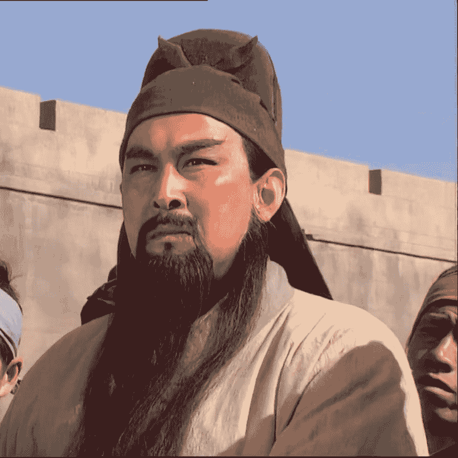

运行结果

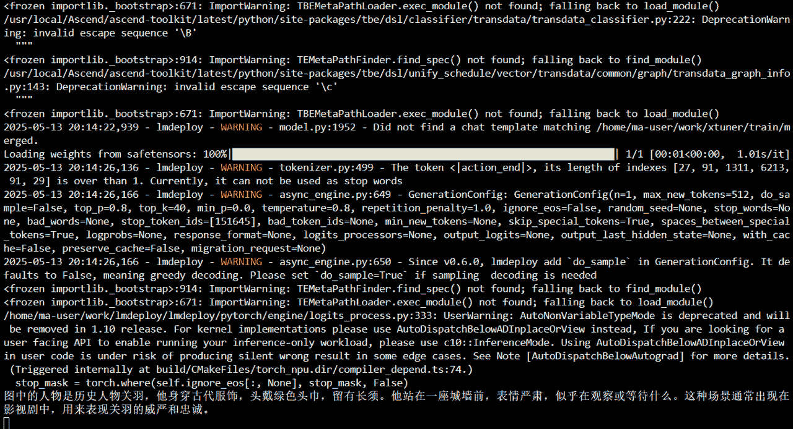

从推理输出的结果看，微调的结果还算是可以
