# E3-LazyLLM +书生大模型实践

> 来源：[https://aicarrier.feishu.cn/docx/SyOjdh4RLo56jZx2apIcCXNvnkc](https://aicarrier.feishu.cn/docx/SyOjdh4RLo56jZx2apIcCXNvnkc)

> 文档尚处于草稿阶段，完善中

## 第一章 LazyLLM框架介绍

### 1.1 什么是LazyLLM

LazyLLM是由商汤 LazyAGI 团队开发的一款开源低代码大模型应用开发工具，提供从应用搭建、数据准备、模型部署、微调到评测的一站式工具支持，帮助开发者以极低的成本快速构建 AI 应用，并持续迭代优化效果。


LazyLLM为同一模块的不同技术选型提供了一致的使用体验 -- 统一调用、统一服务、统一部署。

对于初级开发者，LazyLLM 彻底简化了AI应用的构建过程。用户不必了解不同模型 API 服务的构建细节，无需在微调模型时选择框架或切分模型，也不需要掌握任何Web开发知识，通过预置的组件和简单的拼接操作，初级开发者便能轻松构建出具备生产价值的工具。

对于资深的专家，LazyLLM 提供了极高的灵活性，为开发者提供了无限的可能性。其模块化设计支持高度的定制与扩展，使用户能够轻松集成自有算法、行业领先的生产工具以及最新的技术成果，从而快速构建适配多样化需求的强大应用。

### 1.2 重要特性

**📌便捷的AI应用组装流程：**即使不了解大模型，开发者仍然可以像搭积木一样，借助内置的数据流（Flow）和功能模块，轻松组建包含多个Agent的AI应用。

**📌复杂应用一键部署：L**azyLLM提供一键部署所有模块的能力，通过一套轻量的网关机制，简化了多Agent应用的部署流程，解决了依次启动各个子模块（如LLM、Embedding等）服务并配置URL的问题，使整个过程更加顺畅高效。同时，LazyLLM则提供了一键封装镜像的能力，使得应用可以方便地利用k8s的网关、负载均衡、容错等能力。由此，无论是POC还是项目落地，有了LazyLLM，这些都不是问题。

**📌跨平台兼容：无**需修改代码，即可一键切换IaaS平台，目前LazyLLM兼容裸金属服务器、开发机、Slurm集群、公有云等。这使得开发中的应用可以无缝迁移到其他IaaS平台，大大减少了代码修改的工作量。

**📌高效的模型微调：L**azyLLM支持对应用中的模型进行微调，持续提升应用效果。根据微调场景，自动选择最佳的微调框架和模型切分策略。这不仅简化了模型迭代的维护工作，还让开发者们能够将更多精力集中在算法和数据迭代上，而无需处理繁琐的工程化任务。

### 1.3 本次实践内容概述

本次实践我们将为大家展示LazyLLM的基本使用方法，并结合书生大模型实现聊天机器人（Chatbot）、RAG应用以及书生大模型微调（Finetune），同时受益于InternVL强大的多模态能力，实践将同样展示上述应用的多模态版本搭建。

接下来就让我们来看看LazyLLM与书生大模型能够碰撞出怎样的火花🔥吧~

## 第二章 LazyLLM环境配置

> **在**使用LazyLLM搭建RAG系统之前，我们需要配置好相关的环境，包括“开发环境搭建”和“环境变量配置”两个步骤。

### 2.1 开发环境搭建

您可以用以下任一方式搭建 LazyLLM 的开发环境。

#### 手动配置✏️

LazyLLM 基于 Python 开发，我们需要保证系统中已经安装好了 Python， Pip 和 Git。在Macbook上安装这些比较复杂，安装方式见最后附录。

首先准备一个名为 lazyllm-venv 的虚拟环境并激活：

```
python -m venv lazyllm-venv
source lazyllm-venv/bin/activate
```

如果运行正常，你可以在命令行的开头看到 (lazyllm-venv) 的提示。接下来我们的操作都在这个虚拟环境中进行。

从 GitHub 下载 LazyLLM 的代码：

```
git clone https://github.com/LazyAGI/LazyLLM.git
```

并切换到下载后的代码目录：

```
cd LazyLLM
```

安装基础依赖：

```
pip3 install -r requirements.txt
```

把 LazyLLM 加入到模块搜索路径中：

```
export PYTHONPATH=$PWD:$PYTHONPATH
```

这样我们在任意目录下都可以找到它。

####  拉取镜像📑

我们提供了包含最新版本的 LazyLLM 的 docker 镜像，开箱即用：

```
docker pull lazyllm/lazyllm
```

也可以从 [https://hub.docker.com/r/](https://hub.docker.com/r/lazyllm/lazyllm/tags)lazyllm/lazyllm/tags 查看并拉取需要的版本。

#### 从Pip安装👉

LazyLLM 支持用 pip 直接安装,下面三种安装方式分别对应不同功能的使用：

安装 LazyLLM 基础功能的最小依赖包。可以支持线上各类模型的微调和推理。

```
pip3 install lazyllm
```

安装 LazyLLM 的所有功能最小依赖包。不仅支持线上模型的微调和推理，而且支持离线模型的微调（主要依赖 LLaMA-Factory）和推理（大模型主要依赖 vLLM，多模态模型依赖LMDeploy，Embedding模型依赖Infinity）。

```
pip3 install lazyllm
lazyllm install standard
```

安装 LazyLLM 的所有依赖包，所有功能以及高级功能都支持，比如自动框架选择（AutoFinetune、AutoDeploy 等）、更多的离线推理工具（如增加 LightLLM 等）、更多的离线训练工具（如增加 AlpacaloraFinetune、CollieFinetune 等工具）。

```
pip3 install lazyllm
lazyllm install full
```

### 2.2 环境变量配置 - 测试你的LazyLLM

接下来我们通过**模型调用**的方式测试LazyLLM的环境是否搭建完毕。

LazyLLM支持调用**线上模型**和**本地模型**，为二者提供了一致的使用体验，做到模型即黑盒，您只需关注输入输出及相关参数的具体取值，而无需研究不同模型调用上的差异。


#### 调用在线大模型 🌏

LazyLLM 通过OnlineChatModule统一调用线上大模型接口，您只需要根据自己的需求将模型名称等参数传给对应的模块即可，这里我们选择书生官方的api平台调用线上模型。

##### 书生API-KEY配置

首先需要在https://internlm.intern-ai.org.cn/api/tokens申请专属的api token。


随后使用以下命令设置对应的环境变量：

```
export LAZYLLM_OPENAI_API_KEY=&lt;申请到的api token&gt;
```

[由于书生 Cha](https://github.com/InternLM/lmdeploy)t API 完全基于开源版本 LMDeploy 部署，且兼容了 openai python sdk，因此我们可以直接使用LazyLLM的在线聊天模块OnlineChatModule，配置来源类型为openai并填入对于的base_url即可。

实例化OnelineChatModule，指定模型来源并写入base_url，即可使用书生大模型进行聊天：

```
from lazyllm import OnlineChatModule
llm = OnlineChatModule(
    source=&#x27;openai&#x27;,
    base_url=&quot;https://chat.intern-ai.org.cn/api/v1/&quot;,
    model=&quot;internlm3-latest&quot;,
    stream=True
)
print(llm(&quot;介绍一下你自己&quot;))
```

如果你得到了与下图相似的输出，证明你的LazyLLM环境搭建完毕了。

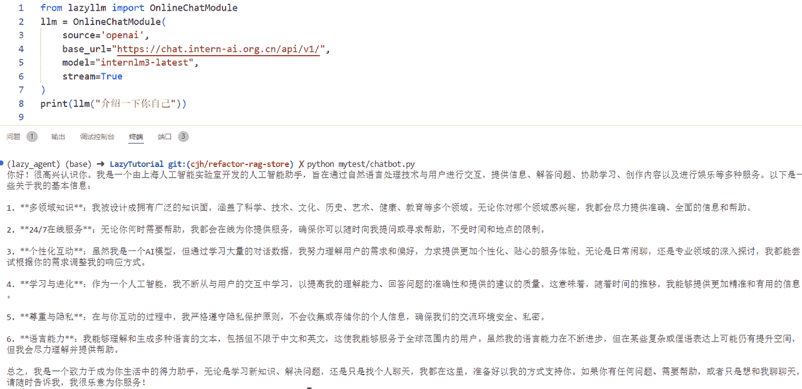

#### 调用本地大模型 💻

如果您期望使用本地部署大模型，且有充足的GPU资源，LazyLLM 提供的TrainableModule 能够为所有本地模型(包括LLM、VLM、Embedding模型等)提供服务，用于本地模型的训练、微调和推理。

在这里我们只需将书生大模型所在的路径传入 LazyLLM **的Tra**inableMod**ule，然后**通过 start() 函数启动服务即可。这里需要您传入模型文件的绝对路径，或者配置环境变量LAZYLLM_MODEL_PATH指定模型所在的目录。如果您本地没有该模型，LazyLLM会为您下载对应模型并存入模型缓存目录，默认情况下会下载到您的家目录下的 ".lazyllm/model" 目录；您可以通过配置 LAZYLLM_MODEL_CACHE_DIR环境变量指定模型缓存目录。

LazyLLM 支持多种推理框架，如：LMDeploy、LightLLM 和 vLLM等，在不指定明确框架下LazyLLM会根据模型大小和测试数据等信息，自动为用户选择合适的推理框架。

这里我们使用LMDeploy框架本地部署internlm2-chat-7b模型：

```
import lazyllm
from lazyllm import deploy

llm = lazyllm.TrainableModule(&#x27;internlm2-chat-7b&#x27;).\
        deploy_method(deploy.LMDeploy).start()
print(llm(&#x27;你是谁&#x27;))
```

如果你得到了与下图相似的输出，证明你成功使用LazyLLM完成了书生大模型的本地部署。


## 第三章 使用LazyLLM + 书生大模型搭建Chatbot

在第二章中，我们学习了如何配置LazyLLM的开发环境，并掌握了使用LazyLLM调用线上以及本地部署书生大模型。本章将在第二章的基础上介绍如何使用LazyLLM + 书生大模型搭建聊天机器人。

### 3.1 Prompt配置使用💭

#### 基础的Prompt

使用 LazyLLM 提供的 Prompt 模板，您只需要在初始化大模型时通过如下语法进行定义，在调用时直接传入用户输入即可。下面定义了两个大模型llm1和llm2，llm1是一个默认的在线大模型，llm2是一个自定义了prompt的在线大模型：

```
import lazyllm

llm1 = lazyllm.OnlineChatModule()
llm2 = lazyllm.OnlineChatModule().prompt(&quot;你是一只小猫，在每次回答问题之后都要加上喵喵喵&quot;)

print(&#x27;普通情况下模型的输出:   &#x27;, llm1(&#x27;你好&#x27;))
print(&#x27;自定义Prompt后模型的输出: &#x27;, llm2(&#x27;你好&#x27;))
```

让我们看看上述代码的输出：

```
普通情况下模型的输出:    你好！有什么我可以帮助你的吗？
自定义Prompt后模型的输出:  你好，有什么我可以帮助你的吗？喵喵喵
```

看可以看到在自定义prompt模板后，大模型按照我们的要求在回答后加上了“喵喵喵”。

#### 动态的Prompt

有些场景下例如RAG系统，prompt需要植入额外的内容，此时我们就可以在prompt中插入了一个变量作为占位符，然后在推理的过程中该变量可以替换为我们希望的内容。为了实现这样一种动态的Prompt，具体让我们来看一下这个例子：

```
import lazyllm

llm2 = lazyllm.OnlineChatModule().prompt(&quot;根据给出的文段回答问题，文段：{content}&quot;)

passage = (&#x27;孙悟空，是在小说《西游记》当中唐僧的四个徒弟之一，排行第一，别名孙行者、孙猴子。&#x27;
           &#x27;自封美猴王、齐天大圣。因曾在天庭掌管御马监而又被称为弼马温，在取经完成后被如来佛祖授封为斗战胜佛&#x27;)

# 模型推理：
print(llm2({&#x27;input&#x27;:&#x27;孙悟空有哪些名字？&#x27;, &#x27;content&#x27;:passage}))
```

上面例子中，我们希望在推理过程中，能把文段信息替换`{content}`，这里我们取了个变量名叫做content，您可以取任意其他变量名（除了input）。passage送入大模型后输出的实际效果为：

```
孙悟空有以下几个名字和别称：

1. 孙行者
2. 孙猴子
3. 美猴王（自封）
4. 齐天大圣（自封）
5. 弼马温（曾掌管天庭御马监）

在取得真经后，他还被如来佛祖授封为“斗战胜佛”。
```

可以看到模型根据我们的需求正确从文本段中提取出来了内容。

#### 独立的Prompt

前面介绍的Prompt都是在大模型上直接设置的，有时候我们需要单独先定义好一个Prompt，然后再给它设置给大模型来使用（这样定义好一个Prompt就可以设置给不同的大模型使用了）。LazyLLM主要有两种Prompt：AlpacaPrompter和 ChatPrompter(前面其实用到的都是这种ChatPrompter)。它们两者主要是格式不一样，具体来说：

AlpacaPrompter :

```
{system}\n{instruction}\n{tools}\n{user}### Response:\n
```

ChatPrompter：

```
{sos}{system}{instruction}{tools}{eos}\n\n{history}\n{soh}\n{user}{input}\n{eoh}{soa}\n
```

其中：

+   instruction: 任务指令，我们前面设置的Prompt内容主要就是这个部分；

+   history: 历史对话，由用户的输入得到，格式为 [[a, b], [c, d]] 或 [{"role": "user", "content": ""}, {"role": "assistant", "content": ""}]

+   tools: 可以使用的工具，在构造 prompter 时传入或者由用户使用时传入，当构造 prompter 时定义了工具之后，将禁止用户使用时再次传入。格式为 [{"type": "function", "function": {"name": "", "description": "", "parameters": {}, "required": []}]

+   user: 用户级指令，可选指令。由用户通过 instruction指定，如果 instruction是字符串，则默认是系统指令，如果是字典，且其键值只能是 system 和 user 。system 指定的是系统级指令， user 指定的是用户级指令。

由模型归属信息自动填入的参数（用户和开发者都不用关心如何填入这部分信息，LazyLLM会自动处理，这里做了解就好）：

+   system: 系统提示，一般会读取模型的归属信息并进行设置（当设置到某个模型上后会自动设置上），如不设置默认为 You are an AI-Agent developed by LazyLLM. ；

+   sos: start of system , 标志着系统提示的开始；

+   eos: end of system , 标志着系统提示的结束；

+   soh: start of human , 标志着用户输入的开始；

+   eoh: end of human , 标志着用户输入的结束；

+   soa: start of assistant , 标志着模型输出的开始；

+   eoa: end of assistant , 标志着模型输出的结束；

让我们先看看这两种独立的Prompt的拼合效果：

假设文段和用户提问是：

```
import lazyllm

passage = (&#x27;孙悟空，是在小说《西游记》当中唐僧的四个徒弟之一，排行第一，别名孙行者、孙猴子。&#x27;
           &#x27;自封美猴王、齐天大圣。因曾在天庭掌管御马监而又被称为弼马温，在取经完成后被如来佛祖授封为斗战胜佛&#x27;)
query = &#x27;孙悟空有哪些名字？&#x27;
```

AlpacaPrompter(独立)

```
prompter1 = lazyllm.AlpacaPrompter({
    &#x27;system&#x27;: &#x27;系统指令&#x27;,
    &#x27;user&#x27;: &#x27;用户指令。\n### 文段内容：{content}\n### 问题：{input}\n&#x27;
    })
content = prompter1.generate_prompt({&#x27;input&#x27;:query,&#x27;content&#x27;:passage})
print(&quot;\n独立Prompt(Alpaca):\n&quot;, repr(content))
```

输出：

```
独立Prompt(Alpaca):
 &#x27;You are an AI-Agent developed by LazyLLM.\nBelow is an instruction that describes a task, paired with extra messages such as input that provides further context if possible. Write a response that appropriately completes the request.\n\n### Instruction:\n系统指令\n\n用户指令。\n### 文段内容：孙悟空，是在小说《西游记》当中唐僧的四个徒弟之一，排行第一，别名孙行者、孙猴子。自封美猴王、齐天大圣。因曾在天庭掌管御马监而又被称为弼马温，在取经完成后被如来佛祖授封为斗战胜佛\n### 问题：孙悟空有哪些名字？\n### Response:\n&#x27;
```

ChatPrompter（独立）

```
prompter2 = lazyllm.ChatPrompter({
    &#x27;system&#x27;: &#x27;系统指令&#x27;,
    &#x27;user&#x27;: &#x27;用户指令。\n### 文段内容：{content}\n### 问题：{input}\n&#x27;
    })
content = prompter2.generate_prompt({&#x27;input&#x27;:query,&#x27;content&#x27;:passage})
print(&quot;\n独立Prompt(Chat):\n&quot;, repr(content))
```

输出：

```
独立Prompt(Chat):
 &#x27;You are an AI-Agent developed by LazyLLM.系统指令\n\n\n\n用户指令。\n### 文段内容：孙悟空，是在小说《西游记》当中唐僧的四个徒弟之一，排行第一，别名孙行者、孙猴子。自封美猴王、齐天大圣。因曾在天庭掌管御马监而又被称为弼马温，在取经完成后被如来佛祖授封为斗战胜佛\n### 问题：孙悟空有哪些名字？\n\n\n&#x27;
```

现在再让我们把它塞到模型里，让模型自动添加上和它相关的信息，这里我们选择一个本地模型InternLM2-Chat-7B。

AlpacaPrompter(带LLM)

```
m1 = lazyllm.TrainableModule(&quot;internlm2-chat-7b&quot;).prompt(prompter1)
res = m1._prompt.generate_prompt({&#x27;input&#x27;:query,&#x27;content&#x27;:passage})
print(&quot;\n带LLM的Prompt(Alpaca):\n&quot;, repr(res))
```

输出：

```
带LLM的Prompt(Alpaca):
 &#x27;You are an AI assistant whose name is InternLM (书生·浦语).\n- InternLM (书生·浦语) is a conversational language model that is developed by Shanghai AI Laboratory (上海人工智能实验室). It is designed to be helpful, honest, and harmless.\n- InternLM (书生·浦语) can understand and communicate fluently in the language chosen by the user such as English and 中文.\nBelow is an instruction that describes a task, paired with extra messages such as input that provides further context if possible. Write a response that appropriately completes the request.\n\n### Instruction:\n系统指令\n\n用户指令。\n### 文段内容：孙悟空，是在小说《西游记》当中唐僧的四个徒弟之一，排行第一，别名孙行者、孙猴子。自封美猴王、齐天大圣。因曾在天庭掌管御马监而又被称为弼马温，在取经完成后被如来佛祖授封为斗战胜佛\n### 问题：孙悟空有哪些名字？\n### Response:\n&#x27;
```

ChatPrompter（带LLM）

```
m2 = lazyllm.TrainableModule(&quot;internlm2-chat-7b&quot;).prompt(prompter2)
res = m2._prompt.generate_prompt({&#x27;input&#x27;:query,&#x27;content&#x27;:passage})
print(&quot;\n带LLM的Prompt(Chat):\n&quot;, repr(res))
```

输出：

```
带LLM的Prompt(Chat):
 &#x27;&lt;|im_start|&gt;system\nYou are an AI assistant whose name is InternLM (书生·浦语).\n- InternLM (书生·浦语) is a conversational language model that is developed by Shanghai AI Laboratory (上海人工智能实验室). It is designed to be helpful, honest, and harmless.\n- InternLM (书生·浦语) can understand and communicate fluently in the language chosen by the user such as English and 中文.系统指令&lt;|im_end|&gt;\n\n\n\n&lt;|im_start|&gt;user\n\n用户指令。\n### 文段内容：孙悟空，是在小说《西游记》当中唐僧的四个徒弟之一，排行第一，别名孙行者、孙猴子。自封美猴王、齐天大圣。因曾在天庭掌管御马监而又被称为弼马温，在取经完成后被如来佛祖授封为斗战胜佛\n### 问题：孙悟空有哪些名字？\n\n&lt;|im_end|&gt;\n&lt;|im_start|&gt;assistant\n\n&#x27;
```

格式对比：

### 3.2 三行代码搭建聊天机器人

#### 基于InternLM的Chatbot

在LazyLLM框架当中，搭建聊天机器人是一件极其简单的事情，只需三行代码即可完成：

```
from lazyllm import OnlineChatModule, WebModule
llm = OnlineChatModule(
    source=&#x27;openai&#x27;,
    base_url=&quot;https://chat.intern-ai.org.cn/api/v1/&quot;,
    model=&quot;internlm3-latest&quot;,
    stream=True
).prompt(&quot;你扮演一只小猫，在每次回答问题都要加上喵喵喵&quot;)
webpage = WebModule(llm, port=23466, history=[llm], stream=True).start().wait()
```

在定义模型模块llm时，只需在后面调用.prompt()即可实现提示词配置。这里我们引入了一个新模块：WebModule，它能够提供一个基于gradio的交互界面，帮助我们快速验证应用能力。使用时：

+   指定用大模型llm来作为对话的机器人;

+   port指定了聊天界面发布的端口；

+   history中指定了要将llm的输出作为历史信息，这样机器人就具有了历史对话记忆能力；

+   stream开启了输出的对话是流式的；

+   start()用于启动整个聊天机器人的部署；

+   wait()表示启动后就一直服务不停止，如果不加上服务部署好后会立刻停止；

程序启动后，我们便可以自由对话了。


#### 基于InternVL的多模态Chatbot

我们可以使用相同的方法使用InternVL多模态大模型快速搭建多模态大模型，下面我们演示使用LMDeploy本地部署InternVL大模型，并搭建多模态聊天机器人。同样我们只需在第二章的基础上加入WebModule即可：

```
from lazyllm import TrainableModule, WebModule, deploy
vlm = TrainableModule(&#x27;internvl2-8b&#x27;).deploy_method(deploy.LMDeploy).start()
w = WebModule(vlm, port=23432, files_target=vlm).start().wait()
```

注意，由于多模态Chatbot需要接收图片等格式的文件，此处需要将WebModule的files_target参数设置为我们的模型，一个多模态聊天机器人轻松搭建完成。


## 第四章 使用LazyLLM + 书生大模型搭建RAG应用

除了较为简单的聊天机器人，LazyLLM提供了大量的优质组件，最大程度方便开发者灵活选择，开发高性能的工业级RAG应用。

让我**们快速回顾一下R**AG（Retrieval-au**gmente**d Generation**，RAG，检**索增强生成）的基本原理。RAG的工作原理是当模型需要生成文本或回答问题时，首先会从一个庞大的文档集合中检索出相关的信息，这些检索到的信息随后会被用于指导生成过程，从而显著提高生成文本的质量和准确性。RAG 的整体结构可以用下图标识，系统接收一个用户 Query， 首先通过检索器（Retriever）从外部文档中检索出与给定 Query 相似的内容，然后将其与 Query 一同输入到 LLM ，LLM 给出最终答案：

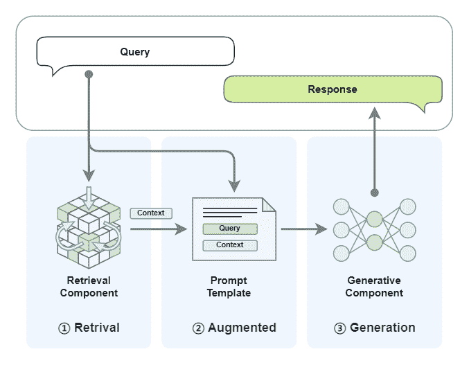

> **小结**

> RAG的工作流程可以归纳成以下三步：

1.  **检索（Retrieval）**

> 用户输入问题后，系统会基于该输入在知识库中检索相关内容。

1.  **增强（Augmented）**

> 检索到的文本内容会作为额外的上下文，与用户输入一起提供给大模型。

1.  生成（Generatation）

> 大模型结合检索到的信息和自身的预训练知识，生成最终的回答。

> **接下来我们将按照顺序，依次介绍**lazyllm中的文档加载、检索组件和生成组件。

> **Here we go！🏄**

### 4.1 LazyLLM框架RAG组件介绍

#### 文档加载 - Document

RAG的核心是从文档集合进行文档检索，文档集合中可以有各种各样的文档格式：可以是 DOCX，PDF，PPT 等富文本或者 Markdown 这样的纯文本，也可能是从某个 API 获取的内容（如通过搜索引擎检索得到的相关信息）等等。由于集合内的文档格式各异，针对这些不同格式的文档，我们需要特定的解析器来提取其中有用的文本、图片、表格、音频和视频等内容。

在 LazyLLM 中，这些用于提取特定内容的解析器被抽象为Document类，目前 LazyLLM 内置的 Document可以支持 DOCX，PDF，PPT，EXCEL 等常见的富文本内容提取，您也可以自定义文档解析器Reader 读取特定格式的文档（在后续的教程中我们会进行详细介绍）。

Document的主要参数如下：

+   **dataset_path** (str) – 数据集目录的路径。此目录应包含要由文档模块管理的文档（注意：暂不支持指定单个文件）。

+   **embed** (Optional[Union[Callable, Dict[str, Callable]]], default: None ) – 用于生成文档 embedding 的对象。如果需要对文本生成多个 embedding，此处需要通过字典的方式指定多个 embedding 模型，key 标识 embedding 对应的名字, value 为对应的 embedding 模型。

+   **manager** (bool, default: False ) – 指示是否为文档模块创建用户界面的标志。默认为 False。

+   **launcher** (optional, default: None ) – 负责启动服务器模块的对象或函数。如果未提供，则使用 lazyllm.launchers 中的默认异步启动器 (sync=False)。

+   **store_conf** (optional, default: None ) – 配置使用哪种存储后端和索引后端。

+   **doc_fields** (optional, default: None ) – 配置需要存储和检索的字段继对应的类型（目前只有 Milvus 后端会用到）。

对于最基础的使用，我们只需要传入数据集目录的路径即可：

```
# RAG 文档读取
from lazyllm import Document

# 传入绝对路径
doc = Document(&quot;path/to/content/docs/&quot;)
print(f&quot;实际传入路径为：{}&quot;)
# 传入相对路径
doc = Document(&quot;/content/docs/&quot;)
```

注意，您需要在此处传入绝对路径，或者是以当前目录为基础的相对路径，其他情况下需要您通过环境变量 LAZYLLM_DATA_PATH 指定您的文档所在目录再传入相对路径。

#### 检索组件 - Retriever

实际应用中，不是所有文档都和用户要查询的内容相关，因此需要通过检索组件从文档中筛选出和用户查询相关的文档。LazyLLM 中执行检索功能的是 Retriever 组件， Retriever组件可以创建一个用于文档查询和检索的检索模块。此构造函数初始化一个检索模块，该模块根据指定的相似度度量配置文档检索过程。Retriever组件主要参数如下：

+   **doc** (object) – 文档模块实例。该文档模块可以是单个实例，也可以是一个实例的列表。如果是单个实例，表示对单个Document进行检索，如果是实例的列表，则表示对多个Document进行检索。

+   **group_name** (str) – 在哪个 node group 上进行检索。

group_name 有三种内置切分策略，都是用 SentenceSplitter 切分，区别在于块大小不同：

+   CoarseChunk: 块大小为 1024，重合长度为 100

+   MediumChunk: 块大小为 256，重合长度为 25

+   FineChunk: 块大小为 128，重合长度为 12

+   **similarity** (Optional[str], default: None ) – 用于设置文档检索的相似度函数。默认为 'dummy'。候选集包括 ["bm25", "bm25_chinese", "cosine"]。

+   similarity_cut_off (Union[float, Dict[str, float]], default: float('-inf') ) – 当相似度低于指定值时丢弃该文档。在多 embedding 场景下，如果需要对不同的 embedding 指定不同的值，则需要使用字典的方式指定，key 表示指定的是哪个 embedding，value 表示相应的阈值。如果所有的 embedding 使用同一个阈值，则只指定一个数值即可。

+   **index** (str, default: 'default' ) – 用于文档检索的索引类型。目前仅支持 'default'。

+   **topk** (int, default: 6 ) – 表示取相似度最高的多少篇文档。

+   **embed_keys** (Optional[List[str]], default: None ) – 表示通过哪些 embedding 做检索，不指定表示用全部 embedding 进行检索。

+   **similarity_kw** – 传递给 similarity 计算函数的其它参数。

下面这行代码声明检索组件需要在 doc 这个文档中的 Coarse chunk 节点组利用 bm25_chinese相似度进行检索，最终返回相似度最高的 3 个节点。

```
from lazyllm import Retriever

# 传入绝对路径
doc = Document(&quot;/path/to/content/docs/&quot;)

# 使用Retriever组件，传入文档doc，节点组名称这里采用内置切分策略&quot;CoarseChunk&quot;，相似度计算函数bm25_Chinese
retriever = Retriever(doc, group_name=Document.CoarseChunk, similarity=&quot;bm25_chinese&quot;, topk=3)

# 调用retriever组件，传入query
retriever_result = retriever(&quot;your query&quot;)      

# 打印结果，用get_content()方法打印具体的内容
print(retriever_result[0].get_content())
```

#### 生成组件 - LLM

有了检索到的内容，结合我们提问的问题，将二者共同输入给生成组件，即可得我们想要的答案。这里的生成组件就是 LLM 大模型，先前已经介绍，这里不过多赘述。

#### 解析组件 - Reader

Reader 的功能就是负责把以各种形式存储的知识读取出来，然后以统一的格式给检索模块使用。

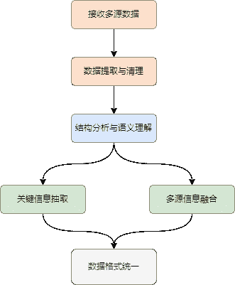

[下面我们看下 R](https://huggingface.co/datasets/LazyAGI/CMRC2018_Knowledge_Base/tree/main)eader 的使用方法。首先，我们以 cmrc2018 知识库中的 "part_1.txt"为例，内容为:

```
MIT OpenCourseWare是由麻省理工学院在2002年创始的一项计划。它的目标是在2007年年底以前，让所有大学生和研究生课程能够在线上自由的被任何人从任何地点取用。MIT开放式课程也可以被视为一项庞大的、网路出版的MIT教材。这个计划由William and Flora Hewlett Foundation、Andrew W. Mellon Foundation、麻省理工学院共同主持。之后，这个计划更激励了不少机构将他们的教材转变为开放教育资源。2007年11月，已经有超过1800个课程在线上。其中少数仅是书单和讨论主题，大多数会提供课后问题、考试（通常附有解答）以及演讲笔记。某些课程甚至提供互动式的示范程式、MIT教授写的教科书、串流影音格式的演讲影片。2008年8月，1800个线上课程中，只有26个完整的演讲影片。并不是所有影片都附有演讲笔记，这导致了观看演讲时的困难。无论如何，那些完整的课程都具有良好的品质，而且许多演讲都非常地令人信服。线上的影片虽然都是影音串流，但也有可供下载后离线观看的方法。像是iTunes U就有提供这些影音档的下载。
参加2008年北京夏季奥林匹克运动会的中国皮划艇队共计40人，其中运动员23人，官员与工作人员17人，领队刘刚。皮划艇静水项目组共计28人，其中运动员18人；副领队宋广礼副领队：宋广礼教练员（7人）：孙尔杰、马克、钟成海、李戴源、何军、谭志宏、徐菊生医生：阙云太，管理：姜丹男运动员（12人）：刘海涛、李臻、林淼、周鹏、沈洁、潘耀、黄志鹏、孟关良、杨文军、陈忠云、张志武、李强女运动员（6人）：钟红燕、徐琳蓓、王 凤、于腊梅、许亚萍、梁培兴皮划艇激流回旋项目组共计11人，其中运动员5人；副领队：李欣教练员：张磊、马可武、克里斯帝安、汉斯、安吉利卡男运动员（4人）：胡明海、舒俊榕、冯黎明、丁富学女运动员（1人）：李晶晶男子单人划艇／冯黎明／预赛第1轮／第9位／成绩91.44（8月11日）；男子单人划艇／冯黎明／预赛第2轮／第12位／成绩90.55（8月11日）；男子单人划艇／冯黎明／预赛第1、2轮／第11位／总成绩181.99／落后小组第1位11.84（8月11日）；男子单人划艇／冯黎明／半决赛／第11位／总成绩94.64（92.64+罚时2）／落后小组第1位5.72（未入前8名被淘汰）（8月12日）男子单人皮艇／丁富学／预赛第1轮／成绩87.47／落后小组第1位5.68（8月11日）；男子单人皮艇／丁富学／预赛第1轮／成绩90.92／落后小组第1位5.68（8月11日）；男子单人皮艇／丁富学／预赛第1、2轮／第21位／总成绩228.39／落后小组第1位61.90（被淘汰）（8月11日）。
乍都节公园（）位于泰国的首都曼谷的乍都节县，是拍凤裕庭路、威拍哇丽兰室路、甘烹碧路之间的一处公众游园地。1975年由泰国国家铁路局捐献土地建筑成公园。1980年12月4日，泰国国王拉玛九世62岁生日那天，公园开放。它的面积约为0.304平方公里。后期，再在邻近地段，增辟「诗丽吉皇后公园」（Queen Sirikit Park）及「火车公园」（Rot Fai Park），都被「甘烹碧三街」所分隔。整个细长的公园被一个人工湖泊占据，许多桥梁跨越湖泊连接两岸。公园里亦有一座小型的火车博物馆，展示泰国的机车及车厢。每逢星期日，都会成为杂货市集，吸引许多观光客来购物。
摩尔甘比足球俱乐部（）是位于英格兰西北兰开夏郡渡假小镇莫克姆（Morecambe）的足球俱乐部。于2007年透过附加赛在球队历史内首次升级到英格兰足球联赛，现时在英格兰乙级联赛中作赛。&quot;参见2015年至2016年英格兰足球乙级联赛&quot;地球体育场（Globe Arena）位于英格兰兰开夏郡莫克姆（Morecambe）的足球场，取代自1921年已开始使用的基士堤公园球场（Christie Park），成为摩甘比的主场球场，以建造球场的「地球建筑公司」（Globe Construction）命名。2009年5月9日接收地盘进行平整工地，于同年9月初动工兴建上盖，由于工程延误，揭幕日期推迟一个球季至2010/11年球季才正式启用，于2010年8月10日英格兰联赛杯第一圈对-{zh-hans:考文垂; zh-hk:高云地利;}-进行首场赛事，摩甘比旗开得胜以2-0淘汰较高级别的对手，新加盟的安德鲁·弗莱明（Andrew &quot;Andy&quot; Fleming）包办两个入球。地球体育场可以容纳6,476名观众，其中在草坪长边的主看台有2,173个坐席，对面是可容606名观众没有顶盖的阶梯看台，龙门后方是主场及作客球迷看台，西看台可容2,234名主场球迷，而东看台则可让1,389名作客球迷进场观战。
达曼（）位于沙特阿拉伯的东部省，是沙特石油工业的重要中心。达曼是东部省最大的城市，达曼港也是波斯湾最大的海港之一。它的货物进出口量仅次于沙特位于红海海岸的吉达港。达曼拥有新建的法赫德国王国际机场，机场位于市西20km，有一条6车道公路连接。达曼的卫星城有现代经济中心 Khobar、世界最大的沙特Aramco石油公司所在地札哈兰以及渔业农业中心Qatif。几座城市（达曼、寇巴Khobar和札哈兰）共有200万人口，其中750,000居住在主城达曼。本地的体育场所是Mohamed bin法赫德王子体育场。达曼是沙特大陆桥计划的东段终点，西端终点在吉达港。ISG-达曼
潘仕成（），字德畬、德舆，祖籍福建，家族世居广州，先祖以盐商起家，至潘仕成时为广州十三行家族巨贾第三代，晚清巨富、慈善家。清嘉庆九年(1804年)，祖籍福建且家族世居广州的潘仕成出生。潘仕成的先祖以盐商起家，至潘仕成时为第三代经营，成为广州十三行巨贾，与米利坚商人颇多熟悉，亦素为该国夷人所敬重。曾捐官20万两白银使自己成为二品官，亦曾镇压广东连山瑶族有功。鸦片战争爆发时，又捐助军需银八万两，得赏戴花翎，封为道员头衔。清道光年间，官至兵部侍郎。道光二十二年（1842年）十月，潘自行出资延请美国军官壬雷斯在广州研发水雷。道光二十三年（1843年）七月，由李光铨等将制成的水雷送北京，在天津试演。又从国外引进牛痘，被誉为“轻财好义，地方善举资助弗吝”。晚年横遭变故，经济拮据。清同治十年(1871年)，将《佩文韵府》的木刻版抵押给山西票号。清同治十二年(1873年)，卒。
马飚（），壮族，广西田阳人；中央民族学院政治系毕业。1985年6月加入中国共产党，是中共第十七届中央候补委员，十八、十九届中央委员。曾任广西壮族自治区人民政府主席。现任第十二届全国政协副主席。文化大革命期间，马飚中学毕业后，在广西柳州钢铁厂当工人。高考制度恢复后，于1978年考入中央民族学院政治系政治经济学专业学习。毕业后，从事经济研究工作，先后在广西壮族自治区计划委员会计划经济研究所和中国社会科学院民族研究所任职；期间，还曾在广西罗城县挂职担任县委副书记。1994年，马飚出任中共北海市委书记助理，步入政界。此后，历任广西壮族自治区经济体制改革委员会副主任、自治区青年联合会副主席，百色地区行政公署专员，中共百色地委书记。2003年地市合并后，出任首任中共百色市委书记（省辖市）；2004年，升任自治区政府副主席；2005年3月起，任自治区党委常委、兼中共南宁市委书记、市人大常委会主任；2007年12月，任自治区党委副书记，政府副主席、代主席；2008年1月，正式当选广西壮族自治区人民政府主席。2013年3月，作为壮族代表，接替李兆焯，当选为第十二届全国政协副主席。
&lt;br&gt;西班牙语言（lenguas de España）指的在西班牙使用或曾经使用的语言。罗曼语族的语言在西班牙被广泛使用，其中只有西班牙语（español）（或称为卡斯蒂利亚语（castellano））拥有全国官方语言的地位，有些语言只在某些地区是官方语言，同时也有一些非官方的语言或方言。在西班牙，有最多使用者及最具优势的语言是西班牙语，基本上每个西班牙人都以西班牙语为母语或第二语言。在2005年，89%的西班牙人的母语是西班牙语，9%是加泰罗尼亚语，而加利西亚语和巴斯克语则分别有5%和1%的母语使用者。由于有3%人口可以说两种母语，所以以上的比率加起来超过100%。一些语言在某地区有较多的使用者：上述语言都是地方性的官方语言，除了Aranese之外，其余3种语言都在各自的地区广泛使用，并有报刊、书籍等媒体使用该种语言，而加泰罗尼亚语及加利西亚语更被地区政府用作行政语言。西班牙境内还有一些语言只有少数人使用：西班牙语本身也有不同的方言，例如Andalusian及Canarian方言，每种方言之下又有各自的变体。在加利西亚，加利西亚语和葡萄牙语的关系曾引起过争议，有语言学家认为虽然这两种语言的音系和词汇不一样，但它们是同一种语言的方言（见）。相反意见认为，正是由于这两种语言的音系和词汇不一样，它们是两种不同的语言。历史上曾在现今西班牙境内使用的语言包括：不在西班牙使用但与西班牙有联系的语言包括：
南田县是浙江省一个已经撤消的县，存县期间，范围包括今宁波市象山县的南田岛、高塘岛、花岙岛、檀头山、坦塘岛、渔山列岛等。道光三年（1824年），宁波府海防同知移驻象山县石浦（亦有称石浦厅）。光绪初年，南田岛置开垦委员，宣统元年六月癸卯（1909年8月11日）于大佛头山麓改置为南田厅，设抚民通判，同年驻地移樊岙。民国元年（1912年）2月，南田厅改置为南田县，县政府驻樊岙。4月，原石浦厅（废厅后并回象山县），即象山县东溪岭以南地划入南田县，县府迁治石浦。民国二年（1913年）石浦等地复归象山县，南田县还驻樊岙。民国29年（1940年）7月1日，南田县撤消，合宁海县、临海县部分地区合置三门县，县府移至今六敖健康塘。1952年原南田县所属区域从三门县划出，重新划归象山县，仅满山（岛屿）仍划归三门县，并成为三门县、象山县和宁海县的海上界岛。
有田中井手之战是武田元繁与毛利元就的战争，也是毛利元就的初阵，最后武田元繁战死，被誉为西国的桶狭间之战。毛利元就1000人，武田元繁5000人。当时正值毛利家当主毛利兴元方才去世不久，年仅两岁的其子毛利幸松丸被拥立为下任当主，由当时尚无作战经验的元就与其弟相合元纲共同担任监护人之职，坐镇于佐东银山城的武田元繁见有机可趁，随即命令部下熊谷元直担任先锋，率军前往毛利领地烧杀掳掠，自己则会同香川行景、己斐宗瑞等豪族，进攻位于吉田郡山城邻近的有田城。隶属于吉川家的有田城主小田信忠，闻知武田家大军来袭，随即派出使者前往毛利家求援。毛利元就以有田城若失陷，则吉田郡山城亦将不保的考量下，决定率领部队支援。首先击杀了武田家的先锋熊谷元直，武田元繁闻元直死讯而大怒，亲率部队来迎战元就。时值夜色，元就采奇袭战术，使武田军势大乱，武田元繁在混乱中遇袭身亡，决定了毛利家的胜利。有田中井手之战 - 吉田郡山城之战 - 第一次月山富田城之战 - 折敷畑之战 - 严岛之战 - 防长经略 - 忍原崩 - 第二次月山富田城之战 - 多多良滨之战 - 布部山之战 - 上月城之战 - 备中兵乱 - 鸟取城之战 - 备中高松城之战% 
```

我们先导入需要用到的包，因为 Reader 模块是在 Document 内部使用的，所以这里我们先导入 Document 模块。

```
from lazyllm.tools.rag import Document
```

然后我们基于上面的文档创建一个 Document 实例。

```
doc = Document(dataset_path=&quot;your_doc_path&quot;)
```

然后我们直接通过 Document 实例来调用 Reader 的模块，并传入上面的文档路径。

```
data = doc._impl._reader.load_data(input_files=[&quot;your_doc_path/part_1.txt&quot;])
```

由于 Reader 模块是通过 load_data 来加载数据的，所以上面这里需要调用 load_data 接口。

> 这里需要注意一下，input_files 中的文件列表必须要传入文件的相对路径或者绝对路径。因为正常情况下这个 load_data 接口是 Document 类内部调用的，用户是看不到的，所以代码中会利用实例化 Document 时传入的 dataset_path 以及环境变量中配置的 LAZYLLM_DATA_PATH 环境变量拼接出知识库的路径，然后遍历知识库中的所有文档的。

下面我们看看 Reader 模块加载完这个文档之后，输出的是什么内容？通过下面的命令，我们打印一下 Reader 模块的输出：

```
print(f&quot;data: {data}&quot;)
```

输出的结果是：

```
data: [&lt;Node id=23b37172-1c5d-45d4-a9e1-d70fee799116&gt;]
```

可以看到 Reader 模块输出的内容是一个 list 类型，然后里面的元素是 Node 类型，一般 Node 类型里面会存放相应的文本信息、embedding信息、元数据、以及 Node 之间的关系等等。这里只要知道 Node 类型就是把 Reader 解析出来的内容进行封装，方便后面检索模块统一处理即可。进一步， 我们输出 Node 里面的文本信息：

```
print(f&quot;text: {data[0].text}&quot;)
```

输出的结果是：

```
data: MIT OpenCourseWare是由麻省理工学院在2002年创始的一项计划。它的目标是在2007年年底以前，让所有大学生和研究生课程能够在线上自由的被任何人从任何地点取用。MIT开放式课程也可以被视为一项庞大的、网路出版的MIT教材。这个计划由William and Flora Hewlett Foundation、Andrew W. Mellon Foundation、麻省理工学院共同主持。之后，这个计划更激励了不少机构将他们的教材转变为开放教育资源。2007年11月，已经有超过1800个课程在线上。其中少数仅是书单和讨论主题，大多数会提供课后问题、考试（通常附有解答）以及演讲笔记。某些课程甚至提供互动式的示范程式、MIT教授写的教科书、串流影音格式的演讲影片。2008年8月，1800个线上课程中，只有26个完整的演讲影片。并不是所有影片都附有演讲笔记，这导致了观看演讲时的困难。无论如何，那些完整的课程都具有良好的品质，而且许多演讲都非常地令人信服。线上的影片虽然都是影音串流，但也有可供下载后离线观看的方法。像是iTunes U就有提供这些影音档的下载。
参加2008年北京夏季奥林匹克运动会的中国皮划艇队共计40人，其中运动员23人，官员与工作人员17人，领队刘刚。皮划艇静水项目组共计28人，其中运动员18人；副领队宋广礼副领队：宋广礼教练员（7人）：孙尔杰、马克、钟成海、李戴源、何军、谭志宏、徐菊生医生：阙云太，管理：姜丹男运动员（12人）：刘海涛、李臻、林淼、周鹏、沈洁、潘耀、黄志鹏、孟关良、杨文军、陈忠云、张志武、李强女运动员（6人）：钟红燕、徐琳蓓、王 凤、于腊梅、许亚萍、梁培兴皮划艇激流回旋项目组共计11人，其中运动员5人；副领队：李欣教练员：张磊、马可武、克里斯帝安、汉斯、安吉利卡男运动员（4人）：胡明海、舒俊榕、冯黎明、丁富学女运动员（1人）：李晶晶男子单人划艇／冯黎明／预赛第1轮／第9位／成绩91.44（8月11日）；男子单人划艇／冯黎明／预赛第2轮／第12位／成绩90.55（8月11日）；男子单人划艇／冯黎明／预赛第1、2轮／第11位／总成绩181.99／落后小组第1位11.84（8月11日）；男子单人划艇／冯黎明／半决赛／第11位／总成绩94.64（92.64+罚时2）／落后小组第1位5.72（未入前8名被淘汰）（8月12日）男子单人皮艇／丁富学／预赛第1轮／成绩87.47／落后小组第1位5.68（8月11日）；男子单人皮艇／丁富学／预赛第1轮／成绩90.92／落后小组第1位5.68（8月11日）；男子单人皮艇／丁富学／预赛第1、2轮／第21位／总成绩228.39／落后小组第1位61.90（被淘汰）（8月11日）。
乍都节公园（）位于泰国的首都曼谷的乍都节县，是拍凤裕庭路、威拍哇丽兰室路、甘烹碧路之间的一处公众游园地。1975年由泰国国家铁路局捐献土地建筑成公园。1980年12月4日，泰国国王拉玛九世62岁生日那天，公园开放。它的面积约为0.304平方公里。后期，再在邻近地段，增辟「诗丽吉皇后公园」（Queen Sirikit Park）及「火车公园」（Rot Fai Park），都被「甘烹碧三街」所分隔。整个细长的公园被一个人工湖泊占据，许多桥梁跨越湖泊连接两岸。公园里亦有一座小型的火车博物馆，展示泰国的机车及车厢。每逢星期日，都会成为杂货市集，吸引许多观光客来购物。
摩尔甘比足球俱乐部（）是位于英格兰西北兰开夏郡渡假小镇莫克姆（Morecambe）的足球俱乐部。于2007年透过附加赛在球队历史内首次升级到英格兰足球联赛，现时在英格兰乙级联赛中作赛。&quot;参见2015年至2016年英格兰足球乙级联赛&quot;地球体育场（Globe Arena）位于英格兰兰开夏郡莫克姆（Morecambe）的足球场，取代自1921年已开始使用的基士堤公园球场（Christie Park），成为摩甘比的主场球场，以建造球场的「地球建筑公司」（Globe Construction）命名。2009年5月9日接收地盘进行平整工地，于同年9月初动工兴建上盖，由于工程延误，揭幕日期推迟一个球季至2010/11年球季才正式启用，于2010年8月10日英格兰联赛杯第一圈对-{zh-hans:考文垂; zh-hk:高云地利;}-进行首场赛事，摩甘比旗开得胜以2-0淘汰较高级别的对手，新加盟的安德鲁·弗莱明（Andrew &quot;Andy&quot; Fleming）包办两个入球。地球体育场可以容纳6,476名观众，其中在草坪长边的主看台有2,173个坐席，对面是可容606名观众没有顶盖的阶梯看台，龙门后方是主场及作客球迷看台，西看台可容2,234名主场球迷，而东看台则可让1,389名作客球迷进场观战。
达曼（）位于沙特阿拉伯的东部省，是沙特石油工业的重要中心。达曼是东部省最大的城市，达曼港也是波斯湾最大的海港之一。它的货物进出口量仅次于沙特位于红海海岸的吉达港。达曼拥有新建的法赫德国王国际机场，机场位于市西20km，有一条6车道公路连接。达曼的卫星城有现代经济中心 Khobar、世界最大的沙特Aramco石油公司所在地札哈兰以及渔业农业中心Qatif。几座城市（达曼、寇巴Khobar和札哈兰）共有200万人口，其中750,000居住在主城达曼。本地的体育场所是Mohamed bin法赫德王子体育场。达曼是沙特大陆桥计划的东段终点，西端终点在吉达港。ISG-达曼
潘仕成（），字德畬、德舆，祖籍福建，家族世居广州，先祖以盐商起家，至潘仕成时为广州十三行家族巨贾第三代，晚清巨富、慈善家。清嘉庆九年(1804年)，祖籍福建且家族世居广州的潘仕成出生。潘仕成的先祖以盐商起家，至潘仕成时为第三代经营，成为广州十三行巨贾，与米利坚商人颇多熟悉，亦素为该国夷人所敬重。曾捐官20万两白银使自己成为二品官，亦曾镇压广东连山瑶族有功。鸦片战争爆发时，又捐助军需银八万两，得赏戴花翎，封为道员头衔。清道光年间，官至兵部侍郎。道光二十二年（1842年）十月，潘自行出资延请美国军官壬雷斯在广州研发水雷。道光二十三年（1843年）七月，由李光铨等将制成的水雷送北京，在天津试演。又从国外引进牛痘，被誉为“轻财好义，地方善举资助弗吝”。晚年横遭变故，经济拮据。清同治十年(1871年)，将《佩文韵府》的木刻版抵押给山西票号。清同治十二年(1873年)，卒。
马飚（），壮族，广西田阳人；中央民族学院政治系毕业。1985年6月加入中国共产党，是中共第十七届中央候补委员，十八、十九届中央委员。曾任广西壮族自治区人民政府主席。现任第十二届全国政协副主席。文化大革命期间，马飚中学毕业后，在广西柳州钢铁厂当工人。高考制度恢复后，于1978年考入中央民族学院政治系政治经济学专业学习。毕业后，从事经济研究工作，先后在广西壮族自治区计划委员会计划经济研究所和中国社会科学院民族研究所任职；期间，还曾在广西罗城县挂职担任县委副书记。1994年，马飚出任中共北海市委书记助理，步入政界。此后，历任广西壮族自治区经济体制改革委员会副主任、自治区青年联合会副主席，百色地区行政公署专员，中共百色地委书记。2003年地市合并后，出任首任中共百色市委书记（省辖市）；2004年，升任自治区政府副主席；2005年3月起，任自治区党委常委、兼中共南宁市委书记、市人大常委会主任；2007年12月，任自治区党委副书记，政府副主席、代主席；2008年1月，正式当选广西壮族自治区人民政府主席。2013年3月，作为壮族代表，接替李兆焯，当选为第十二届全国政协副主席。
&lt;br&gt;西班牙语言（lenguas de España）指的在西班牙使用或曾经使用的语言。罗曼语族的语言在西班牙被广泛使用，其中只有西班牙语（español）（或称为卡斯蒂利亚语（castellano））拥有全国官方语言的地位，有些语言只在某些地区是官方语言，同时也有一些非官方的语言或方言。在西班牙，有最多使用者及最具优势的语言是西班牙语，基本上每个西班牙人都以西班牙语为母语或第二语言。在2005年，89%的西班牙人的母语是西班牙语，9%是加泰罗尼亚语，而加利西亚语和巴斯克语则分别有5%和1%的母语使用者。由于有3%人口可以说两种母语，所以以上的比率加起来超过100%。一些语言在某地区有较多的使用者：上述语言都是地方性的官方语言，除了Aranese之外，其余3种语言都在各自的地区广泛使用，并有报刊、书籍等媒体使用该种语言，而加泰罗尼亚语及加利西亚语更被地区政府用作行政语言。西班牙境内还有一些语言只有少数人使用：西班牙语本身也有不同的方言，例如Andalusian及Canarian方言，每种方言之下又有各自的变体。在加利西亚，加利西亚语和葡萄牙语的关系曾引起过争议，有语言学家认为虽然这两种语言的音系和词汇不一样，但它们是同一种语言的方言（见）。相反意见认为，正是由于这两种语言的音系和词汇不一样，它们是两种不同的语言。历史上曾在现今西班牙境内使用的语言包括：不在西班牙使用但与西班牙有联系的语言包括：
南田县是浙江省一个已经撤消的县，存县期间，范围包括今宁波市象山县的南田岛、高塘岛、花岙岛、檀头山、坦塘岛、渔山列岛等。道光三年（1824年），宁波府海防同知移驻象山县石浦（亦有称石浦厅）。光绪初年，南田岛置开垦委员，宣统元年六月癸卯（1909年8月11日）于大佛头山麓改置为南田厅，设抚民通判，同年驻地移樊岙。民国元年（1912年）2月，南田厅改置为南田县，县政府驻樊岙。4月，原石浦厅（废厅后并回象山县），即象山县东溪岭以南地划入南田县，县府迁治石浦。民国二年（1913年）石浦等地复归象山县，南田县还驻樊岙。民国29年（1940年）7月1日，南田县撤消，合宁海县、临海县部分地区合置三门县，县府移至今六敖健康塘。1952年原南田县所属区域从三门县划出，重新划归象山县，仅满山（岛屿）仍划归三门县，并成为三门县、象山县和宁海县的海上界岛。
有田中井手之战是武田元繁与毛利元就的战争，也是毛利元就的初阵，最后武田元繁战死，被誉为西国的桶狭间之战。毛利元就1000人，武田元繁5000人。当时正值毛利家当主毛利兴元方才去世不久，年仅两岁的其子毛利幸松丸被拥立为下任当主，由当时尚无作战经验的元就与其弟相合元纲共同担任监护人之职，坐镇于佐东银山城的武田元繁见有机可趁，随即命令部下熊谷元直担任先锋，率军前往毛利领地烧杀掳掠，自己则会同香川行景、己斐宗瑞等豪族，进攻位于吉田郡山城邻近的有田城。隶属于吉川家的有田城主小田信忠，闻知武田家大军来袭，随即派出使者前往毛利家求援。毛利元就以有田城若失陷，则吉田郡山城亦将不保的考量下，决定率领部队支援。首先击杀了武田家的先锋熊谷元直，武田元繁闻元直死讯而大怒，亲率部队来迎战元就。时值夜色，元就采奇袭战术，使武田军势大乱，武田元繁在混乱中遇袭身亡，决定了毛利家的胜利。有田中井手之战 - 吉田郡山城之战 - 第一次月山富田城之战 - 折敷畑之战 - 严岛之战 - 防长经略 - 忍原崩 - 第二次月山富田城之战 - 多多良滨之战 - 布部山之战 - 上月城之战 - 备中兵乱 - 鸟取城之战 - 备中高松城之战
```

从结果可以看出里面就是上面的文本中的内容。所以到这里我们就能明白 Reader 模块的功能就是把文档中的内容解析出来，并封装成统一的格式供后面的检索模块使用。

#### 向量化 - Embedding

**Embedding 是**一种将文档映射为一个保留原文语义的高维向量的技术，基于这种高维向量可以高效进行语义检索。LazyLLM 支持调用线上和线下 Embedding 模型，其中线上模型通过 OnlineEmbeddingModule 调用，线下模型通过 TrainableModule 调用。OnlineEmbeddingModule 用来管理创建目前市面上的在线Embedding服务模块，可配置参数有：

+   source (str) – 指定要创建的模块类型，可选为 openai / sensenova / glm / qwen / doubao

+   embed_url (str) – 指定要访问的平台的基础链接，默认是官方链接

+   embed_model_name (str) – 指定要访问的模型，默认值为 text-embedding-ada-002(openai) / nova-embedding-stable(sensenova) / embedding-2(glm) / text-embedding-v1(qwen) / doubao-embedding-text-240715(doubao)

使用 TrainableModule启动本地服务可配置参数有：

+   base_model (str, default: '' ) – 基模型的名称或者路径，如果本地没有模型，则会尝试下载。这里需要您注意的是您需要传入模型的绝对路径，或者指定模型路径为环境变量 LAZYLLM_MODEL_PATH 后在此处传入模型名。

目前而言常用的 Embedding 模型通常是 jina 系列或 bge 系列的模型（例如 bge-large-zh-v1.5，bge-m3 等），具体模型名称可以在 huggingface 检索得到。在线 embedding 模型提供的 embedding 模型需要在指定厂商的模型列表进行查找，如果没有特定需求，您可以直接使用LazyLLM OnlineEmbeddingModule 提供的默认模型即可。

下面是使用LazyLLM调用在线Embedding模型和启动本地服务并调用的示例代码：

```
from lazyllm import OnlineEmbeddingModule, TrainableModule, deploy

# 将您的在线模型 API key 抛出为环境变量，以 sensenova 为例
#     export LAZYLLM_SENSENOVA_API_KEY=     
#     export LAZYLLM_SENSENOVA_SECRET_KEY=
online_embed = OnlineEmbeddingModule(&quot;sensenova&quot;)

# 将您的本地模型地址抛出为环境变量：
#     export LAZYLLM_MODEL_PATH=/path/to/your/models
offline_embed = TrainableModule(&#x27;bge-large-zh-v1.5&#x27;).start()
# 或者使用绝对路径：
offline_embed = TrainableModule(&#x27;/path/to/your/bge-large-zh-v1.5&#x27;).start()

# 启动稀疏嵌入模型，目前仅支持 bge-m3
offline_sparse_embed = TrainableModule(&#x27;bge-m3&#x27;).deploy_method(
            (deploy.AutoDeploy, 
            {&#x27;embed_type&#x27;: &#x27;sparse&#x27;})).start()

print(&quot;online embed: &quot;, online_embed(&quot;hello world&quot;))
print(&quot;offline embed: &quot;, offline_embed(&quot;hello world&quot;))
print(&quot;offline sparse embed: &quot;,  offline_sparse_embed(&quot;hello world&quot;))
```

上述代码输出应当为：

> online embed: [0.0010528564, 0.0063285828, 0.0049476624, -0.012008667,..., -0.051696777]

> offline embed: [-0.02584601193666458, -0.0014020242961123586,..., 0.016336631029844284]

> offline sparse embed: {"33600": 0.22412918508052826, "31": 0.20403659343719482, "8999": 0.2736259400844574}

注：不同模型生成的 Embedding 有所差异是正常的。

如果您部署了一个在线 Embedding 服务，当接口格式与OnlineEmbeddingModule 的 source 参数接收的五个厂商的在线服务一致时，可以直接将 embed_url 改为您自己的服务地址使用，如果不一致则可以通过继承 OnlineEmbeddingModuleBase 访问自定义 Embedding 服务，下面是一段示例代码。

```
from lazyllm.module import OnlineEmbeddingModuleBase

# 配置新平台支持的api_key到全局变量
# 通过lazyllm.config.add(变量名，类型，默认值，环境变量名)进行添加
class CustomOnlineEmbeddingModule(OnlineEmbeddingModuleBase):
    def __init__(self, embed_url: str = &#x27;&lt;new platform embedding url&gt;&#x27;,
                 embed_model_name: str = &#x27;&lt;new platform embedding model name&gt;&#x27;):
        super().__init__(&quot;&lt;new_platform_name&gt;&quot;, embed_url, lazyllm.config[&#x27;new_platform_api_key&#x27;], embed_model_name)
        
    def _encapsulated_data(self, text:str, **kwargs):
        # 将数据包装为您的服务需要的数据格式
        json_data = {
            &quot;input&quot;: [text],
            &quot;model&quot;: self._embed_model_name
        }
        if len(kwargs) &gt; 0:
            json_data.update(kwargs)
        return json_data

    def _parse_response(self, response: dict[str, any]):
        # 解析您的服务返回的数据，返回 embedding 部分即可
        return response[&#x27;embeddings&#x27;][0][&#x27;embedding&#x27;]
```

**使用 Lazy**LLM 为文档进行嵌入时无需手动遍历，只需在实例化 Document 对象时传入上述定义的嵌入模型即可，方法如下所示：

```
import lazyllm

# 定义嵌入模型
online_embed = lazyllm.OnlineEmbeddingModule()

# 加载文档
documents = lazyllm.Document(&#x27;/path/to/your/document&#x27;, embed=online_embed)
```

#### 存储组件 - Store

LazyLLM提供了基于内存和向量数据库的Store存储组件，以供开发者灵活选择。处于技术探索阶段的开发者，可以直接使用系统默认的MapStore，将文档处理后的切片与向量一并保存在内存中，以实现从文档入库至向量检索的最快读写速度；对于处于成熟阶段的RAG系统，LazyLLM提供了多种向量数据库支持，确保数据持久稳定存储，并显著缩短RAG系统的二次启动时间，提高系统的稳定性和可扩展性。

| 组件名 | 存储介质 | 功能描述 | 适用场景 |
| --- | --- | --- | --- |
| MapStore | 内存 | 基于内存的存储，提供节点存储的基本能力，能以最快的速度实现数据读写 | 技术探索阶段，将少量文档处理数据保存在内存中，以技术选型与算法迭代的快速验证 |
| ChromadbStore | 硬盘 | 使用 Chroma向量数据库，实现数据的持久化存储。 | 轻量级实验，快速POC，缩短从构思到可运行原型的研发周期 |
| MilvusStore | 硬盘 | 使用Milvus向量数据库，实现数据的本地存储/分布式远程存储。 | 企业级部署，适用于数据体量大，对并发、检索性能都有较高要求的场景 |

在实际的使用过程中，用户只需要在Document定义阶段配置st**ore_**conf参数，进行简单的存储配置，即可利用这两种数据库将文档处理后的数据存储于本地，并在下次系统启动时直接从本地加载这些数据，避免文档的重复入库，实现知识库持久化存储。使用store_conf配置Document存储的实现方式如下：

```
document = lazyllm.Document(dataset_path=&#x27;/path/to/your/document&#x27;,
           embed=lazyllm.OnlineEmbeddingModule(),
           ...,
           store_conf=store_conf)
```

参数**store_conf**接收字典形式的存储配置，配置时需要传入type和kwargs参数，具体字段解释如下：

+   type：使用存储类型。如之前介绍，LazyLLM目前支持的存储类型有map（基于内存）、chroma（基于ChromaDB向量数据库）以及milvus（基于Milvus向量数据库）：

+   map：仅使用内存 key/value 存储暂存所有文档处理数据，系统重启后数据消失；

+   ch[roma：使用 Chrom](https://www.trychroma.com/)aDB 存储数据，ChromaDB 是一个更轻量的向量数据库，相比于 Milvus 能处理的数据量级有限，适合调试，更多 ChromoDB 相关信息可以参考 ChromaDB 官方文档；

+   m[ilvus：使用 Mi](https://www.milvus-io.com/overview)lvus 存储数据，支持海量数据的检索和存储，支持分布式部署，更适合生产级应用，更多 Milvus 相关信息可以参考 Milvus 官方文档；

+   kwargs：具体存储所需的额外配置参数，同样以字典的形式输入。

+   当type为chroma时，所需配置参数为：

+   dir（必填）：存储数据的目录；

+   当type为milvus时，所需配置参数为：

+   **uri（**必填**）：存储数据地址**，可以是一个文件路径或者远程连接的url；

+   index_kwargs（可选）：Milvus数据库的索引配置，可以是一个 dict 或者 list[dict]，索引配置主要包含两个字段：索引类型index_type和度量类型metric_type（即Index和Similarity，和LazyLLM的定义很像）。参数如果是一个 dict 表示所有向量模型使用相同配置；如果需要指定不同的向量模型以不同索引配置，则可以以列表的方式传入，由 embed_key 指定所使用配置即可。当前只支持 floating point embedding 和 sparse embedding 两种 embedding 类型，分别支持的参数如下，感兴趣的开发者可以前往官网查看：

+   floating point embedding

+   sparse embedding

例如我们使用Milvus向量数据库作为存储后端，需要传入如下配置：

```
milvus_store_conf = {
  &#x27;type&#x27;: &#x27;milvus&#x27;,  # 指定存储后端类型
  &#x27;kwargs&#x27;: {
    &#x27;uri&#x27;: &#x27;test.db&#x27;,  # 存储后端地址，本例子使用的是本地文件 test.db，文件不存则创建新文件
    &#x27;index_kwargs&#x27;: {  # 存储后端的索引配置
      &#x27;index_type&#x27;: &#x27;FLAT&#x27;,  # 索引类型
      &#x27;metric_type&#x27;: &#x27;COSINE&#x27;,  # 相似度计算方式
    }
  },
}

document = lazyllm.Document(
    dataset_path=&#x27;/path/to/your/document&#x27;,
    embed=embedding_model,
    store_conf=milvus_store_conf 
)
```

> 请注意，目前 LazyLLM 支持 Milvus 2.4.x，请注意您的pymilvus >= 2.4.11 , milvus-lite == 2.4.10。使用Milvus时，检索会根据输入配置中的索引配置进行对应算法检索，Retriever中无需指定similarity参数。

#### 重排组件 - Reranker

**重排序模型**通常应用于两阶段检索算法中的第二个阶段，对应 LazyLLM 中的 Reranker 组件。召回重排策略的基本思想是：在初步检索后，通过一个额外的模型对检索结果进行再次排序以提高最终的效果。下图对比了直接使用检索器召回 top 3 文档和先通过检索器召回 top 5 文档再对其进行重排序返回 top 3 文档的流程。可见检索流程并没有对文档进行排序，只是将满足需求的 top 5 个文档返回，而通过重排序流程，可以对其进行更精细的排序，得到排序后的文档，使得更重要的文档在返回列表中更靠前。


LazyLLM 分别提供了在线和离线两种重排序模型的调用途径，其中在线模型通过OnlineEmbeddingModule(type="rerank")进行调用，离线重排模型则仍然通过 TrainableModule 进行调用。使用 Reranker 时的可调整参数有：

+   name (str, default: 'ModuleReranker') ： 实现重排序时必须为 ModuleReranker

+   model（Union[Callable, str]) ： 实现重排序的具体模型名称或可调用对象

+   Callable 情形：

+   OnlineEmbeddingModule (type="rerank")：目前支持qwen和glm的在线重排序模型，使用前需要指定 api key

+   TrainableModule(model="str")：需要传入本地模型名称，常用的开源重排序模型为bge-reranker系列

+   str情形：模型名称，与上 Callable 情形 TrainableModule 对应的 model 参数要求相同

+   topk（int）： 最终需要返回的 k 个节点数

+   output_format（str, default: None）：输出格式，默认为None，可选值有 'content' 和 'dict'，其中 content 对应输出格式为字符串，dict 对应字典

+   join（boolean, default: False）：是否联合输出的 k 个节点，当输出格式为 content 时，如果设置该值为 True，则输出一个长字符串，如果设置为 False 则输出一个字符串列表，其中每个字符串对应每个节点的文本内容。

目前常用的开源重排序模型时 bge-reranker，可以通过 TrainableModule 启动相关服务并调用。在线模型服务商有qwen和glm提供了重排序模型服务，通过OnlineEmbeddingModule（type="rerank"）进行调用。

```
from lazyllm import OnlineEmbeddingModule, TrainableModule
# 如果您要使用在线重排模型
# 目前 LazyLLM 支持 qwen和glm 在线重排模型，使用前请指定相应的 API key。
online_rerank = OnlineEmbeddingModule(type=&quot;rerank&quot;)
reranker = Reranker(&#x27;ModuleReranker&#x27;, model=online_rerank, topk=3)

# 启动本地重排序模型
offline_rerank = TrainableModule(&#x27;bge-reranker-large&#x27;).start()
reranker = Reranker(&#x27;ModuleReranker&#x27;, model=offline_rerank, topk=3)
# 或者直接传入模型名称使用本地重排序模型
reranker = Reranker(&#x27;ModuleReranker&#x27;, model=&#x27;bge-reranker-large&#x27;, topk=3)
```

对于LazyLLM RAG相关组件的更多高级用法，可以参考官方API文档：https://docs.lazyllm.ai/zh-cn/latest/

### 4.2 LazyLLM的数据流组件 - Flow

LazyLLM是一款以数据流（Data Flow）为核心的大模型应用开发框架，其中定义了大量的数据流组件，配合 LazyLLM 中提供的工具和组件，可以让您像搭积木一样搭建复杂的大模型应用。

数据流的核心设计思路是**无需您手动对数据流动进行指定**，而是通过数据流内部将上一阶段的数据直接分发给对应的下游接收组件。LazyLLM支持Pipeline、Parallel、Switch、If、Loop、Diverter、Warp、Graph等数据流。

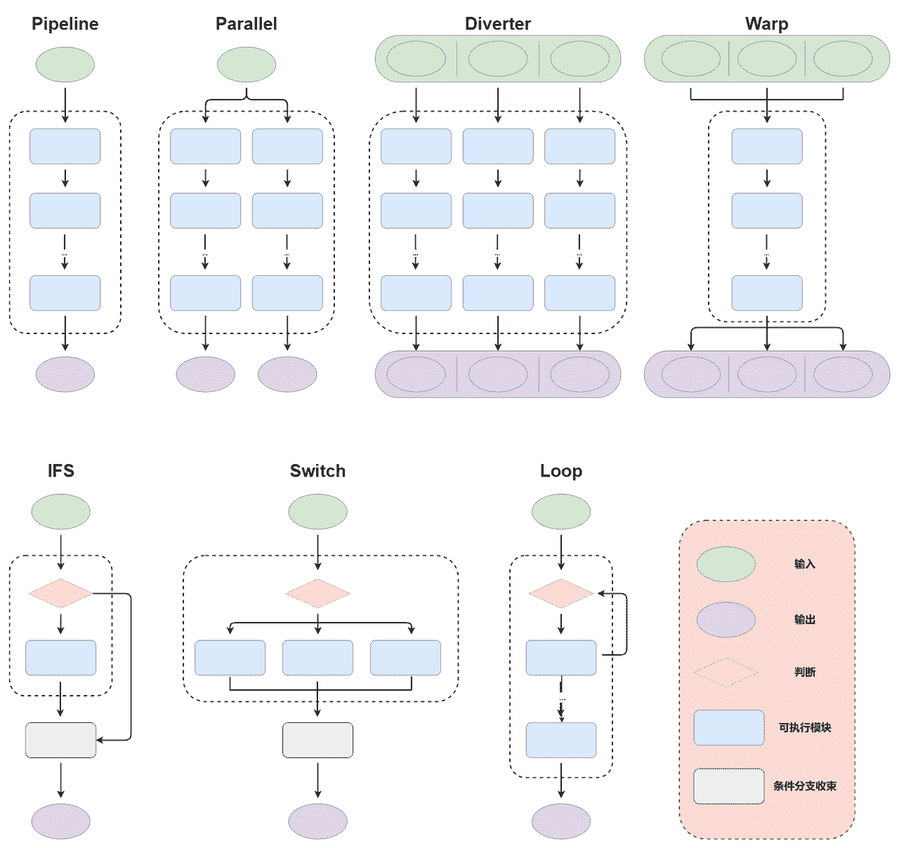

本节将详细为您介绍 LazyLLM 中典型的Flow组件：Pipeline、Parallel、Warp以及Bind，方便您在接下来的教程中理解和使用。其余的组件介绍可见API文档：https://docs.lazyllm.ai/zh-cn/latest/API%20Reference/flow/

> 注意：

> LazyLLM 支持数据流的 with 语句。with 语句可以让数据流定义代码更加的简洁和清晰。下面关于数据流的所有例子不仅展示了基于函数式的数据流构建，同时在右侧也对应展示了通过 with 语法定义的数据流，with语句的巧妙之处在于定义代码的缩进与目标数据流结构有一定的关联性，可以清晰的看出整体结构。

#### Pipeline

Pipeline 是顺次执行的数据流，上一个阶段的输出成为下一个阶段的输入。pipeline 支持函数和仿函数（或仿函数的 type），其工作流如下所示：

```
input -&gt; module1 -&gt; ... -&gt; moduleN -&gt; out
```

下面是通过 Pipeline 执行顺序结构程序的例子, 任意函数、匿名函数以及可调用实例（含__call__()函数的类）都可以作为 pipeline 中的一员。

函数式：

```
import lazyllm

f1 = lambda x: x * 2

def f2(input):
  return input - 1

class AddOneFunctor(object):
  def __call__(self, x): return x + 1

f3 = AddOneFunctor()

# 手动调用：
inp = 2
x1 = f1(inp)
x2 = f2(x1)
x3 = f3(x2)
out_normal = AddOneFunctor()(x3)

# 使用数据流
ppl = lazyllm.pipeline(f1, f2, f3, AddOneFunctor)
out_ppl1 = ppl(inp)

print(f&quot;输入为{inp},手动调用输出:&quot;, out_normal)
print(f&quot;输入为{inp},数据流输出:&quot;, out_ppl1)

```

输出：

```
输入为2,手动调用输出: 5
输入为2,数据流输出: 5
```

with式：

```
import lazyllm

f1 = lambda x: x * 2

def f2(input):
  return input - 1

class AddOneFunctor(object):
  def __call__(self, x): return x + 1

f3 = AddOneFunctor()

# 使用with方式的数据流
with lazyllm.pipeline() as ppl:
    ppl.func1 = f1
    ppl.func2 = f2
    ppl.func3 = f3
    ppl.func4 = AddOneFunctor

inp = 2
out_ppl1 = ppl(inp)

print(f&quot;输入为{inp},数据流输出:&quot;, out_ppl1)
```

输出：

```
输入为2,数据流输出: 5
```


[1pipeline.mp4](https://internal-api-drive-stream.feishu.cn/space/api/box/stream/download/all/PCTfbLIIQosuMwxphPGcp3tInrh)


[1pipeline_with.mp4](https://internal-api-drive-stream.feishu.cn/space/api/box/stream/download/all/YWoVbUMy4oEHgqxvtAGcEbPsnwc)

#### Parallel

Parallel支持我们并行调用多个pipeline，其数据流示意如下：

```
      /&gt; module11 -&gt; ... -&gt; module1N -&gt; out1 \
input -&gt;  module21 -&gt; ... -&gt; module2N -&gt; out2 -&gt; (out1, out2, out3)
      \&gt; module31 -&gt; ... -&gt; module3N -&gt; out3 /
```

Parallel支持对输出格式进行格式化处理，方便下游组件进行针对性使用，目前Parallel支持输出字典、元组、列表和字符串形式的输出，具体效果可见下方例子：

函数式：

```
import lazyllm

test1 = lambda a: a + 1
test2 = lambda a: a * 4
test3 = lambda a: a / 2

prl1 = lazyllm.parallel(test1, test2, test3)
prl2 = lazyllm.parallel(path1=test1, path2=test2, path3=test3).asdict
prl3 = lazyllm.parallel(test1, test2, test3).astuple
prl4 = lazyllm.parallel(test1, test2, test3).aslist
prl5 = lazyllm.parallel(test1, test2, test3).join(&#x27;，&#x27;)

print(&quot;默认输出：prl1(1) -&gt; &quot;, prl1(1), type(prl1(1)))
print(&quot;输出字典：prl2(1) -&gt; &quot;, prl2(1), type(prl2(1)))
print(&quot;输出元组：prl3(1) -&gt; &quot;, prl3(1), type(prl3(1)))
print(&quot;输出列表：prl4(1) -&gt; &quot;, prl4(1), type(prl4(1)))
print(&quot;输出字符串：prl5(1) -&gt; &quot;, prl5(1), type(prl5(1)))
```

输出：

```
默认输出：prl1(1) -&gt;  (2, 4, 0.5) &lt;class &#x27;lazyllm.common.common.package&#x27;&gt;
输出字典：prl2(1) -&gt;  {&#x27;path1&#x27;: 2, &#x27;path2&#x27;: 4, &#x27;path3&#x27;: 0.5} &lt;class &#x27;dict&#x27;&gt;
输出元组：prl3(1) -&gt;  (2, 4, 0.5) &lt;class &#x27;tuple&#x27;&gt;
输出列表：prl4(1) -&gt;  [2, 4, 0.5] &lt;class &#x27;list&#x27;&gt;
输出字符串：prl5(1) -&gt;  2，4，0.5 &lt;class &#x27;str&#x27;&gt;
```

with式：

```
import lazyllm

test1 = lambda a: a + 1
test2 = lambda a: a * 4
test3 = lambda a: a / 2

with lazyllm.parallel() as prl1:
    prl1.func1 = test1
    prl1.func2 = test2
    prl1.func3 = test3

with lazyllm.parallel().asdict as prl2:
    prl2.path1 = test1
    prl2.path2 = test2
    prl2.path3 = test3

with lazyllm.parallel().astuple as prl3:
    prl3.func1 = test1
    prl3.func2 = test2
    prl3.func3 = test3

with lazyllm.parallel().aslist as prl4:
    prl4.func1 = test1
    prl4.func2 = test2
    prl4.func3 = test3

with lazyllm.parallel().join(&#x27;，&#x27;) as prl5:
    prl5.func1 = test1
    prl5.func2 = test2
    prl5.func3 = test3

print(&quot;默认输出：prl1(1) -&gt; &quot;, prl1(1), type(prl1(1)))
print(&quot;输出字典：prl2(1) -&gt; &quot;, prl2(1), type(prl2(1)))
print(&quot;输出元组：prl3(1) -&gt; &quot;, prl3(1), type(prl3(1)))
print(&quot;输出列表：prl4(1) -&gt; &quot;, prl4(1), type(prl4(1)))
print(&quot;输出字符串：prl5(1) -&gt; &quot;, prl5(1), type(prl5(1)))
```

输出：

```
默认输出：prl1(1) -&gt;  (2, 4, 0.5) &lt;class &#x27;lazyllm.common.common.package&#x27;&gt;
输出字典：prl2(1) -&gt;  {&#x27;path1&#x27;: 2, &#x27;path2&#x27;: 4, &#x27;path3&#x27;: 0.5} &lt;class &#x27;dict&#x27;&gt;
输出元组：prl3(1) -&gt;  (2, 4, 0.5) &lt;class &#x27;tuple&#x27;&gt;
输出列表：prl4(1) -&gt;  [2, 4, 0.5] &lt;class &#x27;list&#x27;&gt;
输出字符串：prl5(1) -&gt;  2，4，0.5 &lt;class &#x27;str&#x27;&gt;
```


[2parallel.mp4](https://internal-api-drive-stream.feishu.cn/space/api/box/stream/download/all/RaTmb88gZo3t5HxTCnkcZbsBnJg)


[2parallel_with.mp4](https://internal-api-drive-stream.feishu.cn/space/api/box/stream/download/all/JrKtbKFGuovCCtxeIXycjOcHnUc)

#### Warp

Warp是一款强大的控制流工具，旨在将同一处理模块并行地应用于一系列输入数据。它通过高效地“形变”单个模块至各个输入，确保每个输入都能得到并行处理，从而大幅提升处理效率。

工作原理示意图：

```
#                 /&gt; in1 \                            /&gt; out1 \
# (in1, in2, in3) -&gt; in2 -&gt; module1 -&gt; ... -&gt; moduleN -&gt; out2 -&gt; (out1, out2, out3)
#                 \&gt; in3 /                            \&gt; out3 /
```

> **注意**：

+   Warp流不应用于异步任务，如训练和部署。

+   Warp流不支持字典输出

与Parallel工具类似，Warp支持对输出格式进行灵活处理。目前，它能够输出元组、列表和字符串形式的结果输出（注意：暂不支持字典输出）。具体的格式化效果及示例，请参见下方例子：

函数式：

```
import lazyllm

test1 = lambda a: a + 1
test2 = lambda a: a * 4
test3 = lambda a: a / 2

prl1 = lazyllm.warp(test1, test2, test3)
# prl2 = lazyllm.warp(path1=test1, path2=test2, path3=test3).asdict # Not Implemented
prl3 = lazyllm.warp(test1, test2, test3).astuple
prl4 = lazyllm.warp(test1, test2, test3).aslist
prl5 = lazyllm.warp(test1, test2, test3).join(&#x27;，&#x27;)

inputs = [1, 2, 3]

print(&quot;默认输出：prl1(1) -&gt; &quot;, prl1(inputs), type(prl1(inputs)))
print(&quot;输出元组：prl3(1) -&gt; &quot;, prl3(inputs), type(prl3(inputs)))
print(&quot;输出列表：prl4(1) -&gt; &quot;, prl4(inputs), type(prl4(inputs)))
print(&quot;输出字符串：prl5(1) -&gt; &quot;, prl5(inputs), type(prl5(inputs)))
```

输出：

```
默认输出：prl1(1) -&gt;  (4.0, 6.0, 8.0) &lt;class &#x27;lazyllm.common.common.package&#x27;&gt;
输出元组：prl3(1) -&gt;  (4.0, 6.0, 8.0) &lt;class &#x27;tuple&#x27;&gt;
输出列表：prl4(1) -&gt;  [4.0, 6.0, 8.0] &lt;class &#x27;list&#x27;&gt;
输出字符串：prl5(1) -&gt;  4.0，6.0，8.0 &lt;class &#x27;str&#x27;&gt;
```

with式：

```
import lazyllm

test1 = lambda a: a + 1
test2 = lambda a: a * 4
test3 = lambda a: a / 2

with lazyllm.warp() as prl1:
    prl1.func1 = test1
    prl1.func2 = test2
    prl1.func3 = test3

with lazyllm.warp().astuple as prl3:
    prl3.func1 = test1
    prl3.func2 = test2
    prl3.func3 = test3

with lazyllm.warp().aslist as prl4:
    prl4.func1 = test1
    prl4.func2 = test2
    prl4.func3 = test3

with lazyllm.warp().join(&#x27;，&#x27;) as prl5:
    prl5.func1 = test1
    prl5.func2 = test2
    prl5.func3 = test3

inputs = [1, 2, 3]

print(&quot;默认输出：prl1(1) -&gt; &quot;, prl1(inputs), type(prl1(inputs)))
print(&quot;输出元组：prl3(1) -&gt; &quot;, prl3(inputs), type(prl3(inputs)))
print(&quot;输出列表：prl4(1) -&gt; &quot;, prl4(inputs), type(prl4(inputs)))
print(&quot;输出字符串：prl5(1) -&gt; &quot;, prl5(inputs), type(prl5(inputs)))
```

输出：

```
默认输出：prl1(1) -&gt;  (4.0, 6.0, 8.0) &lt;class &#x27;lazyllm.common.common.package&#x27;&gt;
输出元组：prl3(1) -&gt;  (4.0, 6.0, 8.0) &lt;class &#x27;tuple&#x27;&gt;
输出列表：prl4(1) -&gt;  [4.0, 6.0, 8.0] &lt;class &#x27;list&#x27;&gt;
输出字符串：prl5(1) -&gt;  4.0，6.0，8.0 &lt;class &#x27;str&#x27;&gt;
```


[4warp.mp4](https://internal-api-drive-stream.feishu.cn/space/api/box/stream/download/all/J9jzb1aLxojYXtxY4LecQL8Hnoe)

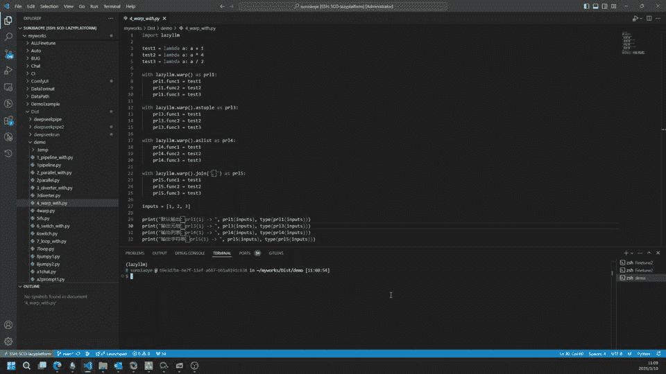

[4warp_with.mp4](https://internal-api-drive-stream.feishu.cn/space/api/box/stream/download/all/F5pqbDnidoJwjHxeZ2Sc94TxnVd)

#### Bind

通过上述对数据流的介绍，我们会发现有一个问题是数据按照预定义的路径流动，我们似乎只能控制入端数据，当我们遇到想要在某个环节引入上两级的数据时就会遇到问题，如下面图示中的in到f3我们很难用上述的流来搭建。


针对这个问题，LazyLLM 提供了一种参数绑定的方式，使数据在数据流中向下游自由地游走（跳跃的数据流）。

让我们先定义f1,f21,f22,f3上图中的几个函数：

```
def f1(input): return input ** 2
def f21(input1, input2=0): return input1 + input2 + 1
def f22(input1, input2=0): return input1 + input2 - 1
def f3(in1=&#x27;placeholder1&#x27;, in2=&#x27;placeholder2&#x27;, in3=&#x27;placeholder3&#x27;): 
    return f&#x27;get [input:{in1}], [f21:{in2}], [f23: {in3}]]&#x27;
```

LazyLLM 提供了 lazyllm.bind 函数进行函数绑定，bind 函数接收的参数格式如下所示：

```
lazyllm.bind(func, param1, param2, ...)
```

其中：

+   func 为需要进行参数绑定的函数，

+   param1, param2 依次为 func 接收的参数。实际上我们观察上图可以发现：

+   我们需要输入的param1就是ppl的输入（ppl.input），此处我们可以通过 ppl.input 在当前数据流获取对应的输入。

+   param2 和 param3 是f3的上一级，LazyLLM对这种情况定义了一种占位符，_0。_0表示数据流中当前节点的上一级输出，如果上一级中有多个输出，则可以通过_1, _2, _3依次获取，这里有两个输出所以分别是_0, _1。

基于LazyLLM的参数绑定可以实现上图中的数据跳连：

```
from lazyllm import pipeline, parallel, bind, _0, _1

with pipeline() as ppl1:
  ppl1.f1 = f1
  with parallel() as ppl1.subprl2:
    ppl1.subprl2.path1 = f21
    ppl1.subprl2.path2 = f22
  ppl1.f3 = bind(f3, ppl1.input, _0, _1)
  
print(&quot;ppl1 out: &quot;, ppl1(2))
```

输出：

```
ppl1 out:  get [input:2], [f21:5], [f23: 3]]
```

> 注意，参数绑定仅在当前数据流内生效，您无法将外部变量数据绑定至数据流内，也无法跨数据流进行数据绑定。

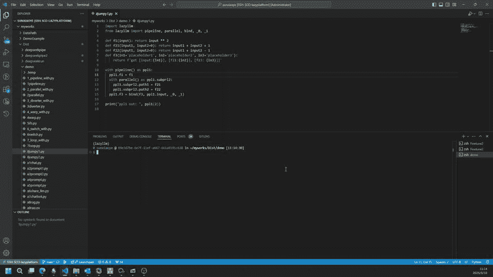

[8jump1.mp4](https://internal-api-drive-stream.feishu.cn/space/api/box/stream/download/all/WiNxb2o4ooOhVXxPId1c8xr5nCd)

LazyLLM为 bind 函数重载了 | 运算符，可以通过它实现更直观的参数绑定，将函数和参数区分开来（|运算符之前的是被绑定的函数，之后是需要绑定的参数）。此外，子数据流也支持绑定入参。下面我们将上图修改为更复杂的流，我们将数据流输入绑定为subprl2的第一个输入(下图红色箭头线)，上游f1的输出为subprl的第二个输入。

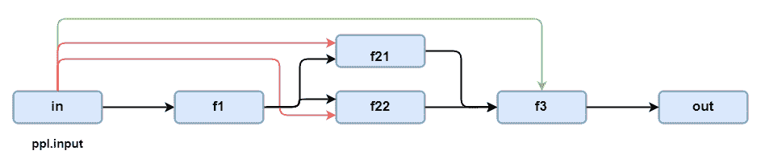

```
from lazyllm import pipeline, parallel, bind, _0, _1

with pipeline() as ppl1:
  ppl1.f1 = f1
  with parallel().bind(ppl1.input, _0) as ppl1.subprl2:
    ppl1.subprl2.path1 = f21
    ppl1.subprl2.path2 = f22
  ppl1.f3 = f3 | bind(ppl1.input, _0, _1)
  
print(&quot;ppl1 out: &quot;, ppl1(2))
```

输出：

```
ppl1 out:  get [input:2], [f21:7], [f23: 5]]
```

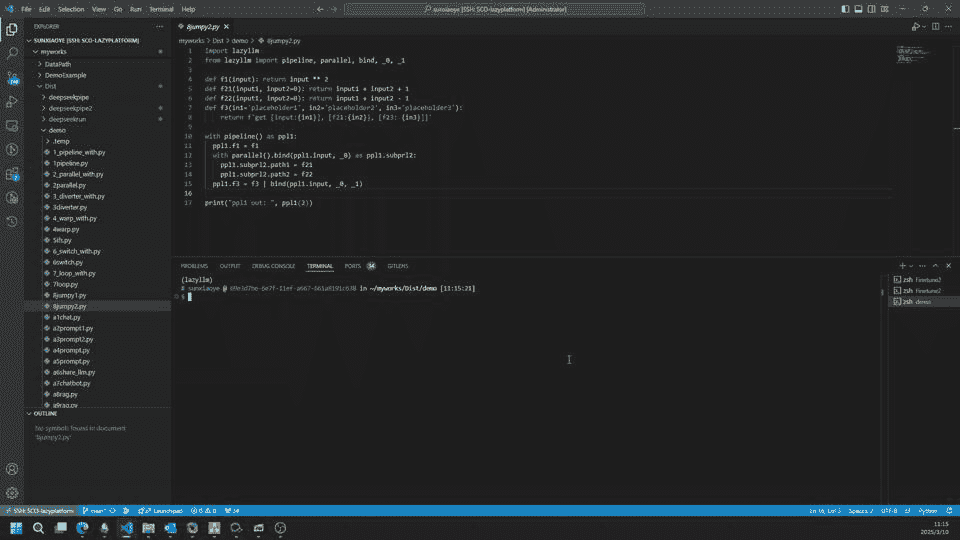

[8jump2.mp4](https://internal-api-drive-stream.feishu.cn/space/api/box/stream/download/all/OGspbSDzVoAB9Bxfow8czvepnVx)

### 4.3 使用LazyLLM快速搭建高性能RAG应用

在了解过LazyLLM的相关组件之后，我们使用它们，并结合书生大模型搭建一个高性能的RAG系统：

我们选择一些法律、论文pdf等文件放在路径中：

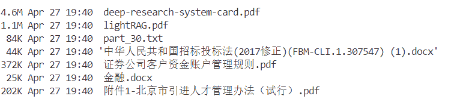

实现代码如下：

```
import lazyllm

# 定义llm、embedding、reranker模型
llm = lazyllm.OnlineChatModule(
    source=&#x27;openai&#x27;,
    base_url=&quot;https://chat.intern-ai.org.cn/api/v1/&quot;,
    model=&quot;internlm3-latest&quot;,
    stream=True
)
embedding_model = lazyllm.TrainableModule(&quot;bge-large-zh-v1.5&quot;).start()
rerank_model = lazyllm.TrainableModule(&quot;bge-reranker-large&quot;).start()
# 定义文件路径及Milvus存储配置
DOC_PATH = &quot;/mnt/lustre/share_data/dist/test_docs&quot;
milvus_store_conf = {
    &#x27;type&#x27;: &#x27;milvus&#x27;,
    &#x27;kwargs&#x27;: {
        &#x27;uri&#x27;: &quot;dbs/test_rag.db&quot;,
        &#x27;index_kwargs&#x27;: {
            &#x27;index_type&#x27;: &#x27;HNSW&#x27;,  # 索引类型使用HNSW
            &#x27;metric_type&#x27;: &#x27;COSINE&#x27;,  # 相似度类型使用COSINE
            }
        }
}

# 定义Document，加载文档
docs = lazyllm.Document(dataset_path=DOC_PATH, embed=embedding_model, store_conf=milvus_store_conf)
# 按句子划分，创建节点组
docs.create_node_group(name=&#x27;sentence&#x27;, parent=&quot;MediumChunk&quot;, transform=(lambda d: d.split(&#x27;。&#x27;)))
# 设计prompt
prompt = &#x27;你是一个友好的 AI 问答助手，你需要根据给定的上下文和问题提供答案。\
    根据以下资料回答问题：\
    {context_str} \n &#x27;

# 定义RAG应用 pipeline
with lazyllm.pipeline() as ppl:
    # Parallel 多路并行召回
    with lazyllm.parallel().sum as ppl.prl:
        ppl.prl.r1 = lazyllm.Retriever(docs, group_name=&quot;MediumChunk&quot;, topk=6)
        ppl.prl.r2 = lazyllm.Retriever(docs, group_name=&quot;sentence&quot;, target=&quot;MediumChunk&quot;, topk=6)
    # reranker重排序
    ppl.reranker = lazyllm.Reranker(name=&#x27;ModuleReranker&#x27;,model=rerank_model, topk=3) | lazyllm.bind(query=ppl.input)
    # 召回结果转换为字符串格式上下文，以拼接prompt
    ppl.formatter = (
        lambda nodes, query: dict(
            context_str=&quot;\n&quot;.join(node.get_content() for node in nodes),
            query=query)
    ) | lazyllm.bind(query=ppl.input)
    ppl.llm = llm.prompt(lazyllm.ChatPrompter(instruction=prompt, extra_keys=[&#x27;context_str&#x27;]))

w = lazyllm.WebModule(ppl, port=23492, stream=True).start().wait()

```

代码精讲：

1.  选择使用书生API-KEY，并使用internlm3-latest作为系统的大模型，同时使用TrainableModule本地部署embedding模型bge-large-zh-v1.5和reranker模型bge-reranker-large。

1.  给定知识库路径以及Milvus向量数据库的相关配置。

1.  创建文档加载模块Document docs，设置存储配置和使用的embedding模型。并调用create_node_group基于已有节点组MediumChunk（按照token长度256、重叠长度25切分文档）的基础上按照句子划分成更细粒度的文档切片。

1.  使用Flow组件，像搭积木一样搭建RAG系统，数据流的流向如下：

1.  首先用户查询query会并行流向两个Retriever，检索器在不同节点组中并行查询相似度较高的节点；

1.  待并行检索结束后，收集所有检索器的结果传入至Reranker当中精排，并取相似度得分最高的top 3

1.  精排后的节点传入至ppl.formatter，这里会将所有节点的内容拼接在一起，形成llm所需的context_str，同时使用bind将query一并组装为字典

1.  组装后的字典传入大模型，模型根据上下文问答用户的问题。

1.  最后将pipeline传入WebModule，启动交互界面，即可运行RAG系统。

我们通过查询query：“什么是lightrag”，将RAG系统与之前的Chatbot对比效果：

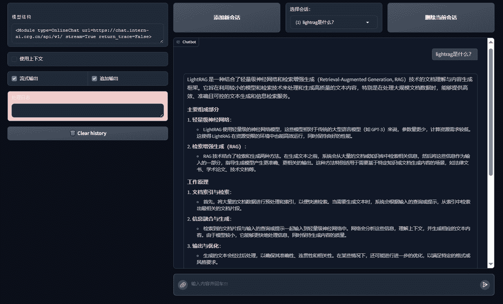

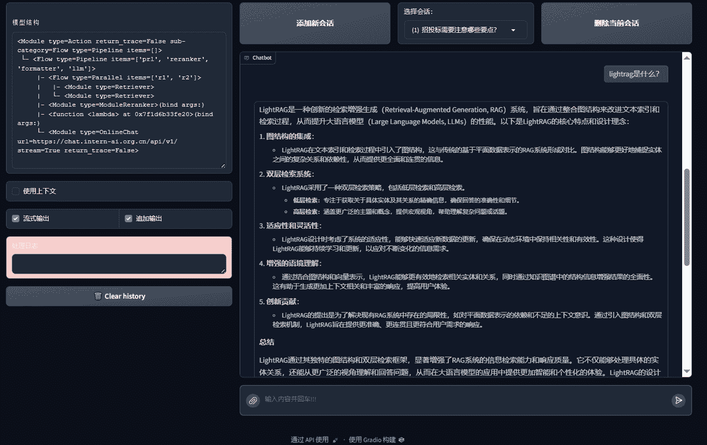

可以看到，原来的Chatbot并不知道什么是LightRAG，所以给出的答案是基于LLM幻觉生成。而RAG系统基于召回的论文文段生成了较为最准确的答案。

### 4.4 基于InternVL的多模态RAG应用

如果一个RAG系统只能处理文字信息、回答文字，未免有些太“玩具”了，得益于InternVL强大的视觉理解能力，我们能够使用其理解图文，搭建图文并茂的多模态RAG系统。

在RAG系统中，多模态信息有两种处理方式：统一至文本与统一至向量空间


+   统一到文本模态：直接使用InternVL为文档中的每一张图表生成一段描述，按照传统方式进行向量嵌入。

+   统一到向量空间：使用多模态embedding模型，将文本与图标直接映射到统一向量空间中。

本次我们展示后者，即在使用InternVL生成图片描述的同时，使用多模态embedding模型将text与image映射至统一的向量空间中。

#### 基于InternVL的多模态文档解析器

对于包含图片的文档来说，现有的解析组件无法较好的满足多模态RAG的需求，因此我们需要基于LazyLLM提供的ReaderBase基类，自定义一个符合需求的解析器，注意，这里我们使用了一款高性能开源解析工具magic-pdf(https://github.com/opendatalab/MinerU)来实现较为高质量的pdf文件解析。

以**下代码重点体现**使用InternVL为图片添加描述的过程，自定义Reader的细节可参考LazyLLM社区的开源RAG课程：

```
class MagicPDFReader(ReaderBase):
def __init__(self):
    self.image_save_path = get_image_path()
    self.model = None
    self.vlm = lazyllm.TrainableModule(‘internvl2-8b’).start()   # 初始化一个多模态大模型

def _result_extract(self, content_list):
    ......
    if not content[&quot;img_path&quot;]:
  ......
        block[&#x27;img_desc&#x27;] = self.vlm(formatted_query(block[&quot;image_path&quot;])) # 利用VLM对图像内容进行解析生成图像的文本描述

def _load_data(self, file: Path, split_documents: Optional[bool] = True, ) -&gt; List[DocNode]:
     ......
     for k, v in elements.items(): # 对其中的一个block
         ......
         if &quot;text&quot; in element:
               docs.append(DocNode(text=element[&quot;text&quot;], metadata=metadata))
         elif &quot;img_desc&quot; in element:
               image_node = ImageDocNode(text=element[&quot;img_desc&quot;], 
        image_path=element[“image_path”], global_metadata=metadata)# 构建ImageDocNode节点 
               docs.append(image_node)
         else:
               docs.append(DocNode(text=&quot;&quot;, metadata=metadata)) 
```

代码解读：

+   自定义Reader只需要重新实现_load_data方法即可，其中传入文件路径后，将文件路径传入magic-pdf组件，即可获取解析结果elements。

+   对elements遍历，其中如果是图片类型节点，则调用InternVL模型对其进行描述，并创建ImageDocNode图片节点，否则为默认的DocNode节点。

创建自定义解析器后，使用.add_reader()即可将解析器注册至Document组件：

```
documents.add_reader(&quot;*.pdf&quot;, MagicPDFReader)
```

这样，对于文件路径下的pdf格式文件，LazyLLM就会自动调用自定义解析器了。

#### 多模态RAG系统搭建

基于先前的知识，按照如下所示的系统流程图，使用InternVL搭建多模态RAG系统。

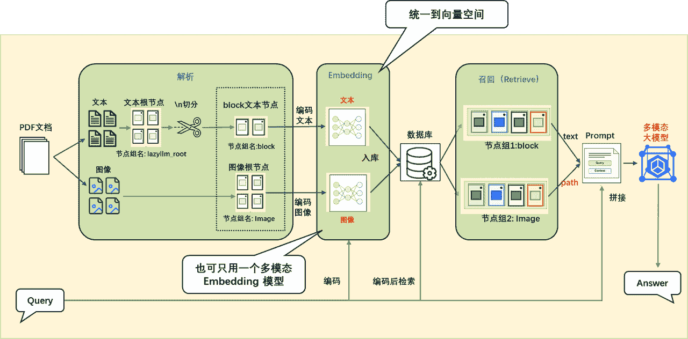

代码如下：

```
# 本地部署多模态embedding模型
embed_multimodal = lazyllm.TrainableModule(&quot;colqwen2-v0.1&quot;)
# 使用线上的千问 text embedding模型
embed_text = lazyllm.OnlineEmbeddingModule(
    source=&#x27;qwen&#x27;, embed_model_name=&#x27;text-embedding-v1&#x27;)
# 定义embedding模型字典
embeds = {&#x27;vec1&#x27;: embed_text, &#x27;vec2&#x27;: embed_multimodal}

documents = lazyllm.Document(dataset_path=tmp_dir.rag_dir, embed=embeds)
# 为pdf格式的文件注册自定义解析器
documents.add_reader(&quot;*.pdf&quot;, MagicPDFReader)
# 创建按行拆分的block节点组
documents.create_node_group(name=&quot;block&quot;, transform=lambda s: s.split(&quot;\n&quot;) if s else &#x27;&#x27;)

with lazyllm.pipeline() as ppl:
    with lazyllm.parallel().sum as ppl.prl:
        ppl.prl.retriever1 = lazyllm.Retriever(documents, group_name=&quot;block&quot;, embed_keys=[&#x27;vec1&#x27;], similarity=&quot;cosine&quot;, topk=1)
        # 多路召回中，使用多模态embedding将查询问题映射至图片相同的向量空间中，检索与query相似的图片
        ppl.prl.retriever2 = lazyllm.Retriever(documents, group_name=&quot;Image&quot;, embed_keys=[&#x27;vec2&#x27;], similarity=&quot;maxsim&quot;, topk=2)
    # 将召回节点与query组合成最终
    ppl.prompt = build_vlm_prompt | bind(_0, ppl.input)
    ppl.vlm = lazyllm.TrainableModule(&quot;internvl2-8b&quot;).prompt(lazyllm.ChatPrompter(gen_prompt))

 lazyllm.WebModule(ppl, port=range(23468, 23470), static_paths=get_image_path()).start().wait()
```

我们以DeepSeek的技术报告为测试文档，代码运行结果：

query：详细介绍一下deepseek基本概念和模型性能

block节点组召回内容：

```
For education-oriented knowledge benchmarks such as MMLU, MMLU-Pro, and GPQA Diamond, DeepSeek-R1 demonstrates superior performance compared to DeepSeek-V3. This improvement is primarily attributed to enhanced accuracy in STEM-related questions, where significant gains are achieved through large-scale reinforcement learning. Additionally, DeepSeek-R1 excels on FRAMES, a long-context-dependent QA task, showcasing its strong document analysis capabilities. This highlights the potential of reasoning models in AI-driven search and data analysis tasks. On the factual benchmark SimpleQA, DeepSeek-R1 outperforms DeepSeek-V3, demonstrating its capability in handling fact-based queries. A similar trend is observed where OpenAI-o1 surpasses GPT-4o on this benchmark. However, DeepSeek-R1 performs worse than DeepSeek-V3 on the Chinese SimpleQA benchmark, primarily due to its tendency to refuse answering certain queries after safety RL. Without safety RL, DeepSeek-R1 could achieve an accuracy of over 70%.
```

Image节点组召回结果：

/home/mnt/sunxiaoye/.lazyllm/rag_for_qa/images/c357bd57757e4c544fdda3ad32066e64c5d01bb8540066f1a722c8872d664183.jpg

/home/mnt/sunxiaoye/.lazyllm/rag_for_qa/images/2c6271b8cecc68d5b3c22e552f407a5e97d34030f91e15452c595bc8a76e291c.jpg

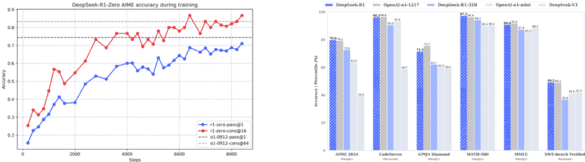

回答情况：


## 第五章 使用LazyLLM微调大模型

**线上的In**te**rnLM固然强**大，然而对于一些需要私有化部署，且GPU资源有限的场景下，我们就不得不选择参数量较小**的模型，较小模型**的能力有时不满足我们的需求，由此我们需要对其进行针对性的微调任务。LazyLLM的能力不只局限于大模型应用开发，一键运行模型微调也是其重要特性。本章我们将介绍如何使用LazyLLM实现书生大模型的微调训练。

我们选择一个参数较小的模型 InternLM2-Chat-7B，使用CMRC2018数据集中的训练数据来微调这个小模型，让它能具有更好的中文阅读理解信息抽取能力。整体的微调步骤如下：


+   微调方法：

+   LoRA策略：冻结原始权重，仅训练低秩矩阵（BA），降低显存占用。

+   控制输出：强化遵循原文内容且精简输出的能力。

### 5.1 数据准备

#### 数据集简介

我们选用CMRC2018数据集，该数据集由近15,00**0个真实**问题组成，这些问题是由人类专家在维基百科段落上标注而成。另外该数据集对应的任务是：“篇章片段抽取型阅读理解”(Span-Extraction Reading Comprehension)，根据给定的一个文档和一个问题，模型需要从该文档中抽取出问题的答案，其中答案是该文章某个连续的片段。

#### 数据集规模

CMRC2018数据集主要由三部分构成：test、validation 和train。这里我们将train部分作为我们的训练集，test部分作为我们的评测集，validation部分我们不使用。

| **数据集** | **短文数** | **问题数** | **用途** |
| --- | --- | --- | --- |
| test | 256 | 1002 | 评测集 |
| train | 2403 | 10142 | 训练集 |
| validation | 848 | 3219 | 未使用 |

> 注意：

+   之前教程中的知识库是基于 **CMRC2018 **中的test数据集中的文段来构建的；

+   这里训练我们使用的 **CMRC2018 **中的train数据集来进行；

+   评**测过程，为避免RA**G系统中检索模块干扰，我们采用控制变量法，假设召回100%没问题，即：我们直接使用 CMRC2018 中的test数据集中的文段片段和问题拼接起来作为大模型LLM的输入，变量是微调前后的两个7B的模型，以对比查看微调后模型在中文阅读理解信息抽取能力方面是否有提升；

#### 数据的结构

数据集中的test和train的结构是一致的，我们抽取其中的一条数据来看如下：

```
[
    {
        &quot;id&quot;: &quot;TRIAL_154_QUERY_0&quot;,
        &quot;context&quot;: &quot;尤金袋鼠（\&quot;Macropus eugenii\&quot;）是袋鼠科中细小的成员，通常都是就袋鼠及有袋类的研究对象。尤金袋鼠分布在澳洲南部岛屿及西岸地区。由于牠们每季在袋鼠岛都大量繁殖，破坏了针鼹岛上的生活环境而被认为是害虫。尤金袋鼠最初是于1628年船难的生还者在西澳发现的，是欧洲人最早有纪录的袋鼠发现，且可能是最早发现的澳洲哺乳动物。尤金袋鼠共有三个亚种：尤金袋鼠很细小，约只有8公斤重，适合饲养。尤金袋鼠的奶中有一种物质，称为AGG01，有可能是一种神奇药及青霉素的改良。AGG01是一种蛋白质，在实验中证实比青霉素有效100倍，可以杀死99%的细菌及真菌，如沙门氏菌、普通变型杆菌及金黄色葡萄球菌。&quot;,
        &quot;question&quot;: &quot;尤金袋鼠分布在哪些地区？&quot;,
        &quot;answers&quot;: {
            &quot;text&quot;: [
                &quot;尤金袋鼠分布在澳洲南部岛屿及西岸地区&quot;
            ],
            &quot;answer_start&quot;: [
                52
            ]
        }
    },
...
```

上面数据中：

+   context: 是文本段；

+   question：是针对文本段的提问；

+   answers：给出了对应问题的答案，包括：

+   text：答案的具体内容，源自文本段；

+   answer_start：答案在文本段中的起始位置；

#### 训练集处理

+   我们从原train数据集中抽取出文章字段context和问题字段question，将它拼接成为用于微调的instruction字段，拼接模板是："请用下面的文段的原文来回答问题\n\n### 已知文段：{context}\n\n### 问题：{question}\n"。

+   将原数据中的answers及其text字段作为，微调的 output 字段

+   由于微调还需要一个input字段，而我们这个任务不需要，所以设置为空。

```
# Template for constructing QA prompts
template = &quot;请用下面的文段的原文来回答问题\n\n### 已知文段：{context}\n\n### 问题：{question}\n&quot;

def build_train_data(data):
    &quot;&quot;&quot;Format training data using predefined template&quot;&quot;&quot;
    extracted_data = []
    for item in data:
        extracted_item = {
            &quot;instruction&quot;: template.format(context=item[&quot;context&quot;], question=item[&quot;question&quot;]),
            &quot;input&quot;: &quot;&quot;,
            &quot;output&quot;: item[&quot;answers&quot;][&quot;text&quot;][0]
        }
        extracted_data.append(extracted_item)
    return extracted_data
```

我们取处理后的一条数据如下：

```
[
    {
        &quot;instruction&quot;: &quot;请用下面的文段的原文来回答问题\n\n### 已知文段：黄独（学名：）为薯蓣科薯蓣属的植物。多年生缠绕藤本。地下有球形或圆锥形块茎。叶腋内常生球形或卵圆形珠芽，大小不一，外皮黄褐色。心状卵形的叶子互生，先端尖锐，具有方格状小横脉，全缘，叶脉明显，7-9条，基出；叶柄基部扭曲而稍宽，与叶片等长或稍短。夏秋开花，单性，雌雄异株，穗状花序丛生。果期9-10月。分布于大洋洲、朝鲜、非洲、印度、日本、台湾、缅甸以及中国的江苏、广东、广西、安徽、江西、四川、甘肃、云南、湖南、西藏、河南、福建、浙江、贵州、湖北、陕西等地，生长于海拔300米至2,000米的地区，多生于河谷边、山谷阴沟或杂木林边缘，目前尚未由人工引种栽培。在美洲也可发现其踪迹，对美洲而言是外来种，有机会在农田大量繁殖，攀上高树争取日照。英文别名为air potato。黄药（本草原始），山慈姑（植物名实图考），零余子薯蓣（俄、拉、汉种子植物名称），零余薯（广州植物志、海南植物志），黄药子（江苏、安徽、浙江、云南等省药材名），山慈姑（云南楚雄）\n\n### 问题：黄独的外皮是什么颜色的？\n&quot;,
        &quot;input&quot;: &quot;&quot;,
        &quot;output&quot;: &quot;外皮黄褐色&quot;
    },
...
```

#### 评测集处理

我们评测集的字段基本都保留了下来，仅对answers字段进行了处理，将其中的内容提取了出来：

```
def build_eval_data(data):
    &quot;&quot;&quot;Extract necessary fields for evaluation dataset&quot;&quot;&quot;
    extracted_data = []
    for item in data:
        extracted_item = {
            &quot;context&quot;: item[&quot;context&quot;],
            &quot;question&quot;: item[&quot;question&quot;],
            &quot;answers&quot;: item[&quot;answers&quot;][&quot;text&quot;][0]
        }
        extracted_data.append(extracted_item)
    return extracted_data
```

我们取处理后的一条数据如下：

```
[
    {
        &quot;context&quot;: &quot;芙蓉洞位于重庆武隆县江口镇的芙蓉江畔，距武隆县城20公里。芙蓉洞于1993被发现，1994年对游人开放。2002年被列为中国国家4A级旅游景区，2007年6月作为中国南方喀斯特－武隆喀斯特的组成部分被列入联合国世界自然遗产，是中国首个被列入世界自然遗产的溶洞。芙蓉洞全长2846米，以竖井众多、洞穴沉积物类型齐全著称。芙蓉洞附近的天星乡境内，有世界上罕见的喀斯特竖井群。在约20平方公里的范围内，至少散布着50个超过100米的竖井，其中汽坑洞的深度为920米，为亚洲第一。芙蓉洞内有70多种沉积物，几乎包括了所有经过科学家命名的喀斯特洞穴沉积类型，其中池水沉积堪称精华。在芙蓉洞的东端有一个“石膏花支洞”，洞内的鹿角状卷曲石枝长57厘米，为世界第一。目前石膏花支洞被永久封存。在紧邻芙蓉洞洞口的芙蓉江上已经建起了江口电站大坝，水库蓄水后对地下水循环及喀斯特景观的演化造成的影响目前还难以估量。&quot;,
        &quot;question&quot;: &quot;芙蓉洞位于什么地方？&quot;,
        &quot;answers&quot;: &quot;重庆武隆县江口镇的芙蓉江畔&quot;
    },
 ...
```

### 5.2 微调模型

在数据处理完成后，我们可以开始进行微调了。

> 值得注意的是：LazyLLM支持微调、部署、推理一条龙！

微调相关配置代码主要如下所示：

```
import lazyllm
from lazyllm import finetune, deploy, launchers

model = lazyllm.TrainableModule(model_path)\
    .mode(&#x27;finetune&#x27;)\
    .trainset(train_data_path)\
    .finetune_method((finetune.llamafactory, {
        &#x27;learning_rate&#x27;: 1e-4,
        &#x27;cutoff_len&#x27;: 5120,
        &#x27;max_samples&#x27;: 20000,
        &#x27;val_size&#x27;: 0.01,
        &#x27;per_device_train_batch_size&#x27;: 2,
        &#x27;num_train_epochs&#x27;: 2.0,
        &#x27;launcher&#x27;: launchers.sco(ngpus=8)
    }))\
    .prompt(dict(system=&#x27;You are a helpful assistant.&#x27;, drop_builtin_system=True))\
    .deploy_method(deploy.Vllm)
model.evalset(eval_data)
model.update()
```

上面代码中，使用LazyLLM的TrainableModule来实现：微调->部署->推理:

+   模型配置：

+   model_path指定了我们要微调的模型，这里我们用Internlm2-Chat-7B，直接指定其所在路径即可；

+   微调配置：

+   .mode设置了启动微调模式finetune；

+   .trainset 设置了训练用的数据集路径，这里用到的就是我们前面处理好的训练集；

+   .finetune_method 设置了用哪个微调框架及其参数，这里传入了一个元组（只能设置两个元素）：

+   第一个元素指定了使用的微调框架是Llama-Factory：finetune.llamafactory

+   第二个元素是一个字典，包含了对该微调框架的参数配置；

+   推理配置：

+   .prompt 设置了推理时候用的Prompt，注意，这里为了和微调的Prompt中的system字段保持一致，所以开启drop_builtin_system以将原system-prompt给替换为`You are a helpful assistant.`

+   .deploy_method 设置了部署用的推理框架，这里指定了vLLM这个推理框架；

+   评测配置：

+   这里通过.evalset来配置了我们之前处理好的评测集；

+   启动任务：

+   .update 触发任务的开始：模型先进行微调，微调完成后模型会部署起来，部署好后会自动使用评测集全部都过一遍推理以获得结果；

微调中的一些关键参数如下：

| **参数** | **作用** | **推荐设置** | **调优建议** |
| --- | --- | --- | --- |
| learning_rate | 控制参数更新幅度 | 1e-4~5e-5 | 大模型取较小值 |
| cutoff_len | 最大上下文长度 | 5120 | 根据GPU显存调整 |
| max_samples | 最大训练样本量 | 20000 | 注意太小导致训练用的数据太少 |
| per_device_train_batch_size | 单卡批次大小 | 2 | 显存不足时减小 |
| num_train_epochs | 训练轮次 | 2.0 | 根据任务loss下降情况来设置 |

额外，我们还可以配置一些LoRA相关的参数，LazyLLM已经默认设置好了一套经验的参数，所以上述代码中没有体现，这里我们展示如下，您可以尝试各类参数来炼丹：

| **参数** | **作用** | **推荐设置** | **说明** |
| --- | --- | --- | --- |
| lora_alpha | LoRA 缩放因子 | 16 | - |
| lora_dropout | LoRA 丢弃率 | 0.0 | - |
| lora_rank | LoRA 秩 | 8 | - |
| lora_target | LoRA 总用模型的目标模块 | all | 模型中的所有线性模块。 |

### 5.3 效果评测

在上一步微调并获得评测集的推理结果后，我们需要拿着结果和评测集的正确答案做个对比，以确认我们微调的效果是什么样的。

#### 评测目的

+   **验证微调效果**：对比模型输出与标准答案，量化模型优化成果（是否超越通用大模型）

+   **任务适配性检验**：通用指标（忠诚度、答案相关性）不适用于“篇章片段抽取”任务，需定制化评估

+   **优化方向指导**：通过指标差异定位模型短板（如完全一致性、语义精准性、原文依赖性）

#### 评测指标设计

这里，针对我们的任务特点，设计了三个维度的评价指标：

+   精确匹配率（Exact Match）​

+   语义相似度（Cosine Score）​

+   原文包含度（Origin Score）​

我们现在来详细介绍一下这三个指标的设计细节：

##### **精确匹配率**

我们将精确匹配度定义如下：

其中：

+   N：测试样本总数；

+   y_i：第i个样本的标准答案；

+   \hat{y}_i：模型预测结果；

+   \mathbb{I}：指示函数（完全匹配时取1，否则取0）；

**该指标的**特性在于：预测结果与标准答案需要完全一致

在不考虑计算平均值下，只实现其中的一项代码很简单，如下所示：

```
exact_score = 1 if output == true_v else 0
```

**代码功能：**

该代码用于判断模型对单个样本的预测结果（output）与该样本的标准答案（true_v）是否完全一致，并据此给出一个精确匹配得分（exact_score）。

**代码解释：**

+   output：模型对某个样本的预测结果。

+   true_v：该样本的标准答案。

+   exact_score：精确匹配得分，取值为1或0。如果预测结果与标准答案完全一致，则得分为1；否则得分为0。

##### **语义相似度**

我们将语义相似度度定义如下：

其中：

+   N：测试样本总数；

+   y_i：第i个样本的标准答案；

+   \hat{y}_i：模型预测结果；

+   \hat{y}_i：是基于BGE模型（bge-large-zh-v1.5）的向量编码，它可以把自然语言编码为一个向量，即：\hat{y}_i；

> 值得注意的是：该评价指标将原本[-1,0)的数值进行了截断，只要是负相关的语义都给0分，得分只能是正相关的。

相应的代码实现如下，这里不含求平均，只是其中一项，同时假设文本已经被BGE模型向量化了：

```
import numpy as np

def cosine(x, y):
    &quot;&quot;&quot;Calculate cosine similarity between two vectors&quot;&quot;&quot;
    product = np.dot(x, y)
    norm = np.linalg.norm(x) * np.linalg.norm(y)
    raw_cosine = product / norm if norm != 0 else 0.0
    return max(0.0, min(raw_cosine, 1.0))
```

**代码功能：**

该代码实现了一个计算两个向量之间余弦相似度的函数，特别适用于评估模型预测结果与标准答案之间的语义相似度。这是上述精确匹配度定义（CS）中的核心计算部分，用于单个样本的相似度计算。

**代码解释：**

+   x 和 y：分别代表两个向量，在实际应用中，这两个向量通常是由BGE模型对文本进行向量化后的结果，即  N和 N。

+   np.dot(x, y)：计算两个向量的点积。

+   np.linalg.norm(x) 和 np.linalg.norm(y)：分别计算向量 x 和 y 的L2范数（即欧几里得范数）。

+   product / norm：计算原始的余弦相似度值。

+   raw_cosine：存储原始的余弦相似度值，但如果分母为0（即两个向量中至少有一个是零向量），则直接返回0.0。

+   max(0.0, min(raw_cosine, 1.0))：对原始的余弦相似度值进行截断处理，确保结果在[0, 1]范围内，且负相关的语义得0分。

##### **原文包含度**

我们将原文包含度定义如下：

其中：

+   N：测试样本总数；

+   \hat{y}_i：模型预测结果；

+   N：表示预测结果中的每个字；

+   N：文章内容；

+   \mathbb{I}：指示函数（所有字在原文中出现时取1，否则有多于原文的字都取0）

相应的代码我们实现如下，这里不含求平均，只涉及其中一项：

```
def check_words_from_content(infer, content):
    &quot;&quot;&quot;Check if all words in inference output exist in original context&quot;&quot;&quot;
    return 1 if all(w in content for w in infer.split()) else 0
```

**代码功能：**

该代码实现了一个函数check_words_from_content，用于检查模型预测结果中的所有字是否都出现在原文内容中。这是上述原文包含度（OS）定义中的核心计算部分，用于单个样本的包含度判断。

**代码解释：**

+   infer：模型对某个样本的预测结果，即N。

+   content：该样本的原文内容，即N。

+   infer.split()：将预测结果分割成单个字的列表。

+   all(w in content for w in infer.split())：使用Python的all函数和生成器表达式检查infer中的每个字或词汇是否都存在于content中。如果所有字或词汇都存在，则返回True；否则返回False。

+   return 1 if ... else 0：根据检查结果返回1或0，作为指示函数\mathbb{I}的实现。如果所有字或词汇都存在于原文中，则返回1；否则返回0。

##### 指标对比分析

我们将上面三个评价指标分别做对比分析：

| **指标维度** | **取值范围** | **理想值** | **数值特征** | **优势** | **局限性** | **任务评价维度说明** |
| --- | --- | --- | --- | --- | --- | --- |
| 精确匹配率 | {0, 1} | 1.0 | 二元判断 | 结果明确，无歧义 | 对表述差异零容忍 | 有多少推理能100%忠于答案 |
| 语义相似度 | [0, 1] | 1.0 | 连续数值 | 捕捉语义相似性 | 依赖编码模型质量 | 由于选取片段范围，或者表述有改变，所以用相似度来评价同一内容的不同表述； |
| 原文包含度 | {0, 1} | 1.0 | 二元判断 | 确保答案忠实原文 | 忽略合理同义替换 | 任务要求，回答必须是用原文，此指标可反映答案是否都源自原文； |

#### 综合评测脚本

让我们将以上评价指标都汇集在一起，实现下面的完整评价：

```
def caculate_score(eval_set, infer_set):
    &quot;&quot;&quot;Calculate three evaluation metrics: exact match, cosine similarity, and word containment&quot;&quot;&quot;
    assert len(eval_set) == len(infer_set)

    # Initialize embedding model
    m = lazyllm.TrainableModule(&#x27;bge-large-zh-v1.5&#x27;)
    m.start()

    accu_exact_score = 0
    accu_cosin_score = 0
    accu_origi_score = 0
    res = []
    for index, eval_item in enumerate(eval_set):
        output = infer_set[index].strip()
        true_v = eval_item[&#x27;answers&#x27;]
        # Exact match scoring:
        exact_score = 1 if output == true_v else 0
        accu_exact_score += exact_score
        # Cosine similarity scoring:
        outputs = json.loads(m([output, true_v]))
        cosine_score = cosine(outputs[0], outputs[1])
        accu_cosin_score += cosine_score
        # Word containment scoring:
        origin_score = check_words_from_content(output, eval_item[&#x27;context&#x27;])
        accu_origi_score += origin_score
        res.append({&#x27;context&#x27;:eval_item[&#x27;context&#x27;],
                    &#x27;true&#x27;: true_v,
                    &#x27;infer&#x27;:output,
                    &#x27;exact_score&#x27;: exact_score,
                    &#x27;cosine_score&#x27;: cosine_score,
                    &#x27;origin_score&#x27;: origin_score})
    save_res(res, &#x27;eval/infer_true_cp.json&#x27;)
    total_score = len(eval_set)
    return (f&#x27;Exact Score : {accu_exact_score}/{total_score}, {round(accu_exact_score/total_score,4)*100}%\n&#x27;
            f&#x27;Cosine Score: {accu_cosin_score}/{total_score}, {round(accu_cosin_score/total_score,4)*100}%\n&#x27;
            f&#x27;Origin Score: {accu_origi_score}/{total_score}, {round(accu_origi_score/total_score,4)*100}%\n&#x27;)
```

上面代码中：

+   首先传入测试集和推理的结果，并确保两个集合是一样大的；

+   然后这里为了实现文本的向量化，我们采用LazyLLM的TrainableModule来加载一个bge-large-zh-v1.5模型，并采用.start给它部署起来；

+   接着我们遍历所有数据，计算三个指标下的每次得分，并累计起来；

+   最后我们保存所有结果，并计算最终的评价结果并以字符串返回。

#### 评测结果对比

这里我们对比了微调前模型Internlm2-Chat-7B，及其微调后的模型，同时我们还对比了线上模型DeepSeek-V3。

下表结果中，括号内是得分，总分是1002分，百分比是得分占总分的百分比。

| **模型** | **精确匹配率** | **语义相似度** | **原文包含度** |
| --- | --- | --- | --- |
| Internlm2-Chat-7B | 2.10% | 74.51% | 5.19% |
| DeepSeek-V3 | 5.29% | 74.85% | 15.17% |
| Internlm2-Chat-7B训练后 | **39.72%** | **86.19%** | **94.91%** |

从上面的评测结果我们可以看出，微调后的模型要比微调前，甚至是在线大模型的各项指标都要明显好。

1.  **精确匹配率飞跃**

+   微调后提升 **37.62个百分点****​（2.10% →** 39.72%），​超过在线模型近8倍

+   说明模型学会遵循特定答案格式

1.  **语义相关性优化**

+   相似度提升11.68个百分点（74.51% → 86.19%）

+   **与在线模型（600多B的**大模型）对比：+11.34个百分点优势

1.  **原文依赖度质变**

+   **包含度从5.19%跃**升至94.91%，​提升幅度达18.3倍

+   表明模型已掌握：

+   ✅ 关键信息定位能力

+   ✅ 原文提取策略

+   ✅ 知识边界控制（避免幻觉）

基于实验数据我们可以得出结论：

> RAG系统中，在召回模块准确和召回无误的前提下，生成模块中模型对任务的适应程度大大影响着最终的效果，而微调是一个有效的手段可以提升模型适应下游任务的能力，甚至通过微调后提升的该能力是可以很好超过通用大模型的。

#### 通用评测对比

这里我们基于[提升RAG召回](https://kh8gmexazp.feishu.cn/wiki/L8wDwa6FciHrUdk0r3WcgxHOnte)中介绍的两个通用生成模块的评价指标来评测一下模型，并与我们设计的评价指标做对比。

| **模型** | **针对任务设计的评价指标** |  |  | **通用评价指标** |  |
| --- | --- | --- | --- | --- | --- |
|  | **精确匹配率** | **语义相似度** | **原文包含度** | **答案相关度** | **忠诚度** |
| Internlm2-Chat-7B | 2.10% | 74.51% | 5.19% | 87.14% | 96.80% |
| DeepSeek-V3 | 5.29% | 74.85% | 15.17% | 85.91% | 96.90% |
| Internlm2-Chat-7B训练后 | **39.72%** | **86.19%** | **94.91%** | 55.16% | 96.50% |

从上面表格的数据我们可以看到通用评价指标显示，在微调之后模型的答案相关度明显下降了，在这评价指标下说明微调是失败的，但真的如此吗？让我们抽取评测过程的数据来看看吧：

**Inter**nLM2-Chat-7B微调后,答案相关度

```
{
    &quot;context&quot;: &quot;基于《跑跑卡丁车》与《泡泡堂》上所开发的游戏，由韩国Nexon开发与发行。中国大陆由盛大游戏运营，这是Nexon时隔6年再次授予盛大网络其游戏运营权。台湾由游戏橘子运营。玩家以水枪、小枪、锤子或是水炸弹泡封敌人(玩家或NPC)，即为一泡封，将水泡击破为一踢爆。若水泡未在时间内踢爆，则会从水泡中释放或被队友救援(即为一救援)。每次泡封会减少生命数，生命数耗完即算为踢爆。重生者在一定时间内为无敌状态，以踢爆数计分较多者获胜，规则因模式而有差异。以2V2、4V4随机配对的方式，玩家可依胜场数爬牌位(依序为原石、铜牌、银牌、金牌、白金、钻石、大师) ，可选择经典、热血、狙击等模式进行游戏。若游戏中离，则4分钟内不得进行配对(每次中离+4分钟)。开放时间为暑假或寒假期间内不定期开放，8人经典模式随机配对，采计分方式，活动时间内分数越多，终了时可依该名次获得奖励。&quot;,
    &quot;exact_score&quot;: 1,
    &quot;cosine_score&quot;: 0.9999,
    &quot;origin_score&quot;: 1,
    &quot;question&quot;: &quot;生命数耗完即算为什么？&quot;,
    &quot;true_answer&quot;: &quot;踢爆&quot;,
    &quot;answer&quot;: &quot;踢爆&quot;,
    &quot;infer_questions&quot;: [
        {
            &quot;question&quot;: &quot;\n踢爆这个词语是什么意思？&quot;,
            &quot;score&quot;: 0.3781
        },
        {
            &quot;question&quot;: &quot;\n踢爆是什么意思？这个词在什么语境下使用？&quot;,
            &quot;score&quot;: 0.3825
        },
        {
            &quot;question&quot;: &quot;\n踢爆是什么意思？这个词通常在什么语境下使用？&quot;,
            &quot;score&quot;: 0.3829
        }
    ],
    &quot;final_score&quot;: 0.3812
},
```

DeepSeek-V3,**答案相关度**

```
{
    &quot;context&quot;: &quot;基于《跑跑卡丁车》与《泡泡堂》上所开发的游戏，由韩国Nexon开发与发行。中国大陆由盛大游戏运营，这是Nexon时隔6年再次授予盛大网络其游戏运营权。台湾由游戏橘子运营。玩家以水枪、小枪、锤子或是水炸弹泡封敌人(玩家或NPC)，即为一泡封，将水泡击破为一踢爆。若水泡未在时间内踢爆，则会从水泡中释放或被队友救援(即为一救援)。每次泡封会减少生命数，生命数耗完即算为踢爆。重生者在一定时间内为无敌状态，以踢爆数计分较多者获胜，规则因模式而有差异。以2V2、4V4随机配对的方式，玩家可依胜场数爬牌位(依序为原石、铜牌、银牌、金牌、白金、钻石、大师) ，可选择经典、热血、狙击等模式进行游戏。若游戏中离，则4分钟内不得进行配对(每次中离+4分钟)。开放时间为暑假或寒假期间内不定期开放，8人经典模式随机配对，采计分方式，活动时间内分数越多，终了时可依该名次获得奖励。&quot;,
    &quot;exact_score&quot;: 0,
    &quot;cosine_score&quot;: 0.6646,
    &quot;origin_score&quot;: 1,
    &quot;question&quot;: &quot;生命数耗完即算为什么？&quot;,
    &quot;true_answer&quot;: &quot;踢爆&quot;,
    &quot;answer&quot;: &quot;生命数耗完即算为踢爆。&quot;,
    &quot;infer_questions&quot;: [
        {
            &quot;question&quot;: &quot;\n在游戏术语中，\&quot;生命数耗完即算为踢爆\&quot;是什么意思？&quot;,
            &quot;score&quot;: 0.7191
        },
        {
            &quot;question&quot;: &quot;\n什么情况下会被视为踢爆？当生命数耗完时会怎样？&quot;,
            &quot;score&quot;: 0.6896
        },
        {
            &quot;question&quot;: &quot;\n在游戏规则中，生命数耗完后会发生什么？&quot;,
            &quot;score&quot;: 0.7918
        }
    ],
    &quot;final_score&quot;: 0.7335
},
```

上面对比中，true_answer是标注的答案，answer是模型推理的答案， question是问题，**答案相关度**需要根据模型推理的答案answer来生成可能的问题（infer_questions中的question），这里是三个，然后让可能的问题与真实问题在向量化后求余弦相似度。在简短的answer之下，模型很难推测出和真实问题question相关的问题。

+   微调后的InternLM2-Chat-7B的answer是："踢爆"

+   DeepSeek-V3的answer是："生命数耗完即算为踢爆。"

可**以看到Deep**Seek-V3因为提供的信息更多，所以评价模型推测出来的问题更加准确，所以得分就更高。但实际上这不符合我们的预期，我们希望它简短准确，正如标准答案"踢爆"一样！与之对应的我们这里采用的语义相似度cosine_score和exact_score精准匹配度就很好的反映预期。

忠诚度在这里几乎没有什么区分度：

InternLM2-Chat-7B微调后,忠诚度：

```
{
    &quot;context&quot;: &quot;中国（南京）国际象棋超级大赛（Pearl Spring Super Tournament）原名中国（南京）国际象棋特级大师邀请赛，首届比赛于2008年12月11日至22日在南京市浦口区明发珍珠泉大酒店举行。本次大赛由南京市人民政府、国家体育总局棋牌运动管理中心主办，浦口区人民政府、南京市体育局承办，康缘药业股份有限公司、扬子晚报、蒙代尔国际企业家大学协办。被国际棋联定为21级赛事，也是亚洲迄今为止举办的最高水平的国际象棋大赛。双循环赛制比赛十轮，12月11日至15日进行前5轮，16日休息，17至21日进行后5轮。每方90分钟，每步棋加30秒。总奖金25万欧元，其中冠军8万欧元，第2至6名依次为5万5千欧元、4万欧元、3万欧元、2万5千欧元、2万欧元。结果托帕洛夫夺得冠军，阿罗尼扬获得亚军，卜祥志获得第三名。2009年2月1日被接纳为大满贯赛事并更名为中国（南京）国际象棋超级大赛。第二届比赛于2009年9月27日-10月9日举行。“康缘药业杯”2010中国(南京)国际象棋超级大赛于2010年10月19-30日举行&quot;,
    &quot;exact_score&quot;: 1,
    &quot;cosine_score&quot;: 0.9999,
    &quot;origin_score&quot;: 1,
    &quot;question&quot;: &quot;首届比赛在哪里举行？&quot;,
    &quot;true_answer&quot;: &quot;南京市浦口区明发珍珠泉大酒店&quot;,
    &quot;answer&quot;: &quot;南京市浦口区明发珍珠泉大酒店&quot;,
    &quot;statements&quot;: &quot;\n首届比赛在南京市浦口区举行。|||比赛的具体地点是明发珍珠泉大酒店。&quot;,
    &quot;scores&quot;: [
        {
            &quot;statement&quot;: &quot;首届比赛在南京市浦口区举行。&quot;,
            &quot;score&quot;: 1
        },
        {
            &quot;statement&quot;: &quot;比赛的具体地点是明发珍珠泉大酒店。&quot;,
            &quot;score&quot;: 1
        }
    ],
    &quot;final_score&quot;: 1.0
},
```

DeepSeek-V3,忠诚度：

```
{
    &quot;context&quot;: &quot;中国（南京）国际象棋超级大赛（Pearl Spring Super Tournament）原名中国（南京）国际象棋特级大师邀请赛，首届比赛于2008年12月11日至22日在南京市浦口区明发珍珠泉大酒店举行。本次大赛由南京市人民政府、国家体育总局棋牌运动管理中心主办，浦口区人民政府、南京市体育局承办，康缘药业股份有限公司、扬子晚报、蒙代尔国际企业家大学协办。被国际棋联定为21级赛事，也是亚洲迄今为止举办的最高水平的国际象棋大赛。双循环赛制比赛十轮，12月11日至15日进行前5轮，16日休息，17至21日进行后5轮。每方90分钟，每步棋加30秒。总奖金25万欧元，其中冠军8万欧元，第2至6名依次为5万5千欧元、4万欧元、3万欧元、2万5千欧元、2万欧元。结果托帕洛夫夺得冠军，阿罗尼扬获得亚军，卜祥志获得第三名。2009年2月1日被接纳为大满贯赛事并更名为中国（南京）国际象棋超级大赛。第二届比赛于2009年9月27日-10月9日举行。“康缘药业杯”2010中国(南京)国际象棋超级大赛于2010年10月19-30日举行&quot;,
    &quot;exact_score&quot;: 0,
    &quot;cosine_score&quot;: 0.5574,
    &quot;origin_score&quot;: 1,
    &quot;question&quot;: &quot;首届比赛在哪里举行？&quot;,
    &quot;true_answer&quot;: &quot;南京市浦口区明发珍珠泉大酒店&quot;,
    &quot;answer&quot;: &quot;首届比赛于2008年12月11日至22日在南京市浦口区明发珍珠泉大酒店举行。&quot;,
    &quot;statements&quot;: &quot;\n首届比赛于2008年12月11日至22日举行。|||比赛地点在南京市浦口区。|||具体举办地是明发珍珠泉大酒店。&quot;,
    &quot;scores&quot;: [
        {
            &quot;statement&quot;: &quot;首届比赛于2008年12月11日至22日举行。&quot;,
            &quot;score&quot;: 1
        },
        {
            &quot;statement&quot;: &quot;比赛地点在南京市浦口区。&quot;,
            &quot;score&quot;: 1
        },
        {
            &quot;statement&quot;: &quot;具体举办地是明发珍珠泉大酒店。&quot;,
            &quot;score&quot;: 1
        }
    ],
    &quot;final_score&quot;: 1.0
},
```

上面的对比中，我们可以看到DeepSeek-V3虽然提供了更多的信息，但它和微调后的模型一样，基本都按照要求使用原文中的内容来回答，所以虽然它的statement更多（3条），但最终得分和微调后模型一样。这也就解释了为什么最终的忠诚度得分没有区分度。值得注意的是这里用cosine_score语义相似度和exact_score精确匹配度，很好区分了两者的差异。

从上面的两个指标的对比结果我们可以看到，如果对RAG系统中的生成模块有特定的任务要求，常用的评价指标并不能很好衡量，此时就需要针对任务的最终效果需求来进行评价指标的设计！

## 总结

本次实践我们首先介绍了LazyLLM的环境配置方法，随后为大家展示了如何使用LazyLLM并结合书生大模型InternLM以及InternVL搭建Chatbot和RAG应用，最后展示了如何使用LazyLLM一键微调书生大模型。

本次实践中我们将重点关注了LazyLLM的基础使用方式以及书生大模型相关的内容，对LazyLLM感兴趣的同学可以前往LazyLLM的官方仓库（https://github.com/LazyAGI/LazyLLM）了解更多信息，🌟Star一下~

另外，在开源代码的同时我们还为大家精心准备了一套课程——《RAG技术详解与应用实战》（https://www.bilibili.com/video/BV1DrLxz5ELu），课程详细介绍了工业级RAG的系统设计思路，并手把手教你使用LazyLLM实现工业级RAG系统的落地。课程持续中，欢迎大家一起学习，共同进步~

## 附录

### 附录一：mac安装 Python， Pip 和 Git

1.  先安装xcode

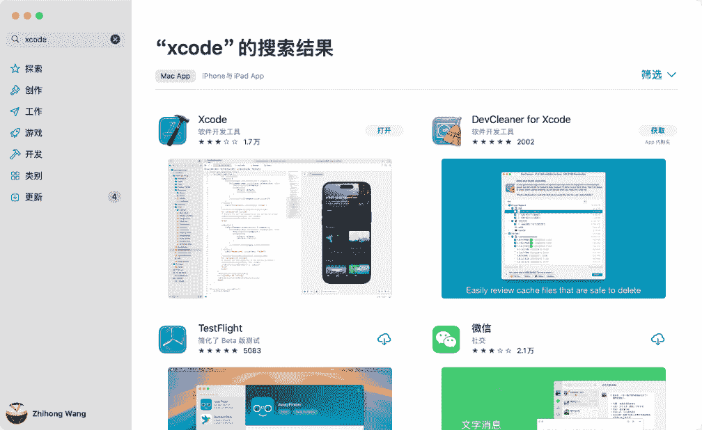

并且接受许可协议，然后安装xcode的命令行工具

```
sudo xcode-select -s /Applications/Xcode.app/Contents/Developer  # 确保路径正确
sudo xcodebuild -license accept  # 接受许可证协议
xcode-select --install  # 安装 Xcode 命令行工具
```

1.  安装homebrew，并并通过homebrew安装python和pip

```
/bin/bash -c &quot;$(curl -fsSL https://raw.githubusercontent.com/Homebrew/install/HEAD/install.sh)&quot;
echo &#x27;eval &quot;$(/opt/homebrew/bin/brew shellenv)&quot;&#x27; &gt;&gt; ~/.zshrc
source ~/.zshrc
brew install pyenv
pyenv install 3.10.0
```

1.  安装python3.10。注意不能安装python3.13，因为我们依赖的spacy包不支持python3.13。

```
echo &#x27;export PYENV_ROOT=&quot;$HOME/.pyenv&quot;&#x27; &gt;&gt; ~/.zshrc
echo &#x27;export PATH=&quot;$PYENV_ROOT/bin:$PATH&quot;&#x27; &gt;&gt; ~/.zshrc
echo &#x27;eval &quot;$(pyenv init --path)&quot;&#x27; &gt;&gt; ~/.zshrc
echo &#x27;eval &quot;$(pyenv init -)&quot;&#x27; &gt;&gt; ~/.zshrc
pyenv global 3.10.0
python3 -m venv lazyllm
source lazyllm/bin/activate
```