# 基于Zotero，使用InternLM API打造英文文献翻译助手 | 玩转书生大模型

> 来源：[https://aicarrier.feishu.cn/docx/YsRcd1dxPo33hdxckEqcEgMUn5f](https://aicarrier.feishu.cn/docx/YsRcd1dxPo33hdxckEqcEgMUn5f)

> 文档尚处于草稿阶段，完善中

本文来自社区投稿，作者艾天龙

在日常工作和学习中，你是否常常因为无法很好地理解英文文献而感到困扰？又是否对 Google 翻译生硬的结果感到不满？

本教程将介绍如何利用书生・浦语（InternLM）大模型，结合 Zotero 文献管理软件以及 Zotero Translate 翻译插件，实现快速、免费且无需复杂网络环境配置的 AI 翻译功能，助力您轻松读懂英文文献，享受流畅的 AI 翻译体验。

# 步骤1：下载 Zotero 文献管理软件

+   点击链接跳转([https://www](https://www.zotero.org/).zotero.org/)【Zotero 官网】，下载软件安装包，安装至本地即可。

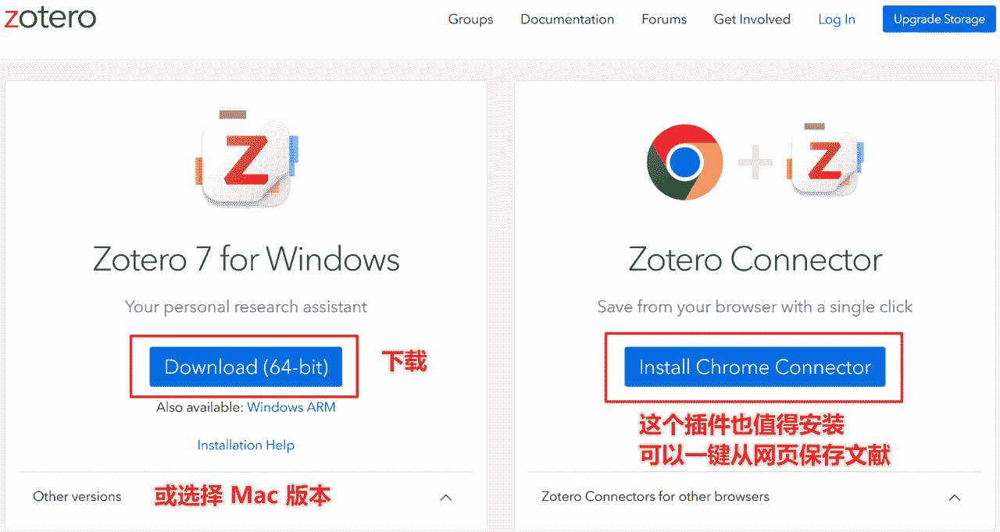

# 步骤2：下载 Zotero Translate 翻译插件

点击链接（https://github.com/windingwind/zotero-pdf-translate#install）跳转至【Zotero Translate 翻译插件】GitHub 官方页面。

按照图示，点击跳转至下载页面。

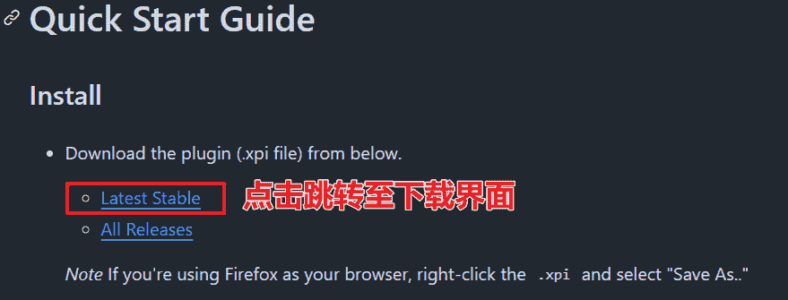

下载 **.xpi** 后缀插件文件至本地。

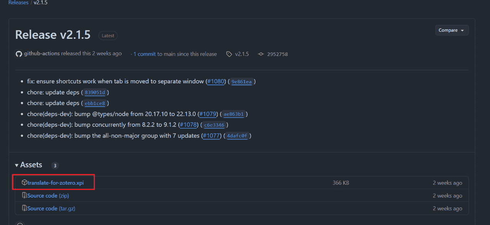

# 步骤3：打开 Zotero 软件，安装插件

打开在 步骤1 中安装好的 Zotero 软件。点击上方菜单栏，工具—>插件，打开插件管理页面。

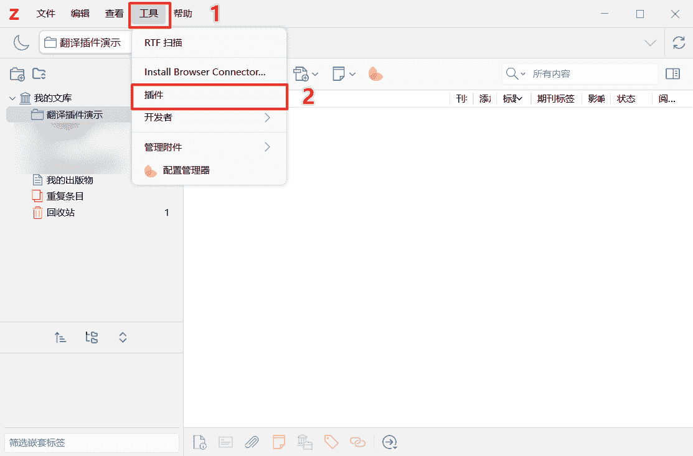

在弹出的**插件管理页面，****点**击齿轮符号，选择“从文件安装插件”，找到 步骤2 中下载的插件，即可自动安装，并出现在下方 Enabled 中。

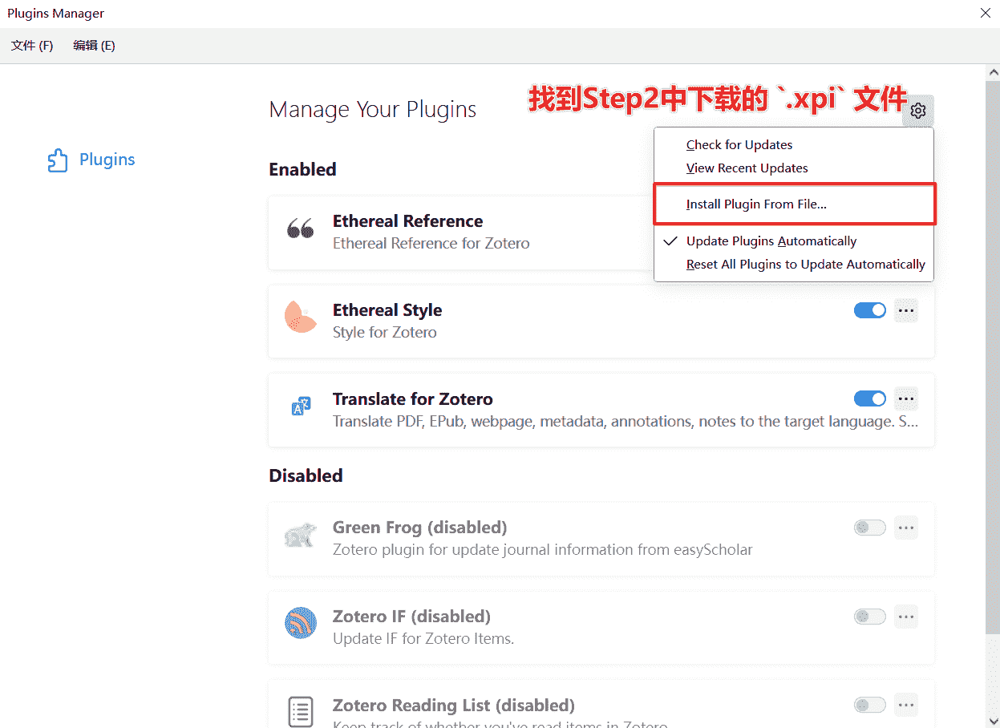

# 步骤4：配置书生·浦语API

回到 Zotero 主界面，点击上方菜单栏的“编辑—>设置”。

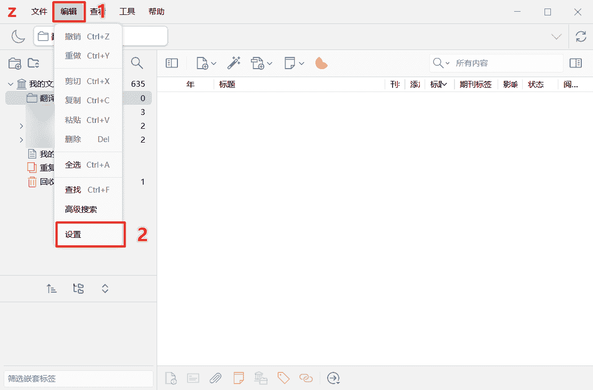

在弹出的界面中，按照下图选择“自定义GPT”。

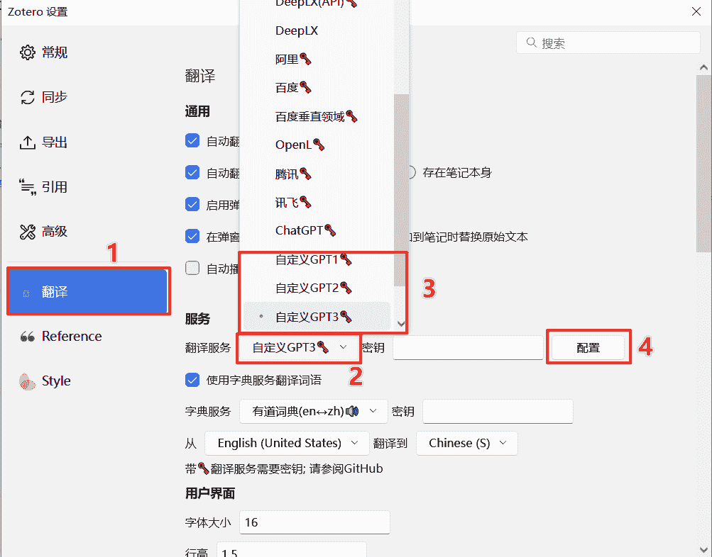

会发现，有 密钥、接口、模型、温度、Prompt 这五个待填写参数。下面，我们依次介绍如何填写这五个参数。

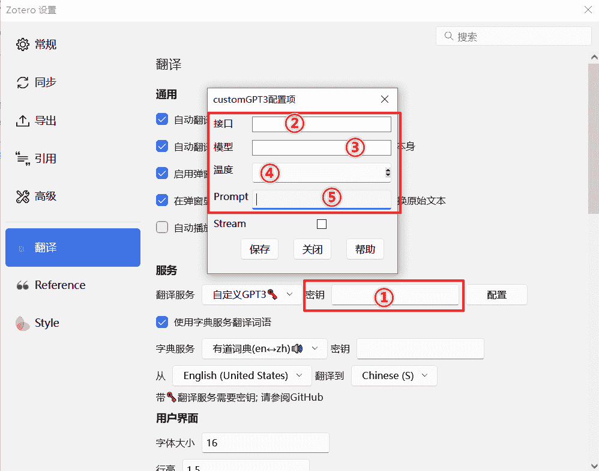

**密钥**

**前往【**[**书生·浦语API**](https://internlm.intern-ai.org.cn/api/document)**】****（****https://internlm.intern-ai****.****org.cn/ap****i****/do****c****ume**nt）官方网站，免费获取 API 密钥。

点击获取个人密钥，会自动跳转至登录界面，注册并登录后，再次点击左侧"获取个人密钥"-->"创建 API Token"-->"填写名称后"--->"提交"。

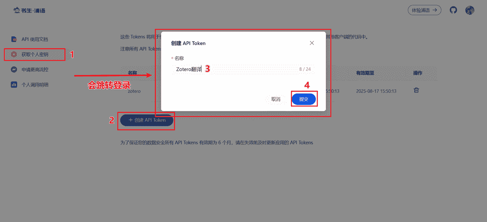

点击提交之后，就会弹出所申请的 API 密钥，将所获得的密钥复制到 Zotero 中的密钥一栏。

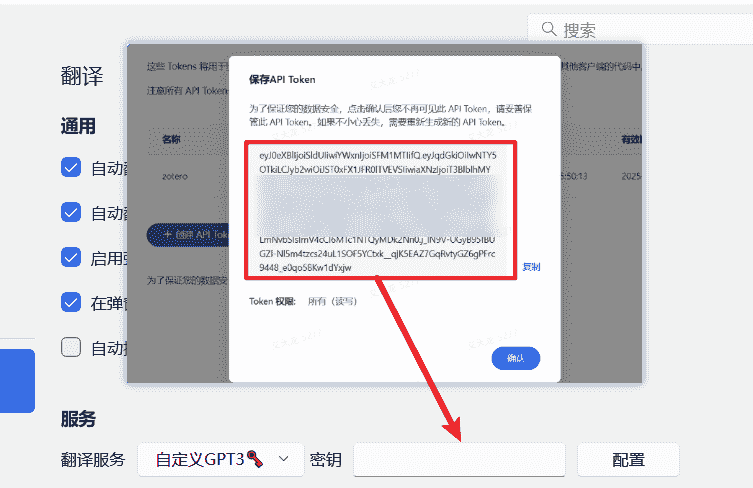

**接口**

**前往【**[**书生·浦语API**](https://internlm.intern-ai.org.cn/api/document)**】****（****https://internlm.intern-ai****.****org.cn/****a****pi/****d****ocume**nt）官方网站，获取 API 接口链接。

按照图示，复制 3 中的链接，填写至 Zotero 的接口一栏。

https://chat.intern-ai.org.cn/api/v1/chat/completions

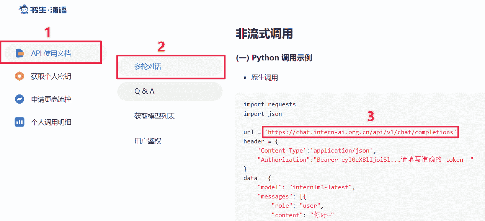

**模型**

**前往【**[**书生·浦语API**](https://internlm.intern-ai.org.cn/api/document)**】****（****https://internlm.intern-ai****.****org.cn/api/d**ocument）官方网站，获取模型列表。

根据个人需求，复制模型名称至 Zoter 的模型一栏，这里建议使用 internlm2.5-latest

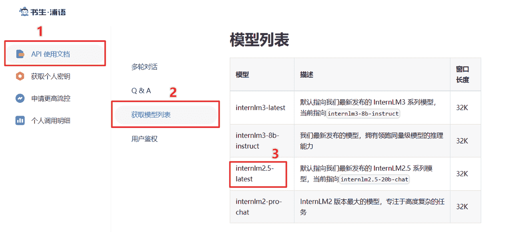

**温度**

这里可以默认写 1

**Prompt**

这里是为了 “PUA” 模型，告诉他帮你进行准确翻译。可以自行编辑，也可以参考如下 “PUA”话术:)

```
As an academic expert with specialized knowledge in various fields, please provide a proficient and precise translation from ${langFrom} to ${langTo} of the academic text enclosed in ??. It is crucial to maintaining the original phrase or sentence and ensure accuracy while utilizing the appropriate language. The text is as follows:  ?? ${sourceText} ??  Please provide the translated result without any additional explanation and remove ??.
```

最终填写好的界面如下图所示，点击保存即可

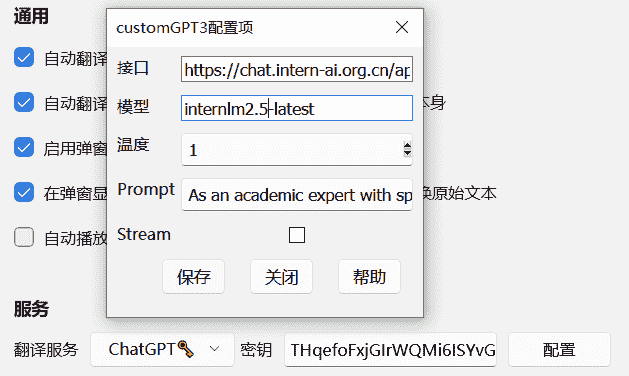

# 步骤5：开始顺畅阅读英文文献吧~

打开任意文献，划取想要翻译的部分，将会自动调用 书生·浦语 API 翻译，并返回翻译的结果。

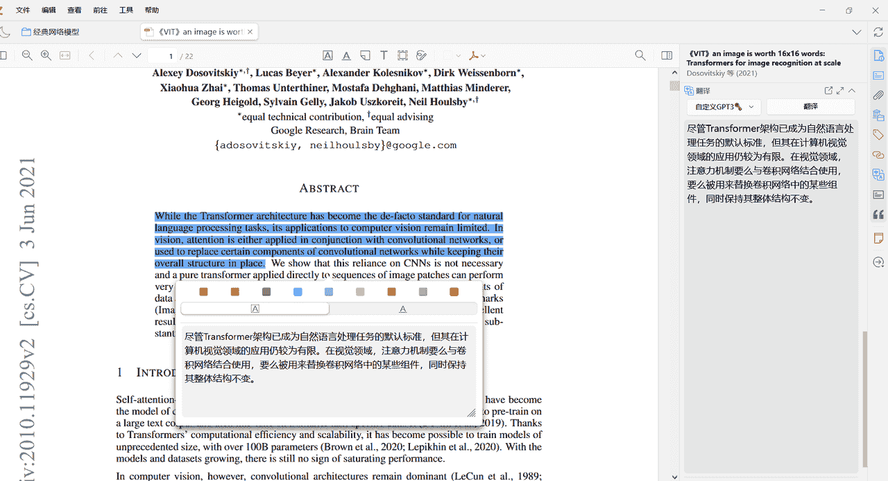

点击颜色块进行标记后，还能将翻译结果保存在笔记，方便查看哦。

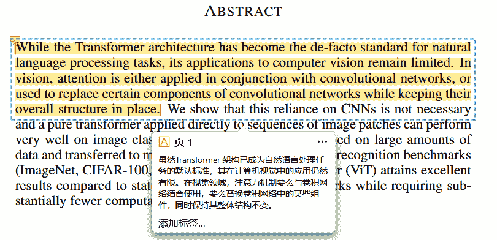

# 步骤6：翻译界面美化

在编辑-设置中，选择翻译插件，按照下图进行配置，感觉会比较好用。

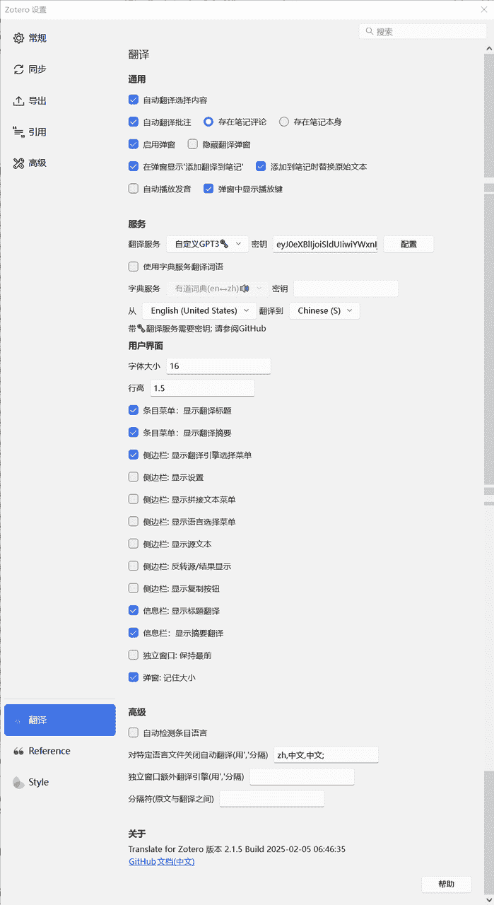

# 步骤7：多种翻译模型结果比较

## **原文：ViT的摘要**

While the Transformer architecture has become the de-facto standard for natural language processing tasks, its applications to computer vision remain limited. In vision, attention is either applied in conjunction with convolutional networks, or used to replace certain components of convolutional networks while keeping their overall structure in place. We show that this reliance on CNNs is not necessary and a pure transformer applied directly to sequences of image patches can perform very well on image classification tasks. When pre-trained on large amounts of data and transferred to multiple mid-sized or small image recognition benchmarks (ImageNet, CIFAR-100, VTAB, etc.), Vision Transformer (ViT) attains excellent results compared to state-of-the-art convolutional networks while requiring substantially fewer computational resources to train.1

## Google 翻译

尽管变压器体系结构已成为自然语言处理任务的事实上的标准，但其在计算机视觉上的应用仍然有限。在视力中，注意要么与卷积网络一起应用，要么用于替代卷积网络的某些组成部分，同时保持其整体结构。我们表明，这种对CNN的依赖不是必需的，并且直接应用于图像贴片序列的纯变压器可以很好地在图像分类任务上执行。当对大量数据进行预训练并转移到多个中型或小图像识别基准（Imagenet，Cifar-100，VTAB等）时，视觉变压器（VIT）与最新的结果相比，取得了良好的结果艺术卷积网络，同时需要训练的计算资源大大少得多。

## Bing 翻译

虽然 Transformer 架构已成为自然语言处理任务的事实标准，但它在计算机视觉中的应用仍然有限。在视觉中，注意力要么与卷积网络结合使用，要么用于替换卷积网络的某些组件，同时保持其整体结构不变。我们表明，这种对 CNN 的依赖是不必要的，直接应用于图像块序列的纯转换器可以在图像分类任务中表现得非常好。当对大量数据进行预训练并传输到多个中小型图像识别基准测试（ImageNet、CIFAR-100、VTAB 等）时，Vision Transformer （ViT） 与最先进的卷积网络相比，获得了出色的结果，同时需要的计算资源也大大减少。

## GPT-4o-mini

虽然Transformer架构已经成为自然语言处理任务的事实标准，但它在计算机视觉中的应用仍然有限。在视觉任务中，注意力机制通常与卷积网络结合使用，或者用来替代卷积网络的某些组件，同时保持其整体结构不变。我们证明了对卷积神经网络（CNN）的依赖并非必要，直接将纯Transformer应用于图像块序列也能够在图像分类任务中取得良好的表现。当在大量数据上进行预训练并迁移到多个中小型图像识别基准（如ImageNet、CIFAR-100、VTAB等）时，视觉Transformer（ViT）在与最先进的卷积网络相比，表现出了优秀的结果，同时训练所需的计算资源显著减少。

## Gemini-2.0-Flash-lite

gemini-2.0-flash-lite-preview-02-05

对Gemini的API频次限制及其厌烦！！！其实翻译效果也不错，并且很快。

```
[请求错误]
此翻译引擎不可用，可能是密钥错误，也可能是请求过快。
可以尝试其他翻译引擎，或者来此查看相关回答：
https://zotero.yuque.com/staff-gkhviy/pdf-trans/age09f

请注意，这些错误与 Zotero 和本翻译插件无关，由该翻译服务引起： Gemini🗝️

Error: HTTP POST https://generativelanguage.googleapis.com/v1beta/models/gemini-2.0-flash-lite-preview-02-05:generateContent failed with status code 429:

{
  &quot;error&quot;: {
    &quot;code&quot;: 429,
    &quot;message&quot;: &quot;Resource has been exhausted (e.g. check quota).&quot;,
    &quot;status&quot;: &quot;RESOURCE_EXHAUSTED&quot;
  }
}
```

Transformer架构虽然已成为自然语言处理任务的实际标准，但其在计算机视觉领域的应用仍然有限。在视觉领域，注意力机制要么与卷积网络结合使用，要么用于替换卷积网络的某些组件，同时保持其整体结构不变。我们证明了这种对CNNs的依赖并非必要，一个纯粹的Transformer直接应用于图像块序列，可以在图像分类任务上表现出色。当在大规模数据集上进行预训练，并迁移到多个中型或小型图像识别基准（ImageNet, CIFAR-100, VTAB等）时，Vision Transformer (ViT) 获得了优异的结果，与最先进的卷积网络相比，同时需要显著更少的计算资源进行训练。

## DeepSeek-v3

尽管Transformer架构已成为自然语言处理任务的事实标准，但其在计算机视觉中的应用仍然有限。在视觉领域，注意力机制要么与卷积网络结合使用，要么用于替换卷积网络的某些组件，同时保持其整体结构不变。我们表明，这种对卷积网络的依赖并非必要，直接将纯Transformer应用于图像patch序列可以在图像分类任务中表现非常出色。当在大规模数据上进行预训练并迁移至多个中型或小型图像识别基准（如ImageNet、CIFAR-100、VTAB等）时，视觉Transformer（ViT）相比最先进的卷积网络取得了优异的结果，同时训练所需的计算资源显著减少。

## 书生·浦语 internlm2.5-latest

尽管Transformer架构已成为自然语言处理任务的默认标准，但在计算机视觉领域的应用仍然有限。在视觉领域，注意力机制要么与卷积网络结合使用，要么用其替代卷积网络的部分组件，同时保持其整体结构不变。我们证明这种对卷积神经网络（CNN）的依赖并非必要，一个纯Transformer直接应用于图像块的序列即可在图像分类任务中表现优异。当在大量数据上进行预训练，然后转移到多个中等规模或小规模的图像识别基准（ImageNet、CIFAR-100、VTAB等）时，视觉Transformer（ViT）与最先进的卷积网络相比表现出色，同时在训练过程中所需的计算资源大幅减少。