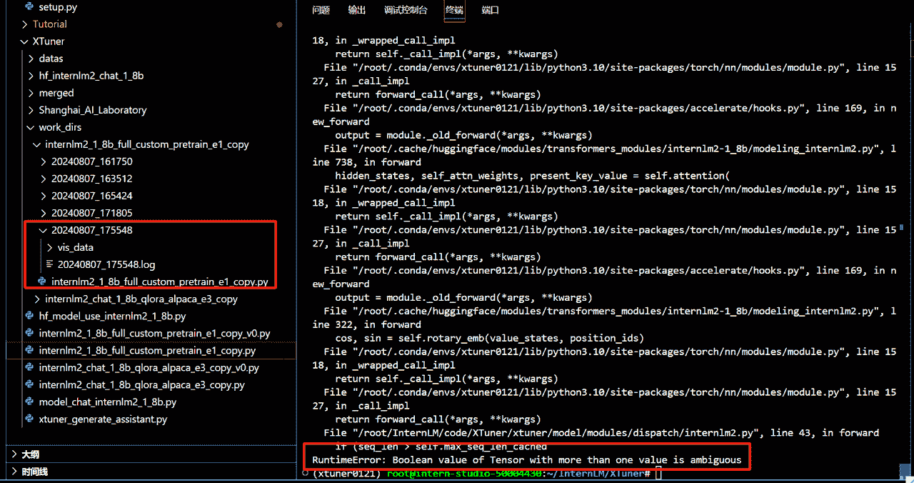
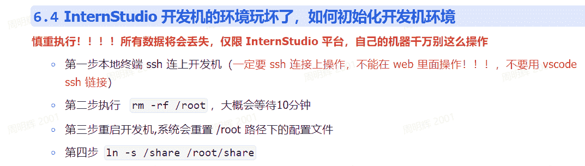
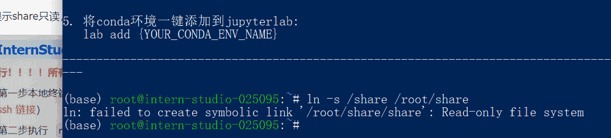
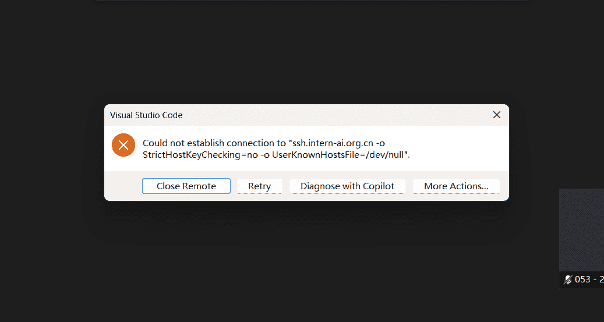

# QA 文档

> 来源：[https://aicarrier.feishu.cn/docx/RMOBdDFE0o5MS8xXf0ncQ63Unue](https://aicarrier.feishu.cn/docx/RMOBdDFE0o5MS8xXf0ncQ63Unue)

请问我的关卡L0-Git为什么是未完成呀？问卷星序号：1975

在基础岛 XTuner 微调个人小助手认知 的进阶任务，internlm2-1_chat_8b微调都没问题，internlm2-1_8b就报错，有人碰到过这个问题吗？报错信息如下：

正常一般是需要出来一个 .pth 后缀的文件，此处跑不出来。

请问第四步提示share只读，用过怎么弄啊？问卷星序号：3667

同问：而且初始化后conda用不了了，有什么办法恢复吗？？？？？？？问卷星序号：5010

初始化后conda用不了了，有什么办法恢复吗？？？？？？？

问卷星id：7186，为啥连不上远程VSCode

班级群扫码进不去，有人拉一下我么？（15105760617）

请问2025-4-1现在是无法报名最新一期的大模型实战营了吗？为什么🛰️扫码后，点击🛰️登录没反应了，填不到调查问卷了。