# InternVL3 社区圆桌

> 来源：[https://aicarrier.feishu.cn/docx/Gmw9dQOUsoIHCKxLoKpcmUxVnie](https://aicarrier.feishu.cn/docx/Gmw9dQOUsoIHCKxLoKpcmUxVnie)

腾讯会议：622-960-453

出品人：王培东，书生大模型社区贡献者，ACL 顶会一作

时间：2025.04.27

体验地址：`https://chat.intern-ai.org.cn/`

Paper: `https://huggingface.co/papers/2504.10479`

Code: `https://github.com/OpenGVLab/InternVL`

Model: `https://huggingface.co/collections/OpenGVLab/internvl3-67f7f690be79c2fe9d74fe9d`

Data: `https://huggingface.co/datasets/OpenGVLab/InternVL-Data`

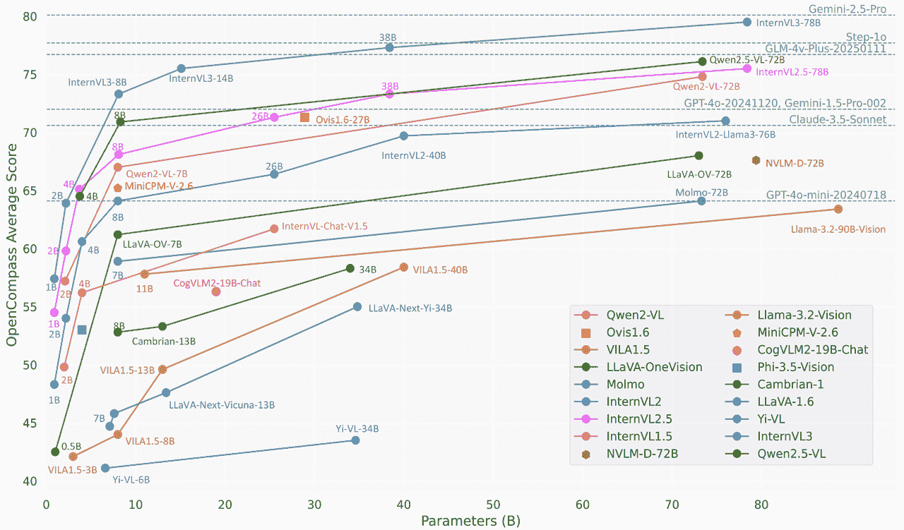

## 论文翻译

下面给出了`InternVL3`技术报告的全文翻译。分割线内为出品者自己的解读，不代表原论文作者观点。

## 0 摘要

我们推出了`InternVL3`，这是`InternVL`系列的一项重要进展，采用了原生的多模态预训练范式。与将仅支持文本的大型语言模型（`LLM`）改造成支持视觉输入的多模态大语言模型（`MLLM`）不同，`InternVL3` 在单个预训练阶段中同时从多样化的多模态数据和纯文本语料库中获取多模态和语言能力。这种统一的训练范式有效解决了传统`MLLM`后训练管道中常见的复杂性和对齐难题。为了进一步提升性能和可扩展性，`InternVL3` 引入了可变视觉位置编码（`V2PE`）以支持扩展的多模态上下文，采用了先进的后训练技术，如监督微调（`SFT`）和混合偏好优化（`MPO`），并结合测试时扩展策略以及优化的训练基础设施。广泛的实证评估表明，`InternVL3` 在各种多模态任务中表现出卓越性能。特别是，`InternVL3-78B` 在`MMMU`基准测试中取得了72.2分的成绩，树立了开源`MLLM`的新标杆。其能力与领先的专有模型（如`ChatGPT-4o`、`Claude 3.5 Sonnet`和`Gemini 2.5 Pro`）保持高度竞争力，同时在纯语言任务上也表现出色。秉承开放科学的原则，我们将公开发布训练数据和模型权重，以推动下一代`MLLM`的研究与开发。

## 1 引言

多模态大语言模型（`MLLM`s） 最近在广泛的任务领域中达到了甚至超越了人类水平的表现，突显了它们作为通向通用人工智能（`AGI`）的重要一步的潜力。然而，大多数领先的`MLLM`——无论是开源还是专有模型——都是通过复杂的多阶段管道从仅支持文本的大语言模型改造而来的。这些“后处理”方法建立在原始基于文本的预训练过程之上，因此在整合额外模态（如视觉）时引入了对齐挑战。实际上，弥合模态差距通常需要从特定领域（例如光学字符识别场景）引入辅助数据，并设计复杂的参数冻结或多阶段微调计划，以确保核心语言能力不受损害。这种资源密集型策略凸显了更高效的多模态训练范式的必要性。

在本报告中，我们推出了`InternVL3`，这是`InternVL`系列的最新里程碑，其独特之处在于其原生的多模态预训练策略。与先预训练一个仅支持文本的大语言模型，然后通过多模态对齐改造以支持视觉处理不同，`InternVL3` 从预训练阶段开始就同时接触纯文本语料库和多样化的多模态数据集来学习多模态能力。这种统一的方法使模型能够以更高效且集成的方式同时获取语言和多模态能力。

`InternVL3`通过多项创新进一步提升了性能和可扩展性。我们采用了可变视觉位置编码（variable visual position encoding, `V2PE`）机制来适应更长的多模态上下文。此外，先进的后训练策略——包括监督微调（`SFT`）和混合偏好优化（`MPO`）——结合测试时扩展策略 [125] 和优化的训练基础设施 [15]，显著提升了`InternVL3`的效率和性能。

全面的实证评估表明，`InternVL3`在其前身（如`InternVL2.5` [18]）的基础上，在广泛的任务中表现更优，包括跨学科推理、文档理解、多图像/视频理解、现实世界理解、多模态幻觉检测、视觉定位和多语言能力。值得注意的是，通过整合扩展的领域特定数据集，`InternVL3`在工具使用、`GUI`代理、工业图像分析和空间推理方面也表现出显著改进，从而大幅扩展了`InternVL`系列所覆盖的多模态场景。它在与其他开源`MLLM`（如`Qwen2.5-VL` [7]）的竞争中表现出色，并与闭源模型（如`ChatGPT-4o` [98]、`Claude-3.5 Sonnet` [3]、`Gemini-2.5 Pro` [117]）保持同等水平。这一多功能性通过其在`MMMU`基准测试 [141] 中取得的72.2分得以证明，树立了开源`MLLM`的新标准。此外，`InternVL3`的语言能力与其他类似规模的先进`LLM`相当。

为了推动开源社区的进一步发展，我们将随本工作发布训练数据和模型权重，从而确保下一代`MLLM`持续开发的透明性和可重复性。

## 2 InternVL3

基于先前的`InternVL`系列，我们提出了`InternVL3`，这是`InternVL`模型家族的新一代版本。`InternVL3`专门设计用于简化训练流程，同时显著增强多模态能力。在本节中，我们将首先详细描述`InternVL3`的核心组件，包括其模型架构、训练过程、测试时扩展策略以及基础设施级别的优化。

### 2.1 模型架构

`InternVL3`的架构遵循与其前身相同的总体框架，采用“`ViT`-`MLP`-`LLM`”范式。详细的架构规范总结在表1中。

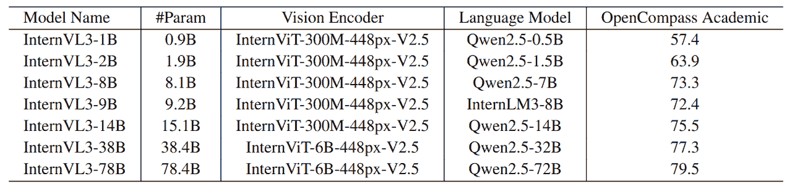

---

表1展示了`InternVL2/2.5`系列使用的预训练模型。可以看出，`InternVL3`使用的视觉编码器与`InternVL2.5`系列的一致，而`LLM`则都换为了`base`模型，且将几个`InternLM2.5` 替换为了`Qwen2.5` 和`InternLM3`。`InternVL3`中，`14B`的模型性能即可与`InternVL2.5-78B`相媲美。

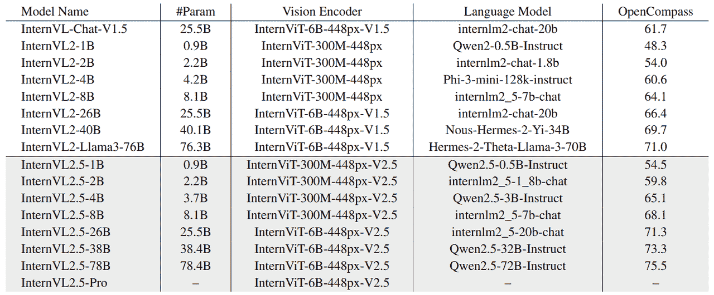

---

尽管稍后讨论的原生预训练范式可以支持从头训练`MLLM`，我们选择使用预训练模型权重初始化`ViT`和`LLM`组件以降低计算成本。视觉编码器有两种配置：`InternViT-300M`和`InternViT-6B`。对于语言模型，我们利用预训练的大语言模型（`LLM`），特别是`Qwen2.5`系列和`InternLM3-8B`。

重要的是，我们的`LLM`组件仅从预训练的基础模型初始化，而不使用指令微调变体。模型中使用的多层感知机（`MLP`）是一个两层网络，采用随机初始化。与`InternVL2.5`的做法一致，`InternVL3`引入了像素反洗牌操作（`pixel unshuffle`），以增强处理高分辨率图像的可扩展性。该操作将视觉标记的数量减少到原始值的四分之一，用256个视觉标记表示每个`448×448`的图像块。

---

`Pixel Shuffle` 技术来自图像超分领域，是把不同通道的特征拿出来，拼到一个通道上，从 转化为 。`r`是上采样因子。

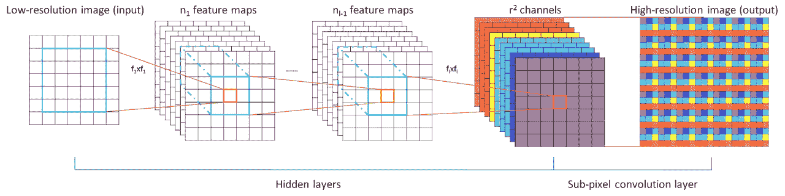

在本文中，`r` 取 `0.5`。就可以把 `448*448/14*14=32*32=1024` token 下采样到 `16*16=256` token，大大减小token 的使用，在同一上下文中，处理更多信息。

---

可变视觉位置编码 `InternVL3`还集成了可变视觉位置编码（`V2PE`），它为视觉标记 (`tokens`)使用更小、更灵活的位置增量。这种修改便于处理更长的多模态上下文，而不会过度扩展位置窗口。具体而言，每个用于`MLLM`的训练样本表示为：

其中每个标记 `x_i` 可以是文本标记嵌入 (`embedding`)、视觉嵌入或其他特定模态的表示（例如视频片段嵌入）。任何标记 `x_i` 的位置索引 `p_i` 可按以下方式顺序计算：

与传统`MLLM`不同，在传统模型中，无论模态如何，每个标记的位置索引都均匀递增`1`，而`V2PE`采用特定模态的递归函数来计算位置索引。这导致文本和视觉标记的位置索引分配不同：

其中`\delta`是一个小于1的增量（`\delta`），降低了视觉标记位置索引的增长速度。标准增量`1`保留给文本标记，以保持它们的位置区分度。根据原始`V2PE`设计，我们在单张图像内保持`\delta`为常数，以保留相对位置关系。在训练期间，`\delta` 从一组预定义的小数值中随机选择：

在推理期间，可以根据输入序列长度灵活选择`\delta` ，从而在任务性能和确保位置索引保持在模型有效上下文范围内之间取得平衡。值得注意的是，当`\delta = 1` 时，`V2PE`退化为`InternVL2.5`中使用的传统位置编码。

### 2.2 原生多模态预训练

我们提出了一种原生多模态预训练方法，将语言预训练和多模态对齐训练整合到一个预训练阶段中。与传统范式不同——先训练仅支持语言的大模型（通常先进行语言预训练，然后进行语言后训练），再将其改造成支持其他模态——我们的方法通过在预训练过程中交织多模态数据（如图文、视频-文本或交错的图文序列）与大规模纯文本语料库来进行集成优化。这种统一的训练方案使预训练模型能够同时学习语言和多模态能力，最终增强其处理视觉-语言任务的能力，而无需引入额外的桥接模块或后续的跨模型对齐步骤。

多模态自回归公式化 令`M` 表示由参数`\theta` 参数化的基于`Transformer`的模型，它可以同时处理文本、图像和视频。具体而言，对于任意训练样本`\theta` ，其标记长度为`\theta`，我们采用标准的从左到右自回归目标：

其中 `w_i` 表示标记 `i` 的损失权重。尽管此公式自然会通过所有模态的标记传播梯度，但我们限制损失计算仅针对文本标记，结果为：

在此选择性目标下，视觉标记作为文本预测的条件上下文，不直接被预测。因此，模型学会以有益于下游语言解码任务的方式嵌入多模态信息。值得注意的是，关于标记权重 `w_i` 的设计选择，正如`InternVL2.5` [18] 中所讨论的，广泛使用的标记平均和样本平均策略可能导致梯度偏向较长或较短的响应。为缓解这一问题，我们采用平方平均法，定义如下：

其中`l`表示需要计算损失的训练样本中的标记数量。

---

在使用 token 平均时，每个 token 对最终损失的贡献是均等的，这可能导致梯度偏向于 token 数量较多的响应，从而导致基准性能下降。相比之下，样本平均确保每个样本的贡献均等，但可能会导致模型倾向于较短的响应，从而对用户体验产生负面影响。

---

联合参数优化 与传统的“仅语言训练后进行多模态适应”范式不同，我们的方法在多模态预训练期间联合更新所有模型参数。具体而言，

其中 `D_multi` 是大规模纯文本和多模态语料库的并集（例如图文或视频-文本对）。因此，我们优化了一个单一模型来处理这些组合数据源。这种多任务联合优化确保文本表示和视觉特征协同学习，强化了模态间的对齐。

此外，这种集成优化脱离了传统的“仅语言训练后进行多模态适应”管道，后者在适应`MLLM`时通常冻结或部分微调`LLM`组件甚至`ViT`编码器的某些层。相比之下，我们的方法联合训练每一层，允许所有参数在大规模多模态语料库上联合优化，并确保语言和视觉特征同步发展。结果是，最终参数在纯语言和多模态任务上均表现出高性能，无需额外的调优步骤。

数据 `InternVL3`使用的预训练数据大致分为两类：多模态数据和纯语言数据。多模态数据集由现有数据集和新获取的真实世界数据合成而来。具体而言，我们利用了`InternVL2.5`的预训练语料库，涵盖图像字幕、通用问答、数学、图表、光学字符识别（`OCR`）、知识定位、文档理解、多轮对话和医学数据等多样化领域。虽然整体数据规模没有增加，但通过更新不仅`MLP`模块权重，还包括`ViT`和`LLM`组件的相关权重，显著提高了该数据集的实用性。此外，为了增强模型在现实应用中的泛化能力，我们还从图形用户界面（`GUI`）、工具使用、`3D`场景理解和视频理解相关任务中引入了额外数据。

为了弥补多模态数据集中通常存在的较短且多样性较低的文本内容，我们将纯语言数据整合到预训练过程中。这有助于保留和放大模型的语言理解和生成能力。语言语料库主要基于`InternLM2.5`的预训练数据，并进一步扩充了各种开源文本数据集。这种增强旨在提高模型在知识密集型任务上的表现，以及其在数学和推理任务中的熟练程度。

鉴于平衡这些异构数据源的复杂性，确定适当的采样策略并非易事。在`InternVL3`中，我们采用两阶段策略来建立多模态和语言数据集之间的最佳采样比例。首先，我们分别在多模态和语言数据集上训练单独的模型，并评估其在相应基准上的表现，从而确定每种模态内的最佳采样比例。然后，在固定的总训练预算下，我们将两种模态结合起来，确定其相对采样比例。实证研究表明，语言与多模态数据的比例为`1:3`时，在单模态和多模态基准上均表现出最佳的整体性能。在此配置下，训练标记总数约为2000亿，其中500亿来自语言数据，1500亿来自多模态数据。

### 2.3 后训练

在原生多模态预训练之后，我们应用两阶段后训练策略以进一步增强模型的多模态对话和推理能力。该策略包括监督微调（`SFT`）和混合偏好优化（`MPO`）。在`SFT`阶段，模型在正向监督信号下模仿高质量响应。在随后的`MPO`阶段，我们引入来自正负样本的额外监督，从而进一步提升其整体能力。

监督微调 在此阶段，`InternVL2.5`中提出的随机`JPEG`压缩、平方损失重加权和多模态数据打包技术也被应用于`InternVL3`系列。与`InternVL2.5`相比，`InternVL3`的`SFT`阶段的主要进步在于使用了更高质量和更多样化的训练数据。具体而言，我们进一步扩展了工具使用、`3D`场景理解、`GUI`操作、长上下文任务、视频理解、科学图表、创意写作和多模态推理的训练样本。

混合偏好优化 在预训练和`SFT`期间，模型被训练为基于之前的真值标记预测下一个标记。然而，在推理期间，模型基于自身的先前输出预测每个标记。这种真值标记与模型预测标记之间的差异引入了分布偏移，可能损害模型的思维链（`CoT`）推理能力。为缓解这一问题，我们采用混合偏好优化（`MPO`），它通过引入来自正负样本的额外监督，将模型响应分布与真值分布对齐，从而提高推理性能。具体而言，`MPO`的训练目标是偏好损失 `L_g` 、质量损失 `L_q` 和生成损失 `L_g` 的组合，可表述为：

其中 `w_*` 表示分配给每个损失成分的权重。具体而言，`DPO`损失 作为偏好损失，使模型能够学习所选响应和拒绝响应之间的相对偏好：

其中 `\beta` 是`KL`惩罚系数，而 `y_r`、`y_r` 和 `y_r` 分别是用户查询、所选响应和拒绝响应。策略模型 `\pi_\theta` 从模型 `\pi_0` 初始化。之后，`BCO`损失 [53] 作为质量损失，帮助模型理解单个响应的绝对质量：

其中 `L_q^+` 和 `L_q^-` 分别表示所选响应和拒绝响应的损失。它们独立计算，要求模型区分单个响应的绝对质量。损失项为：

其中 `\delta` 表示奖励偏移，计算为先前奖励的移动平均值以稳定训练。最后，`LM`损失用作生成损失，以帮助模型学习首选响应的生成过程。损失函数定义见上式。

数据 对于`SFT`数据，我们基于`InternVL2.5` 中使用的训练语料库构建，同时引入了额外的工具使用、`3D`场景理解、`GUI`操作、科学图表、创意写作和多模态推理样本。结果是，训练样本数量从`InternVL2.5`中的`16.3M`增长到`InternVL3`中的`21.7M`。对于`MPO`数据，我们基于`MMPR v1.2` 中提出的数据管道和样本构建偏好对，涵盖广泛领域，包括通用视觉问答（`VQA`）、科学、图表、数学、`OCR` 和文档。我们使用`InternVL3-8B`、`38B`和`78B`的`SFT`版本生成`rollout`。在`MPO`阶段，所有模型都在相同的数据集上训练，该数据集包含约`300K`样本。

---

`MMPR`数据构造过程：(`https://arxiv.org/pdf/2411.10442`)

在我们的 `MMPR` 数据集中，每个样本由一张图像 `y_r ∈ Y_n` 、一条指令 `y_r ∈ Y_n` 、一个被选中的响应 `y_c ∈ Y_p` 和一个被拒绝的响应 `y_r ∈ Y_n` 组成，其中 `y_c` 比 `y_r` 更优。图像集合 `I` 和指令集合 `X` 来自现有的数据集。 `y_r ∈ Y_n` 和 `Y_n` 分别表示正响应集和负响应集。对于给定的图像 `I` 和指令 `I` ，我们从初始指令模型 `M_0` 中采样候选响应 `I` ，如下所示：

其中 `M_0(y | x, I)` 表示模型 `M_0` 在条件 `I` 和 `x` 下的响应分布。

对于`具有明确正确答案`的指令，模型会被提示首先提供推理过程，然后以“`Final Answer:`”的格式给出最终答案。与正确答案匹配的响应构成正响应集 `I` ，而不匹配的响应则构成负响应集 `I` 。此外，未能提供明确最终答案的响应也会被归入 `I` 。基于这些标记为正或负的响应，我们通过从 `Y_p` 中选择一个被选中的响应 `y_c` 和从 `Y_n` 中选择一个被拒绝的响应 `y_r` 来构建偏好对。

对于`没有明确正确答案`的指令，我们提出了一种简单而有效的方法：`Dropout Next-Token Prediction` (`Dropout NTP`)。具体来说，我们将公式 (1) 生成的所有响应直接视为正响应集 `I` 。为了生成负响应集 `I` ，我们从 `Y_p` 中采样一个响应 `y` 并截断其后半部分。模型需要完成剩余的部分，如下所示：

其中`y_{<j}`和`y_{\geq j}`分别是响应`y`的保留部分和截断部分，`I`是在不使用图像输入的情况下对`y_{<j}`的补全。原始响应`y = [y_{<j}, y_{\geq j}]`被用作被选中的响应`I`，而补全后的响应`\tilde{y} = [y_{<j}, \tilde{y}_{\geq j}]`被用作被拒绝的响应`I`。注意的是，尽管由`M_0`生成的响应可能并不完美，但不使用图像输入生成的补全内容会比使用图像输入生成的内容包含更多的幻觉（hallucinations）。因此，`I`和`\tilde{y}`之间的偏序关系成立。

---

## 2.4 测试时扩展（Test-Time Scaling）

测试时扩展已被证明是一种有效的方法，可以增强大型语言模型（LLMs）和多模态大模型（MLLMs）的推理能力。在本研究中，我们使用 `Best-of-N` 评估策略，并采用 `VisualPRM-8B` 作为评判模型，以选择最佳响应用于推理和数学评估。

视觉过程奖励模型（`VisualPRM`）`VisualPRM` 首先为给定解决方案的每个步骤分配一个质量分数，然后对这些分数取平均值以获得该解决方案的整体分数。这一过程被表述为一个多轮对话任务，从而能够有效利用 MLLM 的生成能力。图像 `q` 、问题 `q` 和逐步解决方案 `s = \{s_0, s_1, \cdots, s_n\} \in S` 的第一步 `s_0` 包含在第一轮对话中，后续每一轮则呈现一个新的步骤。在训练阶段，模型需要预测每一轮中给定步骤的正确性，如下所示：

其中 `c_i \in \{+, -\}` 表示第 `i` 步的正确性。在推理阶段，每个步骤的分数定义为生成“`+`”的概率。

**数据** `VisualPRM400K` 被用于训练 `VisualPRM`，该数据集基于从 `MMPR v1.2` 收集的多模态问题构建。按照 `VisualPRM400K` 的数据流水线，我们进一步扩展了 `VisualPRM400K`，通过从 `InternVL3` 的 `8B` 和 `38B` 变体中采样轨迹数据来扩充数据集。

---

### `VisualPRM400K` 的数据流水线 (`https://arxiv.org/abs/2503.10291`)

如下图所示，`VisualPRM400K`中的每个数据样本由一张图像 `\mathcal{S}` 、一个问题 `\mathcal{S}` 、逐步解决方案 `s = \{s_0, s_1, \dots, s_n\} \in \mathcal{S}` 和每一步的预期准确度标注 `m_c = \{m_{c0}, m_{c1}, \dots, m_{cn}\}` 组成，其中 `m_{ci} \in \mathbb{R}_{\geq 0}` 表示第 `i` 步的预期准确度，`n` 是特定解决方案的步数。图像集合 `\mathcal{I}` 和问题集合 `\mathcal{Q}` 来源于`MMPR v1.1`，而逐步解决方案 `\mathcal{S}` 则通过`InternVL2.5`系列模型采样生成。

**过程监督生成** 给定一张图像 `q` 、一个问题 `q` 和解决方案 `q` ，我们使用自动化数据管道对每一步 `s_i` 的正确性进行标注。其核心思想是基于蒙特卡罗采样估计给定步骤 `s_{\leq i}` 的预期准确度。具体来说，模型被要求完成解决方案如下：

其中 `\tilde{s}_{>i}` 是 `s_{\leq i}` 的补全。此外，第 `i` 步的预期准确度定义为：

值得注意的是，为了降低数据构建成本，我们将最大步数限制为12，并在当前步数超过阈值时均匀合并步骤。

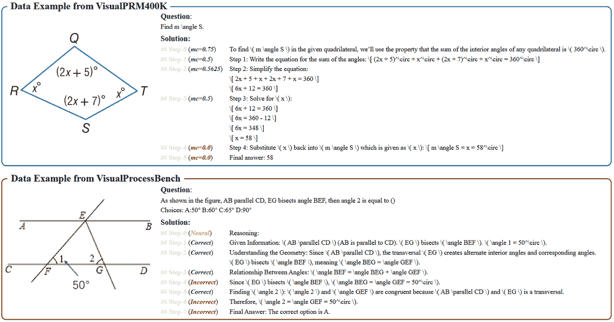

---

## 2.5 Infrastructure

为了促进模型训练，我们扩展了 `InternEVO` 框架——最初设计用于优化大规模 `LLM` 训练的零冗余优化器（`ZeRO`）——以支持我们的 `InternVL` 模型的训练。这一扩展使模型能够在数千个 `GPU` 上高效扩展至数千亿参数规模。增强后的框架引入了针对视觉 `Transformer`（`ViT`）、多层感知机（`MLP`）和 `LLM` 组件的灵活且解耦的分片策略，通过重叠通信与计算显著提高了训练效率。它还支持一系列并行策略的全面组合，包括数据并行、张量并行、序列并行和流水线并行，以及它们的任意组合。

在 `MLLM` 训练中的一个关键挑战是由视觉和文本 `token` 比例不同所导致的计算负载不平衡问题。这种不平衡可能导致 `ViT` 或 `LLM` 模块过载，从而降低效率。为了解决这一问题，我们引入了一套技术，动态平衡各模块之间的计算工作负载，确保资源的高效和公平利用。

对于不同规模的 `InternVL` 模型，扩展后的 `InternEVO` 框架制定了一个优化目标，旨在找到最佳配置以最小化不同模块维度下的内存消耗和通信开销。为了支持长达 `32K` `token` 的序列，我们的方法结合了 `head-parallel` 和 `sequence-parallel` 技术，有效克服了扩展瓶颈，同时保持了计算效率。与 `InternVL2.5` 的训练相比，在相同的计算预算下，`InternEVO` 在 `InternVL3` 中的应用使得同等规模模型的训练速度提升了 50% 至 200%。

---

### `InternEvo` 的工作流 (`https://arxiv.org/abs/2401.09149`)

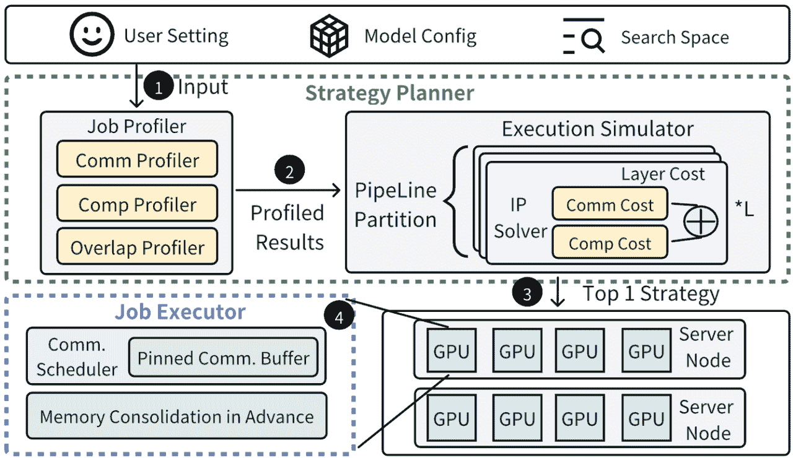

`InternEvo` 的工作流程分为四个关键步骤：1) 用户输入模型架构、超参数和集群设置；2) `Job Profiler` 分析通信带宽、计算时间和重叠特性，生成性能数据；3) `Execution Simulator` 模拟不同策略的内存成本和训练时间，结合优化求解器选出前 10 个最优策略，并通过实际系统评测确定最佳策略；4) `Job Executor` 使用选定的策略执行分布式训练任务，通过通信调度和内存管理优化性能。整个流程旨在高效探索并行化和分片策略，最大化训练速度并避免内存瓶颈。

---

## 3 实验

在本节中，我们首先通过广泛采用的多模态基准测试，将 `InternVL3` 的整体多模态能力与当前先进的 `MLLM` 进行比较。随后，我们评估了 `InternVL3` 在多个领域中的表现，包括多模态推理、数学、光学字符识别（`OCR`）、图表和文档理解、多图像理解、现实世界理解、综合多模态评估、多模态幻觉评估、视觉定位、多模态多语言理解、视频理解以及其他多模态任务，其中大多数任务使用 `VLMEvalKit` [33] 进行测试。此外，我们还详细评估了 `InternVL3` 的语言能力。最后，我们分析了 `InternVL3` 相较其前身 `InternVL2.5` 的几项关键改进的优势，包括朴素多模态预训练、`V2PE` 位置编码以及后训练技术带来的改进。

### 3.1 与其他先进 `MLLM` 的总体比较

图 1 提供了对 `InternVL3` 在多种基准测试中的性能的详细评估，这些基准包括 `MMMU` [141]、`MathVista` [80]、`AI2D` [57]、`ChartQA` [91]、`DocVQA` [93]、`InfographicVQA` [92]、`HallusionBench` [45]、`OCRBench` [76] 和 `LongVideoBench` [129]。与之前的模型相比，`InternVL3` 在广泛的类别中表现出显著改进。这些进步主要归因于增强的训练策略、优化的测试方法以及扩展的训练语料库。

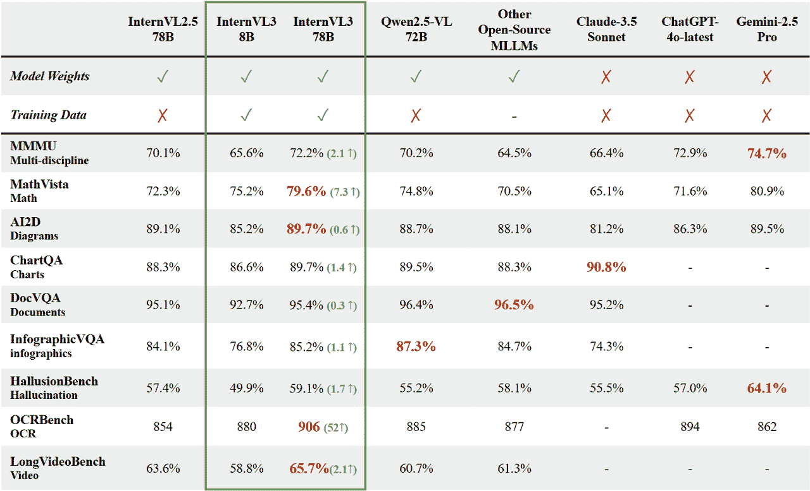

具体而言，`InternVL3` 在 `MMMU` 基准测试中取得了 72.2 的高分，突显了其处理复杂多模态挑战的强大能力。除了在 `MMMU` 上的表现外，`InternVL3` 在各种任务中始终优于 `InternVL` 系列的早期版本，从而强调了其在需要复杂多模态理解和推理的真实场景中的广泛应用性。除了超越开源竞争对手外，`InternVL3` 在与领先的闭源商业模型（如 `ChatGPT-4o-latest` [98] 和 `Claude-3.5 Sonnet` [3]）的对比中也表现出竞争力。在许多情况下，`InternVL3` 与这些专有模型之间的性能差距显著缩小——在某些基准测试中（如 `AI2D` 和 `ChartQA`），`InternVL3` 甚至超过了它们。然而，我们的结果进一步表明，`Gemini2.5 Pro` [117] 在某些任务（例如 `HallusionBench`）上仍保持性能优势，这表明尽管 `InternVL3` 取得了显著进展，但 `InternVL` 系列仍有进一步改进的空间。

### 3.2 多模态推理和数学

为了全面评估 `InternVL3` 的多模态推理和数学能力，我们在一系列基准测试中进行了实验，包括用于跨学科推理的 `MMMU` [141]、`MathVista` [80]、`MathVision` [119]、`MathVerse` [146] 用于数学推理，以及 `DynaMath` [155]、`WeMath` [99] 和 `LogicVista` [131] 用于逻辑推理的补充评估。

如表 2 所示，`InternVL3` 在所有测试基准中均表现出色。具体而言，在 `MMMU` 基准测试中，基于 `InternVL3` 的模型始终优于规模较小的竞争者。例如，随着模型规模的增加，`InternVL3-78B` 在 `MMMU` 上的得分超过 72，表明其在处理抽象跨学科概念时具有强大的理解和推理能力。在数学领域，`InternVL3` 在各种基准测试中均取得显著提升。在 `MathVista` 上，`InternVL3-78B` 的表现为接近 79.0，而在 `MathVision` 和 `MathVerse` 上，结果同样具有竞争力，证明了该模型解决复杂数学问题的能力得到了增强。此外，在 `DynaMath`、`WeMath` 和 `LogicVista` 上的表现也随着规模的扩大而持续提升。总体得分（计算为所有基准测试的平均值）显示，`InternVL3` 模型在不同方面实现了均衡的提升，超越了许多先前的开源方法。

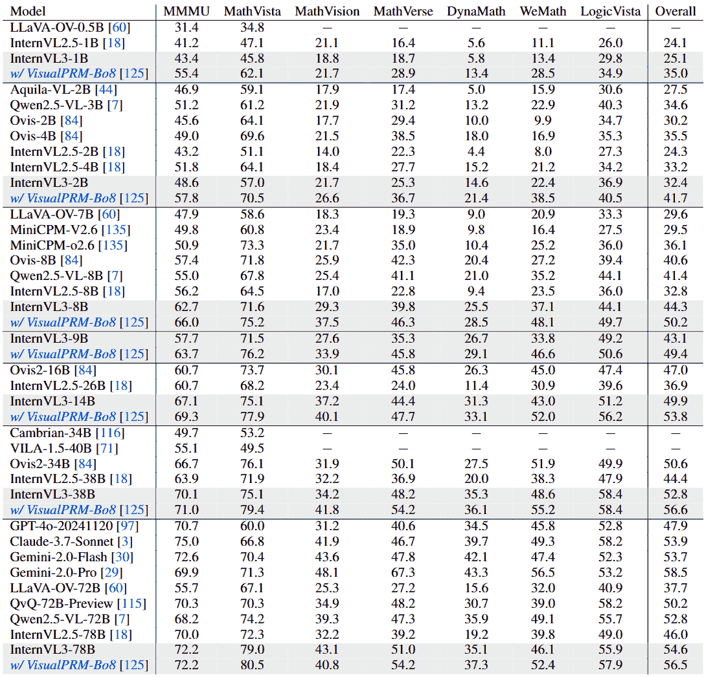

`InternVL3` 的一个显著特点是 `Best-of-N` 评估策略 [125] 的高效性。当应用这种方法时，即使是参数规模相对较小的模型（例如 `InternVL3-1B` 和 `InternVL3-2B`）在推理性能上也表现出显著改进。例如，在 `MathVerse` 的 `Vision-Only` 分割中，`Best-of-8` 策略使 `InternVL3-38B` 和 `InternVL3-78B` 的得分分别提高了约 6.0 和 3.2 个百分点。这种改进突显了测试时扩展的有效性。

### 3.3 `OCR`、图表和文档理解

为了评估模型在涉及文本、文档和图表理解的任务中的综合视觉-语言理解能力，我们在九个基准测试中进行了全面评估，包括 `AI2D` [57]、`ChartQA` [91]、`TextVQA` [107]、`DocVQA` [93]、`InfoVQA` [92]、`OCRBench` [76]、`SEED-2-Plus` [61]、`CharXiv` [128] 和 `VCR` [148]。如表 3 所示，`InternVL3` 系列不仅在这些基准测试中保持了强劲的表现，而且在与其他开源和闭源竞争者的对比中表现出竞争力或优越性。

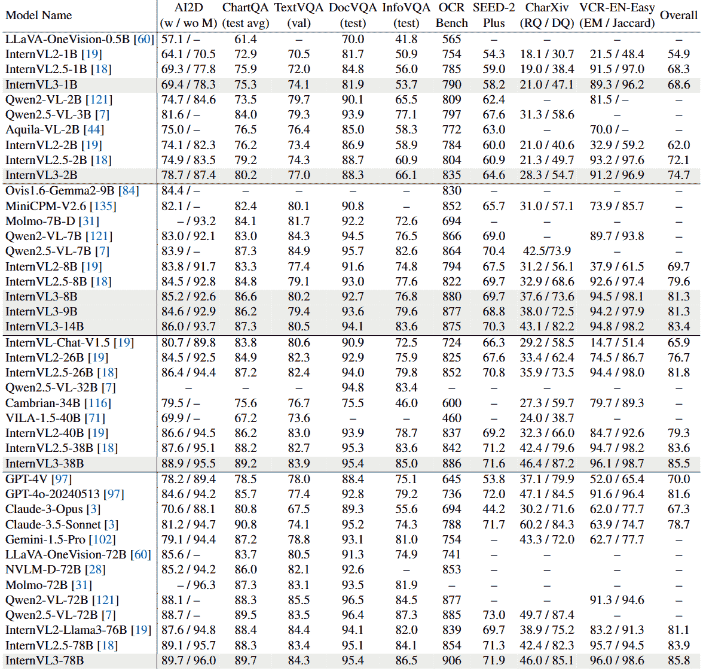

在 `1B` 规模下，`InternVL3-1B` 的表现大致与之前的低规模模型相当。在 `2B` 规模下，`InternVL3-2B` 不仅提升了绝对分数（例如，在 `AI2D` 上达到 78.7/87.4，在 `DocVQA` 上达到 88.3），而且在类似参数化的模型（如 `Qwen2-VL-2B` [121]）中表现出性能优势。尽管其 `TextVQA` 表现（77.0）仍与 `Qwen2-VL-2B` 相当，但在文档和图表理解上的改进表明，所提出的原生多模态预训练在需要精确视觉-文本整合的任务中特别有效。

新预训练协议的优势在更大规模下变得更加明显。中等规模模型（如 `InternVL3-8B` 和 `InternVL3-9B`）带来了显著的提升，其中 `InternVL3-8B` 在 `AI2D` 上达到 85.2/92.6，在 `DocVQA` 上达到 92.7，`VCR` 得分为 94.5/98.1。此外，与重量级系统（如 `Qwen2-VL-72B` [121] 或闭源模型 `GPT-4o-20240513` [97]）相比，`InternVL3` 的高规模变体（尤其是 `InternVL3-38B` 和 `InternVL3-78B`）进一步突破了界限。例如，`InternVL3-78B` 在 `OCRBench` 上取得了 906 的高分，`VCR` 得分为 96.0/98.6，明显超越了同类模型的相应指标。

### 3.4 多图像理解

我们在一系列广泛认可的基准测试中评估了 `InternVL3` 的多图像关系感知和理解能力，包括 `BLINK` [39]、`Mantis-Eval` [51]、`MMIU` [95]、`MuirBench` [118]、`MMT-Bench` [137] 和 `MIRB` [153]，如表 4 所示。这些基准测试全面评估了跨图像推理和上下文整合等技能，这些技能对于有效的多模态交互至关重要。

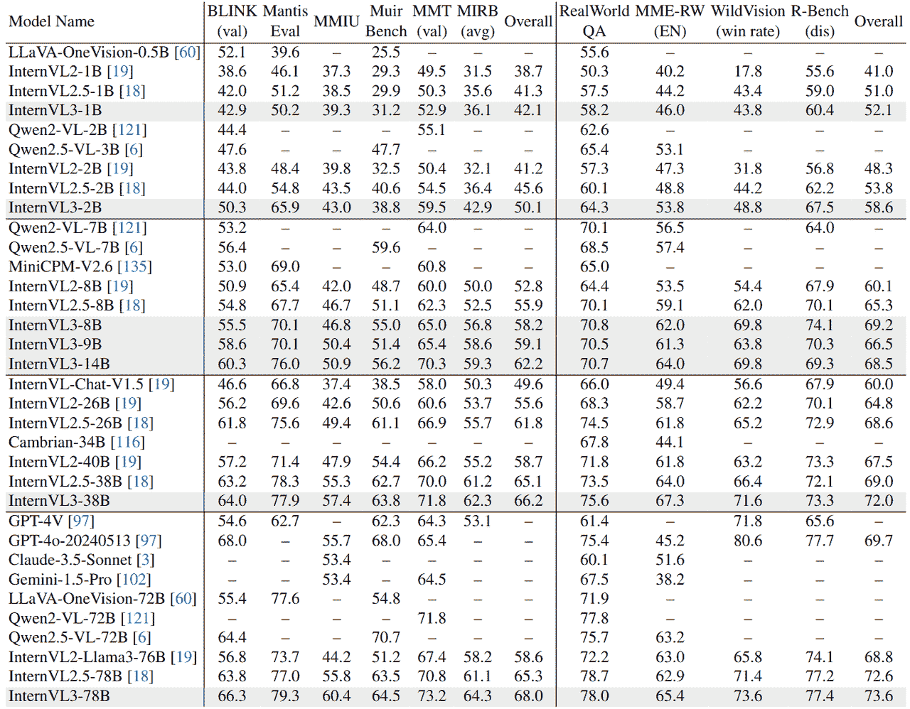

`InternVL3` 在不同参数规模下始终优于其早期版本。例如，在 `1B` 规模下，`InternVL3-1B` 表现出适度但一致的改进，`BLINK` 得分为 42.9，`MMT-Bench` 得分为 52.9。在 `2B` 规模下，性能提升更加显著；`InternVL3-2B` 在 `Mantis-Eval` 上达到了 65.9 的高分，相较于 `InternVL2.5-2B` 提升了超过 11 分，并且其 `MMT-Bench` 表现也提升至 59.5。这些改进表明，`InternVL3` 中的先进的预训练策略和增强的训练数据集显著提升了其捕捉和推理图像间关系的能力。

在更高规模下，这一趋势继续延续。`InternVL3-8B` 及其后续更大的变体不仅在 `BLINK` 和 `MMT-Bench` 上取得了稳定改进，还在 `MIRB` 和 `MuirBench` 基准测试中表现出显著提升。特别是，`InternVL3-78B` 在 `BLINK` 上达到 66.3 的得分，在 `MMT-Bench` 上达到 73.2 的得分，使其成为领先闭源模型（如 `GPT-4o`）的有力竞争者。这些结果表明，通过原生多模态预训练学习多模态能力和扩展模型参数是提升在多样化评估设置中性能的关键因素。尽管取得了令人鼓舞的结果，`InternVL3` 与其他 `MLLM`（如 `Qwen2.5-VL`）在某些基准测试（如 `MuirBench`）上仍存在明显的性能差距，这表明未来的工作可能受益于进一步优化训练数据和额外的模型改进。

### 3.5 现实世界理解

我们在四个现实世界理解基准测试中评估了 `InternVL3` 系列，包括 `RealWorldQA` [27]、`MME-RealWorld` [151]、`WildVision` [86] 和 `R-Bench` [62]，以评估其应对现实和复杂任务的能力。如表 4 所示，即使 `InternVL3` 系列中最小的变体（`InternVL3-1B`）也表现出良好的性能，`RealWorldQA` 得分为 58.2，`MME-RealWorld` 得分为 46.0，`WildVision` 胜率为 43.8，`R-Bench` 得分为 60.4。扩大模型规模会在所有指标上进一步提升表现。中等规模的变体（如 `InternVL3-8B` 和 `InternVL3-14B`）延续了这一积极趋势，其中 `InternVL3-8B` 在 `RealWorldQA` 上得分为 70.8，在 `R-Bench` 上得分为 74.1。这些改进突显了扩展的有效性，因为更大规模的模型在现实世界场景中提供了更稳健的表示和增强的理解能力。

在更大规模下，`InternVL3-38B` 和 `InternVL3-78B` 模型在 `InternVL3` 系列中取得了顶级结果。特别是，`InternVL3-78B` 在 `RealWorldQA` 上得分为 78.0，`MME-RealWorld` 得分为 65.4，`WildVision` 胜率为 73.6，`R-Bench` 得分为 77.4。与竞争模型（如 `GPT-4o` [97]，其在 `RealWorldQA` 上得分为 75.4，在 `WildVision` 上得分为 80.6）相比，`InternVL3` 系列表现出竞争优势。`InternVL3-78B` 不仅在 `RealWorldQA` 上超越了 `GPT-4o`，与其在 `R-Bench` 上的表现相近，而且在 `MME-RealWorld` 上显著优于它，表明其在需要感知精度和全面理解的任务中表现出整体稳健的性能。

### 3.6 综合多模态评估

综合多模态评估基于已建立的基准，包括 `MME` [37]、`MMBench`（评估英语和中文任务）[75]、`MMBench v1.1`（英语）[75]、`MMVet` [138]、`MMVet v2` [139] 和 `MMStar` [13]，如表 5 所示。具体而言，`InternVL3-1B` 在 `MMBench` 上取得了 72.6/67.9（英语/中文）的成绩，并将 `MMBench v1.1` 的得分提升至 69.9，相比 `InternVL2.5-1B` 基线（分别为 70.7/66.3 和 68.4）。在 `2B` 规模下，改进更为显著，其中 `InternVL3-2B` 的 `MME` 得分为 2221.2，`MMBench` 表现为 81.1/78.4，`MMBench v1.1` 得分为 78.6。

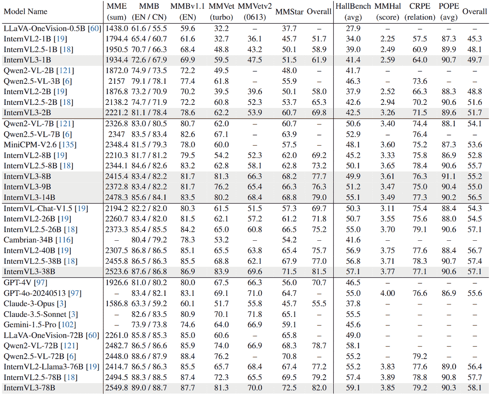

在更大规模下，`InternVL3` 模型始终表现出优越的性能。例如，`InternVL3-8B` 模型的 `MME` 得分为 2415.4，而 `InternVL3-38B` 和 `InternVL3-78B` 模型的 `MME` 得分分别为 2523.6 和 2549.8。相应的 `MMBench` 和 `MMBench v1.1` 得分也显示出稳步提升，其中 `InternVL3-78B` 在英语/中文任务中达到了 89.0/88.7，在纯英语任务中达到了 87.7。与其他竞争模型（如 `Qwen2-VL-72B` 和 `Qwen2.5-VL-72B`）相比，`InternVL3` 系列——尤其是 `78B` 变体——在多模态理解基准上提供了持续的性能优势。

### 3.7 多模态幻觉评估

### 3.7 幻觉倾向评估

我们在四个已建立的基准上评估了 `InternVL` 的幻觉倾向——`HallusionBench` [45]、`MMHal-Bench` [111]、`CRPE` [126] 和 `POPE` [67]，如表 5 所示。与之前的 `InternVL` 系列相比，新的 `InternVL3` 模型在不同规模上总体表现出竞争力，同时在处理多模态幻觉挑战方面提供了持续的改进。在小参数范围内，`InternVL3-1B` 在 `HallusionBench` 上得分为 41.4，相比 `InternVL2.5-1B` 基线（39.0）有显著提升。同样，`InternVL3` 的 2B 变体在 `HallusionBench` 上的表现（42.5）与其 `InternVL2.5` 对应版本（42.6）相当，同时在 `CRPE` 表现上有小幅提升（71.5 vs. 70.2）。

在大规模设置下，`InternVL3-38B` 和 `InternVL3-78B` 尤为引人注目。`InternVL3-38B` 在 `HallusionBench` 上得分为 57.1，而 `InternVL3-78B` 达到了 59.1，同时 `CRPE` 提升至 79.2。这些数据使 `InternVL3` 系列在与领先的闭源和开源模型（如 `GPT-4o` 和 `Qwen2.5-VL` 系列）的竞争中占据一席之地。尽管取得了这些进展，但在某些基准测试（如 `MMHal`）上的小幅下降表明，虽然 `InternVL3` 系列整体上取得了进步，但优化数据和训练策略以实现更一致的改进仍然是未来工作的重要方向。

### 3.8 视觉定位

我们在 `RefCOCO` [56]、`RefCOCO+` [56] 和 `RefCOCOg` [88] 数据集上评估了 `InternVL` 的视觉定位能力，其中模型的任务是从给定的文本描述中准确定位图像中的目标对象。表 6 显示了各种模型的全面比较，包括几个专门的定位模型以及多个 MLLLM。

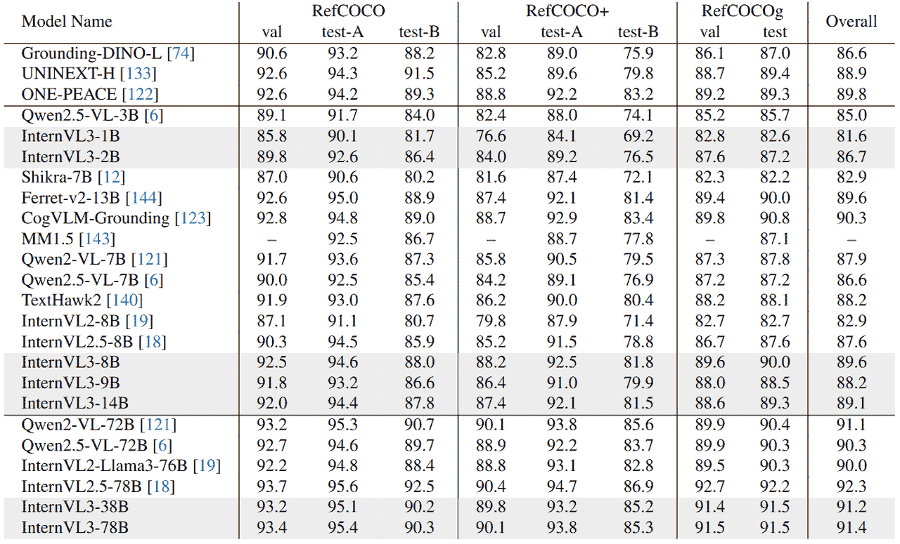

在较小规模的模型中，我们观察到，虽然 `Qwen2.5-VL-3B` 的平均得分为 85.0，但 `InternVL3-1B` 和 `InternVL3-2B` 模型的平均得分分别为 81.6 和 86.7。值得注意的是，随着规模的扩大，`InternVL3` 系列表现出良好的改进。`InternVL3-8B`、`InternVL3-9B` 和 `InternVL3-14B` 的平均得分约为 88.2–89.6，反映出随着模型规模增加，性能增益的一致趋势。然而，当达到更大规模时，性能增益似乎趋于平稳。例如，`InternVL2.5-78B` 的平均得分为 92.3，而 `InternVL3-78B` 仅显示出 91.4 的得分。我们推测，这是因为 `InternVL3` 的训练数据扩展并未包含额外的定位特定数据，相对减少的定位目标数据可能限制了定位能力。

### 3.9 多模态多语言理解

我们使用 `MMMB`、`Multilingual MMBench` [109] 和 `MTVQA` [113] 基准评估了 `InternVL` 的多模态多语言理解能力，如表 7 所示。与之前的前辈相比，`InternVL3` 系列在多语言性能上表现出持续的改进。例如，轻量级的 `InternVL3-1B` 已经显示出比 `InternVL2.5-1B` 的小幅改进，而更大规模的变体（如 `InternVL3-38B` 和 `InternVL3-78B`）在所有三个基准上都取得了显著更高的平均得分。

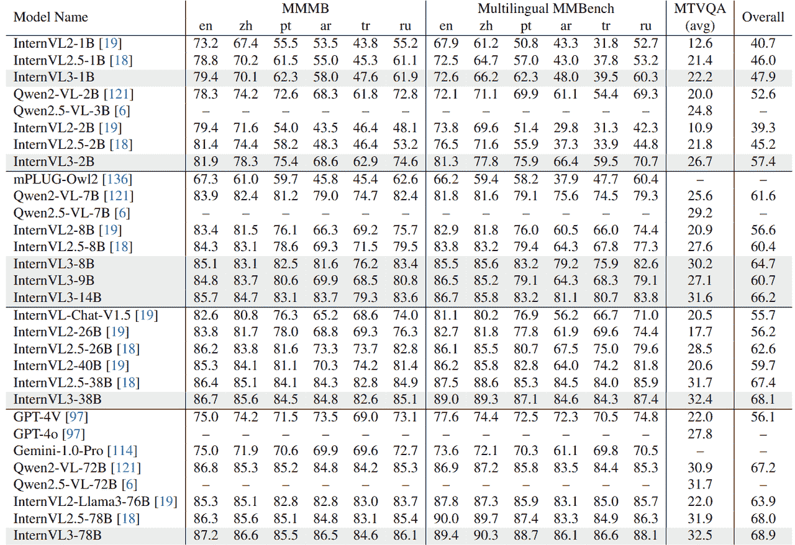

与其他领先模型的比较进一步突显了 `InternVL3` 系列的有效性。值得注意的是，`InternVL3` 变体的表现与 `Qwen2-VL-72B` [121] 和 `Qwen2.5-VL-72B` [6] 等模型相当或更优。总体而言，`InternVL3` 系列在 `MMMB`、`Multilingual MMBench` 和 `MTVQA` 上的增强性能凸显了我们的方法在全球多模态应用中的前景。

### 3.10 视频理解

视频理解对于评估 `MLLM` 在复杂视频内容中捕捉时间和多模态线索的能力至关重要。在这项工作中，我们在六个已建立的基准上评估了 `InternVL3` 系列——`Video-MME` [38]、`MVBench` [65]、`MMBench-Video` [35]、`MLVU` [154]、`LongVideoBench` [129] 和 `CG-Bench` [2]，如表 8 所示。

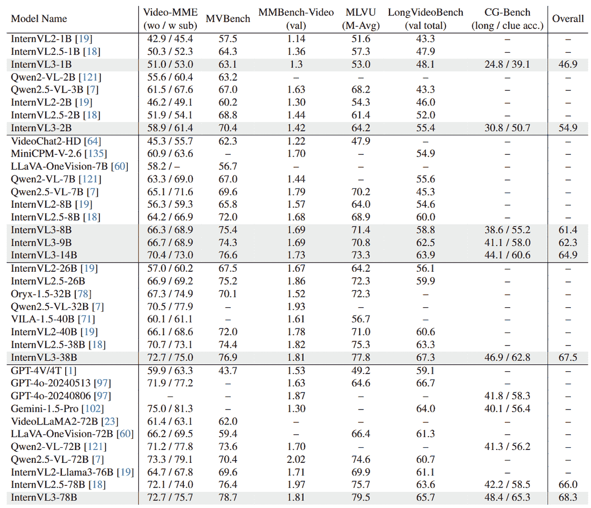

总体而言，`InternVL3` 模型表现出明显的性能改进和强大的可扩展性趋势，超越了其前辈。随着模型容量的增加，性能增益变得更加显著。例如，`InternVL3-2B` 在 `Video-MME` 上的得分为 58.9/61.4，并在 `MVBench` 和 `MLVU` 上表现优于早期的 2B 变体。

`InternVL3` 系列的扩展行为在更大的模型中进一步显现。`InternVL3-14B` 在 `Video-MME` 上得分为 70.4/73.0，而 `InternVL3-38B` 和 `InternVL3-78B` 将这些指标进一步推高，分别达到 72.7/75.0 和 72.7/75.7。此外，对 `InternVL3` 系列的 `CG-Bench` 评估提供了对长距离视频推理的进一步洞察，随着模型规模的增加，性能稳步提升——例如，`InternVL3-78B` 在 `CG-Bench` 上得分为 48.4/65.3。

与其他开源模型相比，`InternVL3` 系列表现出竞争优势。例如，虽然 `Qwen2.5-VL` 模型取得了令人印象深刻的结果（`Qwen2.5-VL-72B` 在 `Video-MME` 上得分为 73.3/79.1），但 `InternVL3` 系列在其他指标（如 `MVBench` 和 `MLVU`）上往往表现更好。同样，虽然像 `Gemini-1.5-Pro` 这样的闭源系统有时在某些基准（如 `Video-MME`）上产生优异结果，但 `InternVL3` 的整体性能——尤其是在更大规模下——具有高度竞争力。

### 3.11 GUI 定位

GUI 定位需要精确定位和理解界面元素，这对于自动化 UI 测试和辅助技术等应用至关重要。在表 9 中，我们报告了 GUI 定位基准上的性能，将 `InternVL3` 与最先进的多模态和 GUI 特定模型进行了比较。结果显示，`InternVL3` 在不同规模上实现了具有竞争力的性能。在 `ScreenSpot` [22] 上，`InternVL3-72B` 实现了 88.7% 的准确率，略优于 `UI-TARS-72B` [100]（88.4%）和 `Qwen2.5-VL-72B`（87.1%），而 `Aguvis-72B` [132] 以 89.2% 领先。值得注意的是，`InternVL3-38B`（85.6%）显著超过了 `GPT-4o`（18.1%）和 `Gemini 2.0`（84.0%）。

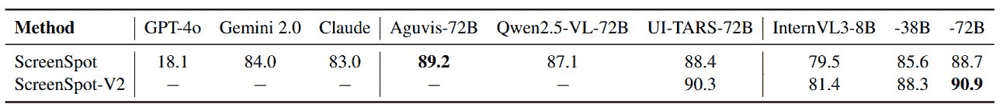

对于更具挑战性的 `ScreenSpot-V2` [130] 基准，`InternVL3` 表现出强大的扩展行为：`InternVL3-72B` 达到了 90.9%，优于 `UI-TARS-72B`（90.3%）。8B 变体（81.4%）已经超过了 `UI-TARS-72B`，而 38B 模型（88.3%）进一步缩小了与 72B 版本的差距。这些结果突显了 `InternVL3` 在 GUI 理解任务中的稳健性，特别是在处理复杂的屏幕布局和动态界面时。随着模型规模的性能改进表明，更大的架构更好地捕捉了精确 GUI 定位所需的细粒度视觉-文本对齐。`InternVL3` 模型的卓越性能突显了其在解释复杂视觉布局中的稳健性。未来的工作将探索将这些能力扩展到更多动态和交互式 GUI 环境中。

### 3.12 空间推理

空间推理涉及从视觉输入构建三维环境的心理表征——这一能力对于自动驾驶等应用至关重要。表 10 报告了在视觉-空间智能基准（`VSI-Bench`）[134] 上的性能结果，其中 `InternVL3` 与其他最先进的 `MLLM` 进行了比较。结果清楚地表明，`InternVL3` 在空间推理任务中优于其竞争对手。特别是，`InternVL3-8B` 变体得分为 42.1，领先于基准中所有开源 `MLLM`。此外，`InternVL3-38B` 和 `InternVL3-78B` 变体分别得分为 48.9 和 48.4——均优于 `GPT-4o`、`Gemini-1.5 Flash` 和 `Gemini-1.5 Pro` 等专有模型。

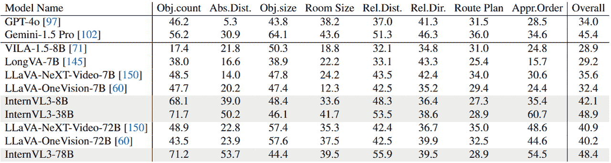

此外，`InternVL3` 在基准内的几个子类别任务中表现出色。它在物体计数中得分为 71.2，在绝对距离估计中得分为 53.7，在相对距离估计中得分为 55.9，在外观顺序预测中得分为 54.5，展示了其强大的空间推理能力。这些令人鼓舞的结果突显了 `InternVL3` 在推进 3D 场景理解方面的潜力，未来的工作将探索其在各种下游应用中的集成。

### 3.13 语言能力评估

表 11 展示了在一系列多样化基准上对语言能力的性能评估。这些基准涵盖了通用知识、语言理解、推理、数学和编码任务的综合评估，如 `MMLU` [46]、`CMMLU` [63]、`C-Eval` [48]、`GAOKAO-Bench` [149]、`TriviaQA` [52]、`NaturalQuestions` [58, 110]、`RACE` [59]、`WinoGrande` [103]、`HellaSwag` [142]、`BigBench Hard` [112]、`GSM8K-Test` [25]、`MATH` [47]、`TheoremQA` [17]、`HumanEval` [14]、`MBPP` [4] 和 `MBPP-CN` [4]。

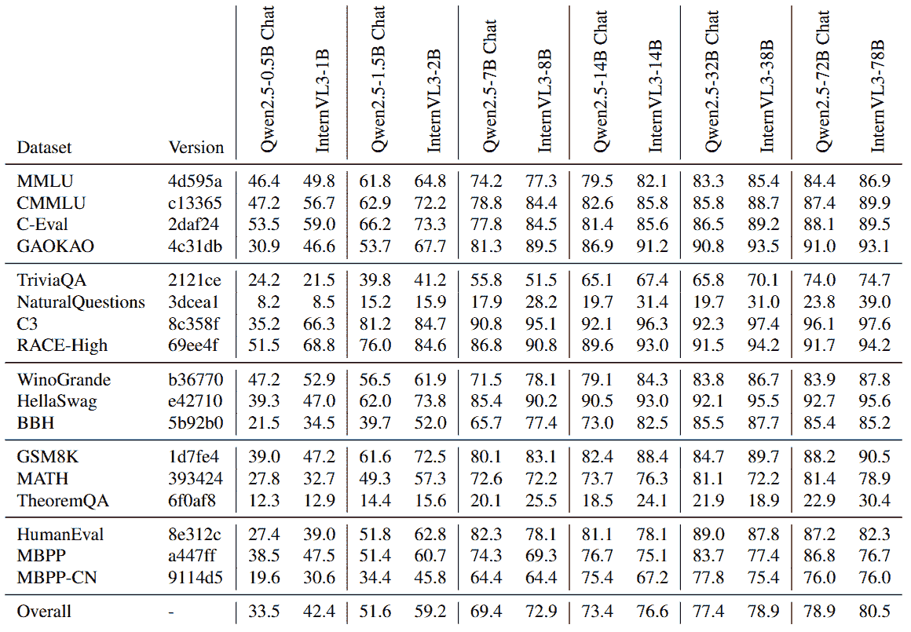

特别是，进行的实验比较了 `Qwen2.5 Chat` 模型与相应的 `InternVL3` 变体的性能。两个模型系列共享相同的预训练 `Qwen2.5` 基础模型作为初始化。在经过原生多模态预训练和额外的后训练后，`InternVL3` 系列在大多数评估基准上始终表现出优于 `Qwen2.5 Chat` 模型的性能。

这种语言能力的增强主要源于几个因素，包括大约 25% 的纯语言数据的整合、原生多模态预训练期间的联合参数优化，以及后续后训练阶段高质量文本语料库的广泛使用。这种方法不仅增强了多模态理解，还显著提高了语言能力。因此，即使源自相同的预训练基础模型，`InternVL3` 采用的集成多模态和纯文本训练策略在语言能力方面相比 `Qwen2.5 Chat` 模型的纯文本任务专用训练管道实现了显著的性能提升。

### 3.14 消融研究

#### 原生多模态预训练的有效性

为了评估原生多模态预训练（native multimodal pre-training）的有效性，我们在 `InternVL2-8B` 模型上进行了实验，同时保持其架构、初始化参数和训练数据完全不变。传统上，`InternVL2-8B` 使用的训练流程从一个多层感知机（`MLP`）热身阶段开始，用于多模态对齐，随后进入指令微调阶段。在我们的实验中，我们用原生多模态预训练过程替代了传统的 `MLP` 热身阶段。这一修改将原生多模态预训练对模型整体多模态能力的贡献独立出来。

图 3 的评估结果表明，使用原生多模态预训练的模型在大多数基准测试中的表现与经过完整多阶段训练的 `InternVL2-8B` 基线模型相当。此外，在使用更高质量的数据进行指令微调后，该模型在所有评估的多模态任务中都表现出进一步的性能提升。这些发现突显了原生多模态预训练在赋予大型语言模型（`MLLM`s）强大多模态能力方面的高效性。

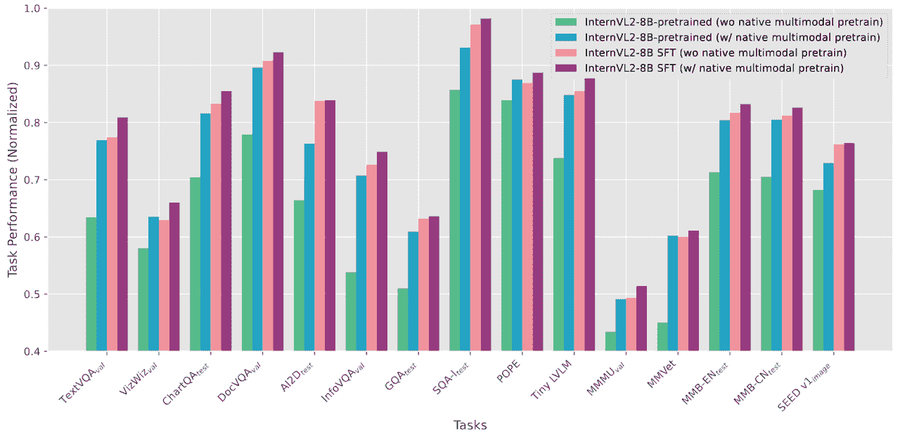

#### 可变视觉位置编码的评估

为了增强长上下文场景中的多模态能力，`InternVL3` 在其视觉嵌入中采用了可变视觉位置编码（`V2PE`）。然而，在原始的 `V2PE` [42] 中，这种针对视觉标记的专用位置编码在中等上下文长度的多模态任务中并未带来显著收益。为了进一步探索 `V2PE` 在更广泛设置下的有效性，我们在原生多模态预训练阶段引入了它，并在标准多模态基准测试中评估了预训练后的 `InternVL3-8B` 模型。

如表 12 所示，引入 `V2PE` 在大多数评估指标上带来了显著的性能提升。此外，通过改变位置增量 `δ` 的消融研究表明，即使对于主要涉及短上下文的任务，相对较小的 `δ` 值也能实现最佳性能。这些发现为未来改进 `MLLM` 中视觉标记的位置编码策略提供了重要见解。需要注意的是，为了确保公平比较，本报告中其他所有结果均保持固定的 `δ = 1`，仅表 12 中的实验结果例外。

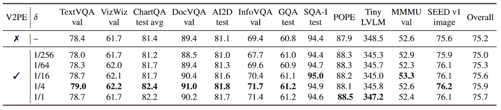

#### 混合偏好优化的有效性

在此，我们展示了混合偏好优化（`MPO`）的有效性。如表 13 所示，使用 `MPO` 微调的模型在七个多模态推理基准测试中表现出优于未使用 `MPO` 的对应模型的推理性能。具体而言，`InternVL3-78B` 和 `InternVL3-38B` 分别比其对应模型高出 4.1 和 4.5 分。注意的是，用于 `MPO` 的训练数据是 `SFT` 所用数据的一个子集，这表明性能提升主要来源于训练算法而非训练数据。

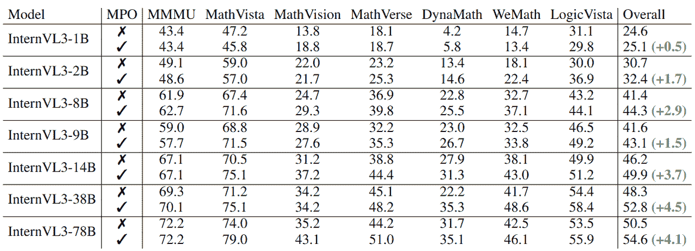

## 4 结论

我们推出了 `InternVL3`，这是 `InternVL` 系列的一项重要进展，实现了原生多模态预训练范式。通过在预训练阶段联合学习语言能力和多模态能力，`InternVL3` 避免了通常与后置 `MLLM` 训练流程相关的复杂性和优化挑战。通过引入变量视觉位置编码（`V2PE`）以支持扩展的多模态上下文、采用先进的后训练策略（如监督微调和混合偏好优化）以及测试时扩展，`InternVL3` 在广泛的多模态任务中树立了新的开源基准，同时保持了强大的语言能力。值得注意的是，`InternVL3-78B` 在 `MMMU` 基准测试中取得了 72.2 分的成绩，超越了以往的开源 `MLLM` 模型，并缩小了与领先的专有模型（如 `Gemini-2.5 Pro`）之间的性能差距。秉承我们推动多模态大语言模型社区创新的承诺，我们将公开发布 `InternVL3` 的训练数据和模型权重，从而进一步促进这一快速发展的领域的研究与开发。
