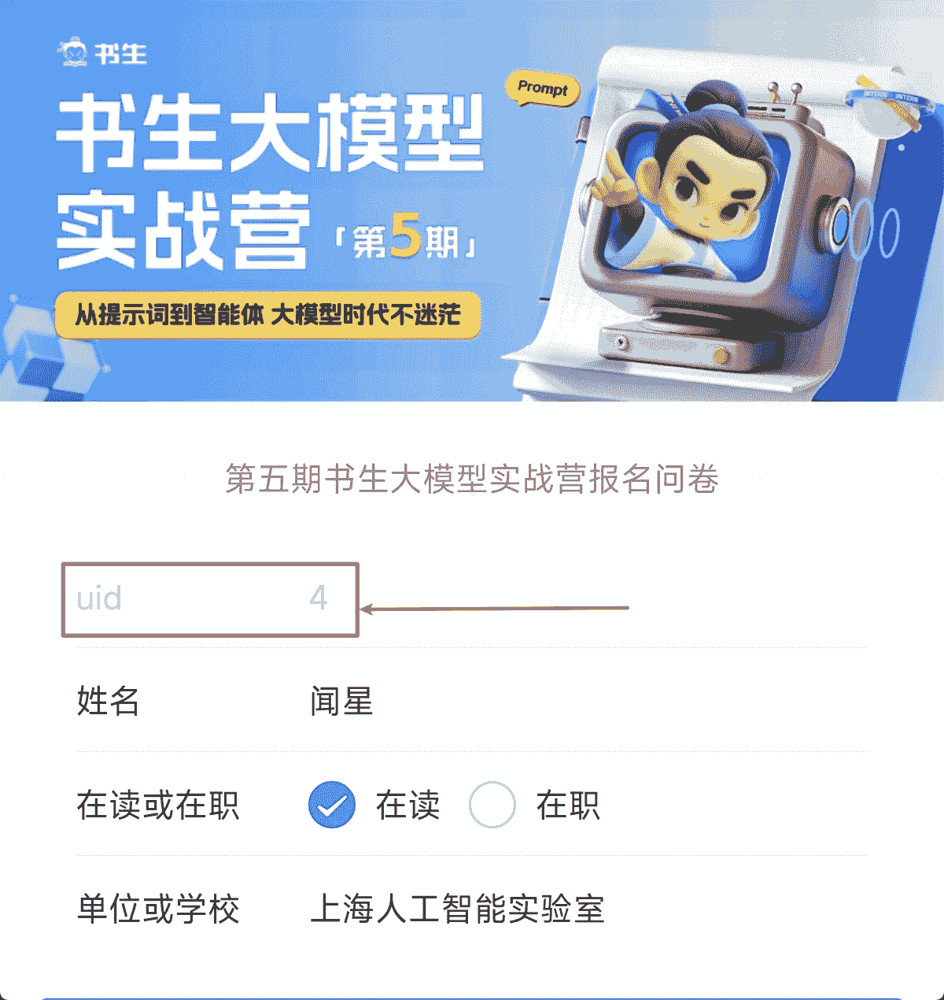
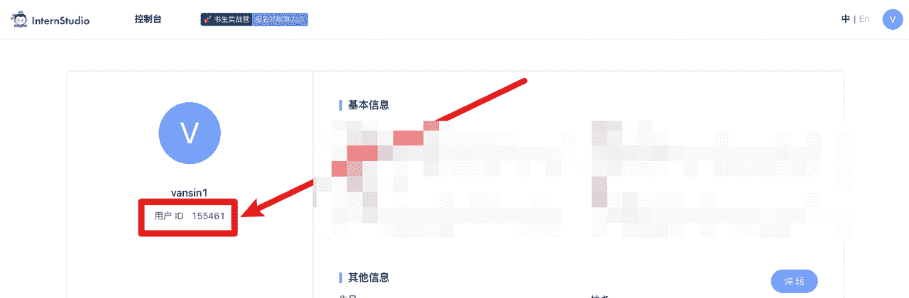
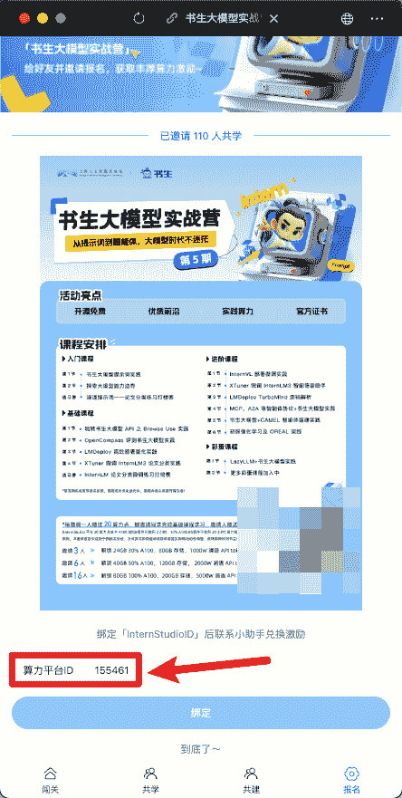
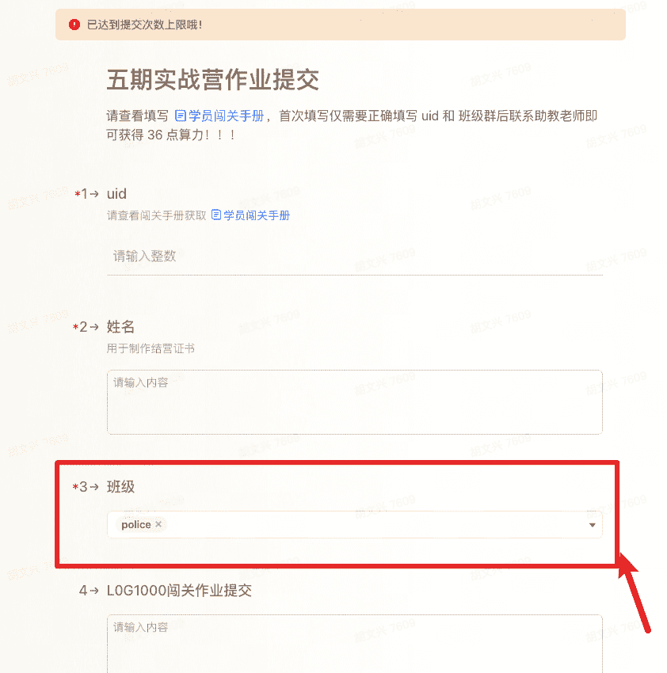
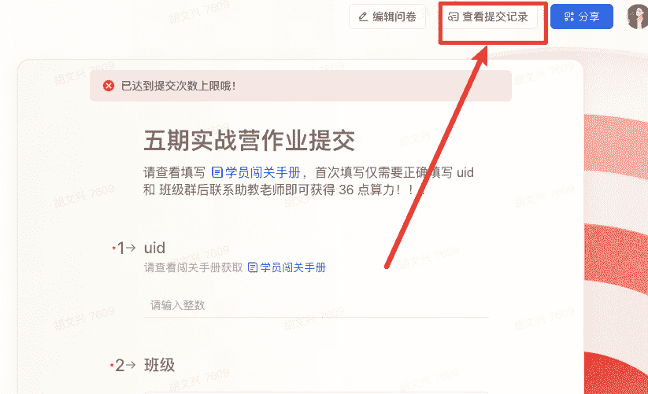
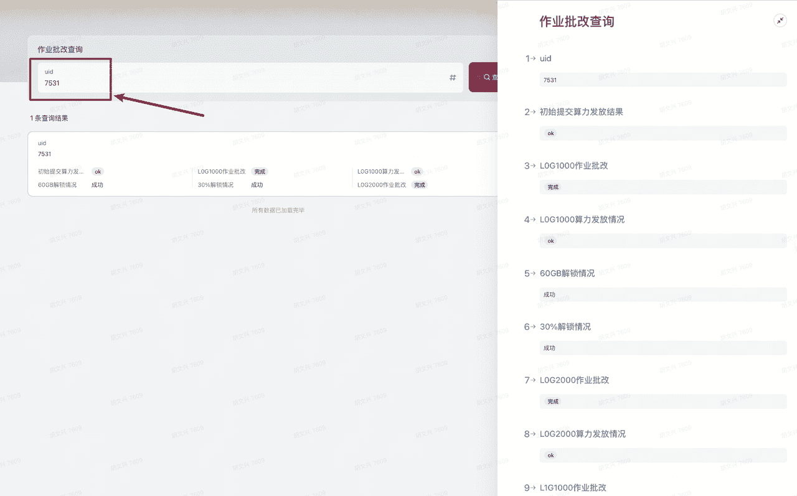
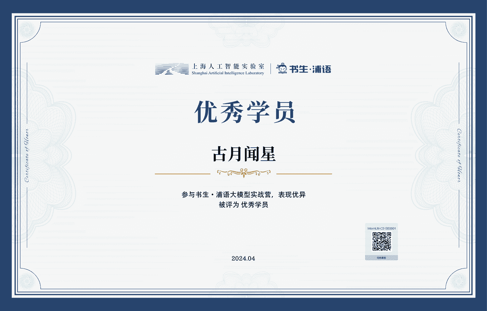
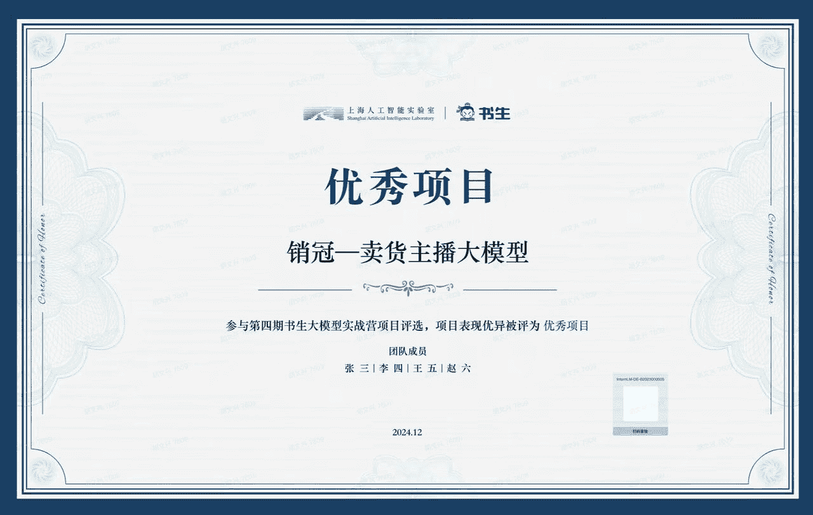
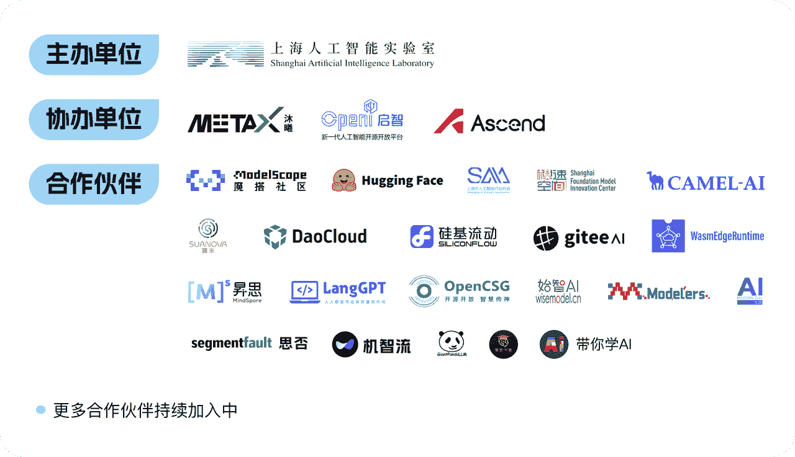
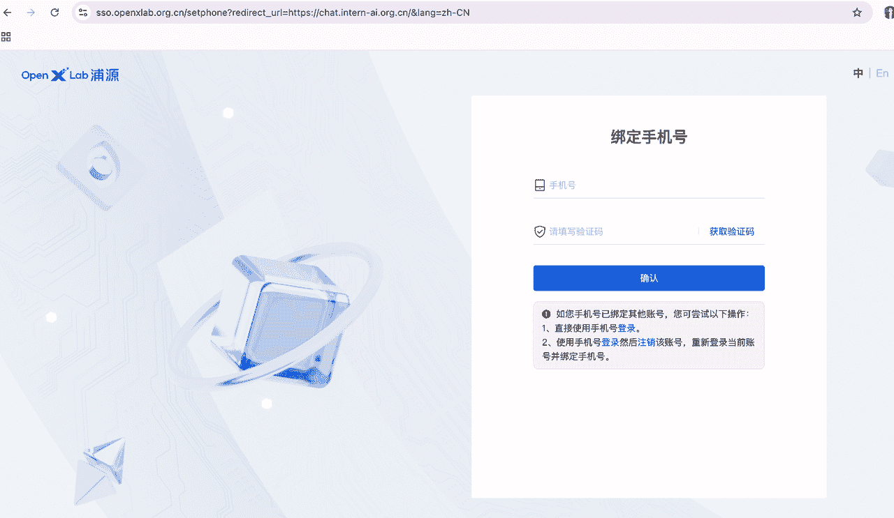

# 学员闯关手册 （公安专场）

> 来源：[https://aicarrier.feishu.cn/docx/FuDTdBm1moMdZYx6GGycaXH5nAe](https://aicarrier.feishu.cn/docx/FuDTdBm1moMdZYx6GGycaXH5nAe)

欢迎小伙伴参加第五期书生大模型实战营，公安专场。

| 第五期书生大模型实战营 |  |
| --- | --- |
| 环节 | 日期 |
| 开营闯关 | 7 月 15 日 |
| 结营 | 8 月 15 日（待定） |
| 第一批算力资源回收重置 | 8 月 15 日 |

**算力来源：**

+   邀请共学获取算力

+   闯关获取算力（等开营后）

+   项目申报获取算力 [🔥书生大模型开源社区项目申报🔥](https://aicarrier.feishu.cn/wiki/JuXvwHzGni2A2Rksd8Rczpvxngb?open_in_browser=true)

**书生ChatWeb:**  https://chat.intern-ai.org.cn/

InternStudio 算力平台：https://studio.intern-ai.org.cn/

# 闯关前准备（必看）

uid（报名id）、Internstudio id (平台算力ID) 涉及发放算力，需要按照文档一步步操作。

## 报名并获取 uid

报名链接：[https://colearn.intern-](https://colearn.intern-ai.org.cn/set?s=lark)ai.org.cn/set?s=lark

例如这个 **uid** 为 4

## 报名页面 绑定算力平台ID（ InternStudio ID）

⚠️注意：只有在报名页面成功绑定了 InternStudio   ID 才能正常发放算力资源。

⚠️新用户 **请****用手机号码登陆 Inte**rnStudio、请用手机号码登陆 InternStudio、请用手机号码登陆 InternStudio（重要的事情说三遍！！）

用手机号码登录 internstudio 获取 internstudio id

https://studio.intern-ai.org.cn/user/info

例如此 InternStudio ID 为 155461

获取 InternStudio 后在以下报名链接中绑定 internstudio id

[https://colearn.intern-](https://colearn.intern-ai.org.cn/set?s=lark)ai.org.cn/set?s=lark

InternStudio ID 填写错误需要解绑，完成首次作业问卷提交后，联系助教可解绑

## 🛰️班级群中改昵称

请将🛰️群中的昵称改为【uid-昵称】例如【4-闻星】

## 首次提交作业问卷获取 36 点初始算力点

完成上述报名，报名页面 uid 绑定 InternStudio 后，请在下方链接完成作业初始化提交后，联系助教可以获得 36 点初化算力点。

https://aicarrier.feishu.cn/share/base/form/shrcnkSJ97ykqRSz4fgyCJbvCsb

**班级请选择 Police**

# 闯关

## 闯关关卡

**特别注意：**

+   提交作业时不要泄漏自己的 API Key

+   笔记和作业请统一以飞书文档方式提交

| 入门岛 |  |  |  |  |  |
| --- | --- | --- | --- | --- | --- |
|  | 关卡编号 | 关卡名称 | 课程贡献者 | 关卡资料 | 通关激励 |
| 第1关 | L0G1000 | 书生大模型提示词实践 | 王明 | [闯关任务](https://aicarrier.feishu.cn/wiki/DK9Wwf1DRiidwgk1FPDcvj6Bnxq)、[文档](https://aicarrier.feishu.cn/wiki/DK9Wwf1DRiidwgk1FPDcvj6Bnxq)、[视频](https://www.bilibili.com/video/BV1vUjYz2Eys/) | 20 算力点，解锁  60 GB 磁盘，30% A100 |
| 第2关 | L0G2000 | 探索大模型能力边界 | 三金 | [闯关任务](https://aicarrier.feishu.cn/wiki/PR7xw4ktwiIiZAkQJKkcojO7nbe) | 20 算力点，compassarena 一次有效投票 10 算力点 |
| **入门岛练习赛：**[浦语提示词——论文分类练习打榜赛](https://aicarrier.feishu.cn/wiki/SEfTwYCgAiDEkskx7yocvzuhnph) |  |  |  |  |  |
| 基础岛 |  |  |  |  |  |
|  | 关卡编号 | 关卡名称 |  | 关卡资料 | 通关激励 |
| 第1关 | L1G1000 | 玩转书生大模型 API 之 Browse Use实践 | 三金 | [闯关任务](https://aicarrier.feishu.cn/wiki/XhoNw2qzPir8qmkVNYyc5YAunrc#share-O7OddkvO2o4obExgQpwceDdlnXb)、[文档](https://aicarrier.feishu.cn/wiki/XhoNw2qzPir8qmkVNYyc5YAunrc) | 40 算力点 |
| 第2关 | L1G2000 | OpenCompass 评测书生大模型实践 | 洛 | [闯关任务](https://aicarrier.feishu.cn/wiki/ZW3KwXZn8iDRPlkMKXZcARHunWg#share-CCJfdvBXNoWEAvxkF4Ec6b6KnTg)、 [文档](https://aicarrier.feishu.cn/wiki/ZW3KwXZn8iDRPlkMKXZcARHunWg) | 40 算力点 |
| 第3关 | L1G3000 | LMDeploy 高效部署量化实践 | 永康 | [闯关任务](https://aicarrier.feishu.cn/wiki/IW3HwIVZ3icIpEkd8cXcFq5NnNd#share-UP7FdbFeMole6bxkpwDc4w0inM9)、 [文档](https://aicarrier.feishu.cn/wiki/IW3HwIVZ3icIpEkd8cXcFq5NnNd) | 40 算力点 |
| 第4关 | L1G4000 | XTuner 微调 InternLM 论文分类实践 | 尖米 | [闯关任务](https://aicarrier.feishu.cn/wiki/D7kZw9Nx4iMyDnkpL0Gc5giNn5g#share-U42edYVsMom6hexTrH1cBRLdnmd)、[文档 1](https://aicarrier.feishu.cn/wiki/D7kZw9Nx4iMyDnkpL0Gc5giNn5g)、[文档 2](https://aicarrier.feishu.cn/wiki/HfQuwYa4Xi4WJVkuNF3cygqnnch) | 40 算力点，解锁 80GB， 50% A100 |
| **基础岛练习赛：**[端测小模型论文分类微调练习打榜赛 ](https://aicarrier.feishu.cn/wiki/I5ywwN1ZZi5m1pk5fhKcGL0Dn0j) |  |  |  |  |  |
| 进阶岛（选修） |  |  |  |  |  |
|  | 关卡编号 | 关卡名称 |  | 关卡资料 | 通关激励 |
| 第1关 | L2G1000 | InternVL 部署微调实践 | 王培东 | [文档](https://aicarrier.feishu.cn/wiki/XrZkwmKmfipoGkkkE3ycJVYknsc) | 40算力点 |
| 第2关 | L2G2000 | GraphGen：训练数据合成实践 | 贡献者 | [文档](https://aicarrier.feishu.cn/wiki/GZG8wHdA5ickHQkQjJhcPr9Pnzh) | 40算力点 |
| 第3关 | L2G3000 | LMDeploy TuborMind 源码解析 | 企鹅火烈鸟 | [文档](https://aicarrier.feishu.cn/wiki/BEQjwYEaJioy7Yk7imNcv5JDnvf) | 40算力点 |
| 第4关 | L2G4000 | 智能体协议 MCP + 书生大模型实践 | 书同文 | [文档](https://aicarrier.feishu.cn/wiki/MjVjwCDmvieQrRk3iT5cuGOAnId) | 40算力点 |
| 第5关 | L2G5000 | CAMEL 书生多智能体系统实践 | CAMEL | [文档](https://aicarrier.feishu.cn/wiki/Xh9Mw01KkiN2eAkBx2McbFg1nkV) | 40算力点 |
| 第6关 | L2G6000 | 初探强化学习及 OREAL 实践 | Tan90 | [文档](https://aicarrier.feishu.cn/wiki/EPUWwViPTibN5LkuAGfcY02KnEh) | 40算力点 |

注意：作业笔记统一提交到飞书文档

## 如何提交作业

https://aicarrier.feishu.cn/share/base/form/shrcnkSJ97ykqRSz4fgyCJbvCsb

点击查看提交记录可以进去补交后续各节课的作业

## 如何查看作业批改情况

在下方链接中输入 uid 查看作业批改情况

https://aicarrier.feishu.cn/share/base/query/shrcnchQXOHnnGDZ7VUqwmyz1Ig

## 如何下载证书

联系助教老师或者  发送 uid 可领取证书。

# 项目申请

第五期项目申报地址：[🔥书生大模型开源社区项目申报🔥](https://aicarrier.feishu.cn/wiki/JuXvwHzGni2A2Rksd8Rczpvxngb?open_in_browser=true)

| 阶段 | 事项 | 算力激励 | API Token 激励 |
| --- | --- | --- | --- |
| 1 | 项目登记 | 168 算力点 | 500W |
| 2 | 初版GitHub Repo和技术架构图 | 333 算力点 | 2500W |
| 3 | 高质量架构图和方案 | 1688 算力点 | 1亿（部分项目可解锁 50 RPS） |
| 4 | 高质量的视频(项目视频播放量超500，且制作精良) | 3600 算力点 | 2亿（50RPM） |
| 5 | 于优秀项目中评选，在👸号文章发起投票，票数前 10 名的项目。 | 3600 算力点 | 5 亿 (50RPM) |
| 5 | 项目视频播放量超 5K、GitHub Repo Star 超 500 | 7200 算力点 | 10亿（50RPM） |

**优秀项目证书**

<https://aicarrier.feishu.cn/sync/OsSedA8ZssKa6ubIiiLcin22nFh>

# 书生·共学计划获取学习算力

小伙伴们可以在报名界面制作并转发自己的专属海报。

| 条件 | 激励 |
| --- | --- |
| 邀请 3 人报名 | 解锁 24GB 30% A100，80GB 存储， 1000W 浦语 API tokens |
| 邀请 6 人报名 | 解锁 40GB 50% A100，120GB 存储， 2000W 浦语 API tokens |
| 邀请 16 人报名 | 解锁 80GB 100% A100，200GB 存储，5000W 浦语 API tokens |
| +   每邀请一人报名赠送 20 算力点。 |  |

本活动规则可能根据实际情况进行调整，活动最终解释权由书生大模型运营团队所有。

专属海报制作地址：https://colearn.intern-ai.org.cn/co

By the way, 要让小伙伴通过自己生成的问卷报名成功才记作邀请成功哦~

算力是系统自动发放的，所以请大家千万注意仔细阅读计划说明。

<https://colearn.intern-ai.org.cn/ilead>

# 班级🛰️群

进入班级群后请将备注改为【uid-昵称】

# 合作伙伴

感谢合作伙伴对书生大模型实战营活动的支持!!!!

# QA 板块

小伙伴们可以在 [QA 文档](https://aicarrier.feishu.cn/wiki/VWn0wy6vNiTYAUkhflMchz3SnDe) 中填写问题，将有小伙伴解答您的问题！

## 如何申请成为助教

🛰️搜索 van-sin 添加小助手私聊申请成为助教！

## InternStudio 开发机的环境玩坏了，如何初始化开发机环境

**慎重执行！！！！所有数据将会丢失，仅限 InternSt**udio 平台，自己的机器千万别这么操作

+   第一步本地终端 ssh 连上开发机（一定要 ssh 连接上操作，不能在 web 里面操作！！！，不要用 vscode ssh 链接）

+   第二步执行  rm -rf /root，大概会等待10分钟

+   第三步**重启开发机****,系统会重置 /**root 路径下的配置文件（一定要重启！！！）

+   第四步 ln -s /share /root/share

## 算力怎么来？

1.  书生共学邀请好友成功报名（每日同步一次算力发放脚本）

1.  完成闯关任务（需助教大大批改之后自动发放）

1.  项目申报成功

## 使用 API 需要绑定号码去哪里绑定？

https://sso.openxlab.org.cn/usercenter?lang=zh-CN

##  InternStudio ID 问题

系统陈年问题，https://studio.intern-ai.org.cn/console/dashboard 和 chat.intern-ai.org.cn 统一用手机号码登陆