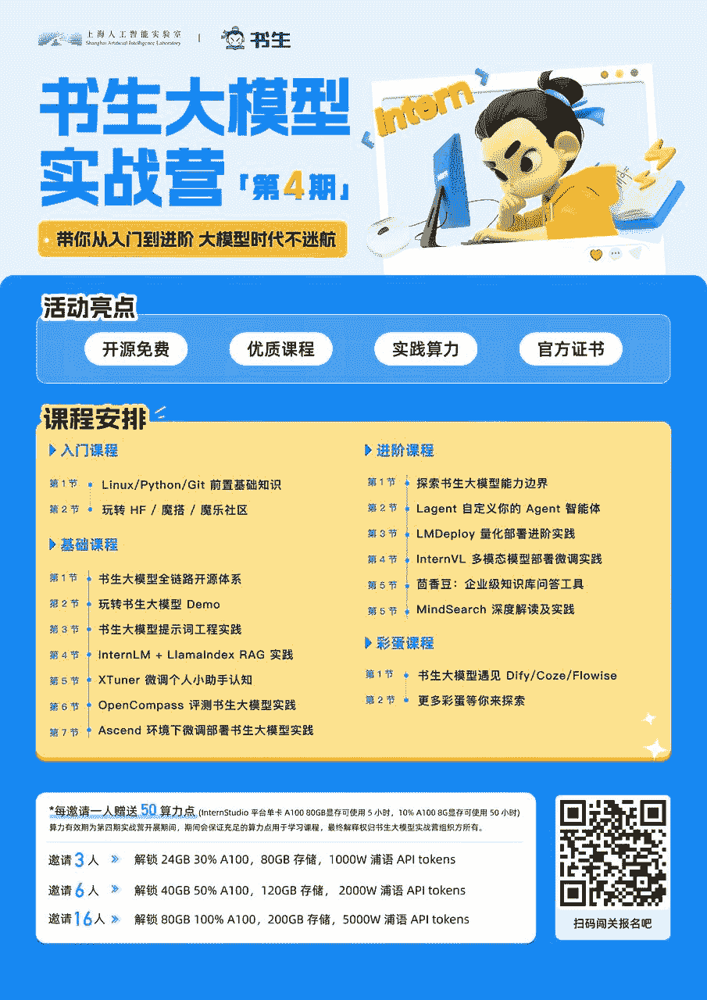
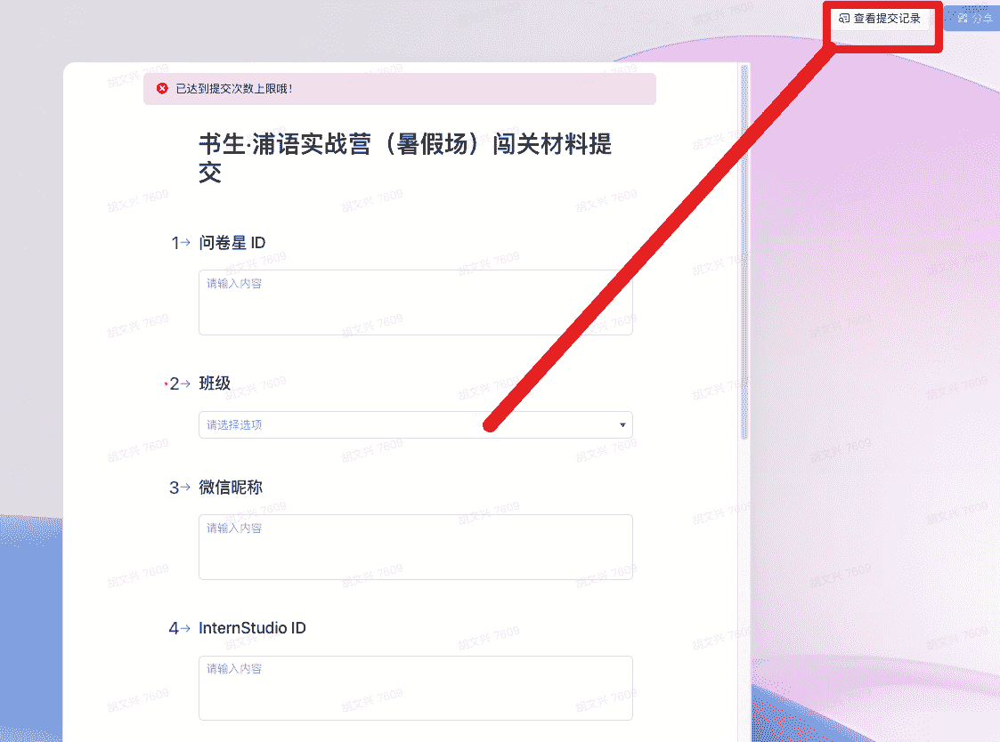
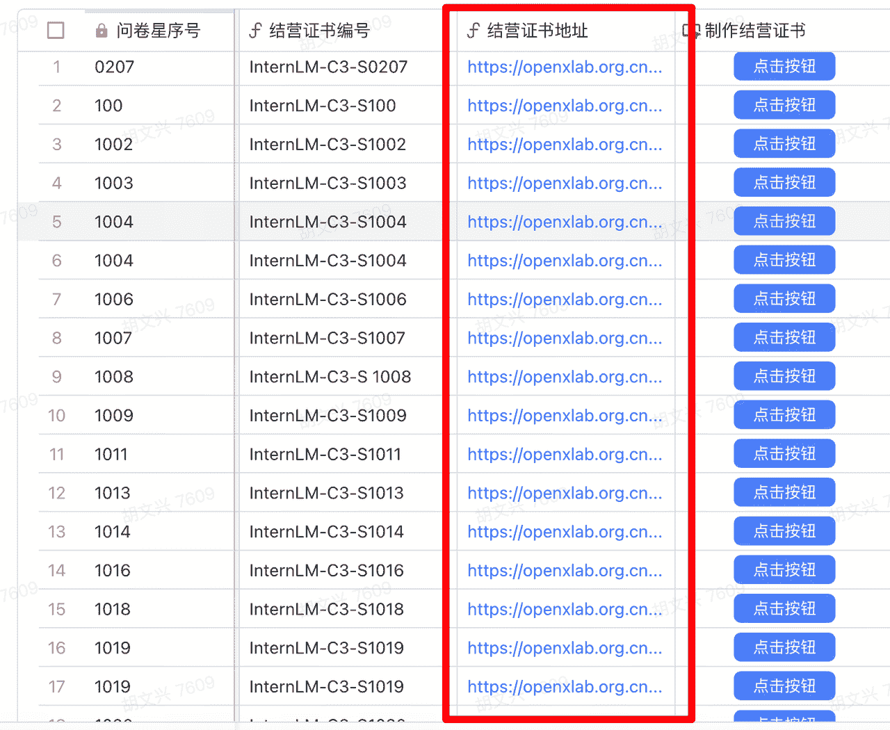
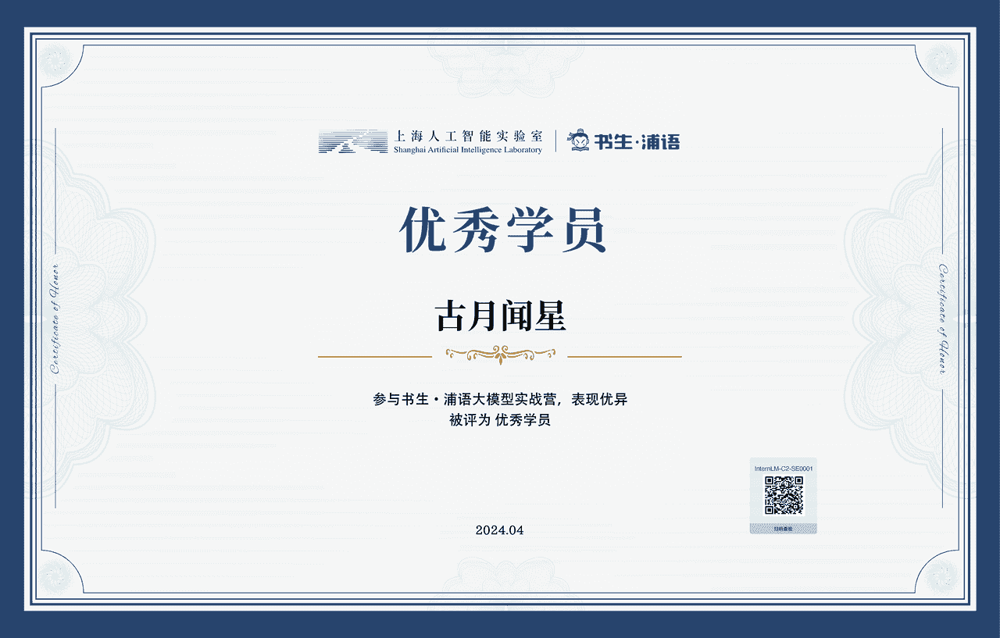
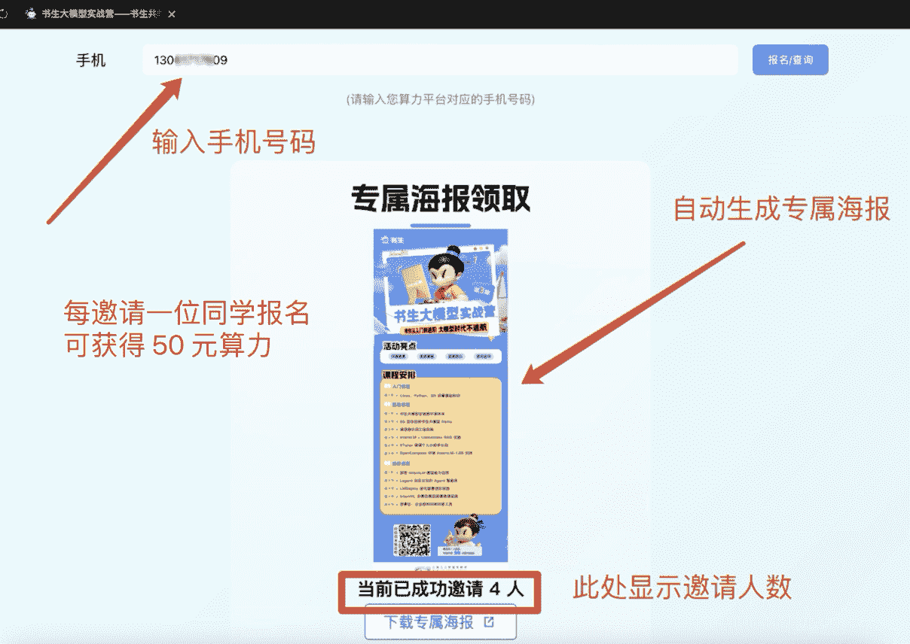
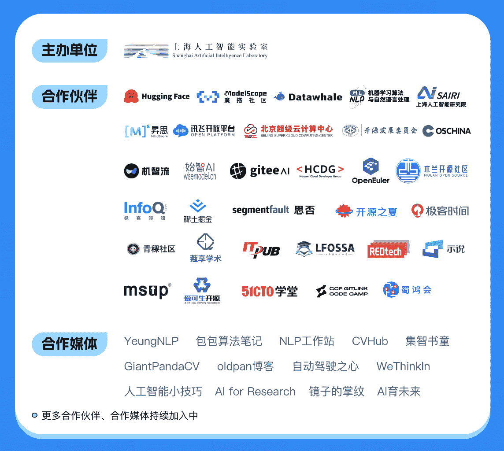
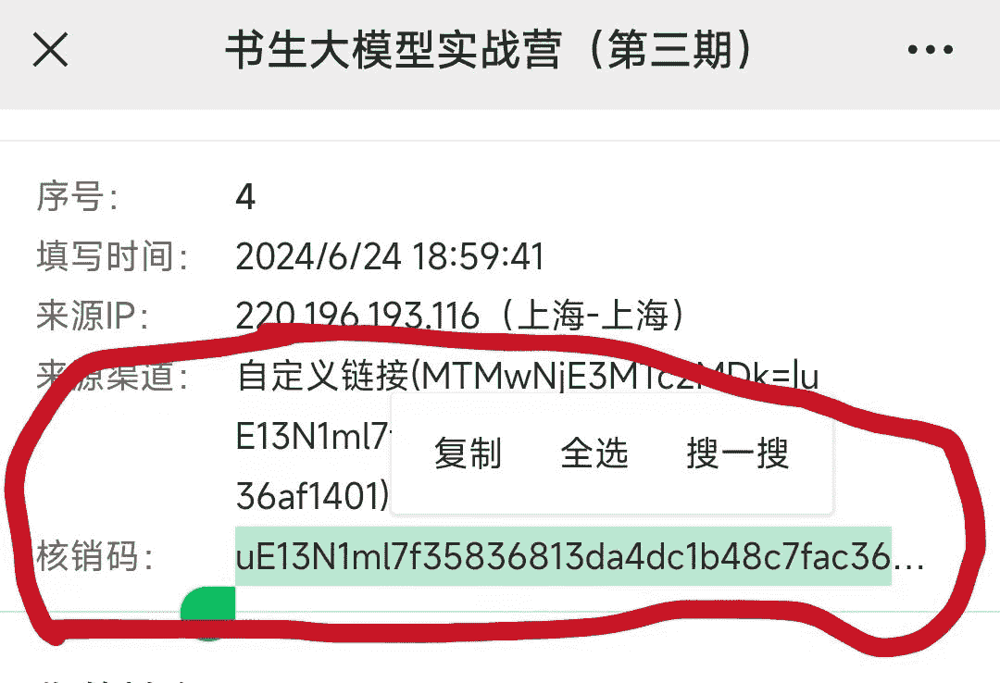
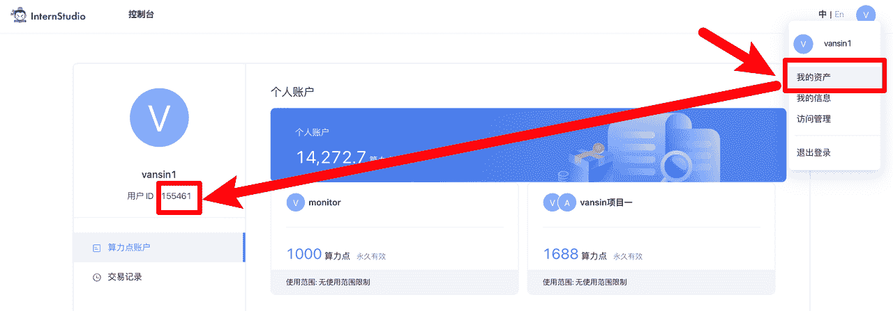

# 学员闯关手册

> 来源：[https://aicarrier.feishu.cn/docx/LuLMduLDRoAVPZxWfiAc7yt7nof](https://aicarrier.feishu.cn/docx/LuLMduLDRoAVPZxWfiAc7yt7nof)

[闯关手册](https://aicarrier.feishu.cn/wiki/QtJnweAW1iFl8LkoMKGcsUS9nld)传送们！！！！

第三期已结束，欢迎大家通过下面问卷/链接报名第四期实战营：

https://colearn.intern-ai.org.cn/set?s=shouce

**恭喜小伙伴成功报名**第三期书生大模型实战营！所有课程免费！！！

| 闯关时间线 |  |
| --- | --- |
| 环节 | 日期 |
| 开营闯关 | 9 月 30 日 |
| 结营 | 10 月 8 日 |
| 清空算力资源 | 10 月 9 日-10月10日 |
| 项目申请长期有效 |  |

第三期项目申报地址：[第三期实战营项目（项目申报）](https://aicarrier.feishu.cn/wiki/DjY6whCO0inTu2kQN9Cchxgynme)

# 报名

还没报名的同学填写以下链接报名。

https://www.wjx.cn/vm/PvefmG2.aspx?udsid=829319

填写问卷报名成功后邮箱中将收到算力平台的“邀请码”，再次报名访问 https://www.wjx.cn/vm/PvefmG2.aspx?udsid=829319 ，其中的核销码就是“邀请码”。

# 闯关

在正式闯关前请完成以下任务!

| 任务 | 任务描述 | 任务激励 | 备注 |
| --- | --- | --- | --- |
| 1 | 扫码报名后收到邮件中的二维码加入🛰️班级群, 并将群昵称改为【问卷星序号-🛰️昵称】 | 无 | 方便助教老师🛰️和作业相互对应上！ |
| 2 | 在[闯关作业信息登记](https://aicarrier.feishu.cn/share/base/form/shrcnZ4bQ4YmhEtMtnKxZUcf1vd)表中登记【问卷星序号】【🛰️昵称】【班级】、【InternStuido ID】【GitHubID】信息，完成登记助教批改后系统赠送 50 算力点用于后续的课程学习。 | **50 算力点** | 问卷星序号，通过访问：https://www.wjx.cn/vm/PvefmG2.aspx?udsid=829319 |

## 闯关地图

备注：快速文档中不需要大家安装 conda 环境，大家可以直接激活 /share 只读路径下的虚拟环境。

| 入门岛 |  |  |  |  |
| --- | --- | --- | --- | --- |
|  | 关卡名称 | 关卡资料 | 往期参考 | 通关激励 |
| 第1关 | Linux 基础知识 | [任务](https://github.com/InternLM/Tutorial/blob/camp3/docs/L0/Linux/task.md)、[文档](https://github.com/InternLM/Tutorial/blob/camp3/docs/L0/Linux/readme.md)、[视频](https://www.bilibili.com/video/BV1FS421d7yg/) |  | 50 算力点 |
| 第2关 | Python 基础知识 | [任务](https://github.com/InternLM/Tutorial/blob/camp3/docs/L0/Python/task.md)、[文档](https://github.com/InternLM/Tutorial/tree/camp3/docs/L0/Python)、[视频](https://www.bilibili.com/video/BV1mS421X7h4/) |  | 50 算力点 |
| 第3关 | Git 基础知识 | [任务](https://github.com/InternLM/Tutorial/blob/camp3/docs/L0/Git/task.md)、[文档](https://github.com/InternLM/Tutorial/blob/camp3/docs/L0/Git/readme.md)、[视频](https://www.bilibili.com/video/BV1Pz421i7bw/) |  | 50 算力点 |
| **通关奖励：通关后**可联系助教老师加入[书生入门岛通关 专属](https://aicarrier.feishu.cn/wiki/DjY6whCO0inTu2kQN9Cchxgynme)🛰️社群。参**加第三期实战营项目**申报，立马获得 168 团队算力点激励，解锁 50% A100 团队开发机算力资源。 |  |  |  |  |
| 基础岛 |  |  |  |  |
|  | 关卡名称 | 关卡资料 |  | 通关激励 |
| 第1关 | 书生大模型全链路开源体系 | [任务](https://github.com/InternLM/Tutorial/blob/camp3/docs/L1/HelloIntern/task.md)、[视频](https://www.bilibili.com/video/BV18142187g5/) |  | 100 算力点 |
| 第2关 | 8G 显存玩转书生大模型 Demo | [任务](https://github.com/InternLM/Tutorial/blob/camp3/docs/L1/Demo/task.md)、[快速文档](https://github.com/InternLM/Tutorial/blob/camp3/docs/L1/Demo/easy_readme.md)、[文档](https://github.com/InternLM/Tutorial/blob/camp3/docs/L1/Demo/readme.md)、[视频](https://www.bilibili.com/video/BV18x4y147SU/) |  | 100 算力点 |
| 第3关 | 浦语提示词工程实践 | [任务](https://github.com/InternLM/Tutorial/blob/camp3/docs/L1/Prompt/task.md)、[文档](https://github.com/InternLM/Tutorial/blob/camp3/docs/L1/Prompt)、[视频](https://www.bilibili.com/video/BV1cU411S7iV/) |  | 100 算力点 |
| 第4关 | InternLM + LlamaIndex RAG 实践 | [任务](https://github.com/InternLM/Tutorial/blob/camp3/docs/L1/LlamaIndex/task.md)、[文档](https://github.com/InternLM/Tutorial/blob/camp3/docs/L1/LlamaIndex)、[视频](https://www.bilibili.com/video/BV1cU411S7iV) |  | 100 算力点 |
| 第5关 | XTuner 微调个人小助手认知 | [任务](https://github.com/InternLM/Tutorial/blob/camp3/docs/L1/XTuner/task.md)、[文档](https://github.com/InternLM/Tutorial/blob/camp3/docs/L1/XTuner)、[视频](https://www.bilibili.com/video/BV1tz421B72y/) |  | 100 算力点 |
| 第6关 | OpenCompass 评测 InternLM-1.8B 实践 | [任务](https://github.com/InternLM/Tutorial/blob/camp3/docs/L1/OpenCompass/task.md)、[文档](https://github.com/InternLM/Tutorial/blob/camp3/docs/L1/OpenCompass/readme.md)、[视频](https://www.bilibili.com/video/BV1RM4m1279j/) |  | 100 算力点 |
| 基础岛通关奖励：结营证书，解锁全部 50% A100 权限，1688 算力点奖励助力项目申请和落地。 |  |  |  |  |
| 进阶岛 |  |  |  |  |
|  | 关卡名称 | 关卡资料 |  | 通关激励 |
| 第1关 | 探索 InternLM 模型能力边界 | [任务](https://aicarrier.feishu.cn/wiki/QjBswYlmdiSGfskq6vNcBmZCn09) |  | 100 算力点 |
| 第2关 | Lagent 自定义你的 Agent 智能体 | [任务](https://github.com/InternLM/Tutorial/blob/camp3/docs/L2/Lagent/task.md)、[文档](https://github.com/InternLM/Tutorial/blob/camp3/docs/L2/Lagent/readme.md)、[视频](https://www.bilibili.com/video/BV18M4m1y7sm/) |  | 100 算力点 |
| 第3关 | LMDeploy 量化部署进阶实践 | [任务](https://github.com/InternLM/Tutorial/blob/camp3/docs/L2/LMDeploy/task.md)、[文档](https://github.com/InternLM/Tutorial/blob/camp3/docs/L2/LMDeploy/readme.md)、[视频](https://www.bilibili.com/video/BV1df421q7cR/) |  | 100 算力点 |
| 第4关 | InternVL 多模态模型部署微调实践 | [任务](https://github.com/InternLM/Tutorial/blob/camp3/docs/L2/InternVL/task.md)、[文档](https://github.com/InternLM/Tutorial/blob/camp3/docs/L2/InternVL)、[视频](https://www.bilibili.com/video/BV1N6p1eXETX/) |  | 100 算力点 |
| 第5关 | 茴香豆：企业级知识库问答工具 | [任务](https://github.com/InternLM/Tutorial/blob/camp3/docs/L2/Huixiangdou/task.md)、[文档](https://github.com/InternLM/Tutorial/blob/camp3/docs/L2/Huixiangdou/readme.md)、[视频](https://www.bilibili.com/video/BV1C5W2epEYP/) |  | 100 算力点 |
| 第6关 | MindSearch 快速部署 | [任务](https://github.com/InternLM/Tutorial/blob/camp3/docs/L2/MindSearch/task.md)、[文档](https://github.com/InternLM/Tutorial/blob/camp3/docs/L2/MindSearch/readme_github.md) |  | 100 算力点 |
| **进阶岛通关奖励：优秀学员证书，****解锁全部 100% A100** 权限，3600 算力点用于项目。 |  |  |  |  |
| 彩蛋岛 |  |  |  |  |
|  | 关卡名称 | 关卡资料 |  | 通关激励 |
|  | 销冠大模型案例 | [文档](https://github.com/InternLM/Tutorial/blob/camp3/docs/EasterEgg/StreamerSales)、[视频](https://www.bilibili.com/video/BV1f1421b7Du) |  | 100 算力点 |
|  | InternLM 1.8B 模型 Android 端侧部署实践 | [文档](https://github.com/InternLM/Tutorial/blob/camp3/docs/EasterEgg/Android)、[视频](https://www.bilibili.com/video/BV1Ai421a7R6/) |  | 100 算力点 |

## 如何提交闯关作业

访问以下链接提交闯关的作业，班级群中的助教老师将会对作业进行批改，如下图所示问卷可以多次修改，作业可以通过以下方式进行提交。

https://aicarrier.feishu.cn/share/base/form/shrcnZ4bQ4YmhEtMtnKxZUcf1vd

## 如何查看助教作业的批改结果

加入以下飞书群，并访问 [闯关信息提交表](https://aicarrier.feishu.cn/wiki/NfwQwrc1Fi19XckDEWKc35Don4d?table=tblcG7akqXrJKvZr&view=vewOnvRii7)

扫码加入实战营飞书群获取阅读权限

## 如何下载证书

联系助教老师或者   [闯关信息提交表](https://aicarrier.feishu.cn/wiki/NfwQwrc1Fi19XckDEWKc35Don4d?table=tblcG7akqXrJKvZr&view=vewOnvRii7)击飞书表格的按钮制作完证书后，可以在 （需要先加上方的飞书群）获取。

# 书生·共学计划获取学习算力

小伙伴们可以通过以下网址使用自己的手机号码制作自己的专属海报。

+   每邀请 1 位同学填写报名问卷即可获得 50 算力点。

+   成功邀请 3 人，解锁 InternStudio 平台 24GB A100 及 80GB 存储使用权限。

+   成功邀请 6 人，解锁 InternStudio 平台 40GB A100 及 120GB 存储使用权限。

+   成功邀请 16 人，解锁 InternStudio 平台 80GB A100 及 200GB 存储使用权限。

算力资源有效期为本批次实战营举办期间，本活动规则可能根据实际情况进行调整，活动最终解释权由 InternLM 运营团队所有。

专属海报制作地址：https://colearn.intern-ai.org.cn/

By the way, 要让小伙伴通过自己生成的问卷报名成功才记作邀请成功哦~

算力是系统自动发放的，所以请大家千万注意仔细阅读计划说明。

# 班级🛰️群

进入班级群后请将备注改为【问卷星序号-昵称】

# 合作伙伴

感谢合作伙伴对书生大模型实战营活动的支持!!!

# QA 板块

小伙伴们可以在 [QA 文档](https://aicarrier.feishu.cn/wiki/AElrwH08WiCG9HkG5iacjlOJnoc) 中填写问题，将有小伙伴解答您的问题！

## 如何申请成为助教

填写问卷申请，https://aicarrier.feishu.cn/share/base/form/shrcnAImp76i1tNl6lZVspDeV6h

如何合适浦语小助手将主动联系。

## 如何获得邀请码

方法一：报名填写的邮箱会收到一封邮件中有邀请码信息

方法二：再次访问  https://www.wjx.cn/vm/PvefmG2.aspx?udsid=829319 问卷链接，复制“核销码”机位邀请码。

手机端访问问卷，长按核销码能复制完整

## 如何获取 InternStudio ID

访问 https://studio.intern-ai.org.cn/ 输入邀请码后，右上角点击我的资产，此时用户 ID 就是 InternStudio ID

## InternStudio 开发机的环境玩坏了，如何初始化开发机环境

**慎重执行！！！！所有数据将会丢失，仅限 InternSt**udio 平台，自己的机器千万别这么操作

+   第一步本地终端 ssh 连上开发机（一定要 ssh 连接上操作，不能在 web 里面操作！！！，不要用 vscode ssh 链接）

+   第二步执行  rm -rf /root，大概会等待10分钟

+   第三步重启开发机,系统会重置 /root 路径下的配置文件

+   第四步 ln -s /share /root/share

## 6.5 第三期夏季场未完成的同学可以参加国庆卷王场嘛

可以的，如果小伙伴们没有在夏季闯关场期间没有完成闯关的话，也可以联系 yanbo 或者助教大大进入中秋卷王场的班级群

## 6.6 算力的有效期是什么时候啊

国庆卷王场算力的有效期可以持续到 10.7 , 也就是国庆假期的最后一天