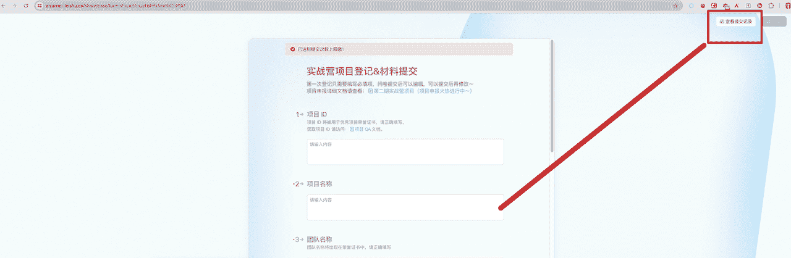

# 第三期实战营项目（项目申报）

> 来源：[https://aicarrier.feishu.cn/docx/CWADdiB2Jol4gCxZgQychweVn4d](https://aicarrier.feishu.cn/docx/CWADdiB2Jol4gCxZgQychweVn4d)

书生·浦语大模型实战营的小伙伴们，书生·浦语团队为实战营的小伙伴提供了丰富的算力和案例帮助大家项目出圈，详细安排如下～，项目🛰️群及时拉  和浦语小助手，获取项目技术支持等服务。

加入群聊找小助手兑换算力（兑换算力前需要登记项目）

# **时间线**

| 日期 | 事项 |
| --- | --- |
| 9 月 20 日 | 项目作品材料提交截止 |
| 9 月 22 日— 9 月 28 日 | 优秀项目公布&amp;人气奖拉票 |
| 9 月 29 日 | 人气奖&amp;明星项目公布 |

# 项目算力激励

备注：第三期实战营项目算力点仅在举办期间有效，结束将根据大家的项目进展统一调整算力资源。

## 实战营学员项目算力激励

前提：报名登记项目并有项目 GitHub！

|  | 激励 | 备注 |
| --- | --- | --- |
| 团队项目算力点 | 50  算力点 | 价值约 50 人民币 |
| 团队GPU Quota | 3 （24GB） | 单位为 10% A100 |
| 团队磁盘 | 100 GB | /group_share 目录 100 GB 共享 Quota |

## 入门岛通关学员项目算力激励

前提：通关入门岛，登记项目并有项目 GitHub！

|  | 激励 | 备注 |
| --- | --- | --- |
| 团队项目算力点 | 168  算力点 | 价值约 168 人民币 |
| 团队GPU Quota | 5 （**40GB**） | 单位为 10% A100 |
| 团队磁盘 | 150 GB | /group_share 目录 150 GB 共享 Quota |

## 基础岛通关学员项目算力激励

实战营结营学员报名所在团队即提供算力支持！

|  | 激励 | 备注 |
| --- | --- | --- |
| 团队项目算力点 | 1688 算力点 | 价值约 1688 人民币 |
| 团队GPU Quota | 10 （80GB） | 单位为 10% A100 |
| 团队磁盘 | 200 GB | /group_share 目录 200GB 共享 Quota |

# **奖项设置**

| 奖项 | 评价标准 | 激励 |
| --- | --- | --- |
| 优秀项目 | GitHub 文档、PPT和介绍视频完整。 | +   优秀项目证书 |
| 人气奖 | 👸号投票10名的优秀项目。 | +   人气奖项目证书 |
| 明星项目 | 于优秀项目中评选，GitHub Star、B站播放量突出的优秀项目若干。 | +   明星项目证书 |

备注：激励除证书外不累计获得，最终解释权归书生·浦语运营团队所有～，算力点有效时长为 1 个月～

# 需提交的材料

参加实战营项目的小伙伴请通过问卷登记团队信息（提交后问卷可以更改，先不用纠结先提交），登记了项目之后联系   兑换算力～

https://aicarrier.feishu.cn/share/base/form/shrcnZAhJeT6PYxhkvRxCnPljkf

提交完成后，点击此处即可修改记录

|  | 材料名称 | 描述 |
| --- | --- | --- |
| 材料1 | 项目 GitHub | 需包含：基于 InternLM 的 xxx 项目，欢迎大家也来参加书生大模型实战营项目（http://github.com/internLM/tutorial） |
| 材料2 | 项目关键架构+效果图 （一页PPT+150字描述） |  |
| 材料3 | 项目介绍视频（上传到 B 站） |  |
| 材料4 | OpenXLab 项目体验地址 |  |
| 材料5 | OpenXLab 模型地址 |  |

往期项目参考：[二期实战营优秀项目评选](https://aicarrier.feishu.cn/wiki/W6ShwMSzYi4ohGkd7yOcCSogn0g)

同时欢迎大家点击以下链接，授权登陆为书生·浦语点亮 GitHub 繁星。

https://github.com/internLM/tutorial

# 常见问题 QA

<https://aicarrier.feishu.cn/sync/YF4fd8DGrsM0kabILLAcUxm0nWe>