# Linux + InternStudio 关卡（草稿）

> 来源：[https://aicarrier.feishu.cn/docx/F6wtd9MLrow0Q6xHcjpcIv6TnHh](https://aicarrier.feishu.cn/docx/F6wtd9MLrow0Q6xHcjpcIv6TnHh)

非正式版！！！ 7月10日后正式开营

## 关卡任务

闯关任务需要在关键步骤中截图，其他为可选任务：

|  | 任务描述 | 完成所需时间 |

| --- | --- | --- |

| 闯关任务 | 完成`SSH`连接与端口映射并运行`hello_world.py` | 10min |

| 可选任务 1 | 将`Linux`基础命令在开发机上完成一遍 | 10min |

| 可选任务 2 | 使用 `VScode` 远程连接开发机并创建一个`conda`环境 | 10min |

| 可选任务 3 | 创建并运行`test.sh`文件 | 10min |

GitHub 文档：`https://github.com/InternLM/Tutorial/tree/camp3/docs/L0/Linux`

> 😀Hello大家好，欢迎来到书生大模型实战营，这里是实战营为第一次参加实战营同学，和来自各个行业的没有`Linux`基础知识的同学准备的基础课程，在这里我们会教大家如何使用`InternStudio`开发机，以及掌握一些基础的`Linux`知识，让大家不至于在后面的课程中无从下手，希望对大家有所帮助。下面是我们这一关卡的大纲，在完成相关基础知识学习以后，会给大家布置一些小关卡，让我们开始吧！

> **大纲：**

+ `InternStudio`开发机介绍

+ `SSH` 介绍实践、端口映射介绍实践

+ `Linux` 基础命令

+ 文件管理

+ 进程管理

+ 工具使用

+ `Conda`与`Shell`介绍

## 一、`InternStudio`开发机介绍

`InternStudio` 是大模型时代下的云端算力平台。基于 `InternLM` 组织下的诸多算法库支持，为开发者提供开箱即用的大语言模型微调环境、工具、数据集，并完美兼容 🤗 `HugginFace` 开源生态。

如果大家想了解更多关于[`InternStudio`](https://aicarrier.feishu.cn/wiki/GQ1Qwxb3UiQuewk8BVLcuyiEnHe)的介绍的话可以查看下面的文档：

首先打开上面的链接进入`InternStudio`，完成登录会自动跳转到控制台界面，如下图所示：

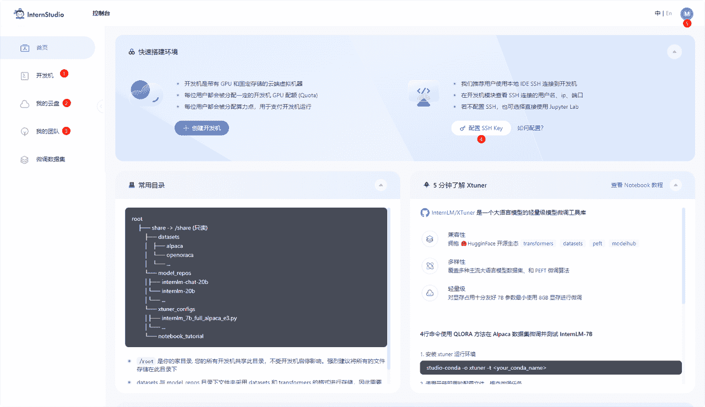

下面给大家讲一下每一个序号对应页面的功能：

1.  在这里可以创建开发机，以及修改开发机配置和查看相关日志等。


1.  这里可以可视化查看[专业名词解释](https://aicarrier.feishu.cn/wiki/Uyvuwtvnjipsr3kaRUdc9PKvnZd)开发机中的文件及文件夹，而且如果你创建了两个开发机，那么他们使用的云盘是一个。（因为每一个开发机都是一个`Docker`容器，存储云盘挂载的都是一个，关于专业名词解释可以看： ）在这里你可以上传文件或者文件夹，以及创建文件，还可以查看隐藏文件。


1.  这是开发机新增的功能，如果大家要做项目的话，可以向小助手申请资源，团队的功能是所有成员共享算力资源，避免造成资源浪费。（毕竟烧的可都是💴啊）

1.  这里是用来配置`SSH`密钥的，我们在后面会讲到如何使用。

1.  最后这个地方是来编辑你的个人信息的，以及查看你算力资源的具体使用。

上面就是`InternStudio`平台的简单介绍，下面让我们来看一下如何创建开发机，我们来到首页，点击“创建开发机”

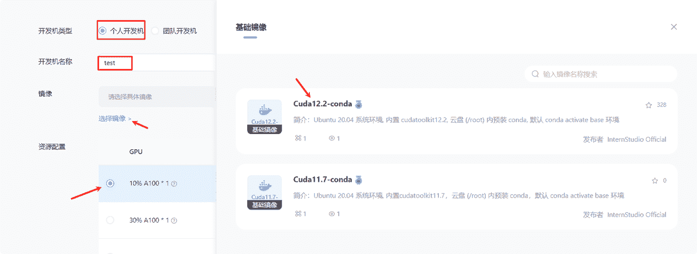

这里我们选择创建个人开发机，名称为`test`，`Cuda`版本为12.2，资源配置选择10%，时长默认就行。

创建完成以后在开发机界面可以看到刚刚创建的开发机，点击进入开发机。

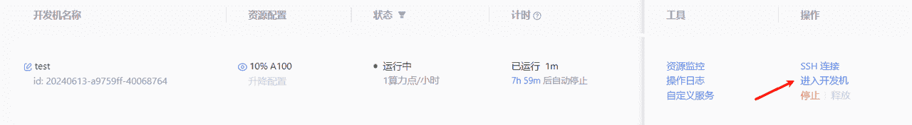

进入开发机以后可以看到开发机的主页面，开发机有三种模式可以选择：`JupyterLab`、终端和`VScode`

其中：

1.  `JupyterLab`：一个交互式的编程和教学环境，同时内置终端，可以很方便地查看文件，执行代码等

1.  `Terminal`（`Terminal`， 最轻量级）：主要进行命令行操作，或者运行脚本和简单程序

1.  `VSCode`：网页中集成的`VSCode`，也可以在本地`VSCode`中通过`SSH`连接远程开发，下面就会讲如何配置远程连接。

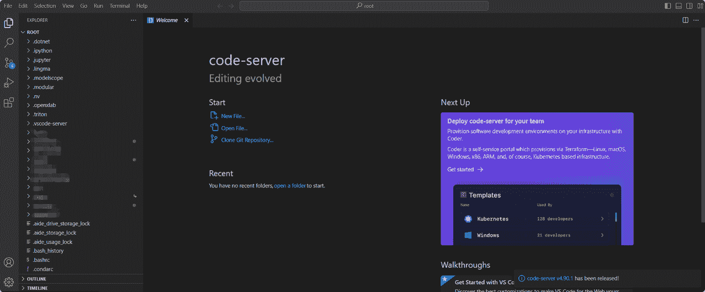

1.  这个是资源使用情况，在后续的课程中会使用到。

## 二、SSH及端口映射

上面我们介绍了`InternStudio`平台，以及如何创建开发机，这一小节，我们要了解什么是`SSH`、为什么使用远程连接、如何使用`SSH`远程连接开发机、什么是端口映射以及如何进行端口映射。

### 什么是SSH？

`SSH`全称`Secure Shell`，中文翻译为安全外壳，它是一种网络安全协议，通过加密和认证机制实现安全的访问和文件传输等业务。`SSH` 协议通过对网络数据进行加密和验证，在不安全的网络环境中提供了安全的网络服务。

`SSH` 是（`C/S`架构）由服务器和客户端组成，为建立安全的 `SSH` 通道，双方需要先建立 `TCP` 连接，然后协商使用的版本号和各类算法，并生成相同的会话密钥用于后续的对称加密。在完成用户认证后，双方即可建立会话进行数据交互。

那在后面的实践中我们会配置`SSH`密钥，配置密钥是为了当我们远程连接开发机时不用重复的输入密码，那为什么要进行远程连接呢？

远程连接的好处就是，如果你使用的是远程办公，你可以通过`SSH`远程连接开发机，这样就可以在本地进行开发。而且如果你需要跑一些本地的代码，又没有环境，那么远程连接就非常有必要了。

### 如何使用SSH远程连接开发机？

#### 2.1 使用密码进行SSH远程连接

首先我们使用输入密码的方式进行`SSH`远程连接，后面我们会讲如何配置免密登录。

当完成开发机的创建以后，我们需要打开自己电脑的`powerShell`终端，使用`Win+R`快捷键打开运行框，输入`powerShell`，打开`powerShell`终端。（如果你是`Linux`或者`Mac`操作系统，下面的步骤都是一样的）

我们回到开发机平台，进入开发机页面找到我们创建的开发机，点击`SSH`连接。

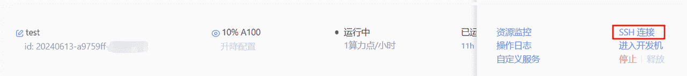

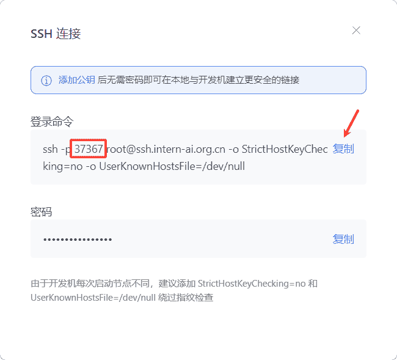

> 然后复制登录命令，这里的`37367`是开发机所使用的`SSH`端口，一般使用的都是`22`端口，没有这个端口号的话是连不上`SSH`的，并且每个人的端口都不一样，所以如果大家在连接开发机时出现连不上的情况，那就需要检查一下是不是端口错了。

将复制的命令粘贴到`powerShell`中，然后回车，这里我们需要输入密码，我们将登录命令下面的密码复制下来，然后粘贴到终端中，这里密码粘贴密码是不显示的，这是正常的。

最后回车出现以下内容就代表成功了：

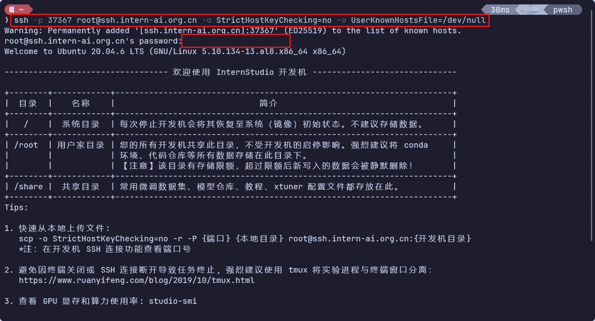

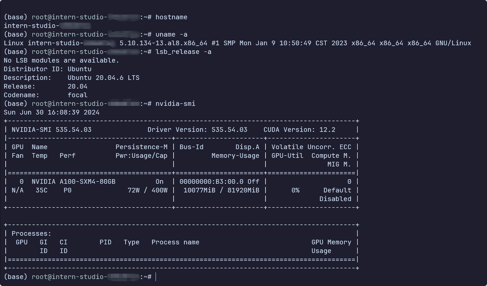

当我们连接上开发机以后，可以使用`hostname`查看开发机名称，使用`uname -a`查看开发机内核信息，使用`lsb_release -a`查看开发机版本信息，使用`nvidia-smi`查看`GPU`的信息，这些命令我们后面都会讲到，如果想要退出远程连接，输入两次`exit`就可以了。

#### 2.2 配置SSH密钥进行SSH远程连接（可选）

但是在我们开发学习的时候，每次远程都输入密码比较麻烦，我们可以设置`SSH key`来跳过输入密码这一步骤，在`ssh`命令中我们可以使用`ssh-keygen`命令来生成密钥

> 如果大家计算机的用户名是中文的，`InternStudio`会识别不了，这种情况就需要用密码来登录`SSH`，不过不影响使用，大家不用担心。

> `SSH`密钥是一种安全便捷的登录认证方式，用于在`SSH`协议中进行身份验证和加密通信。

> `ssh-keygen`支持`RSA`和`DSA`两种认证密钥。

> 常用参数包括：

+   `-t`：指定密钥类型，如`dsa`、`ecdsa`、`ed25519`、`rsa`。

+   `-b`：指定密钥长度。

+   `-C`：添加注释。

+   `-f`：指定保存密钥的文件名。

+   `-i`：读取未加密的`ssh-v2`兼容的私钥/公钥文件。

这里我们使用`RSA`算法生成密钥，命令为：

```
ssh-keygen -t rsa
```

输入命令后一路回车就可以了，这里的密钥默认情况下是生成在`~/.ssh/`目录下的，`~`表示的是家目录，如果是`windows`就是`C:\Users\{your_username}\`。在`powerShell`中可以使用`Get-Content`命令查看生成的密钥，如果是`Linux`操作系统可以使用`cat`命令。

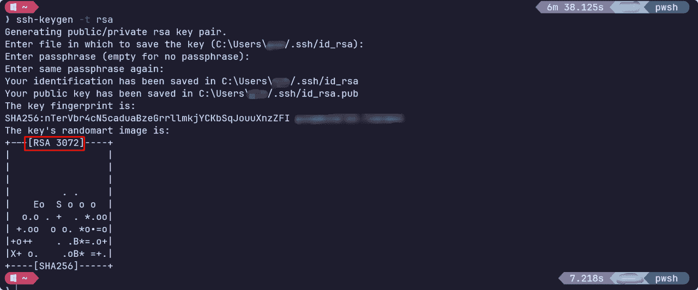

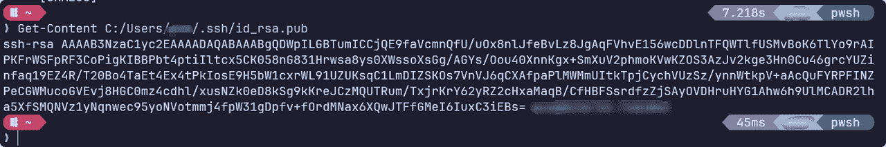

然后我们回到开发机平台，在首页点击配置`SSH Key`，接着点击添加`SSH`公钥，

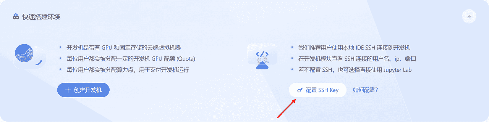

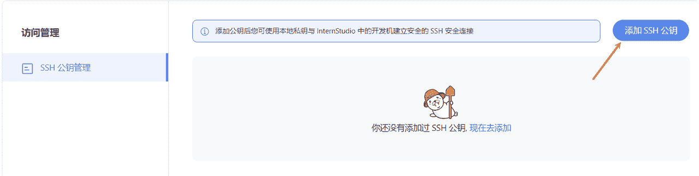

将刚刚生成的密钥复制下来，粘贴到公钥框中，名称会被自动识别到，最后点击立即添加，`SSH Key`就配置完成了。

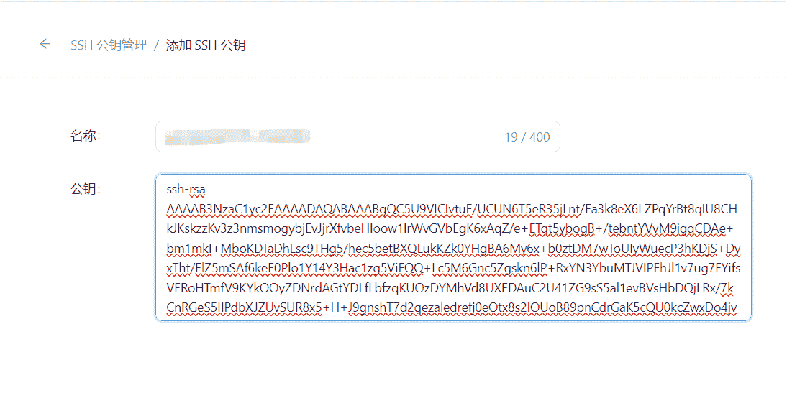

完成`SSH Key`创建以后，重启终端进行远程连接，就会跳过密码输入这一步了。

#### 2.3 使用VScode进行SSH远程连接

当然也可以使用`SSH`远程连接软件，例如：`Windterm`、`Xterminal`等。这里我们使用`VScode`进行远程连接，使用`VScode`的好处是，本身它就是代码编辑器，进行代码修改等操作时会非常方便。

如果要在`VScode`中进行远程连接，我们还需要安装一套插件，如何安装`VScode`大家可以网上搜索一下非常简单。

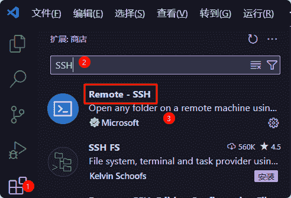

如果你已经安装好了`VScode`，可以在点击左侧的扩展页面，在搜索框中输入“`SSH`”，第一个就是我们要安装的插件，点开它“`Install`”就可以了。

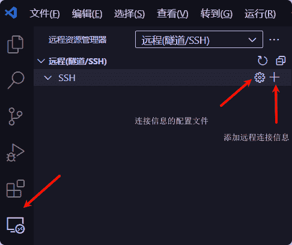

安装完成插件以后，点击侧边栏的远程连接图标，在`SSH`中点击“+”按钮，添加开发机`SSH`连接的登录命令。


我们将登录命令复制下来，然后将命令粘贴到弹出的窗口中，最后回车：

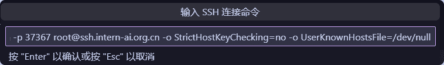

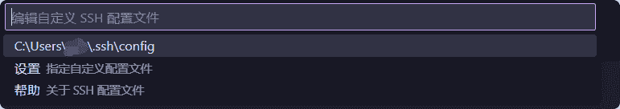

配置文件这一块默认就好，当然你也可以自定义，下面是配置文件的具体内容：（这里包括了你所有远程连接过的信息）

```
Host ssh.intern-ai.org.cn #主机ip也可以是域名
  HostName ssh.intern-ai.org.cn #主机名
  Port 37367 #主机的SSH端口
  User root #登录SSH使用的用户
  StrictHostKeyChecking no
  UserKnownHostsFile /dev/null
```

> 后面的一些配置选项，如果想要手动添加就需要按照上面的格式对相应部分进行修改。

> 如果将`StrictHostKeyChecking no`和`UserKnownHostsFile /dev/null`删除掉会跳出指纹验证的弹窗：

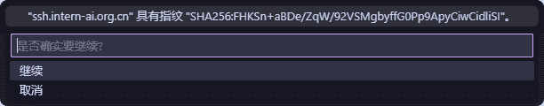

> `StrictHostKeyChecking no`表示禁用严格的主机密钥检查。这意味着当连接到一个新的 `SSH` 服务器时，不会严格验证服务器的主机密钥，可能会带来一定的安全风险。

> `UserKnownHostsFile /dev/null`则是将用户已知的主机密钥文件设置为 `/dev/null` ，这实质上是忽略了对已知主机密钥的记录和使用。

> 但是在一般的安全实践中，不建议随意禁用严格的主机密钥检查。

然后在右下角弹出来的提示窗口中点击“连接”就可以远程到开发机中了。

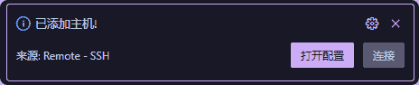

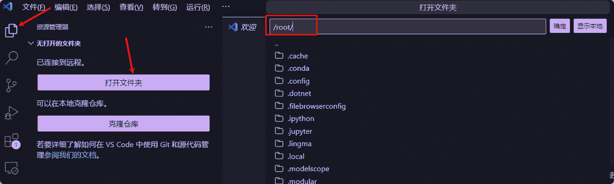

远程连接完成以后，可以选择打开的文件夹，也可以称为工作目录，你可以选择开发机中的也可以选择本地的，开发机中的文件夹，就是我们前面提到的云盘。

当下一次进行远程连接的时候，就不需要输入登录命令等信息了，只需要打开`vscode`的远程连接就可以看到第一次连接的开发机信息，下面的`root`代表我们第一连接开发机时使用的是`/root`工作目录。

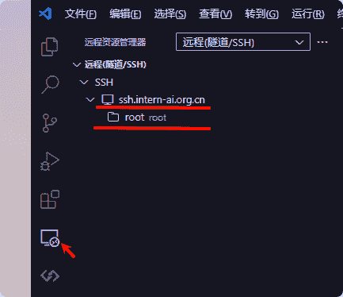

并且下图中的->表示进入开发机后需要重新选择工作目录：

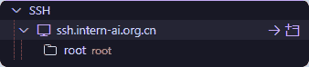

而下图中的->表示进入上一次开发机选择的工作目录：

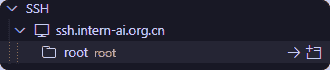

每次选择的工作目录都会在这个开发机信息下面显示：（这里就多了一个`lagent`的工作目录）


下面我们来介绍一下什么是端口映射。

### 端口映射

#### 3.1 什么是端口映射？

端口映射是一种网络技术，它可以将外网中的任意端口映射到内网中的相应端口，实现内网与外网之间的通信。通过端口映射，可以在外网访问内网中的服务或应用，实现跨越网络的便捷通信。

那么我们使用开发机为什么要进行端口映射呢？

因为在后续的课程中我们会进行模型`web_demo`的部署实践，那在这个过程中，很有可能遇到`web ui`加载不全的问题。这是因为开发机`Web IDE`中运行`web_demo`时，直接访问开发机内 `http/https` 服务可能会遇到代理问题，外网链接的`ui`资源没有被加载完全。

所以为了解决这个问题，我们需要对运行`web_demo`的连接进行端口映射，将外网链接映射到我们本地主机，我们使用本地连接访问，解决这个代理问题。下面让我们实践一下。


我们先根据一个图了解一下开发机端口映射是如何工作的：

> 下面会有实践步骤这里先理解如何进行端口映射的

```
ssh -p 37367 root@ssh.intern-ai.org.cn -CNg -L 7860:127.0.0.1:7860 -o StrictHostKeyChecking=no
```

上面是一个端口映射命令，在主机上运行该命令即可进行端口映射，下面用一个流程图了解端口映射的过程：

> 个人`PC`会远程连接到开发机唯一暴露在外的`37367`端口，（这个在`SSH`的时候提到过每个人的开发机暴露的端口都不一样），并设置隧道选项。暴露端口是作为中转站进行流量的转发。

+   `-C`：启用压缩，减少传输数据量。

+   `-N`：不执行远程命令，只建立隧道。

+   `-g`：允许远程主机连接到本地转发的端口。

> 当在个人`PC`上执行这个`SSH`命令后，`SSH`客户端会在本地机器的`7860`端口上监听。

> 任何发送到本地`7860`端口的流量，都会被`SSH`隧道转发到远程服务器的`127.0.0.1`地址上的`7860`端口。

> 这意味着，即使开发机的这个端口没有直接暴露给外部网络，我们也可以通过这个隧道安全地访问远程服务器上的服务。。

#### 3.2 如何进行端口映射？

##### 3.2.1 使用 `ssh` 命令进行端口映射

我们还是来到开发机界面，找到我们的开发机，点击自定义服务，复制第一条命令，

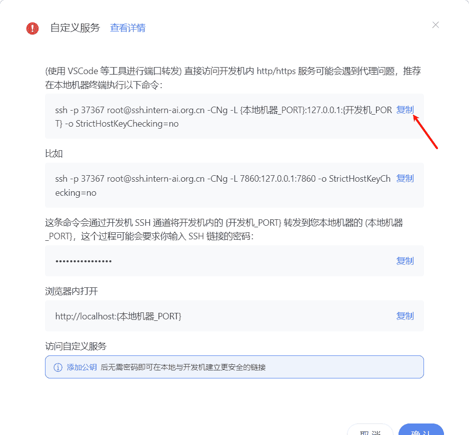

```
ssh -p 37367 root@ssh.intern-ai.org.cn -CNg -L {本地机器_PORT}:127.0.0.1:{开发机_PORT} -o StrictHostKeyChecking=no
```

下面给大家介绍一下命令各部分的含义：

+   `-p 37367`：是指定 `SSH` 连接的端口为 `37367`，这个前面提到过。

+   `root@ssh.intern-ai.org.cn`：表示要以 `root` 用户身份连接到 `ssh.intern-ai.org.cn` 这个主机。

+   `-CNg`：

+   `-C` 通常用于启用压缩。

+   `-N` 表示不执行远程命令，仅建立连接用于端口转发等。

+   `-g` 允许远程主机连接到本地转发的端口。


## 3.2 端口映射

+   \`-L {本地机器_PORT}:127.0.0.1:{开发机_PORT}\`：这是设置本地端口转发，将本地机器的指定端口（由 \`{本地机器_PORT}\` 表示）转发到远程主机（这里即 \`ssh.intern-ai.org.cn\`）的 \`127.0.0.1\` （即本地回环地址）和指定的开发机端口（由 \`{开发机_PORT}\` 表示）。

+   \`-o StrictHostKeyChecking=no\`：关闭严格的主机密钥检查，这样可以避免第一次连接时因为未知主机密钥而产生的提示或错误。

当你运行一个web demo的时候，就可以使用这个命令进行端口映射，举个例子：

我们创建一个 \`hello_world.py\` 文件，在文件中填入以下内容：


```
import socket
import re
import gradio as gr

# 获取主机名
def get_hostname():
    hostname = socket.gethostname()
    match = re.search(r'-(\d+)$', hostname)
    name = match.group(1)
    
    return name

# 创建 Gradio 界面
with gr.Blocks(gr.themes.Soft()) as demo:
    html_code = f"""
            <p align="center">
            <a href="https://intern-ai.org.cn/home">
            </a>
            </p>
            <h1 style="text-align: center;">☁️ Welcome {get_hostname()} user, welcome to the ShuSheng LLM Practical Camp Course!</h1>
            <h2 style="text-align: center;">😀 Let’s go on a journey through ShuSheng Island together.</h2>
            <p align="center">
                <a href="https://github.com/InternLM/Tutorial/blob/camp3">
                </a>
            </p>

            """
    gr.Markdown(html_code)

demo.launch()
```

在运行代码之前，需要先使用 \`pip install gradio==4.29.0\` 命令安装以下依赖包，然后在 Web IDE 的终端中运行了一个 \`hello_world.py\`

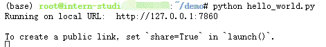

如果不进行端口映射的话，使用本地 IP 是访问不了的

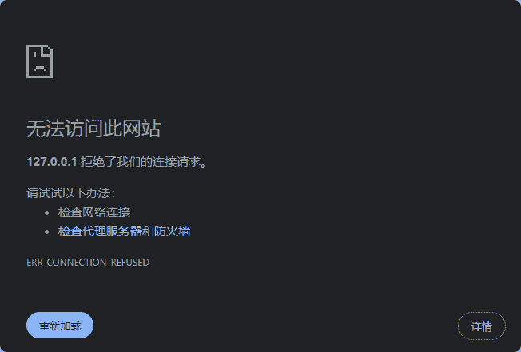

我可以使用下面的命令，将它输入到 powerShell 中：

```
ssh -p 37367 root@ssh.intern-ai.org.cn -CNg -L 7860:127.0.0.1:7860 -o StrictHostKeyChecking=no
```

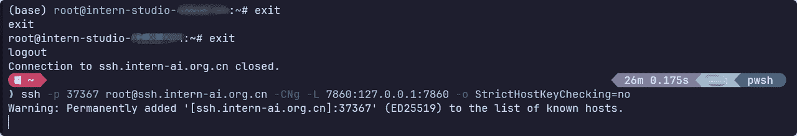

这样就代表成功了。（**注意**：这个命令不返回任何的内容，这样代表端口映射在运行了，然后在网页中打开连接就可以看到 web ui 的界面了）


### 3.2.2 使用 VSCode 进行端口映射

当然，如果我们运行不同的 web ui 的话，需要重复输入命令，这样很麻烦，这就需要用到 VSCode 了。前面我们已经 \`SSH\` 远程连接了开发机，VSCode 提供了自动端口映射的功能，我们不需要手动配置，我们可以使用 "Ctrl+Shift+~" 快捷键唤醒终端，在终端的右侧可以找到端口选项：


在这里可以查看端口映射的信息，如果需要修改端口的话，可以在端口那一栏修改端口号。

## 三、Linux 基础命令

**这一部分**我会带着大家了解 Linux 的一些基础操作，还有使用一些工具。让大家能够在遇到问题的时候，可以自行解决，如果大家有遇到什么问题的话，也可以在这里评论，我会及时给大家回答。

因为我们使用 **开发机** 时很少使用到 **权限管理**，所以我们就不介绍了。（后面的操作均在 VSCode 的终端中进行）

### 文件管理

> 在 Linux 中，常见的文件管理操作包括：

+   **创建文件**：可以使用 \`touch\` 命令创建空文件。

+   **创建目录**：使用 \`mkdir\` 命令。

+   **目录切换**：使用 \`cd\` 命令。

+   **显示所在目录**：使用 \`pwd\` 命令。

+   **查看文件内容**：如使用 \`cat\` 直接显示文件全部内容，\`more\` 和 \`less\` 可以分页查看。

+   **编辑文件**：如 \`vi\` 或 \`vim\` 等编辑器。

+   **复制文件**：用 \`cp\` 命令。

+   **创建文件链接**：用 \`ln\` 命令。

+   **移动文件**：通过 \`mv\` 命令。

+   **删除文件**：使用 \`rm\` 命令。

+   **删除目录**：\`rmdir\`（只能删除空目录）或 \`rm -r\`（可删除非空目录）。

+   **查找文件**：可以用 \`find\` 命令。

+   **查看文件或目录的详细信息**：使用 \`ls\` 命令，如使用 \`ls -l\` 查看目录下文件的详细信息。

+   **处理文件**：进行复杂的文件操作，可以使用 \`sed\` 命令。

这里介绍几种我们在课程中会使用到的命令：

#### `touch`

我们可以使用 \`touch\` 快速的创建文件，这样我们不用手动点击进行创建了。例如我们要创建一个 \`demo.py\` 文件:


#### `mkdir`

同样的使用方法，如果要创建一个名为 `test` 的目录：

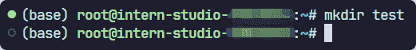

#### `cd`

这个命令会是使用最多的一个命令，在使用之前需要为没有计算机基础的同学讲一下目录结构，画一张图让大家理解：

我们现在使用的是 `root` 目录，也是 `root` 用户的家目录 ~，Linux 操作系统中 `/` 表示根目录，根目录下有许多系统所需的目录和文件，刚才我们创建的目录就存在于 `root` 目录下，其中 `.` 表示的是当前目录，`..` 表示的上级目录。如果我现在要进入到 `test` 目录，然后回到 `root` 目录，我们可以这样操作：

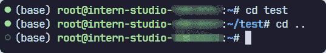

#### `pwd`

我们可以使用 \`pwd\` 命令查看当前所在的目录：这样可以方便我们确定我们当前所在哪个目录下面。

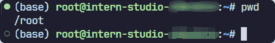

#### `cat`

\`cat\` 命令可以查看文件里面的内容，更多的使用命令可以使用 \`--help\` 命令查看：

+   \`-a\`，\`--show-all\` 等价于 \`-vET\`

+   \`-b\`，\`--number-non\` 空白数非空输出行，覆盖 \`-n\`

+   \`-e\`，等价于 \`-vE\`

+   \`-E\`，\`--show-end\` 显示 \`$\` 在每一行的末尾

+   \`-n\`，\`--number\` 编号所有输出行

+   \`-s\`，\`--crick-blank\` 抑制重复的空输出行

+   \`-t\` 等价于 \`-vT\`

+   \`-t\`，\`--show-tabs\` 将制表符显示为 \`^I\`

+   \`-v\`，\`--show-nonprinting\` 使用 \`^` 和 \`M-\` 表示法，\`LFD\` 和 \`TAB\` 除外

#### `vi` or `vim`

当我们需要编辑文件的时候可以使用 \`vi\` 或者 \`vim\` 命令，当你进入文件编辑以后，有三种模式：

进入编辑模式可以使用 \`i\`，\`vim\` 的方便之处就是可以在终端进行简单的文件修改。

#### `cp` 和 `ln`（重点）

\`cp\` 命令在后面课程中会经常用到，它是用来将一个文件或者目录复制到另一个目录下的操作，常用的使用有：

+   复制文件：\`cp 源文件 目标文件\`

+   复制目录：\`cp -r 源目录 目标目录\`

但是如果我们是要使用模型的话，这种操作会占用大量的磁盘空间，所以我们一般使用 \`ln\` 命令，这个就和 Windows 的快捷方式一样。Linux 中链接分为两种：硬链接 (hard link) 与软链接 (symbolic link)，硬链接的意思是一个档案可以有多个名称，而软链接的方式则是产生一个特殊的档案，该档案的内容是指向另一个档案的位置。硬链接是存在同一个文件系统中，而软链接却可以跨越不同的文件系统。

所以我们一般使用软链接，它的常用的使用方法如下：

\`ln [参数][源文件或目录][目标文件或目录]\`

参数如下：

+   \`-s\`：创建软链接（符号链接）也是最常用的；

+   \`-f\`：强制执行，覆盖已存在的目标文件；

+   \`-i\`：交互模式，文件存在则提示用户是否覆盖；

+   \`-n\`：把符号链接视为一般目录；

+   \`-v\`：显示详细的处理过程。

#### `mv` 和 `rm`

\`mv\` 命令和 \`rm\` 命令的使用方式很相似，但是 \`mv\` 是用来移动文件或者目录的，同时还可以进行重命名。\`rm\` 命令则是用来删除文件或者目录的。

常用的使用方法如下：

+   \`mv\` 命令：

常用参数：

+   \`-i\`：交互模式，覆盖前询问。

+   \`-f\`：强制覆盖。

+   \`-u\`：只在源文件比目标文件新时才进行移动。

使用示例：

+   \`mv file1.txt dir1/\`：将文件 \`file1.txt\` 移动到目录 \`dir1\` 中。

+   \`mv file1.txt file2.txt\`：将文件 \`file1.txt\` 重命名为 \`file2.txt\`。

+   \`rm\` 命令：

常用参数：

+   \`-i\`：交互模式，删除前询问。

+   \`-f\`：强制删除，忽略不存在的文件，不提示确认。

+   \`-r\`：递归删除目录及其内容。

使用示例：

+   \`rm file.txt\`：删除文件 \`file.txt\`。

+   \`rm -r dir1/\`：递归删除目录 \`dir1\` 及其所有内容。

删除目录的命令也可以使用 \`rmdir\`。

#### `find`

\`find\` 命令是 Linux 系统中一个强大的文件搜索工具，它可以在指定的目录及其子目录中查找符合条件的文件或目录，并执行相应的操作。

以下是 \`find\` 命令的一些常见用法：

1.  **按文件名查找**：使用 \`-name\` 选项按照文件名查找文件。例如，\`find /path/to/directory -name "file.txt"\` 将在指定目录及其子目录中查找名为 \`file.txt\` 的文件。

1.  **按文件类型查找**：使用 \`-type\` 选项按照文件类型查找文件。例如，\`find /path/to/directory -type f\` 将查找指定目录及其子目录中的所有普通文件。

1.  **按文件大小查找**：使用 \`-size\` 选项按照文件大小查找文件。例如，\`find /path/to/directory -size +100M\` 将查找指定目录及其子目录中大于 100MB 的文件。

1.  **按修改时间查找**：使用 \`-mtime\`、\`-atime\` 或 \`-ctime\` 选项按照文件的修改时间、访问时间或状态更改时间查找文件。例如，\`find /path/to/directory -mtime -7\` 将查找指定目录及其子目录中在 7 天内修改过的文件。

1.  **按文件权限查找**：使用 \`-perm\` 选项按照文件权限查找文件。例如，\`find /path/to/directory -perm 755\` 将查找指定目录及其子目录中权限为 755 的文件。

1.  **按用户或组查找**：使用 \`-user\` 或 \`-group\` 选项按照文件的所有者或所属组查找文件。例如，\`find /path/to/directory -user username\` 将查找指定目录及其子目录中属于用户 \`username\` 的文件。

1.  **执行操作**：使用 \`-exec\` 选项可以对找到的文件执行相应的操作。例如，\`find /path/to/directory -name "*.txt" -exec rm {} \\;\` 将删除找到的所有以 \`.txt\` 结尾的文件。

#### `ls`

\`ls\` 命令可以用来列出目录的内容以及详细信息。

常用参数及使用方法如下：

+   \`-a\`：显示所有文件和目录，包括隐藏文件（以 \`.\` 开头的文件或目录）。

+   \`-l\`：以长格式显示详细信息，包括文件权限、所有者、大小、修改时间等。

+   \`-h\`：与 \`-l\` 结合使用，以人类可读的方式显示文件大小（如 K、M、G 等）。

+   \`-R\`：递归列出子目录的内容。

+   \`-t\`：按文件修改时间排序显示。

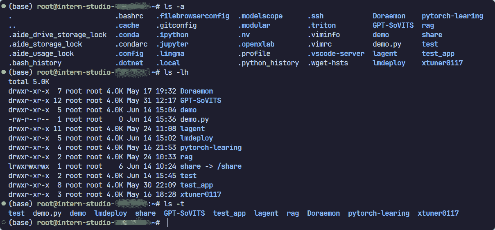

#### `sed`

\`sed\` 命令是一种流编辑器，主要用于文本处理，在处理复杂的文件操作时经常用到，在后续的课程中会使用到，`sed` 命令常用参数及使用示例如下：

+   **参数说明：**

+   \`-e <script>\` 或 \`--expression=<script>\`：直接在命令行中指定脚本进行文本处理。

+   \`-f <script 文件>\` 或 \`--file=<script 文件>\`：从指定的脚本文件中读取脚本进行文本处理。

+   \`-n\` 或 \`--quiet\` 或 \`--silent\`：仅打印经过脚本处理后的输出结果，不打印未匹配的行。

+   **动作说明：**

+   a：在当前行的下一行添加指定的文本字符串。

+   c：用指定的文本字符串替换指定范围内的行。

+   d：删除指定的行。

+   i：在当前行的上一行添加指定的文本字符串。

+   p：打印经过选择的行。通常与 \`-n\` 参数一起使用，只打印匹配的行。

+   s：使用正则表达式进行文本替换。例如，\`s/old/new/g\` 将所有 "InternLM" 替换为 "InternLM yyds"。

+   **示例：**

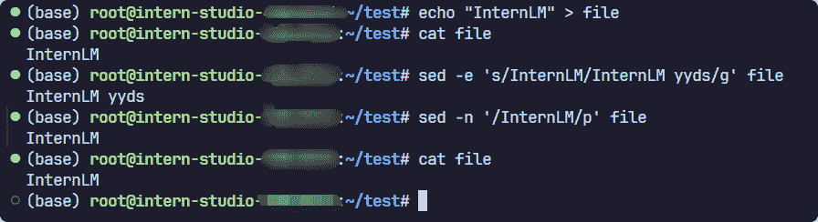

在示例中使用了 \`echo\` 命令，这和 Python 中的 \`print\` 一样，用来打印内容，这里使用管道符 \`>\` 将 InternLM 打印到 `file` 文件中，常用的管道符还有 \`<` 和 \`|\`，比如我们可以使用 \`grep\` 命令来查看 Python 中安装的包含 `os` 字段的包：

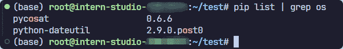

\`grep\` 是一个强大的文本搜索工具。常用参数如下：

+   \`-i\`：忽略大小写进行搜索。

+   \`-v\`：反转匹配，即显示不匹配的行。

+   \`-n\`：显示行号。

+   \`-c\`：统计匹配的行数。

### 进程管理

> **进程管理**命令是进行系统监控和进程管理时的重要工具，常用的进程管理命令有以下几种：

+   \`ps\`：查看正在运行的进程

+   \`top\`：动态显示正在运行的进程

+   \`pstree\`：树状查看正在运行的进程

+   \`pgrep\`：用于查找进程

+   \`nice\`：更改进程的优先级

+   \`jobs\`：显示进程的相关信息

+   \`bg\` 和 \`fg\`：将进程调入后台

+   \`kill\`：杀死进程

> 在开发机中还有一条特殊的命令 \`nvidia-smi\`，它是 NVIDIA 系统管理接口（NVIDIA System Management Interface）的命令行工具，用于监控和管理 NVIDIA GPU 设备。它提供了一种快速查看 GPU 状态、使用情况、温度、内存使用情况、电源使用情况以及运行在 GPU 上的进程等信息的方法。

下面是关于各个命令使用示例：

+   `ps`：列出当前系统中的进程。使用不同的选项可以显示不同的进程信息，例如：

```
ps aux  # 显示系统所有进程的详细信息
```

+   `top`：动态显示系统中进程的状态。它会实时更新进程列表，显示 CPU 和内存使用率最高的进程。

```
top  # 启动 top 命令，动态显示进程信息
```

+   `pstree`：以树状图的形式显示当前运行的进程及其父子关系。

```
pstree  # 显示进程树
```

+   `pgrep`：查找匹配条件的进程。可以根据进程名、用户等条件查找进程。

```
pgrep -u username  # 查找特定用户的所有进程
```

+   `nice`：更改进程的优先级。`nice` 值越低，进程优先级越高。

```
nice -n 10 long-running-command  # 以较低优先级运行一个长时间运行的命令
```

+   `jobs`：显示当前终端会话中的作业列表，包括后台运行的进程。

```
jobs  # 列出当前会话的后台作业
```


# Linux 系统命令与 Conda 使用指南

## 进程与作业管理

+   `bg` 和 `fg`：`bg` 将挂起的进程放到后台运行，`fg` 将后台进程调回前台运行。

```
bg  # 将最近一个挂起的作业放到后台运行
fg  # 将后台作业调到前台运行
```

+   `kill`：发送信号到指定的进程，通常用于杀死进程。

```
kill PID  # 杀死指定的进程ID
```

注意，`kill` 命令默认发送 `SIGTERM` 信号，如果进程没有响应，可以使用 `-9` 使用 `SIGKILL` 信号强制杀死进程：

```
kill -9 PID  # 强制杀死进程
```

> `SIGTERM`（Signal Termination）信号是 Unix 和类 Unix 操作系统中用于请求进程终止的标准信号。当系统或用户想要优雅地关闭一个进程时，通常会发送这个信号。与 `SIGKILL` 信号不同，`SIGTERM` 信号可以被进程捕获并处理，从而允许进程在退出前进行清理工作。（来源于网络）

## nvidia-smi 命令用法

以下是 `nvidia-smi` 命令的一些基本命令用法：

+   显示 GPU 状态的摘要信息：

```
nvidia-smi
```

+   显示详细的 GPU 状态信息：

```
nvidia-smi -l 1
```

这个命令会每 1 秒更新一次状态信息。

+   显示 GPU 的帮助信息：

```
nvidia-smi -h
```

+   列出所有 GPU 并显示它们的 `PID` 和进程名称：

```
nvidia-smi pmon
```

+   强制结束指定的 GPU 进程：

```
nvidia-smi --id=0 --ex_pid=12345
```

这会强制结束 GPU ID 为 `0` 上的 `PID` 为 `12345` 的进程。

+   设置 GPU 性能模式：

```
nvidia-smi -pm 1
nvidia-smi -i 0 -pm 1
```

第一个命令会为所有 GPU 设置为性能模式，第二个命令只针对 ID 为 `0` 的 GPU。

+   重启 GPU：

```
nvidia-smi --id=0 -r
```

这会重启 ID 为 `0` 的 GPU。

下面通过一张图片对 GPU 信息进行介绍：

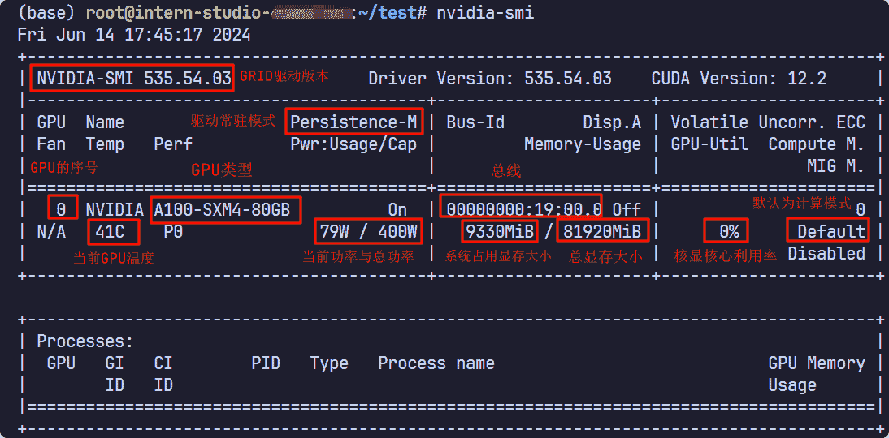

## 工具使用

这里介绍一个工具 `TMUX`，`TMUX` 是一个终端多路复用器。它可以在多个终端之间轻松切换，分离它们（这不会杀死终端，它们继续在后台运行）和将它们重新连接到其他终端中。为什么要介绍这个工具呢？因为在后面进行 `Xtuner` 微调模型的时候，时间会很长，使用 `Tmux` 可以解决程序被杀死中断的情况，下面介绍一下如何安装并使用。

因为开发机使用的是 `ubuntu` 的操作系统，可以使用 `lsb_release -a` 命令查看 `ubuntu` 的系统信息：

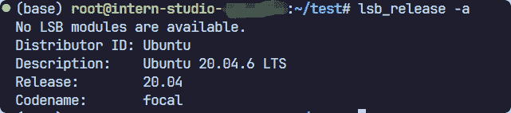

然后使用 `apt install tmux` 命令安装 `tmux`，安装完成以后可以使用 `tmux` 命令就可以使用 `tmux` 了，如果想退出 `tmux` 可以使用 `Ctrl+d` 快捷键。

> 开发机仅 `/root` 路径下的文件是持久化存储的，其他路径下安装的软件重启后都会被重置。

具体的使用方法可以查看：

## 四、Conda 和 Shell 介绍（附加）

`Conda` 是一个开源的包管理和环境管理系统，可在 `Windows`、`macOS` 和 `Linux` 上运行。它快速安装、运行和更新软件包及其依赖项。使用 `Conda`，您可以轻松在本地计算机上创建、保存、加载和切换不同的环境。

在开发机中已经安装了 `conda`，我们可以直接使用，而且开发机中也有内置的 `conda` 命令 `studio-conda`，下面我们会介绍 `conda` 的基本使用，还有 `studio-conda` 的使用方法以及介绍一下 `studio-conda` 是怎么实现的。

我们会从下面几部分进行介绍：

1.  `conda` 设置

1.  `conda` 环境管理

1.  `conda` 和 `pip`

1.  `studio-conda` 使用与 `Shell`（扩展）

### `conda` 设置

我们可以使用 `conda --version` 来查看当前开发机中 `conda` 的版本信息：

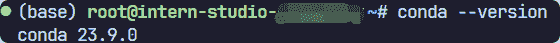

当我们要使用 `conda` 安装包的时候会非常慢，我们可以设置国内镜像提升安装速度，示例如下：

```
# 设置清华镜像
conda config --add channels https://mirrors.tuna.tsinghua.edu.cn/anaconda/pkgs/main
conda config --add channels https://mirrors.tuna.tsinghua.edu.cn/anaconda/pkgs/free
conda config --add channels https://mirrors.tuna.tsinghua.edu.cn/anaconda/pkgs/r
conda config --add channels https://mirrors.tuna.tsinghua.edu.cn/anaconda/pkgs/pro
conda config --add channels https://mirrors.tuna.tsinghua.edu.cn/anaconda/pkgs/msys2
```

但是我们一般都是使用 `pip` 进行包的安装的，后面我们会介绍 `pip` 和 `conda` 的区别。

如果我们想要查看 `conda` 的配置信息可以使用 `conda config --show` 命令，如果是开发机默认的设置的话会返回：（一部分信息）

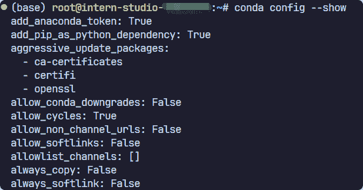

这些配置在 `Conda` 环境配置中，会影响软件包的安装、更新、环境管理等操作的方式和结果。

### `conda` 环境管理

这一部分是 `conda` 中非常重要的一部分，掌握了这一部分大家就可以将开发环境玩转到飞起了😀。

#### 2.1 创建虚拟环境

我们可以使用 `conda create -n name python=3.10` 创建虚拟环境，这里表示创建了 `python` 版本为 `3.10`、名字为 `name` 的虚拟环境。创建后，可以在 `.conda` 目录下的 `envs` 目录下找到。

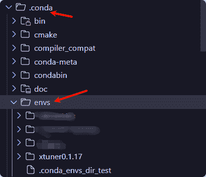

在不指定 `python` 版本时，会自动创建基于最新 `python` 版本的虚拟环境。同时我们可以在创建虚拟环境的同时安装必要的包：`conda create -n name numpy matplotlib python=3.10`（但是不建议大家这样用）

创建虚拟环境的常用参数如下：

+   `-n` 或 `--name`：指定要创建的环境名称。

+   `-c` 或 `--channel`：指定额外的软件包通道。

+   `--clone`：从现有的环境克隆来创建新环境。

+   `-p` 或 `--prefix`：指定环境的安装路径（非默认位置）。

#### 2.2 查看有哪些虚拟环境

如果想要查看有哪些虚拟环境我们可以使用下面的命令：

```
conda env list
conda info -e
conda info --envs
```

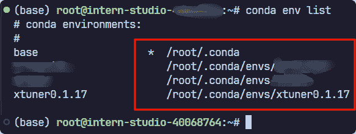

同时我们还可以看到环境所在的目录。

#### 2.3 激活与退出虚拟环境

当我们创建完虚拟环境后我们可以使用 `conda activate name` 命令来激活虚拟环境，如何查看是否切换成功呢？很简单，只需要看 `\`base\`` 是否变成了创建的虚拟环境的名称。


如果想要退出虚拟环境的话可以使用：

```
conda activate
conda deactivate
```

这两条命令都会回到 `base` 环境，因为 `base` 是 `conda` 的基础环境，如果仔细观察的话，`base` 环境目录比其他的虚拟环境目录层级要高。

#### 2.4 删除与导出虚拟环境

如果想要删除某个虚拟环境可以使用 `conda remove --name name --all`，如果只删除虚拟环境中的某个或者某些包可以使用 `conda remove --name name package_name`

导出虚拟环境对于特定的环境是非常有必要的，因为有些软件包的依赖关系很复杂，如果自己重新进行创建和配置的话很麻烦，如果我们将配置好的环境导出，这样下次使用还原就行了，而且也可以把配置分享给其他人。

```
# 获得环境中的所有配置
conda env export --name myenv > myenv.yml
# 重新还原环境
conda env create -f myenv.yml
```

比如我们将 `xtuner0.1.17` 虚拟环境导出，配置信息是这样的：

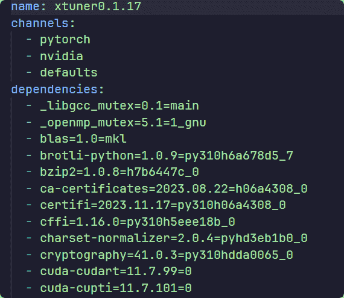

其中包括 `环境名字`、虚拟环境软件包的在线存储库的位置和虚拟环境的依赖。后面我们会使用进阶的使用方法来快速的还原虚拟环境。

### `conda` 和 `pip`

这部分我们介绍一些 `conda` 和 `pip` 的一些区别：

1.  `conda` 可以管理非 `python` 包，`pip` 只能管理 `python` 包。

1.  `conda` 可以用来创建虚拟环境，`pip` 不能，需要依赖 `virtualenv` 之类的包。

1.  `conda` 安装的包是编译好的 `二进制文件`，安装包文件过程中会自动安装依赖包；`pip` 安装的包是 `wheel` 或源码，装过程中不会去支持 `python` 语言之外的依赖项。

1.  `conda` 安装的包会统一下载到当前虚拟环境对应的目录下，下载一次多次安装。`pip` 是直接下载到对应环境中。

> `Wheel` 是一种 `Python` 安装包的格式。

> 它是一种预编译的二进制分发格式，类似于 `conda` 中的已编译二进制文件。

> `Wheel` 格式的主要优点包括：

1.  安装速度快：因为已经进行了预编译，所以在安装时不需要像源码安装那样进行编译过程，节省了时间。

1.  一致性：确保在不同的系统和环境中安装的结果是一致的。

> 例如，如果您要安装一个大型的 `Python` 库，使用 `Wheel` 格式可以避免在不同的机器上因为编译环境的差异而导的安装问题。而且，对于那些没有编译环境或者编译能力较弱的系统，`Wheel` 格式能够让安装过程更加顺畅。

### `studio-conda` 使用与 `Shell`（扩展，不需要在开发机中操作）

这一部分属于扩展的部分，因为我觉得这一部分非常有趣，也非常实用，所以如果大家有兴趣的可以学习一下。

我们先来介绍一下 `studio-conda`，这是开发机内置的一个命令，它通过 `Shell` 脚本来实现的。什么是 `Shell` 脚本呢？

> `Shell 脚本` 是一种包含一系列命令的文本文件，这些命令按照特定的顺序排列，用于在 `Unix/Linux` 或类似的操作系统环境中自动执行任务。

> `Shell` 脚本通常使用 `Shell` 语言编写，常见的 `Shell` 语言如 `Bash`、`Sh` 等，就是我们前面所介绍了 `Linux` 基础命令，这就属于 `Shell` 语言。

> 它有以下几个重要特点：

1.  自动化：可以将一系列重复、复杂的操作编写为一个脚本，然后只需运行脚本即可自动完成这些操作，从而节省时间和减少错误。例如，每天定时备份重要文件的脚本。

1.  系统管理：用于管理系统配置、用户权限、进程控制等。比如，创建新用户并设置其权限的脚本。

1.  批处理：能够同时处理多个文件或数据。例如，将一批图片文件从一种格式转换为另一种格式的脚本。

1.  流程控制：像条件判断（`if-else`）、循环（`for`、`while`）等，使脚本能够根据不同的情况执行不同的操作。

那 `studio-conda` 就属于自动化的一部分，在我们开发机中 `root` 用户的 `bash` 环境的配置文件是 `.bashrc`，但其实主要的配置文件是 `/share/.aide/config/bashrc`，在这个文件里面写了一些命令，可以让我们更快捷的执行一些操作，比如：

```
export no_proxy='localhost,127.0.0.1,0.0.0.0,172.18.47.140'
export PATH=/root/.local/bin:$PATH
export HF_ENDPOINT='https://hf-mirror.com'
alias studio-conda="/share/install_conda_env.sh"
alias studio-smi="/share/studio-smi"
```

`export` 是用来设置环境变量的，`alias` 是将一个 `sh` 文件复制为一个变量，这个可以作为命令在终端中执行，我们的 `studio-conda` 就是这样的。

> 这里的 `studio-smi` 是用来查看查看虚拟内存占用的，当我们打开 `/share/studio-smi` 文件可以看到：

```
#!/bin/bash

if command -v vgpu-smi > /dev/null
then
    echo "Running studio-smi by vgpu-smi"
    vgpu-smi
else
    echo "Running studio-smi by nvidia-smi"
    nvidia-smi
fi
```

> 这个脚本是用于检查系统中是否存在 `vgpu-smi` 命令，如果存在，它将运行 `vgpu-smi` 来显示虚拟 `GPU` (`vGPU`) 的状态信息；如果不存在，它将运行 `nvidia-smi` 来显示 `NVIDIA GPU` 的状态信息。如下图所示：

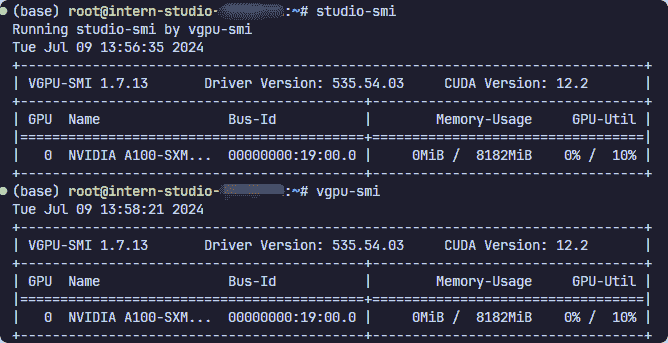

> `nvidia-smi` 是用于监控和管理物理 `NVIDIA GPU` 设备的工具，而 `vgpu-smi` 专门用于监控和管理通过 `NVIDIA vGPU` 技术虚拟化的 `GPU` 资源。

我们查看 `/share/install_conda_env.sh` 文件内容如下：


# studio-conda 环境管理使用指南

## studio-conda 脚本功能介绍

```
#!/bin/bash
# clone internlm-base conda env to user's conda env
# created by xj on 01.07.2024
# modifed by xj on 01.19.2024 to fix bug of conda env clone
# modified by ljy on 01.26.2024 to extend

XTUNER_UPDATE_DATE=`cat /share/repos/UPDATE | grep xtuner |awk -F= '{print $2}'`
HOME_DIR=/root
CONDA_HOME=$HOME_DIR/.conda
SHARE_CONDA_HOME=/share/conda_envs
SHARE_HOME=/share

list() {
    cat <<-EOF
  预设环境          描述

  internlm-base    pytorch:2.0.1, pytorch-cuda:11.7
  xtuner           Xtuner(源码安装: main $(echo -e "\033[4mhttps://github.com/InternLM/xtuner/tree/main\033[0m"), 更新日期：$XTUNER_UPDATE_DATE)
  pytorch-2.1.2    pytorch:2.1.2, pytorch-cuda:11.8
EOF
}

help() {
    cat <<-EOF
  说明: 用于快速clone预设的conda环境

  使用: 
  
    1. studio-conda env -l/list 打印预设的conda环境列表
  
    2. studio-conda <target-conda-name> 快速clone: 默认拷贝internlm-base conda环境
    
    3. studio-conda -t <target-conda-name> -o <origin-conda-name> 将预设的conda环境拷贝到指定的conda环境
        
EOF
}

clone() {
    source=$1
    target=$2

    if [[ -z "$source" || -z "$target" ]]; then
        echo -e "\033[31m 输入不符合规范 \033[0m"
        help
        exit 1
    fi

    if [ ! -d "${SHARE_CONDA_HOME}/$source" ]; then
        echo -e "\033[34m 指定的预设环境: $source不存在\033[0m"
        list
        exit 1
    fi

    if [ -d "${CONDA_HOME}/envs/$target" ]; then
        echo -e "\033[34m 指定conda环境的目录: ${CONDA_HOME}/envs/$target已存在, 将清空原目录安装 \033[0m"
        wait_echo&
        wait_pid=$!
        rm -rf "${CONDA_HOME}/envs/$target"
        kill $wait_pid
    fi

    echo -e "\033[34m [1/2] 开始安装conda环境: <$target>. \033[0m"
    sleep 3
    tar --skip-old-files -xzvf /share/pkgs.tar.gz -C ${CONDA_HOME}
    wait_echo&
    wait_pid=$!
    conda create -n $target --clone ${SHARE_CONDA_HOME}/${source}
    if [ $? -ne 0 ]; then
        echo -e "\033[31m 初始化conda环境: ${target}失败 \033[0m"
        exit 10
    fi

    kill $wait_pid

    # for xtuner, re-install dependencies
    case "$source" in
    xtuner)
        source_install_xtuner $target
        ;;
    esac

    echo -e "\033[34m [2/2] 同步当前conda环境至jupyterlab kernel \033[0m"
    lab add $target
    source $CONDA_HOME/bin/activate $target
    cd $HOME_DIR

    echo -e "\033[32m conda环境: $target安装成功! \033[0m"

    echo """
    ============================================
                    ALL DONE!
    ============================================
    """;
}

······
dispatch $@
```

其中的 `list()` 等，都是 `studio-conda` 的函数，可以实现某些操作，比如我们可以使用 `studio-conda env list` 来查看预设的环境：

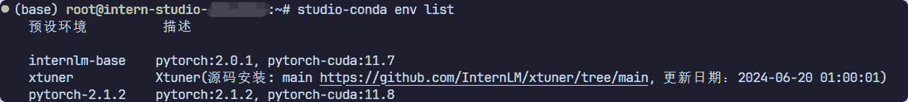

## 克隆预设环境

其中 `clone()` 函数的主要作用就是用来复制环境的，不过只能从预设的环境中进行复制，主要的代码其实就是：

```
tar --skip-old-files -xzvf /share/pkgs.tar.gz -C ${CONDA_HOME}

conda create -n $target --clone ${SHARE_CONDA_HOME}/${source}
```

解压预设环境的压缩包，然后通过 `clone` 创建虚拟环境，不过在 Shell 脚本中还设置了一些逻辑，不过都是一些判断，如果你熟悉任何一种编程语言应该都可以看懂，如果看不懂问题也不大。

## 添加自定义 conda 环境

那么我们如何将我们自己创建的环境添加到 `studio-conda` 中呢？

> 第一步，将新的 conda 环境创建到 `/share/conda_envs` 下
> `conda create -p /share/conda_envs/xxx python=3.1x`

> 第二步，将本机 `/root/.conda/pkgs` 下的文件拷贝到 `/share/pkgs` 中，重新压缩并替换（此步骤是为了把 conda 创建过程中大的公共包存储起来，避免重复下载）

> `cp -r -n /root/.conda/pkgs/* /share/pkgs/`

> `cd /share && tar -zcvf pkgs.tar.gz pkgs`

> 第三步，更新 `install_conda_env.sh` 中的 `list` 函数，增加新的 conda 环境说明。

## 使用环境配置文件还原环境

上面是开发机默认提供的方法，其实还有一种方法，我们前面使用 conda 导出过 `xtuner0.1.17` 虚拟环境的配置文件，我们可以使用 `conda env create -f xtuner0.1.17.yml` 命令来还原虚拟环境。下面我们来写一个简单的 Shell 脚本来实现这个操作：我们在根目录下创建 `test.sh` 文件，写入以下内容：

```
#!/bin/bash

# 定义导出环境的函数
export_env() {
    local env_name=$1
    echo "正在导出环境: $env_name"
    # 导出环境到当前目录下的env_name.yml文件
    conda env export -n "$env_name" > "$env_name.yml"
    echo "环境导出完成。"
}

# 定义还原环境的函数
restore_env() {
    local env_name=$1
    echo "正在还原环境: $env_name"
    # 从当前目录下的env_name.yml文件还原环境
    conda env create -n "$env_name" -f "$env_name.yml"
    echo "环境还原完成。"
}

# 检查是否有足够的参数
if [ $# -ne 2 ]; then
    echo "使用方法: $0 <操作> <环境名>"
    echo "操作可以是 'export' 或 'restore'"
    exit 1
fi

# 根据参数执行操作
case "$1" in
    export)
        export_env "$2"
        ;;
    restore)
        restore_env "$2"
        ;;
    *)
        echo "未知操作: $1"
        exit 1
        ;;
esac
```

当我们完成 Shell 脚本的创建以后我们需要为脚本赋予权限，可以使用命令：`chmod +x test.sh` ，然后输入 `./test.sh restore xtuner0.1.17` 并按下回车就可以还原虚拟环境了。

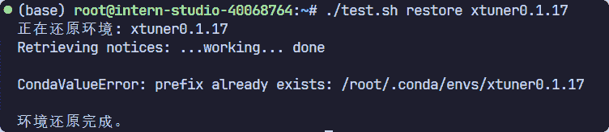

不过这种跟直接使用没什么太大区别，如果将这种操作与开发机中的 `studio-conda` 命令结合起来会非常方便，不过由于复制环境的方法不太一样。所以如果要实现需要对 `/share/install_conda_env.sh` 文件的逻辑进行修改。

> 好了，以上就是我们本关卡的全部内容了，希望上面的内容对大家后面学习有帮助，如果大家想要学习更多 linux 的相关知识，可以看我博客文章，虽然说不会 linux 对我们学习大模型没有太大影响，但是 linux 如果学习的很好，会让你在学习大模型的路上非常顺畅的。最后大家不要忘了完成我们前面设置的关卡呦！

> **博客链接：**[linux](https://blog.lingkongstudy.com.cn/tags/linux)

## 常见问题

### InternStudio 开发机的环境玩坏了，如何初始化开发机环境

**慎重执行！！！！所有数据将会丢失，仅限 InternStudio 平台，自己的机器千万别这么操作**

+   第一步本地终端 `ssh` 连上开发机（一定要 `ssh` 连接上操作，不能在 web 里面操作！！！）

+   第二步执行 `rm -rf /root`，大概会等待10分钟

+   第三步重启开发机,系统会重置 `/root` 路径下的配置文件

+   第四步 `ln -s /share /root/share`
