# Python 关卡（撰写中Beta）

> 来源：[https://aicarrier.feishu.cn/docx/YGqNdmBdOo17MDxd97ocfpUXnmf](https://aicarrier.feishu.cn/docx/YGqNdmBdOo17MDxd97ocfpUXnmf)

非正式版，正式版请看github repo。

# **Intro**

> 欢迎来到书生浦语大模型实战营基础部分Python关卡，本关主要由以下四大块内容组成：

+   Python(Miniconda)的安装

+   Python基础语法

+   Numpy基础(选修)

+   vscode 远程连接 internstudio开发机打断点调试 python 程序

> 学习完成后，完成由三道Python题目组成的闯关作业视为闯关成功。

TIPS：本关内容覆盖较多，知识点较杂，如果有不清楚或者不懂的地方可以随时提问。同时如果觉得教程有问题的地方也请随时提出，让我们一起把本教程优化得更好，帮助更多基础薄弱得人走进大模型的世界。

# 如何安装Python

+     推荐直接安装miniconda(anaconda也可以)来安装python，这样方便管理开发环境。

###     **什么是conda？**

Conda是一个开源的软件包管理系统和环境管理系统，它主要用于安装多个版本的软件包及其依赖关系，并能轻松地在它们之间切换。以下是关于Conda的详细介绍：

1. **功能与作用**：

+   **包管理**：Conda可以帮助用户轻松地安装、更新和卸载各种软件包。它提供了一个庞大而丰富的社区仓库——Anaconda仓库，内含数千个优化过并经过验证的常见Python软件包，也包含其他编程语言（如R）的工具。

+   **环境管理**：使用Conda，用户可以创建独立且隔离的开发环境，为每个项目或应用程序设置不同的版本或配置文件，确保它们之间不会相互干扰，对于处理不同的依赖关系非常重要。

+    **跨平台支持**：Conda适用于Windows、Mac和Linux，使在不同平台上共享代码变得更加容易，避免由于系统差异导致的问题。

2. **常用命令**：

+   conda list：列出当前conda环境所链接的软件包。

+   conda create：创建一个新的conda环境。例如，conda create -n myenv python=3.8会创建一个名为myenv的新环境，并指定Python版本为3.8。

+   conda activate：激活一个已存在的conda环境。

+   conda deactivate：退出当前激活的环境。

+   conda install：在当前激活的环境中安装包。

+   conda update：更新包或conda本身到最新版本。

+   conda remove：从当前环境中卸载包。

+   conda env list：显示所有已创建的环境。

3. **适用性**：

Conda不仅为Python程序创建，也可以打包和分发其他软件，并且支持多种编程语言，包括Python、R、Ruby、Lua、Scala、Java、JavaScript、C/C++等。它被广泛用于数据分析、科学计算和机器学习领域，提供了简单而强大的工具来创建、部署和维护这些领域所需的环境。总的来说，Conda是一个在数据分析和软件开发领域非常有用的工具，特别是当需要管理多个项目和不同版本的依赖时，Conda可以大大简化环境和依赖管理的复杂性。

### **Python安装与学习环境准备**

#### 1. 下载miniconda

miniconda和anaconda都可以通过官网下载，也可以去清华源下载。

[        清华源miniconda下载链接: Index o](https://mirrors.tuna.tsinghua.edu.cn/anaconda/miniconda/)f /anaconda/miniconda/ | 清华大学开源软件镜像站 | Tsinghua Open Source Mirror(建议选择python3.9以上的版本，比如Miniconda3-py310_24.5.0)

#### 2. 安装miniconda

windows可以通过图形化的安装程序直接完成安装记得在最后一步把miniconda加入环境变量

a. 如何换源？(在境外的同学可以跳过此步骤)

python的包管理pip与conda的源服务器均在境外，安装包的时候常常会碰到下载慢的情况。这时我们可以把pip与conda的源替换为国内的镜像，下面我们将刚刚安装好的环境替换为清华源。我们需要进入命令行开始进行换源，Windows可以直接打开miniconda powershell promt。

首先将pip替换为清华源，只需要一条命令。

```
 pip config set global.index-url https://pypi.tuna.tsinghua.edu.cn/simple             
```

接着我们来给conda替换成清华源。各系统都可以通过修改用户目录下的 .condarc 文件来修改镜像源。Windows 用户无法直接创建名为 .condarc 的文件，可先执行 conda config --set show_channel_urls yes 生成该文件之后再修改。在用户目录找到.condarc 文件后，使用文本编辑器打开，将下面的内容复制进去并保存。

```
 channels:   - defaults show_channel_urls: true default_channels:   
 - https://mirrors.tuna.tsinghua.edu.cn/anaconda/pkgs/main   
 - https://mirrors.tuna.tsinghua.edu.cn/anaconda/pkgs/r   
 - https://mirrors.tuna.tsinghua.edu.cn/anaconda/pkgs/msys2 custom_channels:   
 conda-forge: https://mirrors.tuna.tsinghua.edu.cn/anaconda/cloud   
 msys2: https://mirrors.tuna.tsinghua.edu.cn/anaconda/cloud   
 bioconda: https://mirrors.tuna.tsinghua.edu.cn/anaconda/cloud   
 menpo: https://mirrors.tuna.tsinghua.edu.cn/anaconda/cloud   
 pytorch: https://mirrors.tuna.tsinghua.edu.cn/anaconda/cloud   
 pytorch-lts: https://mirrors.tuna.tsinghua.edu.cn/anaconda/cloud   
 simpleitk: https://mirrors.tuna.tsinghua.edu.cn/anaconda/cloud   
 deepmodeling: https://mirrors.tuna.tsinghua.edu.cn/anaconda/cloud/
```

接着在命令行中运行 conda clean -i 清除索引缓存，保证用的是镜像站提供的索引。

#### 创建一个python练习专属的conda虚拟环境

本次教程会需要用到jupyter和numpy，所以安装完miniconda后我们还需要安装jupyter lab和numpy。

打开miniconda powershell promt或者终端，首先我们先创建一个虚拟环境并用Pip安装jupyter lab和numpy。

```
conda create -n python-tutorial python=3.10 
conda activate python-tutorial  
pip install jupyter lab 
pip install numpy
```

本关卡的示例代码与闯关作业均为notebook(ipynb)格式，你们需要自行去github clone或者直接打包下载。下载好后我们激活环境并启动jupyter lab，然后再notebook中打开教程的两个代码文件。就可以开始本次的学习了。

```
conda activate python-tutorial         
jupyter lab         
```

# Python教程内容

# 使用vscode连接开发机进行python debug

VSCode是由微软开发一款轻量级但功能强大的代码编辑器，开源且完全免费。它拥有丰富的插件生态系统、跨平台支持、以及内置的Git控制功能，为开发者提供了高效便捷的编码体验。

VScode下载地址：[Visual Studio Code - Cod](https://code.visualstudio.com/)e Editing. Redefined

## 什么是debug？

当你刚开始学习Python编程时，可能会遇到代码不按预期运行的情况。这时，你就需要用到“debug”了。简单来说，“debug”就是能再程序中设置中断点并支持一行一行地运行代码，观测程序中变量的变化，然后找出并修正代码中的错误。而VSCode提供了一个非常方便的debug工具，可以帮助你更容易地找到和修复错误。

## 使用本地Vscode连接InternStudio开发机

首先需要安装Remote-SSH插件

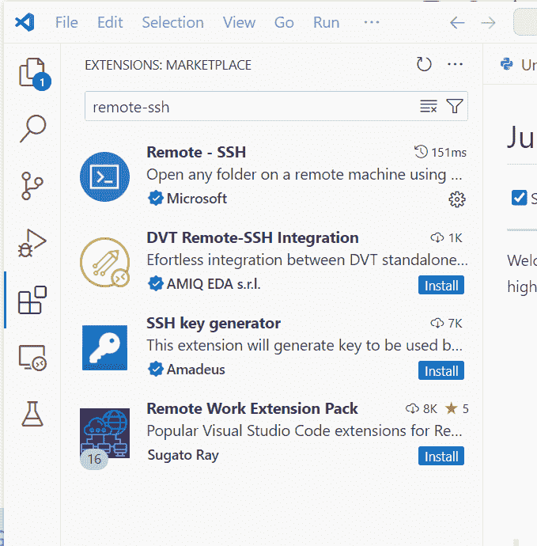

安装完成后进入remot explorer,在ssh目录下新建一个ssh链接

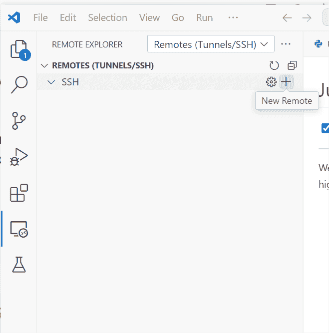

此时会有弹窗提示输入ssh链接命令，回车后还会让我们选择要更新那个ssh配置文件，默认就选择第一个就行（如果你有其他需要的话也可以新建一个ssh配置文件）。

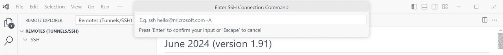

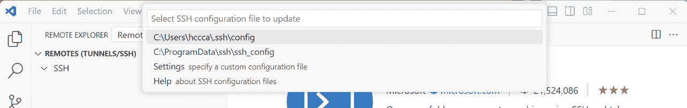

开发机的链接命令可以在开发机控制台对应开发机"SSH连接"找到，复制登录命令到vscode的弹窗中然后回车，vscode就会开始链接interstudio的服务器，记得此时切回去复制一下ssh的密码，待会会用到。

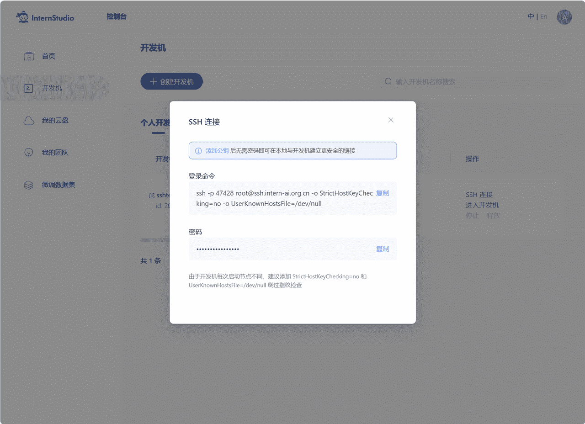

在新的弹窗中将ssh密码粘贴进去然后回车。随后会弹窗让选择远程终端的类型，这边我们的开发机是linux系统，所以选择linux就好。

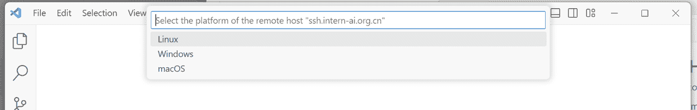

首次连接会进行一些初始化的设置，可能会比较慢，还请耐心等待。后面打开文件夹的时候可能会再需要输入密码，可以一直开着开发机的控制台不要关掉以备不时之需。

看到左下角远程连接已经显示ssh连接地址”SSH: ssh.intern-ai.org.cn”，说明我们已经连接成功了。然后我们就可以像在本地使用Vscode一样愉快的使用vscode在开发机上进行任何操作了。

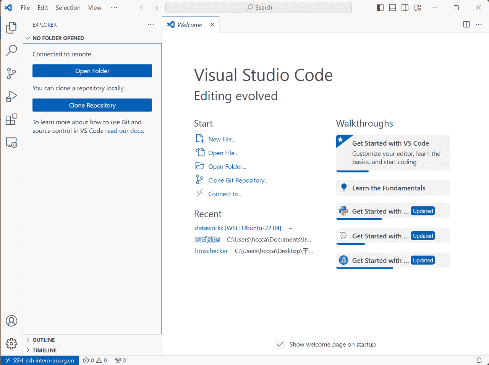

连接成功后我们打开远程连接的vscode的extensions，在远程开发机上安装好python的插件，后面python debug会用到。也可以一键把我们本地vscode的插件安装到开发机上。

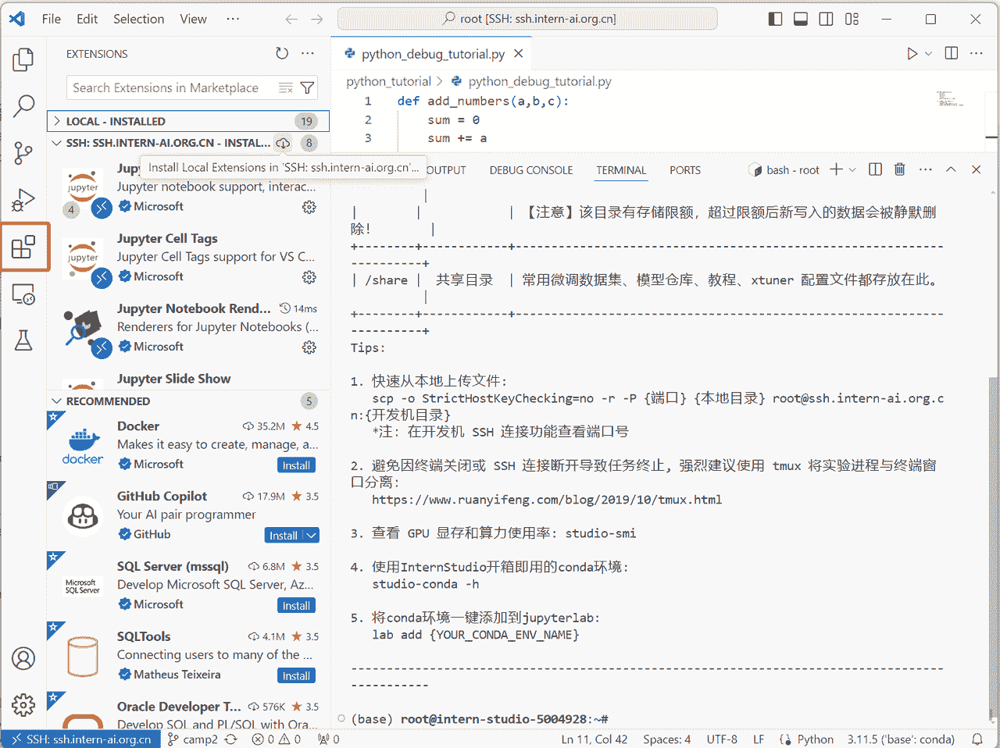

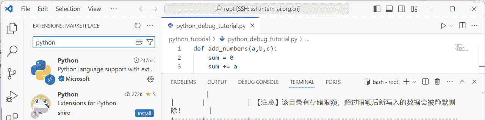

然后我们就可以像在本地使用vscode一样在远程开发机上愉快地使用vscode了

## 在vscode中**打开终端**

单击vscode页面下方有一个X和！的位置可以快速打开vscode的控制台，然后进入TERMINAL。

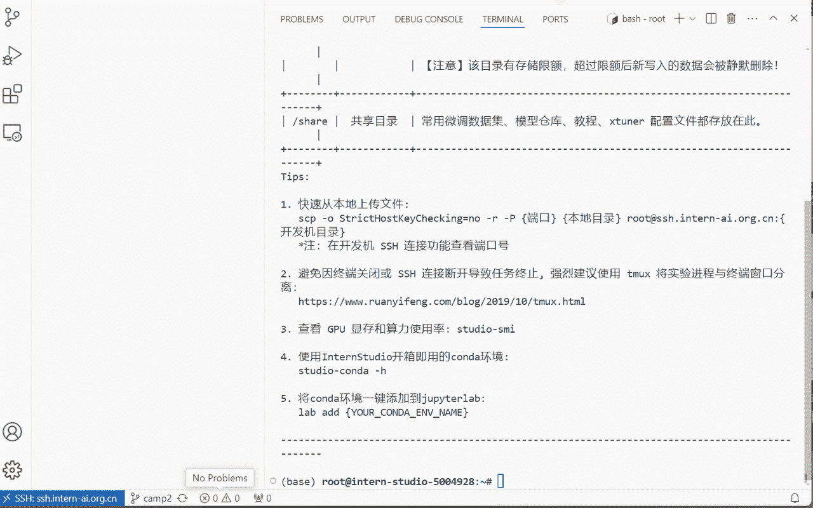

TIPS：右上方的+可以新建一个TERMINAL。

## 使用Vscode进行Python debug的流程

## debug单个python文件

### 1.**打开文件夹**

在VSCode中打开直接打开root文件夹，或者你想要debug的Python文件所在的文件夹。这里可能会需要再次输入密码。下面我们以打开root文件夹为例。单击Open Folder或者左上角菜单File->Open Folder。

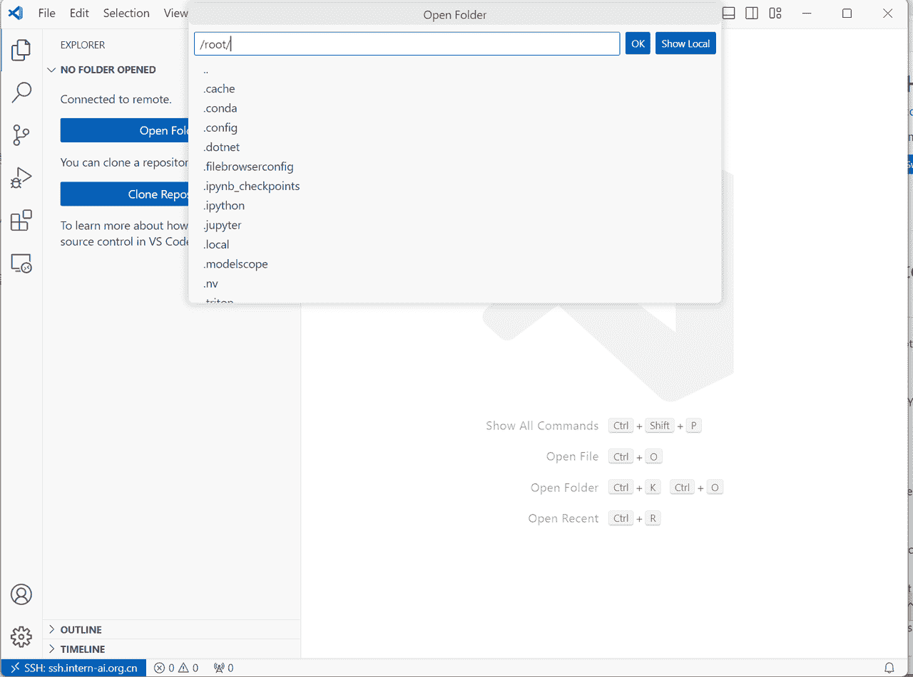

这边我们新建一个文件夹，写一个简单的python程序来做debug演示。

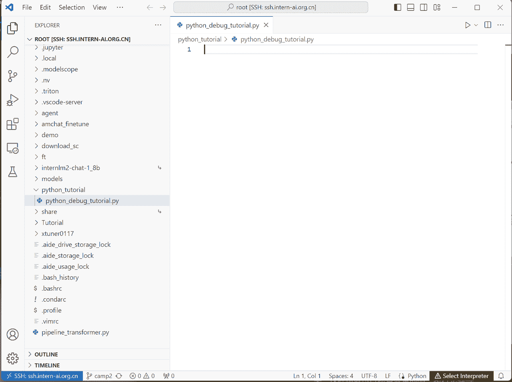

新建python文件后我们如果想要运行，就需要选择解释器。单击右下角的select interpreter，vsconde会自动扫描开发机上所有的python环境中的解释器。这里我们只要选conda中的base就行了，后面各位如果要使用其他虚拟环境就在这选择对应的解释器就可以。

### 2.**设置断点**

在代码行号旁边点击，可以添加一个红点，这就是断点（如果不能添加红点需要检查一下python extension是否已经正确安装）。当代码运行到这里时，它会停下来，这样你就可以检查变量的值、执行步骤等。

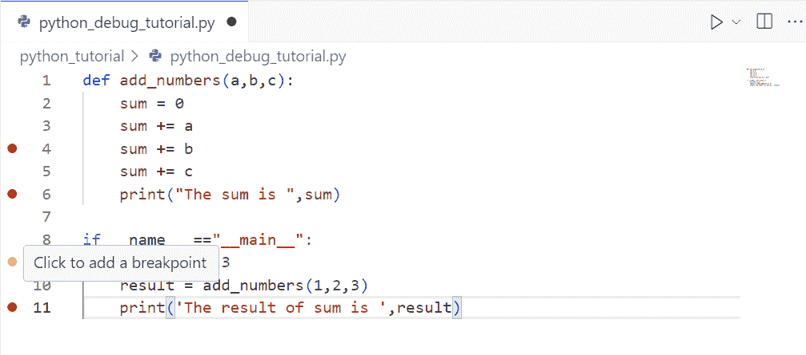

### 3.**启动debug**

点击VSCode侧边栏的“Run and Debug”（运行和调试），然后点击“Run and Debug”（开始调试）按钮，或者按F5键。

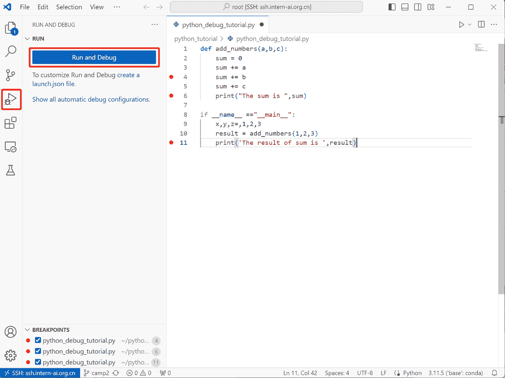

单击后会需要选择debugger和debug配置文件，我们单独debug一个python文件只要选择Python File就行。然后你的代码会在达到第一个断点之前运行，在第一个断点处停下来。

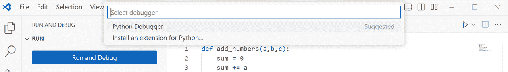

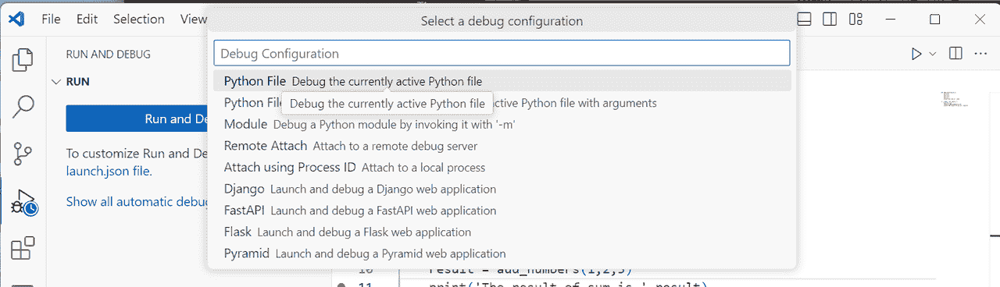

### 4.**查看变量**

当代码在断点处停下来时，你可以查看和修改变量的值。在“Run and Debug”侧边栏的“Variables”（变量）部分，你可以看到当前作用域内的所有变量及其值。

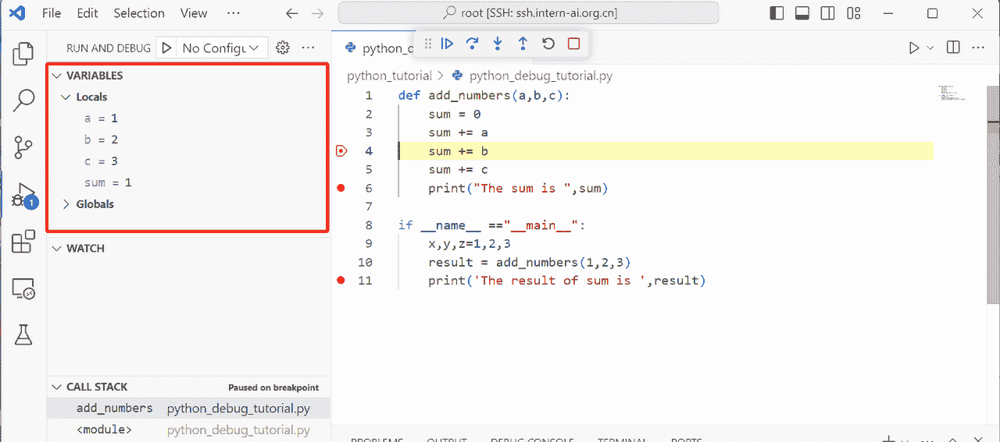

### 5.**单步执行代码**

你可以使用“Run and Debug”侧边栏顶部的按钮来单步执行代码。这样，你可以逐行运行代码，并查看每行代码执行后的效果。

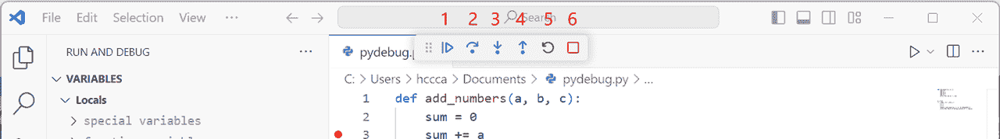

debug面板各按钮功能介绍：

1: continue: 继续运行到下一个断点

2: step over：跳过，可以理解为运行当前行代码，不进入具体的函数或者方法。

3: step into: 进入函数或者方法。如果当行代码存在函数或者方法时，进入代码该函数或者方法。如果当行代码没有函数或者方法，则等价于step over。

4: step out：退出函数或者方法, 返回上一层。

5: restart：重新启动debug

### 6.**修复错误并重新运行**

如果你找到了代码中的错误，可以修复它，然后重新运行debug来确保问题已经被解决。

通过遵循以上步骤，你可以使用VSCode的debug功能来更容易地找到和修复你Python代码中的错误。可以自己编写一个简单的python脚本，并尝试使用debug来更好的理解代码的运行逻辑。记住，debug是编程中非常重要的一部分，所以不要怕花时间在这上面。随着时间的推移，你会变得越来越擅长它！

## 在vscode使用命令行进行debug

很多时候我们要debug的不止是一个简单的python文件，而是很多参数，参数中不止会有简单的值还可能有错综复杂的文件关系,甚至debug一整个项目。这种情况下，直接使用命令行来发起debug会是一个更好的选择。

#### vscode设置

vscode也支持通过remote的方法连接我们在命令行中发起的debug server。首先我们要配置一下debug的config。

还是点击VSCode侧边栏的“Run and Debug”（运行和调试)，单击"create a lauch.json file"

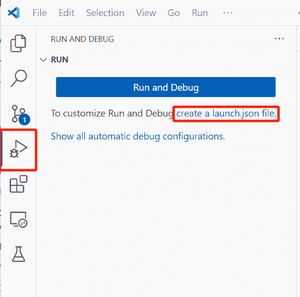

选择debugger时选择python debuger。选择debug config时选择remote attach就行，随后会让我们选择debug server的地址，因为我们是在本地debug，所以全都保持默认直接回车就可以了，也就是我们的server地址为localhost:5678。

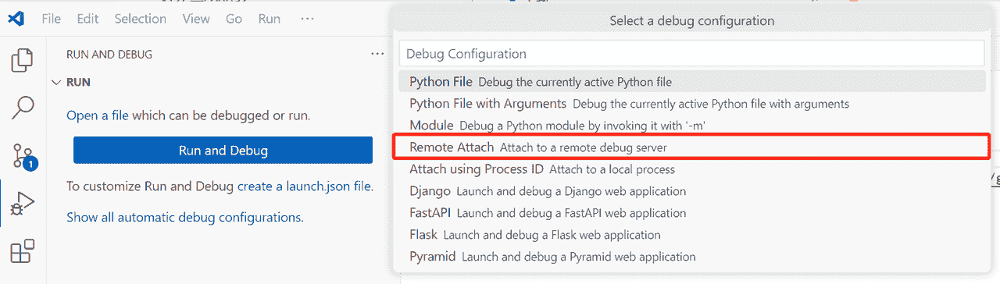

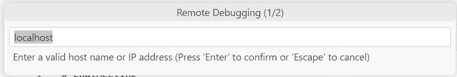

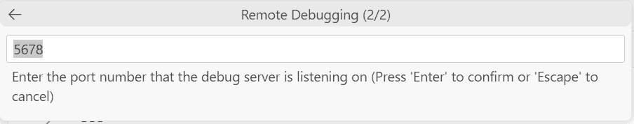

配置完以后会打开配置的json文件，但这不是重点，可以关掉。这时我们会看到run and debug界面有变化，出现了debug选项。

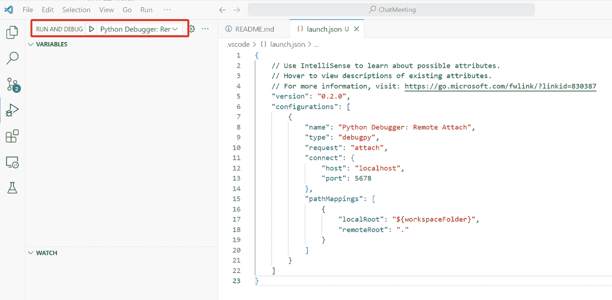

#### debug命令行

现在vscode已经准备就绪，让我们来看看如何在命令行中发起debug。如果没有安装debugpy的话可以先通过pip install debugpy安装一下。

```
python -m debugpy --listen 5678 --wait-for-client ./myscript.py
```

./myscript.py可以替换为我们想要debug的python文件，后面可以和直接在命令行中启动python一样跟上输入的参数。记得要先在想要debug的python文件打好断点并保存。

--wait-for-client 参数会让我们的debug server在等客户端连入后才开始运行debug。在这就是要等到我们在run and debug界面启动debug。

先在终端中发起debug server，然后再去vscode debug页面单击一下绿色箭头开启debug。

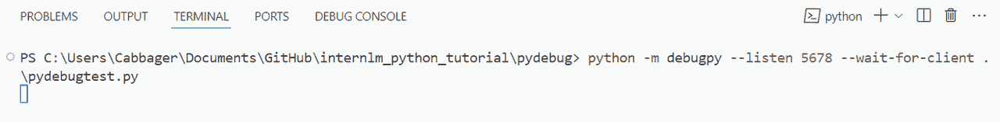


接下来的操作就和上面一样了。

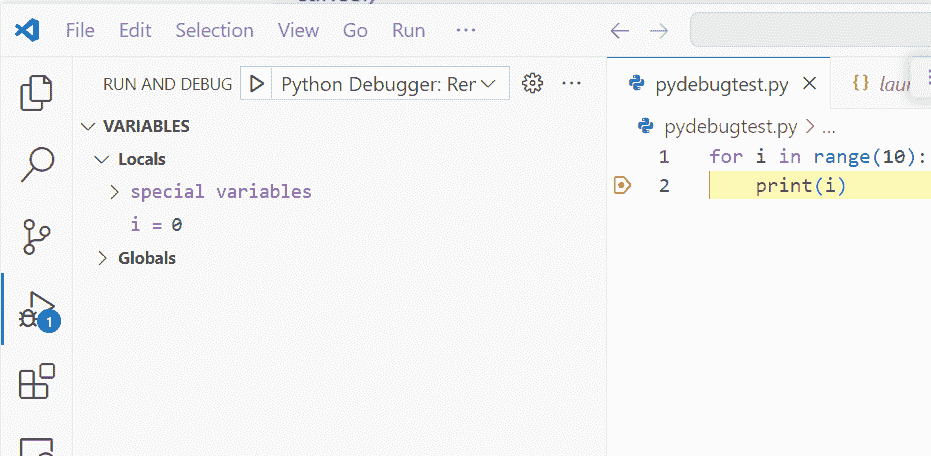

#### 使用别名简化命令

但这边有个不方便的地方，python -m debugpy --listen 5678 --wait-for-client这个命令太长了，每次都打很麻烦。这里我们可以给这段常用的命令设置一个别名。

在linux系统中，可以对 ~/.bashrc 文件中添加以下命令

```
alias pyd=&#x27;python -m debugpy --wait-for-client --listen 5678&#x27;
```

然后执行

```
source ~/.bashrc
```

这样之后使用 pyd 命令(你可以自己命名) 替代 python 就能在命令行中起debug了，之前的debug命令就变成了

```
pyd ./myscript.py
```

如果是windows也可以在powershell中实现类似操作，但会比较繁琐

1.  确定配置文件的位置

首先，你需要知道$PROFILE变量存储的是当前PowerShell会话中可用的配置文件的路径。在PowerShell中，输入$PROFILE并按回车键，它会显示当前用户的配置文件路径（通常是CurrentUserAllHosts类型的配置文件路径）。

```
$PROFILE
```

输出可能类似于：

```
C:\Users\用户名\Documents\PowerShell\Microsoft.PowerShell_profile.ps1
```

1.  创建或编辑配置文件

如果$PROFILE显示的路径不存在（即配置文件尚未创建），你可以使用New-Item命令创建它。如果文件已经存在，你可以直接编辑它。

#### 创建配置文件（如果尚不存在）：

```
if (!(Test-Path -Path $PROFILE)) {  
    New-Item -ItemType File -Path $PROFILE -Force  
}
```

#### 编辑配置文件：

你可以使用任何文本编辑器来编辑配置文件。

这将在记事本中打开配置文件（如果文件已存在），或者创建一个新文件（如果文件不存在）。

1.  将命令添加到配置文件中

在打开的编辑器中，将以下命令添加到文件的末尾：

```
function pyd {  
    python -m debugpy --wait-for-client --listen 5678  
}
```

1.  保存并关闭配置文件

在编辑器中保存文件并关闭它。

1.  重启PowerShell

为了使更改生效，你需要重启PowerShell会话。关闭当前PowerShell窗口，并重新打开一个新的窗口。

1.  测试别名

在新的PowerShell会话中，输入pyd并按回车键，它应该执行python -m debugpy --wait-for-client --listen 5678命令。

通过以上步骤，你就成功地将特定命令添加到了PowerShell配置文件中，并创建了一个可以在每次启动PowerShell时使用的别名。

# 闯关作业

闯关作业总共分为两个任务，两个任务均完成视作闯关成功。

请将作业发布到知乎、CSDN等任一社交媒体，将作业链接提交到以下问卷，助教老师批改后将获得 50 算力点奖励！！！

提交地址：https://aicarrier.feishu.cn/share/base/form/shrcnZ4bQ4YmhEtMtnKxZUcf1vd

## 任务一

请用Python实现一个wordcount函数，统计英文字符串中每个单词出现的次数。返回一个字典，key为单词，value为对应单词出现的次数。

TIPS：记得先去掉标点符号,然后把每个单词转换成小写。不需要考虑特别多的标点符号，只需要考虑实例输入中存在的就可以。

Eg:

Input:

```
Hello world!  
This is an example.  
Word count is fun.  
Is it fun to count words?  
Yes, it is fun!
```

Output:

```
{&#x27;hello&#x27;: 1,&#x27;world!&#x27;: 1,&#x27;this&#x27;: 1,&#x27;is&#x27;: 3,&#x27;an&#x27;: 1,&#x27;example&#x27;: 1,&#x27;word&#x27;: 1,      &#x27;count&#x27;: 2,&#x27;fun&#x27;: 1,&#x27;Is&#x27;: 1,&#x27;it&#x27;: 2,&#x27;to&#x27;: 1,&#x27;words&#x27;: 1,&#x27;Yes&#x27;: 1,&#x27;fun&#x27;: 1  }
```

```
text = &quot;&quot;&quot;
Got this panda plush toy for my daughter&#x27;s birthday, 
who loves it and takes it everywhere. It&#x27;s soft and 
super cute, and its face has a friendly look. It&#x27;s 
a bit small for what I paid though. I think there 
might be other options that are bigger for the 
same price. It arrived a day earlier than expected, 
so I got to play with it myself before I gave it 
to her.
&quot;&quot;&quot;

def wordcount(text):
    pass
```

## 任务二

请使用本地vscode连接远程开发机，将上面你写的wordcount函数在开发机上进行debug，体验debug的全流程，并完成一份debug笔记(需要截图)。