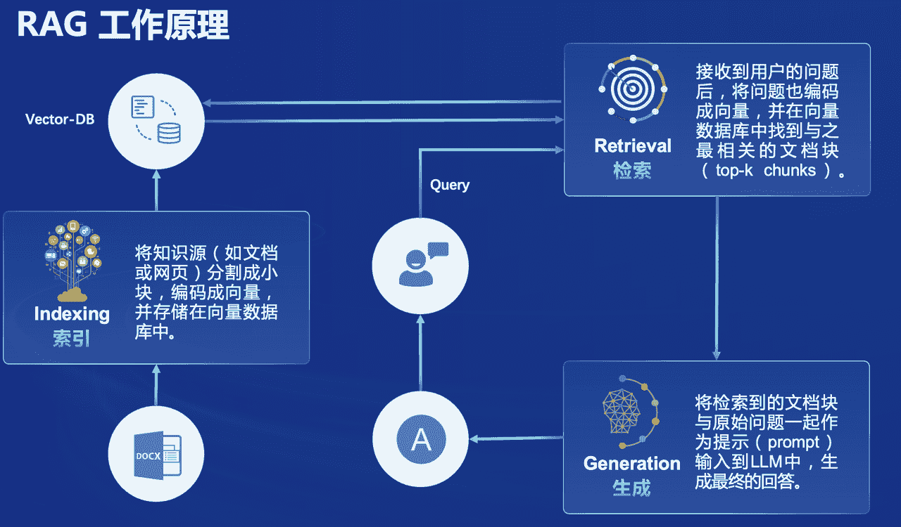
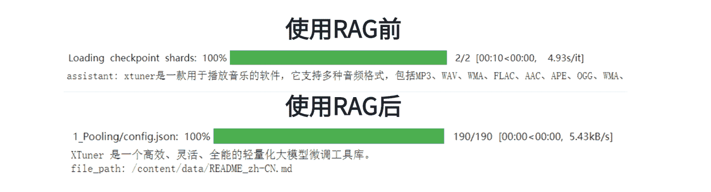
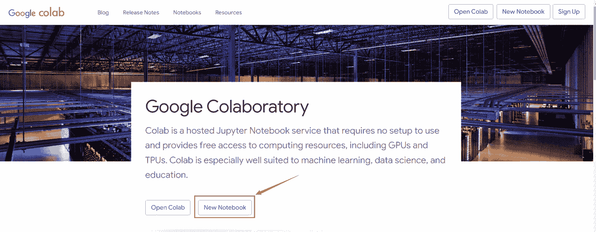
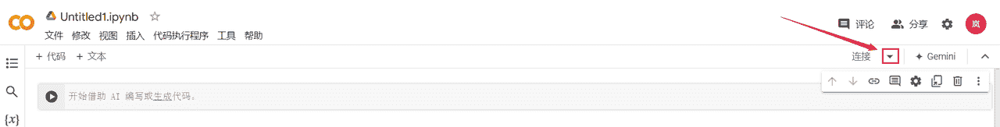
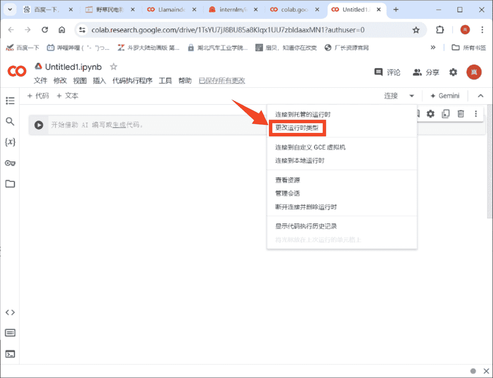
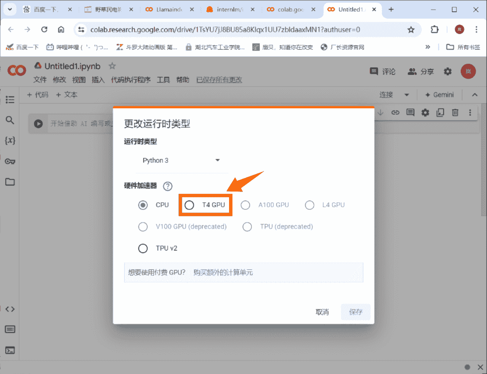
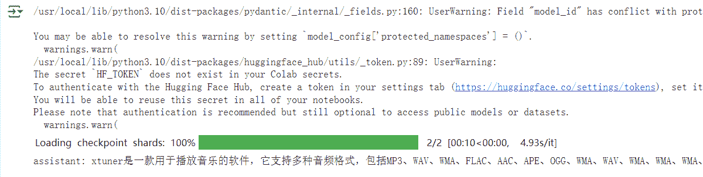
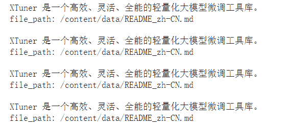

# InternLM+LlamaIndex（Google CoLab 版本）

> 来源：[https://aicarrier.feishu.cn/docx/ORd9dXWdconEVqxlLSuctygbnhe](https://aicarrier.feishu.cn/docx/ORd9dXWdconEVqxlLSuctygbnhe)

本文将分为以下几个部分来介绍，如何使用 LlamaIndex 来部署 InternLM2 1.8B（以 InternStudio 的环境为例）

+   前置知识

+   环境配置

+   LlamaIndex HuggingFaceLLM

+   LlamaIndex RAG

## 前置知识

正式介绍检索增强生成（Retrieval Augmented Generation，RAG）技术以前，大家不妨想想为什么会出现这样一个技术。

给模型注入新知识的方式，可以简单分为两种方式，一种是内部的，即更新模型的权重，另一个就是外部的方式，给模型注入格外的上下文或者说外部信息，不改变它的的权重。

第[一种方式，改变了模](https://arxiv.org/abs/2403.17297)型的权重即进行模型训练，这是一件代价比较大的事情，大语言模型具体的训练过程，可以参考InternLM2技术报告。第二种方式，并不改变模型的权重，只是给模型引入格外的信息。类比人类编程的过程，第一种方式相当于你记住了某个函数的用法，第二种方式相当于你阅读函数文档然后短暂的记住了某个函数的用法。



对比两种注入知识方式，第二种更容易实现。RAG正是这种方式。它能够让基础模型实现非参数知识更新，无需训练就可以掌握新领域的知识。本次课程选用了LlamaIndex框架。LlamaIndex 是一个上下文增强的 LLM 框架，旨在通过将其与特定上下文数据集集成，增强大型语言模型（LLMs）的能力。它允许您构建应用程序，既利用 LLMs 的优势，又融入您的私有或领域特定信息。

### **RAG 效果比对**

如图所示，由于xtuner是一款比较新的框架， InternLM2-Chat-1.8B 训练数据库中并没有收录到它的相关信息。上图中问答均未给出准确的答案。下图未对 InternLM2-Chat-1.8B 进行任何增训的情况下，通过 RAG 技术实现的新增知识问答。



## 环境配置

谷歌里面搜索colab或者点击https://colab.google/

选择+New Notebook



点击右上角的倒三角符号：



更改运行时类型



然后选择T4 GPU



就可以开始愉快的薅羊毛了。

## LlamaIndex HuggingFaceLLM

安装 Llamaindex和相关的包，在单元格里运行下列命令

```
!pip install llama-**i**ndex=**=**0.10**.**38 llama-index-llms-huggingface==0.2.0 &quot;transformers[torch]==4.41.1&quot; &quot;huggingface_hub[inference]==0.23.1&quot; huggingface_hub==0.23.1 sentence-transformers==2.7.0 sentencepiece==0.2.0 einops
```

之后来运行以下代码。

```
from llama_index.llms.huggingface import HuggingFaceLLM
from llama_index.core.llms import ChatMessage
llm = HuggingFaceLLM(
    model_name=&quot;internlm/internlm2-chat-1_8b&quot;,
    tokenizer_name=&quot;internlm/internlm2-chat-1_8b&quot;,
    model_kwargs={&quot;trust_remote_code&quot;:True},
    tokenizer_kwargs={&quot;trust_remote_code&quot;:True}
)

rsp = llm.chat(messages=[ChatMessage(content=&quot;xtuner是什么？&quot;)])
print(rsp)
```

因为代码首次运行会自动下载权重，需要稍等一下。

运行结果为：



## LlamaIndex RAG

安装 LlamaIndex 词嵌入向量依赖

```
!pip install llama-index-embeddings-huggingface llama-index-embeddings-instructor
```

拉取知识库，设置知识库文件夹

```
!mkdir data
!git clone https://github.com/InternLM/xtuner.git
!mv xtuner/README_zh-CN.md ./data
```

之后运行以下代码设置embed_model,建立索引，查询知识库

```
from llama_index.core import VectorStoreIndex, SimpleDirectoryReader, Settings

from llama_index.embeddings.huggingface import HuggingFaceEmbedding
from llama_index.llms.huggingface import HuggingFaceLLM

embed_model = HuggingFaceEmbedding(
    model_name=&quot;sentence-transformers/paraphrase-multilingual-MiniLM-L12-v2&quot;
)

Settings.embed_model = embed_model

Settings.llm = llm

documents = SimpleDirectoryReader(&quot;./data&quot;).load_data()
index = VectorStoreIndex.from_documents(documents)
query_engine = index.as_query_engine()
response = query_engine.query(&quot;xtuner是什么?&quot;)

print(response)
```

因为代码首次运行会自动下载权重，需要稍等一下。

运行结果为：



可以看到与之前结果相比，效果好了许多，并且列出了引用的文档。

## 关卡任务

完成以下任务，并将实现过程记录截图：

+   通过 llamaindex 运行 InternLM2 1.8B，询问“你是谁”，将运行结果截图。

+   通过 llamaindex 实现知识库检索，询问两个问题将运行结果截图。

+   问题1：xtuner是什么?

+   问题2：xtuner支持那些模型？

## 关卡通关文案

恭喜你，成功通关本关卡！继续加油！你成功使用 LlamaIndex 运行了 InternLM-2 1.8B 模型，并实现了知识库的构建与检索。这为管理和利用大规模知识库提供了强大的工具和方法。接下来，可以进一步优化和扩展功能，以满足更复杂的需求。