# LMDeploy 量化部署进阶实践

> 来源：[https://aicarrier.feishu.cn/docx/SMpHdgTnrolpQ8xorV8cAAv4nCe](https://aicarrier.feishu.cn/docx/SMpHdgTnrolpQ8xorV8cAAv4nCe)

**PPT 地址：****https://1drv.ms/p/s!AlAIlKoW**9ghjsRnFucavB_gskNgT

初版文档   时间：8月4日（周四）

PPT @AHJ：8月1号（周四）

实j践RE: 量化、KV CACHE量化、FAST API、Function call

DDL: 8

**交付时间：8 月 13 日**

[课程制作 Tips](https://aicarrier.feishu.cn/wiki/VntfwhzjEi4W6fkTBihchlJonOf)

[LMDeploy 量化部署实践](https://kaxojqwlrks.feishu.cn/wiki/H6nlwFd9EiCNTBkLMYucyZsbnud)

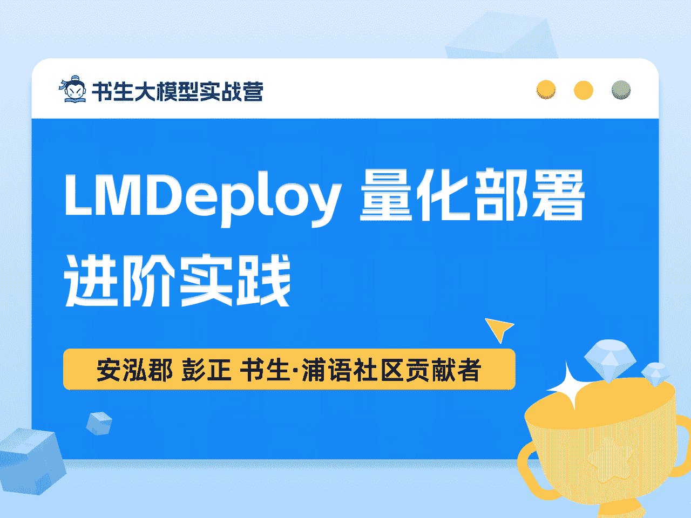

# 配置LMDeploy环境

## 1.1 InternStudio开发机创建与环境搭建

打开InternStudio平台(https://stu**dio.i**ntern-ai.org.cn/console/instance)，进入如下界面并按箭头指示顺序点击创建开发机。

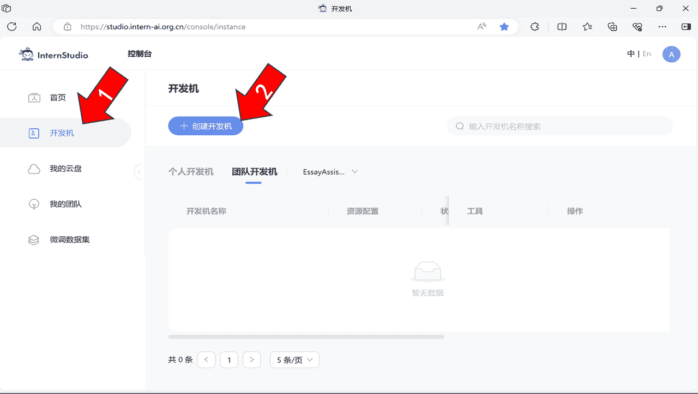

**点选开发机，自拟一个开发机名**称，选择Cuda12.2-conda镜像。

我们要运行参数量为7B的InternLM2.5，由InternLM2.5的码仓(https://huggingface.co/internlm/internlm2_5-7b-chat/blob/main/config.json)查询InternLM2.5-7b-chat的config.json文件可知，该模型的权重被存储为bfloat16格式

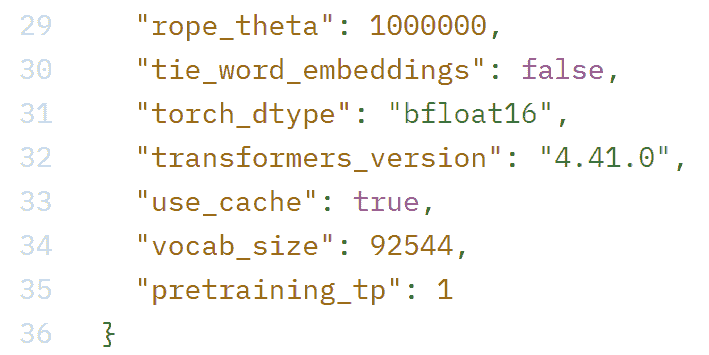

对于一个7B（70亿）参数的模型，每个参数使用16位浮点数（等于 2个 Byte）表示，则模型的权重大小约为：

**70×10^9 parameters×2 **Bytes/parameter=14GB

70亿个参数×每个参数占用2个字节=14GB

**所以我们需要大于1**4GB的显存，选择 30%A**100***1(24GB显存容量)，后**选择立即创**建，等状态栏变成运行中，点击进入开发机，我们即可开始部署。

在终端中，让我们输入以下指令，来创建一个名为lmdeploy的conda环境，python版本为3.10，创建成功后激活环境并安装0.5.3版本的lmdeploy及相关包。

```
conda create -n lmdeploy  python=3.10 -y
conda activate lmdeploy
conda install pytorch==2.1.2 torchvision==0.16.2 torchaudio==2.1.2 pytorch-cuda=12.1 -c pytorch -c nvidia -y
pip install timm==1.0.8 openai==1.40.3 lmdeploy[all]==0.5.3
```

## 1.2 InternStudio环境获取模型

为方便文件管理，我们需要一个存放模型的目录，本教程统一放置在/root/models/目录。

运行以下命令，创建文件夹并设置开发机共享目录的软链接。

```
mkdir /root/models
ln -s /root/share/new_models//Shanghai_AI_Laboratory/internlm2_5-7b-chat /root/models
ln -s /root/share/new_models/OpenGVLab/InternVL2-26B /root/models
```

此时，我们可以看到/root/models中会出现internlm2_5-7b-chat和InternVL2-26B文件夹。

## 1.3 LMDeploy验证启动模型文件

在量化工作正式开始前，我们还需要验证一下获取的模型文件能否正常工作，以免竹篮打水一场空。

让我们进入创建好的conda环境并启动InternLM2_5-7b-chat！

```
conda activate lmdeploy
lmdeploy chat /root/models/internlm2_5-7b-chat
```

稍待片刻，启动成功后，会显示如下。

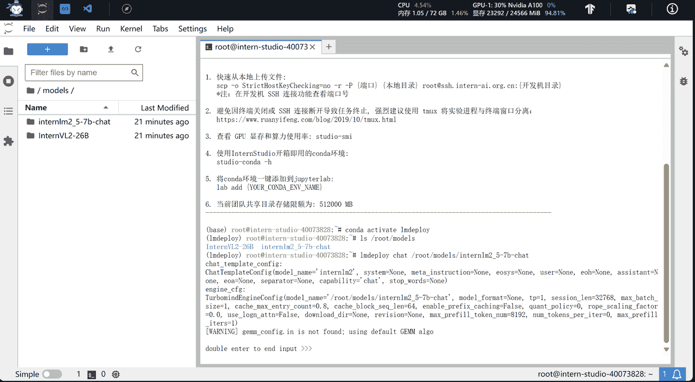

此时，我们可以在CLI(“命令行界面” Command Line Inte**rfac**e的缩写)中和InternLM2.5尽情对话了，注意输入内容完成后需要按两次回车才能够执行，以下为示例。

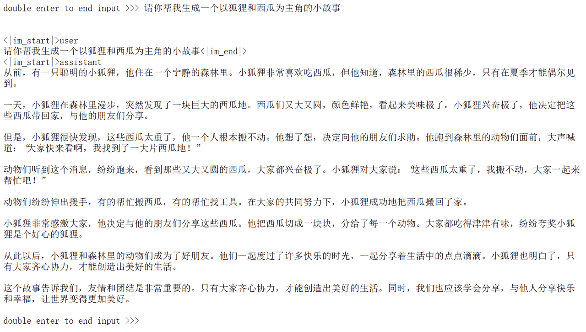

不知道有没有小伙伴注意到屏幕右上角，这是InternStudio提供的资源监控。


请记住现在显存占用约**23GB**，先圈起来，待会要用上。

如果选择 **50%A100*1** 建立机器，同样运行InternL**M2.5** 7B模型，会发现此时显存占用为36GB。


那么这是为什么呢？由[上文可知](https://aicarrier.feishu.cn/wiki/Uf9Lw5yWpiXXvfkcQkCcLzfun6e#part-IFuqdfzT8ob9ZlxoBIKckv3gnSd)InternLM2.5 7B模型为bf16，LMDpeloy**推理精度**为bf16的7B模型权重需要占用14GB显存；如下图所示，lmdeploy默认设置cache-max-entry-count为0.8，即kv cache占用剩余显存的80%；

此时对于24GB的显卡，即**30%A100**，权重占用**14GB**显存，剩余显存**24-14=10GB**，因此kv cache占用**10GB*0.8=8GB**，加上原来的权重**14GB**，总共占用**14+8=22GB**。

而对于40GB的显卡，即**50%A100**，权重占用**14GB**，剩余显存**40-14=26GB**，因此kv cache占用**26GB*0.8=20.8GB**，加上原来的权重**14GB**，总共占用**34.8GB**。

实际加载模型后，其他项也会占用部分显存，**因此剩余**显**存比理论偏低****，**实际占用会略高于22GB和34.8GBy。y

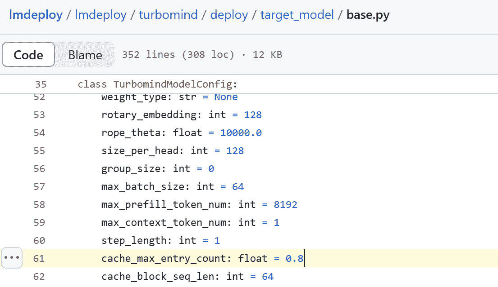

此外，如果想要实现显存资源的监控，我们也可以新开一个终端输入如下两条指令的任意一条，查看命令输入时的显存占用情况。

```
nvidia-smi 
studio-smi 
```

注释：实验室提供的环境为虚拟化的显存，nvidia-smi是NVIDIA GPU驱动程序的一部分，用于显示NVIDIA GPU的当前状态，故当前环境只能看80GB单卡 A100 显存使用情况，无法观测虚拟化后30%或50%A100等的显存情况。针对于此，实验室提供了studio-smi 命令工具，能够观测到虚拟化后的显存使用情况。

# LMDeploy与InternLM2.5

## 2.1 LMDeploy API部署InternLM2.5

在上一章节，我们直接在本地部署InternLM2.5。而在实际应用中，我们有时会将大模型封装为API接口服务，供客户端访问。

### 2.1.1 启动API服务器

首先让我们进入创建好的conda环境，并通下命令启动API服务器，部署InternLM2.5模型：

```
conda activate lmdeploy
lmdeploy serve api_server \
    /root/models/internlm2_5-7b-chat \
    --model-format hf \
    --quant-policy 0 \
    --server-name 0.0.0.0 \
    --server-port 23333 \
    --tp 1
```

命令解释：

1.  lmdeploy serve api_server：这个命令用于启动API服务器。

1.  /root/models/internlm2_5-7b-chat：这是模型的路径。

1.  --model-format hf：这个参数指定了模型的格式。hf代表“Hugging Face”格式。

1.  --quant-policy 0：这个参数指定了量化策略。

1.  --server-name 0.0.0.0：这个参数指定了服务器的名称。在这里，0.0.0.0是一个特殊的IP地址，它表示所有网络接口。

1.  --server-port 23333：这个参数指定了服务器的端口号。在这里，23333是服务器将监听的端口号。

1.  --tp 1：这个参数表示并行数量（GPU数量）。

稍待片刻，终端显示如下。

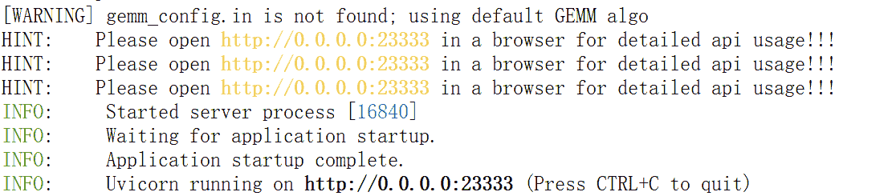

这一步由于部署在远程服务器上，所以本地需要做一下ssh转发才能直接访问。在你本地打开一个cmd或powershell窗口，输入命令如下：

```
 ssh -CNg -L 23333:127.0.0.1:23333 root@ssh.intern-ai.org.cn -p 你的ssh端口号
```

ssh 端口号按照下图图示方法查询，我的是41682，请替换为自己的。

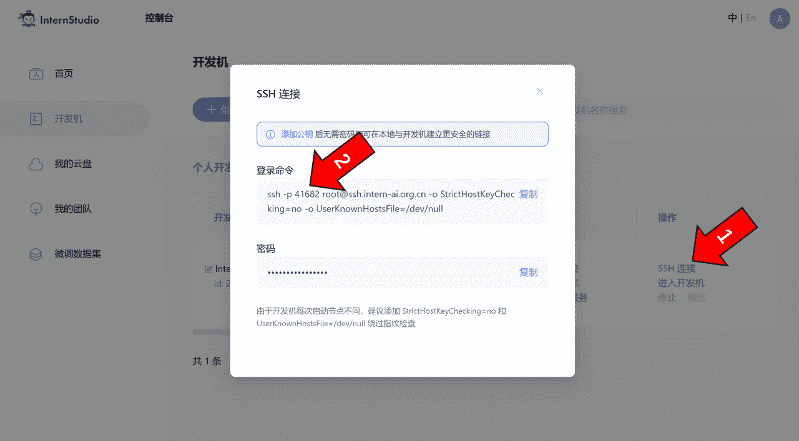

输入后，首次访问可能会询问你是否继续连接，敲入yes并回车即可。

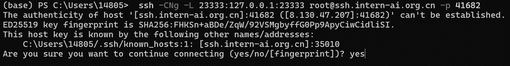

之后会要求输入密码，按下图所示复制密码。

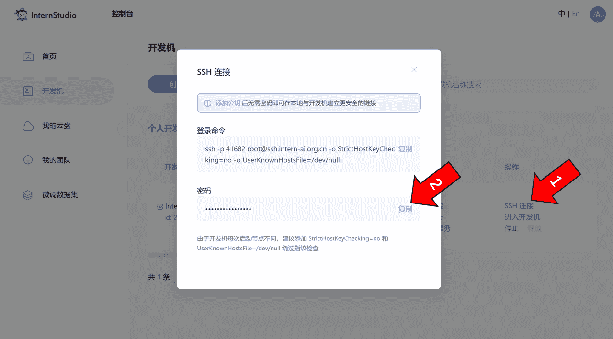

复制后直接在窗口Ctrl+S键粘贴，注意CLI默认密码不显示，黏贴后直接回车即可，让窗口保留在如下所示的状态即可，请勿关闭。

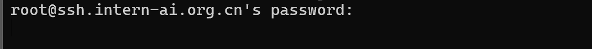

然后打开浏览器，访问http://127.0.0.1:23333看到如下界面即代表部署成功。

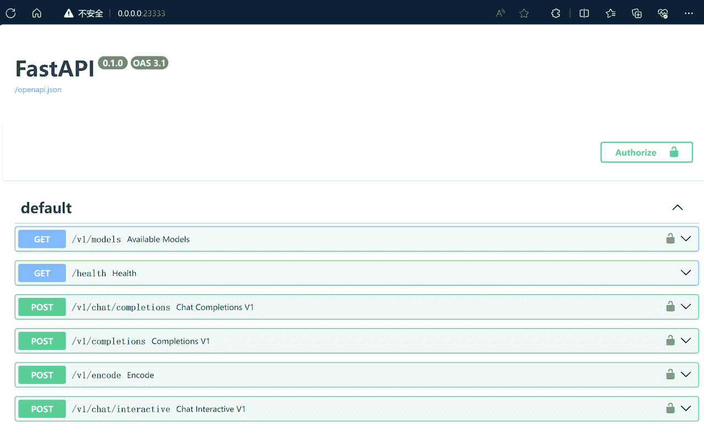

### 2.1.2 以命令行形式连接API服务器

关闭http://127.0.0.1:23333网页，但保持终端和本地窗口不动，按箭头操作新建一个终端。

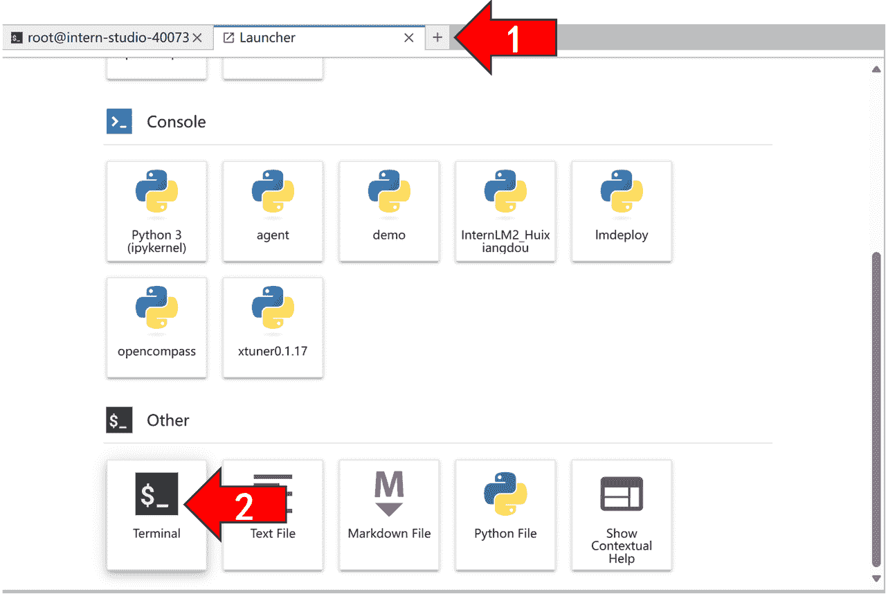

运行如下命令，激活conda环境并启动命令行客户端。

```
conda activate lmdeploy
lmdeploy serve api_client http://localhost:23333
```

稍待片刻，等出现double enter to end input >>>的输入提示即启动成功，此时便可以随意与InternLM2.5对话，同样是两下回车确定，输入exit退出。

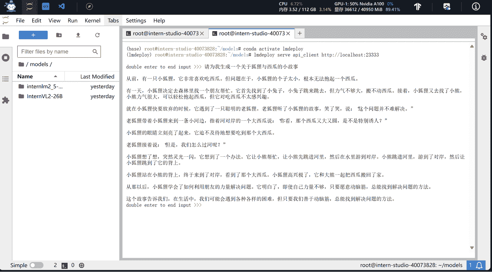

### 2.1.3 以Gradio**网页形式连接API服务器**

保持第一个终端不动，在新建终端中输入exit退出。

输入以下命令，使用Gradio作为前端，启动网页。

```
lmdeploy serve gradio http://localhost:23333 \
    --server-name 0.0.0.0 \
    --server-port 6006
```

稍待片刻，等终端如下图所示便保持两个终端不动。

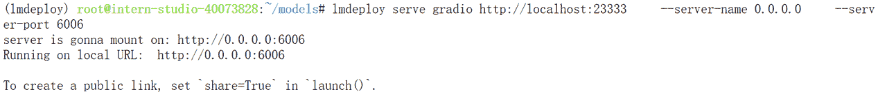

关闭之前的cmd/powershell窗口，重开一个，再次做一下ssh转发(因为此时端口不同)。在你本地打开一个cmd或powershell窗口，输入命令如下。

```
ssh -CNg -L 6006:127.0.0.1:6006 root@ssh.intern-ai.org.cn -p &lt;你的ssh端口号&gt;
```

重复上述操作，待窗口保持在如下状态即可。

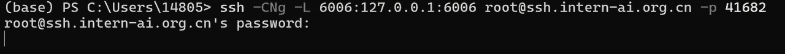

打开浏览器，访问地址http://127.0.0.1:6006，然后就可以与模型尽情对话了。

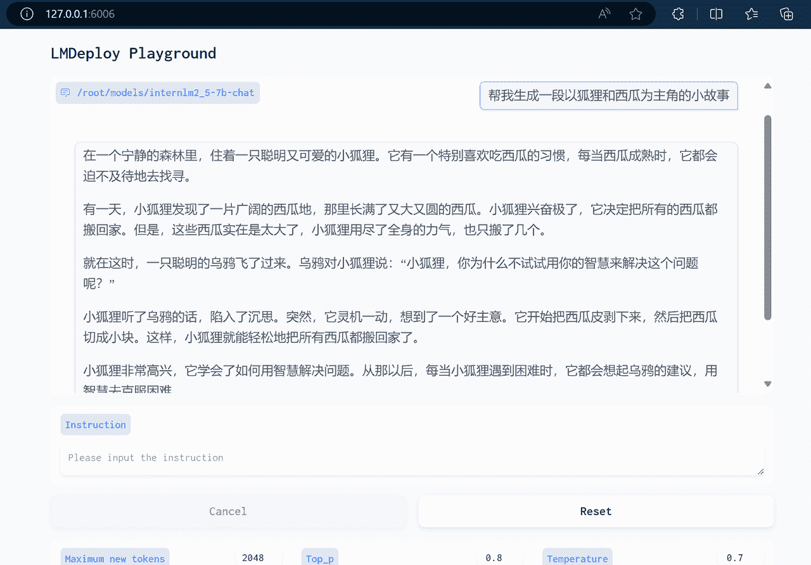

## 2.2 LMDeploy Lite

随着模型变得越来越大，我们需要一些大模型压缩技术来降低模型部署的成本，并提升模型的推理性能。LMDeploy 提供了权重量化和 k/v cache两种策略。

### 2.2.1 设置最大kv cache缓存大小

kv cache是一种缓存技术，通过存储键值对的形式来复用计算结果，以达到提高性能和降低内存消耗的目的。在大规模训练和推理中，kv cache可以显著减少重复计算量，从而提升模型的推理速度。理想情况下，kv cache全部存储于显存，以加快访存速度。

模型在运行时，占用的显存可大致分为三部分：模型参数本身占用的显存、kv cache占用的显存，以及中间运算结果占用的**显存。L**MDeploy的kv cache管理器可以通过设置--cache-max-entry-count参数，控制kv缓存占用剩余显存的最大比例。默认的比例为0.8。

首先我们先来回顾一下InternLM2.5正常运行时占用显存。


占用了**23GB**，那么试一试执行以下命令，再来观看占用显存情况。

```
lmdeploy chat /root/models/internlm2_5-7b-chat --cache-max-entry-count 0.4
```

**稍待片**刻，观测显存占用情况，可以看到减少了约4GB的显存。


让我们计算一下**4GB**显存的减少缘何而来，

对于修改kv cache默认占用之前，**即如1.**3 LMDeploy验证启动模型文件所示直接启动模型的显存占用情况(23GB)：

1、在 BF16 精度下，7B模型权重占用**14GB**：70×10^9 parameter**s×2 **Bytes/parameter=14GB

2、kv cache占用**8GB**：剩余显存**24-14=10GB****，kv cache默**认占用80%，即10*0.8=8GB

3、其他项**1GB**

是故**23GB**=权重占用**14GB**+kv cache占用**8GB**+其它项**1GB**

**对于修改**kv cache占用之后的显存占用情况(19GB)：

**1、与上**述声明一致，在 BF16 精度下，7B模型权重占用14GB

2、kv cache占用**4GB**：剩余显存**24-14=10GB****，kv cache修**改为占用40%，即10*0.4=4GB

3、其他项**1GB**

是故**19GB**=权重占用**14GB**+kv cache占用**4GB**+其它项**1GB**

而此刻减少的**4GB**显存占用就是从10GB*0.8-10GB*0.4=4GB，这里计算得来。

### 2.2.2 设置**在线** kv cache int4/int8 量化

自 v0.4.0 起，LMDeploy 支持在线 kv cache int4/int8 量化，量化方式为 per-head per-token 的非对称量化。此外，通过 LMDeploy 应用 kv 量化非常简单，只需要设定 quant_policy 和cache-max-entry-count参数。目前，LMDeploy 规定 qant_policy=4 表示 kv int4 量化，quant_policy=8 表示 kv int8 量化。

我们通过2.1 LMDeploy API部署InternLM2.5的实践为例，输入以下指令，启动API服务器。

```
lmdeploy serve api_server \
    /root/models/internlm2_5-7b-chat \
    --model-format hf \
    --quant-policy 4 \
    --cache-max-entry-count 0.4\
    --server-name 0.0.0.0 \
    --server-port 23333 \
    --tp 1
```

稍待片刻，显示如下即代表服务启动成功。

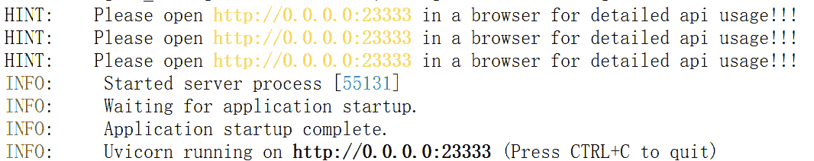

想要和此时的模型对话的话可以回顾2.1.2 以命令行形式连接API服务器或者2.1.3 以Gradio网页形式连接API服务器的内容自行对话，步骤完全一致，本章主要观测显存状态。

可以看到此时显存占用约**19****GB**，相较于1.3 LMDeploy验证**启动模型**文件直接**启动模**型的显存占用**情况(**23GB)减少了[**4GB**](https://aicarrier.feishu.cn/wiki/Uf9Lw5yWpiXXvfkcQkCcLzfun6e#part-V8yfdp54doUnguxR4ZVcqrTAnPf)[的占用。此](https://aicarrier.feishu.cn/wiki/Uf9Lw5yWpiXXvfkcQkCcLzfun6e#part-V8yfdp54doUnguxR4ZVcqrTAnPf)时4GB显存的减少逻辑与2.2.1 设置最大kv cache缓存大小中4GB显存的减少一致，均因设置kv cache占用参数cache-max-entry-count至0.4而减少了4GB显存占用。


那么本节中**19GB**的显存占用与2**.2.1** 设置最大kv cache缓存大小中19GB的显存占用区别何在呢？

由于都使用BF16精度下的inte**rnlm**2.5 7B模型，故剩余显存均为10GB，且 ca**che-max-entr**y-count 均为0.4，这意味着LMDeploy将分配40%的剩余显存用于kv **cac**he，即10GB*0.4=4GB。但quant-policy 设置为4时，意味着使用int4精度进行量化。因此，LMDeploy将会使用int4精度提前开辟4GB的kv cache。

**相比使**用BF16精度的kv cache，int4的Cache可以在相同4GB的显存下只需要4位来存储一个数值，而BF16需要16位。这意味着int4的Cache可以存储的元素数量是BF16的四倍。

### 2.2.3 W4A16 模型量化和部署

准确说，模型量化是一种优化技术，旨在减少机器学习模型的大小并提高其推理速度。量化通过将模型的权重和激活从高精度（如16位浮点数）转换为低精度（如8位整数、4位整数、甚至二值网络）来实现。

那么标题中的W4A16又是什么意思呢？

+   W4：这通常表示权重量化为4位整数（int4）。这意味着模型中的权重参数将从它们原始的浮点表示（例如FP32、BF16或FP16，Internlm2.5精度为BF16）转换为4位的整数表示。这样做可以显著减少模型的大小。

+   A16：这表示激活（或输入/输出）仍然保持在16位浮点数（例如FP16或BF16）。激活是在神经网络中传播的数据，通常在每层运算之后产生。

因此，W4A16的量化配置意味着：

+   权重被量化为4位整数。

+   激活保持为16位浮点数。

让我们回到LMDeploy，在最新的版本中，LMDeploy使用的是AWQ算法，能够实现模型的4bit权重量化。输入以下指令，执行量化工作。(本步骤耗时较长，请耐心等待)

```
lmdeploy lite auto_awq \
   /root/models/internlm2_5-7b-chat \
  --calib-dataset &#x27;ptb&#x27; \
  --calib-samples 128 \
  --calib-seqlen 2048 \
  --w-bits 4 \
  --w-group-size 128 \
  --batch-size 1 \
  --search-scale False \
  --work-dir /root/models/internlm2_5-7b-chat-w4a16-4bit
```

命令解释：

1.  lmdeploy lite auto_awq: lite这是LMDeploy的命令，用于启动量化过程，而auto_awq代表自动权重量化（auto-weight-quantization）。

1.  /root/models/internlm2_5-7b-chat: 模型文件的路径。

1.  --calib-dataset 'ptb': 这个参数指定了一个校准数据集，这里使用的是’ptb’（Penn Treebank，一个常用的语言模型数据集）。

1.  --calib-samples 128: 这指定了用于校准的样本数量—128个样本

1.  --calib-seqlen 2048: 这指定了校准过程中使用的序列长度—1024

1.  --w-bits 4: 这表示权重（weights）的位数将被量化为4位。

1.  --w-group-size 128: 这指定了权重分组的大小，这里为128。分组量化是一种量化技术，通过将权重分为多个组，并对每组执行相同的量化操作，可以减少量化误差。

1.  --work-dir /root/models/internlm2_5-7b-chat-w4a16-4bit: 这是工作目录的路径，用于存储量化后的模型和中间结果。

等终端输出如下时，说明正在推理中，稍待片刻。

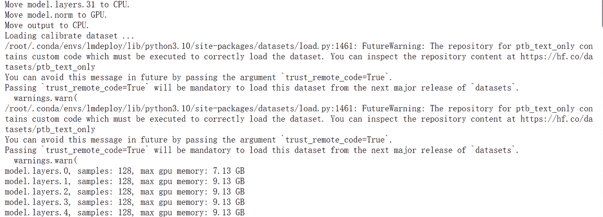

等待推理完成，便可以直接在你设置的目标文件夹看到对应的模型文件。

那么推理后的模型和原本的模型区别在哪里呢？最明显的两点是模型文件大小以及占据显存大小。

我们可以输入如下指令查看在当前目录中显示所有子目录的大小。

```
cd /root/models/
du -sh *
```

输出结果如下。(其余文件夹都是以软链接的形式存在的，不占用空间，故显示为0)

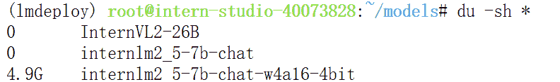

那么原模型大小呢？输入以下指令查看。

```
cd /root/share/new_models/Shanghai_AI_Laboratory/
du -sh *
```

终端输出结果如下。

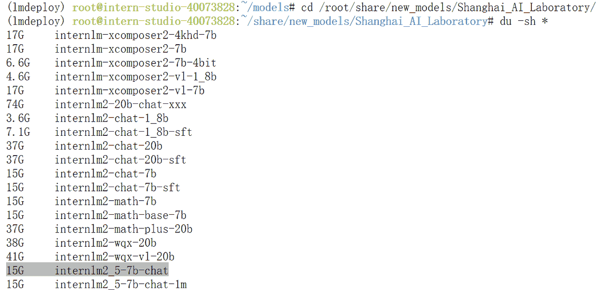

一经对比即可发觉，15G对4.9G，优势在我。

那么显存占用情况对比呢？输入以下指令启动量化后的模型。

```
lmdeploy chat /root/models/internlm2_5-7b-chat-w4a16-4bit/ --model-format awq
```

稍待片刻，我们直接观测右上角的显存占用情况。


可以发现，相比较于原先的**23GB****显存占**用，W4A16量化后的模型少了约2GB的显存占用。

让我们计算一下**2GB**显存的减少缘何而来。

对于W4A16量化之前，即如1.3 LMDeploy验证启动**模型文件**所示直接启动模型的显存占用情况(23GB)：

**1、在 **BF16 精度下，7B模型权重占用1**4GB：**70×10^9 parameters×2 Bytes/parameter=14GB

2、kv cache占用**8GB**：剩余显存**24-14=10GB****，kv cache默**认占用80%，即10*0.8=8GB

3、其他项**1GB**

是故**23GB**=权重占用**14GB**+kv cache占用**8GB**+其它项**1GB**

**而对于W4A1**6量化之后的显存占用情况(20.9GB)：

**1、在 i**n**t4 精****度下，7B模型**权重占用3.5GB：14/4=3.5GB

注释：

+   bfloat16是16位的浮点数格式，占用2字节（**16位）****的存储空****间。int4是4****位的****整数格**式，占用0.5字节（4位）的存储空间。因此，从bfloat16到int4的转换理论上可以将模型权重的大小减少到原来的1/4，即7B个int4参数仅占用3.5GB的显存。

2、kv cache占用**16.4GB**：剩余显存**24-3.5=20.5GB****，kv cache默认占用80**%，即20.5*0.8=16.4GB

3、其他项**1GB**

是故**20.9GB**=权重占用**3.5GB**+kv cache占用**16.4GB**+其它项**1GB**

### 2.2.4 联合部署

我知道你们肯定有人在想，显存占用能不能再小一点？答案是当然可以，方法就是：


我们只需要将我们推理好的模型使用kv cache量化就可以了！

输入以下指令，让我们同时启用量化后的模型和kv cache量化。

```
lmdeploy chat \
/root/models/internlm2_5-7b-chat-w4a16-4bit/ \
--model-format awq \
--cache-max-entry-count 0.4
```

观测显存占用情况，看到此时只需要约13GB的显存，已经是一张消费级显卡即可部署的模型了。


那让我们挑战一下极限，直接看看极限显存只需要多少。

输入指令。

```
lmdeploy chat \
/root/models/internlm2_5-7b-chat-w4a16-4bit/ \
--model-format awq \
--cache-max-entry-count 0.01
```

观测显存占用情况，可以说约6GB的显存占用属于逆天级别的压缩。

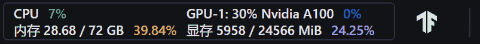

大家可以自行探索在几乎等于禁用kv cache后，模型输出与正常情况下的区别。

我们再来测试一下在线 kv cache int4/int8 量化的情况，输入以下指令。

```
lmdeploy serve api_server \
    /root/models/internlm2_5-7b-chat-w4a16-4bit/ \
    --model-format awq \
    --quant-policy 4 \
    --cache-max-entry-count 0.4\
    --server-name 0.0.0.0 \
    --server-port 23333 \
    --tp 1
```

此时显存占用**13.5GB**，与之前相同。


还是一样的，想要和此时的模型对话的话可以回顾2.1.2 以命令行形式连接API服务器或者2.1.3 以Gradio网页形式连接API服务器的内容自行对话，步骤完全一致，本章主要观测显存状态。

**让我们来计算一**下此刻的显存占用情况(13.5GB)：

**1、在 i**n**t4 精度下，7B模型**权重占用3.5GB：14/4=3.5GB

2、kv cache占用**16.4GB**：剩余显存**24-3.5=20.5GB****，kv cache占用40%**，即20.5*0.4=8.2GB

3、其他项**1.8GB**

是故**13.5GB**=权重占用**3.5GB**+kv cache占用**8.2GB**+其它项**1.8GB**

想要更极限且保证正常工作的量化设置的话，各位小伙伴可以之后自行探索，本次实践教学便止步于此了。

# LMDeploy与InternVL2

本次实践选用InternVL2-26B进行演示，其实就根本来说作为一款VLM和上述的InternLM2.5在操作上并无本质区别，仅是多出了"图片输入"这一额外步骤，但作为量化部署进阶实践，选用InternVL2-26B目的是带领大家体验一下LMDeploy的量化部署可以做到何种程度。

## 3.1 LMDeploy Lite

**InternV**L2-26B需要约70+GB显存，但是为了让我们能够在30%A100上运行，需要先进行量化操作，这也是量化本身的意义所在——即降低模型部署成本。

### 3.1.1y

针对InternVL系列模型，让我们先进入conda环境，并输入以下指令，执行模型的量化工作。(本步骤耗时较长，请耐心等待)

```
conda activate lmdeploy
lmdeploy lite auto_awq \
   /root/models/InternVL2-26B \
   --calib-dataset &#x27;ptb&#x27; \
  --calib-samples 128 \
  --calib-seqlen 2048 \
  --w-bits 4 \
  --w-group-size 128 \
  --batch-size 1 \
  --search-scale False \
  --work-dir /root/models/InternVL2-26B-w4a16-4bit
```

等终端输出如下时，说明正在推理中，稍待片刻。


等待推理完成，便可以在左侧/models内直接看到对应的模型文件。

### 3.1.2 联合部署

现在就能体现出我们联合部署的好处了，我们只需要将已经推理好的模型设置kv cache占用就能够大大减少显存需求。输入以下指令，让我们启用量化后的模型。

```
lmdeploy serve api_server \
    /root/models/InternVL2-26B-w4a16-4bit \
    --model-format awq \
    --quant-policy 4 \
    --cache-max-entry-count 0.1\
    --server-name 0.0.0.0 \
    --server-port 23333 \
    --tp 1
```

**启动后观测显存**占用情况，此时只需要约23.8GB的显存，已经是一张30%A100即可部署的模型了。


根据InternVL2(https://internvl.github.io/blog/2024-07-02-InternVL-2.0/)介绍，InternVL2 26B是一个6B的ViT、一个100M的MLP以及一个19.86B的internlm组成的。

那么让我们来计算一下使用**A100 80GB**直接启动模型的显存占用情况：

**1、在 **fp16 精度下，6BViT模型权重**占用12**GB：60×10^9 parameters×2 Bytes/parameter=12GB

2、在 fp16 精度下，19.86**B≈20**B的internlm模型权重占用40G**B：20**0×10^9 parameters×2 Bytes/parameter=40GB

2、kv cache占用**22.4GB**：剩余显存**80-12-40=28GB****，kv cache默认占用**80%，即28*0.8=22.4GB

3、其他项

是故总占用=Vit权重占用**12GB**+internlm模型权重占用**40GB**+kv cache占用**22.4GB**+其他项≥**74.4GB**

对于使用**30%A100*1****(24GB显**存容量)联合部署的显存情况(23.8GB)：

**1、在 **fp16 精度下，6BViT模型权重**占用12G**B：60×10^9 parameters×2 Bytes/parameter=12GB (ViT使用精度为fp16的pytorch推理，量化只对internlm起效果)

2、在 int4 精度下，19.86**B≈20**B的internlm模型权重占用10GB：**200×**10^9 parameters×0.5 Bytes/parameter=10GB

2、kv cache占用**0.2GB**：剩余显存**24-12-10=2GB****，kv cache修改**为占用10%，即2*0.1=0.2GB

3、其他项**1.6GB**

是故**23.8GB**=Vit权重占用**12GB**+internlm模型权重占用**10GB**+kv cache占用**0.2GB**+其他项**1.6G**

如果此时推理图片，则会显示剩余显存不足，这是因为推理图片的时候pytorch会占用额外的激活显存，故有需要的小伙伴可以开启50%A100进行图片推理。

## 3.2 LMDeploy API部署InternVL2

具体封装操作与之前大同小异，仅仅在数个指令细节上作调整，故本章节大部分操作与2.1 LMDeploy API部署InternLM2.5中几近完全一样，同学们可自行"依葫芦画瓢"，以下教程仅做参考。

通过以下命令启动API服务器，部署InternVL2模型：

```
lmdeploy serve api_server \
    /root/models/InternVL2-26B-w4a16-4bit/ \
    --model-format awq \
    --quant-policy 4 \
    --cache-max-entry-count 0.6 \
    --server-name 0.0.0.0 \
    --server-port 23333 \
    --tp 1
```

其余步骤与[2.1.1 启动API服务器](https://aicarrier.feishu.cn/wiki/Uf9Lw5yWpiXXvfkcQkCcLzfun6e#part-YMXgd0k2ooyjnZxAm7Jcjd4Mntg)剩余内容一致。

命令行形式、Gradio网页形式连接操作与

2.1.2 以命令行形式连接API服务器

2.1.3 以Gradio网页形式连接API服务器

步骤流程、指令完全一致，不再赘述。

以下为Gradio网页形式连接成功后对话截图。


# LMDeploy之FastAPI与Function call

之前在[2.1.1 启动API服务器](https://kaxojqwlrks.feishu.cn/wiki/EiMXwjpi3i2jYBkTz9vcfR7dnze#part-Ds47dAKZ5ovEQNxkco0cX7Tcn0e)与[3.2.1 启动API服务器](https://kaxojqwlrks.feishu.cn/wiki/EiMXwjpi3i2jYBkTz9vcfR7dnze#part-SQq5dWXQWoYQGAxWhetc4012nXg)均是借助FastAPI封装一个API出来让LMDeploy自行进行访问，在这一章节中我们将依托于LMDeploy封装出来的API进行更加灵活更具DIY的开发。

## 4.1 API开发

与之前一样，让我们进入创建好的conda环境并输入指令启动API服务器。

```
conda activate lmdeploy
lmdeploy serve api_server \
    /root/models/internlm2_5-7b-chat-w4a16-4bit \
    --model-format awq \
    --cache-max-entry-count 0.4 \
    --quant-policy 4 \
    --server-name 0.0.0.0 \
    --server-port 23333 \
    --tp 1
```

保持终端窗口不动，按箭头操作新建一个终端。


在新建终端中输入如下指令，新建internlm2_5.py。

```
touch /root/internlm2_5.py
```

此时我们可以在左侧的File Broswer中看到internlm2_5.py文件，双击打开。

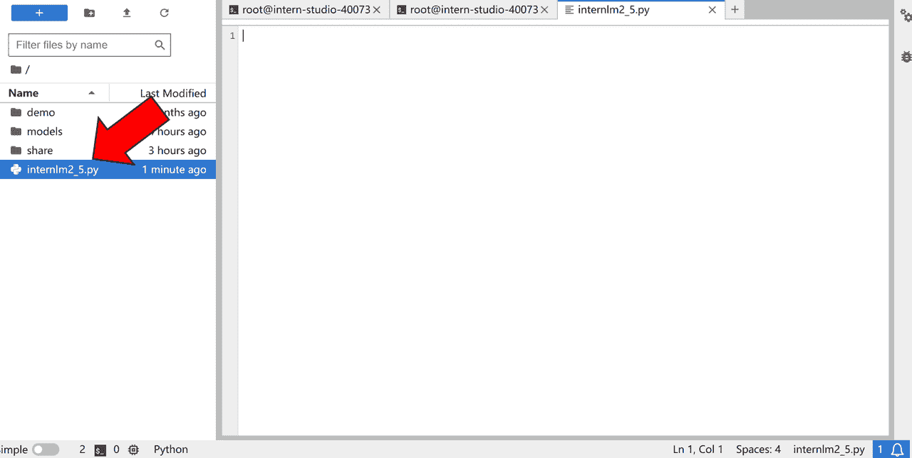

将以下内容复制粘贴进internlm2_5.py。

```
# 导入openai模块中的OpenAI类，这个类用于与OpenAI API进行交互
from openai import OpenAI


# 创建一个OpenAI的客户端实例，需要传入API密钥和API的基础URL
client = OpenAI(
    api_key=&#x27;YOUR_API_KEY&#x27;,  
    # 替换为你的OpenAI API密钥，由于我们使用的本地API，无需密钥，任意填写即可
    base_url=&quot;http://0.0.0.0:23333/v1&quot;  
    # 指定API的基础URL，这里使用了本地地址和端口
)

# 调用client.models.list()方法获取所有可用的模型，并选择第一个模型的ID
# models.list()返回一个模型列表，每个模型都有一个id属性
model_name = client.models.list().data[0].id

# 使用client.chat.completions.create()方法创建一个聊天补全请求
# 这个方法需要传入多个参数来指定请求的细节
response = client.chat.completions.create(
  model=model_name,  
  # 指定要使用的模型ID
  messages=[  
  # 定义消息列表，列表中的每个字典代表一个消息
    {&quot;role&quot;: &quot;system&quot;, &quot;content&quot;: &quot;你是一个友好的小助手，负责解决问题.&quot;},  
    # 系统消息，定义助手的行为
    {&quot;role&quot;: &quot;user&quot;, &quot;content&quot;: &quot;帮我讲述一个关于狐狸和西瓜的小故事&quot;},  
    # 用户消息，询问时间管理的建议
  ],
    temperature=0.8,  
    # 控制生成文本的随机性，值越高生成的文本越随机
    top_p=0.8  
    # 控制生成文本的多样性，值越高生成的文本越多样
)

# 打印出API的响应结果
print(response.choices[0].message.content)

```

按Ctrl+S键保存（Mac用户按Command+S）。

现在让我们在新建终端输入以下指令激活环境并运行python代码。

```
conda activate lmdeploy
python /root/internlm2_5.py
```

终端会输出如下结果。

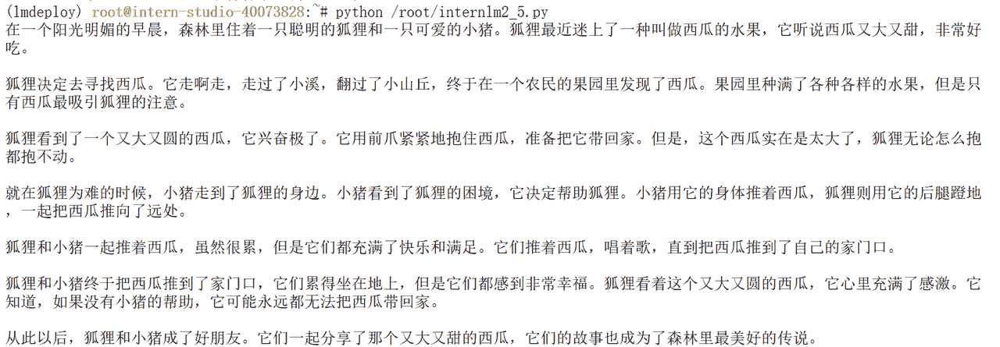

此时代表我们成功地使用本地API与大模型进行了一次对话，如果切回第一个终端窗口，会看到如下信息，这代表其成功的完成了一次用户问题GET与输出POST。

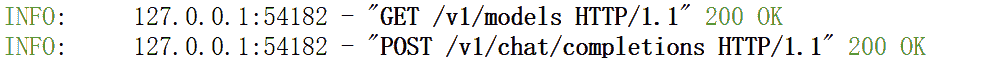

## 4.2 Function call

关于Function call，即函数调用功能，它允许开发者在调用模型时，详细说明函数的作用，并使模型能够智能地根据用户的提问来输入参数并执行函数。完成调用后，模型会将函数的输出结果作为回答用户问题的依据。

首先让我们进入创建好的conda环境并启动API服务器。

```
conda activate lmdeploy
lmdeploy serve api_server \
    /root/models/internlm2_5-7b-chat \
    --model-format hf \
    --quant-policy 0 \
    --server-name 0.0.0.0 \
    --server-port 23333 \
    --tp 1
```

目前LMDeploy在0.5.3版本中支持了对InternLM2, InternLM2.5和llama3.1这三个模型，故我们选用InternLM2.5 封装API。

让我们使用一个简单的例子作为演示。输入如下指令，新建internlm2_5_func.py。

```
touch /root/internlm2_5_func.py
```

双击打开，并将以下内容复制粘贴进internlm2_5_func.py。

```
from openai import OpenAI


def add(a: int, b: int):
    return a + b


def mul(a: int, b: int):
    return a * b


tools = [{
    &#x27;type&#x27;: &#x27;function&#x27;,
    &#x27;function&#x27;: {
        &#x27;name&#x27;: &#x27;add&#x27;,
        &#x27;description&#x27;: &#x27;Compute the sum of two numbers&#x27;,
        &#x27;parameters&#x27;: {
            &#x27;type&#x27;: &#x27;object&#x27;,
            &#x27;properties&#x27;: {
                &#x27;a&#x27;: {
                    &#x27;type&#x27;: &#x27;int&#x27;,
                    &#x27;description&#x27;: &#x27;A number&#x27;,
                },
                &#x27;b&#x27;: {
                    &#x27;type&#x27;: &#x27;int&#x27;,
                    &#x27;description&#x27;: &#x27;A number&#x27;,
                },
            },
            &#x27;required&#x27;: [&#x27;a&#x27;, &#x27;b&#x27;],
        },
    }
}, {
    &#x27;type&#x27;: &#x27;function&#x27;,
    &#x27;function&#x27;: {
        &#x27;name&#x27;: &#x27;mul&#x27;,
        &#x27;description&#x27;: &#x27;Calculate the product of two numbers&#x27;,
        &#x27;parameters&#x27;: {
            &#x27;type&#x27;: &#x27;object&#x27;,
            &#x27;properties&#x27;: {
                &#x27;a&#x27;: {
                    &#x27;type&#x27;: &#x27;int&#x27;,
                    &#x27;description&#x27;: &#x27;A number&#x27;,
                },
                &#x27;b&#x27;: {
                    &#x27;type&#x27;: &#x27;int&#x27;,
                    &#x27;description&#x27;: &#x27;A number&#x27;,
                },
            },
            &#x27;required&#x27;: [&#x27;a&#x27;, &#x27;b&#x27;],
        },
    }
}]
messages = [{&#x27;role&#x27;: &#x27;user&#x27;, &#x27;content&#x27;: &#x27;Compute (3+5)*2&#x27;}]

client = OpenAI(api_key=&#x27;YOUR_API_KEY&#x27;, base_url=&#x27;http://0.0.0.0:23333/v1&#x27;)
model_name = client.models.list().data[0].id
response = client.chat.completions.create(
    model=model_name,
    messages=messages,
    temperature=0.8,
    top_p=0.8,
    stream=False,
    tools=tools)
print(response)
func1_name = response.choices[0].message.tool_calls[0].function.name
func1_args = response.choices[0].message.tool_calls[0].function.arguments
func1_out = eval(f&#x27;{func1_name}(**{func1_args})&#x27;)
print(func1_out)

messages.append({
    &#x27;role&#x27;: &#x27;assistant&#x27;,
    &#x27;content&#x27;: response.choices[0].message.content
})
messages.append({
    &#x27;role&#x27;: &#x27;environment&#x27;,
    &#x27;content&#x27;: f&#x27;3+5={func1_out}&#x27;,
    &#x27;name&#x27;: &#x27;plugin&#x27;
})
response = client.chat.completions.create(
    model=model_name,
    messages=messages,
    temperature=0.8,
    top_p=0.8,
    stream=False,
    tools=tools)
print(response)
func2_name = response.choices[0].message.tool_calls[0].function.name
func2_args = response.choices[0].message.tool_calls[0].function.arguments
func2_out = eval(f&#x27;{func2_name}(**{func2_args})&#x27;)
print(func2_out)
```

按Ctrl+S键保存（Mac用户按Command+S）。

现在让我们输入以下指令运行python代码。

```
python /root/internlm2_5_func.py
```

稍待片刻终端输出如下。

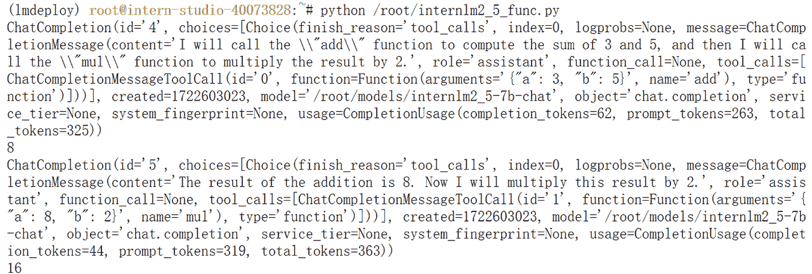

我们可以看出InternLM2.5将输入'Compute (3+5)*2'根据提供的function拆分成了"加"和"乘"两步，第一步调用function add实现加，再于第二步调用function mul实现乘，再最终输出结果16.