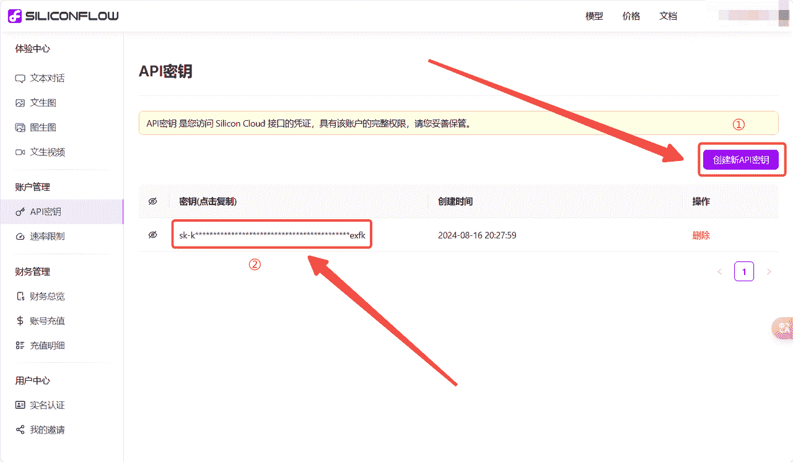
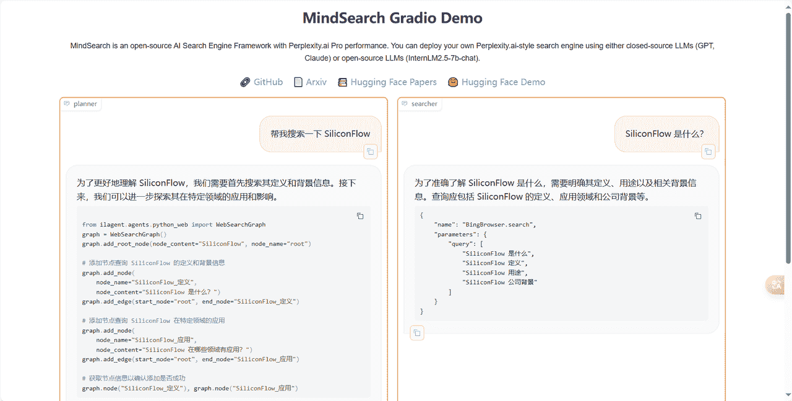
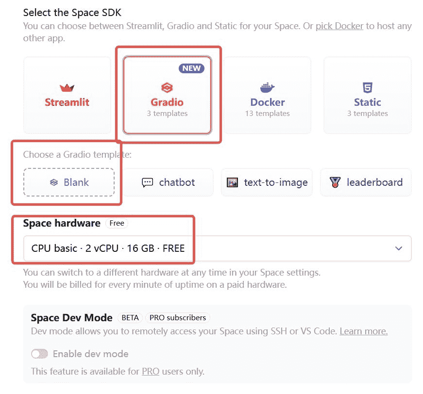
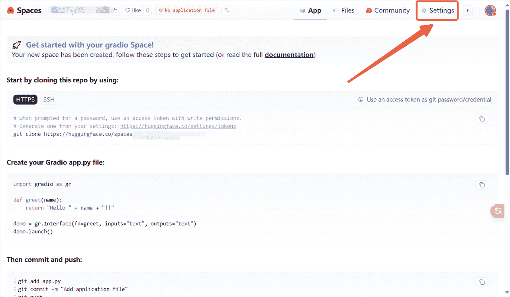
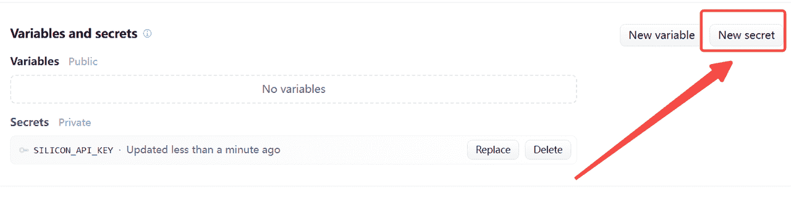
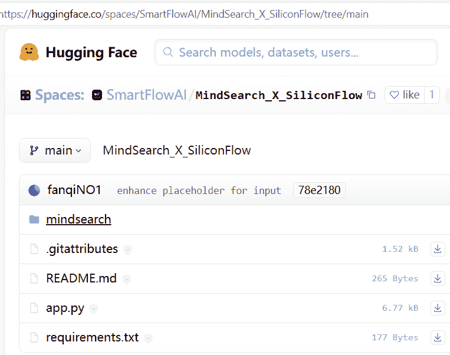

# MindSearch 纯CPU版部署到Hugging Face

> 来源：[https://aicarrier.feishu.cn/docx/BOeWdpDUvoXSEyxMzebcJHs4nZe](https://aicarrier.feishu.cn/docx/BOeWdpDUvoXSEyxMzebcJHs4nZe)

> 该文档已 out of date，最新版本正在更新中！！！！

# 写在前面

随着硅基流动提供了免费的 InternLM2.5-7B-Chat 服务（免费的 InternLM2.5-7B-Chat 真的很香），MindSearch 的部署与使用也就迎来了纯 CPU 版本，进一步降低了部署门槛。那就让我们来一起看看如何使用硅基流动的 API 来部署 MindSearch 吧。

我们也已经根据本文教程部署好了一个基于硅基流动 API 的 MindSearch 服务，体验地址：https://huggingface.co/spaces/SmartFlowAI/MindSearch_X_SiliconFlow

# 部署流程

## 获取 API Key

那么部署的第一步就是获取硅基流动的 API Key 啦。

首先，我们打开 https://account.siliconflow.cn/login 来注册硅基流动的账号（如果注册过，则直接登录即可）

在完成注册后，打开 https://cloud.siliconflow.cn/account/ak 来准备 API Key。首先创建新 API 密钥，然后点击密钥进行复制，以备后续使用。



## 开始部署 MindSearch

接下来，就是调整 MindSearch 的配置来接入硅基流动的 API 了。由于硅基流动的 API 接口与 OpenAI API 接口完全一致（接口完全一致真的非常 nice！）

在 clone MindSearch 到本地并安装相关依赖后（可以参考 https://github.com/InternLM/MindSearch/blob/main/README.md），我们首先修改 /path/to/MindSearch/mindsearch/models.py 加上调用硅基流动 API 的相关配置。配置如下：

```
internlm_silicon = dict(type=GPTAPI,
                        model_type=&#x27;internlm/internlm2_5-7b-chat&#x27;,
                        key=os.environ.get(&#x27;SILICON_API_KEY&#x27;, &#x27;YOUR SILICON API KEY&#x27;),
                        openai_api_base=&#x27;https://api.siliconflow.cn/v1/chat/completions&#x27;,
                        meta_template=[
                            dict(role=&#x27;system&#x27;, api_role=&#x27;system&#x27;),
                            dict(role=&#x27;user&#x27;, api_role=&#x27;user&#x27;),
                            dict(role=&#x27;assistant&#x27;, api_role=&#x27;assistant&#x27;),
                            dict(role=&#x27;environment&#x27;, api_role=&#x27;system&#x27;)
                        ],
                        top_p=0.8,
                        top_k=1,
                        temperature=0,
                        max_new_tokens=8192,
                        repetition_penalty=1.02,
                        stop_words=[&#x27;&lt;|im_end|&gt;&#x27;])
```

在加入这段配置后，我们便可以开始执行相关指令来启动 MindSearch 啦。

首先，我们来启动 MindSearch 的后端：

```
# 指定硅基流动的 API Key
export SILICON_API_KEY=上面流程中复制的密钥
# 启动
python -m mindsearch.app --lang en --model_format internlm_silicon --search_engine DuckDuckGoSearch
```

然后，启动 MindSearch 的前端！这里以 gradio 前端为例，其他前端启动可以参考 MindSearch 的 README：

```
python frontend/mindsearch_gradio.py
```

最后，来体验一下效果吧！响应速度也真的非常快！



## 上传到 HuggingFace Space

最后，我们也可以选择部署到 HuggingFace 的 Space 当中。首先，在 https://huggingface.co/new-space 创建一个新的 Space，配置如下图所示：



创建成功后，进入 settings 设置 API Key。



然后选择 New secrets，name 一栏输入 SILICON_API_KEY，value 一栏输入你的 API Key 的内容。



最后，我们只需要把第二步中的 mindsearch 目录、requirements.txt 和一个 app.py 一并上传上去就完成啦。具体文件结构如下所示：

app.py 的内容由于篇幅问题就不详细展开了，感兴趣的小伙伴们可以访问 https://huggingface.co/spaces/SmartFlowAI/MindSearch_X_SiliconFlow/blob/main/app.py 来查看详细内容。

