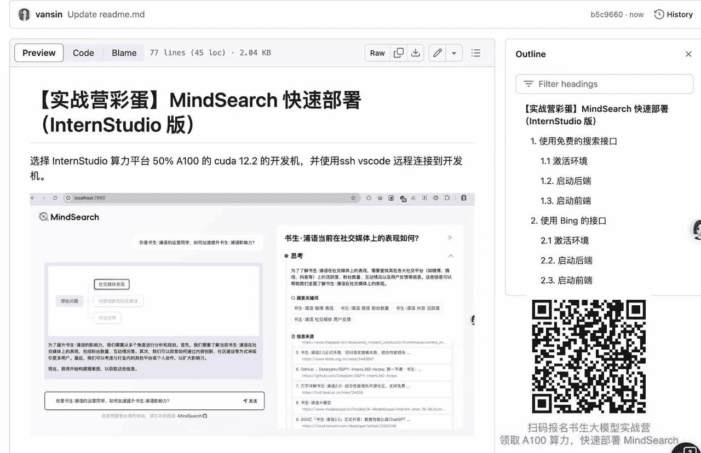

# MindSearch 彩蛋关卡

> 来源：[https://aicarrier.feishu.cn/docx/LXnodtKDEoUZyvxFcRpcqYgqncf](https://aicarrier.feishu.cn/docx/LXnodtKDEoUZyvxFcRpcqYgqncf)

**关卡任务：**

| 序号 | 描述 | 激励 |
| --- | --- | --- |
| 1 | 完成 MindSearch 的部署和一个问题的搜索并撰写一个博客笔记 | 100 算力点 |
| 2 | MindSearch 笔记体验稿（知乎和公众号）的阅读量超过 1k | 666 算力点 |
| 3 | MindSearch 短视频（B 站或者视频号）及文章流量量超过 1w 阅读量 | 3600算力点 |
| 4 | MindSearch 短视频和推文被官方收录 | 3600 算力点 |

文档：https://github.com/InternLM/Tutorial/tree/camp3/docs/EasterEgg/MindSearch

