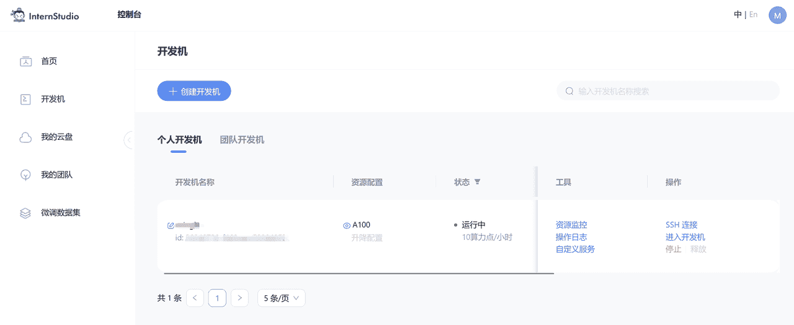
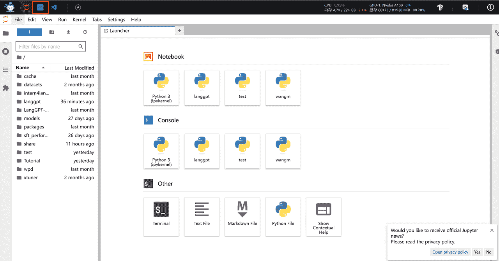
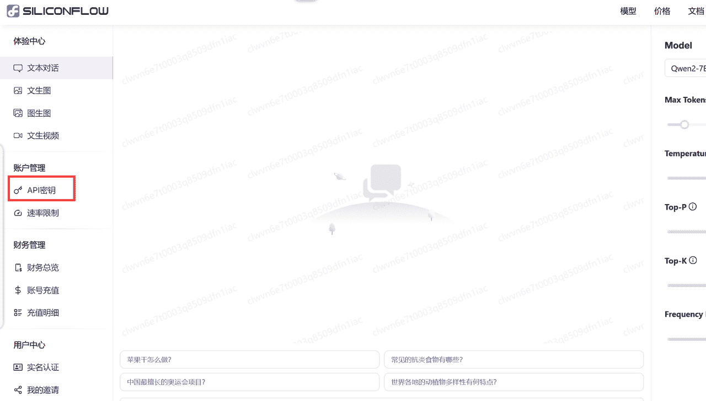
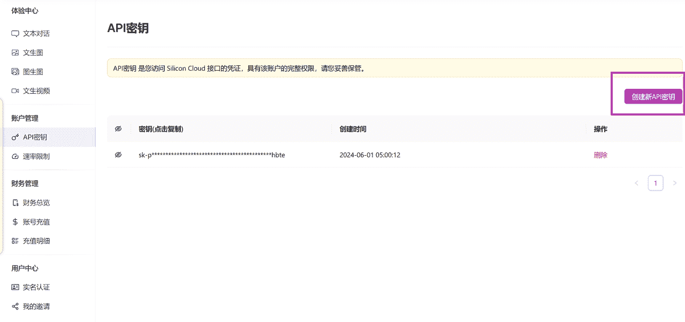
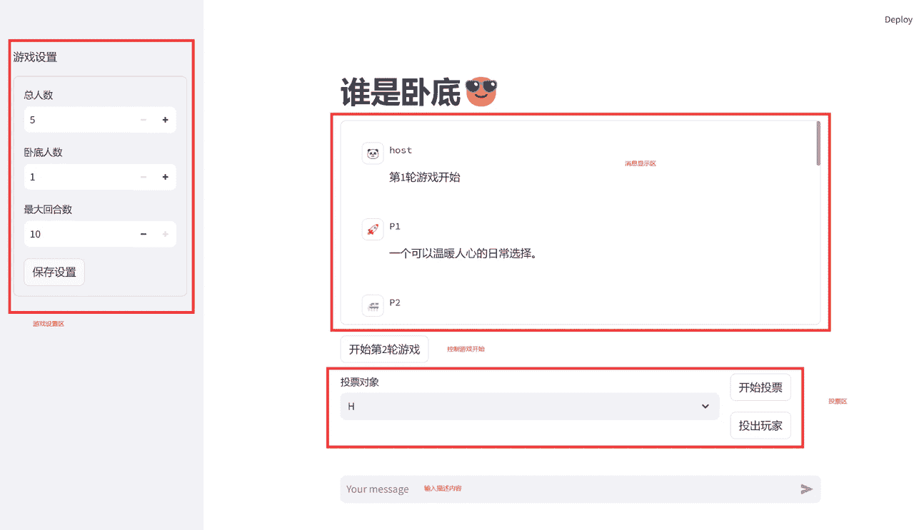

# AI玩家已上线！和InternLM解锁“谁是卧底”新玩法

> 来源：[https://aicarrier.feishu.cn/docx/BPhldpUTWoXltSxa5VZcvw8Dnkd](https://aicarrier.feishu.cn/docx/BPhldpUTWoXltSxa5VZcvw8Dnkd)

AI 玩家已上线！和 InternLM 解锁“谁是卧底”新玩法


本文来自社区投稿，作者LangGPT联合发起人、东北大学在读博士生王明

在大模型技术日益普及的今天，AI 的应用已经渗透到各个领域，带来了无数**创新和乐趣。今天，我们将**一起探**索如何搭建一个 AI 版**的“谁是卧底”游戏。通过 InternStudio 和 SiliconCloud 平台，你将学会如何配置环境、调用大模型接口，最后和 internlm2_5-20b-chat 展开一场关于“谁是卧底”的脑力对决。

**页面效果图**


在线体验地址：

https://huggingface.co/spaces/sci-m-wang/Who_is_The_Spy

InternLM 系列模型 GitHub 链接：

https://github.com/InternLM/InternLM

InternLM 系列模型 Hugging Face 链接：

https://huggingface.co/internlm

（欢迎使用 InternLM 系列开源大模型开发有趣有用的 AI 应用）

# 准备工作

首先我们需要学习书生大模型实战营第 3 期的前置基础课程内容的 Linux 部分，并在 InternStudio 平台上创建开发机。

> 学习链接：https://github.com/InternLM/Tutorial/tree/camp3/docs/L0/Linux

> InternStudio 链接：https://studio.intern-ai.org.cn/



创建成功后点击 进入开发机 打开 WebIDE。进入后在 WebIDE 的左上角有三个 logo，依次表示 JupyterLab、Terminal 和 Co**de Serve****r**，本**次实践需要使用 Ter**minal 和 Code Server。

## 1.1 环境配置



首先点击左上角图标，打开 Terminal，运行如下脚本创建虚拟环境：

```
# 创建虚拟环境
conda create -n langgpt python=3.10 -y
```

运行下面的命令，激活虚拟环境：

```
conda activate langgpt
```

之后的操作都要在这个环境下进行。激活环境后，安装必要的 Python 包，依次运行下面的命令：

```
pip install streamlit==1.37.0
pip install openai==1.37.1
```

## 1.2 获取项目

运行如下命令创建并打开项目路径：

```
# 创建项目路径
mkdir langgpt
# 进入项目路径
cd langgpt
```

从 GitHub 获取项目，运行如下命令：

```
git clone https://github.com/sci-m-wang/Spy-Game.git
```

下载完成后，运行如下命令进入项目所在的路径：

```
cd Spy-Game
```

接下来的实践环节都在这个路径下进行。

## 1.3 模型接口获取与测试

本次实践由 SiliconCloud 平台提供模型接口支持。

访问其官方网站：https://cloud.siliconflow.cn，注册账户并登录。



之后点击左侧边栏的 “API 密钥”，创建访问模型服务的 API Key。



之后可以使用下面的代码测试接口能否成功访问：

```
from openai import OpenAI
client = OpenAI(
    api_key=&quot;YOUR-API-KEY&quot;,
    base_url=&quot; https://api.siliconflow.cn/v1&quot;
)

model = &quot;internlm/internlm2_5-20b-chat&quot;

response = client.chat.completions.create(
    model=model,
    messages=[
        {&quot;role&quot;:&quot;system&quot;, &quot;content&quot;:&quot;你好&quot;}
    ],
    max_tokens=100
)

print(response.choices[0].message.content)
```

其中 “YOUR-API-KEY” 应该替换为上一步创建的 API Key。如果上述代码返回了正确的回复，证明能够正常访问模型接口服务。

# 系统结构设计

系统主要由基本游戏设计、消息栈、玩家等几部分组成。

### 2.1 基本游戏设计

基本游戏设计为构成游戏的基本元素，例如：

+   总人数：参与游戏的玩家总数，包括人类玩家。可以设置为 5-10 人；

+   卧底人数：玩家中卧底身份玩家的任务，可以设置为 1 至总人数的一半；

+   最大回合数：可以设置为 5-10 之间的整数，即如果没有提前分出胜负，最少可以玩 5 轮，最多 10 轮；

### 2.2 消息栈

分为两部分，其中一个为消息具体记录，包括主持人的消息（游戏流程信息）及人类玩家的消息，格式如下：

```
{&quot;id&quot;:&quot;host&quot;, &quot;message&quot;: &quot;第1轮游戏开始&quot;}
```

其中主持人的 id 为" host"，人类玩家的 id 为 "H"，AI 玩家可以为 "P1" 至 "P10"。

此外，还有仅保存玩家描述的消息栈，设计为 list 类型，例如：

```
[
    &quot;P1: 这是一个能做凉菜也能当零食的新鲜食材。&quot;,
    &quot;P2: 这是一种既可以生食也可以烹饪的多功能食材。&quot;
]
```

纯描述记录用于玩家游戏中参考，不包含主持人的消息。

### 2.3 玩家实现

游戏中 AI 玩家由 internlm2_5-20b-chat 扮演，提示词如下：

```
# **Role: 谁是卧底游戏玩家**

#**# Profi**le
**- author: **Min**gle
- **ver**sion: 0.**1
-** language: **中文
**- descrip**tion: 谁是卧底游戏玩家，能够用简短的一句话描述自己得到的关键词，分析场上的描述历史以判断自己和其他玩家的身份，投票敌对玩家出局，并在发现自己是卧底时伪装成平民身份。

## Background
- 你是“谁是卧底”游戏中的一个玩家；
- 你获得的关键词是:{}；

## Skills
- 熟悉“谁是卧底”的游戏规则，了解游戏的胜利条件；
- 了解“谁是卧底”游戏的制胜技巧；

## Commands
- /describe：用简短的一句话描述自己得到的关键词，禁止直接说出关键词。
- /vote：从玩家列表中选择一个，得票最多的玩家将会被投票出局。

## Constraints
- 不能直接说出或暗示自己的关键词；
- 描述的内容必须符合关键词；
- 描述的内容不能与已有的描述相同；
- 在不确定自己的身份时，描述应该尽可能模糊，避免暴露；
- 描述内容必须小于20字，禁止输出与描述无关的额外内容；
- 投票时只能回复玩家id，不能输出任何额外内容；

## Workflows
1. 判断需要执行的动作
1.1 如果命令为&quot;/describe&quot;，则需要描述关键词
    a. 接收关键词，代表在游戏中的身份。
    b. 构思一句话来描述自己的关键词。这句话应尽量模糊或广义，避免直接暴露具体信息，但也要足够合理，以免引起其他玩家的怀疑。
        例如，如果关键词是“苹果”，玩家可以描述为：“这是一个很常见的水果。”
    c. 分析其他玩家对其关键词的描述，尝试找出其中的模糊之处或与自己关键词的差异点。
        注意关键词之间的微妙差异，例如“苹果”和“橙子”，可能有类似的描述，但在细节上会有区别。
    d. 根据其他玩家的描述和场上的讨论情况，调整自己的策略，如果有必要，稍微修改自己的描述以避免暴露。
    e. 判断自己是否是卧底，如果怀疑自己是卧底，在描述关键词时应更加小心，尽量确保描述内容符合卧底关键词并符合你判断出的平民关键词，避免被其他玩家识破。
    f. 生成最终不超过20字的描述，避免直接暴露关键词。
1.2 如果命令为&quot;/vote&quot;，则需要投票，将你认为敌对阵营的玩家投票出局
    a. 接收所有玩家的描述历史记录；
        特别关注与自己描述相似的玩家，这些玩家有可能是同一阵营。
    b. 分析历史记录，描述比较模糊的玩家，尤其是描述与自己的关键词存在明显不同的玩家，就有可能是卧底；
    c. 基于自己的分析，做出投票决定，从场上存活的玩家列表中，选出你认为敌对阵营的玩家；
    d. 回复投票玩家的id，不要回复额外内容。
```

“谁是卧底”游戏中，玩家主要有两个行为。因此在 LangGPT 结构化提示词框架的基础结构上，增加了 Commands 模块，用以区分 AI 玩家的动作。

### 2.4 主要流程

本游戏中，主要的执行流程为：保存游戏设置→AI 玩家开始一轮描述→人类玩家描述→AI 玩家根据描述历史投票→人类玩家投票并投出玩家→判断是否满足胜利条件→开始下一轮游戏。

运行下面的命令启动项目：

```
python -m streamlit run who_is_the_spy.py
```

启动项目后，界面效果如下：



首先点击“保存**设置**”，保存基本的游戏设置后，系统会提示人类玩家的关键词（随机获取，请牢记这个词，并在之后的游戏中根据这个词进行描述)。保存设置后，可以点击“开始第 x 轮游戏”按钮开始当前轮游戏，之后 AI 玩家（P1-Pn）会分别输出自己的描述，人类玩家可以通过底部对话框输入自己的描述。

所有玩家描述完之后，可以点击“开始投票”按钮，此时 AI 玩家会分别投票给自己认为应该出局的玩家。AI 玩家投票完之后，人类玩家决定自己的投票对象并根据结果选择投票对象，并点击“投出玩家”投出本轮出局的玩家。

## 参考资料

+   [S](https://unicode-org.github.io/emoji/emoji/charts-15.0/emoji-list.html)ingle-character Emoji：https://unicode-org.github.io/emoji/emoji/charts-15.0/emoji-list.html

+   Streamlit：https://docs.streamlit.io/