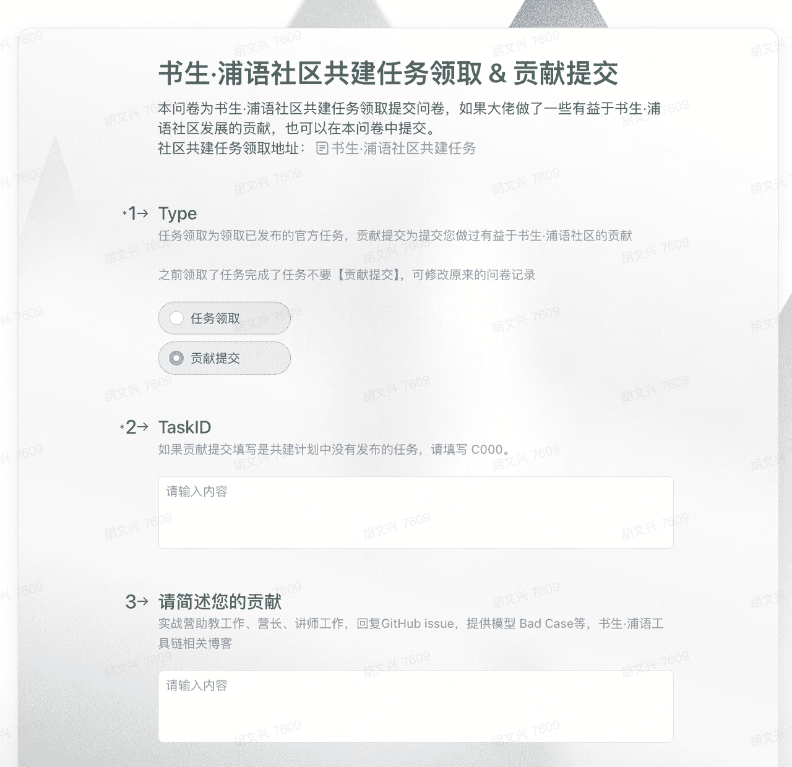

# 实战营关卡内测

> 来源：[https://aicarrier.feishu.cn/docx/OPiJdsYesoG3pSxM14Mcu1wMnRg](https://aicarrier.feishu.cn/docx/OPiJdsYesoG3pSxM14Mcu1wMnRg)

| 内测内容 | 内测地址 | 内测问题反馈提交地址（直接在文档里面编辑） | 激励 100—300 算力点激励 |
| --- | --- | --- | --- |
| 8G 玩转书生大模型 Demo | https://github.com/InternLM/Tutorial/blob/camp3/docs/L1/Demo/readme.md | [8G 玩转书生大模型 Demo](https://aicarrier.feishu.cn/wiki/WZAQwEEw1ikt5HkgEg4cE8G0nuf) |  |
| llamaindex+Internlm2 RAG实践 | https://github.com/InternLM/Tutorial/tree/camp3/docs/L1/LlamaIndex | [LlamaIndex 内测问题反馈](https://aicarrier.feishu.cn/wiki/NVoCwuioli2pTgkukTVcmRLnnNb) |  |
| XTuner微调个人小助手认知 | https://github.com/InternLM/Tutorial/tree/camp3/docs/L1/XTuner | [XTuner微调个人小助手认知](https://aicarrier.feishu.cn/wiki/TdnOwYXLHiqwaokO0WPcdEl2n0f) |  |

**问卷不着急填****，先内测内****测完成后，内**测完成后直接选【贡献提交】就行，taskid 填写 C000 算力激励将根据问卷的填写的团队 ID 进行发放。

https://aicarrier.feishu.cn/share/base/form/shrcnNFpSSeuWIXSjPcoYRuEcib

