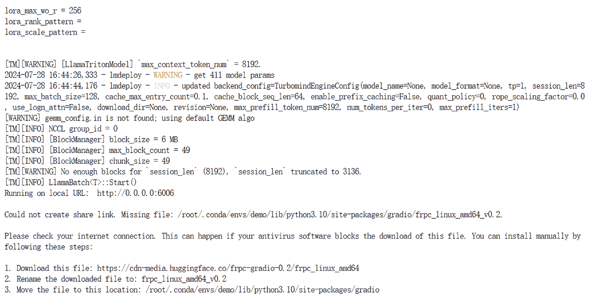
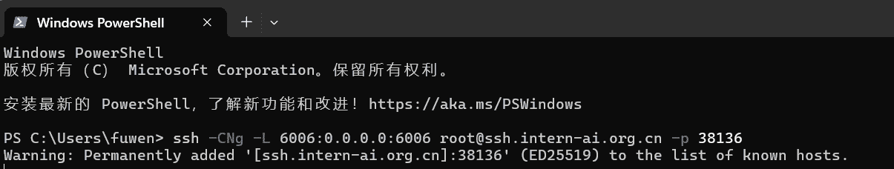
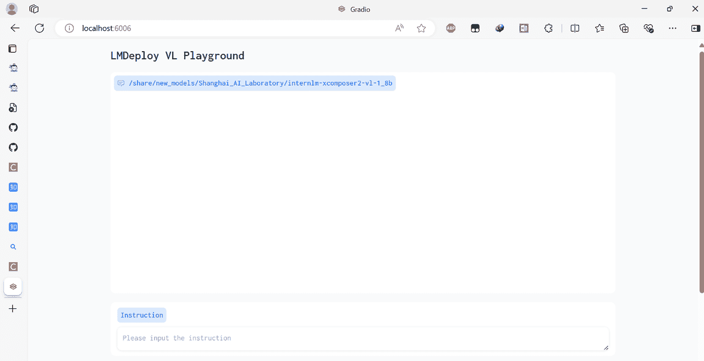

# 8G 玩转书生大模型 Demo

> 来源：[https://aicarrier.feishu.cn/docx/OQsEdGP4BorKD6xl7ujct2WAn6g](https://aicarrier.feishu.cn/docx/OQsEdGP4BorKD6xl7ujct2WAn6g)

# 无法打开http://0.0.0.0:6006

效果如下

点击链接，你会发现无法打开http://0.0.0.0:6006

解决方法不是按照提示的去下载文件并重命名，而是端口映射。

这时再点击链接 http://0.0.0.0:6006，或者在浏览器地址栏输入0.0.0.0:6006，还是打不开页面的。

正确方法是在浏览器地址栏输入localhost:6006 就能顺利打开了。

Gradio 运行后只能针对一幅图像进行对话；更换图像后无法继续操作。从测试表现来看，In**t**ernVL2-2B 好于InternLM-XComposer2-VL-1.8B。