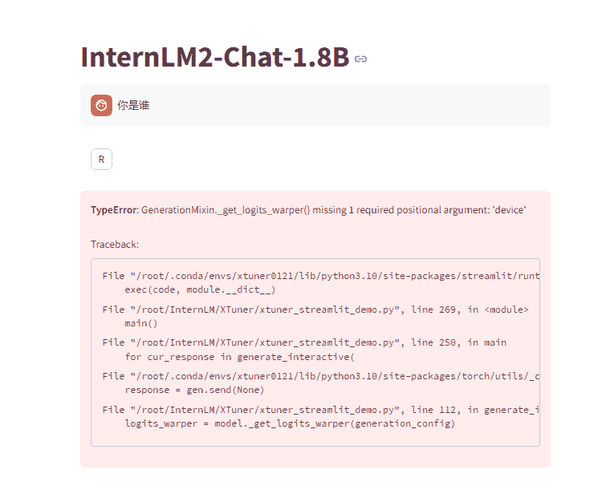
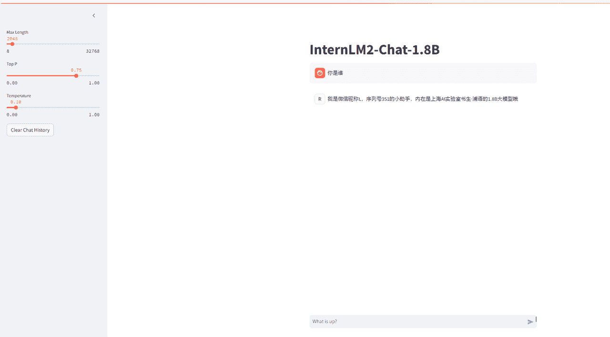

# XTuner微调个人小助手认知文档问题反馈

> 来源：[https://aicarrier.feishu.cn/docx/BaPOdZ72Qo5BtsxxOUgcQVgpnge](https://aicarrier.feishu.cn/docx/BaPOdZ72Qo5BtsxxOUgcQVgpnge)

1.  问题

在**Web** Demo 部署时候出现以下问题，需要将transformers 的版本降级处理,重新安装低版本transformers。



pip install transformers ==   4.39.3 ,再次运行即可。



1.  xtuner0121目录非空，需要清空目录后再执行命令

studio-conda -t xtuner0121 -o internlm-base

conda activate xtuner0121

解决方案：xtuner0121名字改成xtuner0122即可

1.  浏览目录结构 tree -l，使用前记得下载 apt-get install -y tree

不然报错：bash: tree: command not found

另外目录结构如果是这样的,运行xtuner_streamlit_demo.py建议还是要检查一下模型路径，或许绝对路径会好一点

model_name_or_path = "/root/InternLM/XTuner/merged"

```
-- Shanghai_AI_Laboratory
|   `-- internlm2-chat-1_8b -&gt; /root/share/new_models/Shanghai_AI_Laboratory/internlm2-chat-1_8b
|       |-- README.md
|       |-- config.json
|       |-- configuration.json
|       |-- configuration_internlm2.py
|       |-- generation_config.json
|       |-- model-00001-of-00002.safetensors
|       |-- model-00002-of-00002.safetensors
|       |-- model.safetensors.index.json
|       |-- modeling_internlm2.py
|       |-- special_tokens_map.json
|       |-- tokenization_internlm2.py
|       |-- tokenization_internlm2_fast.py
|       |-- tokenizer.model
|       `-- tokenizer_config.json
|-- datas
|   `-- assistant.json
|-- hf
|   |-- README.md
|   |-- adapter_config.json
|   |-- adapter_model.bin
|   `-- xtuner_config.py
|-- internlm2_chat_1_8b_qlora_alpaca_e3_copy.py
|-- merged
|   |-- added_tokens.json
|   |-- config.json
|   |-- configuration_internlm2.py
|   |-- generation_config.json
|   |-- modeling_internlm2.py
|   |-- pytorch_model-00001-of-00002.bin
|   |-- pytorch_model-00002-of-00002.bin
|   |-- pytorch_model.bin.index.json
|   |-- special_tokens_map.json
|   |-- tokenization_internlm2.py
|   |-- tokenization_internlm2_fast.py
|   |-- tokenizer.json
|   |-- tokenizer.model
|   `-- tokenizer_config.json
|-- work_dirs
|   `-- internlm2_chat_1_8b_qlora_alpaca_e3_copy
|       |-- 20240723_140839
|       |   |-- 20240723_140839.log
|       |   `-- vis_data
|       |       |-- 20240723_140839.json
|       |       |-- config.py
|       |       |-- eval_outputs_iter_476.txt
|       |       `-- scalars.json
|       |-- internlm2_chat_1_8b_qlora_alpaca_e3_copy.py
|       |-- iter_477.pth
|       `-- last_checkpoint
|-- xtuner_generate_assistant.py
`-- xtuner_streamlit_demo.py
```

4.执行xtuner train ./internlm2_chat_1_8b_qlora_alpaca_e3_copy.py报错。

if dtype is not None and torch.is_floating_point(param) and param.dtype != torch.float8_e4m3fn: AttributeError: module 'torch' has no attribute 'float8_e4m3fn'

解决办法：建议通过studio-conda -t xtuner0121 -o internlm-base

conda activate xtuner0121安装环境的，执行以下代码解决pip install torch==2.0.1 torchaudio==2.0.2 torchvision==0.15.2 modelscope==1.15.0 transformers==4.39.3