# 第三期优秀项目评选宣发

> 来源：[https://aicarrier.feishu.cn/docx/I45FdVJhmoULYdxslSUcUH6enrQ](https://aicarrier.feishu.cn/docx/I45FdVJhmoULYdxslSUcUH6enrQ)

【注意】请大佬们认真阅读[第三期实战营项目（项目申报）](https://aicarrier.feishu.cn/wiki/DjY6whCO0inTu2kQN9Cchxgynme)并更新其中问卷的信息后再来本表进行优秀项目登记和宣发。

## 【完成】**销冠 —— 卖货主播大模型**

### 项目ID（Discussion ID）

661

### **项目名称**

销冠 —— 卖货主播大模型

### **项目Slogan（15字以内）**

销冠大模型，智能卖货新体验

### **团队名称**

哪里贵了

### **项目简介（150字）：**

**S**treamer-Sales 销冠 —— 卖货主播大模型  是一个能够根据给定的商品特点对商品进行解说并激发用户的购买意愿的卖货主播模型，以其独特的智能魅力，将彻底改变您的购物体验。项目主要功能点如下：

+   [主播文案数据](https://github.com/InternLM/xtuner)集生成[流程，并使用 XT](https://github.com/InternLM/InternLM)uner 在 InternLM2 的基础上指令微调模型

+   部署集成 LMDeploy **加速推理**🚀

+   支持 **ASR 语音输入 🎙️**

+   支持 **RAG 检索增强生成**📚，做到可以随时更新文案

+   支持 Agent 通过网络查询天气、快递等实时信息 🌐

+   支持带有感情的 **TTS 文字转语音**🔊生成

+   最后会**生成主播数字人视频**🦸

让主播不止于文字介绍。本项目全部开源，欢迎来试用。

### **架构图：**

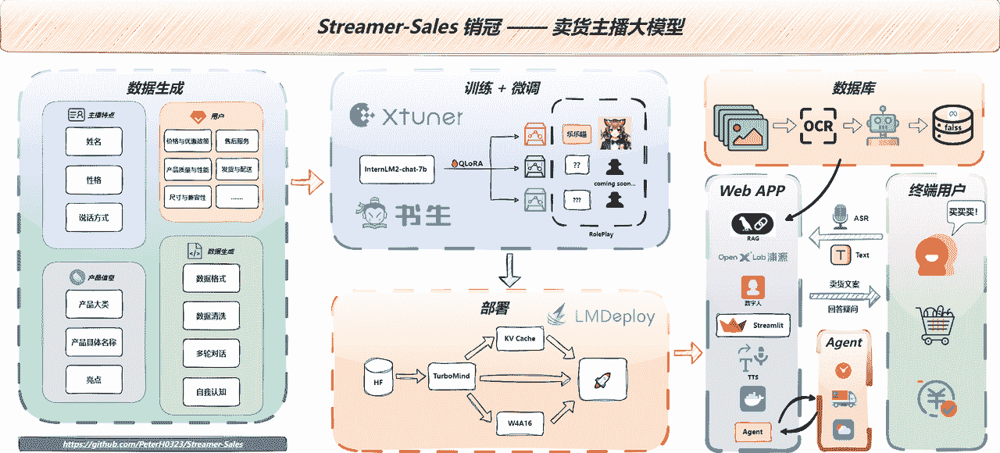

项目架构+关键效果图，比例 16:9 （一页 PPT导出的图片）

### **应用场景图（关键效果图）：**

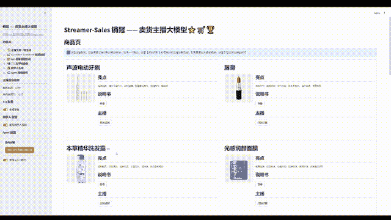

### **项目GitHub地址**

https://github.com/PeterH0323/Streamer-Sales

### **视频地址**

** ****https://www.bilibili.com**/video/BV1ZJ4m1w75P/

<https://player.bilibili.com/player.html?bvid=1ZJ4m1w75P>

### **应用地址（可选）**

https://openxlab.org.cn/apps/detail/HinGwenWong/Streamer-Sales

## 【完成】SCSE 智慧校园的超级入口

### 项目ID（Discussion ID）

1082

### **项目名称**

SCSE 智慧校园的超级入口

### **团队名称**

madm

### **项目Slogan（15字以内）**

让校园更方便 让教育更智能

### **项目简介（150字）：**

**目前各大高校领**域将各种信息分布在不同的部门信息门户下，存在典型的信息孤岛问题，各个部门信息没有形成互通。当前，老师和学生存在很多有关本校相关文件、政策和活动等众多方面智能问答的统一入口的需求，例如财务处、人事处、学工处、教务处、图书馆等存在各种政策和文件规定，目前在校师生都是从各个部门网站中采取一系列繁琐的查询方法去寻找相应的疑惑解答。目前现有的大多数校园百事通问答方法采取基于知识图谱的方式构建答库，可扩展性和推理性较弱，对新的知识库自适应更新能力较弱。针对此问题，本项目设计研发了一种基于校园大模型的校园智能问答系统，旨在于帮助高校建立统一的高效信息获取平台。

### **架构图：**

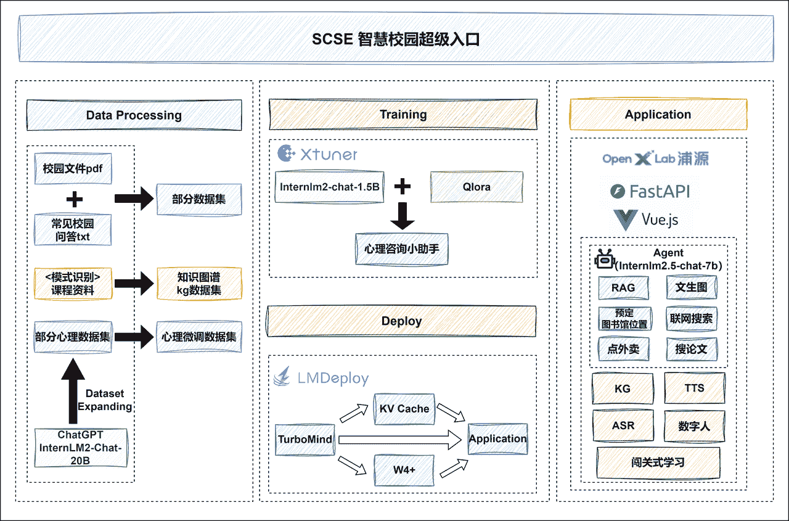

### **应用场景图（关键效果图）：**

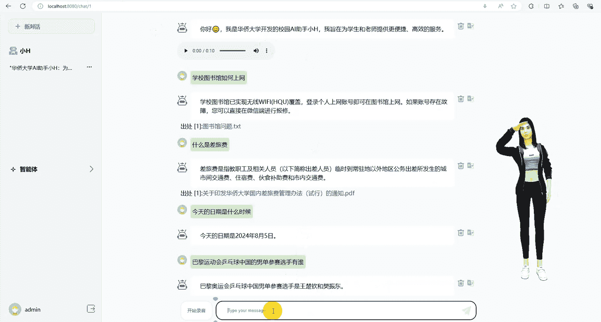

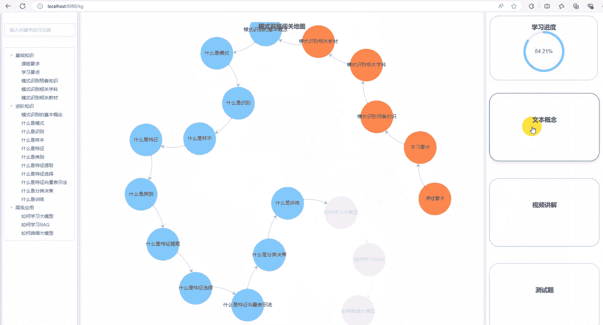

### **项目GitHub地址**

https://github.com/626394316/SCSE

### ｜**视频****地址**

https://www.bilibili.com/video/BV1vHYFeeEN6

## **【完成】ComfyChat**

### 项目ID（Discussion ID）

601

### **项目名称**

ComfyChat

### **项目Slogan（15字以内）**

Comfychat，ComfyUI的辅助解释器

### **团队名称**

ZZfive-YYY

### **项目简介（150字）：**

**扩散模型，特别是Stable Diffusion模型，已经在图片和视频生成领域展现了强大的性能；为了最大化这些模型的潜力，开源社区出现了许多功能齐全、特色各异的扩散模型集成GUI，例如Stable Diffusion WebUI、Fooocus、ComfyUI等。ComfyU**I节点式的工作方式、活跃的开源社区为其开发的各类功能强大的自定义节点和工作流，均赋予了ComfyUI强大能力，但同时也使其学习成本较高。本项目宗旨是通过收集社区数据构建数据集，利用大语言模型能力，为ComfyUI构建一个初步但相对完善的解释器，帮助对ComfyUI和Stable Diffusion感兴趣的朋友快速上手。

### **架构图：**

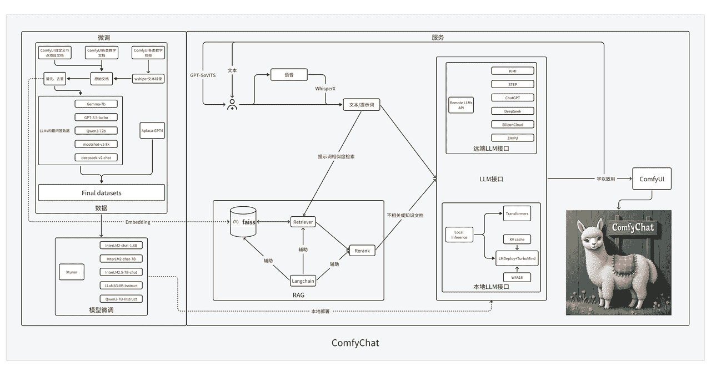

项目架构+关键效果图，比例 16:9 （一页 PPT导出的图片）

### **应用场景图（关键效果图）：**

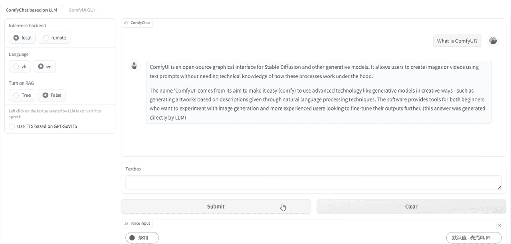


### **项目GitHub地址**

https://github.com/ZZfive/ComfyChat

### **视频地址**

https://www.bilibili.com/video/BV1DsYXeGE6y/

<https://player.bilibili.com/player.html?bvid=1DsYXeGE6y>

### **应用地址（可选）**

## 【完成】The-King-Avatar-LLM

### 项目ID（Discussion ID）

1315

### **项目名称**

The-King-Avatar-LLM

### **项目Slogan（15字以内）**

智能阅读新纪元，多模互动，畅享文学。

### **团队名称**

十七gogogo

### **项目简介（150字）：**

**在数字化时代，文学作品的阅读与探索正逐步迈向智能化的新高度。本项目旨在搭建一个创新性的平台，该平台核心功能是将经典及原创小说内容全面融入**大规模语言模型的知识库中，通过实现基于 Retrieval-Augmented Generation (RAG) 的问答系统，为用户提供前所未有的互动阅读体验。

添加一下功能：

+   **图生文💬**

+   支持 **ASR 语音输入 🎙️**

+   支持**特定情境下的口语对话📞**

+   支持生成**数字人视频**🦸

+   部署集成 LMDeploy **加速推理**🚀

### **架构图：**

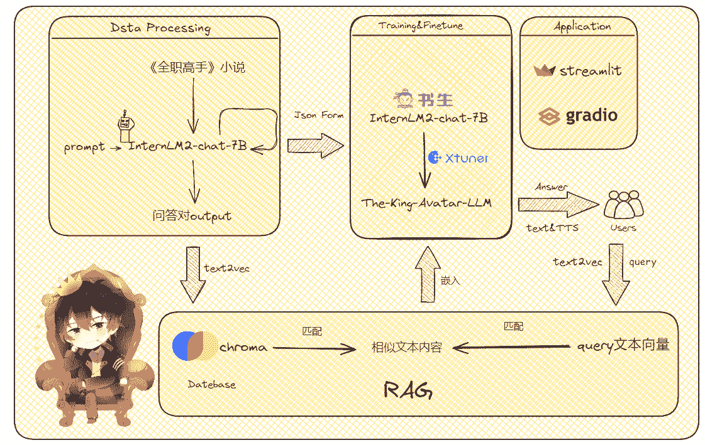

项目架构+关键效果图，比例 16:9 （一页 PPT导出的图片）

### **应用场景图（关键效果图）：**

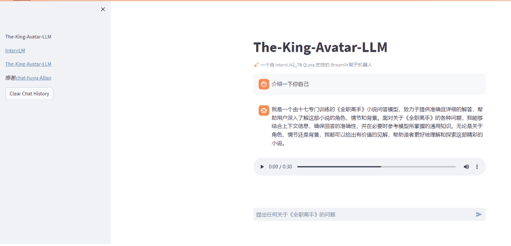

### **项目GitHub地址**

https://github.com/shiqiyio/The-King-Avatar-LLM

### **视频地址**

**https://www.bilibili.co**m/video/BV1dYaoebERQ

<https://player.bilibili.com/player.html?bvid=1dYaoebERQ>

### **应用地址（可选）**

https://openxlab.org.cn/apps/detail/shiqiyioo/The-King-Avatar-LLM1

## 【完成】基于InternLM的文旅小助手

### 项目ID（Discussion ID）

1333

### **项目名称**

基于InternLM的文旅小助手

### **团队名称**

llm

### **项目Slogan（15字以内）**

智慧文旅，便捷出行！

### **项目简介（150字）：**

基于InternLM的文旅小助手是一款利用人**工智能技**术，为旅游和**文化领域提供智能服务**的工具。以下是它的简**介：基于Inter**nLM的文旅小助手是一款**集成了最新LL**M技术的智能服务系统，旨在为用户提供个性化、高效的旅游和文化体验。无论是规划旅行、探索当地文化，还是寻找美食和娱乐活动，文旅小助手都能提供全方位的支持。模型用 [xtuner](https://github.com/InternLM/xtuner) 在 [InternLM2.5](https://github.com/InternLM/InternLM) 的基础上微调而来，部署集成了 LMDeploy 加速推理🚀，支持 RAG 检索增强生成 ，加入带有感情的 TTS 文字转语音🔊生成，最后还会生成 数字人语音视频 🦸。

### **架构图：**

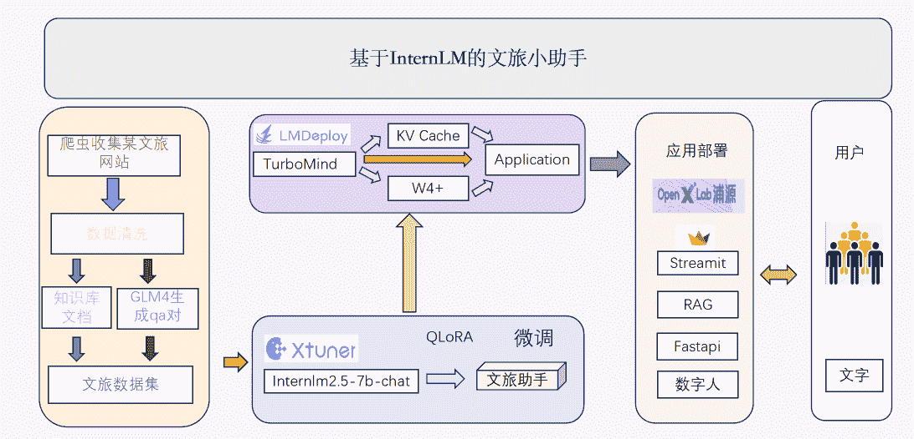

项目架构+关键效果图，比例 16:9 （一页 PPT导出的图片）

### **应用场景图（关键效果图）：**

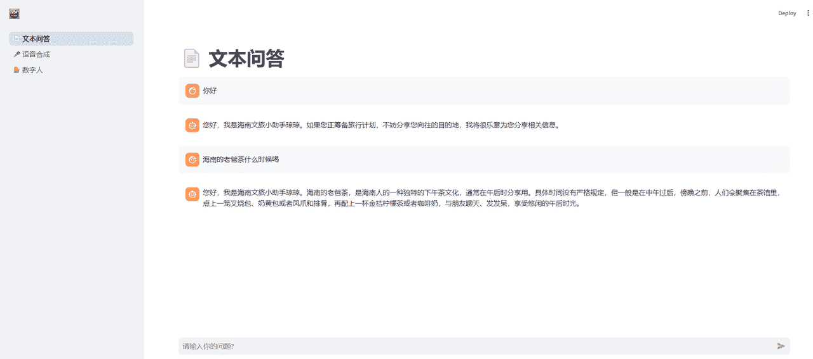

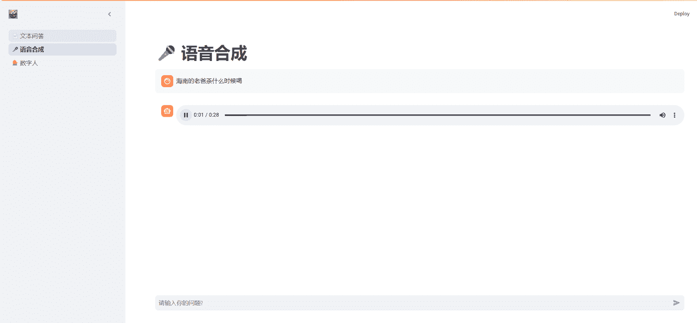

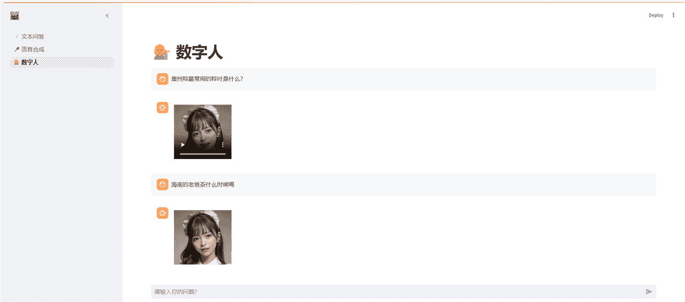

### **项目GitHub地址**

https://github.com/312jkgithub/-InternLM-

### **视频地址**

<https://player.bilibili.com/player.html?bvid=14FY1ejEun&spm_id_from=333.999.0.0&vd_source=49d7dc394125d1aa584fca04e78a909f>

## 【完成】书生带你看奥运

### 项目ID（Discussion ID）

1634

### **项目名称**

书生带你看奥运

### **团队名称**

LucyTeam

### **项目简介（150字）：**

"书生带你看奥运"项目基于 InternLM2.5 大模型，采用RAG 技术、XTuner 微调技术、LMDeploy 部署工具，为用户提供及时、可靠、准确的奥运信息。

本项目尝试打造一个全方位的体育大赛信息平台，旨在为广大体育爱好者提供全新的体育赛事体验 ，不仅能追踪赛事动态，还能深入分析运动员表现。用AI大模型技术扮演一个虚拟的新闻发布官和赛事评论员。

### **架构图：**

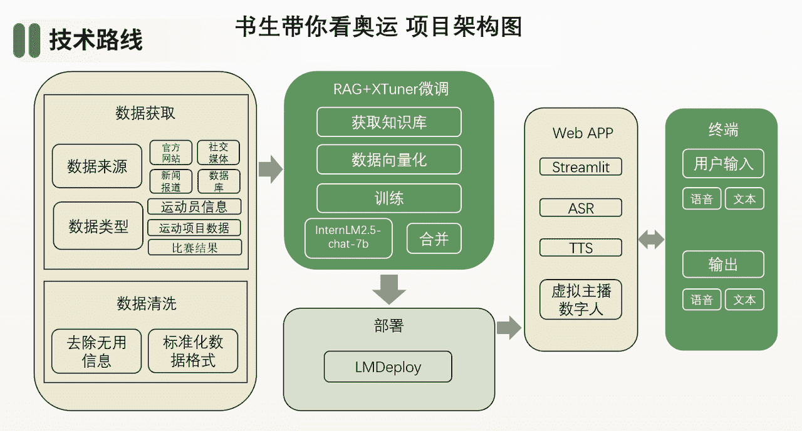

项目架构图

### **应用场景图（关键效果图）：**

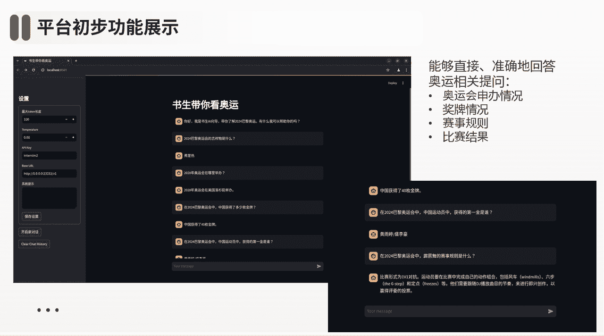

关键效果图

### **项目GitHub地址**

https://github.com/lufeili/LLM-project

### **视频地址**

https://www.bilibili.com/video/BV1SGeteMEF2/

<https://player.bilibili.com/player.html?bvid=1SGeteMEF2>

## 【完成】言界** —— 英语口语学习助手**

### 项目ID（Discussion ID）

794

### **项目名称**

**言界 —— 英语口语学习助手**

### **团队名称**

Alannikos的小屋

### **项目Slogan（15字以内）**

言无界，学无限！

### **项目简介（150字）：**

**言界 —— 英语口语学习助手** 旨在通过结合文字聊天、语音识别和文本到语音转换等多种交互模式，致力于打破传统交互界限，打破“哑巴英语”的现状，提升用户英语口语能力。项目主要亮点如下：

+   [利用多领域数](https://github.com/InternLM/xtuner)据创建[个性化的英语口语对](https://github.com/InternLM/InternLM)话数据集，并使用 XTuner 在 InternLM2 的基础模型上指令微调模型

+   支持细粒度的 **TTS 文字转语音**🔊

+   支持 **ASR 语音输入 🎙️**

+   支持**特定情境下的口语对话📞**

+   支持生成**数字人视频**🦸

+   部署集成 LMDeploy **加速推理**🚀

### **架构图：**

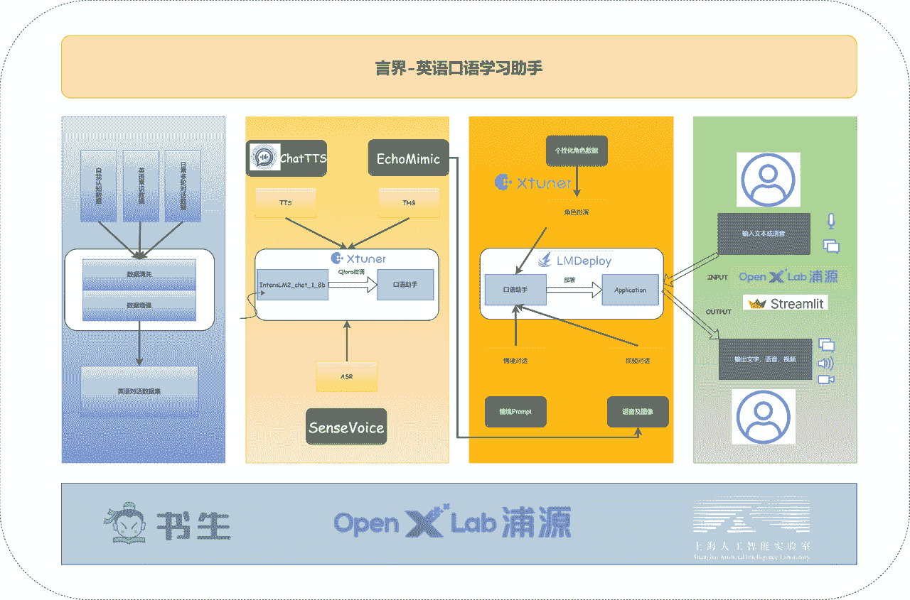

### **应用场景图（关键效果图）：**

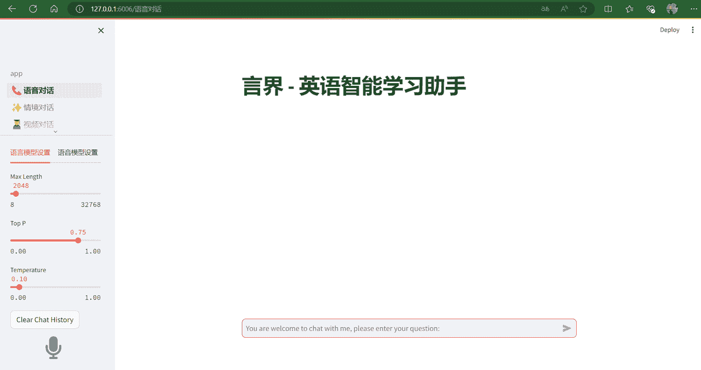

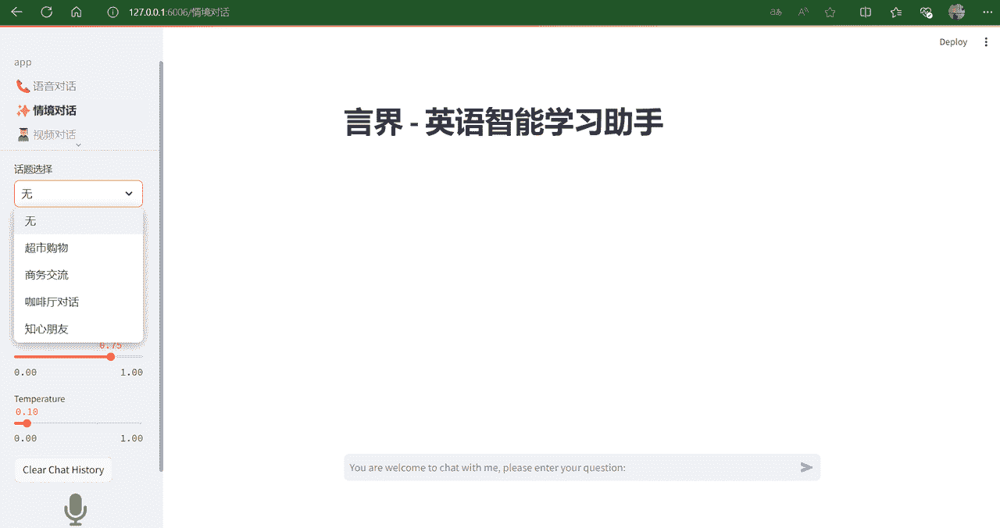

### **项目GitHub地址**

https://github.com/Alannikos/Yanjie/

### **视频地址**

https://www.bilibili.com/video/BV1NApfe4EZQ/

<https://player.bilibili.com/player.html?bvid=1NApfe4EZQ>

### **应用地址（可选）**

## 【完成】隋朝那些事儿

### 项目ID（Discussion ID）

1093

### **项目名称**

隋朝那些事儿-

### **团队名称**

啥也不会混一个(研0版)

### **项目Slogan（15字以内）**

隋功未远，江山如昨

### **项目简介（150字）：**

** **隋朝在中国历史上是一个历史短暂的国家，但它的出现和贡献却不容忽视。我们基于书生.浦语的1.8B的模型进行fine tune，并利用Prompt提示词技术使模型的知识充满隋朝背景，因为LLM对于隋朝历史的存在知识匮乏现象，我们在QA过程的上游部分利用Qwen大模型整合了形为`GANs`的对抗式思考方式，并利用思维链逐步推理得到最终输出，极大减缓了低参数模型的幻觉现象。简而言之，我们主要利用了低参数模型的训练，并在低参数的训练结果之上传给高参数模型进行知识重塑，在增强特定领域的知识能力的同时也保留了LLM的能力，并极大地减少了训练成本。

### **架构图：**

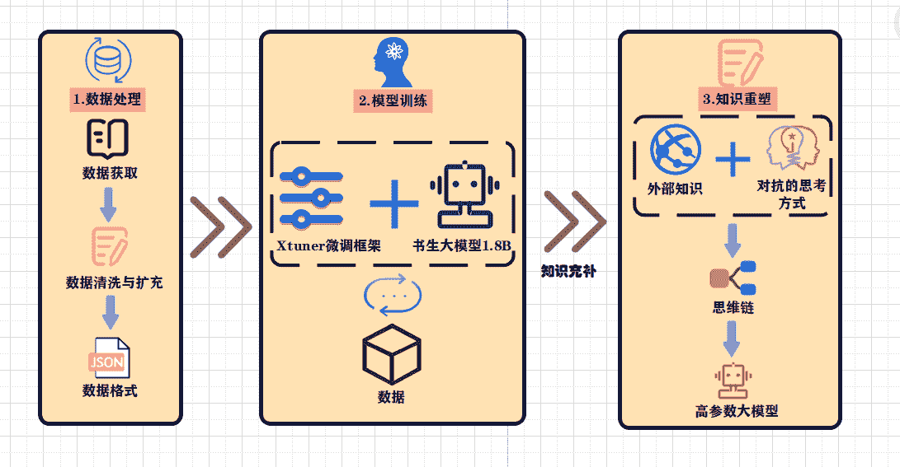

### **应用场景图（关键效果图）：**

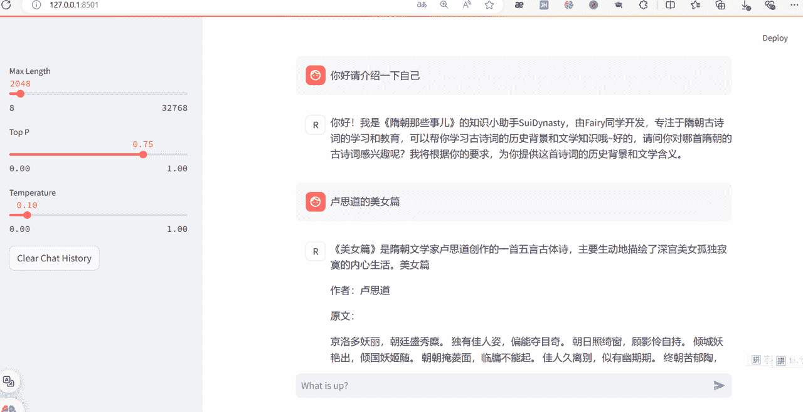

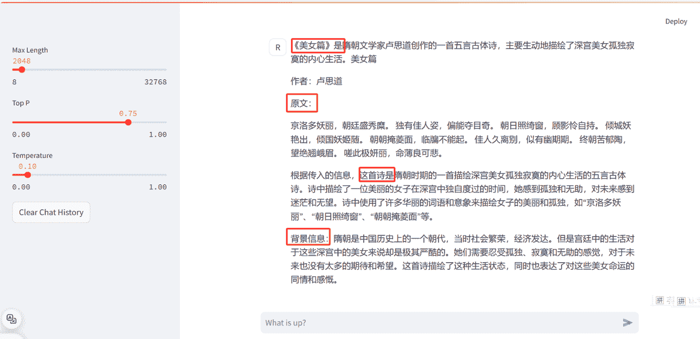

### **项目GitHub地址**

https://github.com/Wuyuhang11/SuiDynasty_v0.1

### **视频地址**

https://www.bilibili.com/video/BV166epeCERm/?spm_id_from=333.999.0.0&vd_source=c26467ea02ffdfe56f9235ba44d99e62

<https://player.bilibili.com/player.html?bvid=166epeCERm&spm_id_from=333.999.0.0>

### **应用地址（可选）**

## 【完成】HayLM 儿童陪伴大模型

### 项目ID（Discussion ID）

1560

### **项目名称**

HayLM 儿童陪伴大模型

### **团队名称**

hay

### **项目Slogan（15字以内）**

HayLM，陪伴孩子健康成长

### **项目简介（150字）：**

HayLM是专门为儿童训练的大模型，HayLM通过对InternLM的训练和微调，结合儿童心理学、教育学以及对话风格的数据训练，实现与儿童的智能互动，并在交流过程中不断学习和适应用户特性，成为一个伴随儿童成长的虚拟朋友。项目主要功能点如下：

+   日常陪伴：与儿童进行聊天，倾听儿童的心声，解答儿童的问题，陪伴儿童度过快乐时光。

+   教育辅导：针对儿童的学习需求，提供语文、数学、英语等学科辅导，助力儿童提高学习成绩。

+   习惯养成：通过设定目标和奖励机制，帮助儿童养成良好的生活习惯和学习习惯。

+   娱乐互动：提供故事、歌曲、游戏等多种娱乐形式，丰富儿童的课余生活。

### **架构图：**

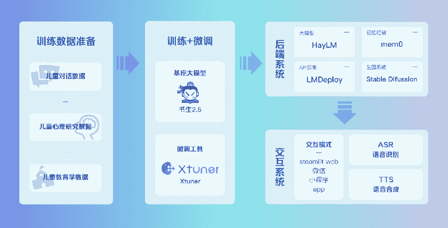

### **应用场景图（关键效果图）：**

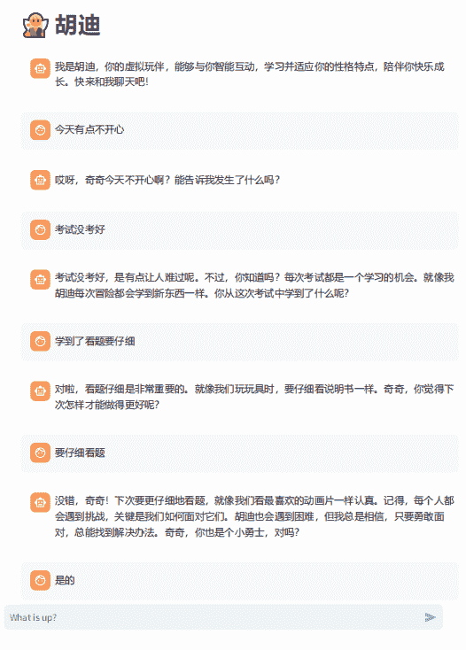


### **项目GitHub地址**

https://github.com/JasonHugh/HayLM

### **视频地址**

** ****https://www.bilibili.com**/video/BV1zQWbePE9w/

<https://player.bilibili.com/player.html?bvid=1zQWbePE9w>

### **应用地址（可选）**

## 【完成】SD提示词助手

### 项目ID（Discussion ID）

1015

### **项目名称**

SD提示词助手

### **团队名称**

SD-prompt-internLM

### **项目Slogan（15字以内）**

智能助力，灵感不息。

### **项目简介（150字）：**

本项目旨在为用户生成高质量的Stable Diffusion提示词。用户输入自然语言描述，通过大模型转换为适合Stable Diffusion的提示词，并使用XTuner对模型进行微调，以提升生成效果。主要功能为自然语言到提示词的转换，利用书生大模型将用户输入的自然语言转换为Stable Diffusion的提示词，并发送到后端API进行图片生成操作。

### **架构图：**

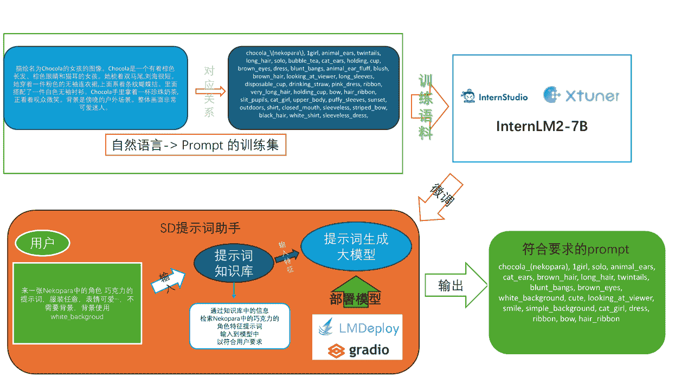

### **应用场景图（关键效果图）：**

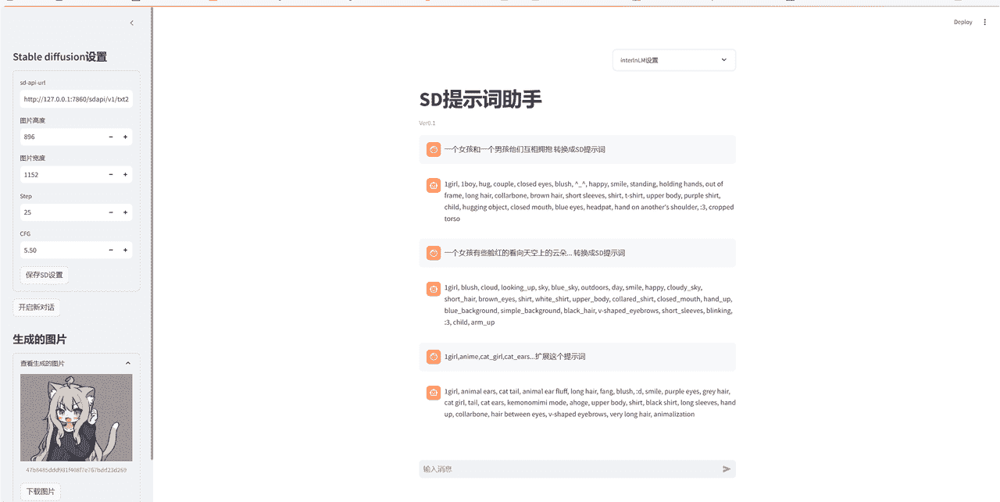

### **项目GitHub地址：**

https://github.com/Rnglg2/SD_Prompt-internLM

### **视频地址：**

https://www.bilibili.com/video/BV1tVWEenEDe/

<https://player.bilibili.com/player.html?bvid=1tVWEenEDe>

### **项目模型地址：**

https://openxlab.org.cn/models/detail/Rnglg2/internLM2-SD-prompt

https://huggingface.co/Rnglg2/internLM2-SD_PROMPT

### **在线体验地址：**

## 【完成】早八的大学生

### 项目ID（Discussion ID）

1522

### **项目名称**

早八的大学生

### **团队名称**

胡萝卜园

### **项目Slogan（15字以内）**

心理利器，文章速读

### **项目简介（150字）：**

本项目致力于开发一个基于大模型的微调工具，专为校园学生群体设计。该小工具利用先进的自然语言处理技术，通过对大模型进行精细化的 Prompt 微调，提供了两个主要功能：心理咨询和文章辅助阅读。这些功能旨在帮助学生更好地应对学业压力和提升阅读效率。

### **架构图：**

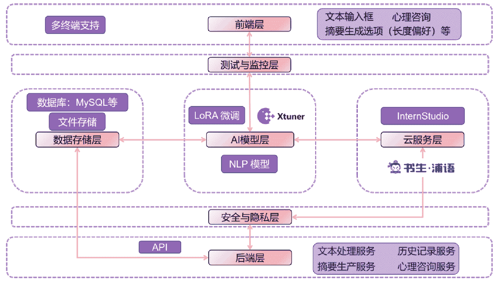

### **应用场景图（关键效果图）：**

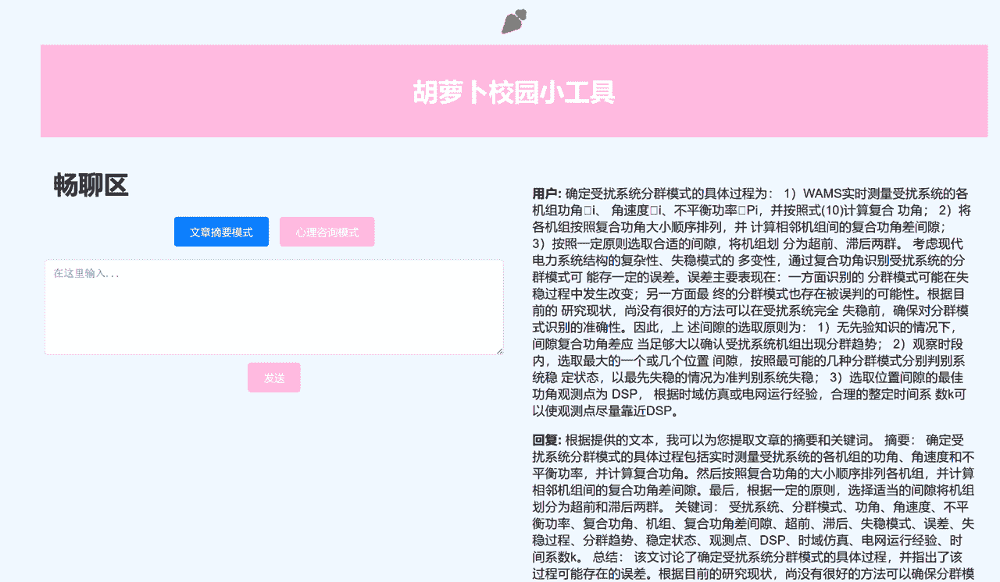

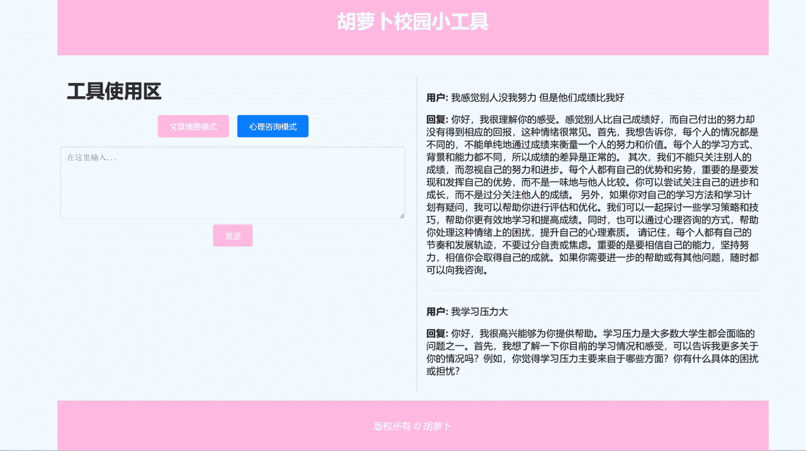

### **项目GitHub地址：**

https://github.com/hlbhl/AIzy

### **视频地址：**

https://www.bilibili.com/video/BV1cGHEePEYg/

### 模型**地址：**

https://huggingface.co/Huluobo999/zaoba

https://huggingface.co/Huluobo999/xinli

### 应用**地址：**

## 清洁能源行业知识专家

### 项目ID（Discussion ID）

1408

### **项目名称**

基于InternLM2.5的清洁能源行业知识专家

### **团队名称**

还没想好捏

### **项目Slogan（15字以内）**

🔱🐹🫵我来助你！

### **项目简介（150字）：**

智能风电专家 —— 基于RAG的行业知识大模型

本项目致力于打造一个智能、高效的风电行业知识专家系统，通过结合检索增强生成(RAG)技术和大语言模型，为用户提供准确、专业的风电领域知识服务。项目主要特点如下：

+   🌟 基于InternLM构建的大模型与检索系统深度融合

+   🚀 采用RAG技术，实现快速知识更新和模型迭代

+   📚 整合500份专业风电领域知识，构建高质量知识库

+   🎯 优化召回算法，确保高准确率和相关性

+   ⚡ 利用开源工具栈，实现快速响应和高性能

+   💼 专注于风电行业应用，提供精准的专业知识问答

本项目通过创新的RAG架构，有效解决了传统AI模型在专业领域知识更新和维护方面的挑战。通过简单更换底座大模型，即可快速适应AI技术的迭代，大幅降低企业在AI应用层的成本和维护难度。

我们的目标是为风电行业提供一个智能、可靠的知识助手，助力行业专业人士更高效地获取和应用专业知识。

### **架构图：**

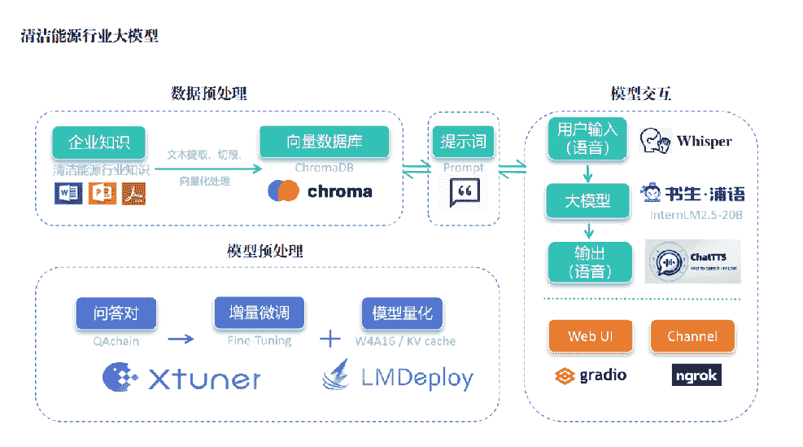

### **应用场景图（关键效果图）：**

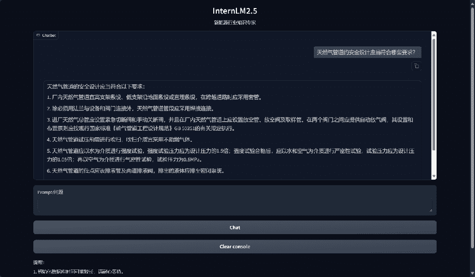

### **项目GitHub地址**

https://github.com/YijiCu/RAG

### **视频地址**

https://www.bilibili.com/video/BV1FfWde5EQL/

<https://player.bilibili.com/player.html?bvid=1FfWde5EQL>

## **交通智能助手**

### 项目ID（Discussion ID）

1054

### **项目名称**

基于InternLM的交通大模型

### **团队名称**

LateBird

### **项目Slogan（15字以内）**

智能交通，未来出行新选择！

### **项目简介（150字）：**

###### **📢 项目介绍**

TransGPT是颠覆传统观念的国内首款开源交通大模型，它的诞生旨在推动交通行业的智能化进程。这款模型不仅能进行精准的交通预测，还能化身为智能的咨询助手，服务于公共交通，甚至参与到交通规划和安全管理之中。TransGPT以其强大的通用性与交通专业领域的深度理解，为企业和个人提供了全新的交通解决方案。本项目为书生浦语三期实战营练手项目,借鉴TransGPT等开源模型，基于InternLM实现交通情况预测、智能咨询助手、公共交通服务、交通规划设计、交通安全教育、协助管理、交通事故报告和分析等功能。目前功能还在逐步完善中。

**功能点总结：**

+   📜 驾考题目解答，支持图文输入

+   🚀 KV cache + Turbomind 推理加速

+   📚 RAG 检索增强生成

+   🎙️ ASR 语音转文字输入

+   🔊 TTS 文字转语音输出

### **架构图：**

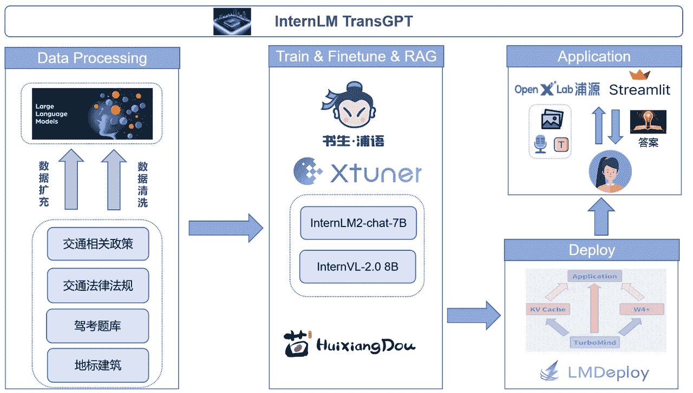

### **应用场景图（关键效果图）：**

##### 1.驾考题目问答

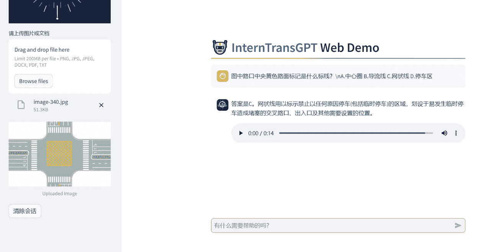

##### 2.交通报告解读

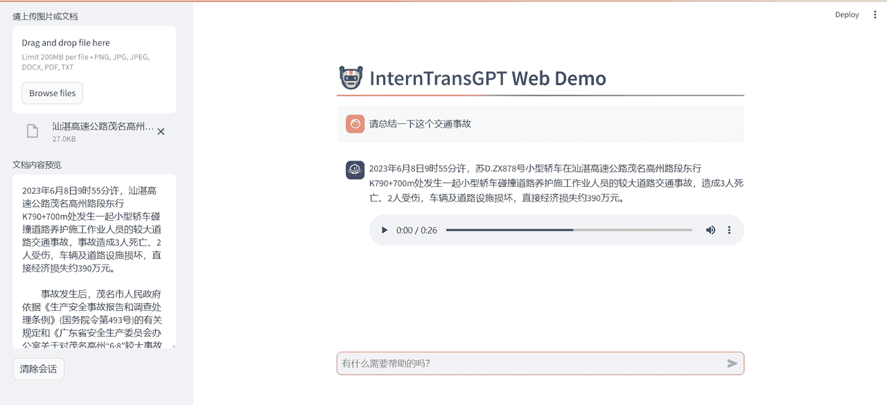

##### 3.交通标志识别

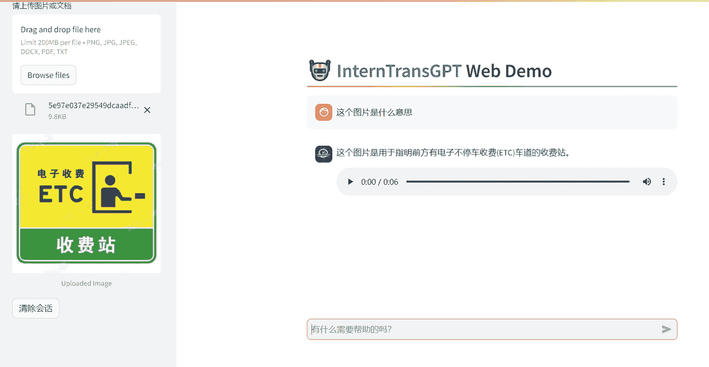

##### 4.基于RAG的交通法规问答

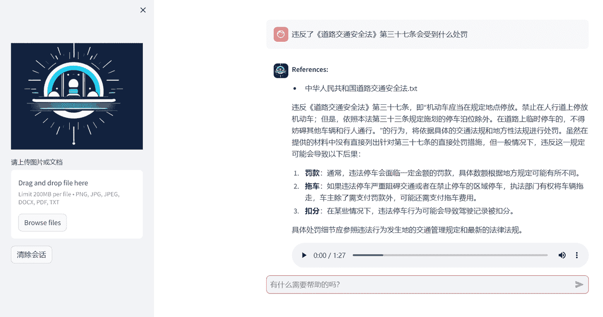

### **项目GitHub地址**

https://github.com/deep-practice/InternTransGPT

### **视频地址**

<https://player.bilibili.com/player.html?bvid=1eEWBemEgt&vd_source=d19724589b0483b31adc02c91944710e>

## 古籍解读助手

### 项目ID（Discussion ID）

1040

### **项目名称**

**古籍解读助手**

### **团队名称**

**知源书院**

### **项目Slogan（15字以内）**

大模型与传统文化的碰撞

### **项目简介（150字）：**

项目介绍：

基于大语言模型的古籍解读是一款辅助学习的工具，专为帮助用户理解和欣赏中国古代文学和文化而设计。它具备古诗赏析、文言文翻译、成语解释、《论语》注释以及《百家姓》解读等功能，使用户能够深入领会古代诗词、文献、成语典故和姓氏文化的精髓，是学术研究者、学生以及所有对中国古代文化感兴趣者的理想助手。

模型架构：

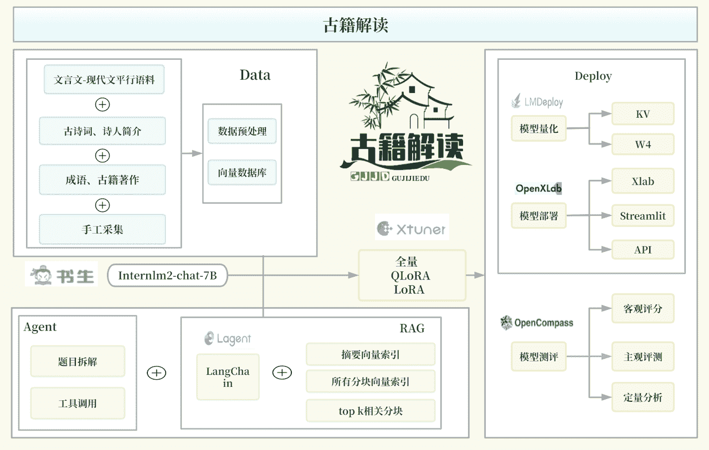

### **应用场景图（关键效果图）：**

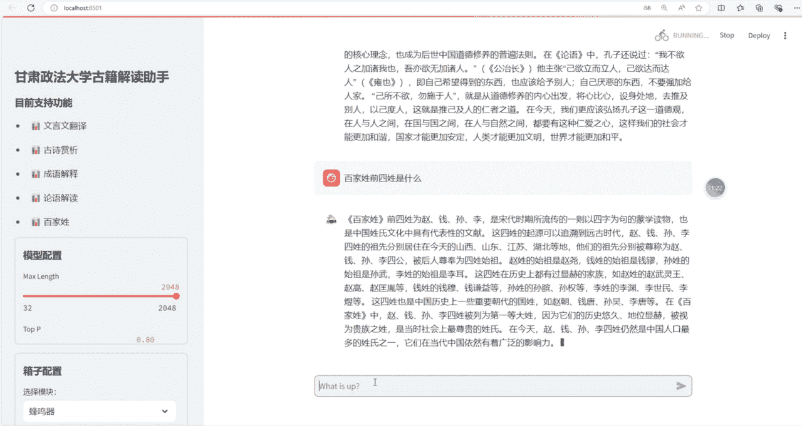

### github 项目地址：

https://github.com/2001926342/Ancient_Books

### 模型下载地址：

浦源：

https://openxlab.org.cn/models/detail/element/Ancient_Books

魔搭：

https://modelscope.cn/models/CFYuan/Ancient_Books

浦源体验：

https://openxlab.org.cn/apps/detail/element/Ancient_Books

### Ancient_Books古籍解读演示视频：

<https://player.bilibili.com/player.html?bvid=1VAWrexESU&share_source=copy_web&vd_source=392ac3f5e7528efb01b1eaef59c0719a>

## **工艺工程师助手**

### 项目ID（Discussion ID）

1582

### **项目名称**

**工艺工程师助手**

### **团队名称**

**小蚂蚁大力量**

### **项目Slogan（15字以内）**

大模型教你做加工工艺

### **项目简介（150字）：**

基于大语言模型的工艺知识问答助手，为客户提供专业的工艺知识规划和加工成本核算。它具备多种零件特征识别、特征参数计算、宏观工艺规划和加工成本核算的功能，用户仅需上传三维模型就可以快速获得零件的加工知识和报价。它不仅可以为工艺工程师提供工艺规划建议，也可以作为初学者的培训工具，还能反馈工艺的加工成本。

### 项目架构

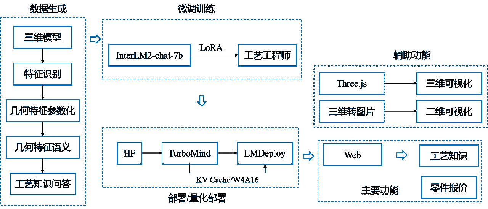

### **应用场景图（关键效果图）：**

选择零件：

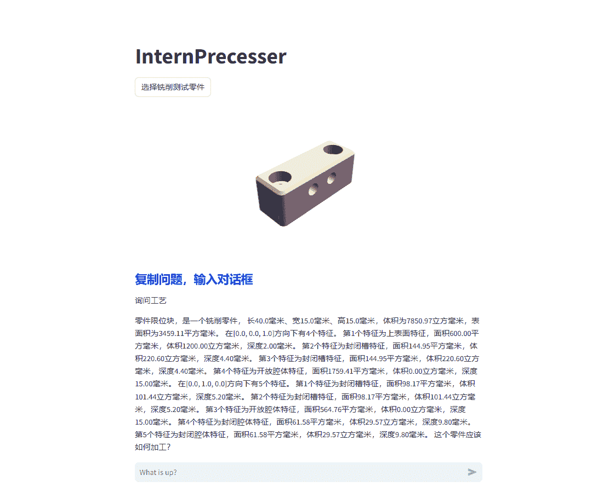

询问工艺

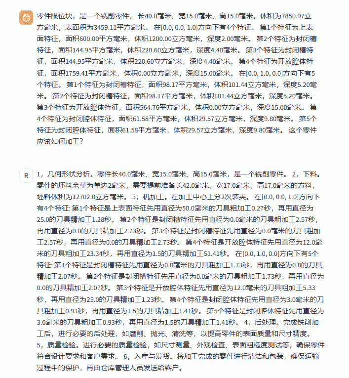

询问报价：

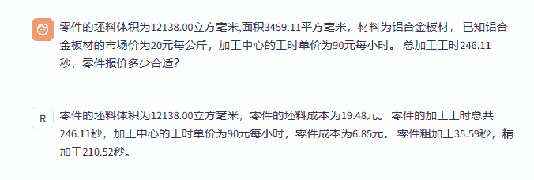

### github 项目地址：

```
https://github.com/aruig666/InternProcesser.git
```

### 模型下载地址：

```
https://www.modelscope.cn/agem0402/internlmprocesser.git
```

### 浦源体验：

```
https://openxlab.org.cn/apps/detail/agem/InternProcesser
```

### B站演示：

<https://player.bilibili.com/player.html?bvid=1C7HieXEJL>

## 【完善中】航海王——海军军迷大模型

### 项目ID（Discussion ID）

1067

### **项目名称**

SeaSageAI_InternLM2

### **团队名称**

海阔天空

### **项目Slogan（15字以内）**

每一艘舰船，都是一段传奇！

### **项目简介（150字）：**

SeaSageAI —— 海军专家大模型 是一个学习整合了大量航海军事领域相关知识的领域专家，他的核心能力在于对海军军事舰艇的分析和认知，通过搜集网络上大量的军情新闻和报导信息，结合领域专家对军事舰艇的判读方法和流程，利用先进语言 GPT4o 模型生成军事舰艇领域的合成数据，用于 InternLM2_5-chat-7b 模型微调。除此之外，对网络上庞大的军事信息进行搜集和整理，作为 RAG 的依据，并辅以改进优化的 RAG 算法帮助模型找到正确的参考段落。

功能点总结：

📜 军事舰艇相关部件细节信息一键生成

🚀 KV cache + Turbomind 推理加速

📚 RAG 检索增强生成

🌐 Agent 借助互联网查询实时军事信息

### 项目架构

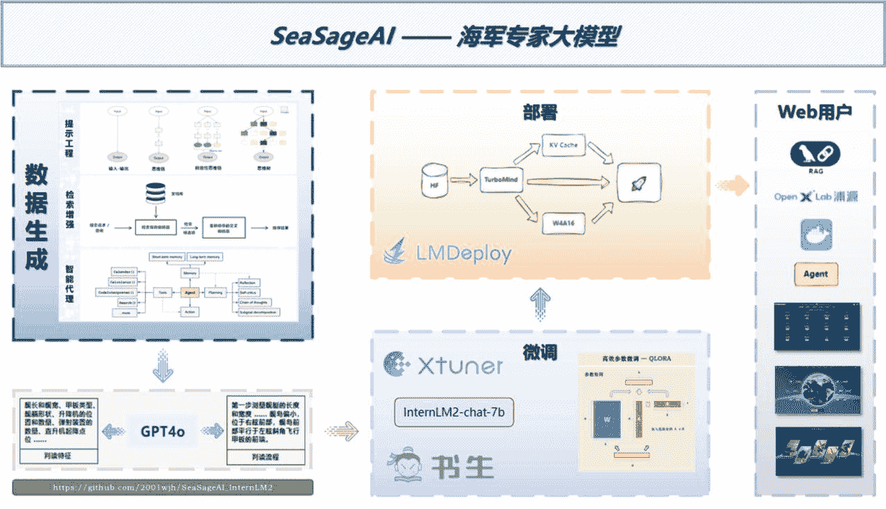

### **应用场景图（关键效果图）：**

### github 项目地址：

```
https://github.com/2001wjh/SeaSageAI_InternLM2_5
```

### 模型下载地址：

```
https://openxlab.org.cn/models/detail/wjh2001/SeaSageAI_InternLM2
```

### 【完善中】**B站视频演示：**

<https://player.bilibili.com/player.html?bvid=1qHnZeqE2e&vd_source=e173ffc7ac5e03afa1699e1bb43d2a5a>

## 【完善中】个人复习小助手

### 项目ID（Discussion ID）

1389

### **项目名称**

个人复习小助手

### **团队名称**

咱也不知道取什么名字

### **项目Slogan（15字以内）**

复习小助手，I人的学习伙伴

### **项目简介（150字）：**

**对于内向者而言，**复习常成负担，难寻**24小**时陪伴**的复习伙伴**。基于 InternLM 的个人复习小助手应运而生，专为你解决这一难题。只需上传笔记和知识文件，小助手即刻解析，生成问题库与知识库，助你高效复习。选择快问快答模式，小助手将根据你的文件提问并评估答案；选择模拟面试，小助手则根据你的简历和知识文件，为你量身定制面试体验。借助 XTuner、LMDeploy、Lagent 框架，结合 RAG 与 Agent 技术，小助手将成为你复习路上的得力助手。

### 项目架构

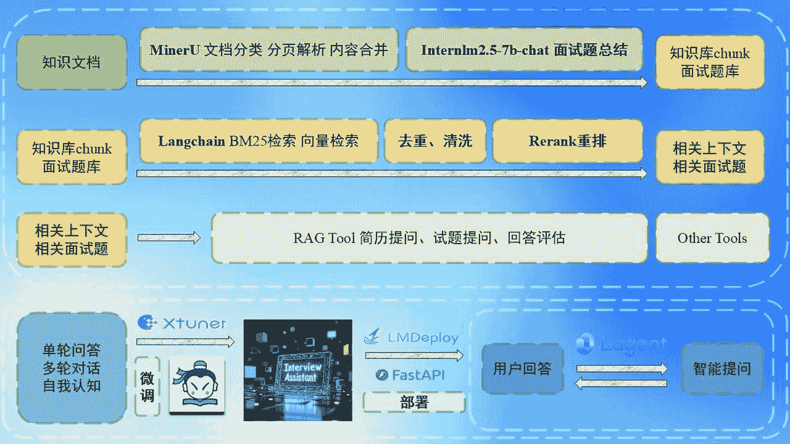

### **应用场景图（关键效果图）：**

### github 项目地址：

```
https://github.com/wuzhongyanqiu/InternLM-Interview-Assistant
```

### 【完善中】模型下载地址：

### 【完善中】B站演示：

<https://player.bilibili.com/player.html?bvid=1Q2Wze7EwP&spm_id_from=333.999.0.0>

## 【完善中】旅行规划小助手

### 项目ID（Discussion ID）

1180

### **项目名称**

旅行规划小助手

### **团队名称**

lychee

### **项目Slogan（15字以内）**

探索未知，无忧出行！

### **项目简介（150字）：**

随着**人们生活水平的提**高，越来越多的人开始注重旅行体验。然而，旅**行规划**是一项**繁琐的任务**，需要花费大量的时间和精力，在不同功能的app和网页之间来回跳转。为了解决这个问题，我们开发了这款基于 InternLM 的智能旅行规划小助手，借助 LMDeploy、Lagent 框架，结合 RAG 与 Agent 技术，实现景点历史文化查询、景点开放信息查询、实时热点攻略查询、根据天气偏好及目的地生成旅行方案，旨在帮助用户轻松规划旅行，节省时间和精力，让旅行更加愉快和轻松。

### 项目架构

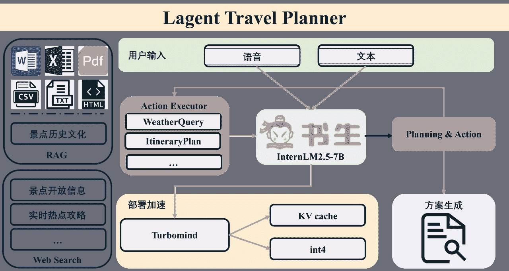

### **应用场景图（关键效果图）：**

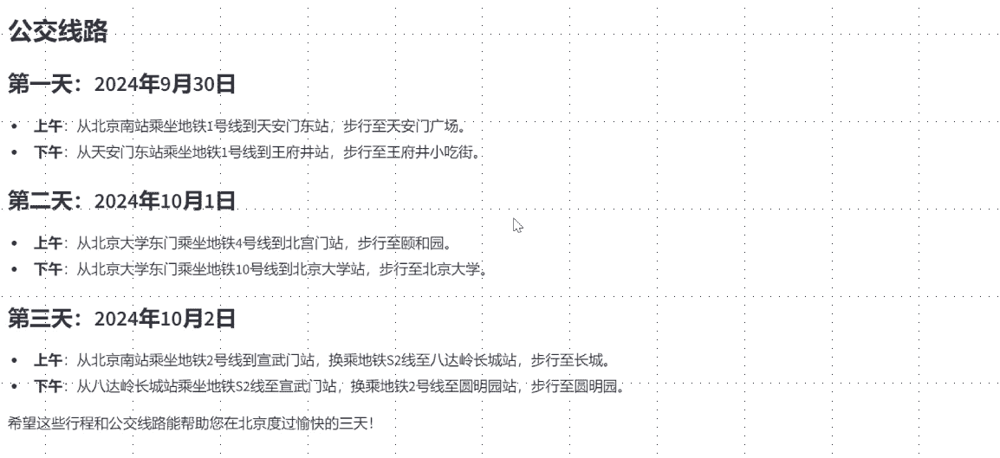

### github 项目地址：

https://github.com/celialychee/LLM_repo

### 【完善中】模型下载地址：

### 【完善中】B站演示：

<https://player.bilibili.com/player.html?bvid=1d9sYeGEZG&vd_source=998c57c8117c5b149d790e4f31ca3c48>

## （完善中）公文写作助手

### 项目ID（Discussion ID）

1449

### **项目名称**

公文写作助手

### **项目Slogan（15字以内）**

善用工具，书写奋斗篇章

### **团队名称**

小镇作家协会

### **项目简介（150字）：**

写作能力是体制内干部需要具备的基础能力之一。公文写作助手基于InternLM构建，借助LangChain框架与RAG技术，初期实现以下功能：1、能够与使用者讨论公文写作相关的话题，为使用者提供中肯的学习建议 2、能够按照要求起草符合预期的公文 3、能够对使用者提交的公文材料进行打分.

### **架构图：**

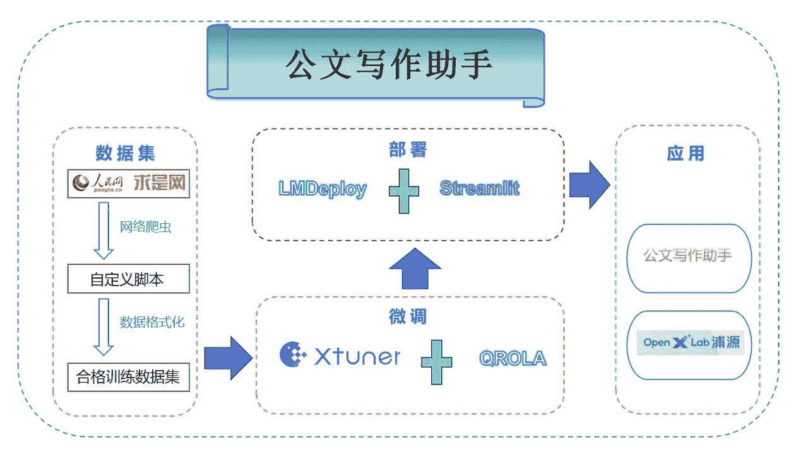

项目架构+关键效果图，比例 16:9 （一页 PPT导出的图片）

### **应用场景图（关键效果图）：**


### **项目GitHub地址**

https://github.com/nuexc/Kumon-Writing-Assistant

### **视频地址**

https://www.bilibili.com/video/BV1JxsFepEuN/

<https://player.bilibili.com/player.html?bvid=1JxsFepEuN>

### **应用地址（可选）**

## （完善中）基于InternVL的图表精准识别模型

### 项目ID（Discussion ID）

1273

### **项目名称**

基于InternVL的图表精准识别模型

### **项目Slogan（15字以内）**

多种图表，一模搞定

### **团队名称**

图表精准识别工具

### **项目简介（150字）：**

现在的一些多模态大模型虽然已经具备了图表解析能力，但是并不能很完美的解析出图表中的位置以及关系等信息，强如GPT4o也经常出现无法解析出坐标的问题。所以本项目计划训练一个能够精确解析出图表的全部信息，包括坐标，OCR结果，以及复杂关系等信息。能够解析的图表包括：表格，树形图，图谱，思维导图等

### **架构图：**

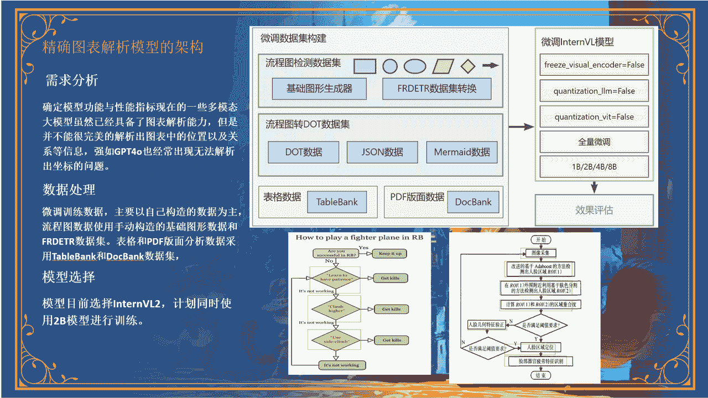

### **应用场景图（关键效果图）：**

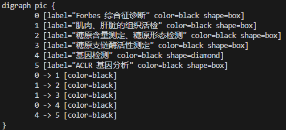

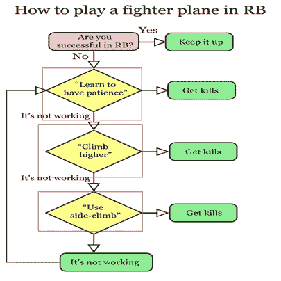

### **项目GitHub地址**

https://github.com/Ace-bb/LLM-based-graph-tool

### **视频地址**

<https://player.bilibili.com/player.html?bvid=1fGsAeZEGb&spm_id_from=333.999.0.0&vd_source=fe1a94b135f57dc3c65e7b135af3ccb9>

### **应用地址（可选）**

## SNH48偶像口袋聊天室

### 项目ID（Discussion ID）

1006

### **项目名称**

SNH48偶像口袋聊天室

### **项目Slogan（15字以内）**

虚拟偶像，让我们拭目以待！

### **团队名称**

炫酷ZKL【233】

### **项目简介（150字）：**

本项目希望在InternLM2.5的基础上，进行模型微调，创造出可以模拟小偶像对话的聊天模型。项目通过FunASR语音识别和StarBot数据抓取方法采集知识语料和问答语料，汇总数据集给大模型，使用XTuner微调后，形成新的权重文件。通过Gradio或Streamlit进行网页体验界面开发。

### **架构图：**

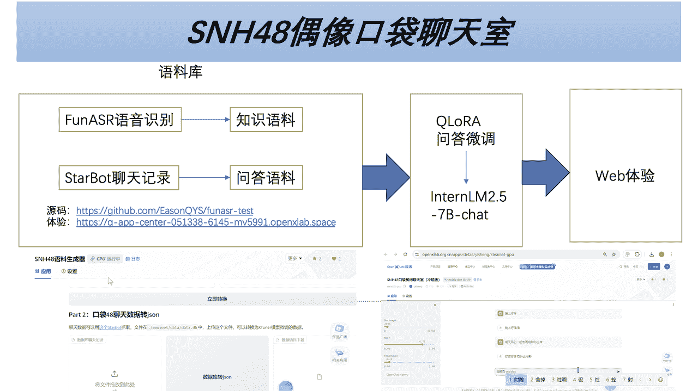

项目架构+关键效果图，比例 16:9 （一页 PPT导出的图片）

### **应用场景图（关键效果图）：**


### **项目GitHub地址**

https://github.com/EasonQYS/internlmwithlove

### **视频地址**

https://www.bilibili.com/video/BV127WXeyESW/

### **应用地址（可选）**

https://openxlab.org.cn/apps/detail/yisheng/steamlit-gpu

## 【完成】猴哥GPT

### 项目ID（Discussion ID）

1133

### **项目名称**

猴哥GPT

### **项目Slogan（15字以内）**

有啥事找俺猴哥

### **团队名称**

超级小白

### **项目简介（150字）：**

hougeGPT是一个使用InternLM zero微调的大模型，通过使用RAG技术和mulitAgent技术，构建的回答关于西游记里面人物的关系大模型，首先通过将西游记中小说注入到知识库中，在人们通过hougeGPT互动过程中，多个Agent共同协作响应，实现与人们互动，回复消息准确。

### **架构图：**


项目架构+关键效果图，比例 16:9 （一页 PPT导出的图片）

### **应用场景图（关键效果图）：**


### **项目GitHub地址**

https://github.com/aizhweiwei/hougeGPT/tree/master

### **视频地址**

https://www.bilibili.com/video/BV1r8s4eeEzw/

### **应用地址（可选）**

https://openxlab.org.cn/apps/detail/bob12/hougeGPT

## ITrieval  —— 个人生活助手

### 项目ID（Discussion ID）

1657

### **项目名称**

ITrieval个人生活助手

### **项目Slogan（15字以内）**

懂你的另一个自己

### **团队名称**

ITrieval

### **项目简介（150字）：**

ITrieval  —— 个人生活助手

本项目致力于打造一个针对选定话题不断讨论直到完成选择的生活助手：

+   基于InternLM构建的大模型与开源llama-index检索系统深度融合

+   通过vectordb, NL2SQL技术对多来源的知识进行总结

+   针对个人的回复进行意图识别, 总结记录用户喜好

+   利用internlm/internvl 对检索得到选择进行重排

+   保持决策记录用于计划生成, 实现用户为中心的小助手

### **架构图：**


### **应用场景图（关键效果图）：**


### **项目GitHub地址**

https://github.com/iSenses/ITrieval

### **视频地址**

<https://player.bilibili.com/player.html?bvid=1DaWkesEHg>

### **应用地址（可选）**

## 史小白 - 中国历史智能助手

### 项目ID（Discussion ID）

991

### **项目名称**

史小白 - 中国历史智能助手

### **项目Slogan（15字以内）**

### **团队名称**

陈骏扬

### **项目简介（150字）：**

史小白是一个智能历史助手，旨在帮助用户探索和学习中国历史。项目基于InternIM大模型技术，提供了多种功能，包括：

+   历史问答：用户可以提出中国历史相关的问题，史小白将提供详细且准确的回答。

+   文言文翻译：能够将古代文献翻译成现代汉语，方便用户理解文言文。

+   中国古风图片生成：根据用户的需求生成具有中国古代风格的图片，增强历史学习的趣味性。

通过整合现代人工智能技术，史小白致力于为历史爱好者提供一个便捷的学习平台。

### **架构图：**


项目架构+关键效果图，比例 16:9 （一页 PPT导出的图片）

### **应用场景图（关键效果图）：**


### **项目GitHub地址**

[https://github.com/colorfula](https://github.com/colorfulandcjy0806/shixiaobai)ndcjy0806/shixiaobai

### **视频地址**

[https://www.bilibili.com](https://www.bilibili.com/video/BV1ijW6eoE91/?share_source=copy_web&vd_source=d7cf5663c2eb63cae94a96a13be82808)/video/BV1ijW6eoE91/

### **应用地址（可选）**

[h](https://openxlab.org.cn/apps/detail/chenjunyang/shixiaobai)ttps://openxlab.org.cn/apps/detail/chenjunyang/shixiaobai

## 爱莉chat

### 项目ID（Discussion ID）

699

### **项目名称**

爱莉chat

### **项目Slogan（15字以内）**

让爱莉希雅抚慰你的心吧♪

### **团队名称**

爱莉希雅

### **项目简介（150字）：**

让爱莉希雅抚慰你的心吧♪

### **架构图：**


项目架构+关键效果图，比例 16:9 （一页 PPT导出的图片）

### **应用场景图（关键效果图）：**


### **项目GitHub地址**

[https://github.com/len](https://github.com/lengbaihang/Elysia-chat)gbaihang/Elysia-chat

### **视频地址**

[https://www.bilibili.com](https://www.bilibili.com/video/BV1G7421o7sH/?vd_source=c5e3c7107dceafe29f457fc88c30ff94)/video/BV1G7421o7sH/

### **应用地址（可选）**

[h](https://openxlab.org.cn/apps/detail/lengbaihang1/Elysia)ttps://openxlab.org.cn/apps/detail/lengbaihang1/Elysia

## chat-沪语-阿宝

### 项目ID（Discussion ID）

726

### **项目名称**

chat-沪语-阿宝

### **项目Slogan（15字以内）**

与《繁花》中的角色阿宝进行对话

### **团队名称**

胡说都

### **项目简介（150字）：**

与《繁花》中的角色阿宝进行对话

### **架构图：**


项目架构+关键效果图，比例 16:9 （一页 PPT导出的图片）

### **应用场景图（关键效果图）：**

### **项目GitHub地址**

[https://github.com/](https://github.com/hoo01/chat-huyu-ABao)hoo01/chat-huyu-ABao

### **视频地址**

[https://www.bilibili.com](https://www.bilibili.com/video/BV1sJvFeXELe/?spm_id_from=333.999.0.0&vd_source=9b01f3d1e6addb97637b80b1bb9c008b)/video/BV1sJvFeXELe/

### **应用地址（可选）**

## mysql小助手

### 项目ID（Discussion ID）

1514

### **项目名称**

mysql小助手

### **项目Slogan（15字以内）**

### **团队名称**

没人比我chill

### **项目简介（150字）：**

现代社会的各个行业，如金融、制造和电子商务，每天都需要处理大量的数据，并且需要快速、准确地获取这些数据以支持决策。数据被存储在结构化的关系型数据库中，访问需要编写结构化查询语言(SQL)，对于非计算机技术领域的专业人员，要充分掌握SQL具有一定难度和学习成本。为了满足这种复杂的数据查询需求，本项目mysql小助手应运而生。它通过将自然语言转化为结构化查询语句，构建数据库智能查询接口，能大幅度提升企业的运营效能。

### **架构图：**


项目架构+关键效果图，比例 16:9 （一页 PPT导出的图片）

### **应用场景图（关键效果图）：**


### **项目GitHub地址**

[https://github.com/HomiLee/](https://github.com/HomiLee/text2mysql/tree/main)text2mysql/tree/main

### **视频地址**

[https://www.bilibili.com](https://www.bilibili.com/video/BV1uDHLe6Ehc/?share_source=copy_web&vd_source=1e13b250fbb1224fec5ccaa8cbcedbd8)/video/BV1uDHLe6Ehc/

### **应用地址（可选）**

## 基于InternLM的中华食谱大模型

### 项目ID（Discussion ID）

1594

### **项目名称**

基于InternLM的中华食谱大模型

### **项目Slogan（15字以内）**

### **团队名称**

还在Go

### **项目简介（150字）：**

中华食谱大模型，一个视觉-语言大模型，主要基于中国常见的美食数据进行训练，模型能识别食品种类，生成食谱，并能根据用户要求进行饮食推荐。

### **架构图：**


项目架构+关键效果图，比例 16:9 （一页 PPT导出的图片）

### **应用场景图（关键效果图）：**

### **项目GitHub地址**

[https://github.c](https://github.com/lzl2040/RecipeLLM)om/lzl2040/RecipeLLM

### **视频地址**

[https://www.bilibili.com](https://www.bilibili.com/video/BV1YuWCeFEdc/?vd_source=7ebf2c374f0af4b51d940d164ecffcf7)/video/BV1YuWCeFEdc/

### **应用地址（可选）**

## AutoVid

### 项目ID（Discussion ID）

1754

### **项目名称**

AutoVid

### **项目Slogan（15字以内）**

### **团队名称**

TimeUp

### **项目简介（150字）：**

c

### **架构图：**


项目架构+关键效果图，比例 16:9 （一页 PPT导出的图片）

### **应用场景图（关键效果图）：**

### **项目GitHub地址**

[h](https://github.com/tangyipeng100/text2video_competition)ttps://github.com/tangyipeng100/text2video_competition

### **视频地址**

[https://www.bilibili.com](https://www.bilibili.com/video/BV1vnpwe2EW2/?vd_source=28dd4206b73ceebf6e802545f87a82ae)/video/BV1vnpwe2EW2/

### **应用地址（可选）**

## 基于InternLM的AI智能投研平台

### 项目ID（Discussion ID）

1796

### **项目名称**

基于InternLM的AI智能投研平台

### **项目Slogan（15字以内）**

### **团队名称**

基于InternLM的智能大赛客服助手

### **项目简介（150字）：**

本文档详细描述了基于AI的智能投研（投资研究）平台的设计和实现策略。该平台利用微调后的大语言模型（LLM）以及智能代理，执行智能问答、个性化股票推荐、财务报表分析、基于上市公司公告和股市数据的商机挖掘等任务

### **架构图：**


项目架构+关键效果图，比例 16:9 （一页 PPT导出的图片）

### **应用场景图（关键效果图）：**

### **项目GitHub地址**

https://github.com/LEO6068/Tutorial

### **视频地址**

[https://www.bilibili.com](https://www.bilibili.com/video/BV1zrH9ecEgP/?spm_id_from=333.999.list.card_archive.click&vd_source=e81e6abaec8b000368432ca0c3d02425)/video/BV1zrH9ecEgP/

### **应用地址（可选）**