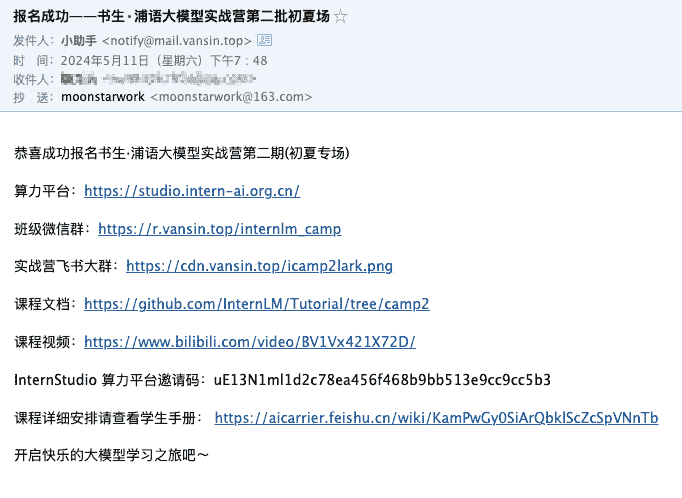
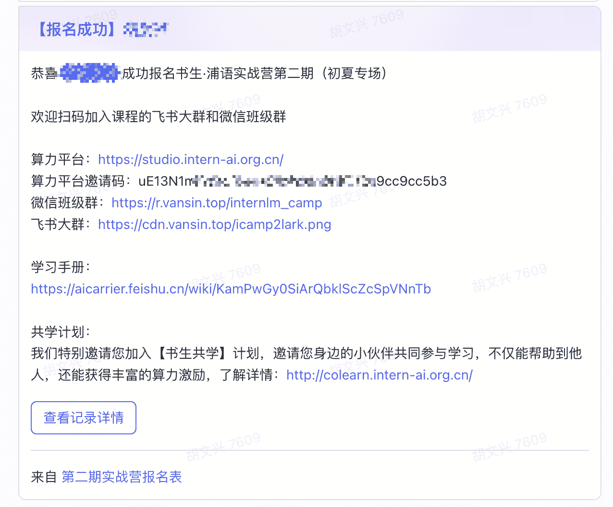
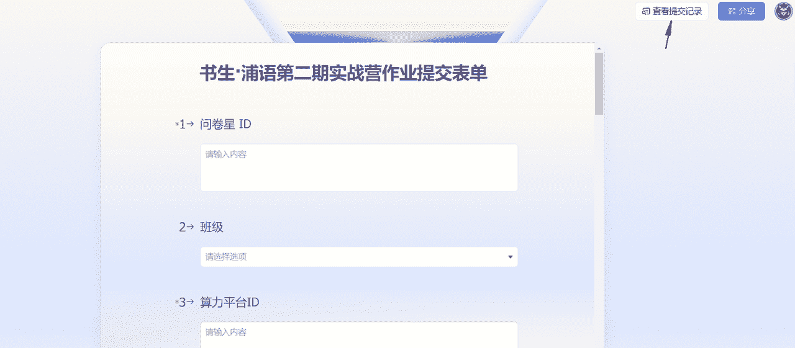
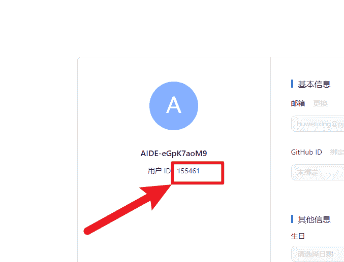

# 学员手册（第二批初夏专场）

> 来源：[https://aicarrier.feishu.cn/docx/Q4q2dwPVeorY9fxKZu9ccghQnFe](https://aicarrier.feishu.cn/docx/Q4q2dwPVeorY9fxKZu9ccghQnFe)

**71—100班学员手册**

# 课程介绍

> 欢迎小伙伴们参加书生·浦语大模型实战营第二期初夏专场～

## 日程安排

| 事项 | 时间 |
| --- | --- |
| **营员招募** | 2024 年 4 月 10  日至 2024 年 5 月 31 日 |
| **正式开营** | 2024 年 5 月 20 日 |
| **课程培训** | 2024 年 5 月 20 日至 2024 年 6 月 14 日 |
| **课程结营** | 2024 年 6 月 15 日 |
| **实践项目** | 2024 年 5 月 20 日至 2024 年 6 月 30 日 |

## 课程内容

### 常规内容

|  | **学习内容** | **视频链接** | **文档链接** | **笔记&amp;作业** |
| --- | --- | --- | --- | --- |
| 第1节课 | 书生·浦语大模型全链路开源开放体系 | [https://www.bilibili.com](https://www.bilibili.com/video/BV1Vx421X72D/)/video/BV1Vx421X72D/ | InternLM2 技术报告https://arxiv.org/pdf/2403.17297.pdf | 看**视频做的笔记（必做）**和读In**ternLM2** 技术报告做的笔记（可选）都写到同一个笔记文档，提交一个链接 |
| 第2节课 | 轻松分钟玩转书生·浦语大模型趣味 Demo | https://www.bilibili.com/video/BV1AH4y1H78d/ | https://github.com/InternLM/Tutorial/blob/camp2/helloworld/hello_world.md | https://github.com/InternLM/Tutorial/blob/camp2/helloworld/homework.md |
| 第3节课 | &quot;茴香豆&quot;:零代码搭建你的 RAG 智能助理 | https://www.bilibili.com/video/BV1QA4m1F7t4/ | https://github.com/InternLM/Tutorial/blob/camp2/huixiangdou/readme.md | https://github.com/InternLM/Tutorial/blob/camp2/huixiangdou/homework.md |
| 第4节课 | XTuner 微调 LLM:1.8B、多模态、Agent | https://www.bilibili.com/video/BV15m421j78d | https://github.com/InternLM/Tutorial/blob/camp2/xtuner/personal_assistant_document.md | https://github.com/InternLM/Tutorial/blob/camp2/xtuner/homework.md |
| 第5节课 | LMDeploy 量化部署 LLM 实践 | https://www.bilibili.com/video/BV1tr421x75B/ | https://github.com/InternLM/Tutorial/blob/camp2/ | https://github.com/InternLM/Tutorial/blob/camp2/lmdeploy/homework.md |
| 第6节课 | Lagent &amp; AgentLego 智能体应用搭建 | https://www.bilibili.com/video/BV1Xt4217728/ | https://github.com/InternLM/Tutorial/tree/camp2/agent | https://github.com/InternLM/Tutorial/blob/camp2/agent/homework.md |
| 第7节课 | OpenCompass 大模型评测实战 | https://www.bilibili.com/video/BV1Pm41127jU/ | https://github.com/InternLM/Tutorial/blob/camp2/opencompass/readme.md | https://github.com/InternLM/Tutorial/blob/camp2/opencompass/homework.md |
| 第8节课 | 大模型微调数据构造 | https://www.bilibili.com/video/BV1Dx4y1z7Ju | https://github.com/InternLM/Tutorial/blob/camp2/data_fine_tuning/data_fine_tuning.md |  |
| 彩蛋 | 平台工具类补充课程 |  |  |  |

**觉得不错～ 欢迎访问以下链接，授权**登陆为书生·浦语点亮 GitHub 繁星

[https://r.vansin.top](https://r.vansin.top/star_repos?s=icamps)/star_repos?s=icamps

### 进阶补充内容

准备中！！！！

## 报名入口

> https://aicarrier.feishu.cn/share/base/form/shrcnEUwIVF25htcYrUngBb3Fte

如上图所示，报名后会给您的邮箱发送一封包含算力平台【邀请码】的邮件。

同时飞书也会收到一条报名成功的消息～

## 作业提交入口

### 方法一：通过问卷提交

> https://aicarrier.feishu.cn/share/base/form/shrcnne13U6fSPhlTBPjInX3lJg

注意：问卷提交后可以修改，小伙伴们可以做完一次作业就更改一次问卷内容，以下为修改已提交问卷内容的方法。

### 方法二：通过直接填写飞书多维表格（不建议此种方式）

飞书扫码加入以上群之后，直接在[学员信息&作业登记](https://aicarrier.feishu.cn/wiki/TqjawZsoqiiRXEkRpcScmKAAn8d?chunked=false&table=tblNCUy9PeGmgd9I&view=vewQagjCL1)中登记作业（不推荐小伙伴们用此方式提交作业，留下此种提交方式的原因是 71班、72班已经部分同学使用此方法提交作业了）

## 书生·共学升级算力配置

使用 InternStudio 算力平台 ID，生成自己专属海报～

参与地址：https://colearn.intern-ai.org.cn/

+   成功邀请 2 人，解锁 InternStudio 平台 24GB A100 使用权限（或者完成第一节课笔记提交作业找助教审核后开通）

+   成功邀请 16 人，解锁 InternStudio 平台 40GB A100 使用权限

+   成功邀请 36 人，解锁 InternStudio 平台 80GB A100 使用权限

算力平台 ID 获取地址：https://studio.intern-ai.org.cn/user/account

# **课程流程&各阶段任务**

## 课前

### 注册算力平台

> 4.在https://studio.intern-ai.org.cn/ 算力平台注册账号时，使用飞书消息或者邮件中的邀请码进行注册 。

> **注意：**

+   **上图**中“核销码”处显示不全，建议**从箭头处微信昵称后面复制核销码**。

+   注意**不要夹杂空格和换行符**，检查有无可疑的间距过大。

+   如果之前参加过第一期实战营，则**不需要再次注册**，直接登录即可。

+   注意自己核销时候使用的哪个账号，**若核销之后再次登**录，仍然提示需要核销码，大概率是账号错误，请先尝试使用自己别的账号登录。

+   若核销之后再次登录，仍提示需要核销码，大概率是自己没有使用第一次登录的方式，注意微信登录、github登录和手机号登录分属不同的登录方式，请先尝试切换。

> 5.点击算力平台右上角头像，查看“我的信息”，复制“用户ID”（如下图所示），同样保存到自己的文档中（用户ID即为算力平台ID）

### 维护个人信息

> 1.加入本期实战营总飞书群。

> 可以使用飞书APP扫下图二维码进群，也可点击链接https://applink.feishu.cn/client/chat/chatter/add_by_link?link_token=33br891a-6704-43b6-a1ef-748eb787d0b2&qr_code=true，使用飞书账号（没有的可以自行申请个人账号）登录加群。

> 要加入飞书群里，才有对应的文档编辑权限，才可以登记个人信息，发放算力进行学习。

> **不需要申请编辑权限！！！**

> **不需要加入企业！！！**

> 3.修改群名片，格式为【昵称-问卷星ID】。

> 注意：

+   **使用邀请码（核销码）注册**算力平台的用户第一次将免费获取 18 点算力点，仅为平台探索期间使用。

+   已经在[学员信息&作业登记](https://aicarrier.feishu.cn/wiki/TqjawZsoqiiRXEkRpcScmKAAn8d?chunked=false&table=tblNCUy9PeGmgd9I&view=vewQagjCL1)**表格中登记了算力平**台ID的同学，后续学习过程中会及时发放足量算力点。

+   每次增补算力时，无论之前的算力点是否用完，**都会自动调整为**统一的值，大家不需要节约，过期作废不累计。

### 开营仪式 (5月20日)

> 进行群内破冰，学员之间相互熟悉，由助教先开始，依次进行自我介绍。

> 自我介绍模板：

> 【姓名】：浦语小助手

> 【坐标】：上海

> 【专业/职业】：大数据科学

> 【学习基础】已完成实战营第一期学习，python及命令行使用熟练，熟悉大模型基本知识，熟悉internLM架构及功能模块

> 【项目技能】数据清洗，模型微调

> 【组队情况】未组队，有项目想法，有数据来源，希望和有前后端开发经验的小伙伴一起完成

> 【兴趣爱好】：分析数据，写代码，打比赛

> 【目标】：组织好本期学习营，和学员们一起学习成长！

### 交流组队

> 在开营自我介绍后，大家自由交流，邀请志同道合的小伙伴一起组队完成实践项目。

> 注意：

+   可以**不组队**，个人独立完成项目

+   项目评优与学习评优**分别独立进行**

## 课程中

### 课程学习及群内讨论

+   **按**照时间要求完成课程内容学习及项目实践。

+   不理解的内容先查阅本期答疑文档[常见问题 QA](https://aicarrier.feishu.cn/wiki/AkCDwTWJtiebUkkChV0ct9uAnGc)及第一期学习答疑文档[书生·浦语大模型实战营Q&A文档](https://cguue83gpz.feishu.cn/docx/Noi7d5lllo6DMGxkuXwclxXMn5f)，如果没有找到解答可在微信群内@助教提问，或在 github 上提 issues。

> **备注：注意群内学习讨论内容仅限本次课程内容，不得讨论无关知**识内容，不得分享本次课程以外的学习资料。

### 笔记&作业提交

+   作业提交可以直接微信扫描二维码直接填写提交，通过查看提交记录进行更新，增加笔记链接即可。

+   或[学员信息&作业登记](https://aicarrier.feishu.cn/wiki/TqjawZsoqiiRXEkRpcScmKAAn8d?chunked=false&table=tblNCUy9PeGmgd9I&view=vewQagjCL1)表格每节课对应的单元格

+   按照时间安排完成笔记和作业。

+   **笔记：**课程学习的知识整理总结和心得体会。

+   **作业：**在算力平台上实践操作的过程整理总结和心得体会，必须有关键步骤完成截图，否则视为未完成。截图必须完整，需要保留算力平台id、环境信息、操作命令等有自己操作特征的部分，且文字清晰可见。

+   笔记和作业可以放在github、[学员信息&作业登记](https://aicarrier.feishu.cn/wiki/TqjawZsoqiiRXEkRpcScmKAAn8d?chunked=false&table=tblNCUy9PeGmgd9I&view=vewQagjCL1)SDN等自己的笔记平台，再把链接粘贴到 表格中对应列。

+   **注意笔记和作业线**上链接中的内容需要公开对所有人可见（注意开启权限），方便助教评审，并注明教程来源链接。

+   笔记尽量不要使用简单的概括性文字描述，以具体的知识点为主。

+   不要大面积截图或者复制粘贴课程内容，可以关注一些亮点，并结合自身背景进行思考。不求全只求新。

+   基础作业和进阶作业可以写在同一个文档，或者更新另一个文档，不需要写成两个链接。

+   **优秀作业反馈&存档**：特别优秀的作业会被助教推荐给浦语小助手（告知学员昵称、作业链接），可能会在 InternLM 新媒体平台宣传推广。

+   如果希望被推荐或者不希望被公开，可以在打卡中显眼处加以文字说明。

### 提升算力值

+   第二课进阶部分除灵笔之外需要30%GPU额度，灵笔需要50%GPU额度。

+   **完成基础部分作业并**提交后，可以群内@助教申请提升GPU额度。

+   助教检查**作业合格之后**可将算力修改为50%，每晚7-8点GPU额度刷新之后生效。

+   50%GPU额度**提升是临时的**，仅供灵笔部分的实践使用。第二课学习结束后，会恢复为30%。

+   大家可以根据自己的学习内容**合理选择GPU额度**，方便他人！

+   遇到没有算力点、显存资源助教已开通但未生效等问题时：

+   **检查自己**登记表中算力平台ID与实际使用的账号算力平台ID是否一致

+   **检查算力平**台ID填写是否正确，前后是否有空格或特殊符号

### 项目实践

在完成了课程内容学习之后，大家可以根据自己的想法创意来完成自己的项目。

[InternLM 项目登记表](https://aicarrier.feishu.cn/wiki/DoKWwqslwiyjjKkHhqJcvXAZnwd?table=tblyxy5MZV7gJ7yS&view=vew0rj0WuN)

这个链接是放了一些要做的项目， 有不少来自第一期的，也有第二期大家想做的，[实战项目](https://aicarrier.feishu.cn/wiki/JuXvwHzGni2A2Rksd8Rczpvxngb)以看下别人做了什么， 给自己点思路，也可以想下自己想做什么 【登记方法可以查阅  】

【模型中心-OpenXLab 实战营优秀项目】

https://openxlab.org.cn/models/InternLM/subject

# 结营

+   暂定在6月底举行结营仪式。

+   **完成所有笔记及基础作业**的同学，即可获得“结营证书”，优秀学员根据笔记作业和项目的评审结果择优选取。

+   名单公示：由助教提前评选出优秀学员，并在结营仪式上公示结业学员、优秀学员名单。

# 其他

> 公用 Q&A 文档链接：[常见问题 QA](https://aicarrier.feishu.cn/wiki/AkCDwTWJtiebUkkChV0ct9uAnGc)