# 二期实战营优秀项目评选

> 来源：[https://aicarrier.feishu.cn/docx/WgKkd2QiVoORduxPwCwcieKVnRG](https://aicarrier.feishu.cn/docx/WgKkd2QiVoORduxPwCwcieKVnRG)

项目申报登记指南：[第二期实战营项目（项目申报火热进行中～）](https://aicarrier.feishu.cn/wiki/X7aewPWxriHOsFkVqVccVmQsnRf)（一直可以报名～）

标题：书生·浦语实战营项目实践（结营学员 1688 算力点激励）

从 500 多个项目中评选出 20+ 优秀项目，快来看看有哪些

| 编号 | 项目ID（Disscussion ID） | 项目名称 | 团队名称 | 项目简介 | 架构图 | 应用场景（选填） | Github | 视频 | 应用链接**（选填）** | 新增列 | 项目 Slogan |
| --- | --- | --- | --- | --- | --- | --- | --- | --- | --- | --- | --- |
|  | 003 |  |  |  |  | 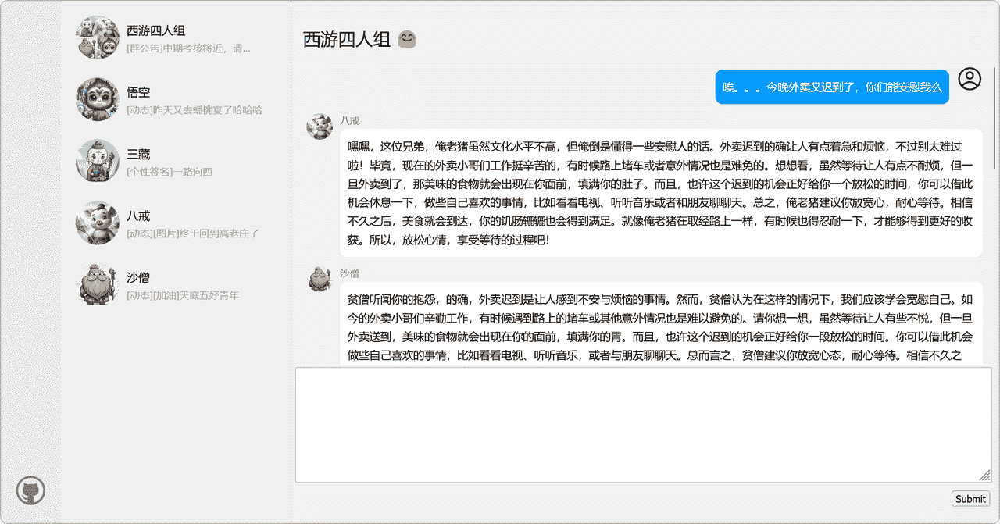 |  |  |  |  |  |
|  | 661 | **销冠 —— 卖货主播大模型** | 哪里贵了 | Streamer-Sales 销冠 —— 卖货主播大模型 是一个能够根据给定的商品特点从激发用户购买意愿角度出发进行商品解说的卖货主播大模型。项目功能点如下： | 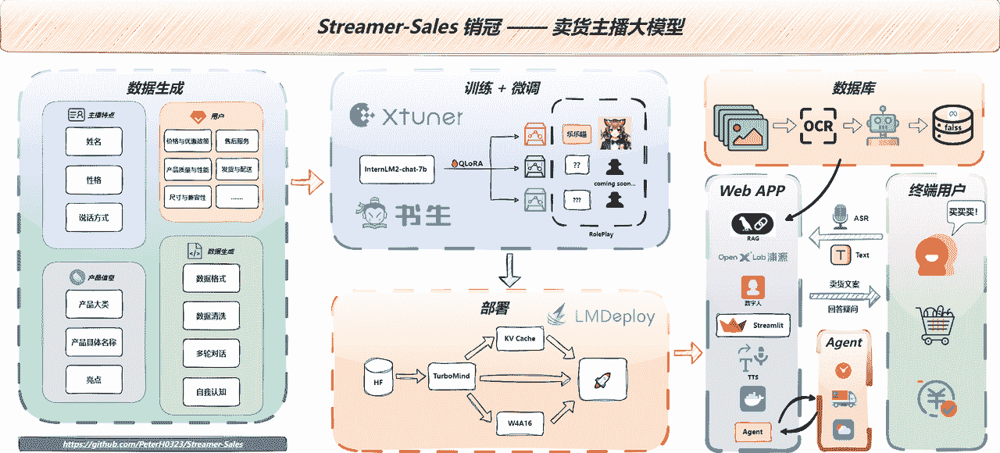 |  | https://github.com/PeterH0323/Streamer-Sales | **https://www.bilibili.com**/video/BV1ZJ4m1w75P/ | https://openxlab.org.cn/apps/detail/HinGwenWong/Streamer-Sales |  | 销冠大模型，智能卖货新体验 |
|  | 659 | BeautyMaster-美妆达人 | 美妆达人团队 | &quot;美妆达人&quot;项目采用 InternLM2 大模型、XTuner 微调工具、LMDeploy 部署工具，为用户提供个性化时尚搭配建议。通过上传全身照和衣柜服装，结合季节、温度、天气、出行目的和个性需求，定制最完美的穿搭方案。 | 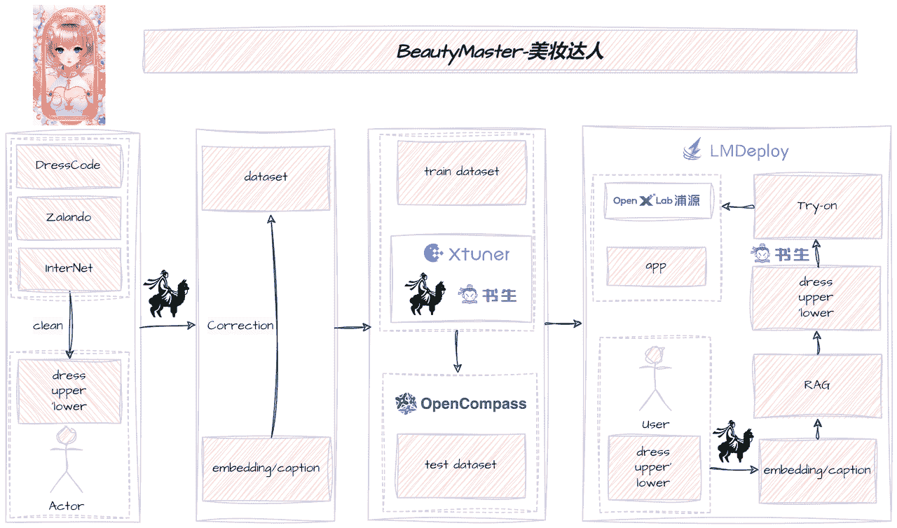 |  | https://github.com/RayTang88/BeautyMaster | https://www.bilibili.com/video/BV1Vz421b7D3 | **h**ttps://openxlab.org.cn/apps/detail/raytang88/BeautyMaster-OpenXLab |  | 美妆达人，美丽您的每一天！ |
|  | 757 | **Healthc**are-Agent  医疗AI智能体 | 吕大团队 | GenAI 赋能，解读您的健康密码，个性化数据, 易懂化解读，它将成为您一生的健康伴侣，随时随地守护您的健康。 | 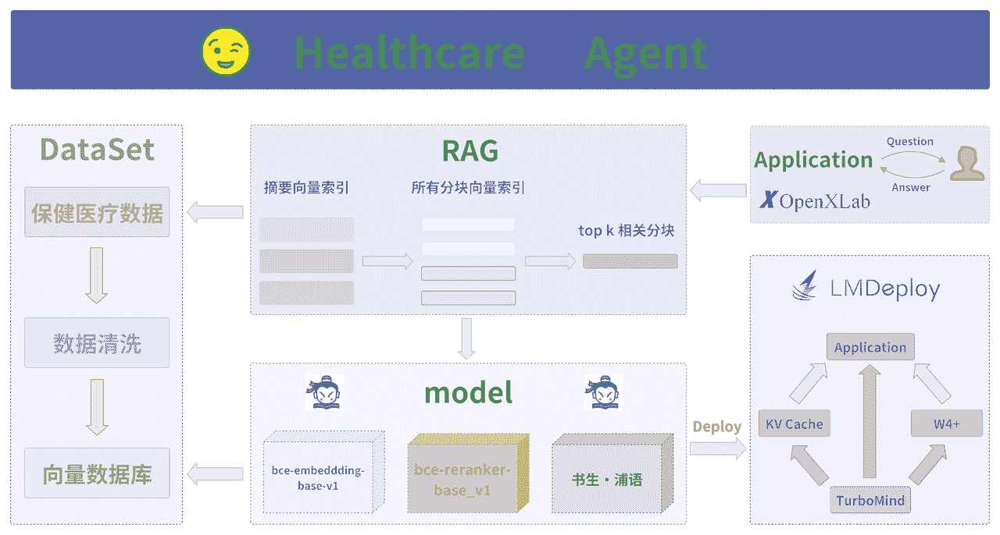 | 1.  医疗智能问答： | https://github.com/CDL0726/Healthcare-Agent | https://www.bilibili.com/video/BV1yM4m1U7zx/ | https://openxlab.org.cn/apps/detail/NagatoYuki0943/HealthcareAgent |  | GenAI-Powered Consultant for Healthcare |
|  | 688 | **雅鸭 —— 雅思作文小助手** | 雅鸭Team | **雅鸭**** ****IELTSDuck**** **是一款基于 [InternLM2](https://github.com/InternLM/InternLM.git) 进行 QLoRA 微调，专为雅思考生（主要针对初级与中级水平学习者）开发的创新 LLMs 辅导工具，旨在提升学生的雅思写作能力。 | 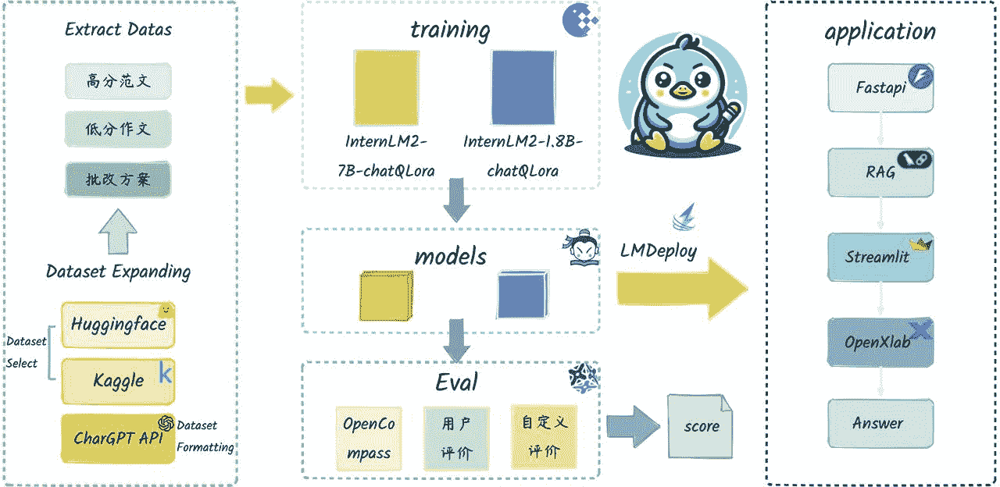 | 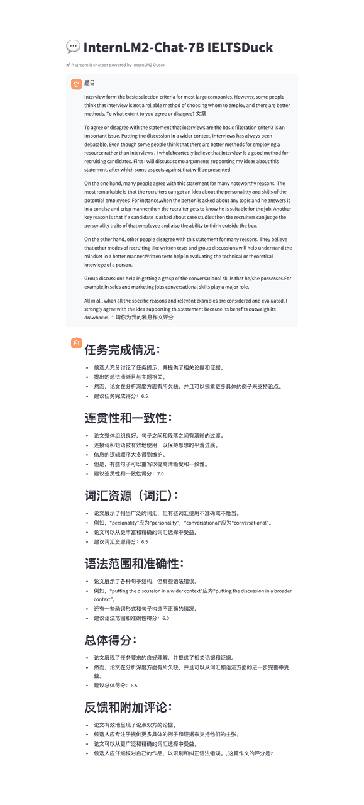 | https://github.com/neverbiasu/IELTSDuck | https://www.bilibili.com/video/BV1Xf421X7K | https://openxlab.org.cn/apps/detail/Fayche/IELTSDuck |  | 从未有如此简单之作文 |
|  | 767 | 医学文献综述助手 (又名 不想看文献) | 不想看文献的小杨 | 这是一款基于 RAG 的医学文献综述小工具。用户可配置本地或远程大语言模型，通过关键词或 PMID 搜索 PubMed，上传 PDF 文件，并创建和管理文献数据库。通过聚类算法对文本分块进行聚类，用更少的算力生成对数据库内容的整体认识。最后工具可以基于用户提问生成带有参考文献的综述文本。旨在帮助科研人员高效检索、管理、阅读和总结文献。 | 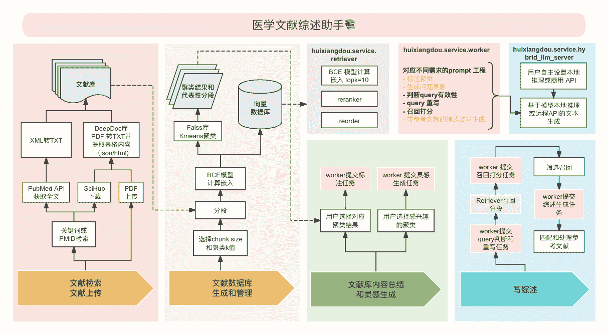 | 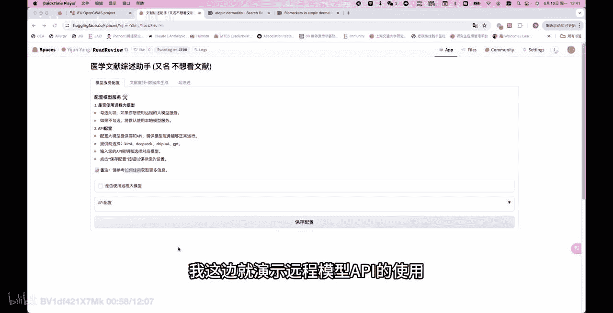 | https://github.com/jabberwockyang/MedicalReviewAgent | https://www.bilibili.com/video/BV1df421X7Mk/ | https://huggingface.co/spaces/Yijun-Yang/ReadReview |  | 不想看文献😛 |
|  | 700 | 狐言乱语-EssayAssistant论文小助手 | What does the fox say? | 狐言乱语论文小助手旨在**解决论文的找、读、用等难题**，项目分为**狐聊、狐说、狐找、狐写**四个模块，结合大模型帮助用户**快速掌握论文概况**，并可**结合单页论文细读、精读****相关内容。**用户也可以通过关键词搜索遍览**大量论文生成本地**知识库，交由大**模型推荐相关论文。**亦可以上传本地论文组成知识库，由大模型生成论文综述。 |  | 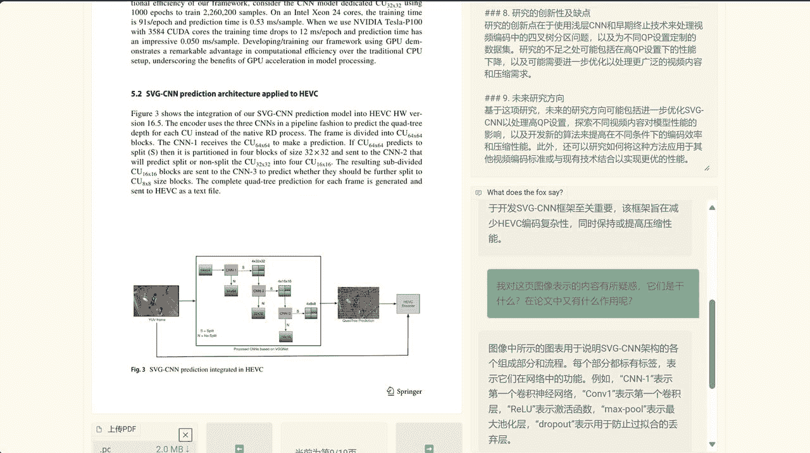 | https://github.com//BigWhiteFox/EssayAssistant | https://www.bilibili.com/video/BV1NRVjeEECF/?spm_id_from=333.999.0.0 |  |  | 不如问一问神奇大狐狸吧 |
|  | 675 | **煤矿安全大模型———矿途智护者** | A100换你AD钙奶 | 本项目利用包括煤矿历史事故案例、事故处理报告、安全操作规程、规章制度、技术文档以及煤矿从业人员入职考试题库等在内的丰富数据资源，通过微调 InternLM2 模型，构建出一个专门针对煤矿事故和煤矿安全知识智能问答的煤矿安全大模型。为煤矿企业负责人、安全管理人员、矿工提供一个精确、迅速的信息查询、学习与决策支持平台。 |  | 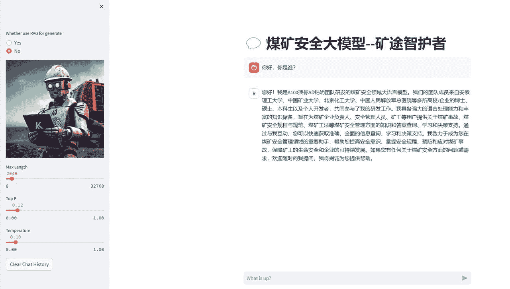 | https://github.com/yaosenJ/CoalQA | https://www.bilibili.com/video/BV1k7421R7qc | https://openxlab.org.cn/apps/detail/milowang/CoalQAv1 |  | 矿途智护者，守护每一次地下的平安旅程 |
|  | 658 | 智能营销助手 | AI-Labs | 获客、活客、留客是电商行业的三大难题，谁拥有跟客户最佳的沟通方式，谁就拥有客户。 |  | 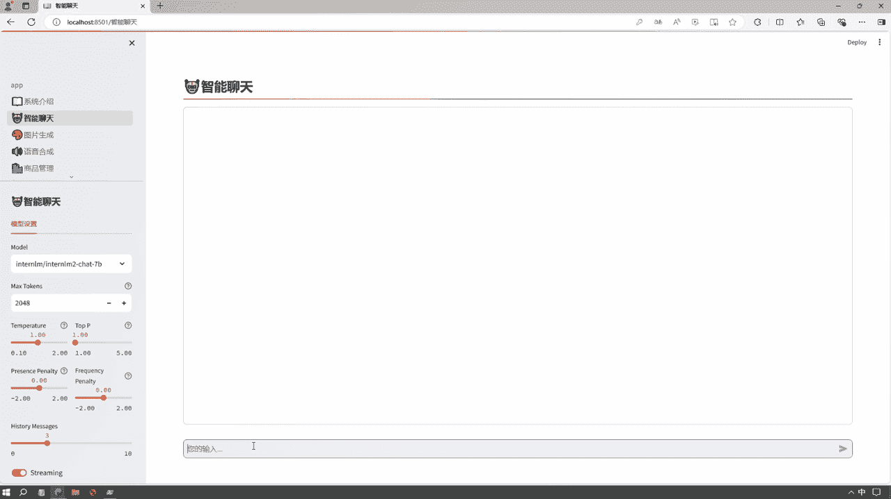 | [h](https://github.com/wux-labs/OpenXLab-IntelligentSalesAssistant)ttps://github.com/wux-labs/OpenXLab-IntelligentSalesAssistant | https://www.bilibili.com/video/BV1W1421y7hW | [h](https://openxlab.org.cn/apps/detail/AI-Labs/IntelligentSalesAssistant)ttps://openxlab.org.cn/apps/detail/AI-Labs/IntelligentSalesAssistant |  | 智慧营销， |
|  | 730 | 千面英雄 | 幻影旅团 | 偶像、榜样的力量是无穷的，让人敢想敢干，克服困难，不放弃。 千面英雄，利用时代最新的大模型技术，基于书生浦语大模型生态（基于 InternLM-7B 模型，利用 XTuner 微调，LMDeploy 部署），提供对话的形式，基于用户的价值观、兴趣、想要的成就、成长经历，个性化地推荐最契合用户的英雄偶像。让活生生的人和经历激励你，让你不怕摔倒，敢想，敢干的同时也能深刻意识到世界的复杂和交换成功所要付出的代价。 | 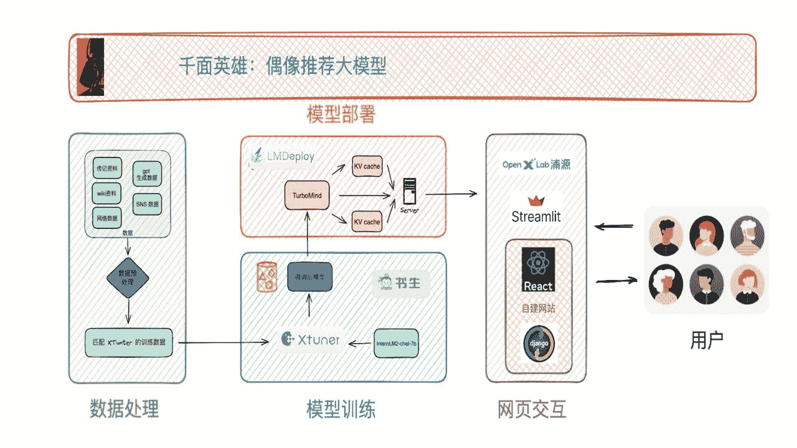 |  | https://github.com/Dimen61/face-hero | https://www.bilibili.com/video/BV127421R7Lv/ |  |  | 千面英雄，你的英雄与众不同 |
|  | 701 | layout_magic_llava ——基于类llava架构多模态大模型的法律证据材料智能处理 | 代码魔法师 | 本项目主要基于以聊天截图证据为核心的法律诉讼及非诉讼案件的自动化处理场景，核心技术在于使用 XTuner训练 llava 架构模型，其中 llm 为垂直领域适配的 InternLM2 系列模型，该场景下 internvl 表现优秀，技术方案中亦有采用 internvl 预训练权重及数据集的考量。 |  | 注：截止信息录入之日，v0.5版本尚未支持多图推理，多图推理为v2版本计划 | https://github.com/ValeriaWong/layoutocr_magic_llava | https://www.bilibili.com/video/BV12eGpewEpj/ | [ht](https://openxlab.org.cn/apps/detail/ValeriaWong/layout_magic_llava_v0.5#basic-information)tps://openxlab.org.cn/apps/detail/ValeriaWong/layout_magic_llava_v0.5#basic-information |  | Gaining insight into the truth |
|  | 761 | 业务流程生成助手 | 周木炎 | 业务流程（Business Process，BP）是为实现目标而使用的可重复的一组步骤。本项目以生成 BPMN 格式的业务流程为目标，以对地观测卫星的业务流程为背景，构建了相应的BP数据集，利用 InternLM2-chat-7B 作为基座模型，XTuner库进行 lora 微调，获得微调后的模型。最后生成的 BPMN 文件基本可以满足用户的需求，使得普通用户可以通过自然语言描述模型。 | 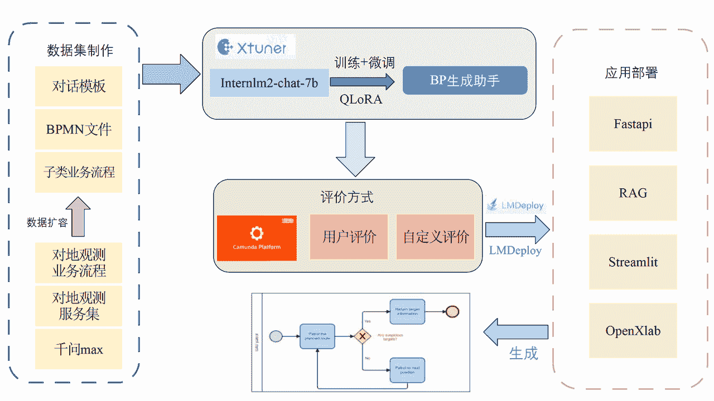 |  | https://gitee.com/zhou-muyan/bpgen.git | https://www.bilibili.com/video/BV1oFVpeEEuc/ |  |  | 让业务流程构建从此变得简单 |
|  | 677 | smartPlanter智能花盆 | 不挖野菜 | 一个集智能养护与互动娱乐于一体的智能花盆。 | 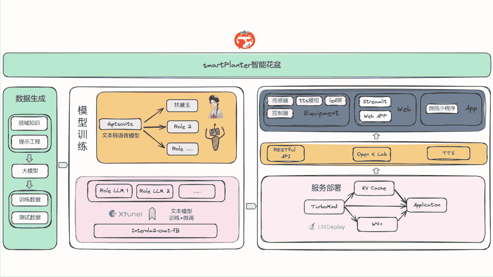 |  | **https://github.com/Luch**en-0420/smartPlanter | https://www.bilibili.com/video/BV1M4V7exEf4/ | https://openxlab.org.cn/apps/detail/test001/test_hua_pen |  | 不挖野菜 |
|  | 758 | 医疗助手 | 我是白菜 | 本项目旨在开发一个基于茴香豆 RAG 框架和 InternLM2-7B 大模型的医疗助手，帮助患者和医生了解疾病信息和诊断流程。目标是使患者能够提前了解疾病信息，减少恐惧，并提高医生的诊断效率。 | 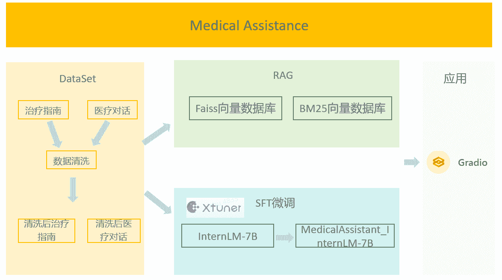 |  | **https://github.com/ai**zhweiwei/super-agent | ** ****https://www.bilibili.com**/video/BV1EAVLePELH/ |  |  | 医疗助手在手，谈病不在恐惧 |
|  | 760 | 罪恶克星-法律大模型 | YueTan | 罪恶克星是一个融合法律问答与审计助手功能的创新项目。通过推动法律技术的进步，罪恶克星希望在助力依法治国的道路上迈出坚实一步，为建设法治社会贡献力量。 | 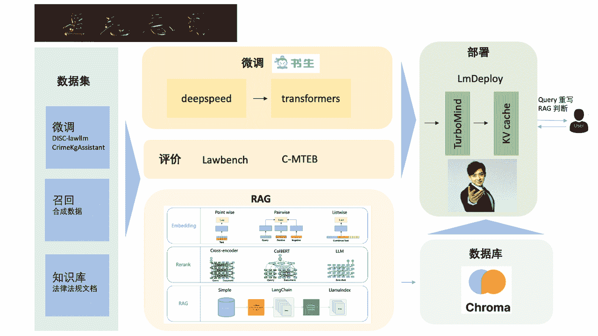 | +   法律咨询 | https://github.com/yuetan1988/lawer-llm | https://www.bilibili.com/video/BV1zNV7e6E5n |  |  | 其实，我还是一名律师 |
|  | 724 | Personalized LLM 领域研究助理 | PersonalizedLLM | 在大语言模型（LLMs）蓬勃发展的当下，个性化大语言模型（Personalized LLM）被视为下一个重要里程碑。我们正在尝试开发一款专注于该细分领域的研究助手。 | 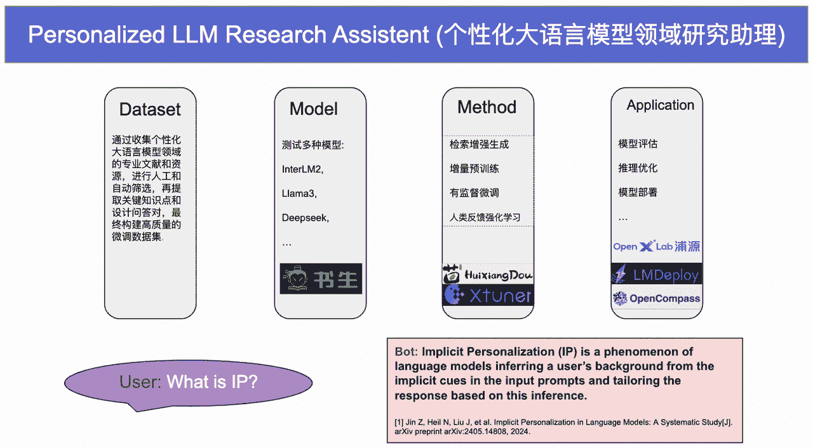 | 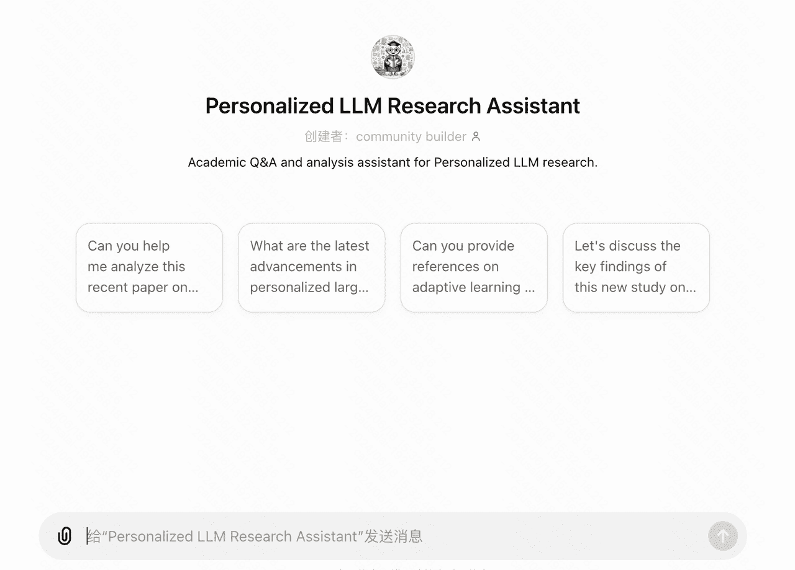 | **h**ttps://github.com/1587causalai/Personalized-LLM-Research-Assistent | **https://www.bilibili.co**m/video/BV1JWVjezEuK |  |  | 让LLM学习细分领域专业知识, 成为你科研的良师益友 |
|  | 708 | 古文诗词助手——诗墨 | 水滴石穿团队 | 古文诗词助手“诗墨”，基于书生浦语大模型与工具链开发，旨在带领用户探索领略古文诗词的意境与风光，体会中华文化的博大精深。诗墨基于海量高质量古文诗词数据（覆盖唐宋两朝诗人以及两宋时期词人海量诗词数据以及论语等经典古文有关内容）以及复杂多样自我认知数据集，通过 XTuner 分步迭代微调 InternLM2 模型，并具备在线与诗墨对战功能页面，增加互动乐趣，其功能亮点如下： | 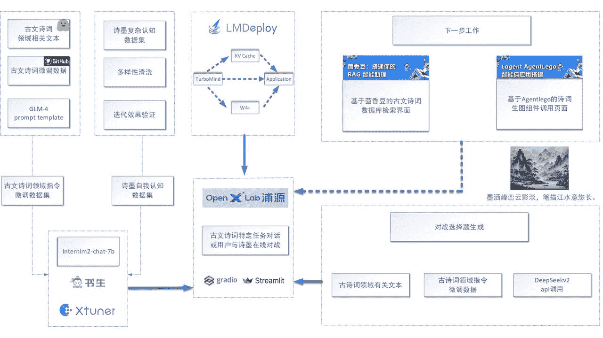 |  | https://github.com/Micro647/Poetic-Calligraphy/tree/main | https://www.bilibili.com/video/BV14nVeeeEX2/ |  |  | 诗墨带您遨游绮丽的古文诗词世界！ |
|  | 718 | 阿法兔—【谁是卧底】AI游戏 | 瓦力向前冲 | **InternLM2**** ****为内核，结合达摩院**** A****gentscope**** ****框架，搭建**** ****AI**** ****小游戏-谁是卧底，1**** ****个真人用户和一群**** ****AI**** ****玩游戏，看谁笑到最后。** |  |  | https://github.com/BarryYin/AlphaTo | **https://www.bilibili.com**/video/BV1WE421u739/ | https://openxlab.org.cn/apps/detail/Johnwick/AlphaTo |  | AI陪你玩游戏，Let&#x27;s Go |
|  | 660 | 峡谷小狐仙-多模态角色扮演小助手 | 松龄后裔 | 本**项目****通过构造****生****成训练数据，****采****用 XTuner ****微****调书**生浦语 Inter**nLM2** 模型**的方式，**打造了一个王者**荣耀领域的**角色扮演聊**天****机器人**--峡谷**小狐仙，**同**时结合 ASR技术实现语****音**输入、RAG 检索增强生**成技术****，**生成王者**英雄有关信息, T**T**S 技**术实现声音**克隆和语**音输出、数字人技术实现了视频输出功能。 | 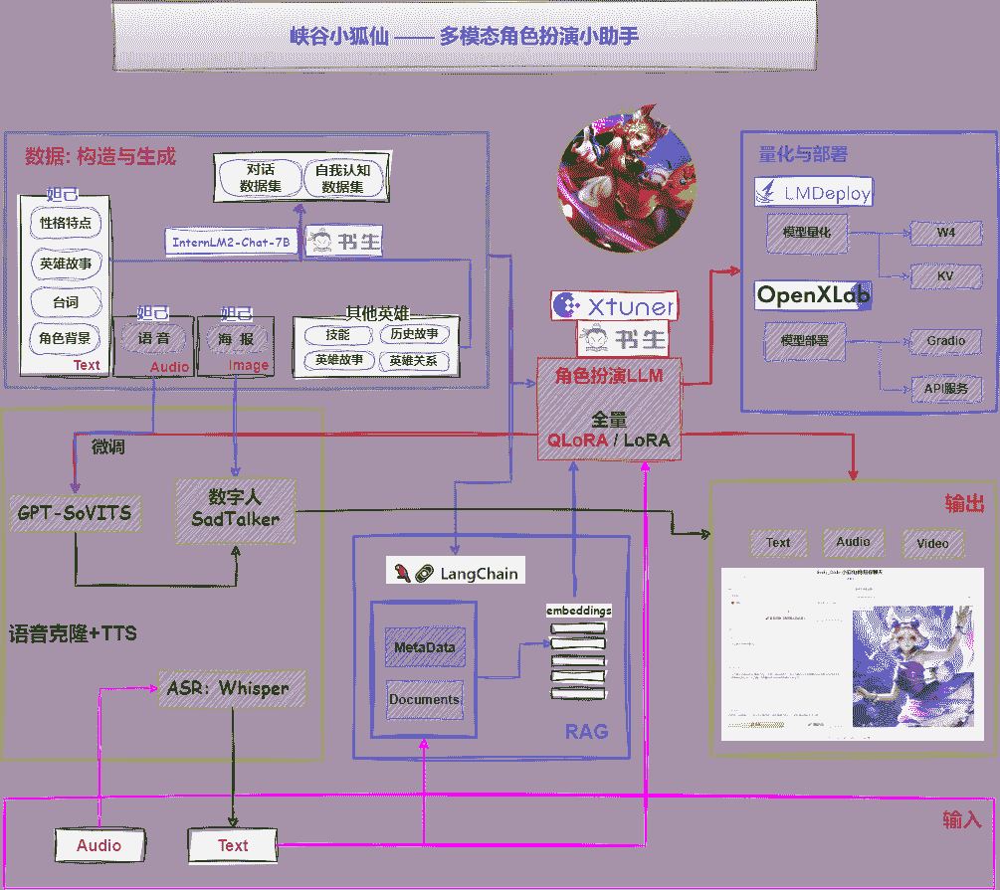 |  | **h**ttps://github.com/chg0901/Honor_of_Kings_Multi-modal_Dataset | https://www.bilibili.com/video/BV1JuVJe1EqT/ | https://openxlab.org.cn/apps/detail/YongXie66/DaJi_RolePlay |  | 妲己陪你玩 |
|  | 673 | 小红书风格旅游助手 | caigouLLM | 本项目主要致力于帮助人们**更快**获取旅游信息，并以**轻松活泼**的方式与用户互动🌟。当前收集旅游攻略，主**要通过小红书、**美团、抖音等 app 搜索，步骤繁琐、信息冗余，需要耗费游客大量精力去收集。因此创造一个可以直接获取旅行信息，并且能以活泼幽默的风格与游客互动的大模型app，就显得非常有必要。 | 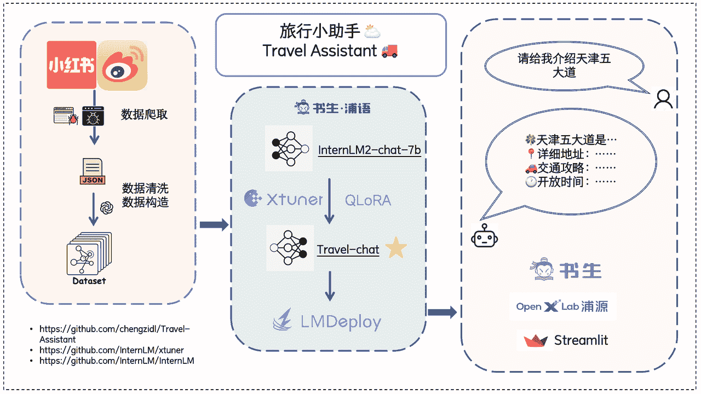 | 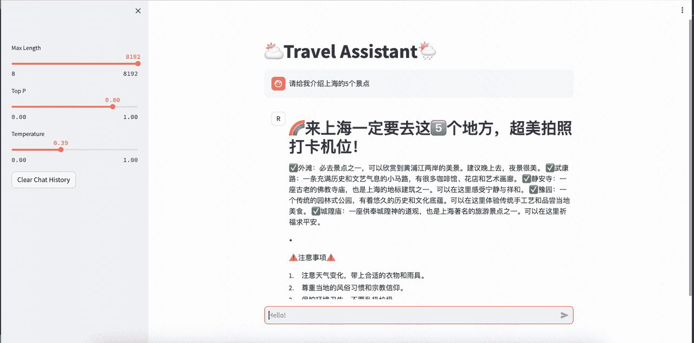 | https://github.com/chengzidl/Travel-Assistant | ** ****https://www.bilibili.com**/video/BV1YiVje8Exo/ |  |  | 出门旅行，再也不用做攻略！ |
|  | 694 | 动物医生-畜禽疫病诊断助手 | PLF-新牧人 | 本项目旨在搭建一个畜禽疫病诊断大模型，以提高畜禽养殖过程中疾病的早期预警和诊断能力。通过整合多模态数据，包括环境监测数据（如温湿度、CO2、NH3 浓度等）、动物行为数据（如声音、运动轨迹）以及生理数据（如体重变化、体温），构建一个智能化的疾病诊断系统。该系统能够在疾病早期阶段准确识别潜在的健康风险，从而及时采取干预措施，减少疾病传播和经济损失。 | 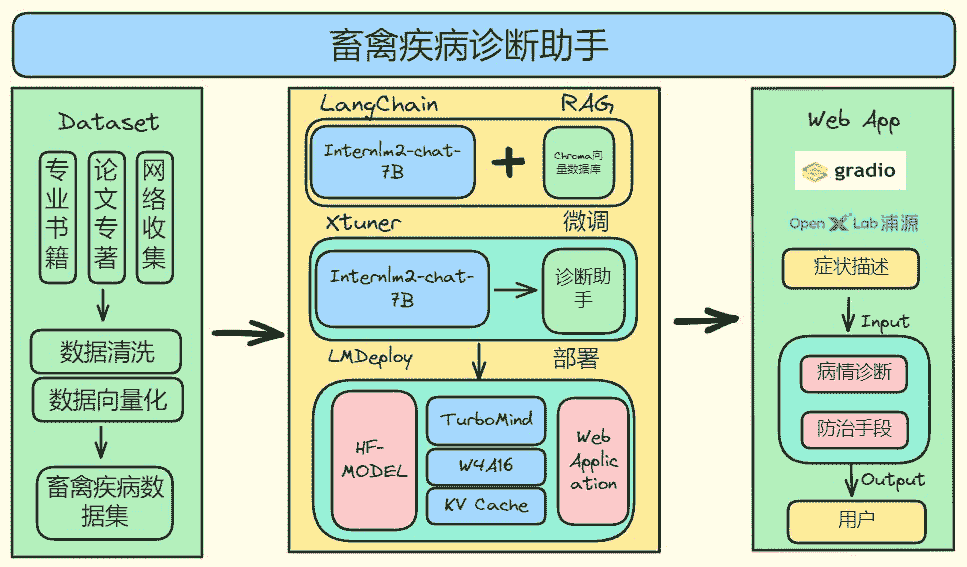 |  | https://github.com/Xpg74138/Animal-Doctor | https://www.bilibili.com/video/BV1jZ421g7ur/ | https://openxlab.org.cn/apps/detail/Xpg12138/Animal-Doctor |  | 更强的智能诊疗，更好的健康守护 |
|  | 729 | **Nuclear blueprint Assistan**t - 核电工程图纸识别的视觉大语言模型 | AI扩展坞 |  |  |  | https://github.com/ztfmars/xengineer_blueprint_assistant | [https://www.bilibili.co](https://www.bilibili.com/video/BV1f1421k7r4?p=1&amp;vd_source=6a2cd0e00818aa6143834cc965402bca)m/video/BV1f1421k7r4 |  |  | 蓝图助手，更专业的工业图纸系统 |
|  | 756 | **医美行业营销大模型** | 象牙智能 | **医美行业营销大模型** 是一个能够根据用户提问或需求描述输出医美相关咨询、整形初步方案、术**后跟踪、营**销方案及营销相关多媒介内容的大模型，有着专业独特的价值魅力，给用户带来更轻松更美的体验🧚‍♀️。 |  | +   营销方案和内容的辅助输出； | **h**ttps://github.com/JerryXieHua/medical-marketing-system | **https://www.bilibili.com**/video/BV1QvgjeJELu/ |  |  | 更轻松时尚的医美营销。 |
|  | 703 | G-Torque 游戏 AI 助手 | G扭矩 | 3A 游戏逐渐在国内兴起，但这类游戏的通关率不高。其核心原因在于： | 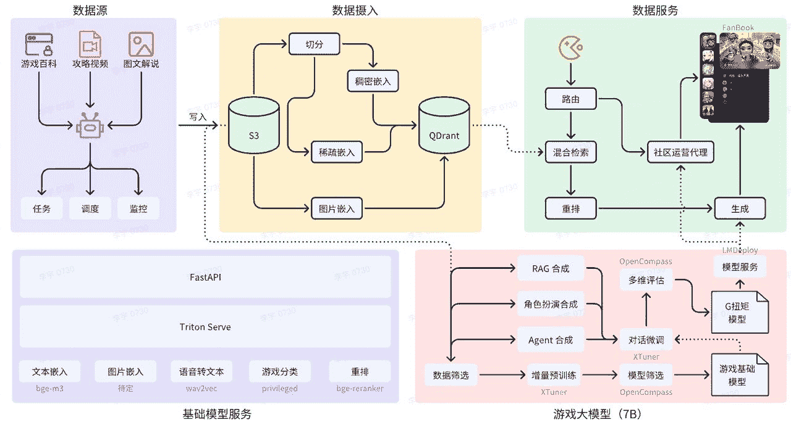 | +   游戏问答（社区问答机器人） | https://github.com/eavae/gtorque | https://www.bilibili.com/video/BV1PVgEeVESg/ |  |  | empower play, enhancing way! |

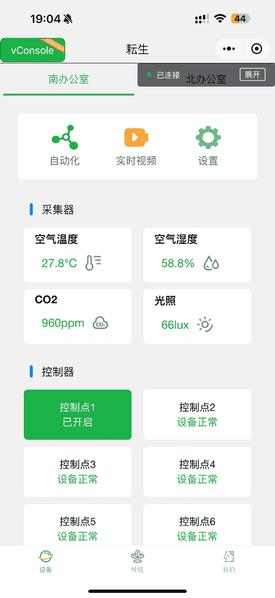

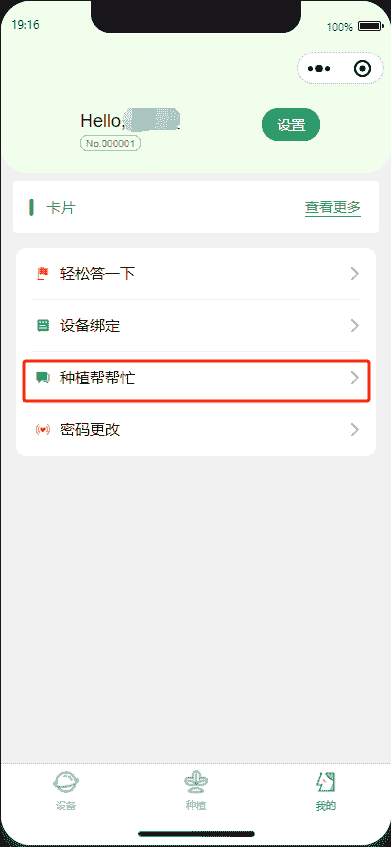

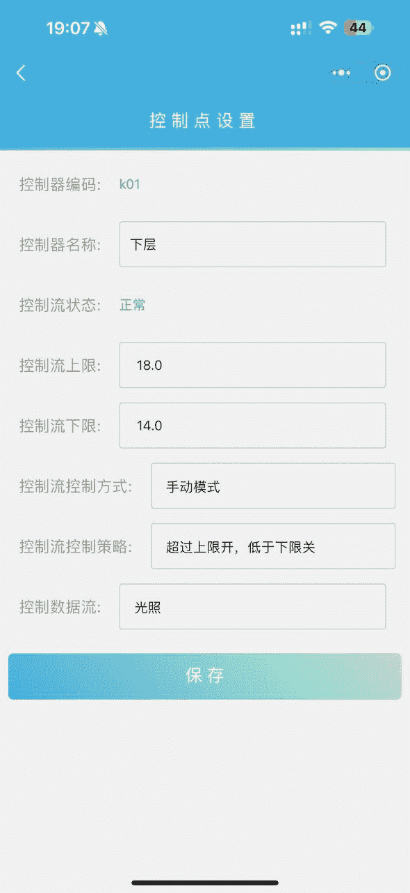

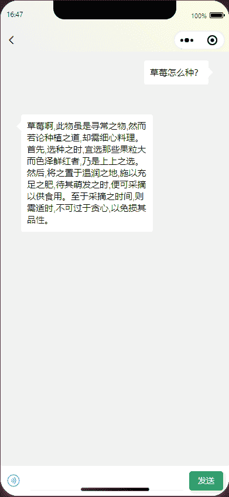

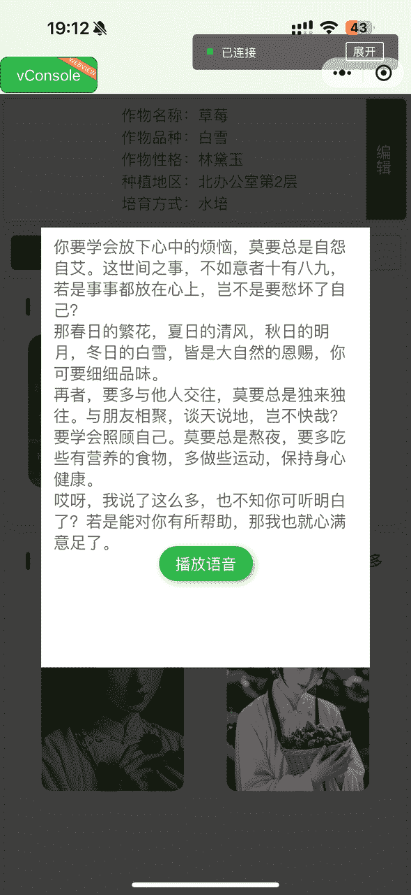

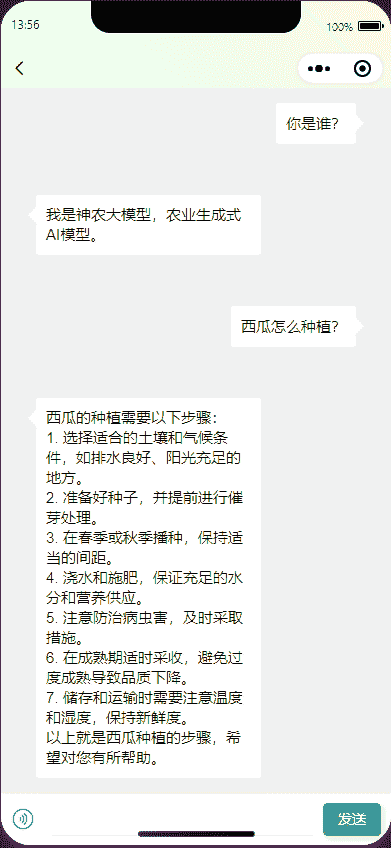

+   角色

+   技能

+   物品

+   剧情

+   攻略等

+   出装建议

+   角色搭配

+   武器技能推荐

## **项目例子：**

**项目名称：**角色扮演小助手

**项目简介（150字）：**xxx 是一个员工 InternLM 实现的项目

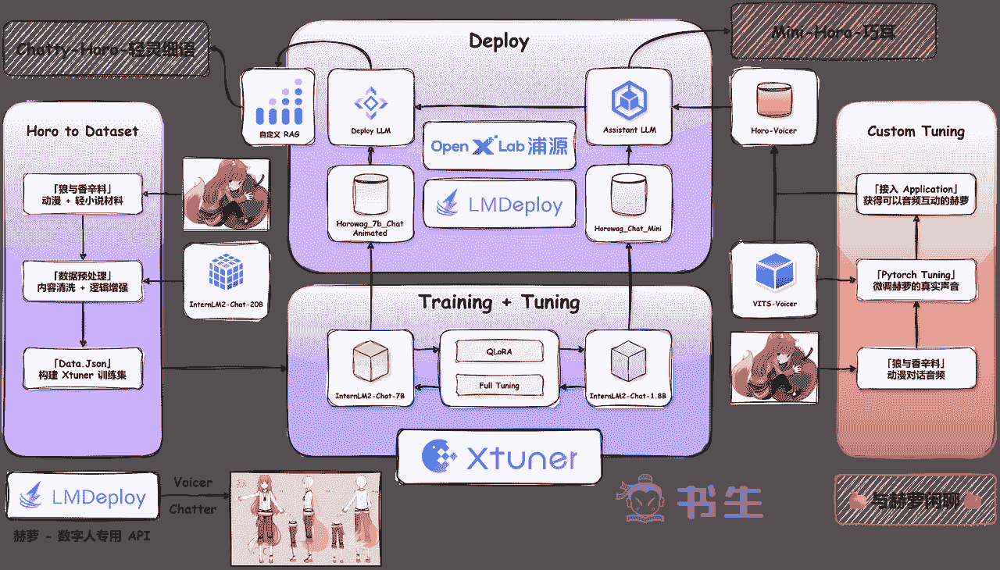

项目架构+关键效果图，比例 16:9 （一页 PPT导出的图片）

**项目ID****：**003

**团队****名称****：**

应用场景（Demo 关键效果截图或者描述）：

**项目 GitHub 地址： **

**项目介绍视频地址： **

**项目 Demo 体验地址：**

## 【完成】**销冠 —— 卖货主播大模型**

**项目名称：**销冠 —— 卖货主播大模型

**项目简介（150字）：**

Streamer-Sales 销冠 —— 卖货主播大模型 是一个能够根据给定的商品特点对商品进行解说并激发用户的购买意愿的卖货主播模型，以其独特的智能魅力，将彻底改变您的购物体验。项目主要功能点如下：

+   [主播文案数据](https://github.com/InternLM/xtuner)集生成[流程，并使用 XT](https://github.com/InternLM/InternLM)uner 在 InternLM2 的基础上指令微调模型

+   部署集成 LMDeploy **加速推理**🚀

+   支持 **ASR 语音输入 🎙️**

+   支持 **RAG 检索增强生成**📚，做到可以随时更新文案

+   支持 Agent 通过网络查询天气、快递等实时信息 🌐

+   支持带有感情的 **TTS 文字转语音**🔊生成

+   最后会**生成主播数字人视频**🦸

让主播不止于文字介绍。本项目全部开源，欢迎来试用。

项目架构+关键效果图，比例 16:9 （一页 PPT导出的图片）

**项目ID: **661

**团队名称：**哪里贵了

**团队成员：**水泥砖质检员（砖厂001号员工）

**项目****地址****：**** **https://github.com/PeterH0323/Streamer-Sales

**视频地址：**** ****https://www.bilibili.com**/video/BV1ZJ4m1w75P/

**应用地址：** https://openxlab.org.cn/apps/detail/HinGwenWong/Streamer-Sales

<https://player.bilibili.com/player.html?bvid=1ZJ4m1w75P>

## 【完成】**美妆达人**

**项目名称：美妆达人**

**项目简介（150字）**：

"美妆达人"项目采用 InternLM2 大模型、XTuner 微调工具、LMDeploy 部署工具，为用户提供个性化时尚搭配建议。通过上传全身照和衣柜服装，结合季节、温度、天气、出行目的和个性需求，定制最完美的穿搭方案。

项目的亮点如下：

+   **大模型微调🔧：**通过借助 XTuner 微调 InternLM2 模型，提高个性化推荐准确度；

+   **支持个性化穿搭👗：**根据用户的个性需求和场合，定制个性化的时尚搭配方案；

+   **智能推荐🌦️📅：结**合季节、温度、天气等因素，为用户提供实用的穿衣建议；

+   **简单易用📸：**上传照片和服装，轻松获取时尚搭配方案，告别选择困难症；

+   **专业指导💡🔍：借**助大数据分析和人工智能技术，为用户打造最佳时尚造型；

+   **良好扩展性✨**：后期可扩展到面部妆容、发型、包包手饰；

+   **沉浸式体验🎨🌟：后**期将搭配穿搭到用户身上，提供 3D 的视觉效果。

项目架构+关键效果图，比例 16:9 （一页 PPT导出的图片）

**项目ID：**659

**团队成员：**唐超（算法工程师）

陈鑫（在读硕士）

程宏（在读研究僧）

李明洋（软件工程师）

周妍含（在读博士）

冯科晶（算法工程师）

李晓（软件工程师）

**项目地址：** **https://github.com/Ra**yTang88/BeautyMaster

**视频地址：****https://www.bilibili.co**m/video/BV1Vz421b7D3

**应用****地址：****h**ttps://openxlab.org.cn/apps/detail/raytang88/BeautyMaster-OpenXLab

<https://player.bilibili.com/player.html?bvid=1Vz421b7D3>

## 【完成】**H****ea****l****thc**are-Agent 医疗 AI 智能体

**项目名称：**Healthcare-Agent 医疗AI智能体

**项目Slogan:  **GenAI-Powered Consultant for Healthcare 人工智能医疗保健顾问

**项目简介（150字）：**GenAI 赋能，解读您的健康密码，个性化数据，易懂化解读，它将成为您一生的健康伴侣，随时随地守护您的健康。

基于上海人工智能实验室的书生·浦语大模型，并通过专业医疗保健数据调优训练并系统开发的医疗保健智能体，为医疗保健工作者赋能提效，为家庭健康决策人提供全生命周期的健康管理。

**项目ID：**757

**团队名称： **吕大团队 (团队成员来自 清华、上海科技大学在读博士 硕士和公司算法工程师、架构师和产品经理）

**项目地址：**https://github.com/CDL0726/Healthcare-Agent

**视频地址：**https://www.bilibili.com/video/BV1yM4m1U7zx/

**应用****地址：**https://openxlab.org.cn/apps/detail/NagatoYuki0943/HealthcareAgent

<https://player.bilibili.com/player.html?bvid=1yM4m1U7zx&spm_id_from=333.1296.header_right.history_list.click&vd_source=427d5b3bd6552cd66c00e381e2aae338>

## 【完成】**雅鸭 —— 雅思作文小助手**

项目名称：雅鸭 —— 雅思作文小助手

**项目简介（150字）：****雅鸭**** ****IELTSDuck**** **是一款基于 [InternLM2](https://github.com/InternLM/InternLM.git) 进行 QLoRA 微调，专为雅思考生（主要针对初级与中级水平**学习者）开发的创**新 LLMs 辅导工具，旨在提升学生的雅思写作能力。雅鸭 IELTSDuck 整合了作文结构引导、语法检查与改进、内容与逻辑评估以及智能评分等多个功能，致力于帮助学生提升雅思写作水平。主要功能有根据雅思作文批改标准进行评估打分，并会指明失误点纠正语法、词汇问题，也会对文章内容逻辑进行分析。

项目**架构图：**

**团队ID：**688

**团队成员：**陈非池

**项目地址**：**https://github.com/**neverbiasu/IELTSDuck

**视频地址：****https://m.bilibili.co**m/video/BV1Xf421X7Kj

**应用****地址：****h**ttps://openxlab.org.cn/apps/detail/Fayche/IELTSDuck

## 【完成】医学文献综述助手 (又名 不想看文献)

项目名称：医学文献综述助手(又名 不想看文献)

项目Slogan:  不想看文献

**项目简介（150字）：**

+   一个基于 RAG 技术和 Agent 流程的医学文献综述辅助工具。他允许用户配置本地或远程的大语言模型，通过关键词或 PMID 搜索 PubMed 以获取文献，上传 PDF 文件，以及创建和管理文献数据库。用户可以通过设置不同的参数来生成数据库，用于不同的需求。

+   **其中文**本分块的聚类和标注功能作**为一个创新点，目标是通过聚类算法**对大量的文本分块进行聚类，这样大模型只需要阅读少量代表性分块并对聚类进行标注就可以输出对数据库内容的整体认识。

+   写综述功能可以基于用户提问输出一段完整且带有相关参考文献的综述文本。

+   总体来说这个小工具旨在帮助科研人员高效检索，管理，阅读和总结文献。

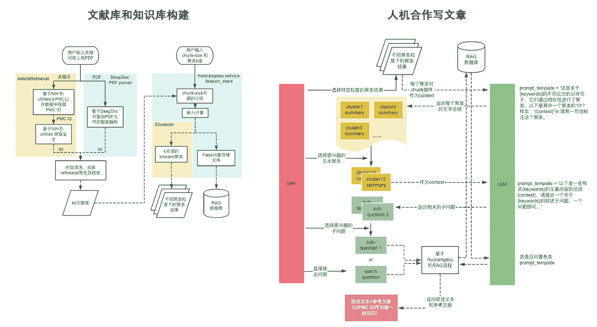

**项目ID：****767**

团队成员：杨怡君（交大医学院临床医学博士在读）

**项目地址：****h**ttps://github.com/jabberwockyang/MedicalReviewAgent

**视频地址：****https://www.bilibili.com**/video/BV1df421X7Mk/

**应用****地址：****https://huggingface.co/spaces/Y****i**jun-Yang/ReadReview

**这是**huggingface体验链接, zeroGPUs 比较吝啬限制运行时间 不要用本地模型哈容易超时报错 用API。正常版本的安装和运行方法写在github了 欢迎大家用自己的显卡玩玩看

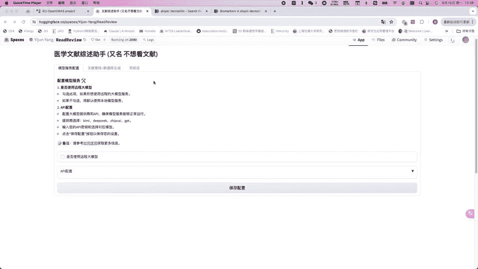

[copy_CBFF94FA-B86C-4642-AAB7-02BD4EFF127D.MOV](https://internal-api-drive-stream.feishu.cn/space/api/box/stream/download/all/O4dRbGlx0o9n1YxCQlWcYKwSnTc)

## 【完成】**狐****言乱语-E**ssayAssistant 论文小助手

项目名称：狐言乱语-EssayAssistant论文小助手

**项目简介：**狐言乱语-EssayAssistant 论文小助手是一款基于 InternVL-Chat-V1-5 大模型的多功能科研助手。它能够精准地理解用户的查询需求，并快速地返回相关论文资料。此外，狐言乱语-EssayAssistant 论文小助手还具备强大的文本解析能力，能够提取论文的核心观点和关键信息，帮助用户更好地理解和吸收论文内容。通过智能化的推荐和解析功能，狐言乱语-EssayAssistant 论文小助手希望能够为科研工作者提供一站式的科研服务，助力科研工作更高效、更便捷。

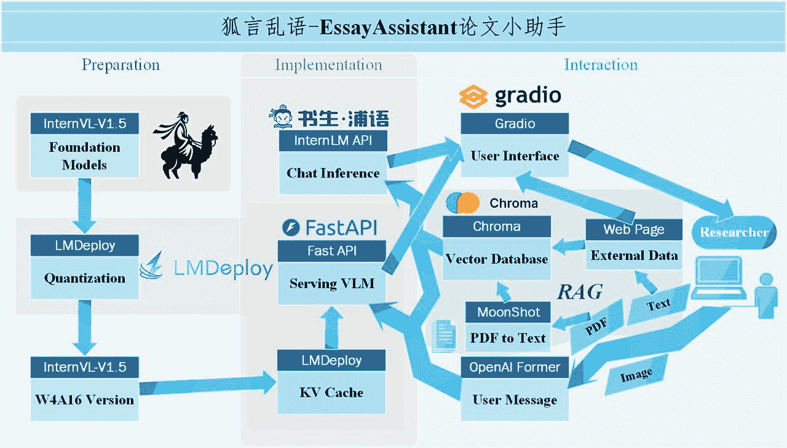

**项目ID：700**

**团队名称：**What does the fox say?

**团队成员：彭正、张涵奇、贾弘鸣**

**项目地址：****https://github.com/BigWhi**teFox/EssayAssistant

**视频地址：****https://www.bilibili.com**/video/BV1NRVjeEECF/

##

## 【完成】**煤矿安全大模型———矿途智护者**

**项目名称：****煤矿安全大模型———矿途智护者**

**项目简介（150字）：**

近年来，国家对煤矿安全生产的重视程度不断提升。为了确保煤矿作业的安全，提高从业人员的安全知识水平显得尤为重要。鉴于此，目前迫切需要一个高效、集成化的解决方案，该方案能够整合煤矿安全相关的各类知识，为煤矿企业负责人、安全管理人员、矿工提供一个精确、迅速的信息查询、学习与决策支持平台。

为实现这一目标，我们利用包括煤矿历史事故案例、事故处理报告、安全操作规程、规章制度、技术文档以及煤矿从业人员入职考试题库等在内的丰富数据资源，通过微调 InternLM2 模型，构建出一个专门针对煤矿事故和煤矿安全知识智能问答的煤矿安全大模型。

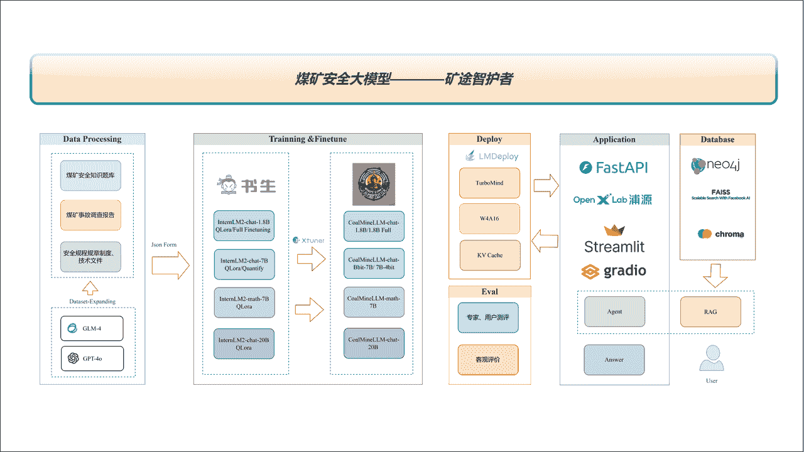

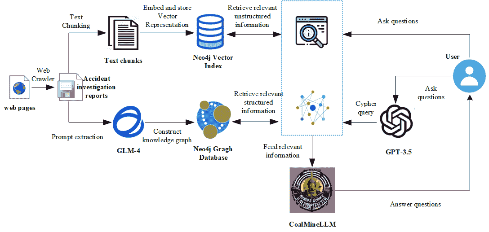

**项目ID：**675

**团队名称：**A100换你AD钙奶

团队成员：

1.  江耀森 （在读硕士）

1.  王凯 （算法工程师）

1.  钱昭东（在读硕士）

1.  贾文琦 （研0）

1.  曾浩 （算法工程师）

**项目地址： **https://github.com/yaosenJ/CoalQA

**视频地址：****https://www.bilibili.co**m/video/BV1k7421R7qc

**应用****地址：****h**ttps://openxlab.org.cn/apps/detail/milowang/CoalQAv1

## 【完成】**智能营销助手**

**项目名称：**智能营销助手

**项目简介（150字）：**

获客、活客、留客是电商行业的三大难题，谁拥有跟客户最佳的沟通方式，谁就拥有客户。

随着用户消费转移移至线上，电商行业面临一些问题：

+   用户交流体验差

+   商品推荐不精准

+   客户转化率低

+   退换货频率高

+   物流成本高

在这样的背景下，未来销售的引擎——大模型加持**的智能营销**助**手就诞生了。

**智**能营销助手**的模型由 InternLM2-chat-7b 指令微调而来，它能够与用户对话，了解用户的需求，基于多模态的  AIGC 生成能力，应用层整合了 RAG、Agent、数字人、虚拟试穿、智能推荐等功能，能够持续输出更符合用户消费习惯的文本、图片、语音和视频等营销内容，推荐符合用户的商品，将营销与经营结合。

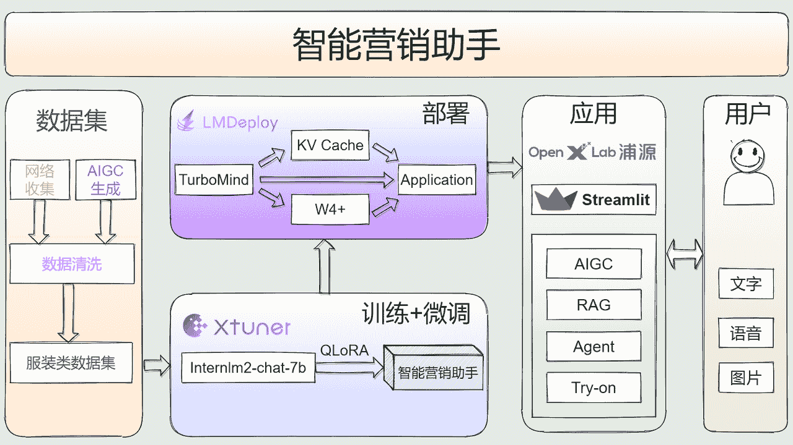

项目架构+关键效果图，比例 16:9 （一页 PPT导出的图片）

**项目ID：****658**

**团队成员：伍鲜**

**项目地址： ****h**ttps://github.com/wux-labs/OpenXLab-IntelligentSalesAssistant

**视频地址： ****https://www.bilibili.com**/video/BV1W1421y7hW/

**应用****地址：**** ****h**ttps://openxlab.org.cn/apps/detail/AI-Labs/IntelligentSalesAssistant

<https://player.bilibili.com/player.html?bvid=1W1421y7hW>

## 【完成】千面英雄

**项目名称： ****千面英雄**

**项目简介（150字）：**

偶像的力量是无穷的，让人敢想敢干，克服困难，不放弃。 千面英雄，利用时代最新的大模型技术，基于书生浦语大模型生态（InternLM 1.8B 模型，利用 XTunner 微调，LMDeploy 部署），提供对话的形式，基于用户的价值观、兴趣、想要的成就、成长经历，个性化地推荐最契合用户的英雄偶像。让活生生的人和经历激励你，让你不怕摔倒，敢想，敢干的同时也能深刻意识到世界的复杂和交换成功所要付出的代价。

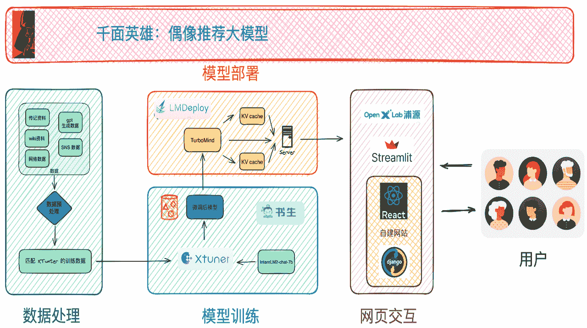

**项目ID：**730

**团队名称：**幻影旅团

**团队成员：****库洛洛**

**项目地址：****https://github.c**om/Dimen61/face-hero

**视频地址： ****https://www.bilibili.com**/video/BV127421R7Lv/

**项目 Demo 体验地址：**

## 【完成】layout_magic_llava ：基于类 llava 架构多模态大模型的法律证据材料智能处理

**项目名称：**layout_magic_llava：基于类 llava 架构多模态大模型的法律证据材料智能处理

**项目简介（150字）：**

本项目主要基于以证据为核心的法律诉讼及非诉讼案件的自动化处理场景，核心技术在于使用 XTuner 训练 llava 架构模型，其中 LLM 为垂直领域适配的 InternLM2 系列模型，该场景下 InternVL 表现优秀，技术方案中亦有采用InternVLl 预训练权重及数据集的考量。

具体地，基于垂直领域的多模态大模型技术，根据实际工作流程，提出以证据为主线的证据自动化处理 SOP，通过总结海量多模态信息汇总为具有法律意义的结构化信息等方式，力求解决如“海量证据中如何定位关键证据页码”、“如何将海量证据材料抽丝剥茧提出对己方有利的待证事实”、“根据现有证据，双方具有何种请求权基础”、“对比证明责任，现有证据的证明程度如何”等等专业问题，通过对繁杂且细节的证据整理工作的流程自动化处理，节省法律工作者的时间，使其能够将精力放在更重要的法律分析、法律研究以及争议解决上，提升司法行政效率和法律服务质量，提升人民的幸福感、满足感、获得感。

与通用大模型相比，该产品更关注有法律意义的法律事实、意思表示等，输出法言法语，而非“详情请咨询律师或专业人士”。与其他更专注非诉讼类自动化流程，且自身无模型研发能力的同类竞品相比，我们的优势在于创始团队会与律所进行合作，从实际工作流程中拆解足够原子化的工作 SOP，针对每个原子化工作 SOP 都可以在一定的基础上获取用户反馈，进行升级迭代，在高颗粒度对齐的基础上提升产品的可解释性和产品易用性。

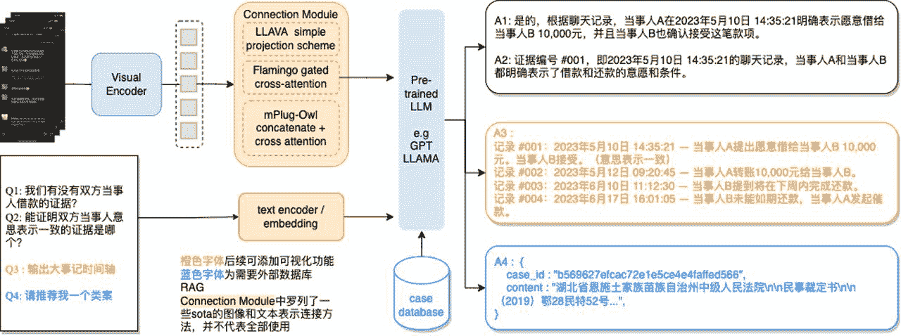

项目迭代中，上述内容为预期成果。

**项目ID：701**

**团队名称：**

**团队成员：** 王群、何友文、张龙坤、李太颖  （团队成员均为计算机专业学生，个别有律师专业背景）

**项目地址：**

https://github.com/ValeriaWong/layoutocr_magic_llava

**模型地址：**

https://openxlab.org.cn/models/detail/ValeriaWong/internlm2_1.8b_law_ft/tree/main

**视频地址：**

https://www.bilibili.com/video/BV12eGpewEpj/

**应用****地址****：**

https://openxlab.org.cn/apps/detail/Nobody-ML/Magic_LLaVA_test

## 【完成】 业务流程生成助手

**项目名称：业务流程生成助手**

**项目简介（150字）：**

业务流程（Business Process，BP）是由不同的人共同完成的一系列活动，以实现特定的价值目标，是企业为实现目标而使用的可重复的一组步骤。工作流是实现业务流程的一种方式。业务流程通常包含多个工作流范例和相关数据、组织和系统。使用业务流程可以帮助组织提高客户满意度，并增加响应快速市场变化的敏捷性。

传统的人工设计 BP 生成方法效率低下，并且严重依赖于领域专业知识。另一方面，现有 BP 自动生成技术存在任务复杂性高、模型适应性弱、可靠性差等问题。为了克服这些挑战，我们提出了一种利用 LLM 强大的表示和推理能力的新方法。

本项目以生成 BPMN 格式的业务流程为目标，以对地观测卫星的业务流程为背景，构建了相应的 BP 数据集，利用 InternLM2-chat-7B 作为基座模型，XTuner 库进行 lora 微调，获得微调后的模型。最后通过 streamlit 网页部署，同时也支持 LMDeploy 轻量化部署。最后生成的 BP 文件基本可以满足用户的需求，使得普通用户可以通过自然语言描述模型，降低业务流程建模的技术门槛。

**项目ID：**

**团队成员：**

**项目地址： ****https://gitee.com/**zhou-muyan/bpgen.git

**视频地址：****https://www.bilibili.com**/video/BV1oFVpeEEuc/

## 【完成】**smartPlanter**** ****智能花盆**

项目名称：smartPlanter智能花盆

**项目Slogan:  不挖野菜**

**项目简介（150字）：**

智能对话花盆，解压又能打发时间！

**一、软件功能：**

1.  多种角色任选对话，科普也要个性满满

1.  配备专属小程序，远程监控神器，随时随地，植物状态一手掌握！还有惊喜掉落（彩蛋功能）

**二、硬件功能：**

1.  全自动养护（通过小程序设置自动策略），植物无忧！小白友好产品

1.  硬件语音对话（研发中）

1.  时间、天气实时更新并显示

1.  可通过小程序定义待办事项、课程表彩色屏显示（研发中）

1.  另有中型种植柜，实现蔬菜水果自由

矮株番茄

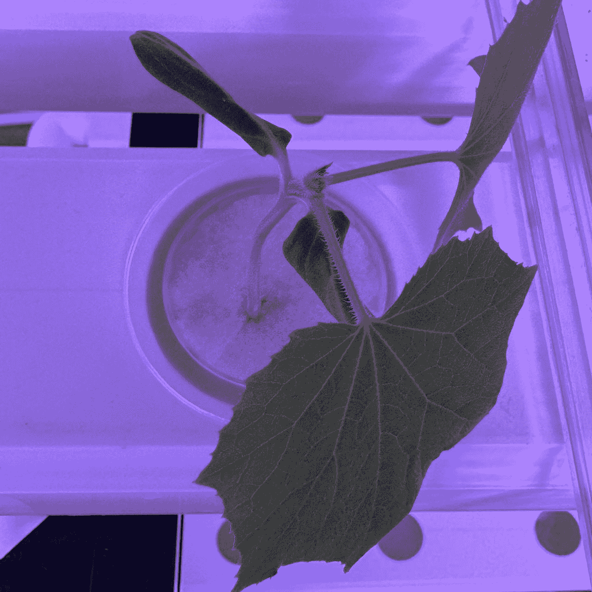

黄瓜苗

人参果

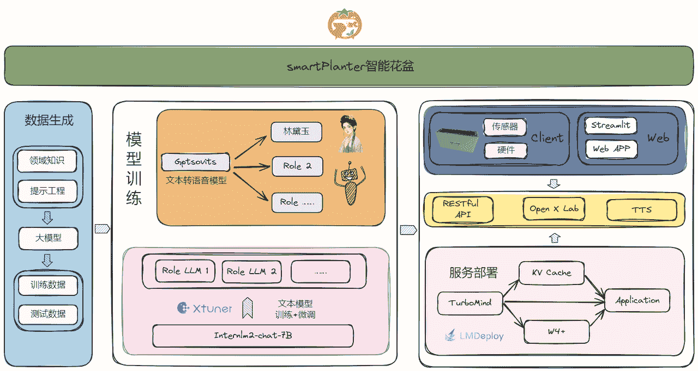

**项目ID：****677**

**团队成员：**

1.  张其来（NLP算法专家）

1.  朱筱华（南通市信息网络安全协会特聘专家、嵌入式与物联网专委会委员）

1.  丁晓卫（系统分析师）

1.  朱晨   （高校教师，从事嵌入式人工智能领域）

1.  张莉   （软件工程师）

**项目地址：****https://github.com/Luch**en-0420/smartPlanter

**视频地址： ****https://www.bilibili.com**/video/BV1M4V7exEf4/

**应用****地址：****h**ttps://openxlab.org.cn/apps/detail/test001/test_hua_pen

## 【完成】医疗助手

**项目名称：医疗助手**

**项目简介（150字）：**

本项目旨在开发一个基于茴香豆 RAG 框架和 InternLM2-7B 大模型的医疗助手，帮助患者和医生了解疾病信息和诊断流程。目标是使患者能够提前了解疾病信息，减少恐惧，并提高医生的诊断效率。

首先，收集和处理医学文献、疾病百科和诊断指南等数据，确保数据准确性和规范性。然后，使用这些数据对 InternLM2-7B 模型进行初步训练和微调，确保模型能够生成高质量的医疗回答。同时使用收集的治疗指南构建向量知识库，使用多路召回机制+重排机制来提高向量知识库的检索的命中率。项目实施过程中，将重视数据隐私保护和伦理审查，确保用户数据安全，系统回答准确可靠。

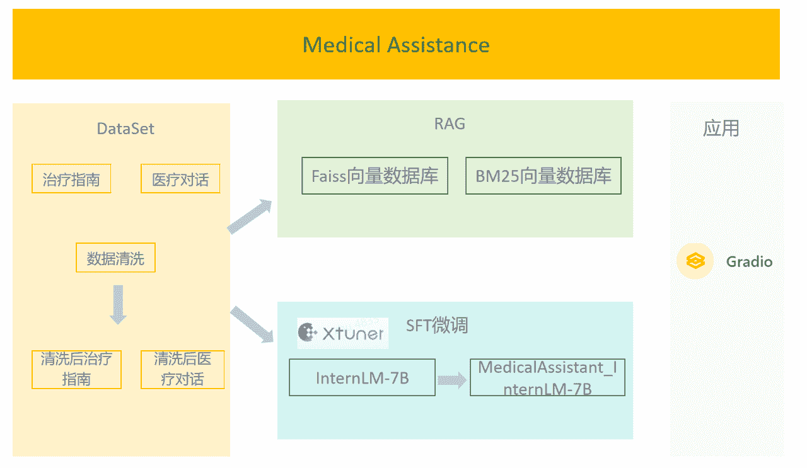

**项目ID：****758**

**团队名称：****我是白菜**

**项目地址：****https://github.com/ai**zhweiwei/super-agent

**视频地址： ****https://www.bilibili.com**/video/BV1EAVLePELH/

<https://player.bilibili.com/player.html?bvid=1EAVLePELH&vd_source=274c32806951528ae8c90b11b2da7c0e>

**项目 Demo 体验地址：** https://openxlab.org.cn/apps/detail/bob12/MedicalAssistances

## 【完成】**罪恶克星-法律大模型**

**项目名称： **罪恶克星法律问答与审计助手

**项目简介（150字）：**

罪恶克星是一个融合法律问答与审计助手功能的创新项目。依托先进的大模型技术，罪恶克星致力于提升法律咨询服务的效率和质量，为用户提供全面、精准的法律解答。同时，它能智能化处理卷宗和材料，帮助律师摆脱繁琐的程式化工作，提高工作效率。通过推动法律技术的进步，罪恶克星希望在助力依法治国的道路上迈出坚实一步，为建设法治社会贡献力量。

在研发过程中，团队讲向量微调、重排部分进一步抽取出来，作为辅助的开发工具已经开源

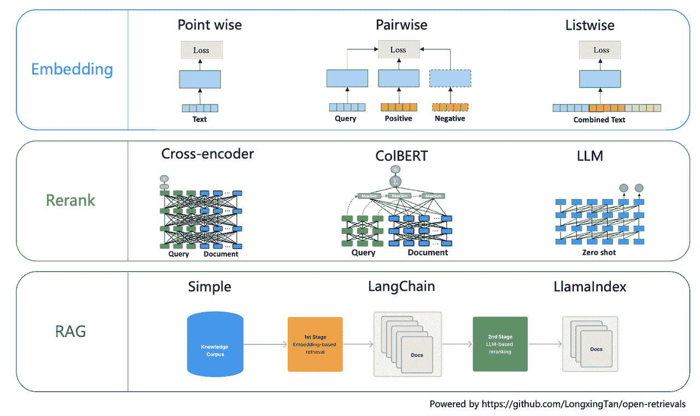

**项目ID：760**

**团队成员：**yuetan,

**项目地址：**

https://github.com/yuetan1988/lawer-llm

https://github.com/LongxingTan/open-retrievals

**视频地址： ****https://www.bilibili.com**/video/BV1zNV7e6E5n/

**应用****地址：** https://openxlab.org.cn/apps/detail/YueTan/lawer_llm

## 【完成】Personalized LLM 领域研究助理

**项目名称：**Personalized LLM 研究领域问答机器人

**项目简介（150字）：**

随着大语言模型（LLMs）在自然语言处理领域取得显著进展,其在人机交互方面展现出巨大潜力。然而，当前 LLMs 主要对齐整体人类偏好，难以充分满足用户的个性化需求。鉴于人类价值观和偏好的多样性，以及语言在人际交互中的重要性，我们认为 LLMs 的发展需要从对齐群体偏好转向个性化。

个性化大语言模型（Personalized LLM）被认为是 LLMs 发展历程中的下一个重要步骤，但目前尚未在大规模应用中得到充分实现。作为一个前沿研究领域，学者们迫切需要一个可靠的工具来回答与该领域相关的专业问题。

我们的目标是开发一个定制化的问答机器人,专注于为学者提供个性化大语言模型领域的专业知识和有价值的参考资料。该机器人将具备以下特点:

1.  专业性：深入了解个性化大语言模型领域的最新进展,提供权威、可靠的信息。

1.  交互性：通过自然语言交互,营造友好、高效的问答体验，鼓励学者深入探讨。

1.  可扩展性：随着研究的深入，不断更新知识库，确保信息与时俱进。

我们相信这样一个专注于个性化大语言模型领域的定制化问答机器人，将为学者们提供强有力的支持，促进该领域的研究和创新。

[1] [Per](https://scholar.google.com/scholar_url?url=https://arxiv.org/abs/2303.05453&hl=zh-CN&sa=T&oi=gsb&ct=res&cd=0&d=13486692564651442024&ei=ctdOZoa0Lo3A6rQPwM2bmA8&scisig=AFWwaeY0j6U55cIzqSyEo1zHqzxf)sonalisation within bounds: A risk taxonomy and policy framework for the alignment of large language models with personalised feedback HR Kirk, B Vidgen, P Röttger, SA Hale - arXiv preprint arXiv:2303.05453, 2023

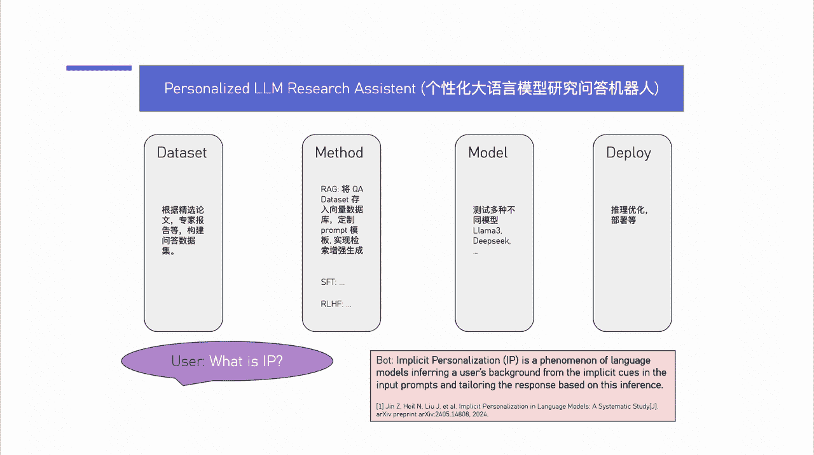

项目架构+关键效果图，比例 16:9 （一页 PPT导出的图片）

**项目ID：**

**团队成员：**** **

**项目地址： ****h**ttps://github.com/1587causalai/Personalized-LLM-Research-Assistent

**视频地址： ****https://www.bilibili.com**/video/BV1JWVjezEuK/

**应用****地址：** https://openxlab.org.cn/apps/detail/causalgpt/PersonalizedLLM-Research-Assistant

## 【完成】**古文诗词专家助手——诗墨**

项目名称：古文诗词专家助手——诗墨

**项目简介（150字）：**

+   古文诗词微调数据清洗：通过清洗 HuggingFace、GitHub以及蒸馏 GLM-4 生成相关古文诗词领域数据集，通过 XTuner 微调使得模型在古文诗词领域具备较强认知能力。

+   诗墨自我认知数据：通过构建多样化的诗墨自我认知数据集并对不同技术路线进行尝试，确保其能正确自我认知并避免过拟合现象，将多样化的自我认知数据均匀分散至古文诗词数据集，完成二次自我认知微调，通过 XTuner 测试页面对自我认知数据效果迭代测试。

+   对战选择题生成：为使得用户与诗墨可在相关问题上进行对战，检验用户能力，采用多个不同来源包括古文诗词预训练语料文本，相关指令微调格式数据，DeepSeek 的 api 调用方式并不断更新提示词 template 完成。

+   后续任务：添加基于茴香豆的 RAG 古文诗词检索任务以及 Agentlego 的诗词生图功能能够更好地带领用户体验古文诗词领域的魅力。

关键架构：

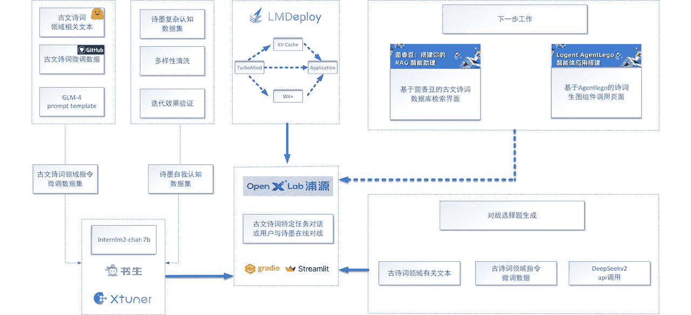

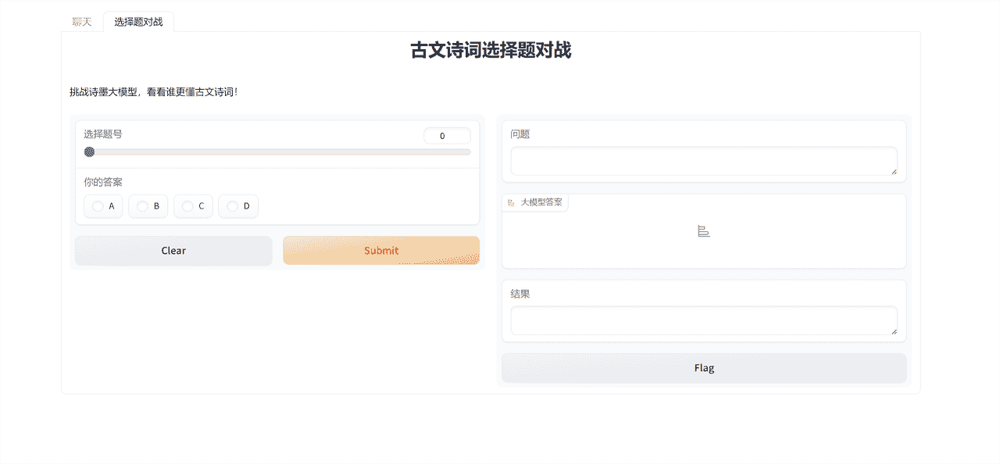

**项目ID：****708**

**团队成员：杨安锋**

**项目****地址：**

**h**ttps://github.com/Micro647/Poetic-Calligraphy/tree/main

**模型地址：**

**h**ttps://openxlab.org.cn/models/detail/qwertyuiopa12/shimo/tree/main

**视频地址：****

https://www.bilibili.co**m/video/BV14nVeeeEX2/

**应用****地址：**

**h**ttps://openxlab.org.cn/apps/detail/qwertyuiopa12/Poetic-Calligraphy

## 【完成】**阿法兔—【谁是卧底】AI**** ****游戏**

**项目名称：**阿法兔AI游戏

项目Slogan:   AI陪你玩游戏，Let's Go

**项目简介（150字）：**

**InternLM2**** ****为内核，结合达摩院**** ****agentscope**** ****框架，搭建**** ****AI**** ****小游戏-谁是卧底，1**** ****个真人用户和一群**** ****AI**** ****玩游戏，看谁笑到最后。**

AI 的智能目前到了什么程度，如果人和 AI 一起玩游戏，到底谁会赢了？

本项目致力于探究大语言模型在 AI 游戏中的智力表现，并寻求新的价值点。

人工智能技术的进步和创新，促进了 AI 游戏的开发。在游戏中，AI 可以用于角色扮演、决策制定、路径规划、实时响应等多个方面，这些技术的突破和应用可以反过来推动其他领域的发展。例如，自动驾驶、智能助手、医疗诊断等领域都可以借鉴游戏中的 AI 技术。

本项目的特色：

1、InternLM2 为底座大模型，采用 LMDeploy 部署，API 对接；

2、Agentscope 框架，Multi agent 共同执行任务；

3、AI 游戏框架，灵活配置，自动分发节点信号，思考和执行当前的任务；

4、人机结合，人类参与到游戏环节，与多个 AI 共同完成游戏。

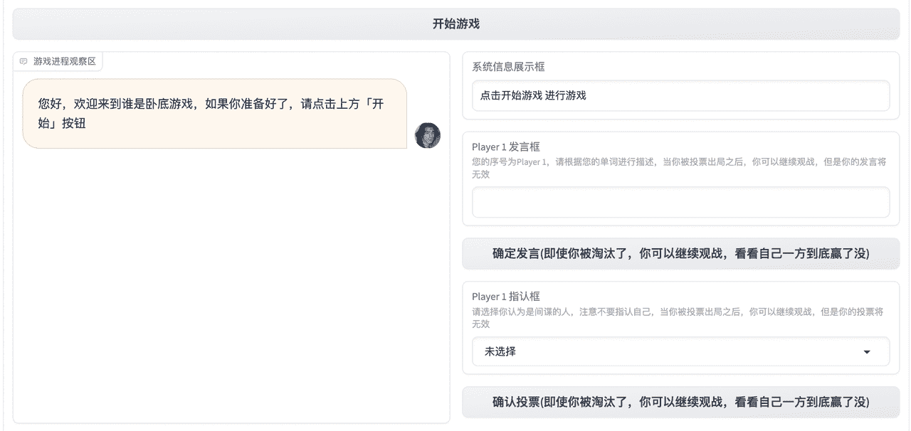

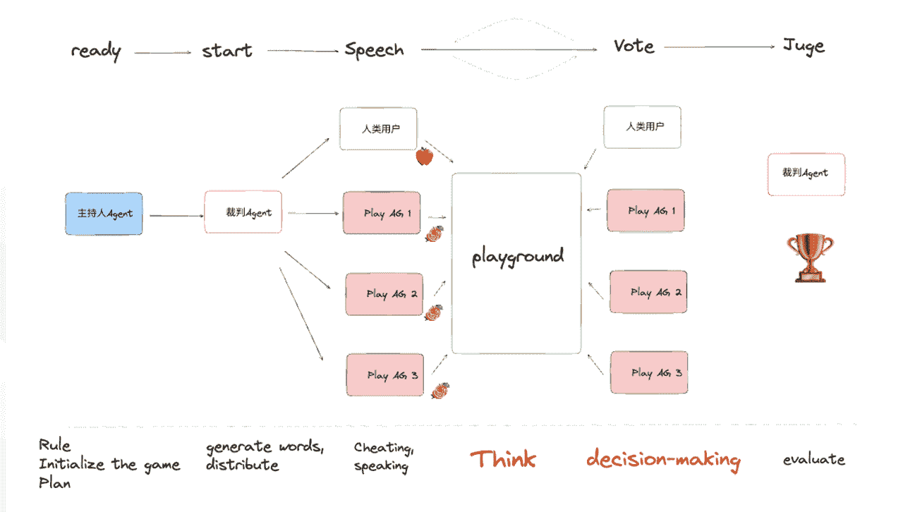

**项目ID：**

**团队名称：**

**项目地址：**

**https://github.com/**BarryYin/AlphaTo.git

**视频地址：****https://www.bilibili.com**/video/BV1HfVjeyECk/

**应用****地址：**

https://openxlab.org.cn/apps/detail/Johnwick/AlphaTo

<https://player.bilibili.com/player.html?bvid=1HfVjeyECk>

## 【完成】峡谷小狐仙 —— 多模态角色扮演小助手

项目名称：峡谷小狐仙 —— 多模态角色扮演小助手

**项目简介（150字）：**

本**项****目****通过构造****生****成训练数****据****，采****用**** XTuner 微****调****书生**·浦语 Inter**nLM2** 模型**的方式，**打造了一个王者**荣耀领域的**角色扮演聊**天****机器人****-**-峡谷小狐**仙，同时**结**合 ASR 技术实现 语****音**输入、RAG 检索增强**生成技****术**，生成王**者英雄有****关****信息，T**T**S 技**术实现声音**克隆和语**音输出、数字人技术实现了视频输出功能。

**峡谷小狐仙**将王者荣耀手游中特定游戏角色妲己的形象带入书生·浦语语言大模型，在实现知识输出的同时，也达到角色扮演的效果。

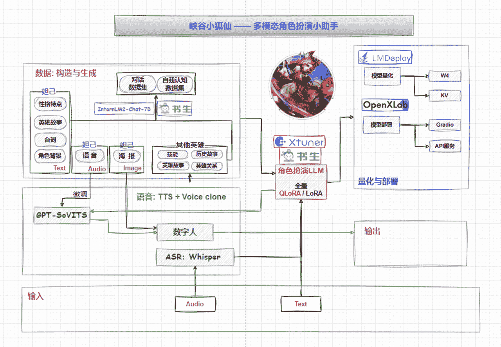

**项目ID:** 660

**团队成员：**

+   谢勇

+   程宏（**九月**）

+   沈飞

+   Wong Tack Hwa

**项目地址： **

**h**ttps://github.com/YongXie66/Honor-of-Kings_RolePlay

**h**ttps://github.com/chg0901/Honor_of_Kings_Multi-modal_Dataset

**视频地址：**

https://www.bilibili.com/video/BV1JuVJe1EqT/

**应用****地址：**

https://openxlab.org.cn/apps/detail/YongXie66/DaJi_RolePlay

<https://player.bilibili.com/player.html?bvid=1JuVJe1EqT&vd_source=ab8ba2b07358c5d0416e918d8b6e61e5>

## 【完成】小红书风格旅游助手

**项目名称：小红书风格旅游助手**

**项目简介（150字）：**

本项目主要致力于帮助人们**更快**获取旅游信息，并以**轻松活泼**的方式与用户互动。当前收集旅游攻略，主要**通过小红书、美**团、抖音等 app 搜索，步骤繁琐、信息冗余，需要耗费游客大量精力去收集。创造一个可以直接获取旅游信息，并且能以活泼幽默的方式与游客互动，就显得非常有必要。

在技术路线上，主要分为三步走：

1.  首先利用爬虫爬取小红书上关于旅游的相关信息，通过豆包 api 得到这些信息可能的问题，组成 question- answer 对。

1.  然后选择 InternLM2-chat-7B 作为基座模型，利用 XTuner 库进行 lora 微调，获得微调后的模型。

1.  通过 streamlit 网页进行部署。

问答功能包括：

+   景点查询

+   交通方式查询

+   住宿查询

+   当地美食及其店铺查询

+   注意事项（防晒、防雨、高反等）

+   **···**

项目架构

关键效果图

**项目ID：****673**

**团队名称：caigouLLM**

**团队成员：**** **

**项目地址：**

**https://github.com/chengz**idl/Travel-Assistant

**视频地址：**

**https://www.bilibili.com**/video/BV1YiVje8Exo/

项目 Demo 体验地址：Coming soon~

## 【完成】动物医生-畜禽疫病诊断助手

**项目名称：****动物医生-畜禽疫病诊断助手**

**项目简介（150字）：**本项目旨在搭建一个畜禽疫病诊断大模型，以提高畜禽养殖过程中疾病的早期预警和诊断能力。通过整合多模态数据，包括环境监测数据（如温湿度、CO2、NH3 浓度等）、动物行为数据（如声音、运动轨迹）以及生理数据（如体重变化、体温），构建一个智能化的疾病诊断系统。该系统能够在疾病早期阶段准确识别潜在的健康风险，从而及时采取干预措施，减少疾病传播和经济损失。

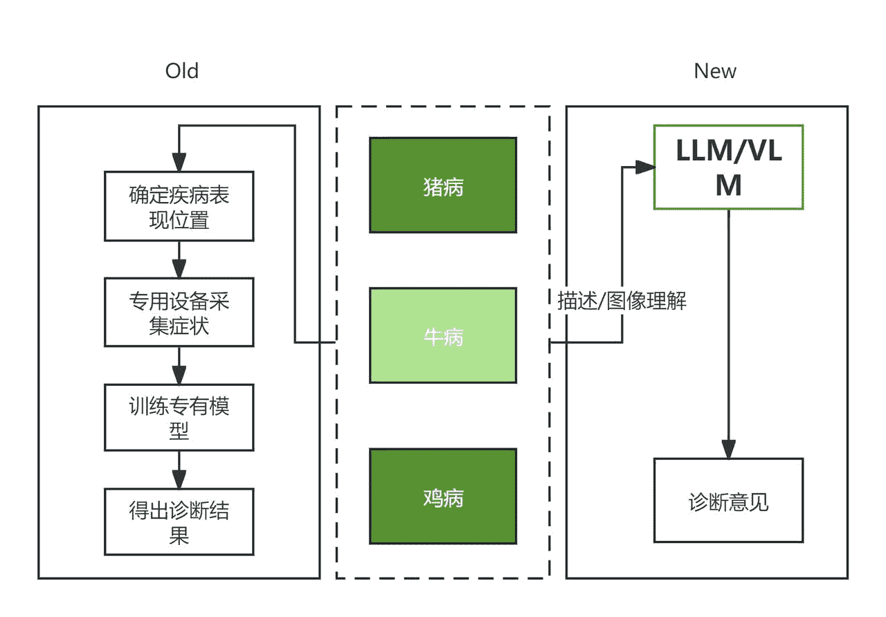

**项目ID：694**

**团队名称：**

**项目地址：**

**https://github.com/Xp**g74138/Animal-Doctor

**视频地址：**

** ****https://www.bilibili.com**/video/BV1jZ421g7ur/

**应用****地址：**

**h**ttps://openxlab.org.cn/apps/detail/Xpg12138/Animal-Doctor

[介绍视频.mp4](https://internal-api-drive-stream.feishu.cn/space/api/box/stream/download/all/SexobhmSPoKnRJxvOMocEz5inlc)

## 【完成】Nuclear blueprint Assistant - 核电工程图纸识别的视觉大语言模型

**项目名称：Nuclear blueprint Assistan**t - 核电工程图纸识别的视觉大语言模型

**项目架构图:  **

**项目简介（150字）：**

传统的单一模态（如仅使用图像）的图纸分析无法充分利用多源信息，导致识别与理解存在局限。针对此现状，我们开发出《Nuclear Blueprint Assistant：核电工程图纸识别的视觉大语言模型》。该系统利用 XComposer2-4khd 模型，结合核电工程图纸与相关文档数据，通过多模态数据的有机结合，挖掘出隐藏的关联模式，提升了识别与分析的效果，打破了传统单一模态分析的局限。

该系统在以下**领域具备显著应用前景**：

+   工程图纸识别：实现对复杂核电工程图纸的高精度识别和解读。

+   图中关键信息提取与理解：自动提取图纸中的关键设计参数和安全信息，辅助工程师进行快速理解和分析。

+   条件逻辑推理与判断：基于图纸和文本数据，进行条件逻辑推理，辅助进行工程决策。

+   核电领域知识问答系统：通过融合图纸和相关文档，构建智能问答系统，提升知识获取效率。

该系统的部署与应用能够显著提升核电工程图纸的处理效率与准确性，推动核电领域智能化水平的提升。

**项目ID：**729

**团队名称：AI扩展坞**

**团队成员：**

张腾飞

黄远

刘一谦

**视频地址：**

https://www.bilibili.com/video/BV1f1421k7r4/

**项目演示demo相关链接：**

<https://player.bilibili.com/player.html?bvid=1f1421k7r4&p=2&vd_source=6a2cd0e00818aa6143834cc965402bca>

## 【完成】医美行业营销大模型

**项目名称：医美行业营销大模型**

**项目简介：**

**医美行业营销大模型** 是一个能够根据用户提问或需求描述输出医美相关咨询、整形初步方案、术**后跟踪、营**销方案及营销相关多媒介内容的大模型，有着专业独特的价值魅力，给用户带来更轻松更美的体验。

+   该模型使用 [XTuner](https://github.com/InternLM/xtuner) 在 [InternLM2](https://github.com/InternLM/InternLM)** 的基础**上微调，部署集成 LMDeploy 加速推理；

+   支持 **RAG 检索增强生成**，可随时更新产品信息、业务信息、企业信息以更好为用户提供服务；

+   结合 AIGC 技术输出多模态的文字、音频、图片、视频等营销相关内容，高效而精准地为营销人员提供辅助；

+   支持 **TTS 文字转语音**声音互动，支持营销人员**数字分身**宣传引导互动，让医美的营销**获客、活客、留客**变得更轻松又不乏时尚和科技感；

+   支持微信 AI 客服功能，为用户提供 24H 的咨询答疑、医美方案建议和术后跟踪。

**项目ID: ****756**

**团队名称：****象牙智能**

**团队成员：****谢华、俞世俊**

**项目地址： **

**h**ttps://github.com/JerryXieHua/medical-marketing-system

**视频地址****：**

**https://www.bilibili.com**/video/BV1QvgjeJELu/

<https://player.bilibili.com/player.html?bvid=1QvgjeJELu&vd_source=7be98deb3d4eacc2ab5c91310ea15e53>

**项目 Demo 体验地址：**

##  PathBOT-智慧病理小助手

项目名称：PathBOT-智慧病理小助手

团队名称：NPU-ABCLab-PathBOT

团队成员：路梦康

**项目GitHub:  **https://github.com/PathBOT-Admin

**项目简介（150字）：**

+   多模态病理图像诊断助手，利用了来自TCGA一万多例病理切片进行视觉自监督预训练，并根据图像标签利用LLMs生成对应的诊断报告和问题，利用InternVL进行病理图像和文本报告对齐，构建智慧病理问答小助手PahtBOT，可以进行多项视觉任务如：腺体分割，细胞检测，亚型分类，生存期回归。以及VQA，retrieval，report generation等多项多模态任务。

## **傻妞 —— 日程规划助手**

项目名称：傻妞

项目简介（150字）：

+   智能日程规划：通过大模型RAG（检索增强生成）技术，帮助用户智能安排日程，评估每项任务所需时间，并根据任务的重要性和优先级进行排序。

+   动态调整：根据用户的实时反馈和任务完成情况，自动调整日程安排，确保高效利用时间，帮助用户逐步实现目标。

+   目标分解：当用户设置远大目标时，大模型会将其分解为多个可管理的子任务，并合理安排到用户的日程中，确保逐步完成目标。

+   个性化适应：根据用户的完成效率和习惯，持续优化日程安排，提供个性化的时间管理建议。

**团队名称：**华人牌

**项目 GitHub 地址：** https://github.com/originx-23/x-23

---

## **中医私人医生**

**项目名称：中医私人医生**

**项目简介（150字）：**

+   个性化推荐: 根据用户健康数据和偏好，智能推荐个性化的养生方案和药物选择。

+   问诊咨询功能: 实时在线咨询，AI模拟中医问诊流程，上传诊断报告或人体症状图，提供便捷的远程医疗咨询服务，确保用户得到及时指导。

+   健康管理核心要素: 集成健康跟踪、提醒与分析，帮助用户管理生活习惯，以图表形式展示健康趋势，促进自我健康管理。

+   数据收集：APP通过用户输入、传感器数据（涉及相关硬件，目前开源项目不涉及此部分内容），收集中医诊断信息，构建全面的健康数据库，并且形成AI医生的长期诊断记忆。

+   中医诊断分析：结合RAG和AGENT，知识图谱等相关技术，分析体质、病症，理解中医辨证规律。

+   预测与建议：基于分析结果，生成个性化健康预测，提供预防措施和调理建议，实现中医治未病。

团队成员：飞行独角兽（中医健康管理）

**项目 GitHub 地址： ****https://github.com/Osbor**nHu/china-doctor.git

**项目介绍视频地址： **

**项目 Demo 体验地址：**** **

## 【完成】G-Torque 游戏 AI 助手

项目名称：G-Torque 游戏 AI 助手

**项目Slogan:  empower **play, enhancing way!

项目地址**：**https://github.com/eavae/gtorque

**视频****地址****：**https://www.bilibili.com/video/BV1PVgEeVESg/

项目ID：703

**项目简介（150字）：**

3A 游戏逐渐在国内兴起，但这类游戏的通关率不高。其核心原因在于：

1.  日益碎片化的游玩时间导致游戏过程难以接续。

1.  预制的难度配置及难度曲线无法覆盖所有玩家。

1.  3A 游戏天然的低粘性，难以持续激励玩家。

G-扭矩，一个有用、有趣、有深度的 AI 助手。现阶段 G-扭矩 试图通过整合互联网上零散的游戏知识，以社区机器人的方式，为游戏玩家提供有价值的信息服务。但，G-扭矩 不止是个问答机器人，我们正在努力通过三个里程碑实现不中断游戏进程的、更智能的游戏助手，通过如下三项：

1.  基于 RAG技术 的游戏攻略助手。（已完成 MVP 验证，正在扩大规模……）

1.  基于 Agent技术 的游戏社区管家。

1.  基于 强化学习、多模态技术 的桌面级 co-pilot 应用。

**项目架构：**

## **教育行业知识库问答助手**

项目名称：教育行业知识库问答助手

**项目GitHub: ****https://github.com/superc**g/Langchain-Chatchat

**项目简介（150字）：**

大模型在教育行业的垂直应用，通过构建教育行业私有知识库，为教师提供关于信息化产品的问答服务，帮助教师提高信息化水平，减轻客服人员的工作压力。提供Streamlit网页版的AI问答助手。

**关键架构：**

## ssc-FinLLM-金融大模型II

项目名称：ssc-FinLLM-金融大模型II

项目简介：ssc-FinLLM 是能够支持 金融咨询-金融nlp任务-简单金融计算--金融研判 金融链路的金融大模型，由书生·浦语2.0（InternLM2）指令微调而来，欢迎大家star~

数据集加工图（已完成）：

项目架构图（待完成）：

团队成员：朱娅梅，江杨靖，刘佼，王凌，何茂贤

项目Github地址：https://github.com/haidizym/ssc-FinLLM

项目Demo体验地址：https://openxlab.org.cn/apps/detail/zhuyamei/ssc-FinLLM2

项目B站地址：https://www.bilibili.com/video/BV1Z1421D7Hq

主要参考文献：**DI**SC-FinLLM: A Chinese Financial Large Language Model based on Multiple Experts Fine-tuning

| 项目名称 | 项目 Slogan |
| --- | --- |
| 销冠 —— 卖货主播大模型 | 销冠大模型，智能卖货新体验 |
| BeautyMaster-美妆达人 | 美妆达人，美丽您的每一天 |
| Healthcare-Agent  医疗 AI 智能体 | GenAI-Powered Consultant for Healthcare |
| 雅鸭 —— 雅思作文小助手 | 从未有如此简单之作文 |
| 医学文献综述助手 (又名 不想看文献) | 不想看文献 |
| 狐言乱语-EssayAssistant 论文小助手 | 不如问一问神奇大狐狸吧 |
| 煤矿安全大模型———矿途智护者 | 矿途智护者，守护每一次地下的平安旅程 |
| 智能营销助手 | 智慧营销，触手可及。推荐试穿，尽在掌握 |
| 千面英雄 | 千面英雄，你的英雄与众不同 |
| layout_magic_llava：基于类llava架构多模态大模型的法律证据材料智能处理 | Gaining insight into the truth |
| 业务流程生成助手 | 让业务流程构建从此变得简单 |
| smartPlanter 智能花盆 | 不挖野菜 |
| 医疗助手 | 医疗助手在手，谈病不再恐惧 |
| 罪恶克星-法律大模型 | 其实，我还是一名律师 |
| Personalized LLM 领域研究助理 | 让 LLM 学习细分领域专业知识, 成为你科研的良师益友 |
| 古文诗词助手——诗墨 | 诗墨带您遨游绮丽的古文诗词世界 |
| 阿法兔—【谁是卧底】AI 游戏 | AI 陪你玩游戏，Let&#x27;s Go |
| 峡谷小狐仙-多模态角色扮演小助手 | 妲己陪你玩 |
| 小红书风格旅游助手 | 出门旅行，再也不用做攻略！ |
| 动物医生-畜禽疫病诊断助手 | 更强的智能诊疗，更好的健康守护 |
| Nuclear blueprint Assistant - 核电工程图纸识别的视觉大语言模型 | 蓝图助手，更专业的工业图纸系统 |
| 医美行业营销大模型 | 更轻松时尚的医美营销 |
| G-Torque 游戏 AI 助手 | empower play, enhancing way |