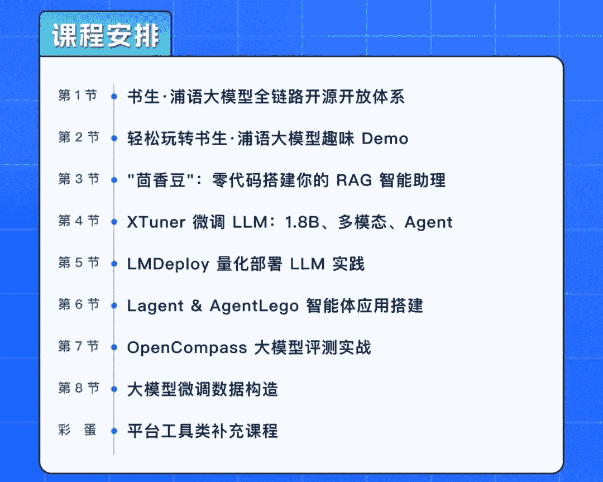
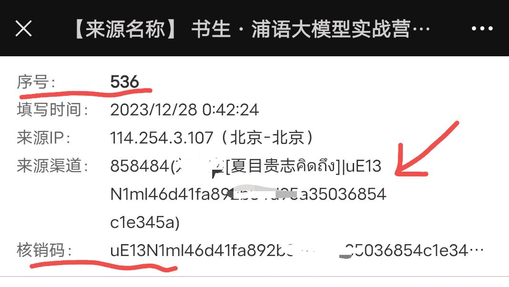
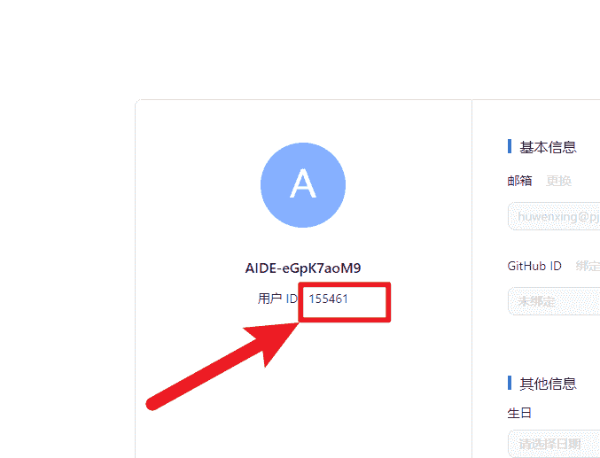
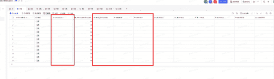
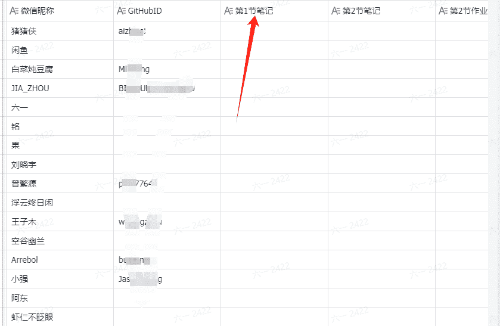

# 二期实战营学员手册

> 来源：`https://aicarrier.feishu.cn/docx/T2OmdMDB7oL367xae61c704Jnad`

## 课程介绍

> 首期实战营，我们同超过 2000 名学员一起学习了大模型微调、部署与评测全链路，相关课程视频播放量超过 4 万次。同学们不仅深入学习了理论知识，还积极地投身于实践探索中。利用开源的书生·浦语大模型，同学们动手构建了超过 100 个各具特色的大模型应用，从实践中体验学习、创新和成长，真正地吃透了大模型的全链路。

> 在首期书生·浦语实战营的学习、实训过程中，同学们不仅积极学习，同时针对时下热点、大模型落地应用等方面进行了积极且热烈的讨论。针对同学们的呼声，我们对第二期书生·浦语实战营内容进行了全面升级，将带领大家玩转 `RAG`、多模态和智能体应用。加入我们，让我们一起探索大模型的无限可能！

## 课程内容

## 日程安排

+ 营员招募

+ 2024 年 3 月 15  日至 2024 年 3 月 24 日

+ 正式开营

+ 2024 年 3 月 25 日

+ 课程培训

+ 2024 年 3 月 26 日至 2024 年 4 月 12 日

+ 实践项目

+ 2024 年 4 月 13 日至 2024 年 4 月 25 日

+ 课程结营

+ 2024 年 4 月 26 日

## 报名入口

> `https://www.wjx.cn/vm/tUX8dEV.aspx?udsid=2146`

> 注意只允许在🛰️中作答，需要使用🛰️打开并授权。也可扫描下方二维码报名。

## 课程流程&各阶段任务

### 课前

#### 注册算力平台

> 1.访问问卷地址：`https://www.wjx.cn/vm/tUX8dEV.aspx?udsid=2146`

> 2.点击右下角“查询结果”，如下图所示；

> 3.复制序号及核验码，找一个文档保存下来备用；

> 注意：

+ 上面🛰️名称后的也是核验码

+ 邀请码和核验码是同一个东西

> 4.在`https://studio.intern-ai.org.cn/` 算力平台注册账号时，使用报名问卷中的核验码注册 。

> 注意：

+ 上图中“核验码”处显示不全，建议从箭头处🛰️昵称后面复制核验码。

+ 注意不要夹杂空格和换行符，检查有无可疑的间距过大。

+ 如果之前参加过第一期实战营，则不需要再次核验注册，直接登录即可。

+ 若核验之后再次登录，仍提示需要核验码，大概率是自己没有使用第一次登录的方式，注意🛰️登录、`github`登录和手机号登录分属不同的登录方式，请先尝试切换。

> 5.点击算力平台右上角头像，查看“我的信息”，复制“用户ID”（如下图所示），同样保存到自己的文档中（用户ID即为算力平台ID）

#### 维护个人信息

> 1.加入本期实战营总飞书群。

> 可以使用飞书APP扫下图二维码进群，也可点击链接`https://applink.feishu.cn/client/chat/chatter/add_by_link?link_token=33br891a-6704-43b6-a1ef-748eb787d0b2&qr_code=true`，使用飞书账号（没有的可以自行申请个人账号）登录加群。

> 要加入飞书群里，才有对应的文档编辑权限，才可以登记个人信息，发放算力进行学习。

> 不需要申请编辑权限！！！

> 不需要加入企业！！！

> 2.在[学员信息&作业登记](https://aicarrier.feishu.cn/wiki/TqjawZsoqiiRXEkRpcScmKAAn8d?chunked=false&table=tblNCUy9PeGmgd9I&view=vewQagjCL1)表格中填写自己的问卷星ID、班级（🛰️群名中的班级号）、算力平台ID、证书姓名、🛰️昵称等信息。

> 3.修改群名片，格式为【昵称-问卷星ID】。

> 注意：

+ 使用邀请码（核验码）注册`算力平台`的用户第一次将免费获取 18 点算力点，仅为平台探索期间使用。

+ 在[学员信息&作业登记](https://aicarrier.feishu.cn/wiki/TqjawZsoqiiRXEkRpcScmKAAn8d?chunked=false&table=tblNCUy9PeGmgd9I&view=vewQagjCL1)表格中登记了算力平台ID的同学，后续学习过程中会及时发放足量算力点。

+ 每次增补算力时，无论之前的算力点是否用完，都会自动调整为统一的值，大家不需要节约，过期作废不累计。

#### 熟悉上期学习内容

> 没有学习过第一期课程的同学，可以在本期课程开始之前，学习一下上一期课程内容，熟悉一下算力平台和`InternLM`模型。

> 注意：上期课程基于`InternLM1`编写，大家实际操作时，可以尝试使用`InternLM2`，与教程的操作有细微差别。

|  | 学习内容 | 视频链接 | 文档链接 |

| --- | --- | --- | --- |

| 第1节课 | 书生·浦语大模型全链路开源开放体系 | `https://www.bilibili.com/video/BV1Rc411b7ns/` |  |

| 第2节课 | 轻松分钟玩转书生·浦语大模型趣味 Demo | `https://www.bilibili.com/video/BV1Ci4y1z72H/` | `https://github.com/InternLM/tutorial/blob/main/helloworld/hello_world.md` |

| 第3节课 | 基于 `InternLM` 和 `Langchain` 搭建你的知识库 | `https://www.bilibili.com/video/BV1sT4y1p71V/` | `https://github.com/InternLM/tutorial/tree/main/langchain` |

| 第4节课 | 《`XTuner` 大模型单卡低成本微调实战》 | `https://www.bilibili.com/video/BV1yK4y1B75J/` | `https://github.com/InternLM/tutorial/blob/main/xtuner/README.md` |

| 第5节课 | 《`LMDeploy` 大模型量化部署实践》 | `https://www.bilibili.com/video/BV1iW4y1A77P` | `https://github.com/InternLM/tutorial/blob/vansin-patch-4/lmdeploy/lmdeploy.md` |

| 第6节课 | `OpenCompass` 大模型评测解读及实战指南 | `https://www.bilibili.com/video/BV1Gg4y1U7uc/` | `https://github.com/InternLM/tutorial/blob/main/opencompass/opencompass_tutorial.md` |

| `Q&A` |  | 书生·浦语大模型实战营`Q&A`文档`https://cguue83gpz.feishu.cn/docx/Noi7d5lllo6DMGxkuXwclxXMn5f` |  |

#### 开营仪式 (3月25日)

> 进行群内破冰，学员之间相互熟悉，由助教先开始，依次进行自我介绍。

> 自我介绍模板：

> 【姓名】：浦语小助手

> 【坐标】：上海

> 【专业/职业】：大数据科学

> 【学习基础】已完成实战营第一期学习，`python`及命令行使用熟练，熟悉大模型基本知识，熟悉`InternLM`架构及功能模块

> 【项目技能】数据清洗，模型微调

> 【组队情况】未组队，有项目想法，有数据来源，希望和有前后端开发经验的小伙伴一起完成

> 【兴趣爱好】：分析数据，写代码，打比赛

> 【目标】：组织好本期学习营，和学员们一起学习成长！

#### 交流组队

> 在开营自我介绍后，大家自由交流，邀请志同道合的小伙伴一起组队完成实践项目。

> 注意：

+ 可以不组队，个人独立完成项目

+ 项目评优与学习评优分别独立进行

## 课程中

### 学习内容

> 注意：本期课程有些名称与上一期相同，但内容进行了全新编写，与上一期不是同一课程！

> `笔记作业提交DDL`：4月25日23：59

> 算力点停止发放：4月28日晚7点最后一次发放

> 算力平台清理（学习环境删除）：4月29日9:00-5月1日9:00

> 下一批学习开始：5月1日

|  | 学习内容 | 视频链接 | 文档链接 | 笔记&作业 |

| --- | --- | --- | --- | --- |

| 第1节课 | 书生·浦语大模型全链路开源开放体系 | `https://www.bilibili.com/video/BV1Vx421X72D/` | `InternLM2` 技术报告`https://arxiv.org/pdf/2403.17297.pdf` | 看视频做的笔记（必做）和读`InternLM2` 技术报告做的笔记（可选）都写到同一个笔记文档，提交一个链接 |

| 第2节课 | 轻松分钟玩转书生·浦语大模型趣味 Demo | `https://www.bilibili.com/video/BV1AH4y1H78d/` | `https://github.com/InternLM/Tutorial/blob/camp2/helloworld/hello_world.md` | 作业：`https://github.com/InternLM/Tutorial/blob/camp2/helloworld/homework.md` |

| 第3节课 | "茴香豆":零代码搭建你的 `RAG` 智能助理 | `https://www.bilibili.com/video/BV1QA4m1F7t4/` | `https://github.com/InternLM/Tutorial/blob/camp2/huixiangdou/readme.md` | 作业： `https://github.com/InternLM/Tutorial/blob/camp2/huixiangdou/homework.md` |

| 第4节课 | `XTuner` 微调 `LLM`:1.8B、多模态、`Agent` | `https://b23.tv/QUhT6ni` | `https://github.com/InternLM/Tutorial/blob/camp2/xtuner/personal_assistant_document.md` | `https://github.com/InternLM/Tutorial/blob/camp2/xtuner/homework.md` |

| 第5节课 | `LMDeploy` 量化部署 `LLM` 实践 | `https://www.bilibili.com/video/BV1tr421x75B/` | `https://github.com/InternLM/Tutorial/blob/camp2/` | 作业：`https://github.com/InternLM/Tutorial/blob/camp2/lmdeploy/homework.md` |

| 第6节课 | `Lagent` & `AgentLego` 智能体应用搭建 | `https://www.bilibili.com/video/BV1Xt4217728/` | `https://github.com/InternLM/Tutorial/tree/camp2/agent` | 作业：`https://github.com/InternLM/Tutorial/blob/camp2/agent/homework.md` |

| 第7节课 | `OpenCompass` 大模型评测实战 | `https://www.bilibili.com/video/BV1Pm41127jU` | `https://github.com/InternLM/Tutorial/blob/camp2/opencompass/readme.md` | 作业: |

| 第8节课 | 大模型微调数据构造 | `https://www.bilibili.com/video/BV1Dx4y1z7Ju` | `https://github.com/InternLM/Tutorial/blob/camp2/data_fine_tuning/data_fine_tuning.md` | 没有笔记作业提交要求 |

| 彩蛋 | 平台工具类补充课程 |  |  | 没有笔记作业提交要求 |

### 课程学习及群内讨论

+ 按照时间要求完成课程内容学习及项目实践。

+ 不理解的内容先查阅本期答疑文档[常见问题 `QA`](https://aicarrier.feishu.cn/wiki/AkCDwTWJtiebUkkChV0ct9uAnGc)及第一期学习答疑文档[书生·浦语大模型实战营`Q&A`文档](https://cguue83gpz.feishu.cn/docx/Noi7d5lllo6DMGxkuXwclxXMn5f)，如果没有找到解答可在🛰️群内@助教提问，或在 `github` 上提 issues。

> 备注：注意群内学习讨论内容仅限本次课程内容，不得讨论无关知识内容，不得分享本次课程以外的学习资料。

### 笔记&作业

+ 作业提交到[学员信息&作业登记](https://aicarrier.feishu.cn/wiki/TqjawZsoqiiRXEkRpcScmKAAn8d?chunked=false&table=tblNCUy9PeGmgd9I&view=vewQagjCL1)表格每节课对应的单元格

+ 按照时间安排完成笔记和作业。

+ 笔记：课程学习的知识整理总结和心得体会。

+ 作业：在`算力平台`上实践操作的过程整理总结和心得体会，必须有关键步骤完成截图，否则视为未完成。截图必须完整，需要保留`算力平台id`、`环境信息`、`操作命令`等有自己操作特征的部分，且文字清晰可见。

+ 笔记和作业可以放在`github`、`[学员信息&作业登记](https://aicarrier.feishu.cn/wiki/TqjawZsoqiiRXEkRpcScmKAAn8d?chunked=false&table=tblNCUy9PeGmgd9I&view=vewQagjCL1)SDN`等自己的笔记平台，再把链接粘贴到 表格中对应列。

+ 注意笔记和作业线上链接中的内容需要公开对所有人可见（注意开启权限），方便助教评审，并注明教程来源链接。

+ 注意笔记及作业至少需要保留至本期学习结营，便于助教们最后集中评审复查及评优。提前删除笔记作业，可能导致失去结营及评优资格。

+ 笔记尽量不要使用简单的概括性文字描述，以具体的知识点为主。

+ 不要大面积截图或者复制粘贴课程内容，可以关注一些亮点，并结合自身背景进行思考。不求全只求新。

+ 基础作业和进阶作业可以写在同一个文档，或者更新另一个文档，不需要写成两个链接。

+ 优秀作业反馈&存档：特别优秀的作业会被助教推荐给`浦语小助手`（告知学员昵称、作业链接），可能会在 `InternLM` 新媒体平台宣传推广。

+ 如果希望被推荐或者不希望被公开，可以在打卡中显眼处加以文字说明。

### 提升算力值

+ 第二课进阶部分除灵笔之外需要30%算力，灵笔需要50%算力。

+ 完成基础部分作业并提交后，可以群内@助教申请提升算力。

+ 助教检查作业合格之后可将算力修改为50%，每晚7-8点算力刷新之后生效。

+ 50%算力提升是临时的，仅供灵笔部分的实践使用。第二课学习结束后，会恢复为30%。

+ 大家可以根据自己的学习内容合理选择算力，方便他人！

+ 遇到没有算力点、显存资源助教已开通但未生效等问题时：

+ 检查自己登记表中算力平台ID与实际使用的账号算力平台ID是否一致

+ 检查算力平台ID填写是否正确，前后是否有空格或特殊符号

### 项目实践

在完成了课程内容学习之后，大家可以根据自己的想法创意来完成自己的项目。

`[InternLM 项目登记表](https://aicarrier.feishu.cn/wiki/DoKWwqslwiyjjKkHhqJcvXAZnwd?table=tblyxy5MZV7gJ7yS&view=vew0rj0WuN)`

这个链接是放了一些要做的项目，有不少来自第一期的，也有第二期大家想做的，[InternLM 项目](https://aicarrier.feishu.cn/wiki/JuXvwHzGni2A2Rksd8Rczpvxngb) 以看下别人做了什么，给自己点思路，也可以想下自己想做什么【登记方法可以查阅】

【模型中心-OpenXLab 实战营优秀项目】
https://openxlab.org.cn/models/InternLM/subject

# 结营（DDL已出！！！）

- 4月29日算力平台清理，届时课程学习创建的开发机将全部被删除，之后算力点照常发放，可重新创建环境，继续完成本期学习。

- 5月4日为作业笔记提交截止日期，5月5日助教完成评审，之后开始下一批次的学习。

- 完成所有笔记及基础作业的同学，即可获得“结营证书”，优秀学员根据笔记作业和项目的评审结果择优选取。

- 名单公示：助教在结营仪式上公示结业学员、优秀学员名单。

## 其他

> 公用 Q&A 文档链接：[常见问题 QA](https://aicarrier.feishu.cn/wiki/AkCDwTWJtiebUkkChV0ct9uAnGc)
