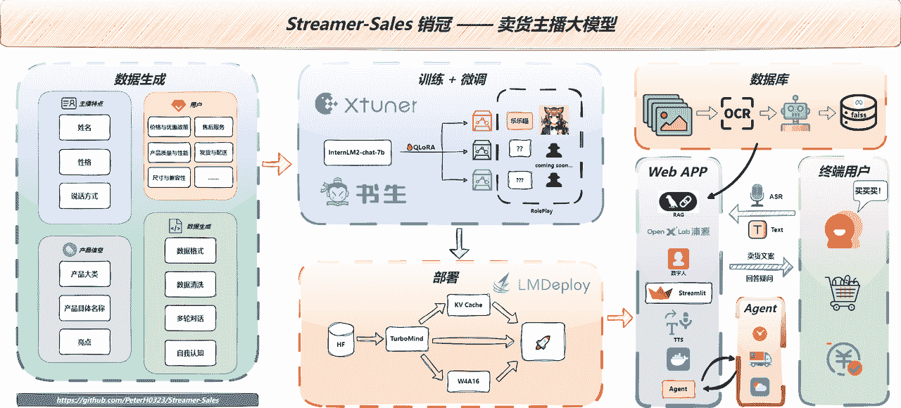

# 二期实战营优秀项目宣发

> 来源：[https://aicarrier.feishu.cn/docx/EmyXdQEfcoKAk3xV8wvc3vYQnde](https://aicarrier.feishu.cn/docx/EmyXdQEfcoKAk3xV8wvc3vYQnde)

# 圆满收官，实战营学员大放异彩

经过一个多月的角逐，挑战赛从  个参赛队伍中决出了 20 支优胜队伍，并结合现场答辩表现，评出___

《**销冠 —— 卖货主播大模型**》成为本届挑战赛**明星项目**，团队**队长**是期书生·浦语大模型实战营**优秀学员**，项目孵化于实战营期间，经过精心准备和推荐，参与了挑战赛并最终荣获最高荣誉。

### 明星项目简介：

Streamer-Sales 销冠 —— 卖货主播大模型 是一个能够根据给定的商品特点从激发用户购买意愿角度出发进行商品解说的卖货主播大模型。项目功能点如下：

+   **📜 精心设计的数据集生成流程**

+   🧰 使用 XTuner 在 InternLM2 上指**令微调模**型

+   🚀 LMDeploy 加**速推理**

+   **🎙️ ASR 语**音输入

+   **🔊 TTS 文**字转语音输出

+   **📚 RAG 检**索增强生成

+   **🌐 Agent 网**络查询实**时快递等**信息

+   **🦸 主播数字人视频生**成

### **人气项目：**

《Healthcare-Agent 医疗AI智能体》

《Nuclear blueprint Assistant - 核电工程图纸识别的视觉大语言模型》

《狐言乱语-EssayAssistant论文小助手》

《smartPlanter智能花盆》

《雅鸭 —— 雅思作文小助手》

《煤矿安全大模型———矿途智护者 》

《医学文献综述助手 (又名 不想看文献)》

《销冠 —— 卖货主播大模型》

《BeautyMaster-美妆达人》

《医美行业营销大模型》

（人气项目的顺序是按照截图票数从高到低，发到优秀项目群里大家反馈调整后的顺序）

### 优秀项目一览

##### 销冠 —— 卖货主播大模型

卖货主播大模型 是一个能够根据给定的商品特点从激发用户购买意愿角度出发进行商品解说的卖货主播大模型。

##### BeautyMaster-美妆达人

项目采用 InternLM2 大模型、XTuner 微调工具、LMDeploy 部署工具，为用户提供个性化时尚搭配建议。通过上传全身照和衣柜服装，结合季节、温度、天气、出行目的和个性需求，定制最完美的穿搭方案。

##### Healthcare-Agent 医疗AI智能体

GenAI 赋能，解读您的健康密码，个性化数据, 易懂化解读，它将成为您一生的健康伴侣，随时随地守护您的健康。基于上海人工智能实验室的书生·浦语大模型，并通过专业医疗保健数据调优训练并系统开发的医疗保健智能体，为医疗保健工作者赋能提效，为家庭健康决策人提供全生命周期的健康管理。

##### 雅鸭 —— 雅思作文小助手

一款基于 [InternLM2](https://github.com/InternLM/InternLM.git) 进行 QLoRA 微调，专为雅思考生（主要针对初级与中级水平学习者）开发的创新 LLMs 辅导工具，旨在提升学生的雅思写作能力。

雅鸭 IELTSDuck 整合了作文结构引导、语法检查与改进、内**容与逻辑评估以及**智能评分等多功能，致力于帮助学生提升雅思写作水平。主要功能有根据雅思作文批改标准进行评估打分，并会指明失误点纠正语法、词汇问题，也会对文章内容逻辑进行分析。

##### 医学文献综述助手 (又名 不想看文献)

这是一款基于 RAG 的医学文献综述小工具。用户可配置本地或远程大语言模型，通过关键词或 PMID 搜索 PubMed，上传 PDF 文件，并创建和管理文献数据库。通过聚类算法对文本分块进行聚类，用更少的算力生成对数据库内容的整体认识。最后工具可以基于用户提问生成带有参考文献的综述文本。旨在帮助科研人员高效检索、管理、阅读和总结文献。

##### 狐言乱语-EssayAssistant论文小助手

**狐言乱语论文小助手旨在**解决论文的找、读、用等难题，项目分为狐聊、狐说、狐找、狐写四个模块，结合大模型帮助用户快速掌握论文概况，并可结合单页论文细读、精读相关内容。用户也可以通过关键词搜索遍览大量论文生成本地知识库，交由大模型推荐相关论文。亦可以上传本地论文组成知识库，由大模型生成论文综述。

##### 煤矿安全大模型———矿途智护者

本项目利用包括煤矿历史事故案例、事故处理报告、安全操作规程、规章制度、技术文档以及煤矿从业人员入职考试题库等在内的丰富数据资源，通过微调 InternLM2 模型，构建出一个专门针对煤矿事故和煤矿安全知识智能问答的煤矿安全大模型。为煤矿企业负责人、安全管理人员、矿工提供一个精确、迅速的信息查询、学习与决策支持平台。

##### 智能营销助手

智能营销助手的模型由 InternLM**2-chat**-**7B 指令微调**而**来，它能够**与用户的对话，了解用户的需求，基于多模态的 AIGC 生成能力，应用层整合了 RAG、Agent、数字人、虚拟试穿、智能推荐等功能，能够持续输出更符合用户消费习惯的文本、图片、语音和视频等营销内容，推荐符合用户的商品，将营销与经营结合。

##### 千面英雄

偶像、榜样的力量是无穷的，让人敢想敢干，克服困难，不放弃。 千面英雄，利用时代最新的大模型技术，基于书生浦语大模型生态（基于 InternLM-7B 模型，利用 XTuner 微调，LMDeploy 部署），提供对话的形式，基于用户的价值观、兴趣、想要的成就、成长经历，个性化地推荐最契合用户的英雄偶像。让活生生的人和经历激励你，让你不怕摔倒，敢想，敢干的同时也能深刻意识到世界的复杂和交换成功所要付出的代价。

##### layout_magic_llava ——基于类llava架构多模态大模型的法律证据材料智能处理

本项目主要基于以聊天截图证据为核心的法律诉讼及非诉讼案件的自动化处理场景，核心技术在于使用 XTuner训练 llava 架构模型，其中 llm 为垂直领域适配的 InternLM2 系列模型，该场景下 internvl 表现优秀，技术方案中亦有采用 internvl 预训练权重及数据集的考量。

##### 业务流程生成助手

务流程（Business Process，BP）是为实现目标而使用的可重复的一组步骤。本项目以生成 BPMN 格式的业务流程为目标，以对地观测卫星的业务流程为背景，构建了相应的BP数据集，利用 InternLM2-chat-7B 作为基座模型，XTuner库进行 lora 微调，获得微调后的模型。最后生成的 BPMN 文件基本可以满足用户的需求，使得普通用户可以通过自然语言描述模型。

##### smartPlanter智能花盆

一个集智能养护与互动娱乐于一体的智能花盆。

+   硬件提供**多角色互动聊天**，赋予**种植知识**个性化的表达。

+   不定时掉落来自**植物反馈彩蛋**。

+   **专属小程序****，提供远程控**制，用户可以随时随地掌握植物状态。同时配备农事专家。

+   可开启**全自动养护功能（补光、浇水）**，友好易用。

+   **自带液晶屏**展示各类丰富内容。

+   另有种植柜系列产品，实现**蔬菜水果自由**。

##### 医疗助手

本项目旨在开发一个基于茴香豆 RAG 框架和 InternLM2-7B 大模型的医疗助手，帮助患者和医生了解疾病信息和诊断流程。目标是使患者能够提前了解疾病信息，减少恐惧，并提高医生的诊断效率。

##### 罪恶克星-法律大模型

罪恶克星是一个融合法律问答与审计助手功能的创新项目。通过推动法律技术的进步，罪恶克星希望在助力依法治国的道路上迈出坚实一步，为建设法治社会贡献力量。

##### Personalized LLM 领域研究助理

一款专注于该细分领域的研究助手，它用通俗易懂的语言，阐释晦涩难懂的概念；用智能算法，发掘隐藏在海量文献中的关键信息；用友好互动，点燃您的创新灵感。

##### 古文诗词助手——诗墨

古文诗词助手“诗墨”，基于书生浦语大模型与工具链开发，旨在带领用户探索领略古文诗词的意境与风光，体会中华文化的博大精深。诗墨基于海量高质量古文诗词数据（覆盖唐宋两朝诗人以及两宋时期词人海量诗词数据以及论语等经典古文有关内容）以及复杂多样自我认知数据集，通过 XTuner 分步迭代微调 InternLM2 模型，并具备在线与诗墨对战功能页面，增加互动乐趣。

##### 阿法兔—【谁是卧底】AI游戏

**InternLM2 为内核，结合达摩院 Agentscope 框架，**搭建 AI 小游戏-谁是卧底，1 个真人用户和一群 AI 玩游戏，看谁笑到最后。

##### 峡谷小狐仙-多模态角色扮演小助手

本项目通过构造生成**训练数据**，采用** XTu**ner 微调书**生浦语 I**ntern**LM2 **模型的方**式，打造**了**一个王者荣耀领域的角色扮演**聊天机器人--峡谷小狐仙**，同时结**合 AS**R技术实现语音输入**、**RAG** 检索增强**生成技术**，生成王者英雄有关信息, TTS 技术实现声音克隆和语音输出、数字人技术实现了视频输出功能。

##### 📕风格旅游助手

本项目主要致力于帮助人们**更快**获取旅游信息，并以**轻松活泼**的**方式与用户互动**🌟。当前收集旅游攻略，主要通过📕、美团、抖音等 app 搜索，步骤繁琐、信息冗余，需要耗费游客大量精力去收集。因此创造一个可以直接获取旅行信息，并且能以活泼幽默的风格与游客互动的大模型app，就显得非常有必要。

##### 动物医生-畜禽疫病诊断助手

本项目旨在搭建一个畜禽疫病诊断大模型，以提高畜禽养殖过程中疾病的早期预警和诊断能力。通过整合多模态数据，包括环境监测数据（如温湿度、CO2、NH3 浓度等）、动物行为数据（如声音、运动轨迹）以及生理数据（如体重变化、体温），构建一个智能化的疾病诊断系统。该系统能够在疾病早期阶段准确识别潜在的健康风险，从而及时采取干预措施，减少疾病传播和经济损失。

##### Nuclear blueprint Assistant - 核电工程图纸识别的视觉大语言模型

专注于核工业 VLM 大模型提升对于行业图纸识别和逻辑推理。利用 InternLM-20B 进行 prompt 语义、形式扩展，提升数据多样性、泛化效果。

##### 医美行业营销大模型

一个能够根据用户提问或需求描述输出医美相关咨询、整形初步方案、术**后跟踪、营**销方案及营销相关多媒介内容的大模型，有着专业独特的价值魅力，给用户带来更轻松更美的体验🧚‍♀️。

##### G-Torque 游戏 AI 助手

G-扭矩，一个有用、有趣、有深度的 AI 助手。现阶段 G-扭矩 试图通过整合互联网上零散的游戏知识，以社区机器人的方式，为游戏玩家提供有价值的信息服务。

这些项目不仅展现了实战营学员的创新实践能力，也证明了实战营在培养学员掌握大模型相关知识、开发大模型相关项目以及帮助学员步入更广阔舞台的独特优势。在之后的文章中，我们会分享他们在实战营中学习、成长的故事，敬请期待哦 ~

**参考：**

1.[二期实战营优秀项目评选](https://aicarrier.feishu.cn/wiki/W6ShwMSzYi4ohGkd7yOcCSogn0g?table=tblNCUy9PeGmgd9I&view=vew1Yqf5GS)