# 常见问题 QA

> 来源：`https://aicarrier.feishu.cn/docx/TC2bdy1pBolqUbx7yDkcKhHMncb`

## InternStudio 开发机的环境玩坏了，如何初始化开发机环境

> **慎重执行！！！！所有数据将会丢失，仅限 `InternStudio` 平台，自己的机器千万别这么操作**

+ 第一步本地终端 ssh 连上开发机（一定要 ssh 连接上操作，不能在 web 里面操作！！！）
+ 第二步执行 `rm -rf /root`，大概会等待10分钟
+ 第三步重启开发机,系统会重置 `/root` 路径下的配置文件
+ 第四步 `ln -s /share /root/share`

### 第二期 第二课 常见bug

+ PowerShell输密码总是错误-解决办法：直接点鼠标右键即可(因为快捷键冲突)
+ [Huggingface下载报错](https://sap7x39yn02.feishu.cn/wiki/IZlMwQkrXilLKxkKjucceAuNnoe) 浦语实战2：四个demos的部署实现 - Feishu Docs

```
File "/usr/local/lib/python3.8/dist-packages/huggingface_hub/utils/_http.py", line 66, in send
return super().send(request, *args, **kwargs)
File "/usr/lib/python3/dist-packages/requests/adapters.py", line 510, in send
raise ProxyError(e, request=request)
requests.exceptions.ProxyError: (MaxRetryError("HTTPSConnectionPool(host='huggingface.co', port=443): Max retries exceeded with url: /api/models/internlm/internlm2-chat-7b/revision/main (Caused by ProxyError('Cannot connect to proxy.', OSError('Tunnel connection failed: 503 Service Unavailable')))"), '(Request ID: 7a82ab9c-5503-4a04-9ac6-2935adc2d828)')
```

+ 解决办法：`huggingface-cli download internlm/internlm2-7b config.json --local-dir /root/tmp/tmp1`
+ agentlego 输入完，`generate` 后，没显示，  后台打印 `Output generated in 0.0 seconds`

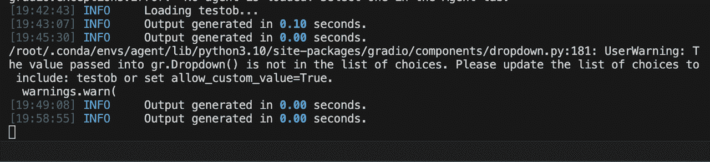

+ 解决办法：Web服务器和API服务器均在`VSCode`终端运行

### 第二期 第三课 常见bug

+ `local_llm_path` 重复 [浦语实战3：用RAG技术搭建个人工作助手](https://sap7x39yn02.feishu.cn/wiki/UCYgwffk0iPYPrkO2z5c2hZmnYg)

+ 错误提示：duplicate keys, Key "local llm path" was used more than once.

+ 解决办法：`config.ini`文件里 注释掉第31行

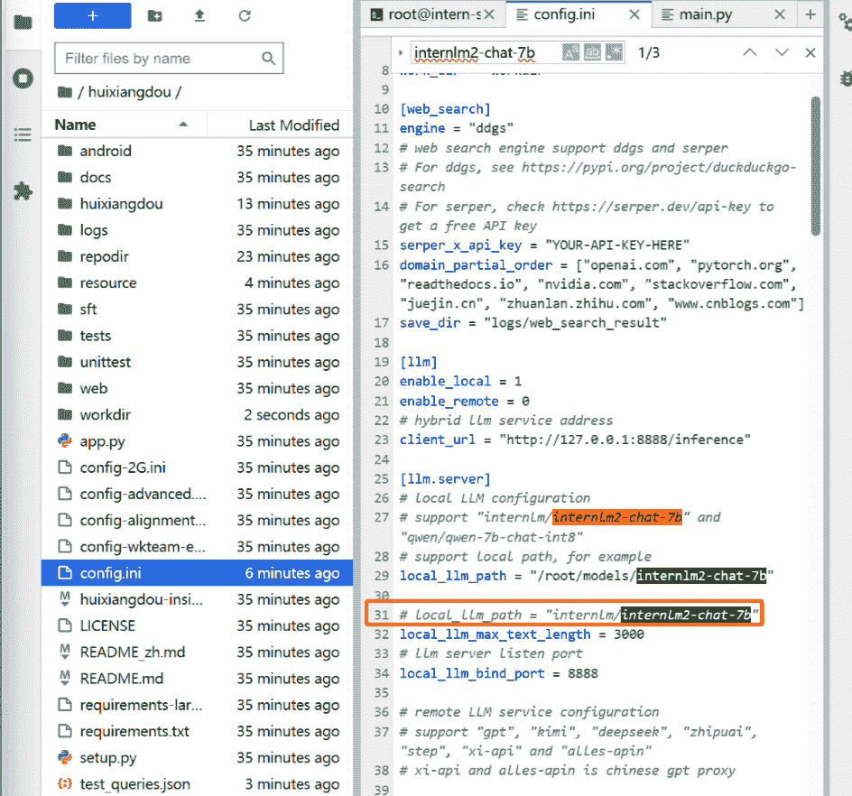

### 第二期 第四课 常见bug

+ [浦语实战4：XTuner 微调 LLM：1.8B、多模态](https://sap7x39yn02.feishu.cn/wiki/TRQ3whRxwiEQS9kynzac0vNMnUd) `oneType` Error错误

+ 解决办法：重装`transformers`，`transformers==4.40.0`

+ `git lfs install`报错

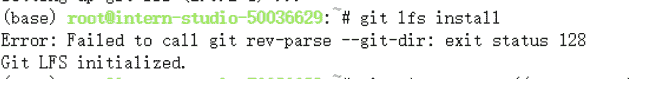

+ 解决办法

```
mkdir openxlab #先新建一个文件夹，比如openxlab
cd openxlab #进入此文件夹
git init #然后在这个文件夹下，生成一个Git文件-即初始化一个新的 Git 仓库
git lfs instal1 #然后才能运行git lfs install
```

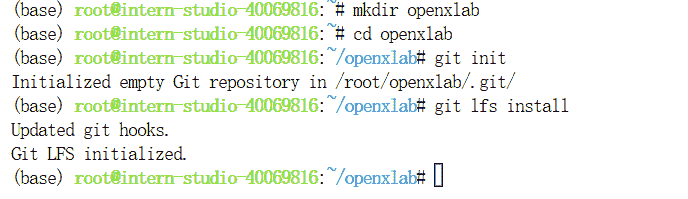

+ `git push` 出错 [`https://blog.csdn.net/wudiyjnewway/article/details/139663439`](https://blog.csdn.net/wudiyjnewway/article/details/139663439)

+ 解决办法：正确的密码其实是`github`给你的token，设置token方法，在Setting/Developer Settings/personal access token/tokens (classic)/Generate new token/Generate new token(classic)，里面设置

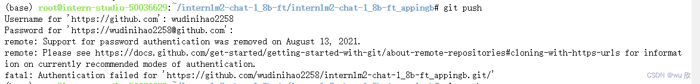

+ OSError: `We couldn't connect to 'https://hf-mirror.com' to load this file,`

+ 解决办法：给配置文件的这个路径改为本地的模型路径

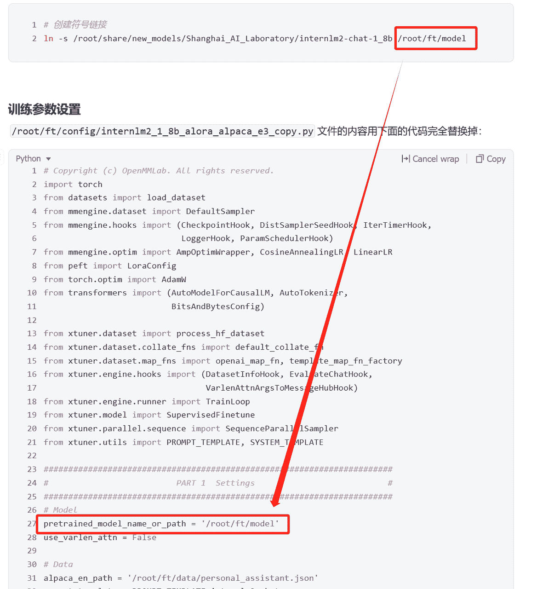

### 第二期 第五课 常见bug

+ 爆显存

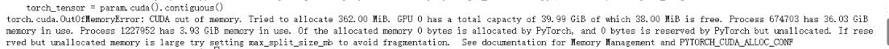

+ 解决办法：关掉多余终端

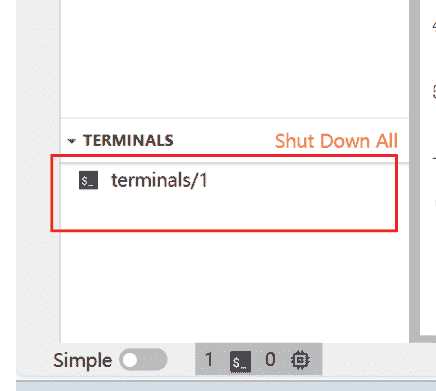

+ 警告：`Aborted（core dumped）`

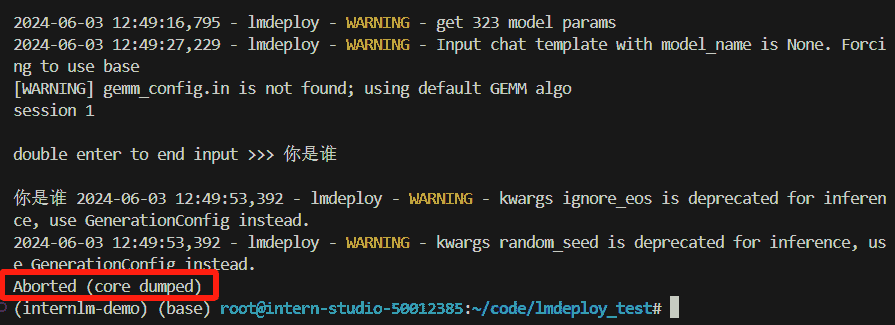

+ 解决办法：`torch`的版本升级到`2.1.2`

### 第二期 第六课 常见bug

+ [`ModuleNotFoundError`](https://blog.csdn.net/wudiyjnewway/article/details/139567839) @第六课 Lagent & AgentLego 智能体应用搭建 学习笔记及作业_智能agent 课程设计-CSDN博客

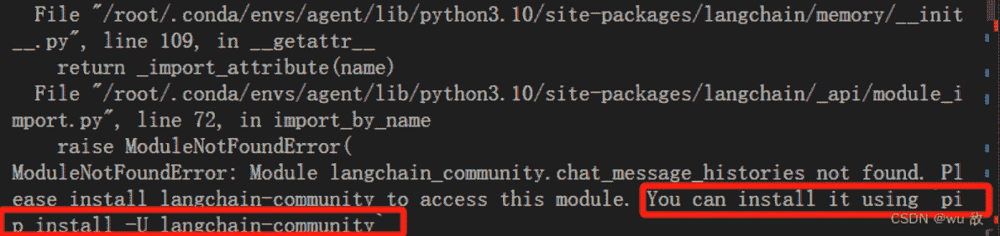

+ 解决办法：装个包：`pip install -U langchain-community`

+ Lego demo页面提示 `Error: No APl found`

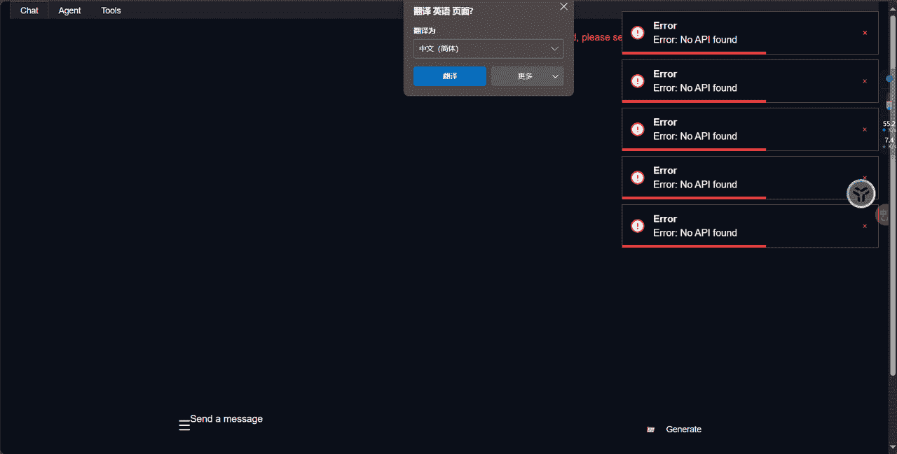

+ 解决办法 浏览器使用 `http://localhost:7860` 来访问`AgentLego` `WebUI`

### 第二期 第七课 常见bug

+ No module错误 [浦语实战7：OpenCompass 大模型评测实战](https://sap7x39yn02.feishu.cn/wiki/Sd7UwAP5diNYy6ky8FJcEdBBnEc)

```
ModuleNotFoundError: No module named 'tabulate'
ModuleNotFoundError: No module named 'mmengine'
```

+ 解决办法：在终端里`opencompass`环境里执行`pip install tabulate`和`pip install mmengine`

+ 如果一直碰到缺module，那可能就是`pip install -e .`没有运行成功

+ 解决办法：**请运行：**`pip install -r requirements.txt`

## 如何报名？

> `https://www.wjx.cn/vm/tUX8dEV.aspx?udsid=2146`

> 注意只允许在🛰️中作答，需要使用🛰️打开并授权。也可扫描下方二维码报名。


## 如何提交作业？

> 提交地址就是学员信息登记地址，注意提交在每一节课对应的列。

> [学员信息&作业登记](https://aicarrier.feishu.cn/wiki/TqjawZsoqiiRXEkRpcScmKAAn8d?table=tblNCUy9PeGmgd9I&view=vewaCKMgVg)

+ 同一节课可能有“笔记”和“作业”两个需要提交的文档。
+ **笔记：**课程学习的知识整理总结和心得体会。
+ **作业：**在算力平台上实践操作的过程整理总结和心得体会，必须有关键步骤完成截图，否则视为未完成。
+ 笔记和作业可以放在`github`、`CSDN`、知乎、小[学员信息&作业登记](https://aicarrier.feishu.cn/wiki/TqjawZsoqiiRXEkRpcScmKAAn8d?chunked=false&table=tblNCUy9PeGmgd9I&view=vewQagjCL1)书等自己的开放笔记平台，再把链接粘贴到 表格中对应的班级作业列。
+ **注意笔记和作业线上链接中的内容需要公开对所有人可见**（注意开启权限），方便助教评审，并注明教程来源链接。
+ 注意两节课的学习时间和**DDL时间可能会重叠**，所以尽早完成前一节课学习任务，避免影响后续学习。
+ 笔记不要使用简单的概括性文字描述，以具体的知识点为主。
+ 不要大面积截图或复制粘贴课程内容，建议关注亮点，结合自身背景深度思考，不求全只求新。

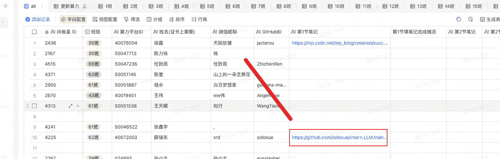

## 为什么提交作业的文档没有访问权限？

> 需要加入本期实战营总飞书群。

> 可以使用飞书APP扫下图二维码进群，也可点击链接`https://applink.feishu.cn/client/chat/chatter/add_by_link?link_token=33br891a-6704-43b6-a1ef-748eb787d0b2&qr_code=true`，使用飞书账号（没有的可以自行申请个人账号）登录加群。

> 要加入飞书群里，才有对应的文档编辑权限，才可以登记个人信息，发放算力进行学习。

> 飞书**文档的权限设置了只能编辑自己创建的记录，不能编辑其他学员的记录！！！**

> **不需要申请编辑权限！！！**

> **不需要加入企业！！！**


## 如何查看报名序号和核销码？

> 1.访问问卷地址：`https://www.wjx.cn/vm/tUX8dEV.aspx?udsid=2146`
> 2.点击右下角“查询结果”，如下图所示；

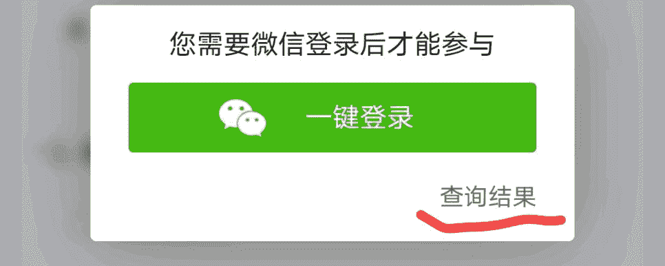

> 3.复制序号及核销码，找一个文档保存下来备用；

> **注意：**

+ **上面🛰️名称后的也是核销码**
+ **邀请码和核销码是同一个东西**

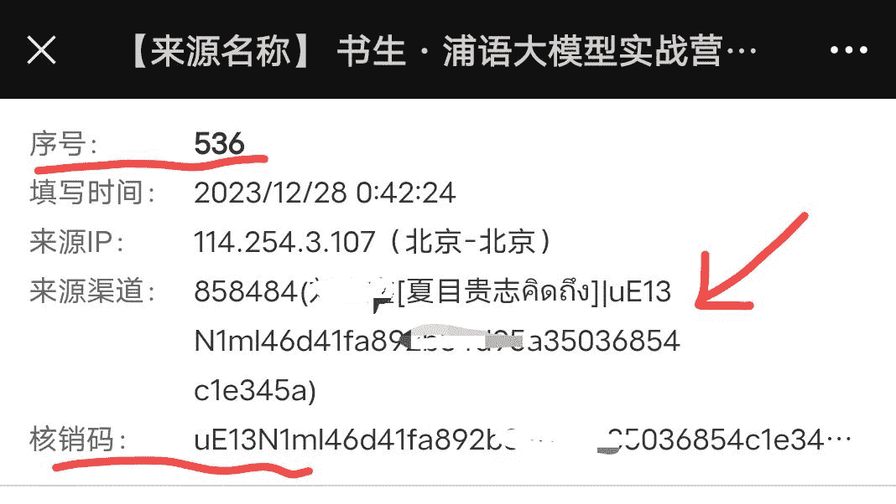

## 如何注册算力平台？

> 在`https://studio.intern-ai.org.cn/` 算力平台注册账号时，使用报名问卷中的核销码注册 。

> **注意：**

+ **上图**中“核销码”处显示不全，建议**从箭头处🛰️昵称后面复制核销码**。
+ 注意**不要夹杂空格和换行符**，检查有无可疑的间距过大。
+ 如果之前参加过第一期实战营，则**不需要再次核销注册**，直接登录即可。
+ 注意自己核销时候使用的哪个账号，**若核销之后再次登录**，仍然提示需要核销码，大概率是账号错误，请先尝试使用自己别的账号登录。
+ 若核销之后再次登录，仍提示需要核销码，大概率是自己没有使用第一次登录的方式，注意🛰️登录、`github`登录和手机号登录分属不同的登录方式，请先尝试切换。

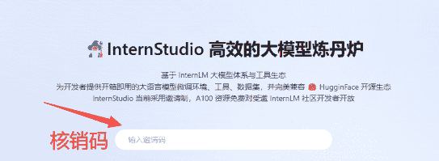

> 点击算力平台右上角头像，查看“我的信息”，复制“用户ID”（如下图所示），同样保存到自己的文档中（用户ID即为算力平台ID）

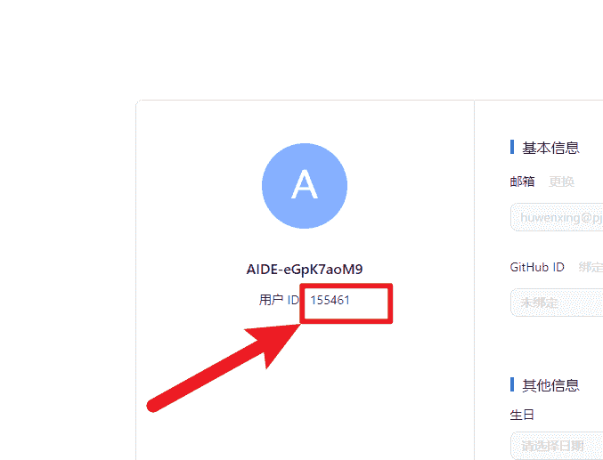

## 如何体验算力平台？

+ 进入算力平台 `https://studio.intern-ai.org.cn/`

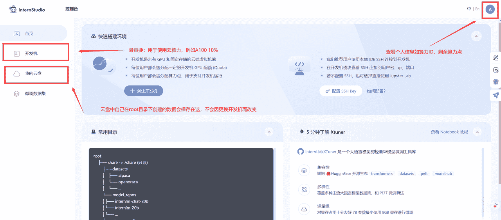

+ 在开发机页面中创建

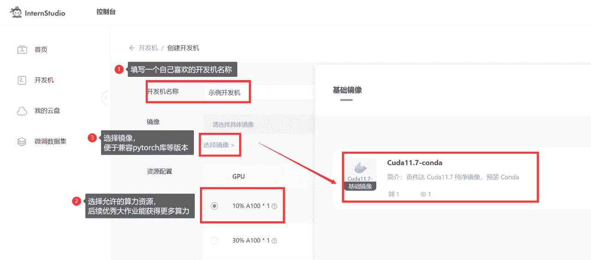

+ 回到上个页面，需要注意根据自己剩余算力点合理分配运行时长，随后可以直接进入开发机。想使用ssh连接的可以参考网页教程

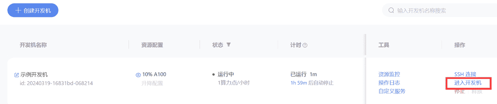

+ 进入网页开发机页面，随后就可以当正常云服务器使用啦。

在终端输入`vgpu-smi`，发现GPU资源正常

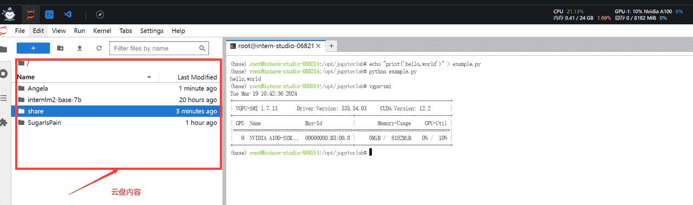

## ssh密码不正确？

+ 不是登录平台的密码
+ 不要用`powershell`，用`cmd`
+ 不要用`Ctrl+v`，用右键复制右键粘贴（无法使用右键复制、粘贴）
+ 输入密码时默认不显示明文，空白是正常的
+ 如果无法连接成功，可以尝试配置公钥

## （待补充）部分配置因 GPU 配额不足无法使用，剩余 GPU 额度 1.00是什么意思？

>

## （待补充）如果超过存储限额了，怎么删掉之前的一些模型？

> 可以先删除缓存：

> 1. `/.cache`文件夹下会有模型和数据缓存
> 2. `conda`， `pip`安装软件创建环境都会有缓存
> 3. 下载模型， 修改下载路径会占用存储

## 怎么连接公钥？

> 连接公钥用于ssh连接开发机，可以避免ssh时每次都输入密码。

> 步骤：

+ 在windows上安装ssh。  参考`https://blog.csdn.net/z164470/article/details/121683333`
+ 生成公钥：   win+r  输入`cmd`  ，在命令提示符里操作
+ `ssh-keygen -t rsa`    然后按  回车  回车 回车，即可生成完毕
+ 找到公钥：
+ 直接在`cmd`里输入： `cat id_rsa.pub`     复制
+ 在`C:\Users\你的用户名\.ssh`  文件夹里，找到`id_rsa.pub`文件，打开后复制
+ 把公钥粘贴到  开发机控制台——SSH连接——添加公钥——自己随便起名字 +粘贴公钥——立即添加
+ 免密登录：
+ 在`CMD`/ `anaconda prompt`/ `powershell` /mac电脑`terminal` 等 电脑的终端里，直接`ssh -p 你自己的端口 root@ssh.intern-ai.org.cn -o StrictHostKeyChecking=no -o UserKnownHostsFile=/dev/null`    就是开发机控制台的SSH连接里让你复制的命令，  你复制粘贴回车后，直接能登录上了，不需要输入密码了。
+ 在`mobaxterm`/`vs code` 等工具用SSH登录 也一样。
+ host：`ssh.intern-ai.org.cn`
+ username:`root`
+ Port: 你自己的端口

## 如何将开发机挂在后台运行？

这里针对不同的**开发环境**，多种情况进行讨论：

> 我们的开发机原生内置了多种开发途径，包括：

+ `Terminal`（`Terminal`， 最轻量级）：主要进行命令行操作，或者运行脚本和简单程序
+ `JupyterLab`：在网页中打开，提供Jupyter，一个交互式的编程和教学环境，同时内置终端，可以很方便地查看文件，执行代码等
+ `VSCode`：可以使用网页中集成的`VSCode`，也可以在本地`VSCode`中通过SSH连接远程开发。总体功能会比`JupyterLab`更强大，但是对于初学者来说可能上手难度更高。

> 如果是没有接触过开发的同学可以都尝试一下，选择最适合自己的工具哦~

### 在 `Terminal` 中让任务持久化运行

+ 最基础 & 最简单的方法：
+ `nohup`命令可以使得即使终端关闭，运行的任务也不会停止
+ 使用方法是在命令前加上`nohup`并在命令末尾加上`&`
+ 例如`nohup python script.py &`
+ 这将会在**当前目录**下生成一个名为`nohup.out`的文件，其中包含了命令的输出
+ 或者也可以在后面加上`> output.txt`(你想要的输出文件名) 指定将这个输出重定向到这个文件中
+ 再高阶一点，也可以将错误信息（`stderr`）也重定向到输出中，这样文件里面也会包含错误信息

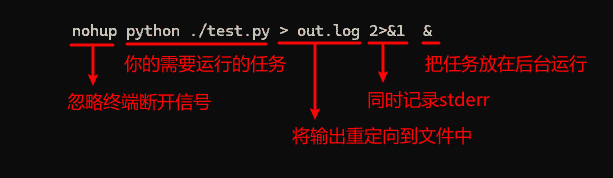

+ 或者也可以使用`tmux`（有一定的学习成本，但是上手之后会非常轻松）：它允许用户轻松地创建、分离和重新连接会话。


# 结营条件是什么？常见问题 QA

## 1. 最基础 & 最简单的方法：nohup

使用方法是在命令前加上 `nohup` 并在命令末尾加上 `&`。

例如 `nohup python script.py &`。

这将会在当前目录下生成一个名为 `nohup.out` 的文件，其中包含了命令的输出。

或者也可以在后面加上 `> output.txt`（你想要的输出文件名）指定将这个输出重定向到这个文件中。

再高阶一点，也可以将错误信息（`stderr`）也重定向到输出中，这样文件里面也会包含错误信息。

## 2. 或者也可以使用 tmux

它允许用户轻松地创建、分离和重新连接会话。

### 创建新会话

要使用 `tmux` 创建一个新的会话，可以在终端中运行以下命令：`tmux new -s session_name`

### 分离会话

要从活动会话中分离（`detach`），可以使用快捷键：`Ctrl + b`，然后按 `d`

### 重新连接会话

要重新载入之前分离的会话，可以运行：`tmux attach -t session_name`

这样在新的会话中运行的任务也不会因为终端断开而退出，同时也可以看到完整的日志~

希望更完整地学习的同学可以看：`Tmux` 使用教程 - 阮一峰的网络日志

## 3. 在 JupyterLab 中让任务持久化运行

只要服务器不关闭，服务器 `JupyterLab` 进程不结束，那么即使关掉浏览器，已经在运行的 `notebook` 和里面的 `cell` 亦或是 `Terminal` 还会继续运行。

但是这样关闭浏览器之后再打开之前还在运行的 `notebook` 的话，就看不到里面正在运行的 `cell` 打印的最新的结果了，所以我们需要保存结果到本地的文件中，这里有多种方法，比如使用 Python 的 `Logging` 模块，或者在 `notebook` 中也可以使用一个魔法方法捕捉输出：

```
%%capture out
%%timeit

# 需要运行的代码...
```

## 4. 在 VSCode 中让任务持久化运行

注意！在 `VSCode` 中运行的终端 / 任务都会在关闭后自动结束，所以如果希望让这些任务持久化运行，需要使用上述的方法，例如 `nohup` 或者 `tmux`。

## 5. 完成所有笔记和基础作业
