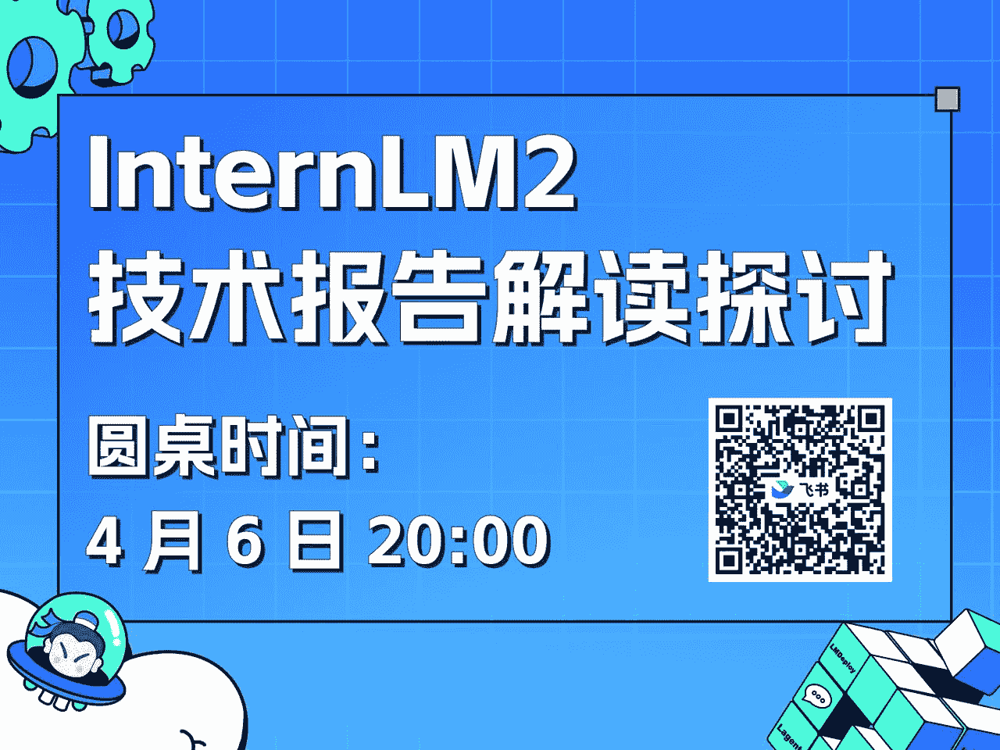
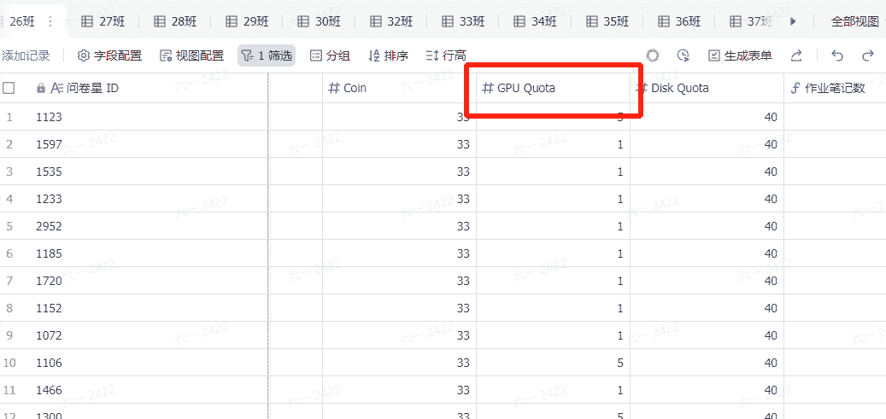
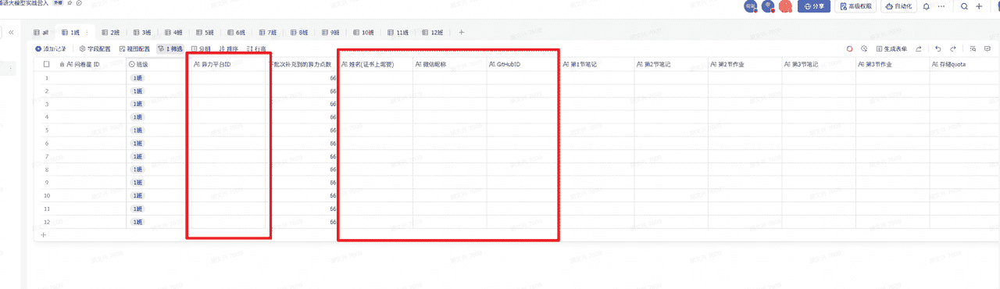

# 营长&助教手册

> 来源：[https://aicarrier.feishu.cn/docx/UVzrd5dM2oDTVBx6tMCcNGmjndd](https://aicarrier.feishu.cn/docx/UVzrd5dM2oDTVBx6tMCcNGmjndd)

# 名单

## 营长名单

职责：负责10个班助教的招募，以及助教工作的兜底

| 班级 | 营长 |
| --- | --- |
| 1-10 班 | 徐政杰 |
| 11-20 班 | 郑皓桦 |
| 21-30 班 | 六  一 |
| 31-40 班 | 猫先生 |
| 41-50 班 | 尖  米 |
| 51-60班 | 金润杰 |
| 61-70班 | 刘卓鑫 |
| 71-80班 | 舒克 |
| 81-90班 | 知唐(未定) |
| 91班-100班 | 那路(未定) |

营长福利：单卡 A100 权益

## 助教名单

# 近期工作

## 开营前

### 引导学员完成注册登记等准备工作

> 引导学员加入实战营飞书群获取文档编辑权限，引导学员完成信息登记，28 号前登记信息的小伙伴每天的算力将会补充到 33 点用于体验平台，并发起群接龙

### 常见问题

> 登记了算力没刷新：

+   是不是使用了不同的账号（查平台ID）

+   填写内容前后有没有空格导致未匹配

## 开营

> 群内破冰，引导学习者自我介绍及项目思路讨论。

> 自我介绍模板：

> 【大家可以叫我】: 夏目/五条

> 【坐标】：北京/西安/宁夏

> 【专业/职业】：计算机科学与技术专业学生

> 【兴趣爱好】： 摄影，调酒，旅游，AIGC

> 【项目技能】数据清洗，模型微调

> 【组队情况】未组队，有项目想法，有数据来源，希望和有前后端开发经验的小伙伴一起完成

> 【本课程学习基础】：已完成实战营第一期学习，python及命令行使用熟练，熟悉大模型基本知识，之前有参与做过AI应用

> 【本期活动目标】：帮助大家更好的完成训练营学习，和大家一起学习进步

## 正式学习

### DDL汇总

60班以后的班级，可以在这个DDL的基础上，根据学员进班的情况适当延后几天。

| **DDL** | **学习内容** | **视频链接** | **文档链接** | **笔记&amp;作业** |
| --- | --- | --- | --- | --- |
| 第1节课 | 书生·浦语大模型全链路开源开放体系 | [https://www.bilibili.com](https://www.bilibili.com/video/BV1Vx421X72D/)/video/BV1Vx421X72D/ | InternLM2 技术报告https://arxiv.org/pdf/2403.17297.pdf | **看视频做的笔记**和读InternLM2 技术报告做的笔记都写到同一个笔记文档，提交一个链接 |
| 第2节课 | 轻松分钟玩转书生·浦语大模型趣味 Demo | https://www.bilibili.com/video/BV1AH4y1H78d/ | https://github.com/InternLM/Tutorial/blob/camp2/helloworld/hello_world.md | https://github.com/InternLM/Tutorial/blob/camp2/helloworld/homework.md |
| 第3节课 | &quot;茴香豆&quot;:零代码搭建你的 RAG 智能助理 | https://www.bilibili.com/video/BV1QA4m1F7t4/ | https://github.com/InternLM/Tutorial/blob/camp2/huixiangdou/readme.md | https://github.com/InternLM/Tutorial/blob/camp2/huixiangdou/homework.md |
| 第4节课 | XTuner 微调 LLM:1.8B、多模态、Agent | https://www.bilibili.com/video/BV15m421j78d | https://github.com/InternLM/Tutorial/blob/camp2/xtuner/personal_assistant_document.md | https://github.com/InternLM/Tutorial/blob/camp2/xtuner/homework.md |
| 第5节课 | LMDeploy 量化部署 LLM 实践 | https://www.bilibili.com/video/BV1tr421x75B/ | https://github.com/InternLM/Tutorial/blob/camp2/lmdeploy/README.md | https://github.com/InternLM/Tutorial/blob/camp2/lmdeploy/homework.md |
| 第6节课 | Lagent &amp; AgentLego 智能体应用搭建 | https://www.bilibili.com/video/BV1Xt4217728/ | https://github.com/InternLM/Tutorial/tree/camp2/agent | 作业：https://github.com/InternLM/Tutorial/blob/camp2/agent/homework.md |
| 第7节课 | OpenCompass 大模型评测实战 | https://www.bilibili.com/video/BV1Pm41127jU | https://github.com/InternLM/Tutorial/blob/camp2/opencompass/readme.md | 作业: |
| 第8节课 | 大模型微调数据构造 | https://www.bilibili.com/video/BV1Dx4y1z7Ju | https://github.com/InternLM/Tutorial/blob/camp2/data_fine_tuning/data_fine_tuning.md | 没有笔记作业提交要求 |
| 彩蛋 | 平台工具类补充课程 |  |  | 没有笔记作业提交要求 |
| **4.29清理算力平台。课程学习DDL**5.11，助教5.12完成笔记作业评审。 |  |  |  |  |

### InternLM2 技术报告解读人员招募

InternLM2 技术报告解读预期近期内会组织一场小圆桌，进行报告的翻译和解读，有要参与的小伙伴进群。需要有一定英文能力和技术能力，能够保证翻译质量。

### InternLM2 技术报告线上探讨（4月6日）

## 结营

+   注意及时提醒学员作业**截止DDL**和**算力平台清理**时间，尽量采用群公告、置顶等方便大家查看的方式。

+   **告知大家作业评审**的要求和条件，同时提醒大家认真对待，不要趁快结营浑水摸鱼。

+   及时**评审所有笔记及作业**，并提醒学员查看评审结果。

+   具体话术见本文末“公告文案”。

> **作业评审完**毕后**，联系营长将**完成所有笔记作业并合格的同学拉入结营群，并制作结营证书。

## 学习群注意事项

### 氛围

+   有些群热闹有些群冷清，都是常态，不需要过多担心，做好日常消息发布和提醒就够了

+   有不知道怎么处理的问题，及时在助教群提出，或者找营长

+   提醒学习者群内**不要发广告、拉票等无关信息**，否则T出群

+   提醒学习者不要轻信私聊自己提供学习资料的人

### 提问

+   尽量引导学员**在群里提问**，如果私聊，也尽量在群里@他回答，避免耗费过多精力

+   如果是和本次课程**相关度不大**的，可以直接告诉学员自己也不会

+   一些简单问题，引导学员**自己搜索或者问大模型**，解决不了再来提问

+   鼓励学员去看QA文档，同时助教自己也及时把群内提问内容更新到QA文档

+   引导学员提问附上**完整截图和自己的探索思考**

### 作业提交

+   尽量在下一次课预计开始时间之前**提醒大家完成**上一次课作业

+   **会考虑留出周末时间来**让大家学习，一般为链接下发后的下一个周一20:00

+   可能出现前后两节课**同一DDL时间**的情况

+   作业截图注意查看算力平台id、环境信息、操作命**令等有**自己操作特征的部分，如果没有或看不清，按照未完成处理。

+   **注意提醒学习者笔记**及作业至少需要保留至本期学习**结营，提前删除笔记**作业，可能导致失去结营及评优资格

+   **DDL之后再补交**的作业是否评审，是否给学员结营资格，助教可自行决定

+   完成基础作业之后**开算力做进阶的****，需要先简单看一**下基础作业是否完成，等进阶部分做完后再一起评审，可以约定DDL为限。

### 调整学员算力值

+   特别注意检查学员的作业情况！！！不要一说就开！！！

+   助教在[学员信息&作业登记](https://aicarrier.feishu.cn/wiki/TqjawZsoqiiRXEkRpcScmKAAn8d?chunked=false&table=tblNCUy9PeGmgd9I&view=vewQagjCL1)表格里自行操作。

+   在班级筛选视图里找到需要调整的学员，修改“GPU Quota”列的值。数字1为80*10%=8G，数字5为80*50%=40G。

+   调整后**下一次刷新时方可生效**（一般是每天晚上7-8点）。

+   **表格其它列（**算力点、磁盘容量）助教暂时无法修改。

+   如果**算力正常提示显存不够**，首先考虑是否开了多个终端，把没有在用的关闭。

+   **需要完成第一次作业****并评审合**格后才可调整算力为3，可一直保持。

+   需要完成第二次作业基础部分**并评审合格后，才**可临时调整算力为5，第二课学完即恢复为3。

+   第二课基础部分，算力1足够，进阶部分除灵笔之外算力3足够，灵笔需要算力5。

### 即时调整GPU和磁盘容量

> 磁盘容量不够，先让学员**自行删除**之前的学习环境及内容（参见QA文档第一条）。

> 删除之后需要**等待一段时间**才能刷新。

> 学员反馈**算力调整没有生效**，可以联系营长即时刷新一下。

> 有**比较紧急的情况**需要马上调整显存和容量，可以直接联系营长。

> 告知学员算力平台ID，简要**说明情况**。

> 调整**即时生效**，不需要等晚上刷新。

> 助教自己掌握，不要在群内直接公告，**对于认真学习的同**学，确实资源不够的才开，人数次数不要太多。

## 助教福利

+   定制证书

+   40GB A100 权限

+   精美周边

# 学习群公告文案

## 报名接龙

> 已经加入飞书群的小伙伴，并且成功登记学员信息的小伙伴，参与一下接龙。

> 要加入飞书群里，才有对应的文档编辑权限，才可以登记你的个人信息，平台这边才能统一给大家发放算力进行学习。

> 例 问卷星-🛰️名

> 实战营入口链接: https://aicarrier.feishu.cn/wiki/A4W6wvDNNiwwpgksCqxcrnJZnAf

## 开营前

> 欢迎来到书生·浦语大模型实战营（二期）26班！

> 我们将在2024年3月25日进行开营仪式，带领大家正式开始学习之旅~

> 在开营之前，希望大家能够完成：

1.  阅读学员手册；

1.  注册算力平台用户；

1.  加入本期实战营飞书群；

1.  填写学员信息登记表。

> =======================

> 学员手册链接：[学员手册](https://aicarrier.feishu.cn/wiki/Vv4swUFMni5DiMkcasUczUp9nid?from=from_copylink)

> 算力平台链接：https://studio.intern-ai.org.cn/

> 飞书群加入链接（需要在浏览器或者飞书打开，使用飞书账号登录）：https://applink.feishu.cn/client/chat/chatter/add_by_link?link_token=33br891a-6704-43b6-a1ef-748eb787d0b2&qr_code=true

> 学员信息登记表链接：[学员信息&作业登记](https://aicarrier.feishu.cn/wiki/TqjawZsoqiiRXEkRpcScmKAAn8d?chunked=false&table=tblNCUy9PeGmgd9I&view=vewQagjCL1)

> QA文档链接:[书生·浦语大模型实战营Q&A文档](https://cguue83gpz.feishu.cn/docx/Noi7d5lllo6DMGxkuXwclxXMn5f)

> ============================

> 也可使用飞书APP扫描这个二维码加群

> 各位同学傍晚好呀，不知道大家算力平台体验的怎么样啦，有没有试着跑通1.8B模型体验呢

> ==========================

> 目前还是以完善飞书表格登记为主，请新来的同学查看群公告，及时填写信息，早拿算力早享受哦[旺柴][强]

> ==========================

> 今日推荐一些很棒的辅助学习资料，可以帮助大家更好的入门课程，做出优秀的作品：

1.  参数高效微调方法对比（英文）：https://www.theaidream.com/post/fine-tuning-large-language-models-llms-using-peft

1.  QLoRA原理（中文）：https://zhuanlan.zhihu.com/p/634256206

1.  QLoRA原理（英文）：https://www.mercity.ai/blog-post/guide-to-fine-tuning-llms-with-lora-and-qlora

> ==========================

> Tips：

1.  可以用vscode，ssh到服务器，在本地有更优质的代码体验

1.  服务器上modelscope的下载速度非常快

1.  share文件夹中有所有书生系列模型，可以软链接到自己文件夹而避免下载，如ln -s /share/temp/model_repos/internlm-chat-7b .   后续课程正式开放后一些权重会更新到最新版

> 21班-九月:

> [群公告]【21班开班欢迎公告】

> 欢迎大家来到书生·浦语大模型实战营(第二期)21班，

> 我是本班助教来自青岛的九月，

> 接下来我会陪伴大家和大家一起学习，为大家答疑解惑或者提供其他有关的支持，

> 希望大家配合，一起加油！

>

> • 请尽快完成学员信息登记，以方便尽快发放算力，早点采用分配的A100算力机器进行操作。

> • 【算力平台停机维护通知】

> InternStudio 将于 3 月 28 日停机维护，没有在白名单内的用户将会被清空算力、磁盘数据。

> 往期有项目的同学请在项目表格中及时登记加入白名单！！！

> 一个项目只保留一个账号,  及时备份数据

> [InternLM 项目](https://aicarrier.feishu.cn/wiki/JuXvwHzGni2A2Rksd8Rczpvxngb)

> 请小伙伴们及时备份数据，不100%保证白名单内的用户数据不会丢失

>

>

> • 1、加入实战营飞书群

> • 请安装飞书app，注册账号后，扫描二维码后跳转飞书InternLM实战营，加入群组后，才能自动获得文档登记的编辑权限，

> [图片]

> • 登记完个人信息，才会根据填写的信息发放算力方便进行学习。

>

> • 2、做好“学员信息&作业登记”文档编辑登记。

> 登记信息包括：问卷星ID、班级（本班为21班）、算力平台ID、姓名等，接下来具体信息获取渠道为：

> • 2.1：访问https://www.wjx.cn/vm/tUX8dEV.aspx?udsid=2146 查看个人信息，获得问卷星ID、核销码

> • 2.2 复制核销码，进入算力平台地址注册登录核销：https://studio.intern-ai.org.cn/ ，核销注册后，点击 头像-我的信息-用户ID，该用户ID即为算力平台ID

> [学员信息&作业登记](https://aicarrier.feishu.cn/wiki/TqjawZsoqiiRXEkRpcScmKAAn8d?chunked=false&table=tblNCUy9PeGmgd9I&view=vewQagjCL1) 文档登记地址【电脑端操作更方便】：

>

>

>

> • 上期InterLM 大模型训练营优秀项目模型架构图（含InterLM 大模型开源社区有关文档）【内含丰富资料】

> https://wvet00aj34c.feishu.cn/wiki/FwqiwNJCSiEmXGkRzddcLYF8nAe

>

> • 想提前了解课程大致形式的小伙伴可以

>

> 21班-九月:

> 大家问问题, 多在群里问, 因为你的问题可能对别的同学有帮助, 私聊我一般不会回答,

>

> 这是个自己督促自己学习的过程, 只有足够用心和努力的人才会得到更多算力和帮助, 希望大家早点申请项目和尝试, 早点得到算力, 实现自己的想法.

>

> 群公告和置顶消息很重要, 务必每日查看更新

> 【24班开班欢迎公告】

> 欢迎大家来到书生·浦语大模型实战营(第二期)24班，我是本班助教来自厦门大学的莲梅莉usamimeri，

> 接下来我会陪伴大家和大家一起学习，为大家答疑解惑或者提供其他有关的支持，希望大家配合，一起加油！

>

> 请尽快完成学员信息登记，以方便尽快发放算力，早点采用分配的A100算力机器进行操作。

> 【算力平台停机维护通知】

> InternStudio 将于 3 月 28 日停机维护，没有在白名单内的用户将会被清空算力、磁盘数据。

> 往期有项目的同学请在项目表格中及时登记加入白名单！！！

> 一个项目只保留一个账号,  及时备份数据

> [InternLM 项目](https://aicarrier.feishu.cn/wiki/JuXvwHzGni2A2Rksd8Rczpvxngb)

>

> • 1、加入实战营飞书群

> • 请安装飞书app，注册账号后，扫描二维码后跳转飞书InternLM实战营，加入群组后，才能自动获得文档登记的编辑权限，

> [图片]

> • 登记完个人信息，才会根据填写的信息发放算力方便进行学习。

>

> • 2、做好“学员信息&作业登记”文档编辑登记。

> 登记信息包括：问卷星ID、班级（本班为24班）、算力平台ID、姓名等，接下来具体信息获取渠道为：

> • 2.1：访问https://www.wjx.cn/vm/tUX8dEV.aspx?udsid=2146 查看个人信息，获得问卷星ID、核销码

> • 2.2 复制核销码，进入算力平台地址注册登录核销：https://studio.intern-ai.org.cn/ ，核销注册后，点击 头像-我的信息-用户ID，该用户ID即为算力平台ID

> [学员信息&作业登记](https://aicarrier.feishu.cn/wiki/TqjawZsoqiiRXEkRpcScmKAAn8d?chunked=false&table=tblNCUy9PeGmgd9I&view=vewQagjCL1) 文档登记地址【电脑端操作更方便】：

>

> • 上期InterLM 大模型训练营优秀项目模型架构图（含InterLM 大模型开源社区有关文档）【内含丰富资料】

> [第一期InterLM 大模型训练营优秀项目模型架构图（含训练营RoadMap+InterLM 大模型开源社区有关文档）](https://wvet00aj34c.feishu.cn/wiki/FwqiwNJCSiEmXGkRzddcLYF8nAe)

>

> • 想提前了解课程大致形式的小伙伴可以参考上期实战营教程和助教的知乎笔记：

> Github教程： https://github.com/internLM/tutorial

> 助教上期笔记汇总【欢迎点赞和拿到算力后尝试】：

> https://www.zhihu.com/column/c_1743029778746048512

>

> • 常见QA问题文档：

> [常见问题 QA](https://aicarrier.feishu.cn/wiki/AkCDwTWJtiebUkkChV0ct9uAnGc)

> ————————

>

> 这次课程会以1.8B模型为主，在/share/new_models里，完整路径为/root/share/new_models/Shanghai_AI_Laboratory/internlm2-chat-1_8b

> 这些内容晚一点会做一次更新，会把权重更新为最新发布的版本

> -------------

1.  登记一下项目就可以解锁更高的算力额度（ROM存储，GPU RAM 10%->30% or 50%, 算力点）

> [InternLM 项目](https://aicarrier.feishu.cn/wiki/JuXvwHzGni2A2Rksd8Rczpvxngb?fromScene=spaceOverview)

>

> 书生浦语系列模型仓库【欢迎点赞】：https://github.com/internLM/internLM/

## 开营暖场

> @所有人

> 🎉🚀 开营倒计时启动！ 🚀🎉

>

> **27班**的小伙伴们，我们的课程学习即将开始，今晚就是大日子！还没加入我们的飞书群、登记信息、领取那份专属的免费算力的小伙伴们，现在是时候了！🏃♂💨

>

> 破冰行动，不仅仅是因为即将开始的精彩课程，更是为了那些还未遇见的可能性和创意火花！🌟

>

> 今晚，我们不只是相遇，更是为了相知、相助、共创。有独到的项目想法？快来群里分享，让我们一起头脑风暴。

>

> 有需要寻找项目的导航灯？@我 帮大家找到有相关经验的佬，让大家项目少走弯路，想法落地！🌈

>

> 让我们一起，开启这段学习之旅，探索书生·浦语大模型给我们带来的的无限可能。 🌟🛠

## 正式开营

> 很高兴能和大家在这里见面，欢迎来参加上海人工智能实验室举办的书生·浦语大模型实战营！这个活动旨在推动大模型在各个行业大放异彩，并为广大开发者们提供一个学习和实践大模型开发的超级棒平台！

>

> 我们都知道，在人工智能飞速发展的时代，大模型已经成为引领创新和突破的大力推动者。但开发和应用大模型可不是一件容易的事情，需要我们掌握一堆技巧和方法。所以，这次实战营的目标就是让大家能够高效地学习，玩转大模型的微调、部署和评测全套工具。

>

> 接下来的两周里，我们会给大家提供一堆学习资源和实践案例，让你们更深入地了解大模型的原理和应用场景。助教团队也会一直在这里，和大家一起讨论问题、解决疑惑，提供指导和支持，帮助大家充分发挥大模型的潜力。

> 相信通过这次实战营的学习和实践，大家一定能掌握大模型开发的核心技能，提升自己在人工智能领域的竞争力，并把所学应用到真实项目中去。

> 希望这段时间的学习和交流能带给你们满满的收获！谢谢大家的支持和参与！

>

> 我们此次的学习方式是markdown文字教程+视频教程的形式，所以大家只要按时打卡即可，不存在错过直播之类的事情~

>

> 接下来简单介绍下我们课程的时间~

> 正式开营：2024 年 3 月 25 日

> 课程培训：2024 年 3 月 27 日至 2024 年 4 月 12 日

>

> 在开启本次课程的学习之前，我希望大家可以填写飞书内的信息表。如果没有填写的信息表的话，会影响到后续课程算力的发放哦~同学们一定要填写！

>

> 大家可以先做个自我介绍破下冰哦

>

> 【大家可以叫我】: 夏目/五条

> 【坐标】：北京/西安/宁夏

> 【专业/职业】：计算机科学与技术专业学生

> 【兴趣爱好】： 摄影，调酒，旅游，AIGC

> 【项目技能】数据清洗，模型微调

> 【组队情况】未组队，有项目想法，有数据来源，希望和有前后端开发经验的小伙伴一起完成

> 【本课程学习基础】：已完成实战营第一期学习，python及命令行使用熟练，熟悉大模型基本知识，之前有参与做过AI应用

> 【本期活动目标】：帮助大家更好的完成训练营学习，和大家一起学习进步

> **在这次实战营后，你能收获：**

1.  下载Huggingface模型并在命令行、网页端运行！堪比本地的文心一言。

1.  实现RAG，让大模型拥有知识库，试试把你的项目文档、pdf资料等给模型参考吧。

1.  实现大模型参数高效微调，角色扮演、音乐生成、食谱编写……只有你想不到，没有你做不到！

1.  实现量化部署模型，让3060能跑7B模型，让你的机器人能调用模型python接口获取回复。

1.  智能体应用搭建，给予模型工具、计划、记忆……让其成为全能助手

1.  跑通大模型评测，学习根据大模型排行榜单挑选适合业务的模型，并熟悉衡量模型好坏的维度指标。

1.  熟悉常用微调数据格式，让平常收集“指令微调”数据与清洗不再困难！

## 开营结束语

> 所有消息都会由我或者浦语小助手及时通过群公告发布~私下加人发送的课程或者学习资料，都不是本次学习的内容！望周知！

> 本[学员手册](https://aicarrier.feishu.cn/wiki/Vv4swUFMni5DiMkcasUczUp9nid?from=from_copylink)开营到这里就结束啦~大家还有什么想聊的，都可以在群里来说说~别忘了完成注册登记等学习准备哦！详见学习手册

## 正式学习

### 第一节课直播预告

> ⭐3月27日第一次课⭐

> ====================

> 今晚8点，上海人工智能实验室的青年科学家陈恺老师将带领我们开启书生浦语实战营的学习，揭开AI技术最前沿的神秘面纱

> 赶快扫描二维码预约直播吧

> 📢开营第一课的学习内容还包括最近刚出的internlm2报告，链接如下:

> https://arxiv.org/pdf/2403.17297.pdf

> 📢注意本次课程需要提交笔记:视频笔记+InternLM2技术报告笔记都写到同一个笔记中，并提交一个可以被公开访问的链接。

> （组员笔记会由我来评审，优秀笔记会被展示和推荐哦）

> ====================

> 📘学员手册对应页面已更新：

> ✅:常见QA问题文档：

> [常见问题 QA](https://aicarrier.feishu.cn/wiki/AkCDwTWJtiebUkkChV0ct9uAnGc)

> ====================

> 💡Tips:笔记不需要完全照抄课程内容，可以关注一些亮点，并结合自身背景进行思考。

> 可以参考助教上期的笔记：https://www.zhihu.com/column/c_1743029778746048512

### 第一节课作业说明

注意将两个飞书文档超链接文字替换为链接

> 昨晚直播之后，我们就正式开始学习之旅啦！

> ================================

> 第一节课学习内容：

1.  《书生·浦语大模型全链路开源体系》视频课程

> 地址：[https://www.bilibili.com](https://www.bilibili.com/video/BV1Vx421X72D/)/video/BV1Vx421X72D/

1.  internlm2技术报告

> 地址:https://arxiv.org/pdf/2403.17297.pdf

> =====================================

> 作业要求：

+   学习视频课程和InternLM2技术报告的笔记都写到同一个线上文档或博客等平台，并提交一个可以被公开访问的链接。

+   不要大面积截图或者复制粘贴课程内容，可以关注一些亮点，并结合自身背景进行思考。不求全只求新。

+   如果引用请注明来源链接，包括教程及别的参考资料。

> ======================================

> 作业提交：

+   DDL为4月1日（周一）20:00。注意第二节课可能在4月1日之前会放出，两节课的学习时间和DDL时间可能会重叠，所以尽早完成第一节课学习任务，避免影响后续学习。

+   提交地址就是学员信息登记地址，注意提交在“第一课笔记”对应的列。

> [学员信息&作业登记](https://aicarrier.feishu.cn/wiki/TqjawZsoqiiRXEkRpcScmKAAn8d?table=tblNCUy9PeGmgd9I&view=vewaCKMgVg)

+   还没有完成注册登记的同学迅速注册登记，具体流程详见学员手册。

> [学员手册](https://aicarrier.feishu.cn/wiki/Vv4swUFMni5DiMkcasUczUp9nid?from=from_copylink)

> ===========================================

> 今天算力平台停机检修，大家抓紧时间完成第一节课的学习任务，为后面实践学习留出更多时间！

> @所有人 数据太多了，没删完~今天平台还在继续检修~大家安心读报告写作业哦~大家安心读报告写作业哦~平台恢复了我们会尽快通知大家的

> 鉴于很多同学反馈技术报告解读难度太大，大家商议之后，决定把这一项作为非必做的加分项~

> 大家认真看视频写笔记，就可以算合格啦~注意要有自己的思考哦，只放几张截图，或者只抄几句ppt大纲而没有自己的归纳总结，都会被我判做0分的

### 第二节课发布

> 课程上新啦~

>

> 由书生·浦语角色扮演小组长【那路】为大家带来【轻松玩转书生·浦语大模型趣味 Demo】课程~

>

> 玩转书生·浦语【智能对话】、【智能体解应用题】、【多模态理解及图文创作】等趣味 Demo

>

> 视频晚上 21:20 上传。

> 课程文档：https://github.com/InternLM/Tutorial/blob/camp2/helloworld/hello_world.md

> 课程视频：https://www.bilibili.com/video/BV1AH4y1H78d/

> 课程作业：https://github.com/InternLM/Tutorial/blob/camp2/helloworld/homework.md

>

> 初始只有 8G 显存，如需要调节 GPU 到 24 GB，请先完成第一节课的笔记后联系我临时（第三节课前）在表中调整 GPU Quota

>

> 觉得不错欢迎 Star

> https://github.com/InternLM/InternLM

> 第二节课来啦！由书生·浦语角色扮演小组长【那路】为大家带来【轻松玩转书生·浦语大模型趣味 Demo】课程！玩转书生·浦语【智能对话】、【智能体解应用题】、【多模态理解及图文创作】等趣味 Demo！

> 课程文档：https://github.com/InternLM/Tutorial/blob/camp2/helloworld/hello_world.md

> 课程视频：https://www.bilibili.com/video/BV1AH4y1H78d/

> 课程作业：[h](https://github.com/InternLM/Tutorial/blob/camp2/helloworld/homework.md)ttps://github.com/InternLM/Tutorial/blob/camp2/helloworld/homework.md

> ==============================

> 作业要求：

> 【第一节课】只提交一个笔记文档链接，需要完成视频课程内容总结归纳。加上InternLM2 技术报告相关解读有加分！

> 【第二节课】需要提交课程学习的知识整理总结和心得体会（笔记）和在算力平台上实践操作的过程整理总结和心得体会（作业）两个文档链接。

> 【作业】必须有关键步骤完成截图，否则视为未完成。

> ======================================

> 作业提交：

> 【DDL】第一节课DDL为4月1日（周一）20:00，第二节课DDL为4月5日（周五）。大家注意充分利用周末休息时间抓紧学习。

> 【提交地址】提交地址就是学员信息登记地址，注意分别提交在对应的列。

> [学员信息&作业登记](https://aicarrier.feishu.cn/wiki/TqjawZsoqiiRXEkRpcScmKAAn8d?table=tblNCUy9PeGmgd9I&view=vewaCKMgVg)

> 【注册登记】从第二节课开始，后面每节课都是实际操作的内容，大家一定要先完成注册登记，才能获得算力资源，在线上平台来操作！注册登记流程详见下面学员手册链接：

> [学员手册](https://aicarrier.feishu.cn/wiki/Vv4swUFMni5DiMkcasUczUp9nid?from=from_copylink)

> =====================================

> 【算力申请】初始只有 8G 显存，如需要调节 GPU 到 24 GB，请先完成第一节课的笔记后联系我临时（第三节课前）在表中调整 GPU Quota

> 【为课程加油】觉得不错欢迎 Star！给课程制作者和助教们一点小小的鼓励！

> https://github.com/InternLM/InternLM

### 第二节课调整算力值

> 第二课进阶部分除灵笔之外需要30%算力，灵笔需要50%算力。大家完成基础部分作业并提交之后，可以群内@我申请提升算力。我检查作业合格之后进行修改，每晚7-8点算力刷新之后生效。

> 50%算力提升是临时的，仅供灵笔部分的实践使用。第二课学习结束后，会恢复为30%。希望大家根据自己的学习内容合理选择算力，方便大家！

> 基础作业和进阶作业可以写在同一个文档，或者更新另一个文档，不需要写成两个链接。我会在打卡DDL结束之后统一再次进行评审。

> 马上要到DDL抢算力高峰时段啦！我们会对占用算力资源但没有学习的情况进行清理~明天开始，我会将没有完成第一次作业的同学算力调整为0，提交并联系我评审合格后恢复~打算DDL前冲一波的同学们一定要注意哦！别因为不交作业影响了算力平台使用~

> 注意，我恢复了也是要等到晚上7点刷新后生效的~

### 第三节课发布

> 课程上新啦~

>

> 由书生·浦语社区贡献者【北辰】带来【茴香豆：搭建你的 RAG 智能助理】讲解

>

> 1、RAG 基础介绍

> 2、茴香豆产品简介

> 3、使用茴香豆搭建RAG知识库实战

>

> 视频地址：https://www.bilibili.com/video/BV1QA4m1F7t4/

> 文档地址：https://github.com/InternLM/Tutorial/blob/camp2/huixiangdou/readme.md

> 作业地址：https://github.com/InternLM/Tutorial/blob/camp2/huixiangdou/homework.md

>

> 觉得不错欢迎给茴香豆 Star

> https://github.com/InternLM/HuixiangDou

> 第三节课来啦！由书生·浦语社区贡献者【北辰】带来【茴香豆：搭建你的 RAG 智能助理】讲解

> 1、RAG 基础介绍

> 2、茴香豆产品简介

> 3、使用茴香豆搭建RAG知识库实战

> 视频地址：https://www.bilibili.com/video/BV1QA4m1F7t4/

> 文档地址：https://github.com/InternLM/Tutorial/blob/camp2/huixiangdou/readme.md

> 作业地址：https://github.com/InternLM/Tutorial/blob/camp2/huixiangdou/homework.md

> ==============================

> 作业要求：

> 后续课程都需要提交笔记和作业两个文档链接：

> 【笔记】主要记录课程学习的知识整理总结和心得体会；

> 【作业】主要记录在算力平台上实践操作的过程整理总结和心得体会。

> 作业必须有自己的关键步骤完成截图，不得使用教程截图，否则视为未完成。

> ===============================

> 作业提交：

> 【DDL】第三节课DDL为4月14日（周日）20:00。注意可能与第四节课学习时间有重叠，尽量提前完成。

> 【提交地址】提交地址就是学员信息登记地址，注意分别提交在对应的列。

> [学员信息&作业登记](https://aicarrier.feishu.cn/wiki/TqjawZsoqiiRXEkRpcScmKAAn8d?table=tblNCUy9PeGmgd9I&view=vewaCKMgVg)

> ===============================

> 【注册登记】新加入学习的同学一定要先阅读学员手册，完成注册登记后开始学习：

> [学员手册](https://aicarrier.feishu.cn/wiki/Vv4swUFMni5DiMkcasUczUp9nid?from=from_copylink)

> 【算力调整】50%算力大狂欢已结束！目前第一节课笔记未完成的，算力值0；完成第一节课笔记的，算力值10%；完成第二节课笔记作业的，算力30%。若有特殊需求，可以群内@六一，说明自己具体的学习或者项目内容，申请增加。

> ===================================

> 【为课程加油】觉得不错欢迎 Star！给课程制作者和助教们一点小小的鼓励！

> https://github.com/InternLM/HuixiangDou

### 第五节课发布

> 课程上新啦～

>

> 由西北工业大学博士生、书生·浦源挑战赛冠军队伍队长、第一期书生·浦语大模型实战营优秀学员【安泓郡】带来【LMDeploy 量化部署 LLM&VLM实战】课程讲解

>

> 课程视频：https://www.bilibili.com/video/BV1tr421x75B/

> 课程文档：https://github.com/InternLM/Tutorial/blob/camp2/lmdeploy/README.md

> 课程作业：https://github.com/InternLM/Tutorial/blob/camp2/lmdeploy/homework.md

>

> 如果觉得 LMDeploy 不错，欢迎 Star

>

> https://github.com/InternLM/LMDeploy

>

> 也欢迎更多的优秀学员私聊浦语小助手（🛰️搜索 InternLM） 参与实战营课程制作

### 第六节课发布

> 课程上新了~

>

> 由 Lagent&AgentLego 核心贡献者樊奇带来【Lagent & AgentLego 智能体应用搭建】课程内容的讲解~

>

> 1、Agent 理论及 Lagent&AgentLego 开源产品介绍

> 2、Lagent 调用已有 Arxiv 论文搜索工具实战

> 3、Lagent 新增自定义工具实战（以查询天气的工具为例）

> 4、AgentLego 新增 MagicMaker 文生图工具实战

>

> 视频地址：https://www.bilibili.com/video/BV1Xt4217728/

> 课程文档：https://github.com/InternLM/Tutorial/tree/camp2/agent

> 课程作业：https://github.com/InternLM/Tutorial/blob/camp2/agent/homework.md

>

> 觉得不错欢迎 Star

> https://github.com/InternLM/Lagent

> https://github.com/InternLM/AgentLego

### 第七节课发布

> 课程上新了~

>

> 由 OpenCompass 贡献者曹茂松、刘卓鑫带来【OpenCompass 大模型评测实战】课程内容的讲解~

>

> 视频地址：https://www.bilibili.com/video/BV1Pm41127jU/

> 课程文档：https://github.com/InternLM/Tutorial/blob/camp2/opencompass/readme.md

> 课程作业：https://github.com/InternLM/Tutorial/blob/camp2/opencompass/homework.md

>

> 觉得不错欢迎 Star

> https://github.com/open-compass/opencompass

## 结营预告

> 今天是DDL之前的最后一个周末啦！各位小伙伴冲冲冲！速度完成作业，五一开心出去玩！

> ========================

> 笔记作业提交DDL：4月25日（周三）23：59

> 算力点停止发放：4月28日（周日）晚7点最后一次发放

> 算力平台清理（学习环境删除）：4月29日（周一）9:00-5月1日9:00

> 下一批学习开始：5月1日

> ========================

> [学员手册](https://aicarrier.feishu.cn/wiki/Vv4swUFMni5DiMkcasUczUp9nid)前所有作业笔记相关的课程内容和作业要求都已放出，详情请查看学员手册：

> ========================

> 【为课程加油】觉得不错欢迎 Star！给课程制作者和助教们一点小小的鼓励！

> https://github.com/InternLM/AgentLego

> https://github.com/InternLM/lagent

> https://github.com/InternLM/HuixiangDou

> https://github.com/InternLM/XTuner

> https://github.com/open-compass/opencompass

> https://github.com/InternLM/lmdeploy

> ========================

> 作业要求：截图必须完整，需要保留算力平台id、环境信息、操作命令等有自己操作特征的部分，且文字清晰可见。不能只截结果呈现的那一小块，否则视同未完成！！！

> 大家尽早提交，我评审发现什么问题还可以及时提出之后修改，以免影响结营或者评优~

> 注意笔记及作业至少需要保留至本期学习结营，便于助教们最后集中评审复查及评优~提前删除笔记作业，可能导致失去结营及评优资格

> 越是临近结营，我对作业和笔记的要求会越高（对想趁机浑水摸鱼的同学会更严苛）~大家不要抱着侥幸心理，尽早开动，认真地对待学习任务

> 希望各位都能通过本次的学习，真正学有所获！