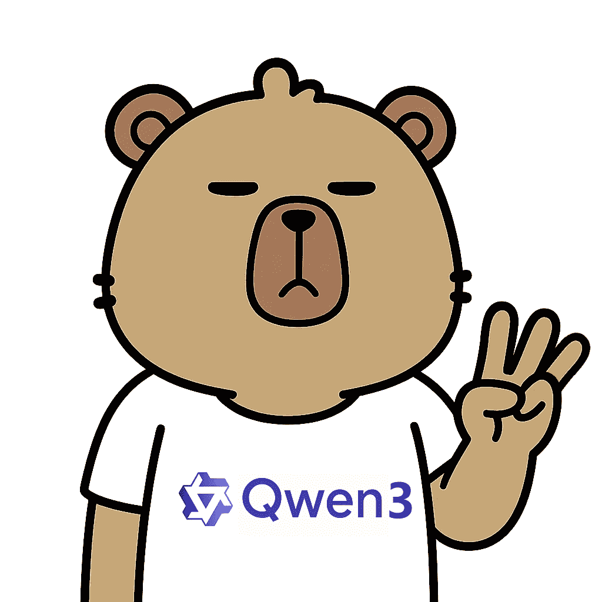

# Qwen3 体验解读圆桌

> 来源：[https://aicarrier.feishu.cn/docx/P5SJdSrQRowLZRxBigvcDUr3nBd](https://aicarrier.feishu.cn/docx/P5SJdSrQRowLZRxBigvcDUr3nBd)

#腾讯会议：822-862-909

问题：

| 序号 | 描述 | 解答 |
| --- | --- | --- |
| 1 | Qwen3 客户端的多模态如何实现的？ |  |
| 2 | Qwen3 Web Design 能力怎么样？ |  |
| 3 | qwen3对比qwen2有哪些改进 |  |
| 4 | qwen3 使用YaRN拓展上下文和原生上下文长度的答案生成质量对比 |  |
|  |  |  |

# Qwen3 名称由来

之前发布了 Qwen2，甚至是 Qwen 2.5

所以这次是 Qwen3

# Qwen 怎么发音

坤～

之前发布的是 Qwen2.5

也就是经过 2.5 年的练习，Qwen3 出道了

考虑到 Qwen3 是多模态

所以是唱跳出道

# 技术分析

# 使用案例

9.9 和 9.11 哪个大

strawberry 有几个r

# 表情包创作

