# LMDeploy Qwen3 量化部署实践

> 来源：[https://aicarrier.feishu.cn/docx/T1nidNh8poFsqexopDEcXV30nZc](https://aicarrier.feishu.cn/docx/T1nidNh8poFsqexopDEcXV30nZc)

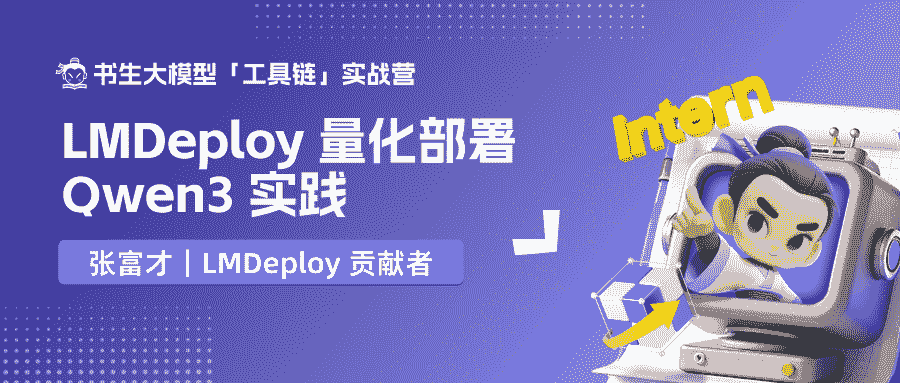

`Qwen3` 系列模型4月29日震撼发布，让我们一起动手用`LMDeploy`部署`Qwen3`系列模型吧～

`LMDeploy` 是一个高效且友好的 `LLMs` 模型部署工具箱，功能涵盖了推理、服务和量化。

本教程将带你使用 `LMDeploy` 工具对 `Qwen3` 系列模型进行本地部署与推理加速实践。内容涵盖：

+ 🧪 简单推理测试：调用本地 `Qwen3` 模型进行对话测试，并对比 `LMDeploy` 与 `Transformers` 的推理速度差异。

+ 📊 模型能力评估：针对不同参数量（0.6B、1.7B、4B、8B、14B）的 `Qwen3` 模型进行多项任务测试，验证其语言理解与生成能力。

+ 🔧 量化尝试：探索 `LMDeploy` 提供的量化功能，尝试压缩模型以提升部署效率（当前暂不支持 `Qwen3`）。

+ ☁️ 部署 `OpenAI API` 服务：通过 `LMDeploy` 启动 `RESTful API` 服务，将本地模型封装为可外部调用的接口，实现多人共享访问。

通过本教程，你将掌握如何高效部署和调优大语言模型，适用于本地开发和服务部署等多场景需求。

## 环境搭建

### 创建开发机

打开[InternStudio平台](https://studio.intern-ai.org.cn/console/instance)，进入如下界面填好信息点击立即创建。可恶只有六算力点，那就需要省着点用。


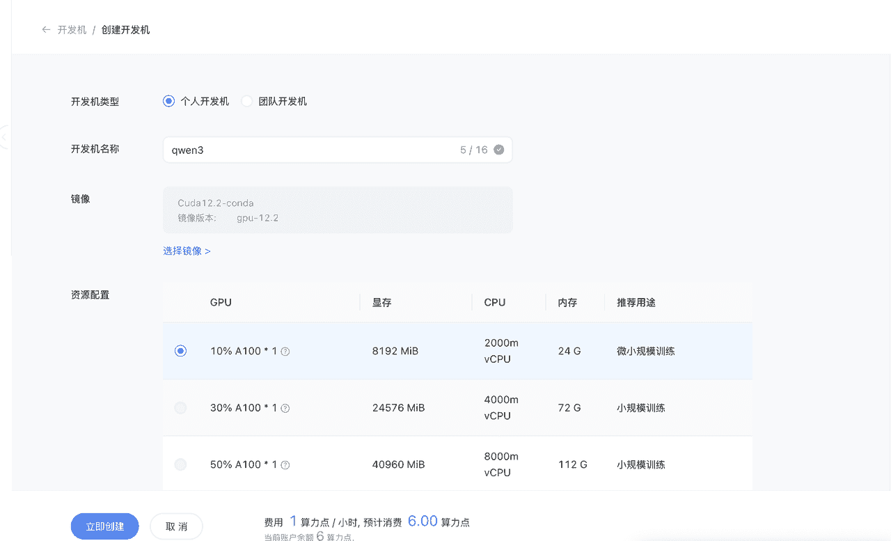

创建完成开发机，可以按照下面的方法配置下公钥，`ssh`连接更方便哦～（可跳）

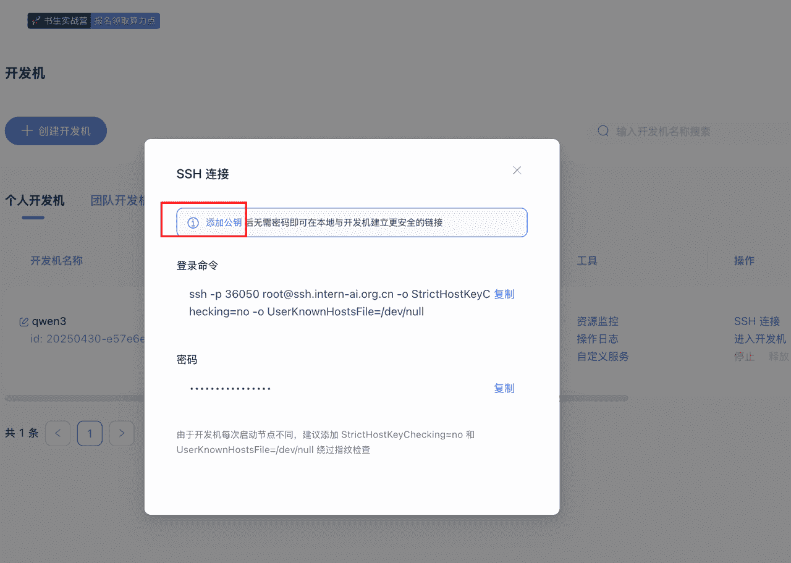

输入这一行命令查看公钥，然后如图复制粘贴上去。

```
cat ~/.ssh/id_rsa.pub
```

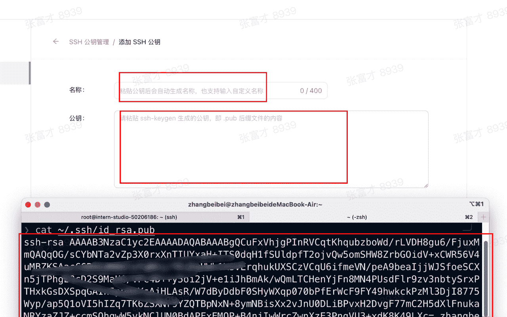

接着终端输入登录命令，测试`ssh`连接

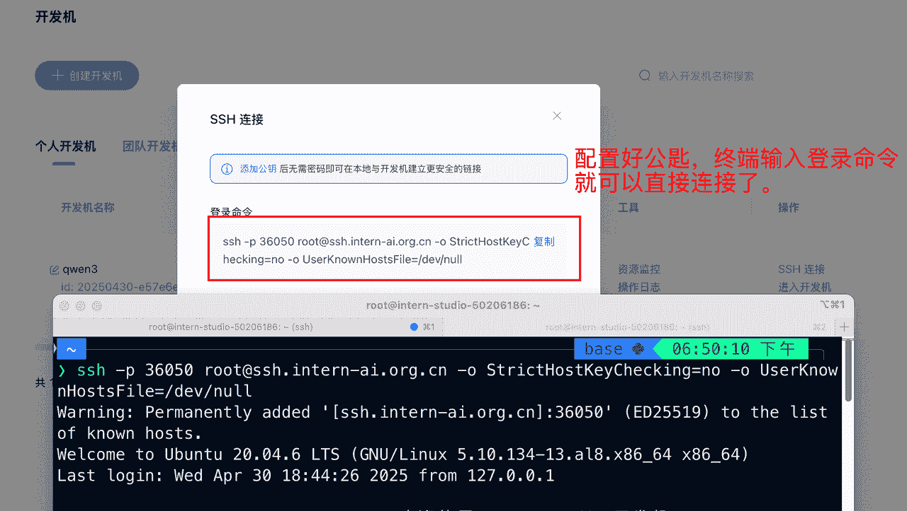

### Conda环境配置

接下来用`conda`管理`python`环境，创建一个命名为`lmdeploy`的环境，然后用`pip`下载需要的包，环境这块就ok了是不是很简单，只需要运行下面几行就ok了

```
conda create -n lmdeploy python=3.12 -y
conda activate lmdeploy
pip install lmdeploy  modelscope gradio partial-json-parser
export LMDEPLOY_USE_MODELSCOPE=True
```

### （可跳）qwen模型下载到本地的两种方法

`qwen3` Model location:https://huggingface.co/collections/Qwen/qwen3-67dd247413f0e2e4f653967f

通过huggingface

```
huggingface-cli download --resume-download Qwen/Qwen3-0.6B-FP8 --local-dir /root/qwen3/Qwen3-0.6B-FP8
```

通过modelscope

```
# 下载完整模型库（以Qwen3-0.6B-FP8 为例）
modelscope download --model Qwen/Qwen3-0.6B-FP8  --local_dir /root/qwen3/Qwen3-0.6B-FP8
```

## LMDeploy部署qwen3

### 简单推理

创建测试文件`test.py`，调用`qwen3`系列模型进行简单对话测试

```
cd /root
mkdir qwen3
cd /root/qwen3
touch test.py
#书生平台已经有下载qwen3系列模型在路径/root/share/new_models/qwen3下，
#所以推理时候直接加载本地模型就好了。
```

把下面内容粘贴到`test.py`里。

```
from lmdeploy import pipeline  
  
# 加载本地模型路径  
pipe = pipeline('/root/share/new_models/qwen3/Qwen3-0.6B')  
# 进行推理  
response = pipe(["Hi, pls intro yourself", "Shanghai is"])  
print(response)
```

推理的结果如图

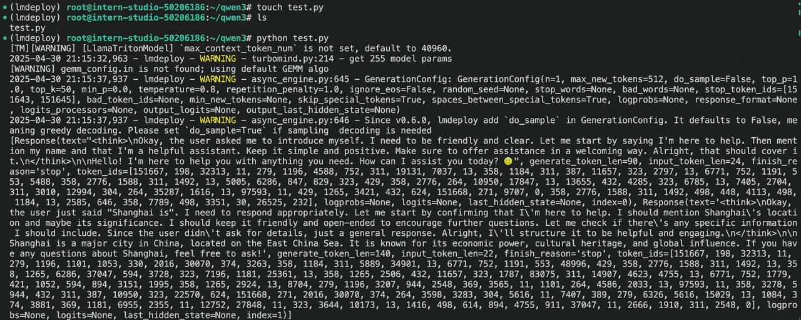

当然`test.py`代码也可以这样写，但是需要重新下载model有些耗时间和占空间内存（不推荐）

```
import lmdeploy

# 网络下载模型路径  
with lmdeploy.pipeline("Qwen/Qwen3-0.6B") as pipe:
    response = pipe(["Hi, pls intro yourself", "Shanghai is"])
    print(response)
```

我们已经完成了推理部分工作，可以不用框架对比一下框架的推理加速效果，写一个`test_origin.py`

```
import time
from transformers import AutoTokenizer, AutoModelForCausalLM

# 记录开始时间
start_time = time.time()

# 加载分词器和模型
model_path = '/root/share/new_models/qwen3/Qwen3-0.6B'
tokenizer = AutoTokenizer.from_pretrained(model_path, trust_remote_code=True)
model = AutoModelForCausalLM.from_pretrained(model_path, device_map="auto", trust_remote_code=True).eval()

# 输入问题
input_texts = ["Hi, pls intro yourself", "Shanghai is"]

responses = []
for text in input_texts:
    # 对输入文本进行分词
    inputs = tokenizer(text, return_tensors="pt").to(model.device)
    # 进行推理
    outputs = model.generate(**inputs)
    # 将输出的ID转换为文本
    response = tokenizer.decode(outputs[0], skip_special_tokens=True)
    responses.append(response)

# 记录结束时间
end_time = time.time()
# 计算花费的时间
elapsed_time = end_time - start_time

print(responses)
print(f"程序运行总共花费了 {elapsed_time:.2f} 秒。")
```

🆚 用`lmdeploy`框架的推理速度会发现，`transformers`推理好慢啊。用`lmdeploy`框架推理速度接近提升3倍。

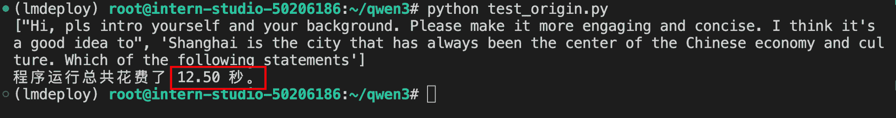

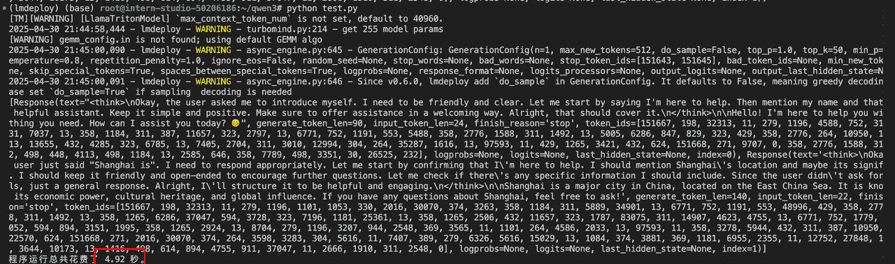

### 模型能力评估

接下来我们看看模型的能力强劲不

其中`question`专门写到一个文本文件下面，整体目录如图

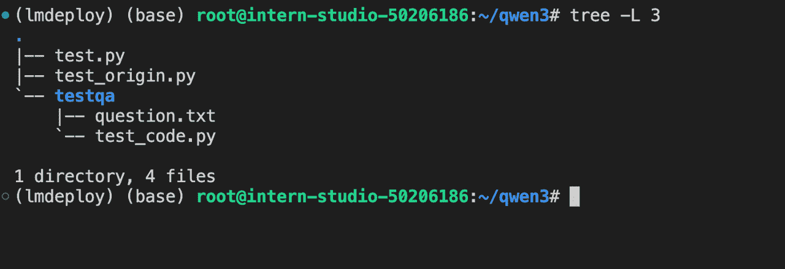

`test_code` 的内容：

```
import time  
from lmdeploy import pipeline, TurbomindEngineConfig, GenerationConfig  
  
# Record start time  
start_time = time.time()  
  
try:  
    # Configure reduced memory usage  
    backend_config = TurbomindEngineConfig(  
        cache_max_entry_count=0.1,  
        session_len=8192  # Increase if needed for longer contexts  
    )  
      
    # Configure generation with higher token limit  
    gen_config = GenerationConfig(  
        max_new_tokens=2048,  # Increase this for longer responses  
        do_sample=True,  
        temperature=0.7,  
        top_p=0.9  
    )  
      
    # Load model with reduced memory configuration  
    pipe = pipeline('/root/share/new_models/qwen3/Qwen3-0.6B',   
                    backend_config=backend_config)  
      
    # Read question file  
    with open('/root/qwen3/testqa/question.txt', 'r', encoding='utf-8') as file:  
        question = file.read().strip()  
  
    if question:  
        # Run inference with generation config  
        responses = pipe([question], gen_config=gen_config)  
  
        # Output response  
        text_response = responses[0].text  
        print(f"问题: {question}")  
        print(f"回答: {text_response}")  
    else:  
        print("问题文件中没有有效内容。")  
  
except FileNotFoundError:  
    print("错误: 未找到问题文件。")  
except Exception as e:  
    print(f"发生未知错误: {e}")  
    import traceback  
    traceback.print_exc()  
  
# Record end time  
end_time = time.time()  
elapsed_time = end_time - start_time  
  
print(f"程序运行总共花费了 {elapsed_time:.2f} 秒。")
```

#### 常规测试，`/root/qwen3/testqa/question.txt`里面直接写 9.11和就9.3谁大

模型输出如图，测试通过✅

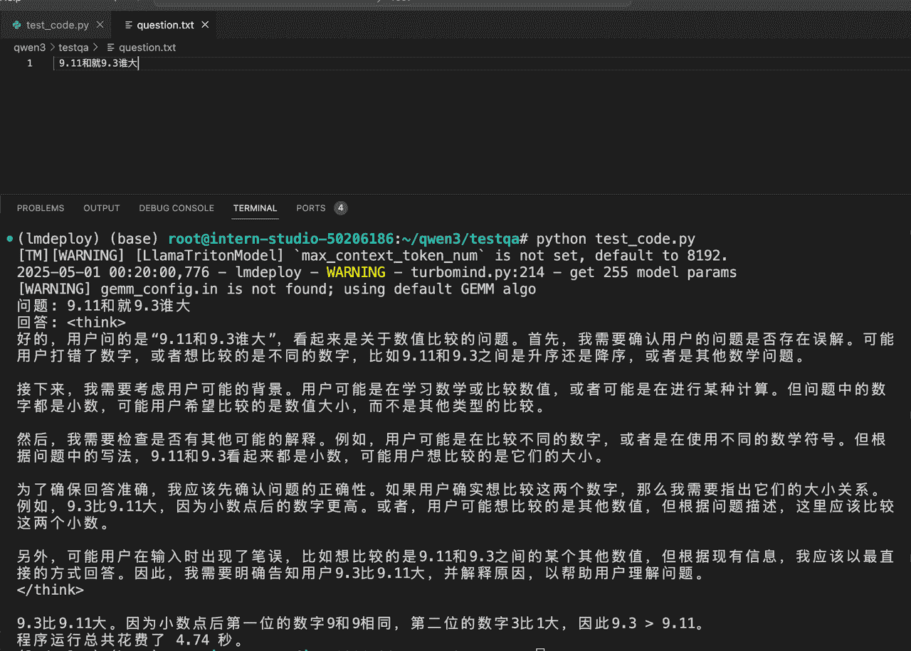

#### 将“`I love Qwen3-235B-A22B`”这句话的所有内容反过来写

0.6B模型输出如图，测试未通过❌

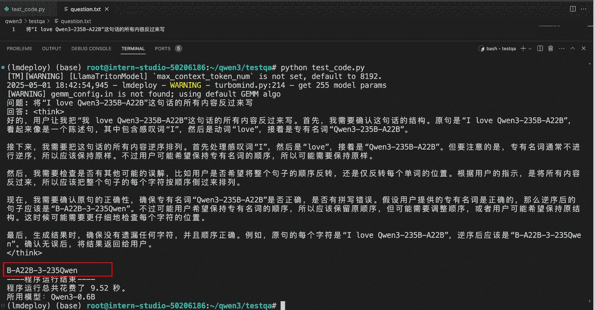

1.7B模型输出如图（居然输出小写`b`，显然不对），测试未通过❌

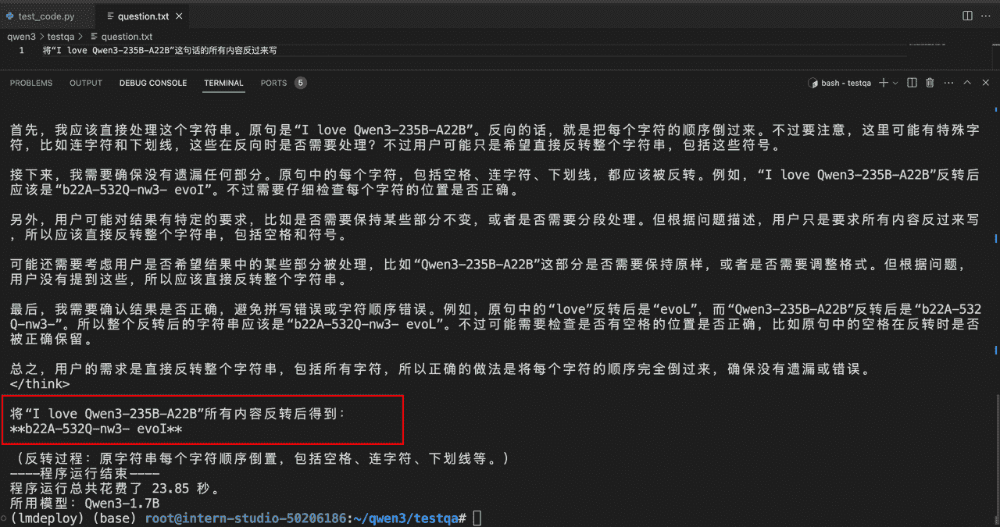

4B模型输出如图，测试未通过❌，差一点✅可惜。

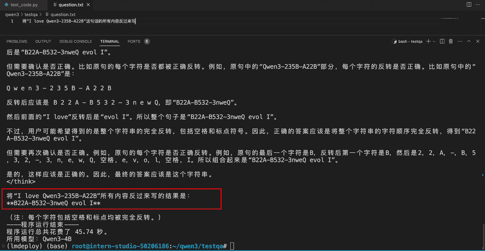

8B模型输出如图，测试未通过❌，太弱了qwen233

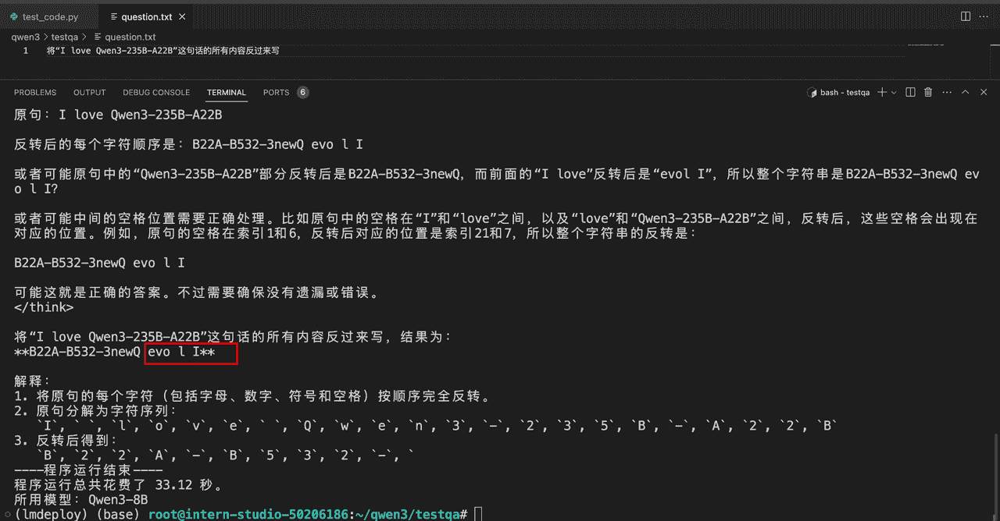

14B模型输出如图，测试通过✅。不容易啊，因为现在我的开发机是40g显存，那么接下来使用更多参数量的模型就需要进行下一环节 量化了。

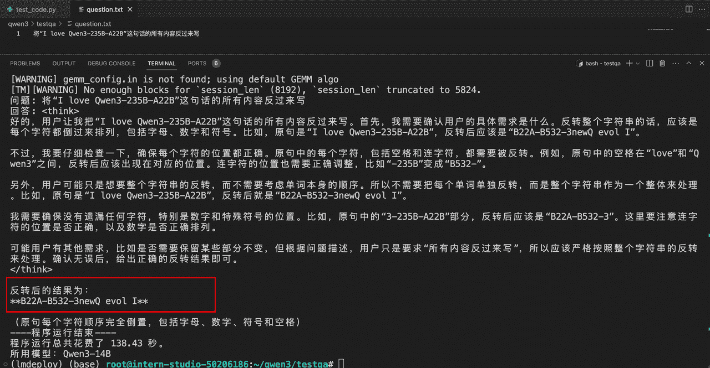

### 量化模型（目前不支持`qwen3`）

但我们运行这行代码，如图会报错不支持，可以去提pr了🤥。

```
lmdeploy lite auto_awq /root/share/new_models/qwen3/Qwen3-0.6B --work-dir /root/share/new_models/qwen3/Qwen3-0.6B-4bit
```

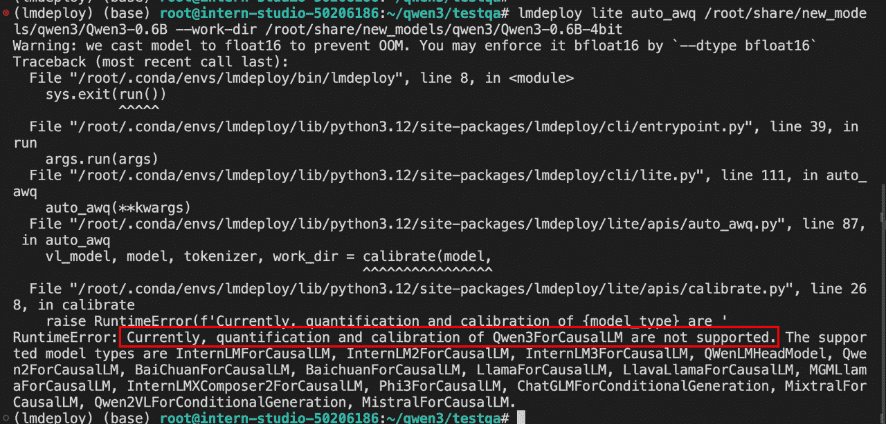

### 部署`OpenAI API` 服务

正如开篇说是`LMDeploy` 是一个高效且友好的 `LLMs` 模型部署工具箱，功能涵盖了推理、服务和量化。

那么我们做完了推理，就开始服务部分。

`LMDeploy` 的核心服务功能是通过 `api_server` 实现的，它可以将模型封装为 `RESTful API` 服务，并且这些接口与 `OpenAI` 的接口通过`OpenAPI`规范兼容。这意味着你可以用调用 `OpenAI API` 的方式来调用你自己部署的模型。

简而言之，通过`LMDeploy`部署你本地的模型，让更多人可以使用到你的模型。

#### 启动服务

那么启动后端服务，将本地模型模型以`api`的形式贡献出去。

```
lmdeploy serve api_server /root/share/new_models/qwen3/Qwen3-0.6B --reasoning-parser qwen-qwq --server-port 23333 --session-len 8192
```

+ `--session-len` 8192 代表着推理的最大上下文窗口长度，防止信息被截断。

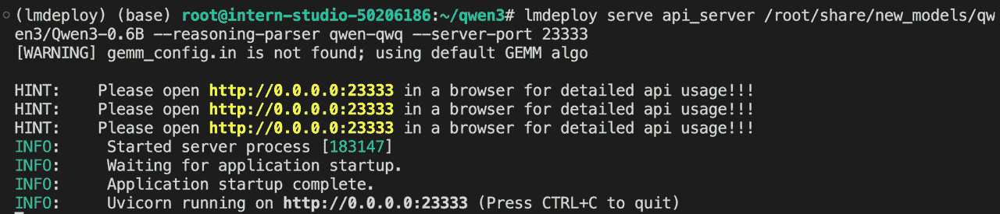

#### 使用 `api_client` 工具调用服务

```
lmdeploy serve api_client http://0.0.0.0:23333
```

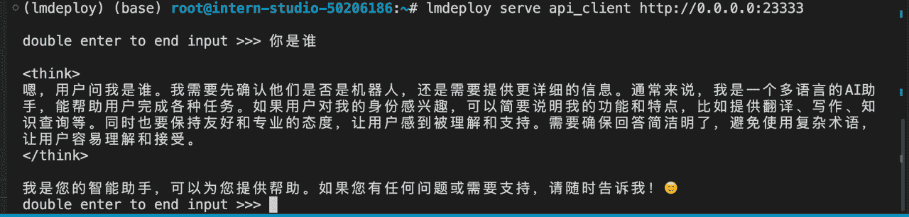

#### 编写代码调用 `RESTful API`调用服务

由于 `api_server` 对外提供的 `RESTful API` 兼容 `OpenAI` 的接口，可以参考 `OpenAI API` 的使用方式，编写代码来调用这些接口。以下是`request_qwen.py`代码：

```
import requests

url = "http://0.0.0.0:23333/v1/chat/completions"
headers = {
    "Content-Type": "application/json"
}
data = {
    "model": "/root/share/new_models/qwen3/Qwen3-0.6B",
    "messages": [
        {
            "role": "user",
            "content": "你好，请介绍一下你自己"
        }
    ]
}

response = requests.post(url, headers=headers, json=data)
result = response.json()
print(result)
```

写好直接点击运行

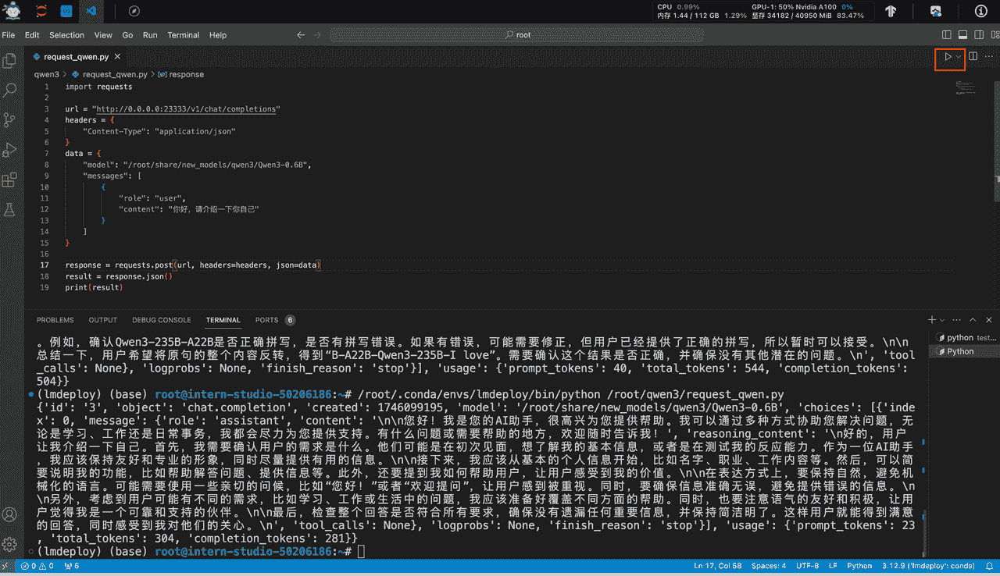

之前的是这一行

```
ssh -p 37883 root@ssh.intern-ai.org.cn  -CNg -L 6006:127.0.0.1:6006 -o StrictHostKeyChecking=no
```

## 问题反馈

### 怎么关闭`think`过程呢?


群友说prompt中加 `/no_think`，实测发现真的有效哈哈。(https://qwenlm.github.io/blog/qwen3/)

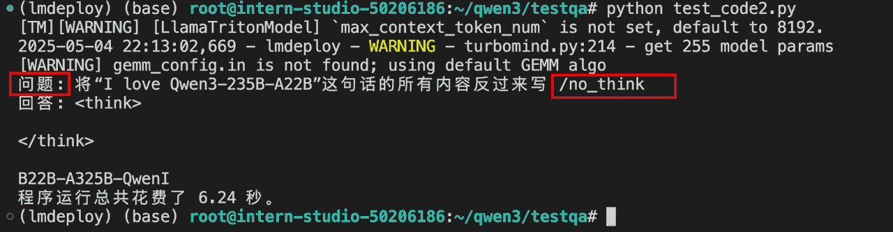

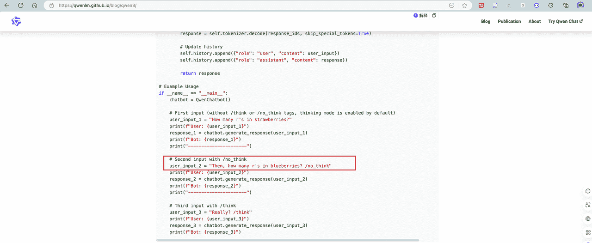

# 结尾彩蛋

写到最后，现在用deepwiki工具一秒可以将开源仓库转变动态可解释的ai文档，用ai帮助我们理解代码库。

比如将 https://github.com/InternLM/lmdeploy 一行秒变文档：https://deepwiki.com/InternLM/lmdeploy

video演示地址：https://x.com/i/status/191582155346 5626791
