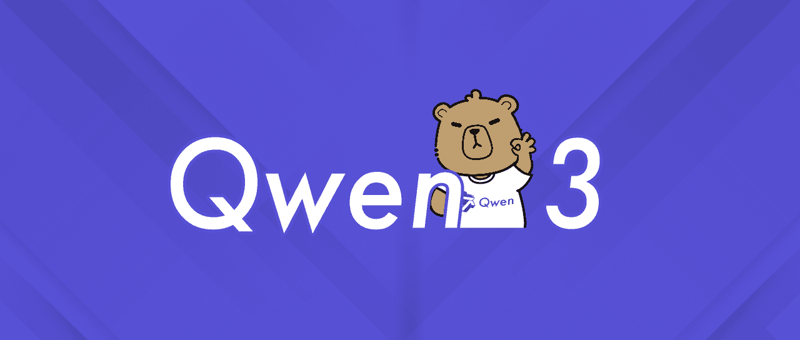
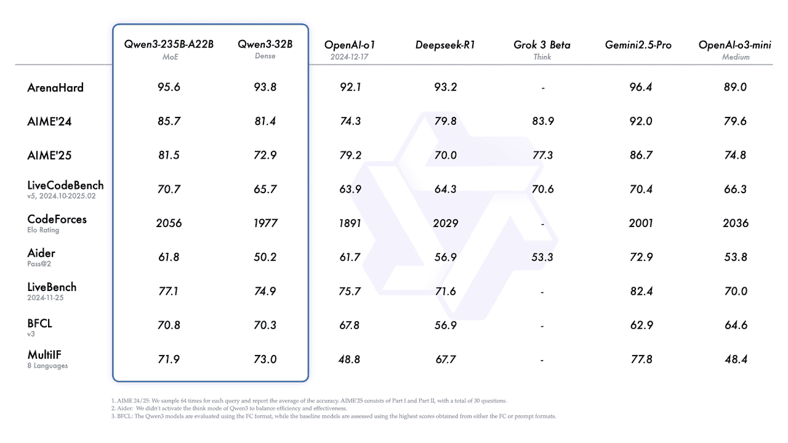
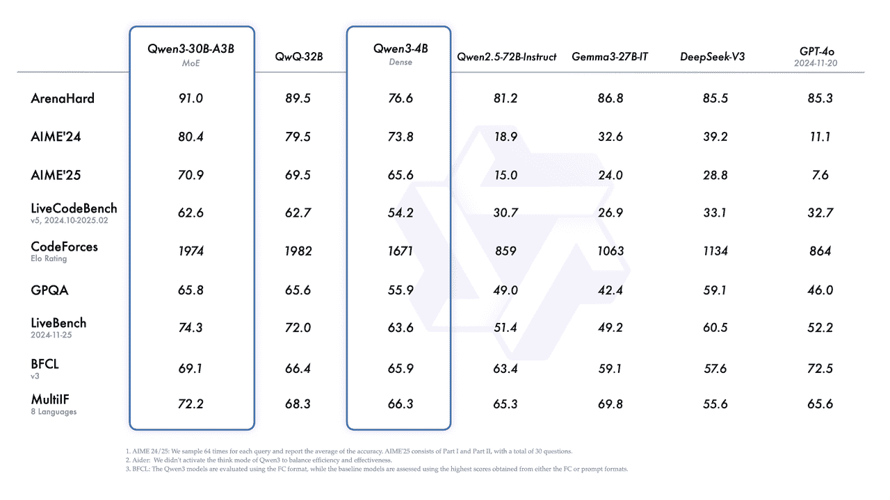
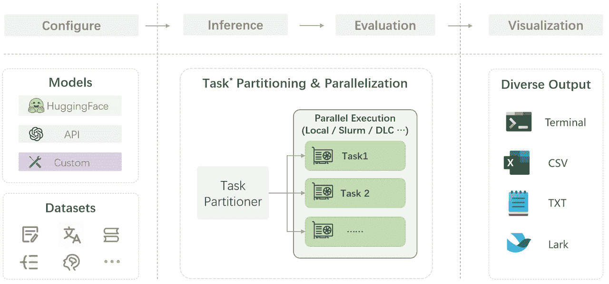
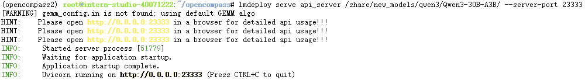
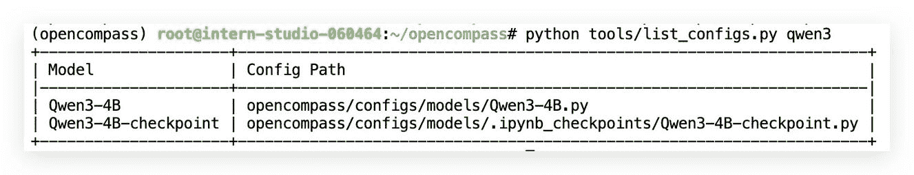
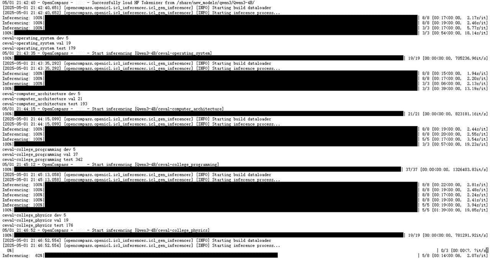
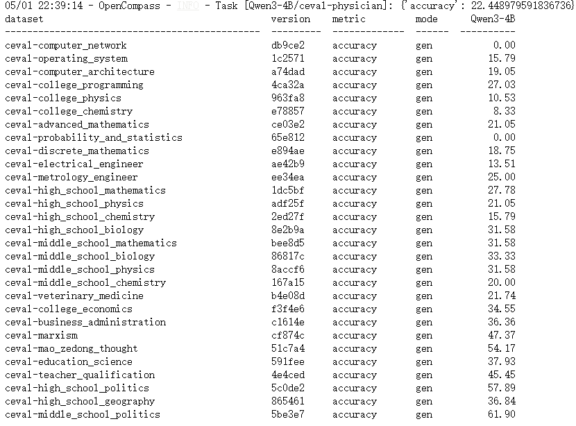

# OpenCompass 评测 Qwen3 实践

> 来源：[https://aicarrier.feishu.cn/docx/JSKRdDjLSo267ox4zIScTLihnzg](https://aicarrier.feishu.cn/docx/JSKRdDjLSo267ox4zIScTLihnzg)


# Qwen3概述

Qwen3 是 Qwen 系列大型语言模型的最新成员，在多个方面展现出了卓越性能与创新特性，为语言模型领域带来了新的活力与发展方向。



+   强大的性能表现：Qwen3 包含多个不同规模的模型，在各类基准测试中成绩亮眼。例如，旗舰模型 Qwen3 - 235B - A22B 在代码、数学、通用能力等测试里，与 DeepSeek - R1、OpenAI - o1 等顶级模型相比极具竞争力。像在 ArenaHard 测试中，其得分达到 95.6 ；小型 MoE 模型 Qwen3 - 30B - A3B 激活参数仅为 QwQ - 32B 的 10%，却表现更优；甚至小模型 Qwen3 - 4B 也能匹敌 Qwen2.5 - 72B - Instruct 的性能，在不同规模和任务上都展现出良好的适应性与能力。





接下来，让我们一起来测测看吧！

# OpenCompass 概述



**在 **Open**Co**mpas**s **中评估一**个模型**通常包括以下几个阶段：配置 -> 推理 -> 评估 -> 可视化。

**配置**：这是整个工作流的起点。您需要配置整个评估过程，选择要评估的模型和数据集。此外，还可以选择评估策略、计算后端等，并定义显示结果的方式。

**推理与评估**：在这个阶段，OpenCompass 将**会开****始对**模型[和数据集进行并](https://opencompass.readthedocs.io/zh-cn/latest/get_started/faq.html#id6)行推理和评估。推理阶段主要是让模型从数据集产生输出，而评估阶段则是衡量这些输出与标准答案的匹配程度。这两个过程会被拆分为多个同时运行的“任务”以提高效率，但请注意，如果计算资源有限，这种策略可能会使评测变得更慢。如果需要了解该问题及解决方案，可以参考 FAQ: 效率。

**可视化**：评估完成后，OpenCompass 将结果整理成易读的表格，并将其保存为 CSV 和 TXT 文件。你也可以激活飞书状态上报功能，此后可以在飞书客户端中及时获得评测状态报告。

对于其他模型，请参考 [configs 目录](https://github.com/open-compass/opencompass/tree/main/configs) 中提供的其他示例。

# 评测模型

## 环境配置

在创建开发机界面选择镜像为 Cuda12.2-conda，显存建议选用单卡A100

```
conda create -n opencompass python=3.10
conda activate opencompass
conda install pytorch==2.3.1 torchvision==0.18.1 torchaudio==2.3.1 pytorch-cuda=12.1 -c pytorch -c nvidia -y

# 注意：一定要先 cd /root
cd /root
git clone -b 0.4.2 https://ghfast.top/https://github.com/open-compass/opencompass
cd opencompass
pip install -e .
```

修改opencompass/requirements/runtime.txt里第35行为

```
-e git+https://ghfast.top/https://github.com/Isaac-JL-Chen/rouge_chinese.git@master#egg=rouge_chinese
```

然后运行

```
pip install -r requirements.txt
apt-get update
apt-get install cmake
pip install protobuf==4.25.3
pip install sentencepiece
pip install onnxscript
```

为了解决一些本地评测时出现的报错问题，我们还需要重装一些 python 库

```
pip uninstall numpy -y
pip install &quot;numpy&lt;2.0.0,&gt;=1.23.4&quot;
pip uninstall pandas -y
pip install &quot;pandas&lt;2.0.0&quot;
pip uninstall rouge
pip install rouge==1.0.1
```

安装lmdeploy模块

```
pip install lmdeploy==0.7.3
pip install partial_json_parser
```

## 评测数据集准备

OpenCompass 支持的数据集主要包括三个部分：

1.  **Hugg**ingface 数据集： Huggingface Dataset 提供了大量的数据集，这部分数据集运行时会自动下载。

1.  ModelScope 数据集：ModelScope OpenCompass Dataset 支持从 ModelScope 自动下载数据集。

1.  自建以及第三方数据集：OpenCom**pa**ss 还**提供了一些第三方数据集**及自建中文数据集。这里我们采用这种方式。

在 OpenCompass 项目根目录下运行下面命令，将数据集准备至 ${OpenCompass}/data 目录下：

```
wget https://gh-proxy.com/https://github.com/open-compass/opencompass/releases/download/0.2.4.rc1/OpenCompassData-complete-20240325.zip
unzip OpenCompassData-complete-20240325.zip
```

将会在 OpenCompass 下看到data文件夹。

**评测，启动！**

## 评测Qwen3-4B

```
lmdeploy serve api_server /share/new_models/qwen3/Qwen3-4B/ --server-port 23333
```

成功部署以后会看到如下输出:



新开一个终端, 使用以下 Python 代码获取由 LMDeploy 注册的模型名称：

```
from openai import OpenAI
client = OpenAI(
    api_key=&#x27;sk-123456&#x27;, # 可以设置成随意的字符串
    base_url=&quot;http://0.0.0.0:23333/v1&quot;
)
model_name = client.models.list().data[0].id
model_name # 注册的模型名称需要被用于后续配置.
```

结果显示/share/new_models/qwen3/Qwen3-4B/, 接着, 创建配置脚本

```
touch /root/opencompass/opencompass/configs/models/Qwen3-4B.py
```

填入

```
from opencompass.models import OpenAI

api_meta_template = dict(round=[
    dict(role=&#x27;HUMAN&#x27;, api_role=&#x27;HUMAN&#x27;),
    dict(role=&#x27;BOT&#x27;, api_role=&#x27;BOT&#x27;, generate=True),
])

models = [
    dict(
        abbr=&#x27;Qwen3-4B&#x27;,
        type=OpenAI,
        path=&#x27;/share/new_models/qwen3/Qwen3-4B/&#x27;, # 注册的模型名称
        key=&#x27;sk-123456&#x27;,
        openai_api_base=&#x27;http://0.0.0.0:23333/v1/chat/completions&#x27;, 
        meta_template=api_meta_template,
        query_per_second=1,
        max_out_len=2048,
        max_seq_len=4096,
        batch_size=8),
]
```

检查一下有没有配置成功

```
python tools/list_configs.py qwen3
```

可以看到，我们已经完成了模型配置。



**gogogo出发咯！开启评测！**

新建一个终端，运行以下命令：

```
opencompass --models Qwen3-4B --datasets  ceval_gen --debug # opencompass 命令基本等价于 python run.py 命令
```

如果运行正常，将会看到：



最终，得到结果:



# 小结

Qwen3 作为 Qwen 系列的最新力作，凭借其丰富的模型规模体系与卓越的性能表现，在各类基准测试中脱颖而出，不同体量的模型在各自擅长的领域展现出强大竞争力。而 OpenCompass 作为专业的评测工具，其评估流程涵盖配置、推理、评估与可视化多个环节，清晰且高效，从环境搭建、数据集准备到模型部署、配置及最终评测，每个步骤都为模型的准确评估提供了坚实保障。

期待未来有更多像 Qwen3 这样创新突破的语言模型涌现，在自然语言处理、代码生成、科学研究等更广泛的领域开疆拓土，以更智能、更高效的表现，推动人工智能技术深度融入生产生活的方方面面~