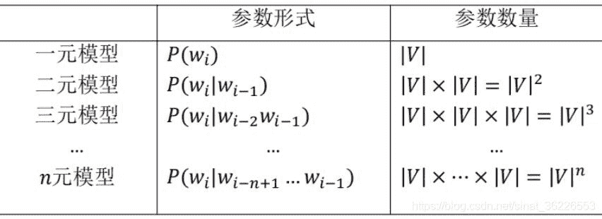

# 101N0101 ngram Python 核心代码解读

> 来源：[https://aicarrier.feishu.cn/docx/Z7jedAcHvoxocExJ0YNcKy58nCc](https://aicarrier.feishu.cn/docx/Z7jedAcHvoxocExJ0YNcKy58nCc)

## 前言

代码仓库地址：[https://github.com/EurekaLabsAI/ngram](https://github.com/EurekaLabsAI/ngram)

今天将和大家一起学习 LLM101n 课程中 N-gram 部分。本期我们先详解 n-gram 模型的算法原理（包括困惑度的定义、计算方式（与熵的关系）、数据稀疏问题的解决方式等），再来对基于 Python 和 C 的 ngram 代码进行解读。

## n-gram 算法原理

n-gram 算法是一种语言模型，本质和 transfromer 语言算法模型一样，也是用来预测下一个 token（词元，可以简单理解为一个单词或词组、词）的算法。但 n-gram 是一种更简单，形式清晰的语言模型。

先看看一句话如何计算分词(token):`<s>`我爱北京天安门。`</s>`

这句话通过分词后会是：`["<s>", "我", "爱", "北京", "天安门", "。", "</s>"]`

如何计算这句话的概率，当然是联合概率分布：

其中 `w_1w_2...w_n` 表示句子序列

公式里描述的是最完美情况，但是这样的每个 token 的预测都依赖所有的历史 token，这个计算代价非常高，为什么？一方面是因为需要计算语料库中任意 `N` 个 tokens 的所有排列的概率分布（这几乎是不可能实现的），另一方面是因为 `N`-gram 算法的空间复杂度和时间复杂度是关于 `N` 的指数函数（即随 `N` 提升，训练所需投入的资源量也呈指数上升，这是不可取的）



为了解决计算复杂度的问题，我们可以采用马尔可夫假设来优化做个问题，即一个词的出现仅与它之前的若干个词有关。比如下一个词的只依赖上一个词概率分布，即:

这就是 n=2 的 bigram 算法（又称 2-gram）。

如果假设每个 token 都是独立的分布的，即:

这就是 n=1 的 unigram 算法（又称 1-gram）。

类推，n=3 的 trigram 公式：

n=4 的 4-gram 公式:

回到我们前面提到的计算复杂度的问题。当 `N` 从 1 到 3 时，模型的效果上升显著；而当模型从 3 到 4 时，效果的提升就不是很显著了，而资源的耗费却增加的非常快。因此 `N`-gram 模型中 `N` 的取值大多不超过 3。[更多详情请参阅吴军《数学之美》相关章节]

按照上面的例子，假设是 bigram 模型，训练语料如下：

```
<s> 我 爱 北京 天安门 。 </s>
<s> 我 想 去 北京 。 </s>
<s> 北京 是 首都 </s>
```

这里为了简单，用空格进行隔开代表分词。

可以得类似以下的条件概率值：

其中 `<s>` 表示 start token，是一种特殊的标记，可以作为一个 “虚拟的前序单词” 参与概率计算。

### Perplexity 困惑度的定义和理解

困惑度（Perplexity，常用 PPL）计算公式是：

+   `n` 即 n-gram 中的 n，表示滑动窗口大小

困惑度的英文名是 Perplexity，是模型在给定的上下文预测下一个 token 的不确定性的度量，下文将会给出这个不确定性度量的近似推导。这里可以直观理解为 weighted average branching factor，可翻译为加权平均分支因子，即可直观近似认为 Perplexity 是序列预测中每个 next token 的选择个数（这里就是分支）的“平均个数”（下文做了近似推导）。比如前面例子“我爱北京天安门” 这句话如果在测试的时候输入 "我爱" 两个字，如果模型对这句子的困惑度 Perplexity=5，就表示模型在 "我爱" 两字后面的输出 token 的平均选项有 5 个，"北京" 这个 token 只是其中一个。

> 请注意，这里我们说的是“近似”，实际绝不能把困惑度和预测下一个 token 时的选项个数等同。困惑度评估的是一个概率模型对样本预测的不确定程度，困惑度越低，模型预测的不确定性就越低，从数学上来说，预测结果实际发生的概率也越高，对于语言模型而言也可以理解为输出内容越合理。

> 另外，这里的平均是几何平均数，评估的是整体，是一个整体指标，表示的是模型对序列预测过程中每一个 token 的平均选择个数，而不是单独某个特殊 token 的预测个数。比如 "我爱"， 后面可能有 16 个后续 token 的选择，但是如果模型对这个句子的困惑度是 5，就是整体上被平均了，从整体上看就有 5 个选择。

使用 n-gram 算法优化困惑度是一个平衡的艺术，如果是在长的固定搭配、冷知识等句子中，你可能希望 `N` 大一些，这样更多信息明确下一个 token（这样能降低困惑度）；如果是常识，常见的 token，你可能会希望 `N` 小一些（这样能降低困惑度，减少 smoothing 使用），减少前面无用信息的干扰。这可能就是 n-gram 模型的固有缺陷。

> 为什么困惑度的计算用上了倒数和几何平均数？

1.  概率的倒数是事件发生的期望次数。从频次角度理解这个期望，比如某事件发生概率 0.8，那么平均每 1.25 次就发生一次，这个平均期望即 0.8 的倒数 1.25 = 1/0.8。从选项个数的场景理解：某事件的概率可以理解为分母是事件空间的样本总数，分子是命中某事件的选择次数，这个概率值反过来可以认为：从已经发生的后验的角度看，当时这次事件被命中的选择次数中，平均每次选择的时候有多少种事件可选，事件可选项越多当然表示越困惑。举个例子：比如总的 10 个球，8 个黑球，1 个红球，1 个白球。易知黑球选中的概率是 0.8，红球选中概率 0.1。现在再完整的在做一次 10 次抽样的测试，8 次也选中了黑球，从后验看(已经发生了)，当时我这 8 次选中黑球过程中，每次挑选就只有 1.25 个球可以选择，可以理解为 1 个是黑球，0.25 个是其他球，那就很容易选中黑球，1.25 也就是概率 0.8 的倒数 1/0.8 = 1.25，表示可选范围相当小；其中 1 次命中了红球，也就是 0.1 概率选中了红球，从后验看(已经发生了)，当时选择红球时的选项有 10 个球可以选择的。

> (这里补充一点：对应到语言模型中，困惑度 本质上就是 概率倒数 含义的的推广！模型给的就是概率分布，句子就是上下文，也就是训练集或者验证集，从已经发生的后验的上帝视角看，整个句子 Perplexity 的困惑度即当时命中某个 token 的选择项！ )

> 另一种直观简单的理解是：概率是事件发生的确定性的大小，概率的倒数是不确定的大小或者说混乱的程度，越大表示越混乱或者越不确定。

1.  几何平均数就是用来评估数据连乘运算的均值，和加法平均值有区别，不同场景使用的均值。

现在我们知道了困惑度是什么，你可能会问困惑度能帮助我们做什么呢？

+   在模型评估方面，可以帮助我们了解模型对下一个 token 预测的准确性，也使我们有了一个统一的标准来评估不同模型的优劣。

+   在模型训练方面，困惑度可以作为一种反馈信号来指导参数的调整，例如，在使用基于梯度下降的训练方法时，困惑度可以告诉我们参数的更新方向是否正确；还可以作为一种反馈信号来指导参数的调整，例如，在使用基于梯度下降的训练方法时，困惑度可以告诉我们参数的更新方向是否正确。

+   在理解语言模型的特性方面，困惑度可以帮助我们了解语言模型对不同语言结构（如语法、语义等）的学习情况，例如，对于一个简单的句子结构 “主语 + 谓语 + 宾语”，如果模型对这种结构的词汇搭配已经有了很好的学习，那么在预测符合这种结构的句子中的单词时，困惑度会比较低；还可以了解模型在不同语言场景下的适应性，比如，一个模型在新闻文本上困惑度较低，但在诗歌文本上困惑度较高，这表明该模型更适合处理新闻相关的语言任务，对于诗歌生成或理解等任务可能需要特殊的调整，如增加诗歌数据集进行训练等。

此外，还有一些细节问题：

1.  在代码里怎么计算困惑度呢？

1.  预测的时候，假设如果 `N=3`，最开始的时候不足 `N` 个元素，应该怎么选择?

第二个问题好解决，就是直接先用 start token 补全前面的，比如 `N=3`，那么前两个 token 都是 `["<s>", "<s>"]`，从而进行预测。

要解决第一个问题，就要了解困惑度和熵（entropy）的关系了

### 困惑度和熵的关系

先摆一下熵计算公式：

放到一个 sequnece 上来计算的话：

`L` 就是所有长度为 `n` 的 sequnece 的集合，是一个整体，`H(W)` 就是 `L` 的熵，熵描述的就是一个整体的混乱的程度，也可以理解为作为一个整体事件发生的次数，和前面的概率的倒数含义相似，只是两个的度量单位是不一样的。

`L` 怎么理解？`L` 是一个集合空间，这个空间可以想象为一个 `m x n` 的矩阵，`m` 是行，表示有多少条 sequnece 序列；`n` 是维度列，表示一个 sequence 序列有多长。公式里 `H(W)` 表示 `m` 可能是未知或者无穷的，但是 `n` 是固定的。这意味着如果使 `H(W) / n` 就可以定义在列维度上，即每个词的位置上，比如 `w_k`，`k` 属于 `[1,n]` 的熵，可以定义这个数值叫 per-token entropy（又叫 entropy rate）:

per-token entropy 和困惑度的含义非常接近，只是度量单位不一致。

进一步进行一些假设：将 `L` 定义为一门语言，语言的长度是无穷的，每个 sequnece 的长度也可以是无穷的，并且是随机过程（stochastic process），那么 per-token entropy：

再进一步假设：我们不可能找出所有长度为 n 的序列，根据 Shannon-McMillan-Breiman 定理（“香农 - 麦克米兰 - 布雷曼定理”），如果一个语言 `L` 是稳定的（stationary）和可遍历的（ergodic）的，那么语言分布的 per-token entropy 可以写作：

这里先直觉性的解释一下：可以认为一个无限的足够长的 sequence 序列可以替代所有长度为 n 的序列。直觉上理解就是 Shannon-McMillan-Breiman 定理认为一个足够长的 sequence 句子将会包含很多子句(这些子句本身是满足稳定性和可遍历性)，即这些子句会在足够长的 sequence 句子里按照他们的概率重复出现。

这样的直觉应该是基于随机过程的平稳性和可遍历性来进行的等价的推导替换，随机过程的可遍历性具有空间均值和时间均值具有统一性，表现为时间均值等于空间均值。计算足够长的句子就相当于计算这个随机过程的时间均值，因为这个无限的长句包含所有可能的子句，用长句的概率和 per-token entropy 代替原来的期望计算（这个期望也就是空间均值）。

这里再讨论交叉熵和 per-token entropy 的关系：

当我们评估一个模型 `M` 的预测概率分布和测试集概率分布 `P`（几乎可看做真实概率分布）差距时，会用 KL 散度表示:

进一步推导可得：

右边这个其实就是交叉熵，可以进一步简写为:

所以交叉熵就是真实语言熵的上界，永远都会相差一个 KL 散度：

即我们训练的模型最终计算的交叉熵值越小，就会越接近正式的语言概率分布，这个模型也就越好。这也是为什么模型训练的时候，loss 值越低越好，loss 的一般就是在验证集上 loss 平均值。

注意我们训练的模型 `M` 的交叉熵的计算公式是：

这里我们加上 `1/n`，计算为 per-token 交叉熵，不影响交叉熵原本能代表含义：即 per-token 交叉熵趋近于 0，也表示这个模型 `M` 的性能接近真实语言：

根据前面的假设：语言是稳定的和可遍历的，以及 SMB (Shannon-McMillan-Breiman) 定理，所有概率的和 (空间均值) 可以用一个足够长的句子的概率 (时间均值) 来等价替代：

这里再做点近似的假设，如果句子的长度不是无穷的，而是有限数值 `N`，那么这个句子的 per-token 交叉熵可以近似为:

这个式子已经很明显了，右边部分就是对模型对某个句子的困惑度的 log 值，这样很容易变换形式，得到交叉熵和困惑度的关系：

注意 log 底数可以是 2，也可以是 `e`，实际的代码中一般用 `e`。

因此，在代码里很容易就使用 loss 值计算出困惑度，这个在后面章节的代码中会解释。

### smoothing 算法

通过前面对 n-gram 模型的介绍，我们知道，训练 n-gram 模型需要计算词元和词元组出现的概率。然而，训练集很容易出现某些词或词组统计频率为 0 的问题（即出现数据稀疏（Data Sparseness）问题），这会导致在后续的文本生成或概率计算中出现不合理的情况。比如，对于 bigram 模型（即 `n=2` 时）算法，测试集里有一个 token 是“火星”，但是在 bigram 模型在训练集里计算 `P(火星|w_{n-1})=0`，那么带入困惑度的计算公式里就无法计算了。

为了解决这种情况，就需要使用对应的 smoothing 的方法。

这里简单介绍一下 Laplace Smoothing 平滑算法（拉普拉斯平滑算法）即可：

这里 `V` 是 token 总数，`N` 和 `c(i)` 都是模型统计的分母和分子。

Laplace Smoothing 实际使用效果不好，实际中使用的是 Add-k smoothing 算法：

代码中使用公式第二步的变形，是非常方便计算的，实际中最常用的也是这种方式。

还有其他较好的和复杂的平滑算法，这里就不讨论了，后续有机会讨论。

### 插值

解决词频为 0 的另外一种方法就是使用插值，有点类似线性插值的思想，组合不同 n-gram 概率值。比如，对于 trigram 的可以结合 trigram、bigram、unigram 的概率值进行计算：

插值算法也相应有其他变种，这里就不展开了

## 代码解读

理解上文的理论篇，代码看起来就非常简单了。

这里先看一下代码里的类，方法等，然后看看整体的流程，这样写起来比较方便，实际看代码当然是先看代码流程再跟代码。

这个项目是想训练一个词表为 `{a-z, \n }` 总共 27 个 token 的 n-gram 模型。先看看代码跑出来的效果：

整体上代码结构非常简洁，刚开始有个 `RNG` 类：

```
class RNG:
    def __init__(self, seed):
        self.state = seed

    def random_u32(self):
        # xorshift rng: https://en.wikipedia.org/wiki/Xorshift#xorshift.2A
        # doing & 0xFFFFFFFFFFFFFFFF is the same as cast to uint64 in C
        # doing & 0xFFFFFFFF is the same as cast to uint32 in C
        self.state ^= (self.state >> 12) & 0xFFFFFFFFFFFFFFFF
        self.state ^= (self.state << 25) & 0xFFFFFFFFFFFFFFFF
        self.state ^= (self.state >> 27) & 0xFFFFFFFFFFFFFFFF
        return ((self.state * 0x2545F4914F6CDD1D) >> 32) & 0xFFFFFFFF

    def random(self):
        # random float32 in [0, 1)
        return (self.random_u32() >> 8) / 16777216.0

random = RNG(1337)
```

这个是个随机数算法，非常简单，非常高效，随机性就验证了。

第二个 class 是:


## NgramModel 类实现

```
class NgramModel:
    def __init__(self, vocab_size, seq_len, smoothing=0.0):
        self.seq_len = seq_len
        self.vocab_size = vocab_size
        self.smoothing = smoothing
        # the parameters of this model: an n-dimensional array of counts
        self.counts = np.zeros((vocab_size,) * seq_len, dtype=np.uint32)
        # a buffer to store the uniform distribution, just to avoid creating it every time
        self.uniform = np.ones(self.vocab_size, dtype=np.float32) / self.vocab_size

    def train(self, tape):
        assert isinstance(tape, list)
        assert len(tape) == self.seq_len
        self.counts[tuple(tape)] += 1

    def get_counts(self, tape):
        assert isinstance(tape, list)
        assert len(tape) == self.seq_len - 1
        return self.counts[tuple(tape)]

    def __call__(self, tape):
        # returns the conditional probability distribution of the next token
        assert isinstance(tape, list)
        assert len(tape) == self.seq_len - 1
        # get the counts, apply smoothing, and normalize to get the probabilities
        counts = self.counts[tuple(tape)].astype(np.float32)
        #print(f&quot;tape:{tape} counts shape: {counts.shape}&quot;)
        #print(f&quot;tape:{tape} counts: {counts}&quot;)
        counts += self.smoothing # add smoothing (&quot;fake counts&quot;) to all counts
        counts_sum = counts.sum()
        probs = counts / counts_sum if counts_sum &gt; 0 else self.uniform
        return probs
```

这个类就是抽象的ngram算法，先看看 `__init__` 方法：

```
def __init__(self, vocab_size, seq_len, smoothing=0.0):
        self.seq_len = seq_len
        self.vocab_size = vocab_size
        self.smoothing = smoothing
        # the parameters of this model: an n-dimensional array of counts
        self.counts = np.zeros((vocab_size,) * seq_len, dtype=np.uint32)
        # a buffer to store the uniform distribution, just to avoid creating it every time
        self.uniform = np.ones(self.vocab_size, dtype=np.float32) / self.vocab_size
```

重点关注2个地方：

第一个是模型接收3个参数：`vocab_size` 是词表大小，训练集分词后的token去重个数；`seq_len` 表示n-gram中的N；`smoothing` 是平滑参数，作用在理论篇里已经介绍了。

第二个是 `self.counts` 参数的初始化，`(vocab_size,) * seq_len` 是一个长度为`seq_len`的元组，内部的值都是`vocab_size`，意思是`self.counts` 是一个总维数为 `seq_len` 的 `vocab_size * vocab_size * vocab_size ...` 维度的矩阵，这在后面用来用来保存n-gram的统计词频，这里比较巧妙的是每个维度大小都是`vocab_size`，这样直接可以用`token_id` 作为维度值即可，缺点就是矩阵非常稀疏。

再看看训练的`train` 方法和 `get_counts` 方法：

```
def train(self, tape):
        assert isinstance(tape, list)
        assert len(tape) == self.seq_len
        self.counts[tuple(tape)] += 1

def get_counts(self, tape):
        assert isinstance(tape, list)
        assert len(tape) == self.seq_len - 1
        return self.counts[tuple(tape)]
```

`train` 方法和`get_counts` 一个就是直接统计词频，一个就是获取词频了。

剩下一个方法是`__call__` 模型预测方法了：

```
def __call__(self, tape):
        # returns the conditional probability distribution of the next token
        assert isinstance(tape, list)
        assert len(tape) == self.seq_len - 1
        # get the counts, apply smoothing, and normalize to get the probabilities
        counts = self.counts[tuple(tape)].astype(np.float32)
        counts += self.smoothing # add smoothing (&quot;fake counts&quot;) to all counts
        counts_sum = counts.sum()
        probs = counts / counts_sum if counts_sum &gt; 0 else self.uniform
        return probs
```

这里的参数 `tape` 就相当于是 n-gram 的前 `n-1` 项 作为输入，这里有个`assert len(tape) == self.seq_len - 1` 语句保证长度。 用前面的例子: `["", "我"]`，如果是`n=3`,那么输入就是：`["", "我"]`，最开始的输入是 `["", ""]` 这在后面有代码这么做。

内容部分就是获取到 `counts`，这个是一个大小为 `vocab_size` 的 一维度 的`array`， 再加上 平缓参数，然后除以 总和 值，计算方法和上面理论篇的Add-k smoothing 平滑算法一样，然后返回 `probs` 概率值即可，`probs` 也是一个 `vocab_size` 大小的一维 `array`.

## Stupid Backoff 模型实现

第三个类是`BackoffNgramModel`，这是前面的 Stupid Backoff 的实现：

```
class BackoffNgramModel:
    def __init__(self, vocab_size, seq_len, smoothing=0.0, counts_threshold=0):
        self.seq_len = seq_len
        self.vocab_size = vocab_size
        self.smoothing = smoothing
        self.counts_threshold = counts_threshold
        self.models = {i: NgramModel(vocab_size, i, smoothing) for i in range(1, seq_len + 1)}

    def train(self, tape):
        assert isinstance(tape, list)
        assert len(tape) == self.seq_len
        for i in range(1, self.seq_len + 1):
            self.models[i].train(tape[-i:])

    def __call__(self, tape):
        assert isinstance(tape, list)
        assert len(tape) == self.seq_len - 1
        # find the highest order model that has data for the current context
        for i in reversed(range(1, self.seq_len + 1)):
            tape_i = tape[-i+1:] if i > 1 else []
            counts = self.models[i].get_counts(tape_i)
            if counts.sum() > self.counts_threshold:
                return self.models[i](tape_i)
        # we shouldn't get here because unigram model should always have data
        raise ValueError("no model found for the current context")
```

具体实现思路是根据初始化 `__init__` 函数里的 `seq_len` 产生 `n` 个 `n` 等于 1 至 `seq_len` 的 `NgramModel` 模型，训练的时候同时训练 `seq_len` 个 1 到 `seq_len` 的模型，预测的时候和公式里的一样，按从高阶 `n` 到低阶 `n` 的顺序获取下一阶的 `NgramModel` 预测值，如果`n=k`， `k<=seq_len` 的时候`k-gram`模型有`w_{i-k+1:i}` 的统计数值大于设置的 `counts_threshold`，就返回对应的 `k-gram` 的预测概率值。默认设置的`counts_threshold` 为0 就和理论篇里的 Stupid Backoff 模型一致。

这里隐藏的数学公式转为代码的技巧是数学的递归公式如果是只有一个变量，并且递归过程中命中一次就返回，那么就可以转为`for`循环处理。

## 其他函数

数据加载函数：

```
def dataloader(tokens, window_size):
    for i in range(len(tokens) - window_size + 1):
        yield tokens[i:i+window_size]
```

数据加载函数很直接，就是通过滑动窗口加载数据，这个`window_size`其实就是后面传入的`seq_len`.

loss评估计算函数：

```
def eval_split(model, tokens):
    # evaluate a given model on a given sequence of tokens (splits, usually)
    sum_loss = 0.0
    count = 0
    for tape in dataloader(tokens, model.seq_len):
        x = tape[:-1] # the context
        y = tape[-1]  # the target
        probs = model(x)
        prob = probs[y]
        sum_loss += -np.log(prob)
        count += 1
    mean_loss = sum_loss / count if count > 0 else 0.0
    return mean_loss
```

这个看出是计算一个sequence的 loss, 计算逻辑是按照长度为 `seq_len` 的滑动窗口获取数据，然后取最后一个元素的概率值，计算交叉熵，累加就是求平均 `mean_loss` 就是这个sequence的 loss 值。

注意这里的`mean_loss` 和前面的理论篇里的 per-token 交叉熵的公式是一致的，就是照着公式写的代码。

离散采样函数：

```
def sample_discrete(probs, coinf):
    # sample from a discrete distribution
    cdf = 0.0
    for i, prob in enumerate(probs):
        cdf += prob
        if coinf < cdf:
            return i
    return len(probs) - 1  # in case of rounding errors
```

这个函数用于给定一个概率分布数组和一个边界值`coinf`, 内部用一个累加值`cdf`, 当累加概率`probs[i]` 的 `cdf` 大于 `coinf` 的时候，就返回索引 `i`, 表示采样到了第 `i` 个元素，常用 `y` 表示。

## 主流程

### 数据清洗部分

```
# "train" the Tokenizer, so we're able to map between characters and tokens
train_text = open('data/train.txt', 'r').read()
assert all(c == '\n' or ('a' <= c <= 'z') for c in train_text)
uchars = sorted(list(set(train_text))) # unique characters we see in the input
vocab_size = len(uchars)
char_to_token = {c: i for i, c in enumerate(uchars)}
token_to_char = {i: c for i, c in enumerate(uchars)}
EOT_TOKEN = char_to_token['\n'] # designate \n as the delimiting <|endoftext|> token
pre-tokenize all the splits one time up here
test_tokens = [char_to_token[c] for c in open('data/test.txt', 'r').read()]
val_tokens = [char_to_token[c] for c in open('data/val.txt', 'r').read()]
train_tokens = [char_to_token[c] for c in open('data/train.txt', 'r').read()]
```

这里 `uchars` 就是去重的元素，这里只有 `a-z`, 和 `'\n'` 共27个字符`char`，所以 `uchars` 里就只有27个元素。`vocab_size` 就是 `uchars` 的个数27。

`char_to_token` 就表示`char`对应的数字 `id`, `token_to_char` 就是 数字`id` 对应的 `char`, 数字`id`就是编码，被称为`token`。

`train_tokens`为训练集，`val_tokens`为验证集，`test_tokens`为测试集。

### 训练部分

这里分为超参数搜索部分和模型训练部分。

超参数搜索部分逻辑是预先设置 `seq_len` 和 `smoothings` 参数进行组合，然后每个超参数组合训练一个模型，使用验证集找到最低的loss的超参组合，放到`base_kwargs`字典里，给第二步训练模型使用。

超参搜索代码如下：


# 超参数搜索

```python
# hyperparameter search with grid search over the validation set
seq_lens = [3, 4, 5]
smoothings = [0.03, 0.1, 0.3, 1.0]
best_loss = float('inf')
best_kwargs = {}
for seq_len, smoothing in itertools.product(seq_lens, smoothings):
    # train the n-gram model
    model = NgramModel(vocab_size, seq_len, smoothing)
    for tape in dataloader(train_tokens, seq_len):
        model.train(tape)
    # evaluate the train/val loss
    train_loss = eval_split(model, train_tokens)
    val_loss = eval_split(model, val_tokens)
    print("seq_len %d | smoothing %.2f | train_loss %.4f | val_loss %.4f"
          % (seq_len, smoothing, train_loss, val_loss))
    # update the best hyperparameters
    if val_loss < best_loss:
        best_loss = val_loss
        best_kwargs = {'seq_len': seq_len, 'smoothing': smoothing}
```

# 第二部分 训练模型

```python
# re-train the model with the best hyperparameters
seq_len = best_kwargs['seq_len']
print("best hyperparameters:", best_kwargs)
model = NgramModel(vocab_size, **best_kwargs)
for tape in dataloader(train_tokens, seq_len):
    model.train(tape)
```

这部分就是使用最优参数训练得到最佳模型。其实这一步可以和上面的超参搜索步骤结合。

## 从模型抽样

这里是从模型中抽象200个token。起始token是准备 `seq_len - 1` 个 `EOT_TOKEN` 前缀序列，预测下一个token，得到 `vocab_size` 大小的概率数组，使用随机方式产生`coinf`，使用离散抽样 `sample_discrete` 函数里获取累计概率值刚大于 `coinf` 的索引 作为下一个`token_id`，然后截取`tape[1:]` 的字符串作为新的前缀预测下一个token。

```python
# sample from the model
tape = [EOT_TOKEN] * (seq_len - 1)
for _ in range(200):
    # print(f"tape: {tape}")
    probs = model(tape)
    # sample the next token
    coinf = random.random()
    probs_list = probs.tolist()
    next_token = sample_discrete(probs_list, coinf)
    # otherwise update the token tape, print token and continue
    next_char = token_to_char[next_token]
    # update the tape
    tape.append(next_token)
    if len(tape) > seq_len - 1:
        tape = tape[1:]
    print(next_char, end='')
print() # newline
```

## 测试集评估 loss 和 困惑度

```python
# at the end, evaluate and report the test loss
test_loss = eval_split(model, test_tokens)
test_perplexity = np.exp(test_loss)
print("test_loss %f, test_perplexity %f" % (test_loss, test_perplexity))
```

# C 代码解读

C代码的实现逻辑基本和 python 版本一致，Python 版本代码中多了超参数搜索这个步骤，而 C 版本中直接使用了最优的超参进行训练和推理，所以看起来C版本快很多，去掉 Python 超参搜索后，python 速度明显快不少，当然比 C 语言版本还是慢一个数量级的。

两个版本的基础流程都是 `dataloader` 从文件中加载数据，然后喂给 `NgramModel` 做训练。

这个是C代码中模型定义：

```c
typedef struct {
    // hyperparameters
    int seq_len;
    int vocab_size;
    float smoothing;
    // parameters
    size_t num_counts; // size_t because int would only handle up to 2^31-1 ~= 2 billion counts
    uint32_t* counts;
    // internal buffer for ravel_index
    int* ravel_buffer;
} NgramModel;
```

其中的 `counts` 就是计数统计缓存，和 python 中的 `seq_len` 个 `vocab_size` 维度的数据大小一致，只是C中使用一维度的线性数组表示多维数组，所以需要将 n-gram 的滑动窗口的数组token id 转为线性地址，使用的函数是`ravel_index`:

```c
size_t ravel_index(const int* index, const int n, const int dim) {
    // convert an n-dimensional index into a 1D index (ravel_multi_index in numpy)
    // each index[i] is in the range [0, dim)
    size_t index1d = 0;
    size_t multiplier = 1;
    for (int i = n - 1; i >= 0; i--) {
        int ix = index[i];
        assert(ix >= 0 && ix < dim);
        index1d += multiplier * ix;
        multiplier *= dim;
    }
    return index1d;
}
```

`ravel_index` 执行逻辑是内部根据`index`数组，这个数组就是n-gram长为 `n` 的滑动窗口 int 型的 token id 数组，从低位(对应低维)到高位(对应高维)进行维度的计算累加，

使用方法：

```c
void ngram_train(NgramModel model, const int tape) {
    // tape here is of length seq_len, and we want to update the counts
    size_t offset = ravel_index(tape, model->seq_len, model->vocab_size);
    assert(offset >= 0 && offset < model->num_counts);
    model->counts[offset]++;
}
```

这里的`tape`其实就是token id 的 `seq_len` 的数组。

# 总结

整体上看懂 Python 和 C 版本的代码需要先理解内部的数学原理，代码几乎都是按照数学逻辑实现的，当然n-gram的数学模型和数学公式都还比较简单。

具体数学公式的代码实现还有一些小技巧，比如：

1. Python如何实现n-gram的`seq_len`维度的数组和统计
2. C版本的如何将代表n-gram滑动窗口的多维度的数组转为一维度的索引地址
3. C版本是如何更细节的抽象模型和数据加载

看懂代码后对这些技巧有更深度的体会

# 主要参考：

`https://web.stanford.edu/~jurafsky/slp3/3.pdf`
