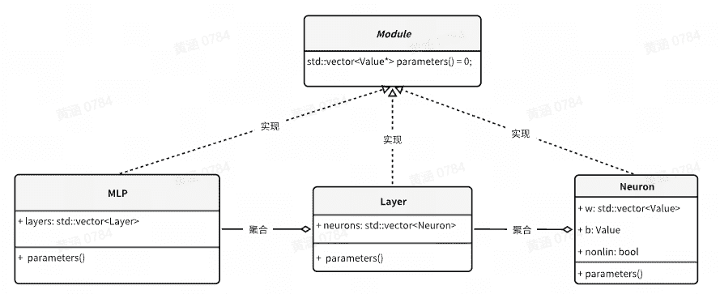
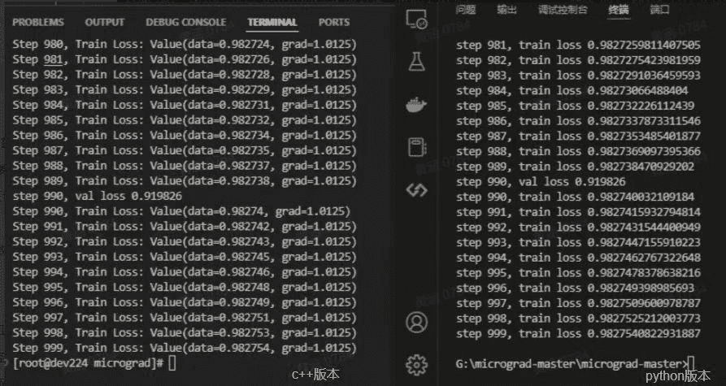

# 101N0202 Micrograd C++ 代码自发实现

> 来源：[https://aicarrier.feishu.cn/docx/Zv9CdilG3oYl2sxIlXxcZ5hVnXb](https://aicarrier.feishu.cn/docx/Zv9CdilG3oYl2sxIlXxcZ5hVnXb)

## 引言

本文是对 `micrograd` C++ 版本的代码解读。`micrograd` 项目是 Andrej Karpathy `101N` 课程的一部分，旨在构建一个轻量级的自动微分引擎，帮助我们理解自动微分、梯度下降、反向传播和神经网络训练的基本原理。原项目是使用 `python` 实现，我们自发对 `101n` 课程做了扩展，使用 `C++` 复现了 `micrograd` 的核心代码，以便让大家了解 `C++` 和 `Python` 在代码实现方式上的差异。下面让我开始一步步对代码解读。

> 阅读 `Tips`：阅读本文需要准备一些高数微积分基础知识。`C++11` 基础知识。

## 代码主要结构：

整个代码只有一个 `micrograd.cpp` 文件，通过面向对象的方式实现了 `Python` 版本中的各个模块：

> `RNG` 类：自定义的随机数生成器，保证相同的 `seed` 情况下，生成的数据相同。

> `Value` 类：整个自动求导引擎的核心。它存储一个标量值及其梯度，并定义了基本的数学运算。

> `Module` 类：定义了神经网络模块的基本接口，是 `Neuron`、`Layer`、`MLP` 的基类。

> `Neuron` 类：实现单个神经元。

> `Layer` 类：实现神经网络层。

> `MLP` 类：实现了一个多层感知机。

> `main` 方法：主程序入口，使用上面的对象和工具，构建了一个具有 2 个输入节点、16 个隐藏层节点和 3 个输出节点的神经网络，跑通了整个训练流程。

以上 `C++` 对象，和 `Python` 版本实现一一对应，都能在 `Python` 版本中找到相应的实现对象。

## 代码解读

### `RNG` 类：

```cpp
class RNG {
private:
    uint64_t state; // 随机数生成器的内部状态

public:
    // 构造函数，初始化随机数生成器的状态
    RNG(uint64_t seed) : state(seed) {}

    // 生成一个 32 位的随机整数
    uint32_t random_u32() {
        // 使用 xorshift 算法生成随机数
        state ^= (state >> 12) & 0xFFFFFFFFFFFFFFFF;
        state ^= (state << 25) & 0xFFFFFFFFFFFFFFFF;
        state ^= (state >> 27) & 0xFFFFFFFFFFFFFFFF;
        // 返回生成的 32 位随机数
        return static_cast<uint32_t>((state * 0x2545F4914F6CDD1D) >> 32);
    }

    // 生成一个 [0, 1) 区间内的随机浮点数
    float random() {
        // 将 32 位随机数右移 8 位后，除以 16777216.0 来生成 [0, 1) 区间内的随机浮点数
        return (random_u32() >> 8) / 16777216.0f;
    }

    // 生成一个 [a, b) 区间内的随机浮点数
    float uniform(float a = 0.0f, float b = 1.0f) {
        // 使用 [0, 1) 的随机数生成 [a, b) 区间内的随机浮点数
        return a + (b - a) * random();
    }
};

// 生成训练集、验证集和测试集
std::tuple<std::vector<std::pair<std::vector<double>, int>>, 
           std::vector<std::pair<std::vector<double>, int>>, 
           std::vector<std::pair<std::vector<double>, int>>>
gen_data(RNG &random, int n = 100) {
    // 定义存储数据点的向量
    std::vector<std::pair<std::vector<double>, int>> pts;

    // 生成 n 个随机数据点
    for (int i = 0; i < n; ++i) {
        // 生成 x 和 y 坐标，范围在 [-2.0, 2.0)
        float x = random.uniform(-2.0f, 2.0f);
        float y = random.uniform(-2.0f, 2.0f);

        // 根据 x 和 y 的位置确定标签
        int label = (x < 0) ? 0 : (y < 0) ? 1 : 2;
        
        // 将生成的点（向量和标签）存入 pts 向量中
        pts.emplace_back(std::vector<double>{x, y}, label);
    }

    // 计算训练集、验证集和测试集的大小 (80%, 10%, 10%)
    int tr_size = static_cast<int>(0.8 * n); // 训练集大小
    int val_size = static_cast<int>(0.1 * n); // 验证集大小

    // 将数据分为训练集、验证集和测试集
    std::vector<std::pair<std::vector<double>, int>> tr(pts.begin(), pts.begin() + tr_size); // 训练集
    std::vector<std::pair<std::vector<double>, int>> val(pts.begin() + tr_size, pts.begin() + tr_size + val_size); // 验证集
    std::vector<std::pair<std::vector<double>, int>> te(pts.begin() + tr_size + val_size, pts.end()); // 测试集

    // 返回训练集、验证集和测试集
    return std::make_tuple(tr, val, te);
}
```

> `RNG` 类：实现了一个简单的随机数生成器，使用 `xorshift` 算法生成随机数。这个类可以生成 32 位的随机整数，也可以生成 `[0, 1)` 区间内的随机浮点数。

> `gen_data` 函数：调用 `RNG` 类，生成 `n` 个随机的二维点，每个点根据其 `x` 和 `y` 坐标位置被赋予不同的标签（0、1 或 2）。然后，这些点被划分为训练集（80%）、验证集（10%）和测试集（10%）。

> 为什么要自己实现一个随机数生成器？

> 主要是为了可重复性和一致性。我们的项目主要是以学习与研究为目的，自己实现一个可控的随机数生成器，可以方便每次生成相同的数据集和网络权重，方便我们重复调试、跟踪 `bug`、重现实验结果，帮助开发者理解更底层的细节。

> 在原项目中，作者还实现了一个 `Pytorch.py` 版本，使用相同的数据集和网络权重，可以通过对比两个版本的输出结果是否一致，来校验两个版本的程序是否正确。

> 同样的，要验证我们的 `C++` 版本改写是否正确，也可以使用相同的数据集和网络权重参数以及训练超参数，来校验 `C++` 版本和 `Python` 版本的输出结果是否一致来判断程序的正确性。

### `Value` 类：

#### 成员变量

```cpp
class Value {
public:
    double m;    // 一阶矩
    double v;    // 二阶矩
    double data; // 存储值
    double grad; // 存储梯度
    std::set<Value*> prev; // 存储前驱节点
    std::string op; // 操作符名称
    std::function<void(Value&)> backward; // 反向传播函数
}
```

> `m`、`v` 变量主要用于自适应学习率的调整，尤其是在 `Adam` 优化器中，可以记录梯度的平均值和变化幅度，帮助调整学习率，防止在陡峭的区域更新过大。后面的代码中，神经网络参数更新时，会有具体的使用方法，实现了 `Adam` 优化器算法。

> `Python` 版本中 `m`、`v` 是在训练时动态初始化的，这得益于 `python` 语言的灵活性，可以在实例化对象后，随时为该对象添加新的属性。`C++` 语言比较严谨，必须在类定义中明确定义好成员变量，后面才能使用。

#### 构造函数

```cpp
Value(double data, std::initializer_list<Value*> children = {}, const std::string& op = "")
        : data(data), grad(0), op(op) {
        for (auto child : children) {
            prev.insert(child);
        }
        backward = [this](Value&) { }; // Default backward function does nothing
    }

    Value(const Value& other): data(other.data), grad(other.grad), prev(other.prev), op(other.op), backward(other.backward) {

    }
```

> `Value` 类主要实现了两个构造函数，需要注意的是拷贝构造函数。

#### 重载运算操作符

`C++` 主要通过其自身的运算符重载机制，完成了 `Value` 类加减乘除运算，其中还包括 `+=`、`-=`、`*=`、`/=` 运算。

##### `+`、`+=` 运算

```cpp
// 实现 Value 类的加法操作符重载
Value operator+(Value const& other) {
    // 创建一个新的 Value 对象 out，data 为 this 和 other 对象的 data 之和
    // 并将 this 和 other 的指针作为前驱节点传递给 out，用于梯度传播
    Value out(data + other.data, {this, &const_cast<Value&>(other)}, "+");

    // 设置 out 的反向传播函数
    out.setBackward([this, &other](Value& out) {
        // this 的梯度加上 out 的梯度，进行链式法则的梯度传递
        this->addGrad(out.getGrad());
        // other 的梯度也加上 out 的梯度
        const_cast<Value&>(other).addGrad(out.getGrad());
    });

    // 返回新生成的 Value 对象
    return out;
}

// 实现 Value 类的加等操作符重载
Value& operator+=(const Value& other) {
    // 创建当前对象（this）的副本 originalThis，用于保存当前状态
    Value* originalThis = new Value(*this);

    // 将 this 对象的 data 加上 other 的 data，完成加等操作
    this->data += other.data;

    // 设置操作符为 "+="，用于标记当前操作
    this->op = "+=";

    // 将 originalThis 作为前驱节点插入 this->prev 集合中
    this->prev.insert(originalThis);
    // 将 other 作为前驱节点插入 this->prev 集合中
    this->prev.insert(&const_cast<Value&>(other));

    // 设置反向传播函数
    this->setBackward([originalThis, &other](Value& out) {
        // originalThis 的梯度加上 out 的梯度
        originalThis->addGrad(out.getGrad());
        // other 的梯度加上 out 的梯度
        const_cast<Value&>(other).addGrad(out.getGrad());
    });

    // 返回修改后的当前对象
    return *this;
}
```

> **加法的梯度**

> 我们可以把梯度理解为“变化的速度”。假设你有两个数，`a` 和 `b`，它们的和是 `c`。也就是说，`c = a + b`。

> 如果 `a` 增加了 1，`c` 会增加多少？答案是 1。同样的，如果 `b` 增加了 1，`c` 也会增加 1。因此，`c` 对 `a` 和 `b` 的变化都是 1，这就是所谓的梯度为 1。

> 简单来说，`a` 和 `b` 都对 `c` 有同样的影响，每增加一点，`c` 就增加一点。

> 在代码里，`self.grad` 是 `a` 的变化率，`other.grad` 是 `b` 的变化率，`out.grad` 是结果 `out` 的变化率。因为 `c = a + b`，`a` 和 `b` 对 `c` 的影响是一样的（变化率都是 1）。所以为了计算 `a` 和 `b` 的梯度，你需要把 `out` 的梯度加到它们各自的梯度上。简单来说，就是把结果的影响“传递”回 `a` 和 `b`。

##### `-`、`-=` 运算


# Value 类运算符重载与梯度计算

## 减法运算 `-`、`-=`

```
// 实现 Value 类的减法操作符重载
Value operator-(Value const& other) {
    // 创建一个新的 Value 对象 out，data 为 this 和 other 对象的 data 之差
    // 并将 this 和 other 的指针作为前驱节点传递给 out，用于梯度传播
    Value out(this->data - other.data, {this, &const_cast<Value&>(other)}, "-");

    // 设置 out 的反向传播函数
    out.setBackward([this, &other](Value& out) mutable {
        // this 的梯度加上 out 的梯度，乘以正 1.0，表示正向传递梯度
        this->addGrad(1.0 * out.getGrad());
        // other 的梯度加上 out 的梯度，乘以负 1.0，表示负向传递梯度
        const_cast<Value&>(other).addGrad(-1.0 * out.getGrad());
    });

    // 返回新生成的 Value 对象
    return out;
}

// 实现 Value 类的减等操作符重载
Value& operator-=(const Value& other) {
    // 创建当前对象（this）的副本 originalThis，用于保存当前状态
    Value* originalThis = new Value(*this);

    // 将 this 对象的 data 减去 other 的 data，完成减等操作
    this->data -= other.data;

    // 设置操作符为 "-="，用于标记当前操作
    this->op = "-=";

    // 将 originalThis 作为前驱节点插入 this->prev 集合中，保存当前状态以备反向传播
    this->prev.insert(originalThis);
    // 将 other 作为前驱节点插入 this->prev 集合中
    this->prev.insert(&const_cast<Value&>(other));

    // 设置反向传播函数
    this->setBackward([originalThis, &other](Value& out) {
        // 将 out 的梯度传递给原始的 this 对象 (originalThis)
        originalThis->addGrad(out.getGrad());
        // 将 out 的负梯度传递给 other 对象，表示梯度在减法中的影响
        const_cast<Value&>(other).addGrad(-out.getGrad());
    });

    // 返回修改后的当前对象
    return *this;
}
```

### 减法的梯度

减法的梯度原理和加法一样，只是在计算时要注意正负号。

## 乘法运算 `*`、`*=`

```
// 实现 Value 类的乘法操作符重载
Value operator*(Value const& other) {
    // 创建一个新的 Value 对象 out，data 为 this 和 other 对象的 data 之乘积
    // 并将 this 和 other 的指针作为前驱节点传递给 out，用于梯度传播
    Value out(data * other.data, {this, &const_cast<Value&>(other)}, "*");

    // 设置 out 的反向传播函数
    out.setBackward([this, &other](Value& out) {
        // this 的梯度加上 other 的 data 乘以 out 的梯度，用于链式法则的梯度传递
        this->addGrad(other.data * out.getGrad());
        // other 的梯度加上 this 的 data 乘以 out 的梯度
        const_cast<Value&>(other).addGrad(this->data * out.getGrad());
    });

    // 返回新生成的 Value 对象
    return out;
}

// 实现 Value 类的乘等操作符重载
Value& operator*=(const Value& other) {
    // 创建当前对象（this）的副本 originalThis，用于保存当前状态
    Value* originalThis = new Value(*this);

    // 将 this 对象的 data 与 other 的 data 相乘，完成乘等操作
    this->data *= other.data;

    // 设置操作符为 "*="，用于标记当前操作
    this->op = "*=";

    // 将 originalThis 作为前驱节点插入 this->prev 集合中，保存当前状态以备反向传播
    this->prev.insert(originalThis);
    // 将 other 作为前驱节点插入 this->prev 集合中
    this->prev.insert(&const_cast<Value&>(other));

    // 设置反向传播函数
    this->backward = [originalThis, &other](Value& out) {
        // originalThis 的梯度加上 other 的 data 乘以 out 的梯度，表示链式法则中乘积的梯度
        originalThis->grad += other.data * out.grad;
        // other 的梯度加上 originalThis 的 data 乘以 out 的梯度
        const_cast<Value&>(other).grad += originalThis->data * out.grad;
    };

    // 返回修改后的当前对象
    return *this;
}
```

### 乘法的梯度

假设有两个数 `a` 和 `b`，它们相乘得到一个结果 `c = a × b`。当我们稍微改变 `a` 或 `b` 时，`c` 也会发生变化。梯度告诉我们 `c` 对 `a` 或 `b` 的变化有多敏感。

1. `a` 的梯度：`b` 影响 `c` 的变化。如果我们增加 `a`，`c` 的变化量会和 `b` 成正比。梯度表示为

1. `b` 的梯度：`a` 影响 `c` 的变化。如果我们增加 `b`，`c` 的变化量会和 `a` 成正比。梯度表示为

简单来说，乘法的梯度就是另一个数对结果变化的贡献。例如，如果你知道结果 `c` 的梯度，那么你只需要用对方的值乘以这个梯度，就能得到你这边的梯度。

因此，我们在代码中这样更新梯度：

+ `a）self.grad += other.data * out.grad`

+ `b）other.grad += self.data * out.grad`

## 除法运算 `/`、`/=`

```
// 实现 Value 类的除法操作符重载
Value operator/(Value const& other) {
    // 断言 other.data 不为 0，以避免除零错误
    assert(other.data != 0 && "Division by zero!");

    // 创建一个新的 Value 对象 out，data 为 this 和 other 对象的 data 之商
    // 将 this 和 other 的指针作为前驱节点传递给 out，用于梯度传播
    Value out(this->data / other.data, {this, &const_cast<Value&>(other)}, "/");

    // 设置 out 的反向传播函数
    out.setBackward([this, &other](Value& out) mutable {
        // this 的梯度为 (1 / other.data) * out 的梯度
        // 这是链式法则在除法中的应用，对于分子，梯度为除数的倒数乘以输出梯度
        this->addGrad((1.0 / other.data) * out.getGrad());

        // other 的梯度为 -(this->data / (other.data^2)) * out 的梯度
        // 这是链式法则在除法中的应用，对于分母，梯度为负的分子除以分母的平方，再乘以输出梯度
        const_cast<Value&>(other).addGrad(-(this->data / (other.data * other.data)) * out.getGrad());
    });

    // 返回新生成的 Value 对象
    return out;
}

// 实现 Value 类的除等操作符重载
Value& operator/=(const Value& other) {
    // 创建当前对象（this）的副本 originalThis，用于保存当前状态
    Value* originalThis = new Value(*this);

    // 将 this 对象的 data 除以 other 的 data，完成除等操作
    this->data /= other.data;

    // 设置操作符为 "/="，用于标记当前操作
    this->op = "/=";

    // 将 originalThis 作为前驱节点插入 this->prev 集合中，保存当前状态以备反向传播
    this->prev.insert(originalThis);
    // 将 other 作为前驱节点插入 this->prev 集合中
    this->prev.insert(&const_cast<Value&>(other));

    // 设置反向传播函数
    this->backward = [originalThis, &other](Value& out) {
        // originalThis 的梯度加上 1 / other.data 乘以 out 的梯度
        // 这是链式法则在除法中的应用，原始对象的梯度由除数的倒数乘以 out 的梯度得到
        originalThis->grad += (1 / other.data) * out.grad;

        // other 的梯度加上 (-originalThis->data / (other.data^2)) 乘以 out 的梯度
        // 这是链式法则在除法中的应用，other 对象的梯度通过商的微分规则计算得到
        const_cast<Value&>(other).grad -= (originalThis->data / (other.data * other.data)) * out.grad;
    };

    // 返回修改后的当前对象
    return *this;
}
```

### 除法的梯度

除法的梯度原理可以用类似乘法的方式来理解，但稍微复杂一点。

假设我们有两个数 `a` 和 `b`，并且它们的商是 `c = a / b`。当我们稍微改变 `a` 或 `b` 时，结果 `c` 也会发生变化。梯度告诉我们 `c` 对 `a` 或 `b` 的变化有多敏感。

1. `a` 的梯度：`b` 会影响 `c` 的变化。如果你稍微增加 `a`，`c` 也会增加，并且增加的程度取决于 `b` 的大小。梯度表示为： 。这意味着，当 `a` 增加时，`c` 会按 `1/b` 的比例增加。

1. `b` 的梯度：这部分稍微复杂一些。如果你增加 `b`，由于 `b` 在分母中，所以 `c` 会减少。具体来说，梯度表示为： 。这意味着，当 `b` 增加时，`c` 会按  的比例减少。

总结起来当我们计算除法的梯度时，`a` 对结果的影响是通过除以 `b` 来决定的，而 `b` 对结果的影响是更加复杂的，因为它在分母中，所以它的梯度是负的，并且会受到平方的影响

+ `a` 的梯度会增加 `1/b × c` 的梯度。

+ `b` 的梯度会减少 `×c` 的梯度。

## 指数运算 `pow`

```
// 实现 Value 类的 pow 函数，支持指数运算
Value pow(double other) {
    // 断言目前仅支持整数或浮点数的幂运算
    assert(("Supporting only int/float powers for now", std::floor(other) == other));

    // 创建一个新的 Value 对象，保存 this->data 的幂次运算结果
    // 并记录操作符为 "**" + 幂次
    Value out(std::pow(data, other), {this}, "**" + std::to_string(static_cast<int>(other)));

    // 设置反向传播函数
    out.setBackward([this, other](Value& out) {
        // 对于幂运算，梯度计算为 other * (this->data ^ (other - 1)) * out 的梯度
        this->addGrad(other * std::pow(this->data, other - 1) * out.getGrad());
    });

    // 返回新生成的 Value 对象
    return out;
}
```

### 幂运算梯度

幂运算的梯度规则基于以下公式：

对于一个标量 `a` 和一个指数 `b`，它们的幂的梯度为：

当我们计算 `c` 的梯度时，`a` 的变化会影响 `c`，并且影响的大小是

所以 `self.grad += (other * self.data**(other-1)) * out.grad`

## 激活函数 `relu`

```
// 实现 Value 类的 ReLU 函数
Value relu() {
    // 创建一个新的 Value 对象，保存 ReLU 操作后的结果
    // ReLU 是一种激活函数，如果输入值小于 0，则输出 0，否则输出原值
    Value out(data < 0 ? 0 : data, {this}, "ReLU");

    // 设置反向传播函数
    out.setBackward([this](Value& out) {
        // 只有当 out 的数据大于 0 时，this 才会接收梯度，否则梯度为 0
        this->addGrad((out.getData() > 0) * out.getGrad());
    });

    // 返回新生成的 Value 对象
    return out;
}
```

`relu` 方法通常用于神经网络的前向传播和反向传播过程中。在前向传播中，它将输入数据通过 `ReLU` 函数进行激活，得到新的输出值。在反向传播中，它根据 `ReLU` 函数的特性，正确地计算并传递梯度。

`ReLU`：输出范围是 [0, +∞)，当输入为负时输出为 0。

`ReLU`：在正区间的梯度恒为 1，负区间的梯度为 0，可能导致梯度消失问题。

因此在反向传播时只有当 `out` 的数据大于 0 时，`this` 才会接收梯度，否则梯度为 0

## 激活函数 `tanh`

```
// 实现 Value 类的 tanh 函数
Value tanh() {
    // 创建一个新的 Value 对象，保存 tanh 操作后的结果
    // tanh 是双曲正切函数，用于将输入数据压缩到 [-1, 1] 的范围
    Value out(std::tanh(data), {this}, "tanh");

    // 设置反向传播函数
    out.setBackward([this](Value& out) {
        // tanh 的梯度计算为 1 - tanh 的平方，再乘以 out 的梯度
        this->addGrad((1 - std::pow(out.getData(), 2)) * out.getGrad());
    });

    // 返回新生成的 Value 对象
    return out;
}
```

`tanh` 方法，也是一个常用的激活函数值。在神经网络中，激活函数（如 `tanh`）用于引入非线性，帮助模型更好地拟合数据。通过自动求导，可以方便地计算梯度，用于参数更新。

### 梯度计算


## tanh 函数

> `tanh` 函数的梯度是 。这个公式可以用来计算 `tanh` 函数在任意点 ( `x` ) 的导数。

> 根据链式法则，`self.grad += (1 - out.data**2) * out.grad`

## exp 函数

```
Value exp() {
    // 创建一个新的 Value 对象，保存 exp 操作后的结果
    // exp 函数用于计算 e^x，其中 e 是自然常数
    Value out(std::exp(data), {this}, "exp");

    // 设置反向传播函数
    out.setBackward([this](Value& out) {
        // exp 的梯度是 exp 的结果本身，再乘以 out 的梯度
        this->addGrad(std::exp(this->data) * out.getGrad());
    });

    // 返回新生成的 Value 对象
    return out;
}
```

> `exp` 方法，用于计算一个数值的指数函数值: ，并返回一个新的 `Value` 对象。这个方法通常用于自动微分系统中，用于计算梯度。

> **梯度计算：**

> exp 函数的梯度是：

> 在反向传播过程中，我们需要计算指数函数相对于其输入的梯度，并将其存储到 `self.grad` 中:

> `self.grad += math.exp(self.data) * out.grad`

## log 对数函数

```
Value log() {
    // 创建一个新的 Value 对象，保存 log 操作后的结果
    // log 函数用于计算自然对数，通常用于处理指数增长的数据
    Value out(std::log(data), {this}, "log");

    // 设置反向传播函数
    out.setBackward([this](Value& out) {
        // log 的梯度计算为 1 / this->data，再乘以 out 的梯度
        this->addGrad(1 / this->data * out.getGrad());
    });

    // 返回新生成的 Value 对象
    return out;
}
```

> `log` 方法，用于计算一个数值的自然对数（即以 e 为底的对数） 。通常用于自动微分系统中，特别是在实现神经网络或其他需要计算梯度的算法时。通过定义 `log` 方法，可以方便地计算一个数值的自然对数，并自动计算其梯度，这对于反向传播算法至关重要。

> **梯度计算：**

> log 函数的梯度是：

> 在反向传播过程中，利用自然对数函数的导数公式，将梯度正确传递回前一个节点。

> `self.grad += (1/self.data) * out.grad`

## 反向传播的函数 `backwardPass()`

```
void backwardPass() {
    // topo 保存拓扑排序后的节点，visited 用于记录访问过的节点
    std::vector<Value*> topo;
    std::set<Value*> visited;

    // 定义递归函数 buildTopo，用于构建拓扑排序
    std::function<void(Value*)> buildTopo = [&topo, &visited, &buildTopo](Value* v) {
        // 检查节点 v 是否已经被访问过
        if (visited.insert(v).second) {  // 如果插入成功，说明节点 v 还没有被访问
            // 对 v 的所有前驱节点递归调用 buildTopo 函数
            for (auto child : v->prev) {
                buildTopo(child);
            }
            // 将节点 v 加入 topo 数组，保证其所有前驱节点已经被访问过
            topo.push_back(v);
        }
    };

    // 对当前节点（this）构建拓扑排序
    buildTopo(this);

    // 初始化当前节点的梯度为 1，表示从损失函数开始反向传播梯度
    this->grad = 1;

    // 遍历拓扑排序的节点，从最后一个节点到第一个节点进行反向传播
    for (auto it = topo.rbegin(); it != topo.rend(); ++it) {
        // 调用每个节点的 backward 函数，计算该节点的梯度
        (*it)->backward(**it);
    }
}
```

> `backwardPass()` 函数通过构建计算图的拓扑排序，确保梯度按照正确的顺序进行反向传播。拓扑排序保证了每个节点的梯度在其依赖的节点之前被计算。这里要注意在计算图中，每个节点代表一个变量或者操作，拓扑排序是保证在计算梯度时先计算所有依赖项的关键步骤。

> `buildTopo` 是一个递归函数，它会遍历所有的前驱节点（`prev`），确保先访问并计算前驱节点，然后再处理当前节点。这样可以保证在进行梯度反向传播时，所有依赖的节点的梯度都已经计算好了。

## 多层感知机 `MLP`

`MLP` 类实现了一个简单的多层感知机，包含多个层（`Layer`），每个层包含多个神经网络节点（`Neuron`）。`MLP`、`Layer`、`Neuron` 都继承了 `Module` 类，并重载了 `Module` 类的 `parameters` 方法，UML 关系如下：



代码解读如下：

### `Module` 接口

```
class Module {
public:
    // 纯虚函数，用于返回所有可学习的参数（梯度需要更新的变量）
    virtual std::vector<Value*> parameters() = 0;
    virtual ~Module() {}  // 虚析构函数

    // 将所有参数的梯度清零，通常在每次反向传播前调用
    void zero_grad() {
        for (auto p : parameters()) {
            p->grad = 0;
        }
    }
};
```

> `Module` 是所有神经网络模块的基类。它有一个纯虚函数 `parameters()`，用来返回可学习的参数（`Value` 对象的指针）。

> `zero_grad()` 方法用于将所有参数的梯度清零，这在每次训练迭代开始时很重要。

> 析构函数通过也被设计为虚函数，通过虚析构函数确保派生类对象可以被正确销毁。

### `Neuron` 神经元节点

```
class Neuron : public Module {
private:
    std::vector<Value> w;  // 权重
    Value b;               // 偏置
    bool nonlin;           // 是否应用非线性激活函数

public:
    // 构造函数，接受输入维度以及是否使用非线性激活函数
    Neuron(int nin, bool nonlin = true) : b(0), nonlin(nonlin) {
        // 初始化权重，使用随机数进行初始化
        for (int i = 0; i < nin; i++) {
            w.emplace_back(Value(_random.uniform(-1, 1) / sqrt(nin)));
        }
    }

    // 重载函数调用运算符，用于计算神经元的输出
    Value operator()(const std::vector<Value> x) {
        Value act = b;  // 初始化为偏置
        for (size_t i = 0; i < w.size(); ++i) {
            act = act + w[i] * x[i];  // 线性组合输入和权重
        }
        return nonlin ? act.tanh() : act;  // 如果中间隐藏层，应用tanh非线性激活函数
    }

    // 返回该神经元的所有参数（权重和偏置）
    std::vector<Value*> parameters() override {
        std::vector<Value*> params;
        for (auto& weight : w) {
            params.push_back(&weight);
        }
        params.push_back(&b);
        return params;
    }
};
```

> `Neuron` 类代表神经网络中的一个神经元，具有 `w`（权重）和 `b`（偏置）两个参数。

> 在构造函数中，权重根据输入的维度随机初始化。

> `operator()` 重载运算符使得类可以像函数一样被调用。它执行加权求和，并根据配置决定是否应用 `tanh` 非线性激活函数。

> `parameters()` 返回当前神经元的所有参数（包括权重和偏置），供优化器使用。

### `Layer` 神经网络层

```
class Layer : public Module {
private:
    std::vector<Neuron> neurons;  // 包含多个神经元

public:
    // 构造函数，接受输入和输出维度以及是否应用非线性激活函数
    Layer(int nin, int nout, bool nonlin = true) {
        for (int i = 0; i < nout; i++) {
            neurons.emplace_back(nin, nonlin);  // 构建每一个神经元
        }
    }

    // 重载函数调用运算符，用于计算层的输出
    std::vector<Value> operator()(const std::vector<Value> x) {
        std::vector<Value> out;
        for (auto& neuron : neurons) {
            out.push_back(neuron(x));  // 逐个神经元计算输出
        }
        return out;
    }

    // 返回该层的所有参数（即层中所有神经元的参数）
    std::vector<Value*> parameters() override {
        std::vector<Value*> params;
        for (auto& neuron : neurons) {
            auto neuronParams = neuron.parameters();
            params.insert(params.end(), neuronParams.begin(), neuronParams.end());
        }
        return params;
    }
};
```

> `Layer` 类表示神经网络中的一层，包含多个神经元。

> 构造函数根据输出维度创建相应数量的神经元，并将输入维度传递给每个神经元。

> `operator()` 实现层的前向传播。它遍历所有神经元并计算它们的输出。

> `parameters()` 返回该层所有神经元的参数，用于梯度计算和更新。

### `MLP` 多层感知机

```
class MLP : public Module {
private:
    std::vector<Layer> layers;  // 多层感知机由多层组成

public:
    // 构造函数，接受输入维度和每层的输出维度列表
    MLP(int nin, const std::vector<int>& nouts) {
        int size = nouts.size();
        for (int i = 0; i < size; ++i) {
            layers.emplace_back(Layer(nin, nouts[i], i != size - 1));
            nin = nouts[i];//前面一层为下一层的输入，nin 决定下一层参数的维度
        }
    }

    // 重载函数调用运算符，用于计算MLP的输出
    std::vector<Value> operator()(std::vector<Value> x) {
        for (auto& layer : layers) {
            x = layer(x);  // 逐层计算输出
        }
        return x;
    }

    // 返回整个MLP的所有参数（即所有层的所有参数）
    std::vector<Value*> parameters() override {
        std::vector<Value*> params;
        for (auto& layer : layers) {
            auto layerParams = layer.parameters();
            params.insert(params.end(), layerParams.begin(), layerParams.end());
        }
        return params;
    }
};
```

> `MLP`（多层感知机）是由多层 `Layer` 组成的神经网络。

> 构造函数接受输入维度 `nin` 和输出维度列表 `nouts`，根据这些信息构建多层感知机。

> `operator()` 实现前向传播，逐层传递输入并返回最终的输出。

> `parameters()` 返回整个网络中所有层的参数，用于训练时的梯度更新。

如果按照代码中示例，建立一个 `model = MLP(2, [16, 3])` 的多层感知机，其神经网络图如下：


## 损失函数

```
Value cross_entropy(std::vector<Value>& logits, int target) {
    // 找到 logits 向量中的最大值，以提高数值稳定性
    Value max_val = *std::max_element(logits.begin(), logits.end());
    
    // 创建一个新的向量，用于存储调整后的 logits（每个值减去最大值）
    std::vector<Value> adjusted_logits;
    adjusted_logits.reserve(logits.size());
    
    // 遍历 logits，将每个值减去 max_val，并存储在 adjusted_logits 中
    for (auto val : logits) {
        adjusted_logits.push_back(val - max_val);
    }

    // 创建一个向量，用于存储每个调整后 logits 的指数值
    std::vector<Value> ex;
    ex.reserve(adjusted_logits.size());
    
    // 计算每个调整后 logits 的指数，并存储在 ex 中
    for (auto val : adjusted_logits) {
        ex.push_back(val.exp());
    }

    // 计算所有指数值的总和
    Value denom = std::accumulate(ex.begin(), ex.end(), Value(0.0));

    // 创建一个向量，用于存储每个概率值
    std::vector<Value> probs;
    probs.reserve(ex.size());
    
    // 计算每个指数值占总和的比例，得到每个类别的概率
    for (auto val : ex) {
        probs.push_back(val / denom);
    }

    // 计算目标类别的对数概率
    Value logp = probs[target].log();

    // 交叉熵损失是对数概率的负值（取负号使得损失值越低越好）
    Value nll = -logp;

    // 返回交叉熵损失
    return nll;
}
```


# NLL 损失函数与训练实验

> 这里的损失函数使用的是负对数似然（Negative Log-Likelihood, NLL）算法。

> NLL 源于最大似然估计（MLE），它是统计学中的一个重要方法。通过最大化似然函数来估计模型参数，使得数据的生成概率最大化。这种理论背景使得 NLL 损失具有坚实的统计学基础。在大样本情况下，NLL 损失的最小化将导致估计的模型参数趋于真实参数，从而使模型更接近真实数据生成分布。

> NLL 损失不仅适用于二分类问题，也适用于多分类问题。在多分类情况下，它计算了目标类别的对数概率，并通过负号转化为损失，用于训练和评估模型，使得模型的预测尽可能接近真实数据。

> 对于多分类问题，交叉熵损失函数是计算 NLL 的一种常见方式。具体地，交叉熵损失函数用于衡量真实标签的概率分布与模型预测概率分布之间的差距。计算步骤包括：

1. 调整 `logits`：为了避免数值不稳定性，通常会先从 `logits` 中减去最大值。

1. 计算指数：对调整后的 `logits` 应用指数函数，得到每个类别的指数值。

1. 计算概率：通过归一化（即将每个指数值除以所有指数值的总和）得到类别概率。

1. 对数计算：对目标类别的概率取对数。

1. 负值：取对数概率的负值，得到 NLL。

## 评估数据集损失

```
// 评估数据集 split 的损失
double eval_split(MLP& model, const std::vector<std::pair<std::vector<double>, int>>& split) {
    // 初始化损失值为 0
    Value loss(0);
    
    // 遍历数据集中的每一个样本
    for (const auto& sample : split) {
        // 获取样本的特征向量 x 和真实标签 y
        const std::vector<double>& x = sample.first;
        int y = sample.second;
        
        // 将特征向量 x 转换为 Value 类型，并存储在 inputs 向量中
        std::vector<Value> inputs = { Value(x[0]), Value(x[1]) };
        
        // 使用模型对输入进行预测，得到 logits（预测的原始分数）
        std::vector<Value> logits = model(inputs);
        
        // 计算交叉熵损失
        Value cer = cross_entropy(logits, y);
        
        // 累加损失值
        loss = loss + cer;
    }
    
    // 对损失进行归一化处理，即将总损失除以样本数量
    loss = loss * (1.0 / split.size());
    
    // 返回归一化后的损失值
    return loss.getData();
}
```

### 解释

1. 初始化损失值：将 `loss` 变量初始化为 0，用于累加所有样本的损失。

1. 遍历数据集：遍历 `split` 中的每一个样本。每个样本由特征向量 `x` 和真实标签 `y` 组成。

1. 特征向量转换：将特征向量 `x` 中的每个值转换为 `Value` 类型，并存储在 `inputs` 向量中。

1. 模型预测：使用模型 `model` 对 `inputs` 进行预测，得到 `logits`（模型输出的原始分数）。

1. 计算交叉熵损失：使用 `cross_entropy` 函数计算当前样本的交叉熵损失 `cer`。

1. 累加损失值：将当前样本的损失值 `cer` 累加到总损失 `loss` 上。

1. 归一化损失：将总损失 `loss` 除以样本数量 `split.size()`，以计算平均损失。

1. 返回损失值：返回归一化后的损失值。

> 这个函数的作用是计算给定数据集 `split` 上模型的平均损失，以评估模型的性能。会在训练过程中每10步调用一次。

## 训练实验

```
int main() {
    // 数据生成
    // 生成数据集，100 是样本数量
    auto datasets = gen_data(_random, 100);
    std::vector<std::pair<std::vector<double>, int>> train_split = std::get<0>(datasets);  // 训练集
    std::vector<std::pair<std::vector<double>, int>> val_split  = std::get<1>(datasets); // 验证集
    std::vector<std::pair<std::vector<double>, int>> test_split  = std::get<2>(datasets); // 测试集

    // 创建一个具有 2 个输入节点，16 个隐藏层节点和 3 个输出节点的 MLP 模型
    MLP model(2, {16, 3});

    // 超参数设置
    double learning_rate = 1e-1;   // 学习率
    double beta1 = 0.9;           // Adam 优化器的 β1 参数
    double beta2 = 0.95;          // Adam 优化器的 β2 参数
    double weight_decay = 1e-4;   // 权重衰减（L2 正则化）

    // 参数初始化
    // 初始化模型参数的梯度、动量 m 和二次矩估计 v
    for (auto* p : model.parameters()) {
        p->grad = 0.0;  // 梯度初始化为 0
        p->m = 0.0;    // 动量初始化为 0
        p->v = 0.0;    // 二次矩初始化为 0
    }

    // 训练循环
    for (int step = 0; step < 1000; ++step) {
        if (step % 10 == 0) {
            // 每 10 步输出一次验证集上的损失
            double val_loss = eval_split(model, val_split);
            std::cout << "step " << step << ", val loss " << val_loss << std::endl;
        }

        // 计算训练集上的总损失
        Value loss(0.0);
        for (auto& data : train_split) {
            std::vector<Value> x = {Value(data.first[0]), Value(data.first[1])}; // 转换特征为 Value 类型
            std::vector<Value> logits = model(x); // 通过模型进行前向传播
            
            // 计算交叉熵损失
            Value ce(cross_entropy(logits, data.second));
            loss += ce; // 累加损失
        }
        // 计算平均损失
        loss = loss * (1.0 / train_split.size());

        // 反向传播计算梯度
        loss.backwardPass();

        // 参数更新（使用 AdamW 优化器）
        for (auto* p : model.parameters()) {
            // Adam 优化器的参数更新逻辑
            p->m = beta1 * p->m + (1 - beta1) * p->grad; // 更新动量
            p->v = beta2 * p->v + (1 - beta2) * p->grad * p->grad; // 更新二次矩
            double m_hat = p->m / (1 - pow(beta1, step + 1));  // 偏差修正
            double v_hat = p->v / (1 - pow(beta2, step + 1));  // 偏差修正
            // 更新参数值，加入权重衰减
            p->data -= learning_rate * (m_hat / (sqrt(v_hat) + 1e-8) + weight_decay * p->data);
        }

        // 清除所有参数的梯度
        model.zero_grad();

        // 输出训练集上的损失
        std::cout << "Step " << step << ", Train Loss: " << loss << std::endl;
    }

    return 0;
}
```

### 主要组件解释

1. 数据生成：

+   `gen_data(_random, 100)`：生成 100 个样本的数据集，并将其分为训练集、验证集和测试集。

1. 模型初始化：

+   `` `MLP model(2, {16, 3})` ``：初始化一个具有 2 个输入节点、一个隐藏层包含 16 个节点、输出层包含 3 个节点的多层感知机模型。

1. 超参数：

+   `learning_rate`、`beta1`、`beta2` 和 `weight_decay`：设置用于训练的学习率、`Adam` 优化器的 `β1` 和 `β2` 参数以及权重衰减（L2 正则化）。

1. 参数初始化：

+   对模型的所有参数进行初始化，包括梯度、动量（`m`）和二次矩（`v`）。

1. 训练循环：

+   每隔 10 步计算并输出验证集上的损失。

+   对训练集进行前向传播，计算损失，进行反向传播，更新参数。

1. AdamW 优化器：

+   使用 `Adam` 优化器更新模型参数，并在更新时加入权重衰减以防止过拟合。

1. 损失输出：

+   每一步输出训练集上的损失，用于监控训练过程中的模型性能。

> 这个程序通过训练和优化 `MLP` 模型来最小化交叉熵损失函数，并使用 `AdamW` 优化器进行参数更新。

我们使用和 `Python` 版本相同的训练参数和随机种子，运行1000从训练过程，输出的结果应该是一样的：



## 总结

从以上代码可以看出 `C++` 相对于 `Python` 来说更加复杂，开发者需要处理诸如指针、内存管理和复杂的编译错误。与 `Python` 社区相比，`C++` 在深度学习领域的社区规模较小，相关的高层框架和工具支持相对较少，很多工具都要自己开发实现。

但 `C++` 最大的优点是性能比较高，在相同的数据集和训练参数配置下，都执行1000次训练，`C++` 版本耗时20s，`Python` 版本耗时接近120s，效率上相差6倍。所以 `C++` 更适合:性能要求高、大规模的计算密集型任务，资源受限的场景，其实许多底层深度学习库（如 `TensorFlow`、`PyTorch`）都使用 `C++` 来实现高效计算部分。
