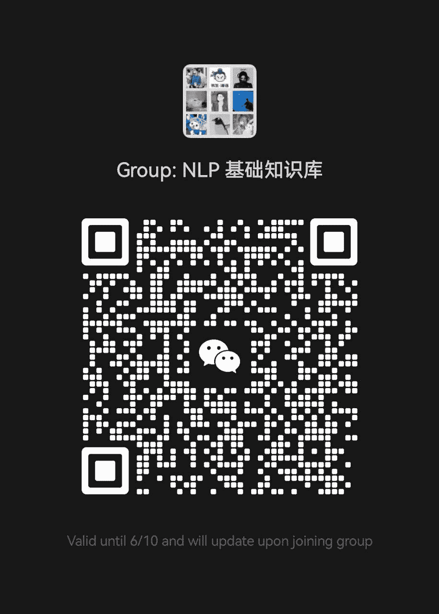

# NLP 基础知识库（共建中）

> 来源：[https://aicarrier.feishu.cn/docx/L3z0dOO1Godh8vxjK1rczvb5ngf](https://aicarrier.feishu.cn/docx/L3z0dOO1Godh8vxjK1rczvb5ngf)

# NLP 基础知识知识库共建招募

注意事项：千万不能抄袭，图片copy需要标注引用来源～

| 章节 | 小节 | 领取地址 | 激励（根据完成情况上下浮动） | 负责人 |
| --- | --- | --- | --- | --- |
| 基础概念 | NLP基础词汇与应用场景 | [N](https://aicarrier.feishu.cn/share/base/form/shrcnNFpSSeuWIXSjPcoYRuEcib?prefill_TaskID=N101)[101](https://aicarrier.feishu.cn/share/base/form/shrcnNFpSSeuWIXSjPcoYRuEcib?prefill_TaskID=N101) | 证书+算力100点 |  |
|  | 词表示与语言模型 |  |  |  |
|  | 大模型与NLP |  |  |  |
| 神经网络基础 | 神经网络的概念、组成以及如何训练 | [N201](https://aicarrier.feishu.cn/share/base/form/shrcnNFpSSeuWIXSjPcoYRuEcib?prefill_TaskID=N201) | 证书+算力100点 |  |
|  | 词向量 Word2vec |  |  |  |
|  | 循环神经网络 RNN | [N202](https://aicarrier.feishu.cn/share/base/form/shrcnNFpSSeuWIXSjPcoYRuEcib?prefill_TaskID=N202) | 证书+算力100点 |  |
|  | 门控循环单元 GRU |  |  |  |
|  | 长短期记忆网络 LSTM | [N203](https://aicarrier.feishu.cn/share/base/form/shrcnNFpSSeuWIXSjPcoYRuEcib?prefill_TaskID=N203) | 证书+算力100点 |  |
|  | 卷积神经网络 CNN |  |  |  |
| Transformer | 注意力机制 | [N301](https://aicarrier.feishu.cn/share/base/form/shrcnNFpSSeuWIXSjPcoYRuEcib?prefill_TaskID=N301) | 证书+算力100点 | 🐧🦩 |
|  | Transformer结构 | [N302](https://aicarrier.feishu.cn/share/base/form/shrcnNFpSSeuWIXSjPcoYRuEcib?prefill_TaskID=N302) | 证书+算力100点 |  |
|  | 预训练语言模型部分 | [N303](https://aicarrier.feishu.cn/share/base/form/shrcnNFpSSeuWIXSjPcoYRuEcib?prefill_TaskID=N303) | 证书+算力100点 |  |
|  | Transformer代码实操 | [N304](https://aicarrier.feishu.cn/share/base/form/shrcnNFpSSeuWIXSjPcoYRuEcib?prefill_TaskID=N304) | 证书+算力100点 |  |
| 大模型的前沿技术：Prompt-learning &amp; Delta Tuning | Prompt-Learning 背景与组成 | [N401](https://aicarrier.feishu.cn/share/base/form/shrcnNFpSSeuWIXSjPcoYRuEcib?prefill_TaskID=N401) | 证书+算力100点 |  |
|  | Prompt-Learning 流程 |  |  |  |
|  | Prompt-Learning 应用与总结 |  |  |  |
|  | Delta Tuning 背景与组成 | [N402](https://aicarrier.feishu.cn/share/base/form/shrcnNFpSSeuWIXSjPcoYRuEcib?prefill_TaskID=N402) | 证书+算力100点 |  |
|  | Delta Tuning 方法 |  |  |  |
| 大模型预训练压缩 | 知识蒸馏 | [N501](https://aicarrier.feishu.cn/share/base/form/shrcnNFpSSeuWIXSjPcoYRuEcib?prefill_TaskID=N501) | 证书+算力100点 |  |
|  | 模型量化 |  |  |  |
|  | 权重分享 |  |  |  |
|  | Low-rank Approximation | [N502](https://aicarrier.feishu.cn/share/base/form/shrcnNFpSSeuWIXSjPcoYRuEcib?prefill_TaskID=N502) | 证书+算力100点 |  |
|  | 结构搜索 |  |  |  |
| 大模型文本理解和生成 | 神经网络文本生成 | [N601](https://aicarrier.feishu.cn/share/base/form/shrcnNFpSSeuWIXSjPcoYRuEcib?prefill_TaskID=N601) | 证书+算力100点 |  |
|  | 受控文本生成 |  |  |  |
|  | 常见的文本生成任务 | [N602](https://aicarrier.feishu.cn/share/base/form/shrcnNFpSSeuWIXSjPcoYRuEcib?prefill_TaskID=N602) | 证书+算力100点 |  |
|  | 文本生成 |  |  |  |

