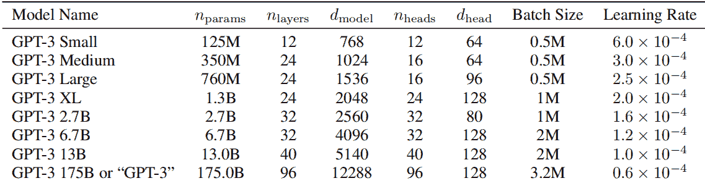
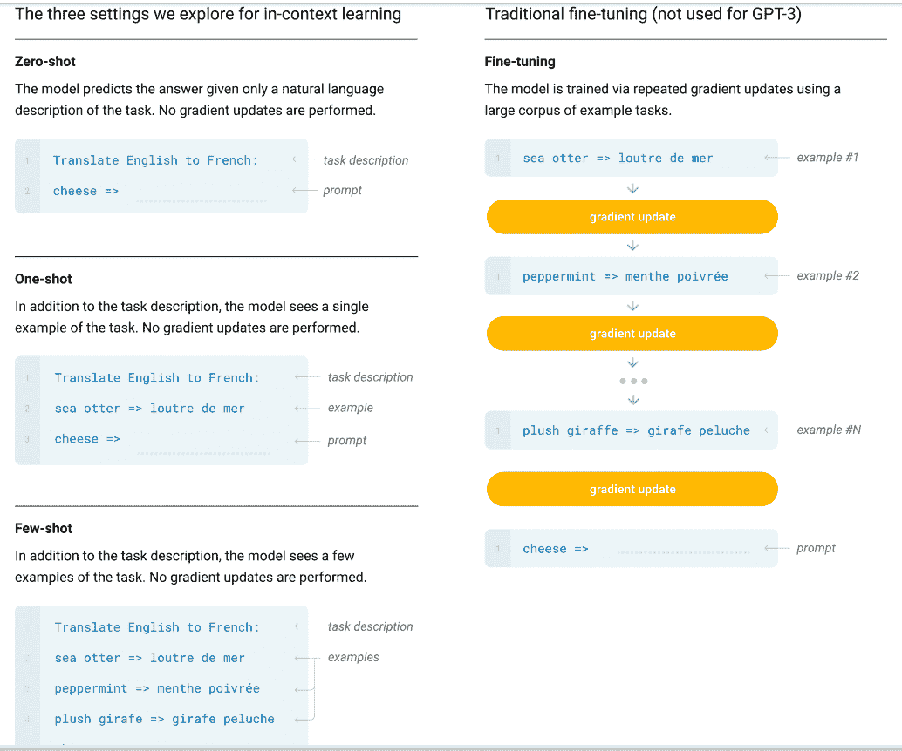
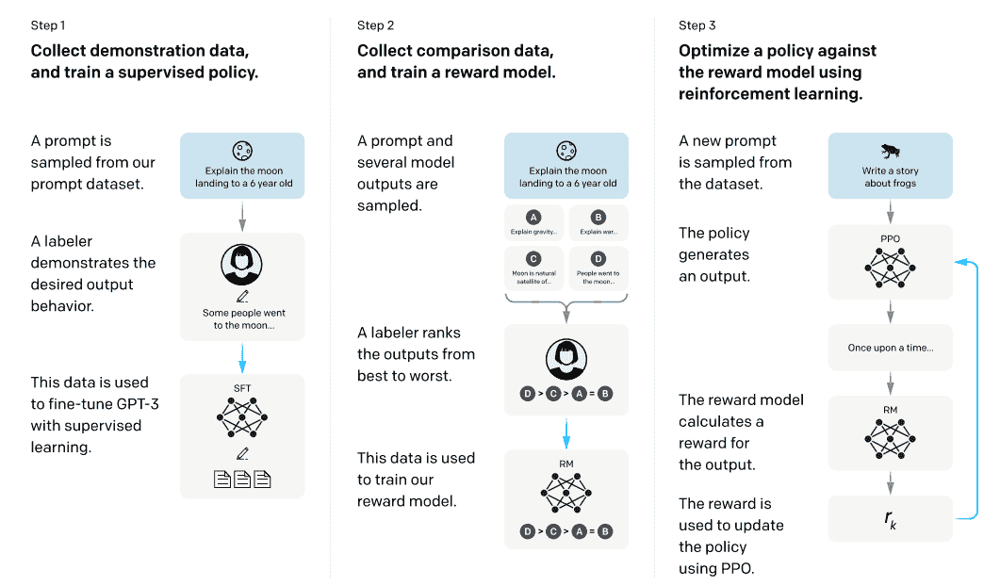
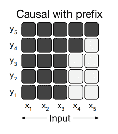

# 3.3 预训练语言模型部分

> 来源：[https://aicarrier.feishu.cn/docx/ZnbndI0bOoSpYkxceszceB4enuf](https://aicarrier.feishu.cn/docx/ZnbndI0bOoSpYkxceszceB4enuf)

## 再探语言模型：为什么是transformer?

上节我们了解了transformer的具体结构，transformer和这个系列以及前面提到的RNN, GRU, LSTM, CNN一样都属于神经网络语言模型。之所以transformer能够脱颖而出成为各家LLM的基础架构，很大程度上取决于它相较RNN（GRU, LSTM），CNN而言较低的计算复杂度。不仅如此，大规模transformer模型的训练是可行的，这相较RNN类模型是很大的优势。同时，OpenAI通过分析大量的训练数据得到的经验规律Scaling Laws表明，神经网络语言模型训练最终得到的损失函数值仅与模型参数量，训练数据量以及计算量有关，而当以及足够大，与的关系是：

可以看到，进一步从经验上说明了大规模类transformer模型性能较其他神经网络语言模型优越的原因。

## 常见预训练语言模型架构

下面我们将简单了解集中常见的预训练语言模型架构以及其具有代表性的语言模型。

### Encoder-only 结构: BERT系列模型

transformer使得训练大规模神经网络语言模型成为可能，而基于transformer encoder的模型BERT则推广了语言模型预训练(pretrain)+微调(finetune, 也叫做精调)的新范式, 也开启了语言模型用芝麻街人物命名的新纪元。

下面将详细介绍BERT模型的结构和预训练，微调方法，并简单介绍一下BERT系列的其他模型。

#### BERT

##### 模型结构

**Tokenizer**

`Tokenizer`将输入的句子按词表分词，并转换成词表中相应词的编号，BERT的`tokenizer`使用wordpiece算法构建词表([详细介绍] [论文链接]), 其词表中有30000个token。

> 在大语言模型中，一个token并不严格对应一个词汇或者一个字符，大多数token对应的是部分或多个词汇。还有一些特殊token，如:
>
> `[BOS]`, `[EOS]`:标识一个句子的开始和结束，有时会以不同的形式出现，如`<s>`, `</s>`等
>
> `[PAD]`: 填充token, 当训练数据长度小于最大训练长度时，用这个token填充到最大长度
>
> `[UNK]`: 词表当中没有出现的词汇将统一使用这个token代替
>
> `[CLS]`: 在BERT中，这个token附加在输入之前，大多数情况下其最后一层隐藏状态会作为分类任务的LM head输入。
>
> `[MASK]`:用于BERT的MLM任务，将随机选择的部分token替换为此token
>
> `[SEP]`: 这个用来分割句子对中的两个句子，可用于NSP任务预训练以及NLI, QA等需要多个句子输入的下游任务

词嵌入(word embedding)

不同于原始transformer, BERT的词嵌入由3部分组成:

1. 词表示嵌入：用于将离散的token映射到`hidden_size`，为一个`nn.Embedding`层；
1. 位置编码：用于给序列添加位置信息，与transformer使用的三角位置编码不同，BERT使用了可学习的位置编码；
1. 句子类型编码：用于下面将会讲到的NSP任务，标识一个句子对中的token属于哪一个句子；

在`transformers`的[实现](https://github.com/huggingface/transformers/blob/main/src/transformers/models/bert/modeling_bert.py#L158)中，位置编码和句子类型编码均使用了`nn.Embedding`。

> 值得注意的是，`transformers`在实现ViT(Vision Transformer, 将transformer encoder用于图像分类任务，模型主体结构与BERT高度相似)模型时，使用了`nn.Parameter`作为可学习的位置编码。

主体骨架结构(backbone)

BERT的模型骨架结构与transformer encoder基本相似，此处就不再赘述了。在原论文中，作者提供了两种大小的模型，具体如下：

| **模型名称** | Encoder layer 层数 | **Hidden size** | Attention heads 个数 | **模型参数量** |
| --- | --- | --- | --- | --- |
| BERT-base | 12 | 768 | 12 | 110M |
| BERT-large | 24 | 1024 | 16 | 340M |

其中在FFN模块，`intermediate`层（中间层）的维度均为`4*Hidden size`。

**模型头(LM head)**

是一个用于下游任务（包括文本分类，自然语言推理(NLI)，序列标注，问题回答(QA)）的线性层，对于NLI，文本分类等分类任务，其输入是`[CLS]`；对于序列标注，问题回答等token级别的任务，其输入是所有token的最后一层隐藏状态。

##### 预训练

BERT提供了一种基于transformer encoder的双向无监督深度表示训练方法（Bidirectional Encoder Representations from Transformers）。具体来说，BERT在预训练阶段训练2个任务，即掩码语言建模（Masked Language Modeling, MLM) 以及下一句预测（Next Sentence Prediction, NSP），预训练的总体框架如下图所示。

> 下图输入token仅作示例，不代表BERT词表的真实情况

1. MLM任务

由于给模型提供双向的注意力信息会使得每个token“看到”自己，从而使得模型非常轻易地给出预测（往往并不是我们想要的结果），为解决这个问题，作者在训练数据的每个句子随机选取15% token进行掩码处理。

但是，`[MASK]`不会出现在微调阶段，这就会带来预训练与微调不匹配（原文使用了mismatch一词）的问题，为了保证网络训练效果同时缓解"mismatch"问题，作者并没有将所有被选择的token直接替换成`[MASK]`, 而是将其中的10%保持不变（但仍需模型预测），10%替换为随机的token，剩余80%替换为`[MASK]`，训练时仅需要预测这些掩码所对应的原始token即可。

1. NSP任务

自然语言处理中的下游任务，如NLI, QA等需要模型理解句子之间的关系，仅仅训练MLM任务并不能很好地泛化至这样的下游任务中。为了使模型具有理解句子之间关系的能力，BERT提出了NSP任务，这个任务的训练目标很简单，给定一个用`[SEP]`分割的句子对 ，只需要判断 在语义上是不是 的下一句话即可，本质上是一个二元分类的任务。在构造训练数据时，输入的句子 在50%的情况下在训练语料中是 的下一句话，50%的情况下是训练语料中的随机句子。

##### 微调

为使BERT模型更好地适配下游任务，我们可以在各种不同的数据集上微调模型参数，根据微调的参数量，微调方式可分为以下两种：

| **微调参数** | **优点** | **缺点** |
| --- | --- | --- |
| 全量 | 下游任务表现更好 | 微调成本较高 |
| 仅`LM head` | 微调成本低 | 下游任务表现较全量微调差 |

对于不同的下游任务，微调时输入内容虽不同，但形式上均是`[SEP]`分割的句子对 ，当输入仅有一个句子时，句子 为空。

#### BERT系列的其他模型

我将尽可能简单地介绍这些BERT变体模型，读者如有兴趣，可点击超链接阅读论文原文。

- [DistilBERT](https://arxiv.org/pdf/1910.01108)：作者使用知识蒸馏技术训练了一个参数量更少，推理更快但表现与原始BERT相当的模型

- [ALBERT](https://arxiv.org/pdf/1909.11942)：同样是减小模型规模，作者提供了另一种思路，核心方法分两部分

  1. 减小`Embedding`层维度 ，通过一个`nn.Linear`变换到 上
  1. 共享参数（仅共享attention相关参数；仅共享FFN相关参数，全部共享）

  为了减小共享参数所带来的性能损耗，作者改进了NSP任务。

- [RoBERTa](https://arxiv.org/pdf/1907.11692)：模型结构没有大的变化，作者主要在训练方面做出了贡献：

  1. 增大了预训练数据量
  1. 去掉了NSP任务
  1. 词表构建采用Byte-level BPE(与GPT-2相同)，且词表更大
  1. 输入文本动态掩码

  后三个改动，对最终的模型效果影响不大,第一点改进增加预训练数据对模型效果有帮助，这也符合scaling law 的结论。

### Decoder-only 结构: GPT系列模型

现今一系列生成式大语言模型皆肇始于GPT系列模型。GPT(Generative Pretrained Transformer, 生成式预训练Transformer)是OpenAI从2018年至今深耕的基于Transformer decoder的语言模型，下面我将从初代GPT开始介绍GPT模型的发展历程。

#### [初代GPT](https://s3-us-west-2.amazonaws.com/openai-assets/research-covers/language-unsupervised/language_understanding_paper.pdf)

##### 模型结构

**Tokenizer**

与BERT不同，GPT采用另一种词表构建算法BPE([详细介绍], [论文原文])， 最终词表在原始词表的基础上进行了40000次合并。

**词嵌入**

GPT的词嵌入符合transformer的形式，即表示嵌入+位置编码，在`transformers`的实现（GPT-2）中，位置编码仍然使用了`nn.Embedding`作为可学习的编码。

**主体骨架**

GPT的主体框架基本遵循transformer decoder，此处就不再赘述了。模型的注意力层数，`hidden size` 和注意力头数与BERT-base一致。

**模型头**

在预训练阶段，模型头是一个Text Predictor, 用于预测下一个token, 在微调阶段，模型头是一个新的`Linear`层，用于在有标记的下游任务数据集上微调

##### 无监督预训练

与BERT不同，GPT仅有一个预训练任务。我们先看看论文中给它的定义：

给定一个句子 （ 是token）和一个上下文窗口大小 , 模型需要找到尽可能好的参数 来最大化以下似然函数：

通俗来讲，这就是要训练模型在已知窗口内 个token的情况下，预测后面一个token的能力。而现在的大模型预训练任务将上面的训练目标批量化进行，如下图所示：

##### 有监督微调

GPT的微调只需在下游任务数据集上调整线性层参数，之前的参数可以完全冻结，无需调整。但由于初代GPT微调的下游任务包括文本分类，文本相似度检测，NLI, 多项选择题等分类任务，decoder架构特有的causal mask会使得模型相较BERT无法更加完全地理解输入文本，故GPT并不适合用于传统的有标记的分类任务。却能够很好地完成文本生成等生成式任务。

#### [GPT-2](https://d4mucfpksywv.cloudfront.net/better-language-models/language-models.pdf)

GPT-2的主要贡献在于：

1. 作者发现在更大的GPT模型在更加充足的数据上预训练后能够学会处理多种NLP任务
1. 作者采用了Byte-level BPE来构建词表，大大减小了基础词表的大小（仅为256）
1. 在模型层面，GPT-2的`LayerNorm`层在每个子块（sub-block）的输入处，与原始transfomer的对比如下图(以attention sub-block为例，FFN sub-block也是同样的区别)：
1. 作者提供了更大规模的预训练GPT模型, 论文中披露的具体情况如下所示

| Decoder 层数 | (即`hidden_size`) | 参数总量 |
| --- | --- | --- |
| 12 | 768 | 117M |
| 24 | 1024 | 345M |
| 36 | 1280 | 762M |
| 48 | 1600 | 1.5B(1542M) |

美中不足的是，OpenAI并没有开源文中提到的WebText数据集

#### [GPT-3](https://arxiv.org/pdf/2005.14165)

> 仅开源了部分训练数据：https://github.com/openai/gpt-3

GPT-3的模型架构与GPT-2大部分相同，只是在attention中使用了类似sparse attention的方法

GPT-3的主要贡献在于:

1. 在更大规模的数据上训练了更大的模型， 论文中披露模型的具体情况如下所示

   

1. 发现了上述语言模型具有进行上下文学习（In-context Learning, ICL）的能力

   ICL无需进行梯度回传和参数更新，大模型能够使用从海量预训练数据中学到的知识，在给出0-shot, 1-shot 和few-shot示例的情况下正确地完成任务，如下图所示：

   

#### GPT-3.5(InstructGPT)

> 未开源

InstructGPT是由GPT-3进行RLHF(Reinforcement Learning with Human Feedback, 基于人类反馈的强化学习)得到的，为的是使GPT-3的回复更加有用且无害，也就是要符合3H(Harmless, Honest, Helpful)原则。这也是强化学习首次被用于大规模语言模型的微调，很多人认为这个模型就是初代ChatGPT的基座模型。

在论文中给出的RLHF的3个步骤如下：

1. 首先利用对话数据集微调GPT-3
1. 再根据人类对同一个prompt的不同回答的优劣反馈训练一个reward model
1. 最后结合上一步得到的reward model, 利用PPO(Proximal policy optimization, 近端策略优化)算法进行强化学习。

奈何笔者对于RLHF及其背后的数学原理了解十分浅陋，故无法在此展开讲解RLHF相关的更多内容，有兴趣的读者可以参考这本书的相关章节学习。

#### [GPT-4](https://arxiv.org/abs/2303.08774) & GPT-4o

> 未开源

GPT-4：引入了图像模态，并且使用了scaling law 对不同规模模型的`loss`进行了预测, 在很多复杂的任务上达到了不俗的表现。

GPT-4o：引入了语音模态，在官方给出的demo中可以实时地理解语音和摄像头捕获的图像并且做出恰当的回应。同时在复杂语音任务（如同声传译）上达到了不俗的表现

### Encoder-Decoder 结构

BERT和GPT(尤其是GPT)模型大放异彩使得encoder-only和decoder-only架构的模型在语言理解和语言生成方面备受关注，而与原始transformer架构相似的encoder-decoder架构语言模型则稍显得有些黯淡。这也引发了关于“为什么现在的LLM都是Decoder only的架构？”的讨论。我们下面就来看一个经典的Encoder-Decoder模型T5（Transfer-Text-to-Text Transformer）。这篇文章的作者将所有NLP任务统一成text-to-text任务，并以自然语言前缀表示任务类型。如下图所示

进而，作者在模型结构，预训练，微调等方面进行了大量探索，为后续大模型的进一步发展提供了宝贵经验。

#### [T5](https://arxiv.org/abs/1910.10683)

##### 模型结构

# T5 模型架构与预训练探索

作者探索了3种模型结构：`Encoder-Decoder`、`Decoder-only` 和 `Prefix LM`。我们对前两种模型结构已经比较熟悉了，而`Prefix LM`的基本思路是结合双向和causal的注意力机制，输入开始的部分token是双向的注意力（我们把这部分叫做前缀），之后的token则使用了causal注意力。在`T5`中，模型将输入中不需要预测的部分（如任务描述和任务的输入）视作前缀，使用双向注意力，而需要模型预测的部分使用causal注意力。在`Prefix LM`预训练时，注意力的掩码情况如下图所示：

实验结果表明，在同等量级的模型中，`encoder-decoder`架构的模型的表现最好。

## 预训练

在探索`T5`的预训练任务时，作者可谓是把预训练数据掰开了揉碎了利用。探索了最佳的训练目标和文本破坏策略。

### 训练目标

作者探索了几种不同的训练目标，具体如下表所示：

> 假设我们的训练数据集中有一组数据"人闲桂花落，夜静春山空"

| 训练目标 | 输入 | 预期输出 |
| --- | --- | --- |
| `GPT-style`(`Prefix-style LM`) | 人闲桂花 | 落，夜静春山空 |
| `BERT-style`(`Masked LM`) | 人闲`[MASK]`[`[MASK]`]落，夜深春山空 | 人闲桂花落，夜静春山空 |
| 还原打乱的文本顺序(`De-shuffling`) | 花桂人，落闲山空春静夜 | 人闲桂花落，夜静春山空 |

论文中多组实验表明`BERT-style`的训练目标能够让语言模型达到最好的结果。

### 文本破坏策略

在确定了`BERT-style`训练目标的基础上，作者又探索了几种不同的文本破坏（掩码）策略，具体如下表所示

> 假设我们的训练数据集中有一组数据"人闲桂花落，夜静春山空"

| 破坏策略 | 输入 | 预期输出 |
| --- | --- | --- |
| `BERT-style` | 同上`BERT-style` | 同上`BERT-style` |
| 简化的`BERT-style`(`MASS-style`) | 同上 | 同上 |
| 替换几小段文本(`Replace`) | 人闲`[X]`落，`[Y]`静春山空 | `[X]`桂花`[Y]`夜`[Z]` |
| 删除几小段文本(`Drop`) | 桂花落，夜静山空 | 人闲春 |

> *: 该方法只挑选15% token替换为`[MASK]`，删除了`BERT`中替换随机token和token保持不变的策略

> **: `[Z]`表示输出结束

论文中多组实验表明`Replace`的破坏策略能够让语言模型达到最好的结果。

之后，作者还探索了较好的文本破坏比例以及替换段落的较好长度等超参，此处不再赘述其结果了，感兴趣的读者可以去看看原论文。

## 微调

作者比较了几种当时提出的非全量微调策略（`adapter` 和 `gradual unfreezing`）和全量微调策略，发现全量微调表现最好，这个结果并不令人意外。

> FYI:

1. `Adapter`策略是提出比较早的`PEFT`(Parameter Efficient Fine-Tuning, 参数高效微调)策略，该方法的思想是在每个`transformer-block`的`FFN`层之后加入一系列`Linear-ReLU-Linear`层，在微调时仅仅更新加入的参数而保持原始模型参数不变。

1. `Gradual unfreezing`策略的思想是在进行首轮微调时仅更新部分模型参数，之后的轮次逐渐增加参数更新量。

作者还在其他方面（如训练数据配比，模型规模大小等）做了探索，限于篇幅，此处就不再赘述了。

总之，虽然以`T5`为代表的`Encoder-Decoder`模型没能成为`LLM`的主流，但其大量的探索为后续的研究者们提供了宝贵的经验和最佳实践。

> 这篇文章仅仅介绍了预训练语言模型的冰山一角，现在流行的开源模型基座如`LLaMA`、`Qwen`、`InternLM`、`GLM`等系列模型在本文皆未涉及。感兴趣的读者可以阅读其源码和相关技术报告。读者如发现本文有任何错误或疏漏，或有任何想与笔者交流的想法，欢迎发邮件至1030587461@qq.com

## 参考文献

1. `https://arxiv.org/pdf/1706.03762` Attention Is All You Need

1. `https://arxiv.org/pdf/2001.08361` Scaling Laws for Neural Language Models

1. `https://arxiv.org/pdf/1810.04805` BERT: Pre-training of Deep Bidirectional Transformers for Language Understanding

1. `https://zhuanlan.zhihu.com/p/622688415` BERT及其变体

1. `https://arxiv.org/pdf/1910.01108` DistilBERT, a distilled version of BERT: smaller, faster, cheaper and lighter

1. `https://arxiv.org/pdf/1909.11942` ALBERT: A Lite BERT for Self-supervised Learning of Language Representations

1. `https://arxiv.org/pdf/1907.11692` RoBERTa: A Robustly Optimized BERT Pretraining Approach

1. `https://s3-us-west-2.amazonaws.com/openai-assets/research-covers/language-unsupervised/language_understanding_paper.pdf` Improving Language Understanding by Generative Pre-Training

1. `https://d4mucfpksywv.cloudfront.net/better-language-models/language-models.pdf` Language Models are Unsupervised Multitask Learners

1. `https://arxiv.org/pdf/2005.14165` Language Models are Few-Shot Learners

1. `https://arxiv.org/abs/2203.02155` Training language models to follow instructions with human feedback

1. `https://arxiv.org/abs/2303.08774` GPT-4 Technical Report

1. `https://arxiv.org/abs/1910.10683` Exploring the Limits of Transfer Learning with a Unified Text-to-Text Transformer

1. `https://zhuanlan.zhihu.com/p/88438851` T5 模型：NLP Text-to-Text 预训练模型超大规模探索

## 相关链接

1. `transformers`版BERT: `https://github.com/huggingface/transformers/blob/main/src/transformers/models/bert/modeling_bert.py`

1. `transformers`版GPT-2: `https://github.com/huggingface/transformers/blob/main/src/transformers/models/gpt2/modeling_gpt2.py`

1. `transformers`版T5: `https://github.com/huggingface/transformers/blob/main/src/transformers/models/t5/modeling_t5.py`
