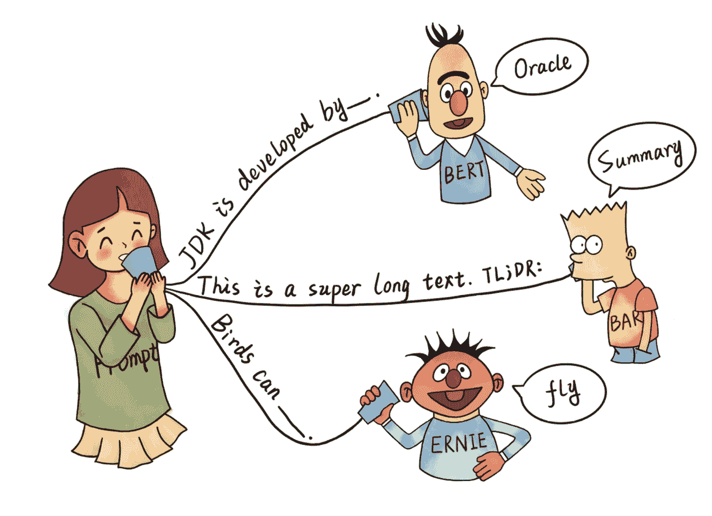
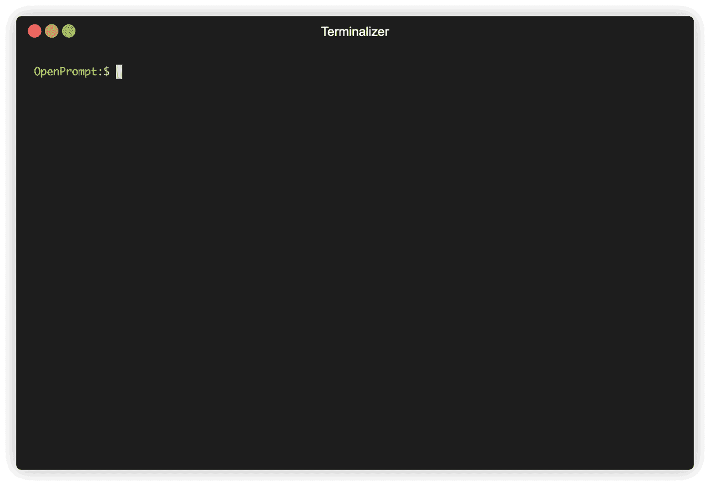

# 4.1 Prompt-Learning 背景与组成

> 来源：[https://aicarrier.feishu.cn/docx/YQRKdHl0toJn3jxdp8IczCV8n6c](https://aicarrier.feishu.cn/docx/YQRKdHl0toJn3jxdp8IczCV8n6c)

在使用大模型时，我们经常会提到Prompt这个关键词，那么Prompt到底是什么呢？Prompt 是一段引导性文字，也就是提示词，用于明确指示预训练模型生成特定的输出，就像在问答游戏中提出一个精确的问题来得到期望的答案。例如，对于情感分析任务，可以设计这样的Prompt：“这段文字的情感是：”。根据不同的Prompt，大语言模型会有不同表现。不同的Prompt会引导大模型遵循Prompt的提示，作出不同答复，同时，Prompt设计的优劣也会影响大模型答复的效果。

> 图1：不同的Prompt引导大语言模型作出不同的回答

> 图来自论文：Liu, P., Yuan, W., Fu, J., Jiang, Z., Hayashi, H., & Neubig, G. (2023). Pre-train, prompt, and predict: A systematic survey of prompting methods in natural language processing. ACM Computing Surveys, 55(9), 1-35.

如何设计出**更好的Prompt？这就**是**Prompt-Learnin**g需要研究的课[题。Prompt-l](https://github.com/thunlp/OpenPrompt?tab=readme-ov-file)earning 是一种利用预训练语言模型（Pre-trained Language Models，PTMs）执行特定任务的方法。通过设计特定的提示（Prompts），可以引导模型生成符合预期的输出。Prompt-learning 不需要大量标注数据，适合小样本学习。Prompt-learning的核心包括预训练模型（PTM）选取、模板（Template）构造和答案映射（Verbalizer）构造。图2是清华OpenPrompt项目运行示例图，生动地展示了Prompt-Learning中的核心步骤。

> 图2: [OpenPrompt](https://github.com/thunlp/OpenPrompt?tab=readme-ov-file)项目的运行Demo

Prompt-learning 的组成部分：

1.  **预训练模型（PTM）选取**：选择合适的预训练模型（如GPT、BERT等）或者大语言模型（ChatGPT、LLaMA、InternLM等），这些模型已经在大规模数据上训练，具备强大的语言理解和生成能力。

1.  **模板（Template）构造**：将任务输入转化为模型能够理解的格式。例如，对于情感分析任务，模板可以是："文本: {text} 情感:"，模型需要填空预测情感。

1.  答案映射（Verbalizer）构造：将模型输出的概率分布映射到具体的分类标签。例如，将模型生成的词汇映射到“积极”或“消极”情感。

Prompt-learning 通过设计引导性提示，实现了对大语言模型的高效利用，特别适合小样本和多任务学习。与模型微调（Finetuning）相比，Prompt-learning 在灵活性和资源利用上具有独特的优势，能够在不大规模调整模型参数的情况下，快速适应不同任务需求。更重要的是，利用Prompt-learning 我们可以驱动那些因计算资源限制而无法直接进行微调的超大模型。

以下是笔者推荐的一些阅读资料，全面地阅读与Prompt-Learning有关的论文、博客和项目，相信你能更好的理解Prompt-Learning。当然，Prompt-Learning作为当前大模型研究中十分火热的一个分支方向，笔者这里仅是列出了几篇较为经典的资料，欢迎读者利用搜索引擎搜索Prompt-Learning领域更新的进展：

+   [Pr](https://arxiv.org/abs/2107.13586)e-train, Prompt, and Predict: A Systematic Survey of Prompting Methods in Natural Language Processing

+   [万字详解提示学习（Prompt Learning ](https://blog.csdn.net/Kaiyuan_sjtu/article/details/135421002)）和微调 （Prompt Tuning）

+   [O](https://github.com/thunlp/OpenPrompt?tab=readme-ov-file)penPrompt: An Open-Source Framework for Prompt-learning.

+   [NLPer福利！清华推出Prompt-tuning开源工具](https://juejin.cn/post/7084875342925529102)包，取代传统的微调fine-tuning

+   [UltraChat: Large-scale, Informative, and Diver](https://github.com/thunlp/UltraChat)se Multi-round Dialogue Data, and Models

+   [NLPedia-Pretrain（持](https://github.com/pfliu-nlp/NLPedia-Pretrain)续更新的Prompt Method论文）