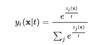
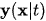
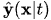
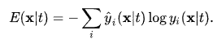
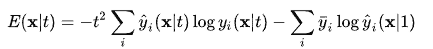
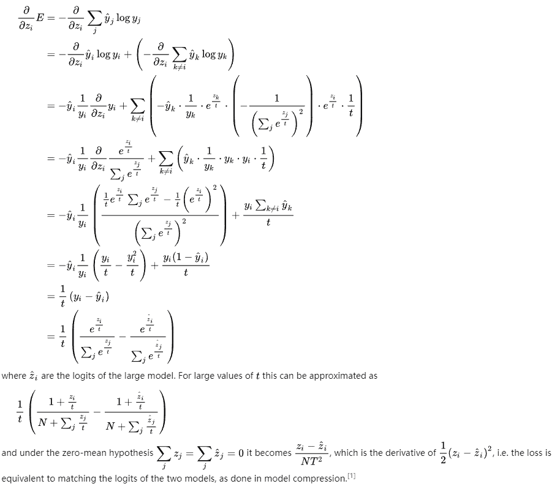

# 5.1 知识蒸馏

> 来源：[https://aicarrier.feishu.cn/docx/WG33dA5NzoFou5xDkM1couO2nPb](https://aicarrier.feishu.cn/docx/WG33dA5NzoFou5xDkM1couO2nPb)

弟子不必不如师，师不必贤于弟子。闻道有先后，术业有专攻，如是而已。——韩愈·师说

### 模型压缩与知识蒸馏

大模型的巨大参数量带来的现实问题是推理和部署成本较高，因而模型压缩（Model Compression）有广泛的应用场景。下面的几节，我们依次讨论一些模型压缩的想法和技术。

一个最自然的想法是：先训练好一个重量级大模型，然后把它的知识压缩迁移给一个轻量级大模型里，后者就便于部署和运行了。

知识蒸馏（Knowledge Distillation）正是基于这样的思想：把一个大的神经网络（称为教师网络）的知识灌输到一个小的神经网络（称为学生网络）当中，让小的网络学习到大的网络的表征。这个想法最早在90年代就出现了，而深度学习革命开启以来，Hinton et al.（2015）正式提出了知识蒸馏的概念。

### 温度

我们首先介绍温度（temperature）的概念。如下式所示，在多分类神经网络的最后一层，往往使用softmax运算，把输入的logits，即下图的zi，归一化为概率分布，即yi。在这其中，温度参数t起到调节输出分布的功能，t默认设定为1，更大的t导致输出概率分布更加平坦。

### 知识蒸馏的原理

知识蒸馏其实就是让学生模仿（mimic）或者说克隆（clone）教师网络的结果。在一个专门用于学生网络训练的迁移训练集（transfer set）上，考虑下面两种情形：

情形1：不知道迁移训练集的真实标签。设

是给定温度t，待训练的学生网络的概率分布预测；而

是给定温度t，已经训练好的教师网络的概率分布预测。我们计算交叉熵，比较两者的差异：

这是一个以温度t为超参数的目标函数。我们选择较大的t，这样信息熵更大，便于学生网络学习，随后选择最优的学生网络的参数，来最大化交叉熵（即上式）。当我们训练好学生网络后，再设定t=1，就可以用于推理了。

情形2：知道迁移训练集的真实标签，为y_bar，操作步骤与情形1完全相同，唯一的区别在于我们考虑这样的目标函数：

这一目标函数权衡了学生网络与教师网络之间的交叉熵，和学生网络预测与真实分布的偏离。如果大家了解VAE（Variational Auto-Encoders），这就像KL散度和重构损失一样。

最后，下面是一个详细的数学证明，最优化交叉熵损失函数等价于匹配两个模型的logits，即zi：

### 参考文献

1.Hinton, G., Vinyals, O., & Dean, J. (2015). Distilling the Knowledge in a Neural Network. In NIPS Deep Learning and Representation Learning Workshop.