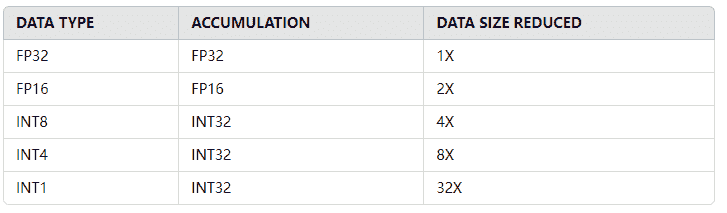

# 5.2 模型量化

> 来源：[https://aicarrier.feishu.cn/docx/XnLAdvgokotb4exLq4uc283Jn4c](https://aicarrier.feishu.cn/docx/XnLAdvgokotb4exLq4uc283Jn4c)

在上一节，作为第一种模型压缩的办法，我们介绍了知识蒸馏的概念。知识蒸馏能让小的模型来具备大的模型相近的推理能力，但是缺点是需要重新训练。有没有一种能直接成倍降低显存占用的方法呢？本节我们介绍模型的量化（quantization），即通过转换模型权重存储的格式，在尽量少地牺牲模型推理性能的前提下，使用低精度的数据格式来存储模型，减少推理环节的显存占用[1]。

### 基本原理

一个粗略估计大模型推理阶段的显存占用的公式是：在float32精度下，7B参数量的模型需要占用的显存至少是4*7=28G。这是因为在推理阶段，除了提示词的KV缓存（KV cache）外，模型的参数需要加载进入显存，由于1bit=0.125bytes，32位浮点数（占用32bits）下，1个参数占用4个字节，因而显存占用至少是模型参数量（以10亿计）的四倍。int8量化可以降低4倍的显存占用，减少2-4倍的带宽占用，以及提高2-4倍的计算速度。

由此，我们希望从高精度表示出发，把float32（32位浮点数）精度的模型权重压缩到低精度表示（float16，int32，int16，int8，int4，int1）当中去。压缩效果如下图所示[2]：

其中data type表示数据存储格式，accumulation表示数据运算结果的存储格式（例如2个2位小数的乘积的最精确表示是4位小数，我们可以选择1-4位的小数来表示运算结果，这里的表示精度选择就是accumulation），data size reduced表示内存/显存占用（运算的空间占用）降低的倍数。

### 范围映射（range mapping）

具体实现上，量化分为两步：

第一步是量化（quantize），在模型存储时，把原始精度数据映射为低精度；

第二步是反量化（dequantize），在推理时，把转换后的低精度数据反映射回原始精度。

我们知道，B bit的整型可以表示-2^B到2^B-1这个范围内的数。根据采用的范围映射（range mapping）方法的不同，量化分为仿射量化（affine quantization）和尺度量化（scale quantization）。在仿射量化中，我们把一个[MIN,MAX]的数据（MIN<=MAX）通过线性变换映射到[-2^B,2^B-1]；在尺度量化中，我们把一个[-MAX,MAX]的数据（MAX>0）通过比例放缩映射到 [-2^(B-1), 2^(B-1)]。对于那些位于给定范围[MIN,MAX]或[-MAX,MAX]之外的数据，我们取边界值即可。

### 校准（calibration）

有三种方法得到原始精度数据的范围[MIN,MAX]：最大法（max），熵法（entropy）和比例法（percentile）。最大法直接取全量数据的最小值和最大值；熵法选择(MIN,MAX)使得量化后的数据和原始数据概率分布的KL散度（Kullback-Leibler divergence）最小；比例法抽取一定比例的数据计算其范围，作为全量数据的代表，对于那些离群点，我们取边界值即可。

### 训练后量化（Post Training Quantization, PTQ）与量化感知训练（Quantization Aware Training, QAT）

量化会带来模型精度的下降。能否在尽量保持模型性能的前提下，降低显存的占用呢？这就需要结合量化以及量化后的微调了。训练后量化 (PTQ) 中，模型在训练之后进行量化；而量化感知训练 (QAT) 是对 PTQ 模型的微调，其中模型在考虑量化的情况下进一步训练。量化过程被结合到训练过程中，允许模型在量化后仍能保持其准确性，这为部署时带来好处，如更低的延迟、更小的模型尺寸、更低的内存占用。

我们知道，模型需要存储的内容包括神经网络的权重（weights，模型的参数）和激活（activation，激活函数的输出）。根据量化对象的不同，训练后量化分为权重量化（weight quantization）和激活量化（activation quantization）。PTQ的权重和激活都在推理前被量化，因此也称作静态量化（static quantization）；如果我们只在推理前量化权重，而在推理的过程中量化激活（这样大模型对提示词的理解就更精确了），这被称作动态量化（dynamic quantization）。我们还可以对不同的部分、不同的层，选择不同的量化精度和量化粒度。

最后，让我们对静态量化和动态量化做一个比较。在静态量化中，激活的量化参数（即映射的参数）是在训练后确定的，并在推理时固定使用。这意味着在推理前，模型已经知道如何将浮点激活值转换为量化整数，而不需要根据每个输入动态调整量化参数。这种方法可以减少推理时的计算量，并提高模型的吞吐量，但它可能不如动态量化灵活，因为量化参数是基于训练数据集的统计信息确定的，可能无法完美适应所有推理时的输入数据。

### 一些支持量化的工具和框架

Llama.cpp, bitsandbytes, vLLM, lmdeploy, onnx runtime, mxnet, pytorch quantization等等。

### 参考文献

1.https://huggingface.co/docs/optimum/en/concept_guides/quantization

2.https://iq.opengenus.org/basics-of-quantization-in-ml/

3.https://deci.ai/quantization-and-quantization-aware-training/

4.https://pytorch.org/blog/introduction-to-quantization-on-pytorch/

6.Jacob, B., Kligys, S., Chen, B., Zhu, M., Tang, M., Howard, A., Adam, H., & Kalenichenko, D. (2017). Quantization and Training of Neural Networks for Efficient Integer-Arithmetic-Only Inference.