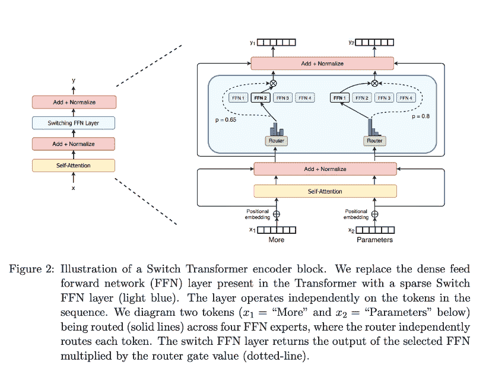

# 5.3 权重分享

> 来源：[https://aicarrier.feishu.cn/docx/WAzOdcMMBoTSsDxLMvqclY3Gnrd](https://aicarrier.feishu.cn/docx/WAzOdcMMBoTSsDxLMvqclY3Gnrd)

作为一种节约参数，从而压缩模型的方法，我们经常能在一些神经网络架构设计当中看到一些权重分享（weight sharing）的想法。

### 神经网络中的参数共享

共享权重的本质是共享知识。例如在RNN/LSTM中，神经网络的参数（输入到隐藏状态，隐藏状态t到隐藏状态t+1，隐藏状态到输出）在每个序列步间共享，而隐藏状态是每步更新的；CNN中，用于遍历窗口采样的卷积核（filter）在不同采样窗口间共享权重。

### 混合专家架构

在大模型研究中，一种应用参数共享这种思想的例子是混合专家（Mixture of Experts, MoE）模型。在switch transformer的设计中，一些参数作为各个专家的共享参数，而另一些参数在激活时通过路由（router）来择优选用。混合专家模型作为一种稀疏的（sparse）模型，其优势是：

+   由于模型是稀疏的，可训练参数比较少，预训练环节的成本较低，时间也更短；

+   混合专家模型是一种集成架构，便于扩张模型规模；

+   由于每次推理只激活部分专家，推理效率更高。

### 参考文献

1.Fedus, W., Zoph, B., & Shazeer, N. (2021). Switch Transformers: Scaling to Trillion Parameter Models with Simple and Efficient Sparsity.