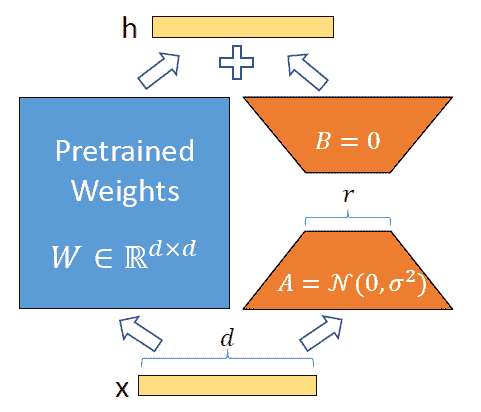
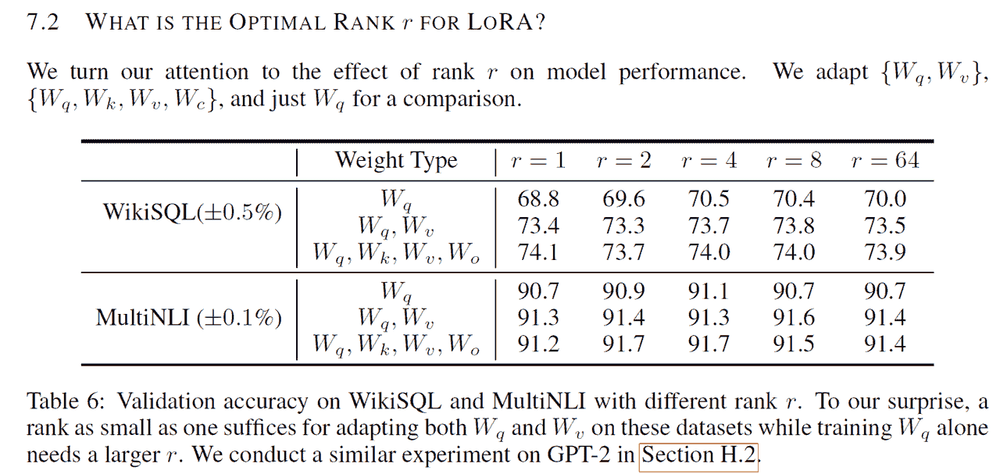

# 5.4 低秩近似

> 来源：[https://aicarrier.feishu.cn/docx/TON0d2RkboXAl7xiVBncnja3noc](https://aicarrier.feishu.cn/docx/TON0d2RkboXAl7xiVBncnja3noc)

### 大模型推理的显存占用

在5.2节，我们估算了大模型的推理显存占用。一个经验公式是，如果使用Adam优化器，微调需要的显存约为推理的4倍：微调环节，我们需要保存梯度（gradients）和优化器状态（optimizer states），加上Adam用到了1期滞后项，那么需要再乘以2，一共就是4倍。例如float32的7B模型，使用Adam优化器的微调显存占用至少约为：7*4*4=128G。

### LoRA

在1.3节，我们介绍了参数高效微调（PEFT）的想法，即调整一小部分参数。Hu et al.（2015）提出了低秩矩阵适应分解（Low Rank Adaptation，LoRA）的概念，这就是一种PEFT的方法，称为重参数法（re-parameterization based）。LoRA的优势在于成本低：根据作者的估计，微调175B的GPT-3，若使用LoRA微调，比使用Adam优化器微调能降低10000倍训练参数量，减少3倍显存占用；从微调RoBERTa， GPT-2和GPT-3的效果看，LoRA的效果比全参微调效果不差甚至更好。

注意，虽然名字中带有Adaptation的字样，LoRA并不属于适配器法（adapters）的范畴，而是重参数法（re-parameterization based）。适配器法为模型增加额外的参数层，这会带来更多的参数，实际上略微增加了推理成本；LoRA并没有新增任何参数，它是基于原有模型的参数做微调的，因而不会带来额外的推理时延（inference latency），这是作者在论文中强调的一点。

这是LoRA微调的原理。简单来说，对于模型参数W，LoRA考虑它在参数更新中的增量deltaW，把deltaW分解为deltaW=AB，其中矩阵A，B具有秩r<W的维度d，这就大大降低了可训练参数的规模。

LoRA背后的思想可以被理解为一种简单性原则：深度神经网络的参数空间是高维的，但是从参数更新的角度来看，这个维度为d的参数空间实际上具有维度为r的简洁表示。令人惊讶的是，选择r=1和r=64的训练效果差异并不大。

### 参考文献

1.Hu, E. J., Shen, Y., Wallis, P., Allen-Zhu, Z., Li, Y., Wang, S., Wang, L., & Chen, W. (2021). LoRA: Low-Rank Adaptation of Large Language Models.