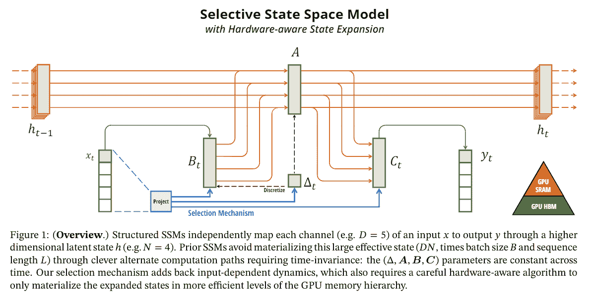

# 5.5 结构调整

> 来源：[https://aicarrier.feishu.cn/docx/ZSqud2BYwoLHXexcnSScWGs2no0](https://aicarrier.feishu.cn/docx/ZSqud2BYwoLHXexcnSScWGs2no0)

最后，我们来看看对基础架构Transformer的优化。我们知道，Transformer的核心机制是自注意力（self attention），这一机制能够捕捉复杂的语义关系，但是缺点是计算成本高，是平方的时间复杂度。

一些研究围绕对Transformer架构的优化展开。在Transformer出现之前，NLP领域的经典算法是RNN：把输入的句子看作一个序列输入RNN，依次更新计算隐藏状态来实现对语义的解析。RNN的优点在于线性复杂度，而缺点在于1.隐藏状态间的更新是累乘的关系，容易出现梯度消失或梯度爆炸，因而无法处理较长的序列;2.无法进行并行计算。

Gu and Dao（2023）介绍了Mamba，一种新的选择性状态空间模型（SSM）类，旨在通过解决Transformer在长序列中的计算效率问题来改进序列建模。Mamba结合了以前的SSM设计和一个新的选择机制，根据输入参数化SSM参数，使得模型能够在序列长度维度上选择性地传播或忘记信息。这种方法使Mamba在序列长度上实现线性扩展，并在推理期间具有高吞吐量。

### **动机**

+   基础模型通常基于Transformer，但Transformer在处理长序列时由于其平方复杂度（即计算复杂度为序列长度的平方）导致计算效率低下。

+   先前的亚二次时间架构（subquadratic-time architectures）（例如线性注意力、门控卷积）在离散模态（如语言）中未能达到Transformer的性能。

### 选择性状态空间（selected state spaces）

+   Mamba通过使SSM的参数依赖于输入，增强了它们处理离散和信息密集数据的能力。

+   这一改变要求设计一个硬件感知的算法，以避免在GPU内存层次结构中出现I/O访问，从而实现效率上的提升。

### **架构设计**

+   Mamba简化了以前的深度序列模型架构，结合了先前SSM架构的设计和Transformers的MLP模块，形成了一个简单的、同质的架构设计。

+   选择性SSM和Mamba架构是完全递归的模型，具有适合作为序列操作的通用基础模型的关键属性，如高质量、快速训练和推理、以及长上下文处理能力。

### 参考文献

1.Gu, A., & Dao, T. (2023). Mamba: Linear-Time Sequence Modeling with Selective State Spaces. Machine Learning Department, Carnegie Mellon University; Department of Computer Science, Princeton University.