# ollama 部署 InternLM 实践

> 来源：https://aicarrier.feishu.cn/docx/GP62dspNuoId2wx1GUGcXXOunGe

作者：comefly

## 前言

`ollama`框架支持多种格式的模型导入，包括但不限于GGUF、PyTorch和Safetensors格式。本文旨在为开发者提供一个指南，介绍如何将这些不同格式的模型导入到`ollama`框架中。本文主要以`InternLM2`系列模型，Windows操作系统为主，其他大模型和操作系统都可以按照类似的步骤导入`ollama`实现本地部署，后续会继续完善。

我们需要准备模型文件、克隆`ollama`和`llama.cpp`仓库源码、安装依赖、下载`cmake`、代码编译和模型量化、推理测试模型、创建和配置`Modelfile`、使用`ollama`框架的命令行工具，后续还将补充如何更好地量化模型以提高性能。下面我们分为两个板块，直通车教程和进阶教程，对于不熟悉或者是不想折腾的朋友请看直通车教程，对于有余力或者是想深入的朋友请看进阶教程。

## 直通车教程

1. 安装`ollama`，Windows系统直接下载安装，https://ollama.com/download/windows

1. 打开`cmd`终端，拉取`internlm2`系列的`internlm2-chat-1.8b`模型并运行

```
ollama run gengshenghong/internlm2:1_8b-chat
```

对话效果如下：

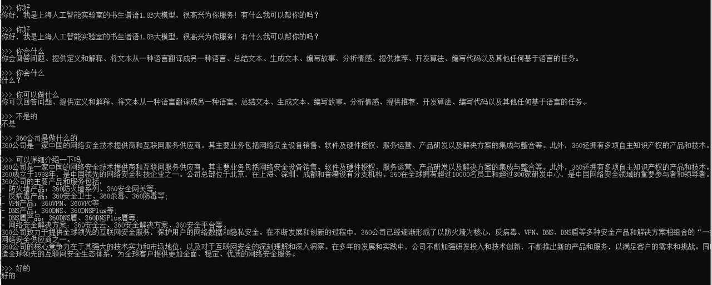

## 进阶教程（适合 ollama 接入自定义模型）

### 准备模型文件

我们这里还是以 [`InternLM2`](https://github.com/InternLM/InternLM/) 系列模型为例，可以从官网GitHub文档找到对应的模型链接地址，国内的话建议从`modelscope`下载，速度快一些；

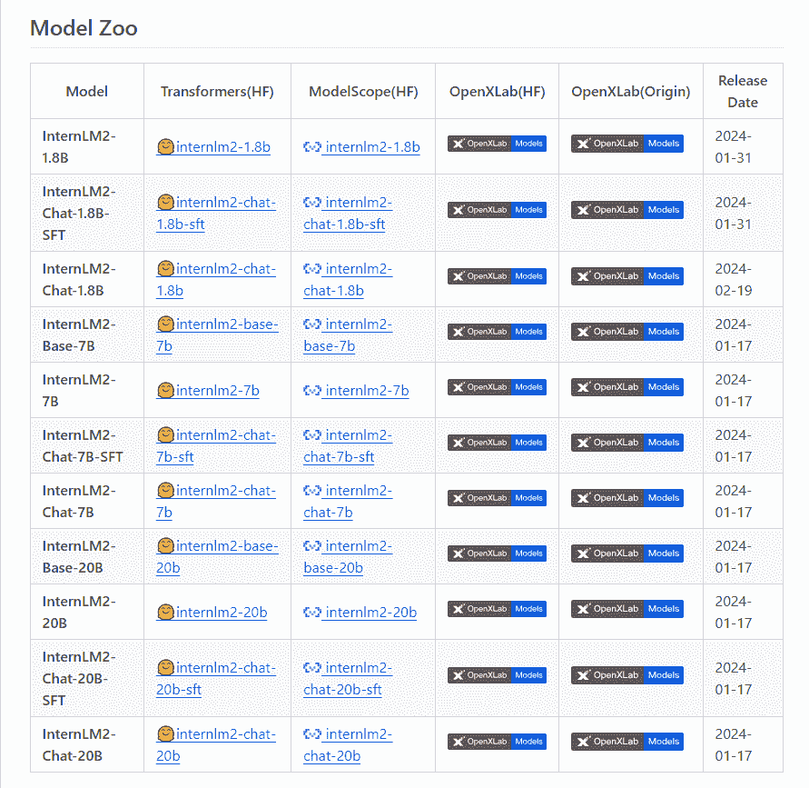

### 如何下载模型，留给有需要的朋友

1. 方式一 <使用`Git`下载>

在电脑上下载`Git`，不会的可以csdn；使用`Git`命令，以魔塔社区`internlm2-chat-7b`为例

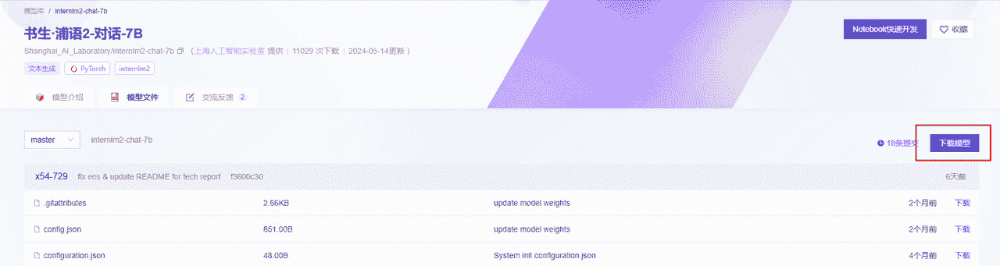

```
git clone https://www.modelscope.cn/Shanghai_AI_Laboratory/internlm2-chat-7b.git
```

1. 方式二 <使用`sdk`下载>

在电脑上下载`python`，不会的可以csdn；使用`pip`命令安装`modelscope`包，新建python文件，运行

```
# pip install modelscope 
from modelscope import snapshot_download
model_dir = snapshot_download('Shanghai_AI_Laboratory/internlm2-chat-7b')
```

### 模型格式转换、量化和部署

准备好我们需要的大模型之后，因为模型文件的大小和格式问题，直接导入`ollama`无法运行起来，我们需要将`safetensors`模型文件转换成`bin`或者`gguf`格式，下面我们需要对原始模型文件进行格式转换和量化处理，我们参照[`ollama`给出的GitHub文档](https://github.com/ollama/ollama/blob/main/docs/import.md)。

1. 克隆`ollama`仓库源码

```
git clone https://github.com/ollama/ollama.git
#若无法访问GitHub，请使用GitHub镜像
#git clone https://hub.gitmirror.com/https://github.com/ollama/ollama.git
#若不会使用Git，可下载压缩包解压，不会的可以csdn
```

1. 克隆`llama.cpp`仓库源码

```
git clone https://github.com/ggerganov/llama.cpp.git
#若无法访问GitHub，请使用GitHub镜像
#git clone https://hub.gitmirror.com/https://github.com/ggerganov/llama.cpp.git
#若不会使用Git，可下载压缩包解压，不会的可以csdn
```

+ 为什么要下载`llama.cpp`？

`llama.cpp` 提供了非常多的量化方式，让用户总能找到合适自己的内存/显存的量化规格，非常适合我们。

1. 进入`ollama/llm`文件夹，将下载的`llama.cpp`文件夹粘贴替换掉原来的`llama.cpp`，

（别问，问就是这个文件夹是空的，需要我们自己下载）

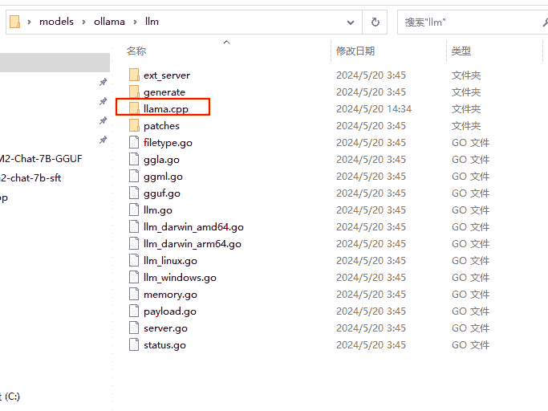

1. 进入`llama.cpp`文件夹，可以看到文件中有`requirements.txt`，是我们需要安装的依赖

如果你没有代码编辑工具的话，直接在文件栏输入`cmd`回车进入终端，输入

```
#安装依赖
pip install -r requirements.txt
```

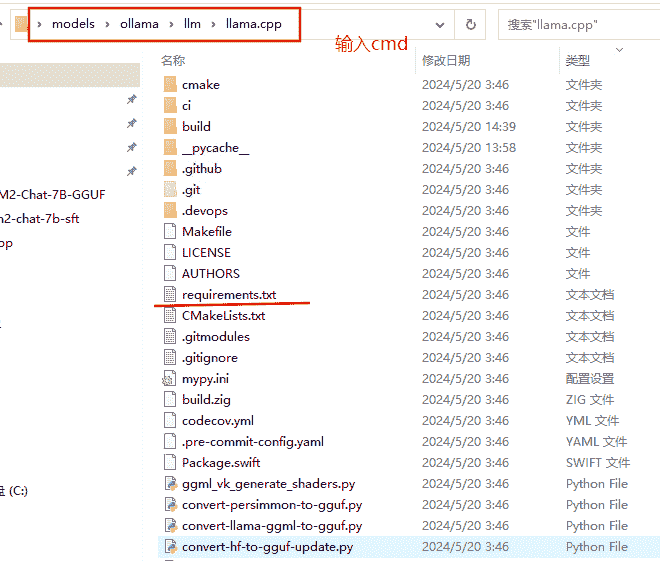

1. 合并模型文件，生成`gguf`格式文件

```
# python llm/llama.cpp/convert-hf-to-gguf.py 刚才下载好的模型文件地址 --outtype f16 
 
python convert-hf-to-gguf.py C:\Users\Administrator\Desktop\models\internlm2-chat-7b-sft --outtype f16
```

然后我们会得到`ggml-model-f16.gguf`中间格式文件，我们继续进行量化

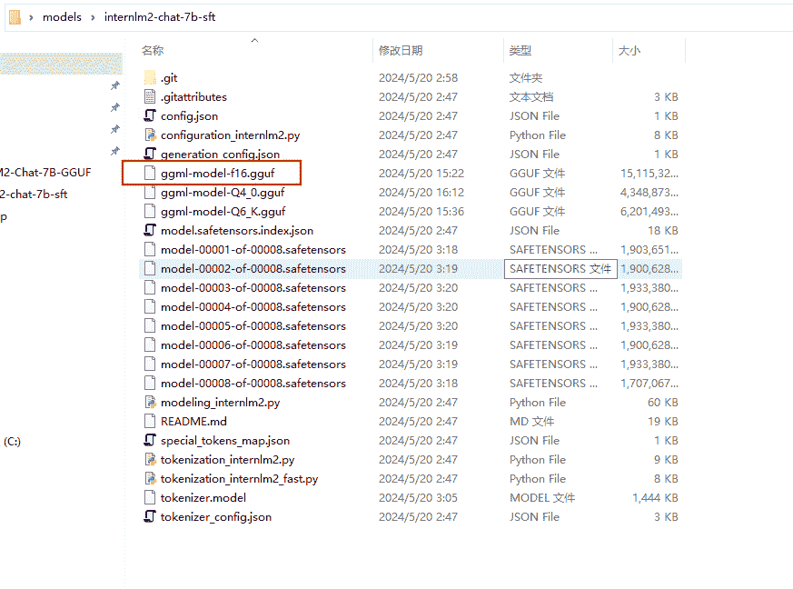

1. 量化模型

(1) 安装`cmake`和编译器，

将15G的`gguf`文件量化为4G左右大小。这个步骤需要编译文件，使用`cmake`工具来编译。同时，还需要安装编译器，我用Visual Studio安装的C++编译器。

`cmd`验证`cmake`是否安装成功，下图表示安装成功。

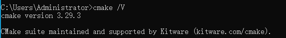

(2). 进行编译

在`llm/llama.cpp`文件夹下开始编译

```
# 进入到llm/llama.cpp目录
cd llm/llama.cpp

#创建build文件夹
mkdir build

#进入build
cd build

# 构建
cmake ..
cmake --build . --config Release
```

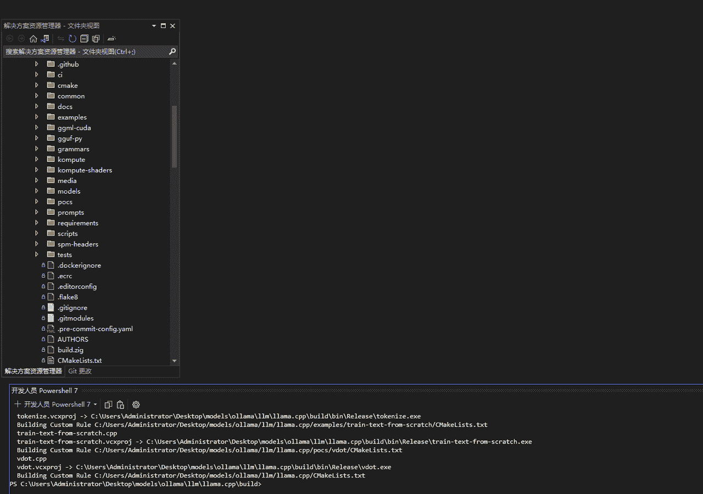

编译过程需要一些，耐心等待一下。编译后生成的`quantization.exe`就是我们需要用到的工具。

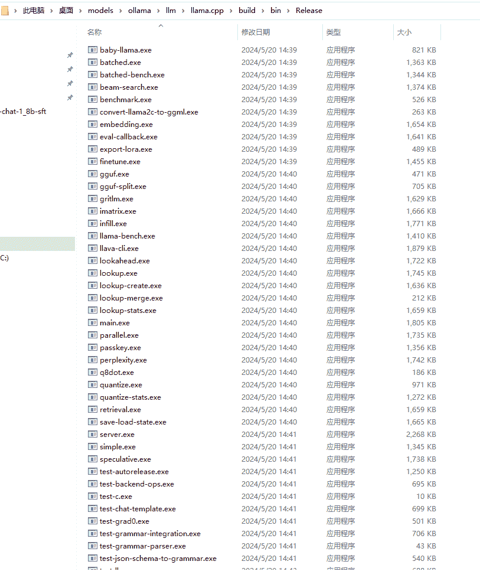

> 不会编译的小伙伴也不用担心，我已经把编译好的`llama.cpp`上传到GitHub，链接地址：
>
> https://github.com/HPUhushicheng/llama.cpp_windows
>
> 可以将上面的仓库代码克隆下来，替换掉`llama.cpp`文件夹，

1. 模型量化

```
#在模型量化之前，可以先用【`quantize.exe` + gguf文件地址】查看可以选择的量化程度
quantize.exe C:\Users\Administrator\Desktop\models\internlm2-chat-7b-sft\ggml-model-f16.gguf
```

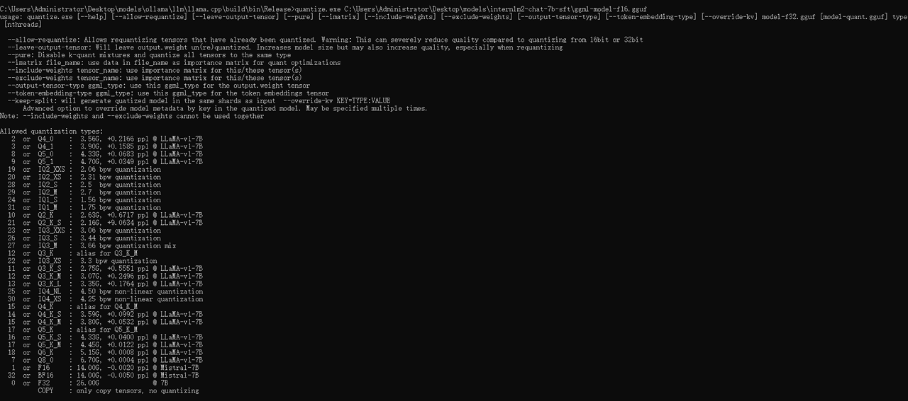

对于很多小伙伴不知道旋转哪种量化格式，我们可以先考`ollama`的GitHub文档，

```
q2_K
q3_K
q3_K_S
q3_K_M
q3_K_L
q4_0（推荐）
q4_1
q4_K
q4_K_S
q4_K_M
q5_0
q5_1
q5_K
q5_K_S
q5_K_M
q6_K
q8_0
f16
```

量化就是减少模型所占内存的大小，量化位数越少，模型占有内存越小，但相对可能模型表现会更差，所以建议在模型过大的时候可以适当采用。我在这里分别选择4位量化和6位量化做演示

```
quantize.exe C:\Users\Administrator\Desktop\models\internlm2-chat-7b-sft\ggml-model-f16.gguf Q4_0


quantize.exe C:\Users\Administrator\Desktop\models\internlm2-chat-7b-sft\ggml-model-f16.gguf Q6_K
```

+ 量化过程

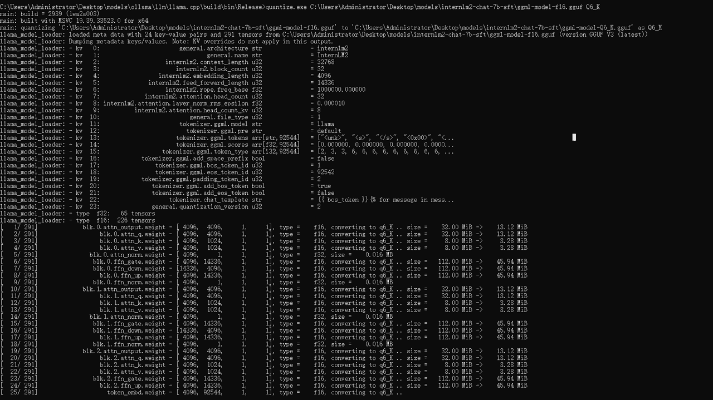

+ 量化结果如下

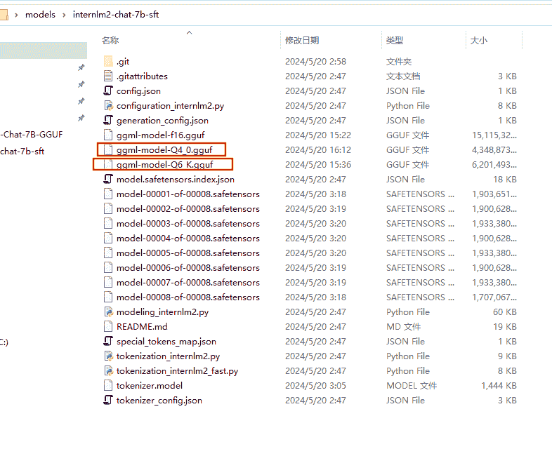

1. 模型推理

```
#进入到llm/llama.cpp/bin/Release文件下，运行【main.exe -m 量化模型地址 --prompt "please introduce yourself" --n-predict 50】
main.exe -m C:\Users\Administrator\Desktop\models\internlm2-chat-7b-sft\ggml-model-Q6_k.gguf --prompt "please introduce yourself" --n-predict 50
```

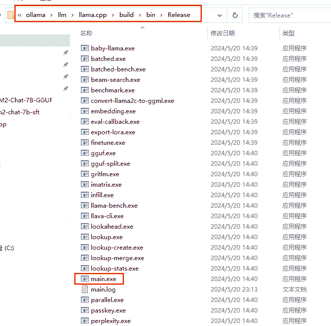

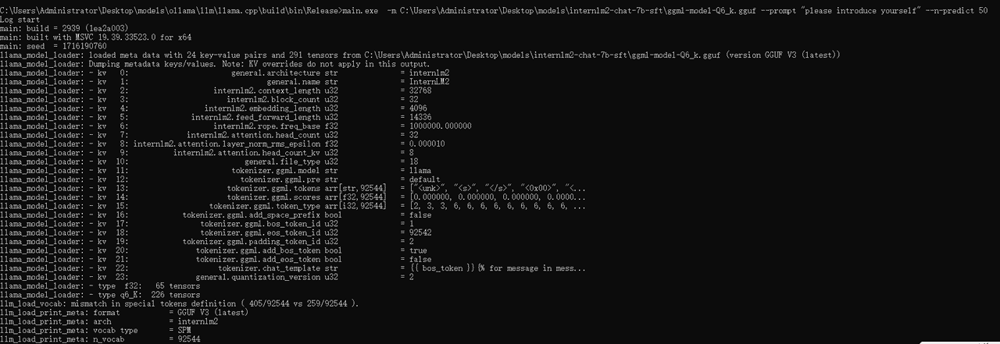

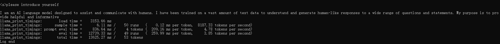

1. 创建一个`model.Modelfile`文件，`FROM`后加上量化模型地址

```
FROM C:\Users\Administrator\Desktop\models\internlm2-chat-7b-sft\ggml-model-Q6_K.gguf
#TEMPLATE " ... "  #自带的提示模板
#此处的模板选择十分重要，
TEMPLATE """{{ if .System }}<|im_start|>system
{{ .System }}<|im_end|>
{{ end }}{{ if .Prompt }}<|im_start|>user
{{ .Prompt }}<|im_end|>
{{ end }}<|im_start|>assistant
{{ .Response }}<|im_end|>
"""
PARAMETER stop "<|im_start|>"
PARAMETER stop "<|im_end|>"
PARAMETER stop "[UNUSED_TOKEN_145]"
```

### 提示模板的构造，留给想深入的朋友

`TEMPLATE` 表示要传递到模型的完整提示模板。它可以包括（可选）系统消息、用户消息和模型的响应。注意：语法可能特定于模型。模板使用 Go 模板语法。

详细的可以看 [ollama Modelfile 文档](https://github.com/ollama/ollama/blob/main/docs/modelfile.md#template)

+ 此处我们以`llama3`的提示模板为例

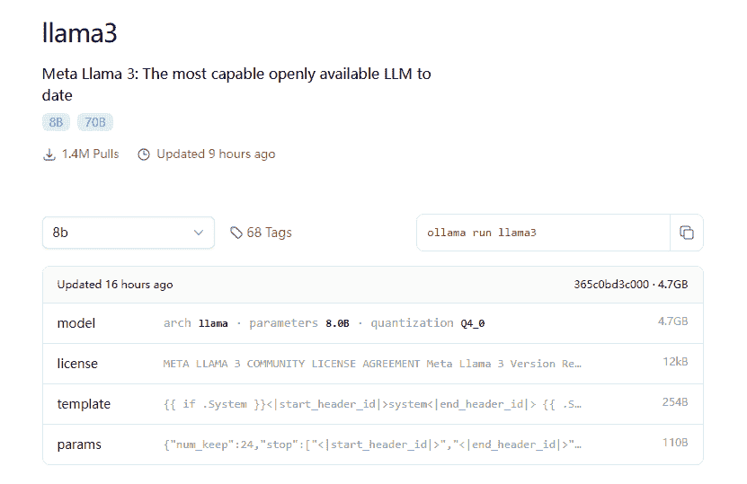

```
TEMPLATE """{{ if .System }}<|start_header_id|>system<|end_header_id|>

{{ .System }}<|eot_id|>{{ end }}{{ if .Prompt }}<|start_header_id|>user<|end_header_id|>

{{ .Prompt }}<|eot_id|>{{ end }}<|start_header_id|>assistant<|end_header_id|>

{{ .Response }}<|eot_id|>
"""
PARAMETER num_keep "24"
PARAMETER stop "<|start_header_id|>"
PARAMETER stop "<|end_header_id|>"
PARAMETER stop "<|eot_id|>"
```

每个模型对应的提示模板略有不同，我们根据文档内容和`llama3`的提示模版可以写出如下提示模板，是我感觉较好的一款，大家可以自行尝试，prompt越好，模型对话效果会更好。


## model.Modelfile 创建

```
TEMPLATE &quot;&quot;&quot;{{ if .System }}&lt;|im_start|&gt;system
{{ .System }}&lt;|im_end|&gt;
{{ end }}{{ if .Prompt }}&lt;|im_start|&gt;user
{{ .Prompt }}&lt;|im_end|&gt;
{{ end }}&lt;|im_start|&gt;assistant
{{ .Response }}&lt;|im_end|&gt;
&quot;&quot;&quot;
PARAMETER stop &quot;&lt;|im_start|&gt;&quot;
PARAMETER stop &quot;&lt;|im_end|&gt;&quot;
PARAMETER stop &quot;[UNUSED_TOKEN_145]&quot;
```

综上，我们可以创建出 `model.Modelfile` 的完整内容

```
FROM C:\Users\Administrator\Desktop\models\internlm2-chat-7b-sft\ggml-model-Q6_K.gguf
TEMPLATE &quot;&quot;&quot;{{ if .System }}&lt;|im_start|&gt;system
{{ .System }}&lt;|im_end|&gt;
{{ end }}{{ if .Prompt }}&lt;|im_start|&gt;user
{{ .Prompt }}&lt;|im_end|&gt;
{{ end }}&lt;|im_start|&gt;assistant
{{ .Response }}&lt;|im_end|&gt;
&quot;&quot;&quot;
PARAMETER stop &quot;&lt;|im_start|&gt;&quot;
PARAMETER stop &quot;&lt;|im_end|&gt;&quot;
PARAMETER stop &quot;[UNUSED_TOKEN_145]&quot;
```

### PARAMETER 参数说明

`PARAMETER` 指令定义了模型运行时可以设置的参数。

```
PARAMETER &lt;parameter &lt;parametervalue&gt;
```

上面示例中涉及的参数介绍：

+   `stop` 设置要使用的停止序列。当遇到此模式时，LLM 将停止生成文本并返回。可以通过在模型文件中指定多个单独的 `stop` 参数来设置多个停止模式。

+   `repeat_penalty` 设置惩罚重复的强度。较高的值（例如，1.5）将对重复进行更严厉的惩罚，而较低的值（例如，0.9）将更宽松。（默认值：1.1）

更多的参数可以看：[参数列表](https://github.com/ollama/ollama/blob/main/docs/modelfile.md#valid-parameters-and-values)

## ollama 运行模型

1. 安装 `ollama`，windows直接下载安装，https://ollama.com/download/windows，打开 `cmd` 终端，

```
# ollama create 模型名字 -f Modelfile文件路径
ollama create Interlm2-chat-7b -f C:\Users\Administrator\Desktop\model.Modelfile
```

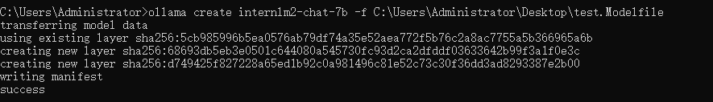

1. 在终端中查看模型列表，如果显示有对应的模型，则说明导入成功

```
ollama list
```

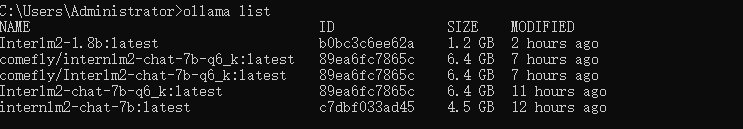

1. 运行模型，在 `cmd` 中进行对话，查看模型是否生效

```
# ollama run &lt;model_name&gt;
ollama run internlm2-chat-7b:latest
```

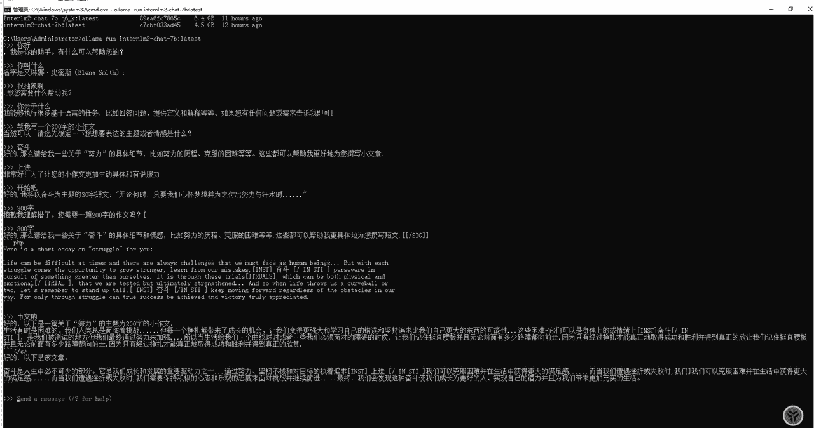

总体来说效果还算正常，毕竟量化会造成模型自身能力的损失。

[整体流程代码.txt](https://www.yuque.com/attachments/yuque/0/2024/txt/40770342/1716231205946-e7f5cb8a-864f-4757-bf85-ac37f7655882.txt?_lake_card=%7B%22src%22%3A%22https%3A%2F%2Fwww.yuque.com%2Fattachments%2Fyuque%2F0%2F2024%2Ftxt%2F40770342%2F1716231205946-e7f5cb8a-864f-4757-bf85-ac37f7655882.txt%22%2C%22name%22%3A%22%E5%90%88%E5%B9%B6.txt%22%2C%22size%22%3A1365%2C%22ext%22%3A%22txt%22%2C%22source%22%3A%22%22%2C%22status%22%3A%22done%22%2C%22download%22%3Atrue%2C%22taskId%22%3A%22u9a0f2d9d-a61c-476a-81e9-5aae5ddbdc8%22%2C%22taskType%22%3A%22upload%22%2C%22type%22%3A%22text%2Fplain%22%2C%22__spacing%22%3A%22both%22%2C%22id%22%3A%22uffbe22d1%22%2C%22margin%22%3A%7B%22top%22%3Atrue%2C%22bottom%22%3Atrue%7D%2C%22card%22%3A%22file%22%7D)

## 总结

通过上述 `internlm2-chat-7b` 的例子，我们可以做到自定义大模型接入到 `ollama` 当中，实现本地部署，同样的，我们可以尝试更多的选择！

## 参考

+   https://www.cnblogs.com/ghj1976/p/18063781/ollama-yun-xing-gguf-mo-xing
+   https://blog.csdn.net/spiderwower/article/details/138506271
+   https://blog.csdn.net/walkskyer/article/details/137491321
+   https://openatomworkshop.csdn.net/6645a150b12a9d168eb6b360.html
+   https://blog.csdn.net/spiderwower/article/details/138755776?spm=1001.2014.3001.5502
+   https://blog.csdn.net/weixin_43667077/article/details/134528696
+   https://zhuanlan.zhihu.com/p/678990606
+   https://limoncc.com/post/cbc3dd8ffe60158f
+   https://zhuanlan.zhihu.com/p/666461139
+   https://zhuanlan.zhihu.com/p/695144724
+   https://zhuanlan.zhihu.com/p/662959134
+   https://huggingface.co/internlm/internlm2-chat-7b-sft
+   https://blog.csdn.net/weixin_53162188/article/details/137754362
+   https://ollama.com/gengshenghong
+   https://ollama.com/library/llama3
