# LMDeploy 教程

> 来源：[https://aicarrier.feishu.cn/docx/PIBddAWQqo5IbVxF1HHc1951nxc](https://aicarrier.feishu.cn/docx/PIBddAWQqo5IbVxF1HHc1951nxc)

# 配置LMDeploy环境

## 1.1 InternStudio开发机创建

打开InternStudio平台(https://stu**dio.i**ntern-ai.org.cn/console/instance)，进入如下界面并按箭头指示顺序点击创建开发机。

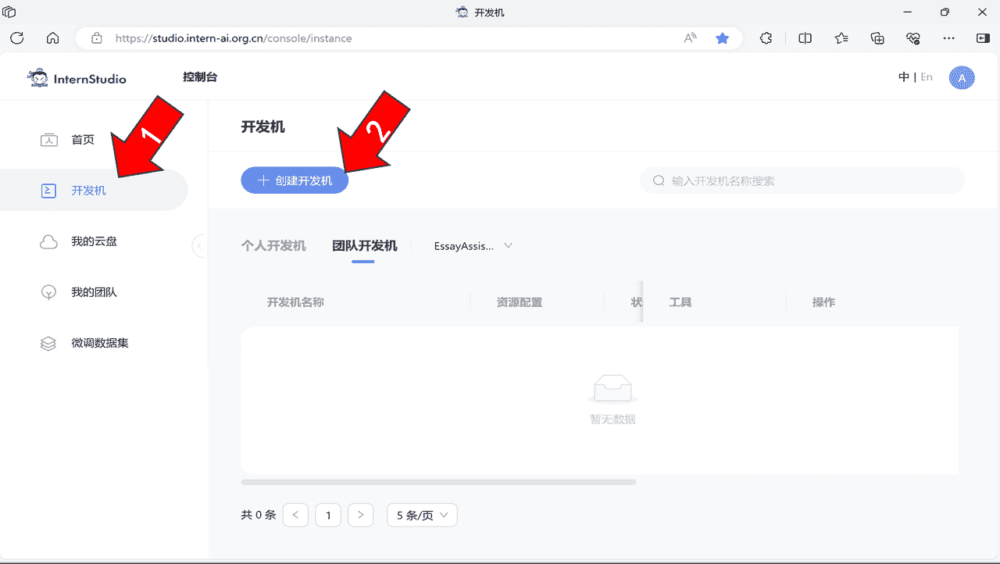

**点选开发机，按照箭头所指，自**拟一个开发机名称，选择Cuda12.2-conda镜像。

目前仅有0.4.1及以上版本的LMDeploy支持部署InternVL-Chat-V1-5，而此版本的LMDeploy需要cu12+的环境，所以请

选择**Cuda12.2-conda**镜像 选择**Cuda12.2-conda**镜像 选择**Cuda12.2-conda**镜像！！

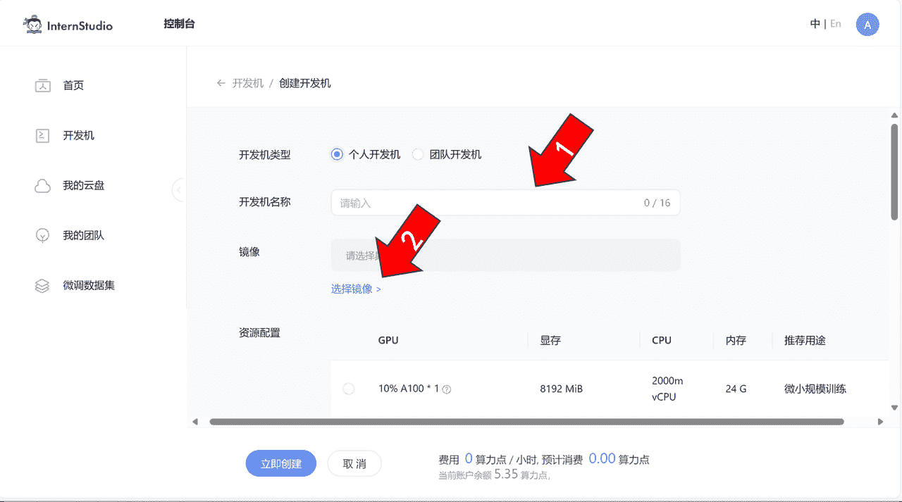

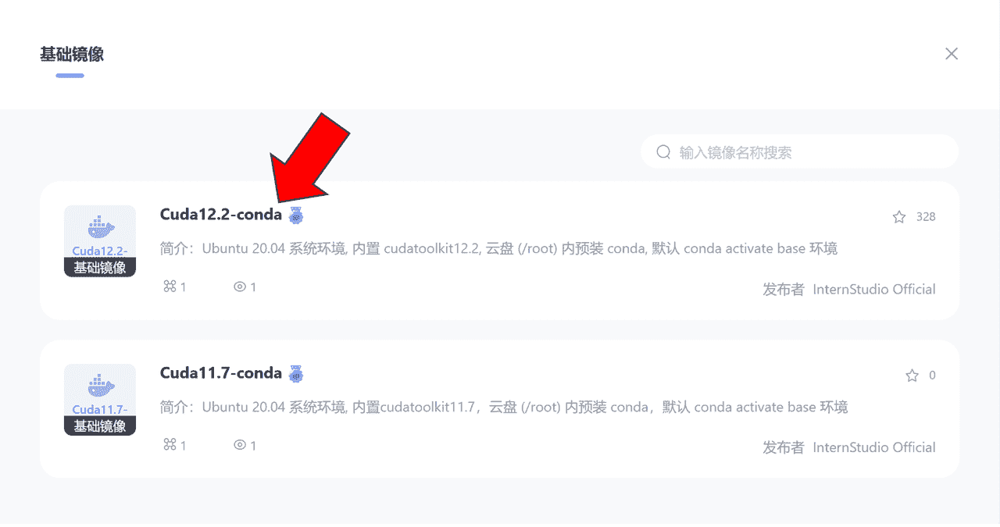

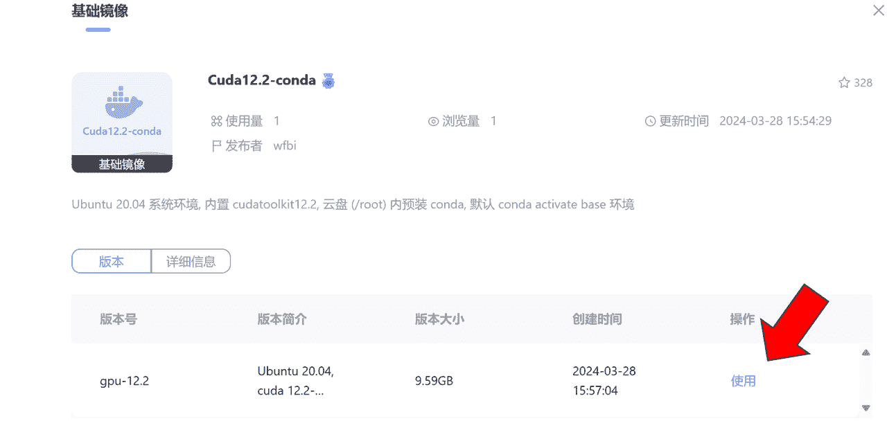

因为要运行参数量为20B的InternVL-Chat-V**1-5，需要约70G**左右的显存**，故选择** A100*1 GPU，而后选择立即创建。

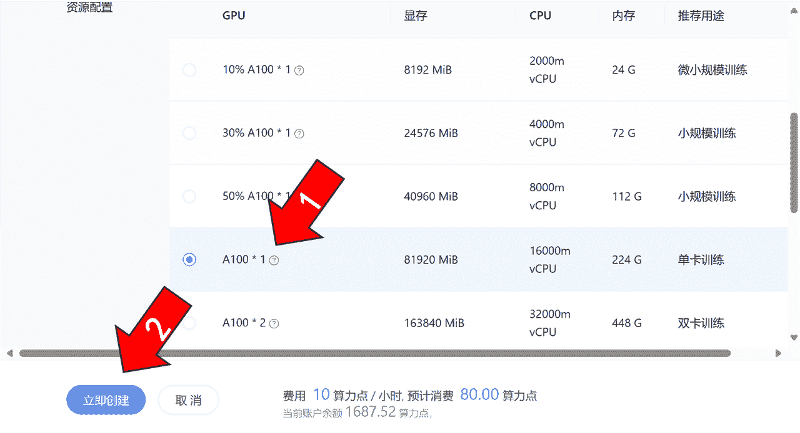

**稍待一会，**等状态栏变成运行中，就可点击进入开发机。

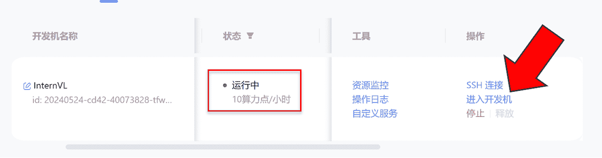

等弹出以下界面，我们即可正式开始部署了。

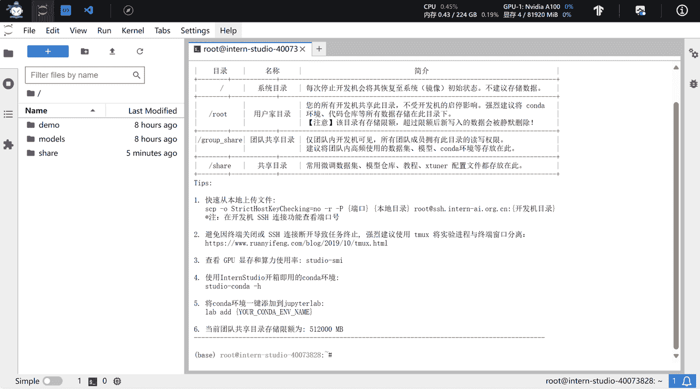

## 1.2 Conda环境配置

在终端中，让我们输入以下指令，来创建一个名为lmdeploy的conda环境，python版本为3.10。

```
conda create -n lmdeploy  python=3.10 -y
```

命令解释：

+   conda create：这是创建新 Conda 环境的命令。

+   -n lmdeploy：这是指定新环境名称的参数，lmdeploy 将是创建的环境的名称。

+   python=3.10：这个参数指定了要安装在环境中的 Python 版本，这里指定为 Python 3.10。

+   -y：这个参数表示自动回答 yes，即在安装过程中如果遇到确认提示，Conda 会自动选择 yes，不需要用户手动确认。

等待片刻，环境创建成功后，会显示如下。

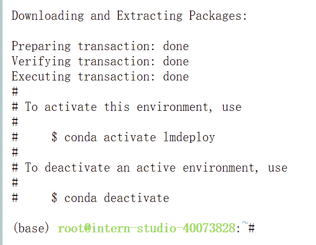

输入以下指令进入我们刚刚创建的lmdeploy环境。

```
conda activate lmdeploy
```

等前缀从如箭头所示的(base)变成(lmdeploy)就代表我们成功进入lmdeploy环境了。

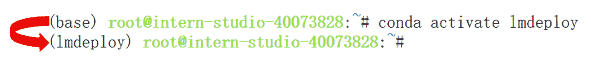

## 1.3 安装LMDeploy

(需要先进入已安装的lmdeploy环境)

输入以下指令，安装完全体的lmdeploy。

```
pip install lmdeploy[all]
```

命令解释：

这条命令是使用 pip（Python 包管理器）来安装一个名为 lmdeploy 的 Python 包。此外，方括号 [all] 表示安装这个包的所有可选依赖项。

等待片刻，安装成功后，会显示如下。

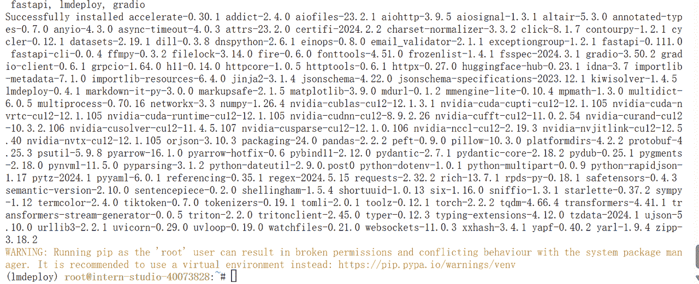

# LMDeploy本地部署InternVL-Chat-V1-5

## 2.1 InternStudio环境获取模型

实战营已经很贴心的在开发机的共享目录中准备好了常用的预训练模型，可以在左侧点选File Broswer，按此路径/root/share/new_models/查看。

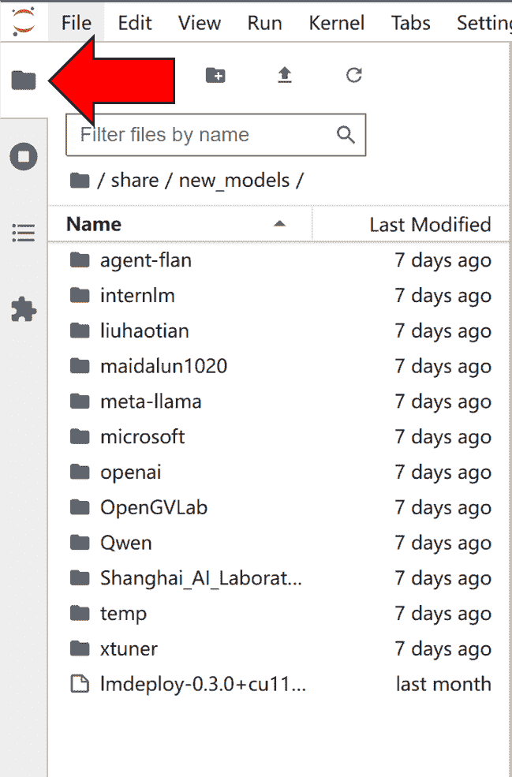

本次我们所需要的InternVL-Chat-V1-5模型文件就在/OpenGVLab/InternVL-Chat-V1-5中。

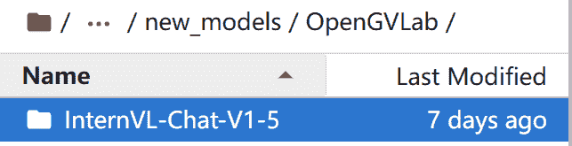

同时，我们也可以运行如下命令进行查看。

```
ls /root/share/new_models/OpenGVLab/
```

命令解释：

ls /root/share/new_models/OpenGVLab/ 是一个用于列出指定目录内容的Unix/Linux命令。具体来说，这个命令会列出 /root/share/new_models/OpenGVLab/ 目录下的所有文件和子目录。

+   ls：这是列出目录内容的命令。

+   /root/share/new_models/OpenGVLab/：这是要列出其内容的目录路径。

执行这个命令后，你会看到目录中包含的文件和子目录列表。如果你需要更详细的信息（如文件大小、修改日期等），可以使用 ls 命令的选项，例如 ls -l。

命令输入后，我们会看到如下所示。

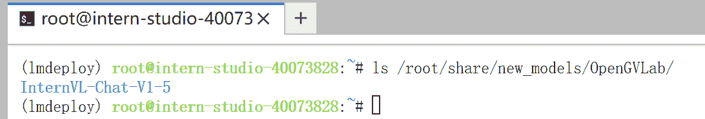

因此，我们在InternStudio开发机上可以直接使用模型文件，而无需等待漫长的下载过程。

首先进入一个存放模型的目录，本教程统一放置在/root/models/目录。

首先运行以下命令，创建文件夹。

```
mkdir /root/models
```

命令解释：

+   mkdir：这是用来创建一个新目录的命令。

+   /root/models：这是指定要创建的新目录的路径和名称。在这个例子中，models 文件夹将被创建在 /root/ 目录下。

执行这个命令后，如果一切正常，你会在 /root/ 目录下看到一个名为 models 的新文件夹，如下图所示。

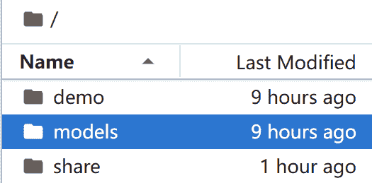

然后执行如下指令由开发机的共享目录软链接。

```
ln -s /root/share/new_models/OpenGVLab/InternVL-Chat-V1-5 /root/models
```

命令解释：

在 Unix/Linux 系统中，ln 命令用于创建链接。这条命令创建了一个符号链接（symbolic link），也称为软链接，它是一个指向另一个文件或目录的特殊文件。符号链接像一个指针，指向原始文件或目录的位置。

下面是对这条命令的分解解释：

+   ln：这是创建链接的命令。

+   -s：这个选项表示创建一个符号链接（symbolic link），而不是一个硬链接（hard link）。

+   /root/share/new_models/OpenGVLab/InternVL-Chat-V1-5：这是原始目录或文件的路径，也就是符号链接将要指向的目标。

+   /root/models：这是你要创建的符号链接的路径。在这个例子中，将在 /root/models 目录下创建一个名为 InternVL-Chat-V1-5 的符号链接，它指向 /root/share/new_models/OpenGVLab/InternVL-Chat-V1-5 目录。

执行这个命令后，你会在 /root/models 目录下看到一个名为 InternVL-Chat-V1-5 的新条目，它实际上是一个指向 /root/share/new_models/OpenGVLab/InternVL-Chat-V1-5 目录的符号链接。这样，你可以通过 /root/models/InternVL-Chat-V1-5 来访问原始目录的内容，而不需要直接访问原始路径。

或者执行如下指令拷贝模型(不建议使用)。

```
cp -r /root/share/new_models/OpenGVLab/InternVL-Chat-V1-5 /root/models
```

命令解释：

在 Unix/Linux 系统中，cp 命令用于复制文件或目录。这条命令使用 -r 选项来递归地复制一个目录及其所有子目录和文件。

下面是对这条命令的分解解释：

+   cp：这是复制文件或目录的命令。

+   -r：这个选项表示递归地复制，即复制目录及其所有子目录和文件。

+   /root/share/new_models/OpenGVLab/InternVL-Chat-V1-5：这是你要复制的目录的路径，即源目录。

+   /root/models：这是你要将源目录复制到的目标路径。在这个例子中，源目录 InternVL-Chat-V1-5 将被复制到 /root/models 目录下。

执行这个命令后，InternVL-Chat-V1-5 目录及其所有内容将被复制到 /root/models 目录下。如果 /root/models 目录已经存在，那么 InternVL-Chat-V1-5 将作为其子目录被创建。如果 /root/models 目录不存在，cp 命令可能会报错，因为没有指定目标目录的名称。

不推荐使用cp命令的原因是InternVL-Chat-V1-5本体文件约48GB大小，使用cp命令复制会消耗大量的计算资源与云盘空间，可能直接导致后续实验无法正常开展。

无论使用哪种命令之后，我们可以看到/root/models中会出现InternVL-Chat-V1-5文件夹。(请忽略前两个xcomposer文件夹，是我单独下载测试用的，本实践无需使用它们)

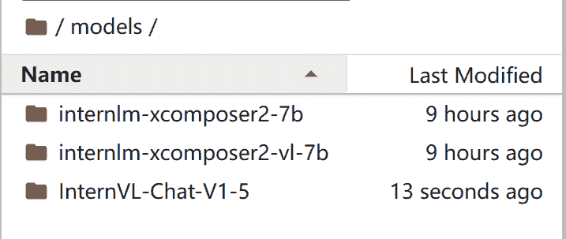

我们同样也可以运行ls命令进行查看。

```
ls /root/models
```

命令输入后，我们会看到如下所示。(同样也请忽略两个xcomposer文件夹，本实践无需使用它们)

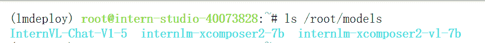

## 2.1 (补充)非实战营环境获取模型

上述方法只适用于在InternStudio，如果是在自己的开发环境上，也可以由HuggingFace下载。

想要从HuggingFace上克隆一个远程仓库到本地，你需要确保你的Git安装中包含了Git LFS。Git LFS是一个Git扩展，用于跟踪和管理大文件。以下是安装Git LFS并克隆指定仓库的步骤：

1.  **安装Git LFS**

(首先需要切换到你的自定义环境)如果你还没有安装Git LFS，你可以通过以下命令安装它。

```
git lfs install
```

这条命令会安装Git LFS并将其配置为在后续的Git操作中自动使用。

1.  设置模型存储路径

使用 cd 命令更改目录到你想存放项目的路径。例如，如果你想将项目克隆到 Documents 文         件夹下的 HuggingFace 文件夹，可以使用以下命令。

对于Windows系统，路径看起来可能是这样的。

```
cd C:\Users\YourUsername\Documents\HuggingFace
```

对于Linux系统，路径看起来可能是这样的。

```
cd ~/Documents/HuggingFace
```

1.  **克隆仓库**:

安装好Git LFS之后，你可以使用Git克隆命令来克隆包含大文件的仓库。

```
git clone https://huggingface.co/OpenGVLab/InternVL-Chat-V1-5
```

这条命令会创建一个名为 InternVL-Chat-V1-5 的文件夹，并将远程仓库的内容克隆到这个文件夹中。由于仓库使用了Git LFS，克隆过程中Git LFS会自动处理大文件的下载。

值得注意的是本方法需要🪜和大约48GB的磁盘存储空间，下载的时候注意window自动休眠中断下载。

如果你缺乏上网手段，也可以使用镜像站进行下载，命令如下。

```
pip install -U huggingface_hub
export HF_ENDPOINT=https://hf-mirror.com
huggingface-cli download --resume-download OpenGVLab/InternVL-Chat-V1-5 --local-dir /root/models/InternVL-Chat-V1-5
```

这一步骤可能耗时较长，主要取决于网速，耐心等待即可，下载完成后根据你设置的路径，文件夹应该如下图所示。

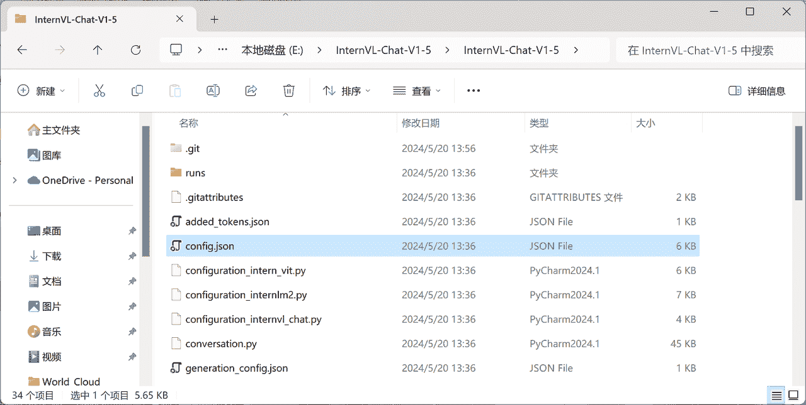

## 2.2 InternVL-Chat-V1-5 启动！

历尽千辛万苦，现在该让我们爽了 部署InternVL-Chat-V1-5了

首先让我们进入创建好的conda环境。

注：以下操作全需要先进入环境，后续不再做提醒

```
conda activate lmdeploy
```

让我们输入以下指令，来到本次实践的戏肉部分，InternVL-Chat-V1-5 启动！

```
lmdeploy chat /root/models/InternVL-Chat-V1-5
```

稍待片刻，启动成功后，会显示如下。

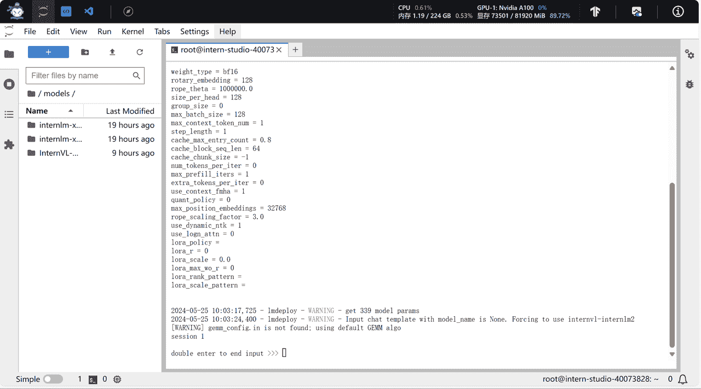

此时，我们可以在CLI(“命令行界面” Command Line Interface的缩**写)中和**InternVL-Chat-V1-5尽情对话了，注意输入内容完成后需要按两次回车才能够执行，以下为示例。

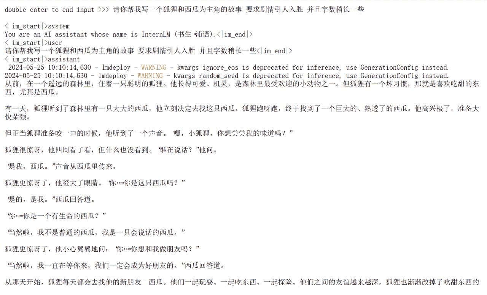

不知道此时有没有小伙伴注意到屏幕右上角，这是InternStudio提供的资源监控。


请记住现在显存占用**73G**，先圈起来，待会要用上。

如果在非InternStudio环境上，想要实现显存资源的监控，我们也可以按照箭头指示顺序，新开一个终端。

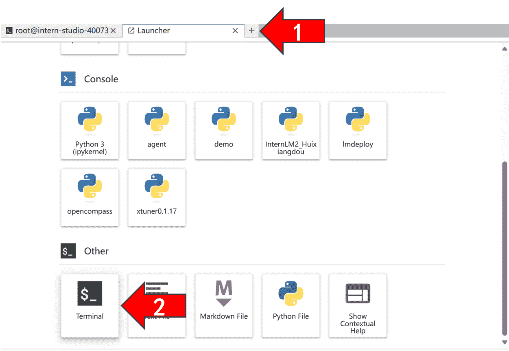

在新终端里，输入如下指令，查看命令输入时的显存占用情况。

```
nvidia-smi
```

终端输出如下图所示。

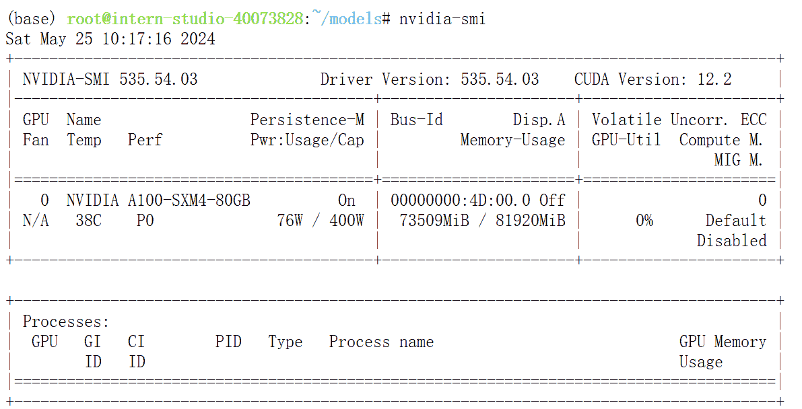

如果想持续监控显存资源，那我们也可以输入如下指令。

```
watch nvidia-smi
```

终端输出如下图所示。

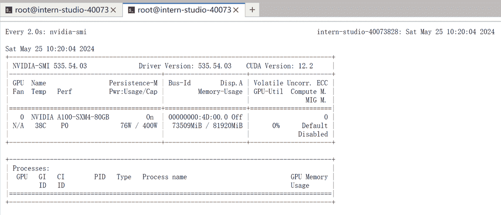

这就代表每两秒刷新一次显存占用等信息。

如果此时我们和InternVL-Chat-V1-5**玩尽兴了**，我们可以在屏幕输入如下指令并按两次回车退出对话。

```
exit
```

终端输出如下图所示。

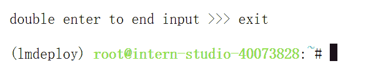

## 2.3 VLM 离线推理 PIPELINE

InternVL-Chat-V1-5可不仅仅是聊天这么简单，带了VL(Vision-Language)那就说明它可以进行看图对话，俗称图生文，而LMDeploy 可以把视觉-语言模型（VLM）复杂的推理过程，抽象为简单好用的 pipeline。

在终端中输入如下指令，新建pipeline.py。

```
touch /root/pipeline.py
```

命令解释：

在linux系统中，touch命令通常用于创建一个空的文件或者修改一个已存在文件的时间戳。命令 touch /root/pipeline.py 将尝试在根目录下创建一个名为 pipeline.py 的新文件。如果文件已经存在，这个命令将更新文件的最后访问时间和最后修改时间到当前时间。

此时我们可以在左侧的File Broswer中看到pipeline.py文件，双击打开。

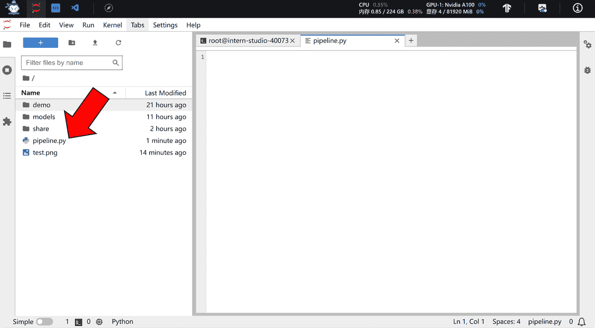

将以下内容复制粘贴进pipeline.py。

image = load_image(&#x27;https://raw.githubusercontent.com/open-mmlab/mmdeploy/main/tests/data/tiger.jpeg&#x27;)


```
from lmdeploy import pipeline
from lmdeploy.vl import load_image

# 创建一个管道实例，指定模型路径
pipe = pipeline(&#x27;/root/models/InternVL-Chat-V1-5&#x27;)

# 加载图片，这里使用了网络URL
# 使用管道处理图片和文本提示
response = pipe((&#x27;请用中文描述这幅图&#x27;, image))

# 输出文本部分
print(response.text)
```

按Ctrl+S键保存（Mac用户按Command+S）。

回到终端，运行python代码。

```
python /root/pipeline.py
```

命令解释：

当运行命令 python /root/pipeline.py 时，是在告诉Python解释器执行位于 /root/pipeline.py 文件中的代码。这个文件应该包含一个Python脚本，其中定义了一系列的命令和逻辑。

如果收到错误消息，这可能是因为以下几个原因：

1.  **文件不存在**: 路径 /root/pipeline.py 可能指向一个不存在的文件。请确认文件名和路径是否正确。

1.  **权限问题**: 可能没有足够的权限来执行该文件。在某些情况下，可能需要使用 sudo 来获得执行权限。

1.  **语法错误**: 文件中的Python代码可能包含语法错误，导致Python解释器无法正确执行。

1.  **依赖问题**: 脚本可能依赖于其他库或模块，但这些依赖可能没有正确安装。

1.  **执行时间**: 脚本可能需要很长时间来执行，这取决于它的复杂性和处理的数据量。

1.  **硬件限制**: 脚本可能需要大量的内存或处理器时间，如果您的系统资源有限，它可能会失败。

1.  **网络问题**: 如果脚本尝试连接到外部服务或资源，网络问题可能会导致执行失败。

稍待片刻，发现运行失败，查看输出会发现提**示缺乏依**赖包'timm'，此时就是上述的依赖问题导致的。

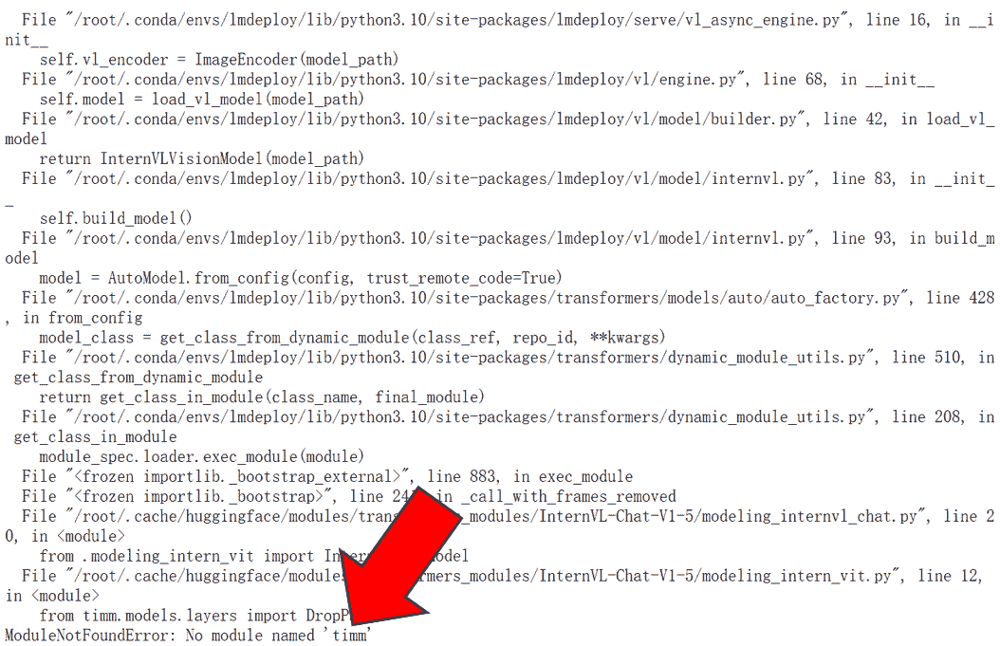

此时输入以下命令安装timm包。如果遇上其他模块缺失，将timm换为其他包即可。

```
pip install timm
```

命令解释：

当运行命令 pip install timm时，是在使用Python的包管理器pip来安装timm库。timm是一个流行的Python库，用于构建高效的视觉识别模型，特别是基于Transformer的模型。

安装过程通常包括以下几个步骤：

1.  **查找包**: pip会查找Python包索引，以确定要安装的包的最新版本。

1.  **下载包**: pip会从Python包索引中下载包的源代码或预编译的二进制文件。

1.  **安装包**: pip会安装包，这可能包括创建包的目录结构、运行包的安装脚本、将包的文件复制到Python的site-packages目录中，以及更新sys.path和PYTHONPATH环境变量。

1.  **更新pip**: 有时，pip会在安装新包之前自动更新到最新版本，以确保安装过程使用的是最新版本的pip。

稍待片刻，会发现终端输出如下。

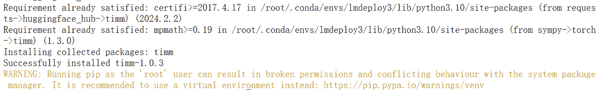

标黄的WARNING很是引人注目，这个警告是在提醒你，以root用户的身份运行pip可能会导致权限问题和与系统包管理器的冲突。但是我们不用管，不理它，无视风险继续！

安装完成后，如果还不放心，可以使用以下命令来验证timm是否已成功安装：

```
pip show timm
```

命令解释：

当运行命令 pip show timm，是在使用Python的包管理器pip来查看关于timm库的详细信息。这个命令会显示以下信息：

+   **Name**: 包的名称。

+   **Version**: 包的版本号。

+   **Location**: 包的安装路径。

+   **Author**: 包的开发者或组织。

+   **Author-email**: 包的开发者或组织的电子邮件地址。

+   **Maintainer**: 包的维护者。

+   Maintainer-email: 包的维护者的电子邮件地址。

+   **Home-page**: 包的主页或官方文档链接。

+   **License**: 包的许可证。

+   **Summary**: 包的简短描述。

+   **Description**: 包的详细描述。

请注意，pip show命令显示的信息取决于包的元数据。如果包的元数据不完整或不存在，某些字段可能不会显示。

终端输出如下，代表我们成功装上timm了。

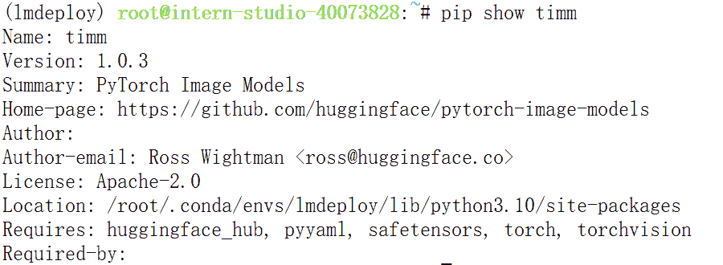

此时我们回到终端，继续运行python代码。

```
python /root/pipeline.py
```

稍待片刻，终端会输出如下结果。

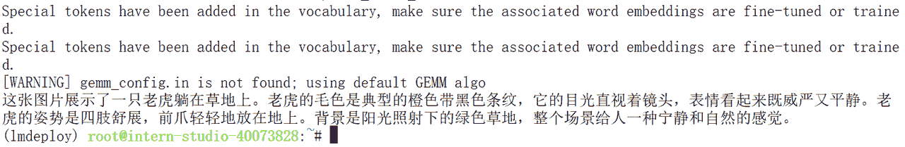

此时我们加载的图片是网络URL，图片如下所示。


如果我们想要上传自己的图片进行分析，只需要点击左侧File Broswer中的Uploda Files选择自己电脑本地的图片进行上传即可，上传后图片会出现在你File Broswer当前停留的路径。

注：经测试，使用**.jpg格式**上传为佳，使用**.png格式**可能会导致Pillow (PIL) 错误，即在尝试将图像保存为 JPEG 格式时出现了错误。错误信息表明，图像的模式是 ‘RGBA’，而 JPEG 格式不支持透明度（alpha 通道）。因此，当 PIL 尝试将 RGBA 图像保存为 JPEG 时，会抛出异常。如对其他格式有需要，可在文件中自行添加代码转换格式。

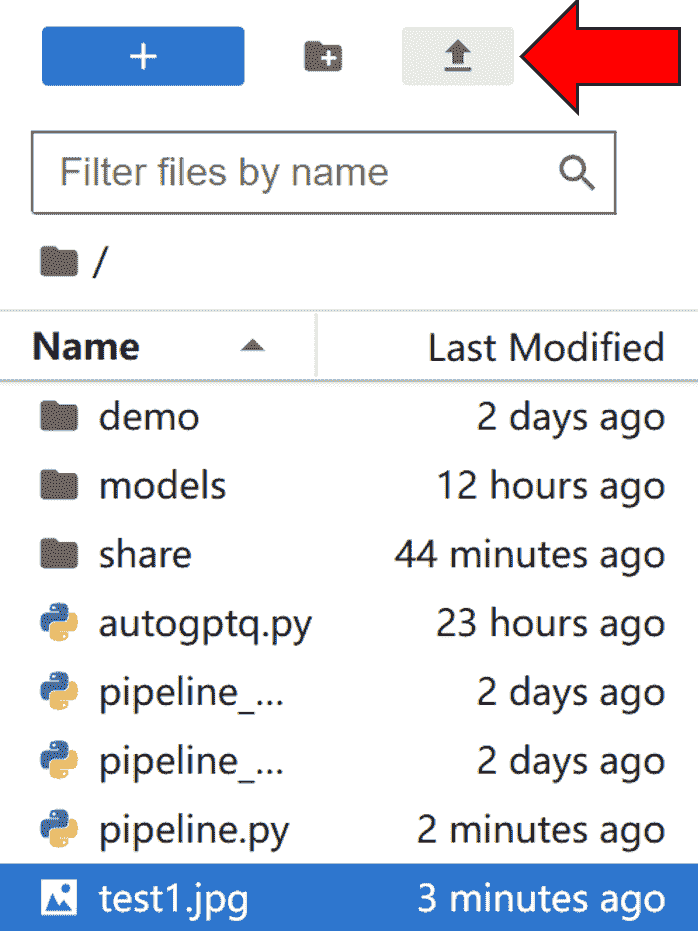

然后让我们回到/root/pipeline.py文件里修改图片路径为当前图片路径。

# image = load_image(&#x27;https://raw.githubusercontent.com/open-mmlab/mmdeploy/main/tests/data/tiger.jpeg&#x27;)

```
from lmdeploy import pipeline
from lmdeploy.vl import load_image

# 创建一个管道实例，指定模型路径
pipe = pipeline(&#x27;/root/models/InternVL-Chat-V1-5&#x27;)

# 加载图片，这里使用了网络URL
# 加载图片，这里修改为本地路径
image = load_image(&#x27;/root/test1.jpg&#x27;)

# 使用管道处理图片和文本提示
response = pipe((&#x27;请用中文描述这幅图&#x27;, image))

# 输出文本部分
print(response.text)
```

记得按Ctrl+S键保存（Mac用户按Command+S）。

回到终端，运行python代码。

```
python /root/pipeline.py
```

稍待片刻，终端会输出如下结果(结果根据你上传的图片因图而异)。

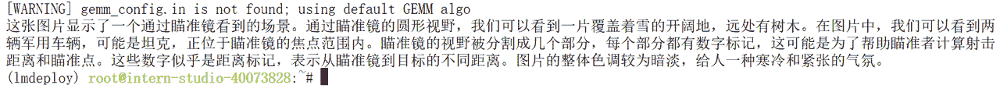

我上传图片的如下所示，不得不说描述的还是很贴切的。

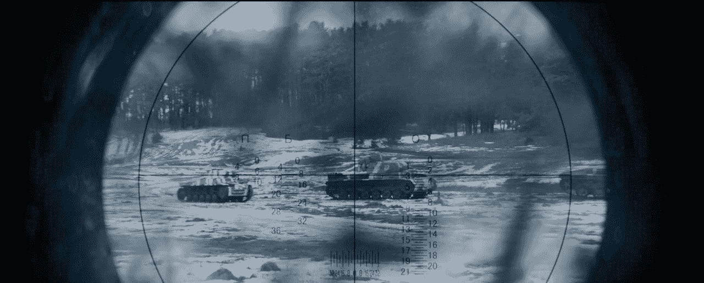

如果你想更进一步，根据这张图来生成一个小故事的话，也可以执行如下操作。

首先让我们回到/root/pipeline.py文件里修改line13的提示词。

# image = load_image(&#x27;https://raw.githubusercontent.com/open-mmlab/mmdeploy/main/tests/data/tiger.jpeg&#x27;)

```
from lmdeploy import pipeline
from lmdeploy.vl import load_image

# 创建一个管道实例，指定模型路径
pipe = pipeline(&#x27;/root/models/InternVL-Chat-V1-5&#x27;)

# 加载图片，这里使用了网络URL
# 加载图片，这里修改为本地路径
image = load_image(&#x27;/root/test1.jpg&#x27;)

# 使用管道处理图片和文本提示
response = pipe((&#x27;请用中文描述这幅图，并以此生成一段小故事&#x27;, image))

# 输出文本部分
print(response.text)
```

记得按Ctrl+S键保存（Mac用户按Command+S）。

回到终端，运行python代码。

```
python /root/pipeline.py
```

稍待片刻，终端会输出如下结果(结果根据你上传的图片因图而异)。

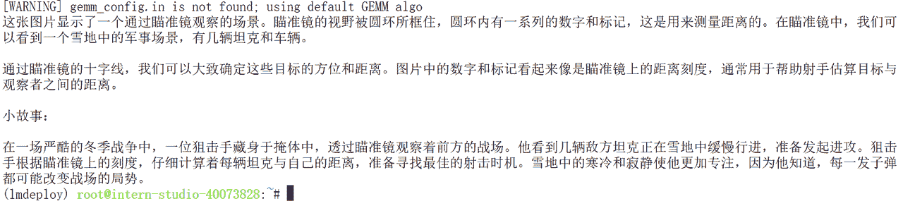

## 2.4 VLM 多图推理

多图推理(Multi-images inference)，顾名思义即同时对多张图片进行推理，而InternVL-Chat-V1-5对于多图的场景，在推理时，只要把它们放在一个列表中即可。不过，多图意味着输入 token 数更多，所以通常需要增大推理的上下文长度。

让我们运行以下命令新建一个pipeline_Multi-images.py。

```
touch /root/pipeline_Multi-images.py
```

双击打开pipeline_Multi-images.py，将以下内容复制粘贴进pipeline_Multi-images.py，并按Ctrl+S键保存（Mac用户按Command+S）。

    &#x27;https://raw.githubusercontent.com/open-mmlab/mmdeploy/main/demo/resources/human-pose.jpg&#x27;,
    &#x27;https://raw.githubusercontent.com/open-mmlab/mmdeploy/main/demo/resources/det.jpg&#x27;

```
# 导入pipeline函数和TurbomindEngineConfig配置类
from lmdeploy import pipeline, TurbomindEngineConfig
# 导入load_image函数，用于加载图片
from lmdeploy.vl import load_image

# 创建一个pipeline对象，指定模型的路径和后端配置
# &#x27;/root/models/InternVL-Chat-V1-5&#x27;是模型所在的路径
# TurbomindEngineConfig是后端配置，session_len=8192指定了会话长度
pipe = pipeline(&#x27;/root/models/InternVL-Chat-V1-5&#x27;,
                backend_config=TurbomindEngineConfig(session_len=8192))

# 定义一个列表，包含要处理的图片的URLs
image_urls=[
]

# 使用列表推导式，通过load_image函数加载每个URL对应的图片
images = [load_image(img_url) for img_url in image_urls]

# 调用pipeline的process方法，传入提示文本和图片列表
# (&#x27;请用中文描述以下图片&#x27;, images)是调用时的参数，表示对图片进行中文描述的请求
response = pipe((&#x27;请用中文描述这两张图片&#x27;, images))

# 打印出模型的响应文本
print(response.text)

```

回到终端，运行python代码。

```
python /root/pipeline_Multi-images.py
```

稍待片刻，终端会输出如下结果。

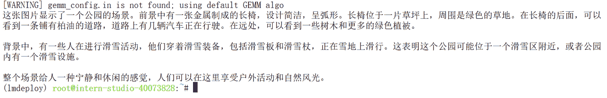

此时所用图片为以下所示。


可以看出来InternVL-Chat-V1-5对两图的解读是融合理解的，那我们是否可以用一个系列图来让InternVL-Chat-V1-5识别看看是何结果呢？

依照 [2.3](https://kaxojqwlrks.feishu.cn/wiki/GkhEwMCREiFtX2kZPWxcHltRnnb?larkTabName=space#part-C1avdAHdGopIrGx9sK6cqrVAnPg)VLM 离线推理 PIPELINE 对应的内容点击Uploda Files上传图片。

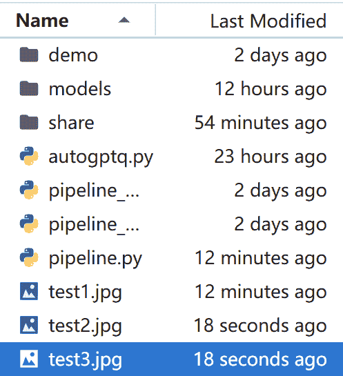

回到/root/pipeline_Multi-images.py文件里修改修改图片路径并按Ctrl+S键保存（Mac用户按Command+S）。

    &#x27;https://raw.githubusercontent.com/open-mmlab/mmdeploy/main/demo/resources/human-pose.jpg&#x27;,
    &#x27;https://raw.githubusercontent.com/open-mmlab/mmdeploy/main/demo/resources/det.jpg&#x27;

```
# 导入pipeline函数和TurbomindEngineConfig配置类
from lmdeploy import pipeline, TurbomindEngineConfig
# 导入load_image函数，用于加载图片
from lmdeploy.vl import load_image

# 创建一个pipeline对象，指定模型的路径和后端配置
# &#x27;/root/models/InternVL-Chat-V1-5&#x27;是模型所在的路径
# TurbomindEngineConfig是后端配置，session_len=8192指定了会话长度
pipe = pipeline(&#x27;/root/models/InternVL-Chat-V1-5&#x27;,
                backend_config=TurbomindEngineConfig(session_len=8192))

# 定义一个列表，包含要处理的图片的URLs
&#x27;&#x27;&#x27;
image_urls=[
]
&#x27;&#x27;&#x27;
# 定义一个新列表，包含要处理的图片的路径
image_urls=[
    &#x27;/root/test2.jpg&#x27;,
    &#x27;/root/test3.jpg&#x27;
]

# 使用列表推导式，通过load_image函数加载每个URL对应的图片
images = [load_image(img_url) for img_url in image_urls]

# 调用pipeline的process方法，传入提示文本和图片列表
# (&#x27;请用中文描述以下图片&#x27;, images)是调用时的参数，表示对图片进行中文描述的请求
response = pipe((&#x27;请分别叙述这两张图片，此外，这两张图的主角是一样的，你能猜出发生了什么事情吗？请对你的猜测加以艺术加工使之成为一个小故事&#x27;, images))

# 打印出模型的响应文本
print(response.text)
```

回到终端，运行python代码。

```
python /root/pipeline_Multi-images.py
```

稍待片刻，终端会输出如下结果。

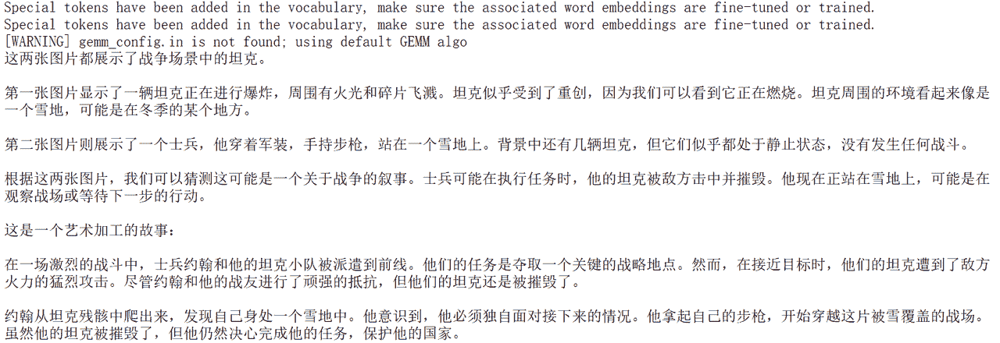

注：重复了几轮，这是其中表现较好的一次输出，对结果不满意可以多跑几次。

以下为原图，可以看出仍有优化空间。


## 2.5 VLM 多轮对话

通过以上实验会发现InternVL-Chat-V1-5在进行某些输出的时候表现不尽如人意，那么此时我们就可以通过LMDeploy使用多轮对话功能来一次输入获得多轮回答。做一个形象的比喻就是此时LMDeploy就是一个复读机对着InternVL-Chat-V1-5提出你所罗列的问题，直到你设置的轮数再停下来并输出结果。

让我们运行以下命令新建一个pipeline_Multi-turn.py。

```
touch /root/pipeline_Multi-turn.py
```

pipeline 进行多轮对话有两种方式，一种是按照 openai 的格式来构造 messages，另外一种是使用 pipeline.chat 接口。这里我们使用pipeline.chat 接口。

双击打开pipeline_Multi-images.py，将以下内容复制粘贴进pipeline_Multi-images.py，并按Ctrl+S键保存（Mac用户按Command+S）。

```
# 导入必要的库和模块
from lmdeploy import pipeline, TurbomindEngineConfig, GenerationConfig
from lmdeploy.vl import load_image

# 创建一个图像处理管道，指向一个特定的模型文件夹
pipe = pipeline(&#x27;/root/models/InternVL-Chat-V1-5&#x27;,
                backend_config=TurbomindEngineConfig(session_len=8192))

# 定义一个包含图片URL的列表
image_urls = [
    &#x27;/root/test2.jpg&#x27;,  # 第一个图片的路径
    &#x27;/root/test3.jpg&#x27;   # 第二个图片的路径
]

# 使用列表推导式和load_image函数加载列表中的每个图片
images = [load_image(img_url) for img_url in image_urls]

# 创建一个生成配置，用于控制生成文本的参数
gen_config = GenerationConfig(top_k=40, top_p=0.8, temperature=0.8)

# 创建一个会话（session），准备与模型进行交互
sess = pipe.chat((&#x27;请分别叙述这两张图片,并加以细节填充与描写。&#x27;, images), gen_config=gen_config)

# 打印模型对第一张图片的描述
print(sess.response.text)

# 继续与模型交互，询问模型是否可以提供更细节的描述
sess = pipe.chat(&#x27;你能给我一些更细节的描述吗？&#x27;, session=sess, gen_config=gen_config)

# 打印模型对第二张图片的更细节的描述
print(&#x27;\n&#x27;, sess.response.text)  # 在描述前添加一个换行符

# 再次与模型交互，请求模型根据之前的结果写一个战争小故事
sess = pipe.chat(&#x27;能否依据这些结果帮我写一个战争小故事？&#x27;, session=sess, gen_config=gen_config)

# 打印模型编写的战争小故事
print(&#x27;\n&#x27;, sess.response.text)  # 在故事前添加一个换行符

```

再让我们接着来运行pipeline_Multi-turn.py。

```
python /root/pipeline_Multi-turn.py 
```

稍待片刻，终端输出结果如下。

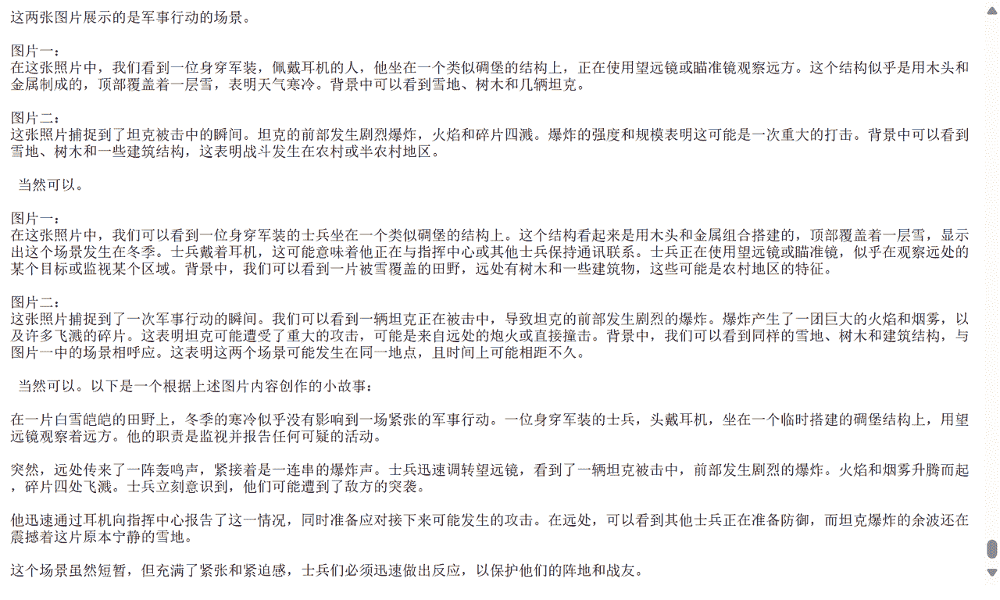

这里有必要针对以下语句单独做一个解释。

```
gen_config = GenerationConfig(top_k=40, top_p=0.8, temperature=0.8)
```

这段代码行是用来创建一个GenerationConfig对象，这是一个用于控制生成文本的参数的配置对象。在lmdeploy库中，这通常与图像描述或问答等功能有关。

具体来说，GenerationConfig对象包含以下三个关键参数：

1.  top_k：这是一个整数，它决定了在生成文本时考虑前top_k个最可能的单词。这个参数可以帮助控制生成的文本的多样性和创造性。较高的top_k值可能会生成更保守、更接近输入的文本，而较低的top_k值可能会生成更独特、更不确定的文本。

1.  top_p：这是一个浮点数，它决定了在生成文本时只考虑概率分布的前top_p部分。这个参数可以用来控制生成文本的连贯性和多样性。较高的top_p值可能会生成更连贯、更相似的文本，而较低的top_p值可能会生成更多样、更不连贯的文本。

1.  temperature：这是一个浮点数，它决定了在生成文本时的温度系数。这个参数可以用来控制生成文本的随机性和确定性。较高的temperature值可能会生成更随机、更不确定性的文本，而较低的temperature值可能会生成更确定、更连贯的文本。

在这段代码中，gen_config对象被创建并设置了top_k=40、top_p=0.8和temperature=0.8。这些参数的值是根据需要生成的文本的特定要求来设置的。例如，如果你想要生成更独特、更不确定的文本，你可以将top_k设置得较低，将top_p设置得较高，将temperature设置得较高。

# LMDeploy API部署InternVL-Chat-V1-5

在上一章节，我们都是在本地直接部署InternVL-Chat-V1-5。而在实际应用中，我们有时会将大模型封装为API接口服务，供客户端访问。

## 3.1 启动API服务器

通过以下命令启动API服务器，部署InternVL-Chat-V1-5模型：

```
lmdeploy serve api_server \
    /root/models/InternVL-Chat-V1-5 \
    --model-format hf \
    --quant-policy 0 \
    --server-name 0.0.0.0 \
    --server-port 23333 \
    --tp 1
```

命令解释：

1.  lmdeploy serve api_server：这是lmdeploy库中的一个命令，用于启动一个API服务器。这个命令告诉lmdeploy库，你想要通过一个API服务器来访问模型。

1.  /root/models/InternVL-Chat-V1-5：这是模型的路径，指定了模型文件夹的位置。这个文件夹包含了模型的所有相关文件和配置。

1.  --model-format hf：这个参数指定了模型的格式。在这里，hf代表“Hugging Face”格式。这告诉lmdeploy库如何加载和处理模型。

1.  --quant-policy 0：这个参数指定了量化策略。量化是将模型从浮点数转换为整数的过程，这可以减少模型的内存使用和计算时间。

1.  --server-name 0.0.0.0：这个参数指定了服务器的名称。在这里，0.0.0.0是一个特殊的IP地址，它表示所有网络接口。

1.  --server-port 23333：这个参数指定了服务器的端口号。在这里，23333是服务器将监听的端口号。

1.  --tp 1：这个参数表示并行数量（GPU数量）。

总的来说，这段代码的目的是启动一个API服务器，以便通过网络接口访问一个位于指定路径的模型。这个服务器将监听所有网络接口上的指定端口，并且可能使用特定的模型格式和量化策略。

稍待片刻，终端显示如下。

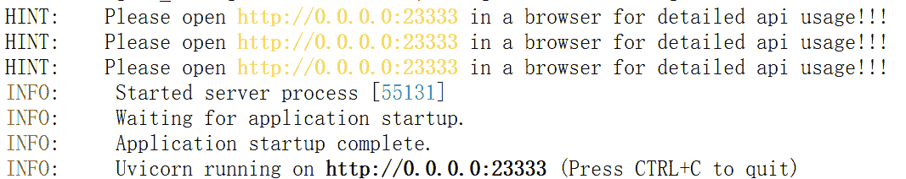

这一步由于部署在远程服务器上，所以本地需要做一下ssh转发才能直接访问。在你本地打开一个cmd或powershell窗口，输入命令如下：

```
 ssh -CNg -L 23333:127.0.0.1:23333 root@ssh.intern-ai.org.cn -p 你的ssh端口号
```

ssh 端口号按照下图图示方法查询，我的是33174，请替换为自己的。

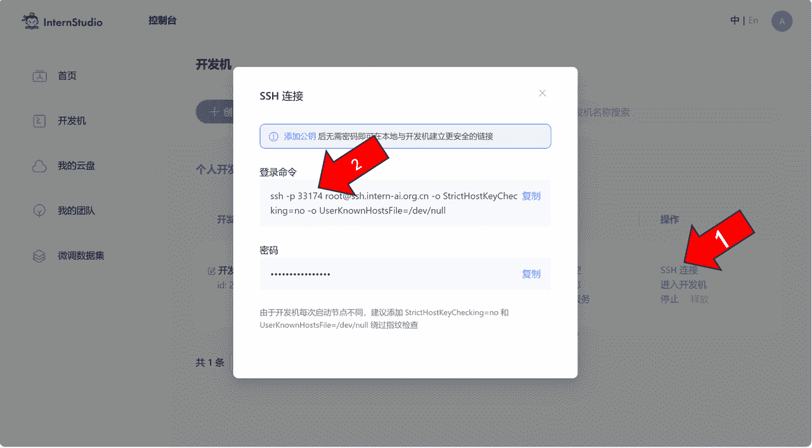

输入后，首次访问可能会询问你是否继续连接，敲入yes并回车即可。

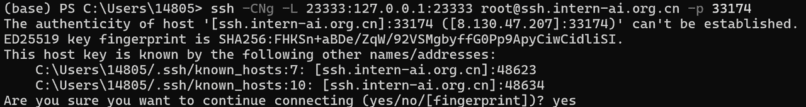

之后会要求输入密码，按下图所示复制密码。

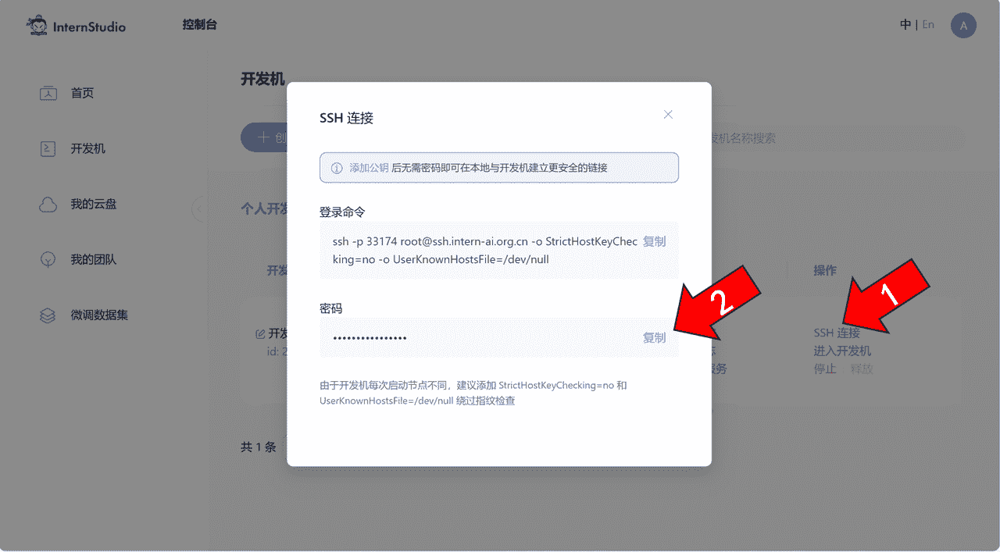

复制后直接在窗口Ctrl+S键粘贴，注意CLI默认密码不显示，黏贴后直接回车即可，让窗口保留在如下所示的状态即可，请勿关闭。

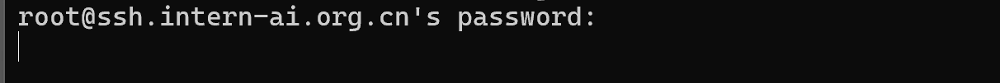

然后打开浏览器，访问http://127.0.0.1:23333看到如下界面即代表部署成功。

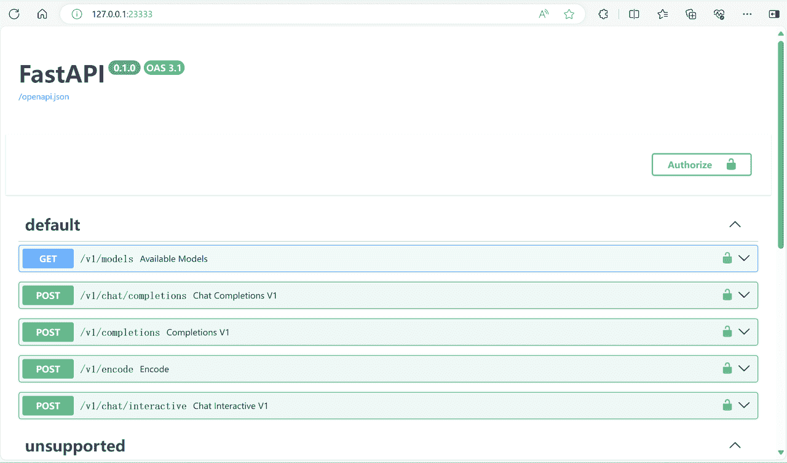

(具体应用方法不采用图文叙述，详见视频，如果有的话)

## 3.2 以命令行形式连接API服务器

关闭http://127.0.0.1:23333网页，但保持终端和本地窗口不动，按箭头操作新建一个终端。

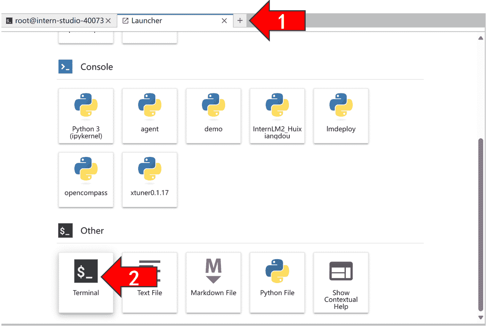

运行如下命令，激活conda环境并启动命令行客户端。

```
conda activate lmdeploy
lmdeploy serve api_client http://localhost:23333
```

稍待片刻，等出现double enter to end input >>> 你好！今天我能为您提供什么帮助？的欢迎语即启动成功，此时便可以随意与InternVL-Chat-V1-5对话，同样是两下回车确定，输入exit退出。

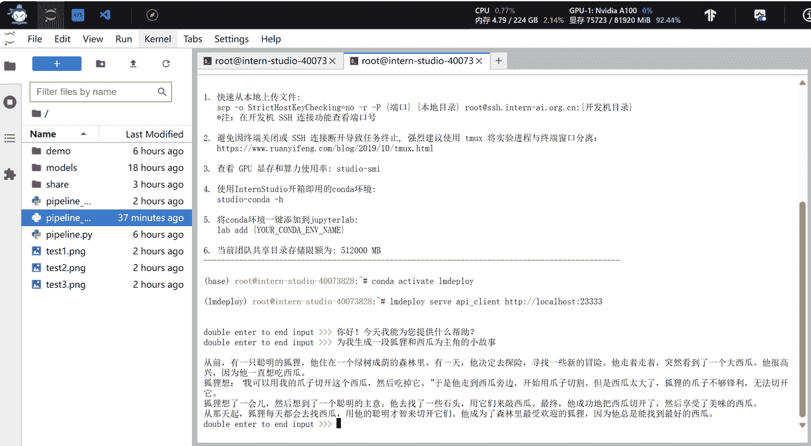

## 3.3 以Gradio**网页形式连接API服务器**

保持第一个终端不动，在新建终端中输入exit退出。

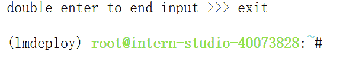

输入以下命令，使用Gradio作为前端，启动网页。

```
lmdeploy serve gradio http://localhost:23333 \
    --server-name 0.0.0.0 \
    --server-port 6006
```

稍待片刻，等终端如下图所示便保持两个终端不动。

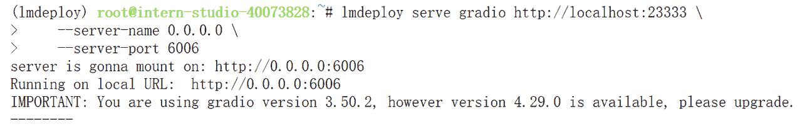

关闭之前的cmd/powershell窗口，重开一个，再次做一下ssh转发(因为此时端口不同)。在你本地打开一个cmd或powershell窗口，输入命令如下。

```
ssh -CNg -L 6006:127.0.0.1:6006 root@ssh.intern-ai.org.cn -p &lt;你的ssh端口号&gt;
```

重复上述操作，待窗口保持在如下状态即可。

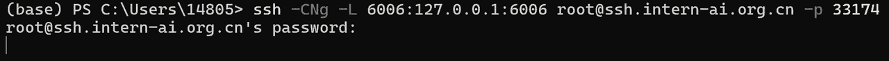

打开浏览器，访问地址http://127.0.0.1:6006，然后就可以与模型尽情对话了。

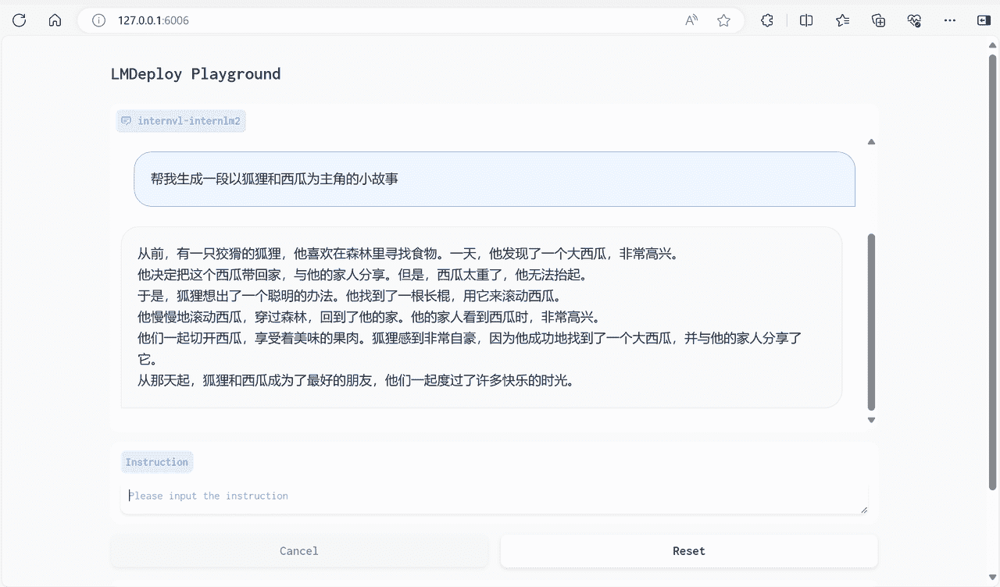

# LMDeploy Lite

不知道大家还记不记得[当初圈起来的内容](https://kaxojqwlrks.feishu.cn/wiki/GkhEwMCREiFtX2kZPWxcHltRnnb?larkTabName=space#part-KlDpdlEBHobx3dxQ5vBc14vInOg)，对，就是InternVL-Chat-V1-5运行时会吃掉73G的显存，而经过前面几回合的学习，大家也会发现峰值时候吃掉80G显存简直轻而易举。而针对此种情况，LMDeploy为大家提供了两种方法，一种是KEY-VALUE(KV) CACHE 量化，一种是模型量化。

## 4.1 kv cache量化

key-value (kv) cache 量化是一种将内存中的键值缓存（kv cache）从高精度浮点数转换为低精度整数的技术，以减少内存使用和提高访问速度。

模型在运行时，占用的显存可大致分为三部分：模型参数本身占用的显存、kv cache占用的显存，以及中间运算结果占**用的显存。L**MDeploy的kv cache管理器可以通过设置--cache-max-entry-count参数，控制kv缓存占用剩余显存的最大比例。默认的比例为0.8。

首先我们先来回顾一下InternVL-Chat-V1-5正常运行时占用显存。


占用了73G，那么试一试执行以下命令，再来观看占用显存情况。

```
lmdeploy chat /root/models/InternVL-Chat-V1-5 --cache-max-entry-count 0.4
```

稍待片刻，观测显存占用情况，可以看到减少了约17G的显存。


接着试一试把--cache-max-entry-count参数设置为0.01，约等于禁止kv cache占用显存。

```
lmdeploy chat /root/models/InternVL-Chat-V1-5 --cache-max-entry-count 0.01
```

稍待片刻，观测显存占用情况，减少了约35G的显存，但是代价就是会降低模型推理速度。


## 4.2 **在线** kv cache int4/int8 量化

自 v0.4.0 起，LMDeploy 支持在线 kv cache int4/int8 量化，量化方式为 per-head per-token 的非对称量化。此外，通过 LMDeploy 应用 kv 量化非常简单，只需要设定 quant_policy 和cache-max-entry-count参数。目前，LMDeploy 规定 qant_policy=4 表示 kv int4 量化，quant_policy=8 表示 kv int8 量化。

我们通过3. LMDeploy API部署InternVL-Chat-V1-5的实践为例，输入以下指令，启动API服务器。

```
lmdeploy serve api_server \
    /root/models/InternVL-Chat-V1-5 \
    --model-format hf \
    --quant-policy 4 \
    --cache-max-entry-count 0.4\
    --server-name 0.0.0.0 \
    --server-port 23333 \
    --tp 1
```

稍待片刻，显示如下即代表服务启动成功。


想要和此时的模型对话的话可以回顾3.2 以命令行形式连接API服务器或者3.3 以Gradio网页形式连接API服务器的内容自行对话，步骤完全一致，本章主要观测显存状态。

可以看到此时显存占用约63G，减少了7G的占用。


如果想要更低的显存占用，也可以更改cache-max-entry-count参数至更小数值，自行尝试即可。

## 4.3 W4A16 模型量化和部署

准确说，模型量化是一种优化技术，旨在减少机器学习模型的大小并提高其推理速度，通常用于移动和边缘设备。量化通过将模型的权重和激活从高精度（如32位浮点数）转换为低精度（如16位浮点数、8位整数、甚至二值网络）来实现。

展开来说说模型量化。

1.  **为何量化？**

+   **减小模型大小**：量化可以显著减少模型的大小，使其更容易部署到资源受限的设备上。

+   **提高推理速度**：低精度计算通常比高精度计算更快，尤其是在专用硬件（如GPU、TPU）上。

+   **降低能耗**：低精度运算通常消耗更少的能耗。

1.  **量化类型：**

+   **动态量化**：在运行时动态地量化权重和激活。通常用于权重分布变化较大的模型。

+   **静态量化**：在训练后量化权重和激活。通常用于权重分布相对稳定的模型。

+   **量化感知训练（QAT）**：在训练过程中模拟量化效果，以适应量化带来的损失。

1.  **量化精度：**

+   **FP32**：32位浮点数，标准精度。

+   **FP16/BF16**：16位浮点数/Brain Float16，低精度浮点数。

+   **INT8/INT4**：8位/4位整数，非常低的精度。

+   **二值网络**：权重和激活只有两个值（+1或-1）。

1.  **量化挑战：**

+   **精度损失**：量化可能会导致模型性能下降。

+   **饱和问题**：在量化过程中，极值可能会被“饱和”，导致信息丢失。

+   **校准**：找到正确的缩放因子和零点以最小化量化误差。

让我们回到LMDeploy上，在最新的版本中，已经支持对InternVL-Chat-V1-5模型进行推理量化了。

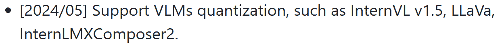

LMDeploy使用的是AWQ算法，能够实现模型的4bit权重量化。输入以下指令，执行模型的量化工作。

```
lmdeploy lite auto_awq \
   /root/models/InternVL-Chat-V1-5 \
  --calib-dataset &#x27;ptb&#x27; \
  --calib-samples 128 \
  --calib-seqlen 1024 \
  --w-bits 4 \
  --w-group-size 128 \
  --work-dir /root/models/InternVL-Chat-V1-5-w4a16-4bit
```

命令解释：

1.  lmdeploy lite auto_awq: lite这是LMDeploy的命令，用于启动量化过程，而auto_awq代表自动权重量化（auto-weight-quantization）。

1.  /root/models/InternVL-Chat-V1-5: 这是模型文件的路径，指出模型的位置。

1.  --calib-dataset 'ptb': 这个参数指定了一个校准数据集，这里使用的是’ptb’（指的是Penn Treebank，一个常用的语言模型数据集）。

1.  --calib-samples 128: 这指定了用于校准的样本数量，这里是128个样本。

1.  --calib-seqlen 1024: 这指定了校准过程中使用的序列长度，这里是1024。

1.  --w-bits 4: 这表示权重（weights）的位数将被量化为4位。

1.  --w-group-size 128: 这指定了权重分组的大小，这里为128。分组量化是一种量化技术，通过将权重分为多个组，并对每组执行相同的量化操作，可以减少量化误差。

1.  --work-dir /root/models/InternVL-Chat-V1-5-w4a16-4bit: 这是工作目录的路径，用于存储量化后的模型和中间结果。

等终端输出如下时，说明正在推理中，稍待片刻。

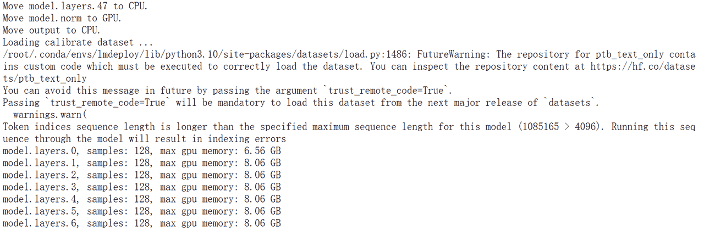

等待推理完成，便可以直接在你设置的目标文件夹看到对应的模型文件。


那么推理后的模型和原本的模型区别在哪里呢？最明显的两点是模型文件大小以及占据显存大小。

我们可以输入如下指令查看在当前目录中显示所有子目录的大小。

```
cd /root/models/
du -sh *
```

输出结果如下。(其余三个文件夹都是以软连接的形式存在的，不占用空间，故显示为0)


那么原模型大小呢？输入以下指令查看。

```
cd /root/share/new_models/OpenGVLab/
du -sh *
```

终端输出结果如下。


一经对比即可发觉，48G对22G，优势在我。

那么显存占用情况对比呢？直接输入以下指令启动量化后的模型。

```
lmdeploy chat /root/models/InternVL-Chat-V1-5-w4a16-4bit/ --model-format awq
```

稍待片刻，我们直接观测右上角的显存占用情况。


可以发现，相比较于原先的73G显存占用，量化后的模型少了约5G的显存占用，效果十分明显。

## 4.4 联合部署

我知道你们肯定有人在想，显存占用能不能再小一点？答案是当然可以，方法就是：


我们只需要将我们推理好的模型使用kv cache量化就可以了！

输入以下指令，让我们同时启用量化后的模型和kv cache量化。

```
lmdeploy chat \
/root/models/InternVL-Chat-V1-5-w4a16-4bit/ \
--model-format awq \
--cache-max-entry-count 0.4
```

观测显存占用情况，看到此时只需要40.8G的显存，已经是一张A40或者一张L20即可部署的模型了。


那让我们挑战一下极限，直接看看极限显存只需要多少。

输入指令。

```
lmdeploy chat \
/root/models/InternVL-Chat-V1-5-w4a16-4bit/ \
--model-format awq \
--cache-max-entry-count 0.01
```

观测显存占用情况，可以说约14G的显存占用属于逆天级别的压缩了，但是经过对话测试，此种情况下的大模型有明显问题存在，且待后续优化吧。


我们再来测试一下在线 kv cache int4/int8 量化的情况，输入以下指令。

```
lmdeploy serve api_server \
    /root/models/InternVL-Chat-V1-5-w4a16-4bit \
    --model-format awq \
    --quant-policy 4 \
    --cache-max-entry-count 0.4\
    --server-name 0.0.0.0 \
    --server-port 23333 \
    --tp 1
```

此时显存占用约47G，属于濒临A40和L20之流的极限了。


还是一样的，想要和此时的模型对话的话可以回顾3.2 以命令行形式连接API服务器或者3.3 以Gradio网页形式连接API服务器的内容自行对话，步骤完全一致，本章主要观测显存状态。

想要更极限且保证正常工作的量化设置的话，各位小伙伴可以之后自行探索，本次实践教学便止步于此了。