# Deploy007 Attention

> 来源：[https://aicarrier.feishu.cn/docx/CXuxdL8z3onko1xvZmMcfgmHnje](https://aicarrier.feishu.cn/docx/CXuxdL8z3onko1xvZmMcfgmHnje)

# Why attention

> 以下引用自：理[解Attention:从起源到](https://transformers.run/c1/attention/)MHA,MQA和GQA，transformer快速入门

Attention（注意力）机制如果浅层的理解，就是「从关注全部到关注重点」。

+   我们的视觉系统就是一种 Attention机制，将有限的注意力集中在重点信息上，从而节省资源，快速获得最有效的信息

+   [Att](https://link.zhihu.com/?target=https%3A//easyai.tech/ai-definition/nlp/)ention 机制最早是在计算机视觉里应用的，随后在 NLP 领域也开始应用

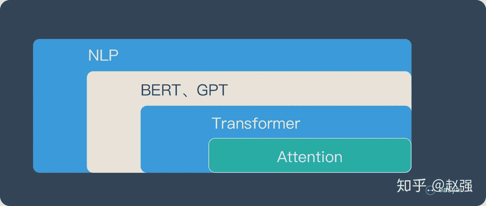


NLP 神经网络模型的本质就是对输入文本进行编码，常规的做法是首先对句子进行分词，然后将每个词语 (token) 都转化为对应的词向量 (token embeddings)，这样文本就转换为一个由词语向量组成的矩阵 X=(x1,x2,…,xn)，其中 xi 就表示第 i 个词语的词向量，维度为 d，故 X∈Rn×d。

在 Attention 机制引入之前，对 token 序列 X 的常规编码方式是通过循环网络 (RNNs) 和卷积网络 (CNNs)。

+   RNN方案

NLP领域使用RNN的Seq2Seq有一个问题：长距离的信息会被弱化，就好像记忆能力弱的人，记不住过去的事情是一样的。一个直觉的想法就是，我们需要想个办法跳过 z ，和前面的每个输入建立直接的联系。我们希望模型能够有机会学习到去“注意”关键的输入，不管这个输入是在前面还是后面。这就引入了attention的概念，一般形式可以写作 Attention(y,h)=Score(y,h)⋅h 。y是decoder hidden state，h是encoder hidden state，Score计算y和h之间的相关性。

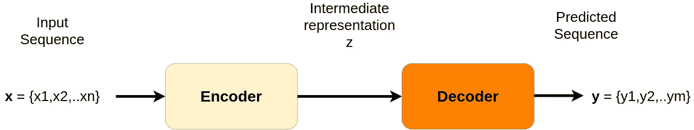

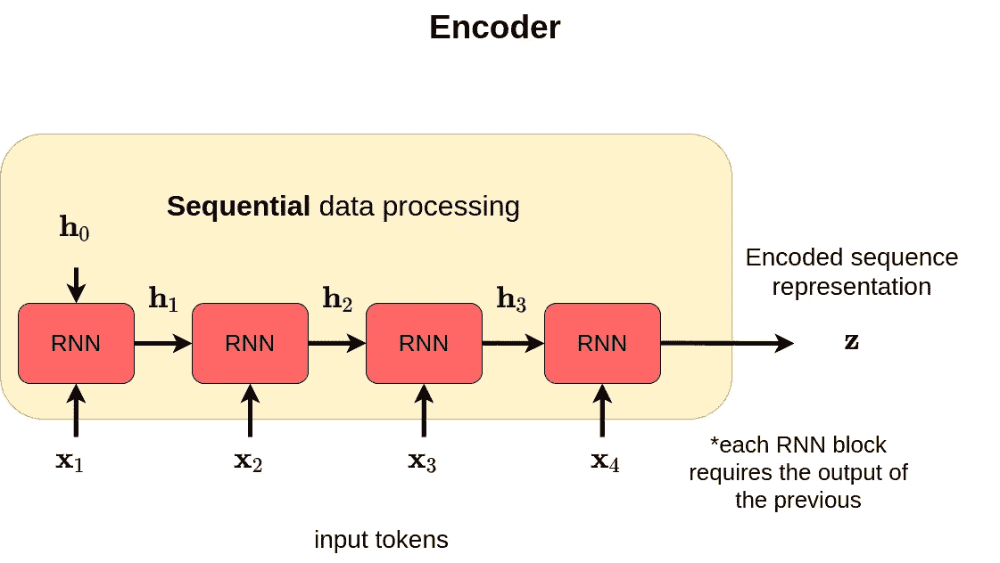

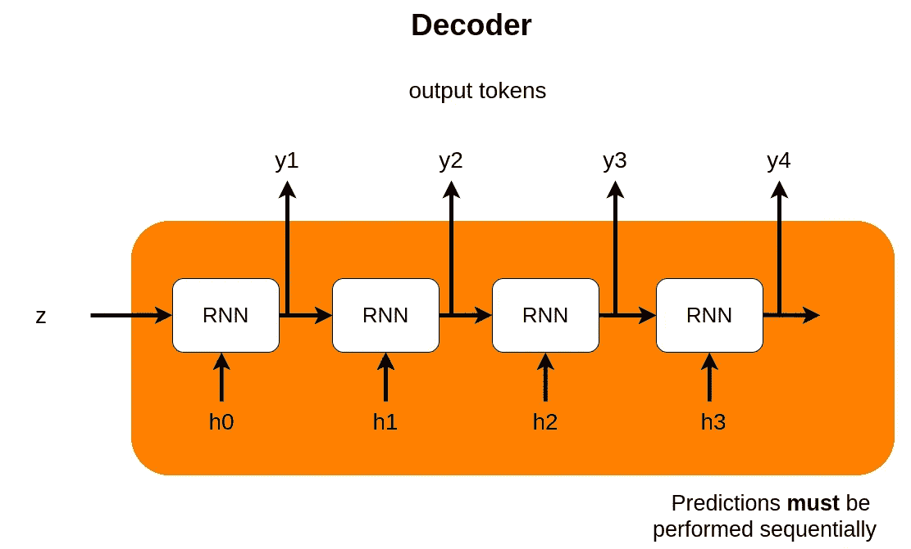

+   CNN 则通过滑动窗口基于局部上下文来编码文本，例如核尺寸为 3 的卷积操作就是使用每一个词自身以及前一个和后一个词来生成嵌入式表示：

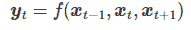

Google《Attention is All You Need》提供了第三个方案：直接使用 Attention 机制编码整个文本。相比 RNN 要逐步递归才能获得全局信息（因此一般使用双向 RNN），而 CNN 实际只能获取局部信息，需要通过层叠来增大感受野，Attention 机制一步到位获取了全局信息：

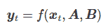

其中 是另外的词语序列（矩阵），如果取 就称为 Self-Attention，即直接将 与自身序列中的每个词语进行比较，最后算出 。

# What is attention

> 以下引用自：[[LLM] 自然语言处理 --- Se](https://blog.csdn.net/zwqjoy/article/details/102680781)lf[-Attention(一) 基](https://transformers.run/c1/attention/)本介绍+ transformer快速入门

从概念上理解，把Attention理解为从大量信息中有选择地筛选出少量重要信息并聚焦到这些重要信息上，忽略大多不重要的信息。聚焦的过程体现在权重系数的计算上，权重越大越聚焦于其对应的Value值上，即权重代表了信息的重要性，而Value是其对应的信息。

从图中可以引出另外一种理解，也可以将Attention机制看作一种软寻址（Soft Addressing）:Source可以看作存储器内存储的内容，元素由地址Key和值Value组成，当前有个Key=Query的查询，目的是取出存储器中对应的Value值，即Attention数值。通过Query和存储器内元素Key的地址进行相似性比较来寻址，之所以说是软寻址，指的不像一般寻址只从存储内容里面找出一条内容，而是可能从每个Key地址都会取出内容，取出内容的重要性根据Query和Key的相似性来决定，之后对Value进行加权求和，这样就可以取出最终的Value值，也即Attention值。所以不少研究人员将Attention机制看作软寻址的一种特例，这也是非常有道理的。

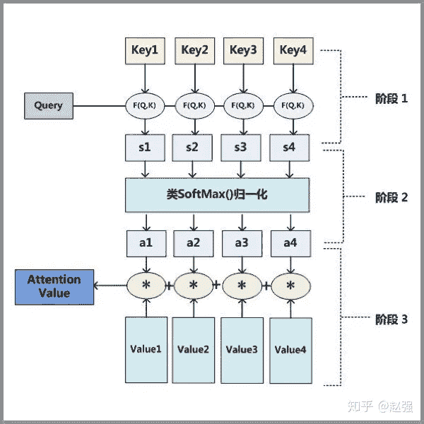

阶段一： query 和 key 进行相似度计算，得到权值

阶段二：将权值进行归一化，得到直接可用的权重

阶段三：将权重和 value 进行加权求和

从上面的建模，我们可以大致感受到 **Atte**ntion 的思路简单，四个字“加权求和”就可以高度概括

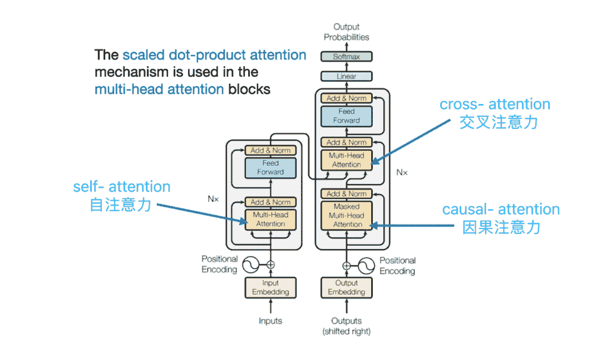

### self-attention VS cross-attention

Transformer encoder-decoder网络结构，encoder部分包含self-attention，decoder部分包含self-attention、cross-attention，下面主要简述两者的区别：

+   self-attention（自注意力）的查询（Q）、键（K）和值（V）均来自编码器同一序列，实现编码器序列内部的注意力计算，计算上下文之间的关系，在NLP任务中可以捕获长距离单词之间的依赖关系和语法特征。

+   cross-attention（交叉注意力）的输入来自不同的序列，即Q和K/V使用**的是不同的序列信息**，其中一个序列用作查询Q输入，而另一个序列用作键K和值V输入，实现跨序列的交互。

以transformer encoder-decoder为例，decoder阶段第一次启用时，cross-attention中K/V使用的是encoder阶段使用的序列信息，而Q使用的是decoder阶段使用的序列信息。

其他方面cross-attention和self-attention没有区别

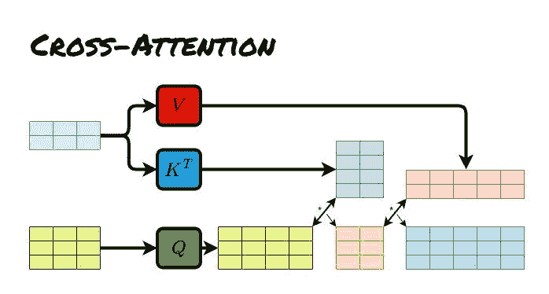

### Scaled Dot-product Attention

虽然 Attention 有许多种实现方式，但是最常见的还是 Scaled Dot-product Attention。

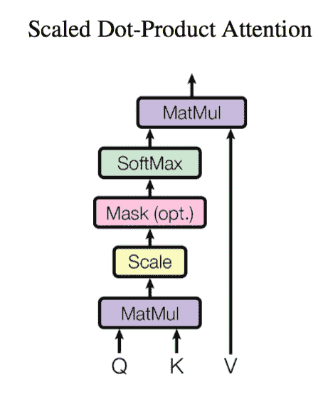

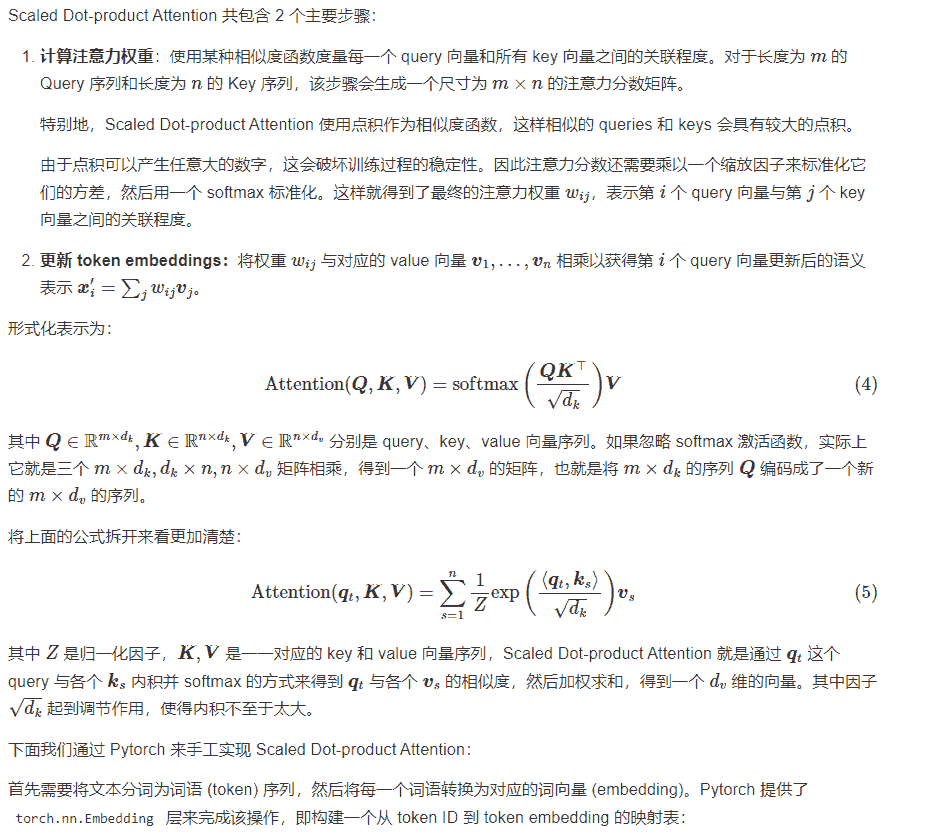

#### 为什么QKV需要线性变换?

假如直接用  和  做scale-dot就会到得一个对称矩阵，多样捕捉注意力的能力就会受限， i 、 j 位置之间的前后向注意力就会变得一样，而我们一般期望两个token在一句话中先后顺序也能反映一定的不同信息。

最重要的，这个对称矩阵的对角线上的值大概率是最大的，这样 softmax 后对角线上的注意力大概率本行最大，也就是不论任何位置任何搭配，每个token的注意力几乎全在自己身上，这样违背了Transformer用来捕捉上下文信息的初衷。所以乘上  后有三个好处：

+   增加了参数量，增加模型的表达能力。

+   加入了不同的线性变换相当于对 x 做了不同的投影，将向量 x 投影到不同空间，增加模型的泛化能力，不要那么hard。

+   允许某个token对其他位置token的注意力大于对自己的注意力，才能更好的捕捉全局位置的注意力。

#### 如何实现信息单向？

> Transformer结构包括[编码器](https://so.csdn.net/so/search?q=%E7%BC%96%E7%A0%81%E5%99%A8&spm=1001.2101.3001.7020)和解码器，在编码过程中目的就是为了让模型看到当前位置前后的信息，所以不需要attention mask。但是在解码过程中为了防止数据泄露，所以在训练的时候加了attention mask。

简单来说GPT的建模思路是只能依靠前面出现的词来猜测下一个token，因此我们需要将attention矩阵中后向的信息mask掉，我们前面说了attention[i,j]代表第i个token对第j个token的注意力，假设 i 代表当前预测到的token， j 代表施加注意力的token，单向因为只有模型前向信息，很显然只能在 attention 矩阵中保留 i>j 部分的元素，即在 attention 矩阵中对应着下三角矩阵部分，那么想要mask掉后向信息则需要将上三角部分置为负无穷，然后再 softmax ，由于 e−∞=0 ，自然就相当于掩盖了后向传输过来的信息，mask详细过程如下所示：

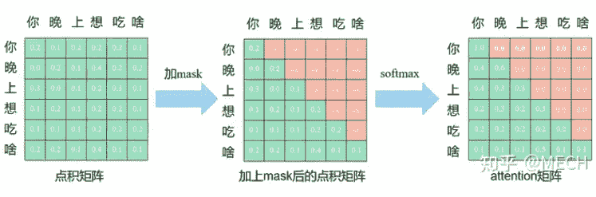

#### scale作用

Attention计算点积的过程中我们可以清晰地看到，由于每个Self-Attention的Q、K、V向量在输入前都被LayerNormalization归一化过，因此对每个Self-Attention的输入都有：  ，其中每一点的均值都是0，方差都是1，那么点积后的矩阵每一行均值为0，方差为 。因此需要除以标准差  以达到输出归一化的效果。

以下为详细推导过程：

对于两个 维向量 ，假设它们都采样自“均值为0、方差为1”的分布，那么它们的内积的二阶矩是：

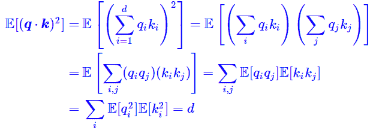

也就是内积的二阶矩为 ，由于均值也为0，所以这也意味着方差也是 。Attention是内积后softmax，主要设计的运算是 ，我们可以大致认为内积之后、softmax之前的数值在  到  这个范围内，由于 通常都至少是64，所以  比较大而  比较小，因此经过softmax之后，Attention的分布非常接近一个one hot分布了，这带来严重的梯度消失问题，导致训练效果差。

解决方法就有两个，一是在内积之后除以  ，使 的方差变为1，对应  都不至于过大过小，这样softmax之后也不至于变成one hot而梯度消失了，这也是常规的Transformer如BERT里边的Self Attention的做法；另外就是不除以  ，但是初始化 全连接层的时候，其初始化方差要多除以一个  ，这同样能使得使 的初始方差变为1，T5采用了这样的做法。

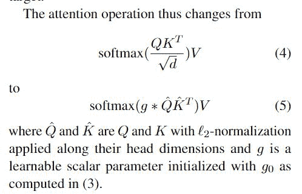

#### 代码实现

下面从代码角度实现 Scaled Dot-product Attention：

首先需要将文本分词为词语 (token) 序列，然后将每一个词语转换为对应的词向量 (embedding)。Pytorch 提供了 torch.nn.Embedding 层来完成该操作，即构建一个从 token ID 到 token embedding 的映射表：

```
**from** torch **import**** nn
****from t****rans****former**s 
import A**u**toConfig
f**r**om tr**a**nsforme**r****s**** ****
impo**rt Auto**T**okenizer
m**o****del_c**kpt = &quot;bert-ba**s****e-unc**ased&quot;
tokenizer = AutoTokenizer.from_pretrained(model_ckpt)

text = &quot;time flies like an arrow&quot;
inputs = tokenizer(text, return_tensors=&quot;pt&quot;, add_special_tokens=False)
print(inputs.input_ids)

config = AutoConfig.from_pretrained(model_ckpt)
token_emb = nn.Embedding(config.vocab_size, config.hidden_size)
print(token_emb)

inputs_embeds = token_emb(inputs.input_ids)
print(inputs_embeds.size())
```

```
tensor([[ 2051, 10029,  2066,  2019,  8612]])
Embedding(30522, 768)
torch.Size([1, 5, 768])
```

> 为了演示方便，这里我们通过设置 add_special_tokens=False 去除了分词结果中的 [CLS] 和 [SEP]。

可以看到，BERT-base-uncased 模型对应的词表大小为 30522，每个词语的词向量维度为 768。Embedding 层把输入的词语序列映射到了尺寸为 [batch_size, seq_len, hidden_dim] 的张量。

接下来就是创建 query、key、value 向量序列 Q,K,V，并且使用点积作为相似度函数来计算注意力分数：

```
**import**** tor****ch
fro**m **m**ath** **
im**p**ort sq**r**t
Q = K **=** V = in**p****u****ts_em**beds
dim_k = K.size(-1)
scores = torch.bmm(Q, K.transpose(1,2)) / sqrt(dim_k)
print(scores.size())
```

```
torch.Size([1, 5, 5])
```

这里 Q,K 的序列长度都为 5，因此生成了一个 5×5 的注意力分数矩阵，接下来就是应用 Softmax 标准化注意力权重，最后将注意力权重与 value 序列相乘

```
**import**** t**orch.nn.**f****un****ction****al** as F
weights** ****= F.s**oftmax(scores, dim=-1)
print(weights.sum(dim=-1))
attn_outputs = torch.bmm(weights, V)
print(attn_outputs.shape)
```

```
tensor([[1., 1., 1., 1., 1.]], grad_fn=&lt;SumBackward1&gt;)
torch.Size([1, 5, 768])
```

至此就实现了一个简化版的 Scaled Dot-product Attention。可以将上面这些操作封装为函数以方便后续调用：

```
**import**** torch****
i****mpor**t torc**h.nn.f****unc**t**i**onal as F
from** **math impor**t** sqrt

def** **scaled_dot_p**r**oduct_atten**t**ion(query, key, val**u**e, q**ue**ry_mask=None**, **k**ey_**mask=N**one**, mask=Non**e)**:**
  **  dim_k = que**r****y**.siz**e(**-1)
  **  **s**cor**es = torch.bmm(**q****ue**ry, **k**ey.transpose**(****1,** 2))** / sqr**t(dim_k)
    if query_mask is not None and key_mask is not None:
        mask = torch.bmm(query_mask.unsqueeze(-1), key_mask.unsqueeze(1))
    if mask is not None:
        scores = scores.masked_fill(mask == 0, -float(&quot;inf&quot;))
    weights = F.softmax(scores, dim=-1)
    return torch.bmm(weights, value)
```

### Multi-head Attention

> 以下部分引用自：Multi-Head-Attention的作用到底是什么

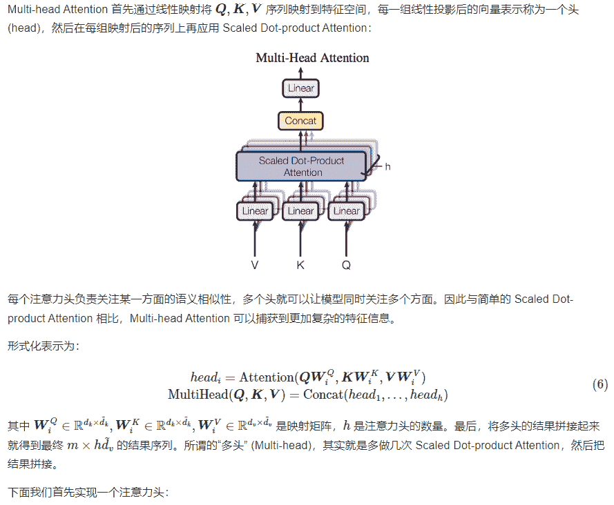

#### 多头作用

> 多头的功能是不一样的，有些头由位置信息主导，只对附近的token有较强的注意力（即使不满足语法或词序）；少数头由语法或词法信息主导。

> multi-head作用就是将这些能够表征语法或词法的pattern抽取出来，否则受位置信息主导只关心自己。

1.  **实验分析**：

基于4层12头transformer模型实验，分析多头中每个头的作用

+   实验一：从语料中选择4个作为query，观察多头的attention pattern

+   现象：大部分pattern仅对当前token附近几个token有较强的注意力，但总有那么几个特立独行的pattern，比如6~10头的pattern就是奇形怪状的

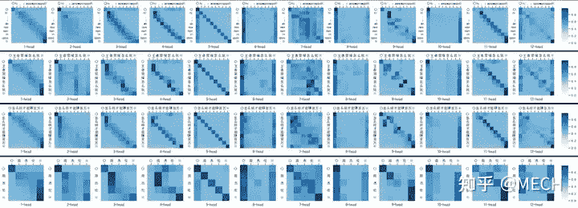

+   实验二：为了分析多头是否能捕获词序关系，通过打乱预料的词序和固定搭配

预料：["王者荣耀怎么玩", "怎耀么荣玩者王", "荣耀王者怎么玩", "怎么玩王荣者耀"]

+   现象：大部分pattern依旧关注当前token附近的几个token，但是少数头pattern发生变化，这些pattern会关注词法或语法相关的信息

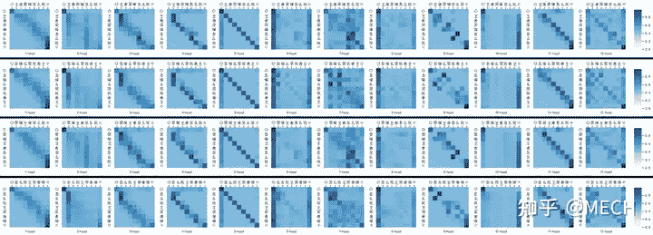

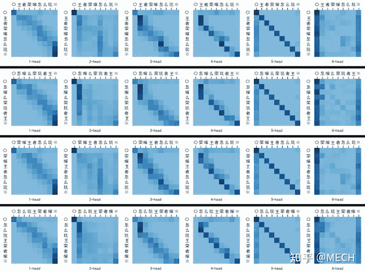

4条query的1~6头的attention pattern

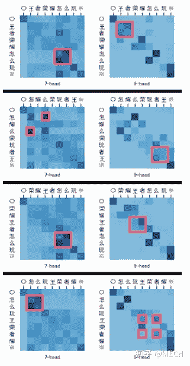

4条query的第7、9头的attention pattern

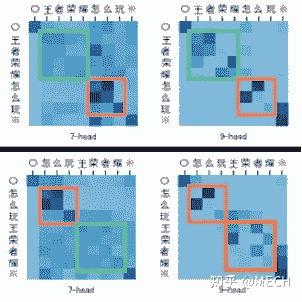

第7、9个head记录下了语法或词法层面的pattern

+   实验三：由于大多数pattern总是对当前token附近的token有较大的注意力，怀疑是否位置编码导致的，因而尝试去掉位置编码再计算attention pattern

+   现象：大部分pattern发生剧烈变换，具有语法和词法能力

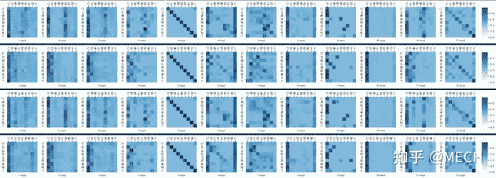

+   结论

+   对于大部分query，每个头都学习了某种固定的pattern模式，而且12个头中大部分pattern是差不多的，但是总有少数的pattern才能捕捉到语法/句法/词法信息。

+   越靠近底层的attention，其pattern种类越丰富，关注到的点越多，越到顶层的attention，大部分head的pattern趋同，最后留下来的极少不相同的head的就是这个模型表达语义信息的head。

+   head数越少，pattern会更倾向于token关注自己本身(或者其他的比较单一的模式，比如都关注CLS)。

+   多头的核心思想应该就是ensemble，如随机森林一样，将特征切分，每个head就像是一个弱分类器，让最后得到的embedding关注多方面信息，不要过拟合到某一种pattern上。

+   已有论文证明head数目不是越多越好，bert-base上实验的结果为8、16最好，太多太少都会变差。

+   multi-head-attention中大部分头没有捕捉到语法/句法信息，但是笔者这里没办法做出断言说它们是没有用的，具体还是要看下游任务对其的适配程度。

1.  **理论分析**

> 根据attention矩阵稀疏性，使用低秩分解的思路，降低矩阵维度依旧可以等价其效果

> 以下引自：苏神回答[BERT中，multi-head 768*64*12与直接使用](https://www.zhihu.com/question/446385446/answer/1752279087)768*768矩阵统一计算，有什么区别？

#### 代码实现

```
**from** torch **import**** nn

**c**lass Attentio**nHea**d(n**n**.Module)**:
    def __ini**t**__(self, embed_**d**im, head_dim):
** **    **   **s**uper().**__init__()
     ** **  self.q = nn.**L**inear(embe**d****_**dim, hea**d_dim)**
        self.k = nn.Linear(embed_dim, head_dim)
        self.v = nn.Linear(embed_dim, head_dim)
        
    def forward(self, query, key, value, query_mask=None, key_mask=None, mask=None):
        attn_outputs = scaled_dot_product_attention(self.q(query), self.k(key), self.v(value), query_mask, key_mask, mask)
        return attn_outputs
```

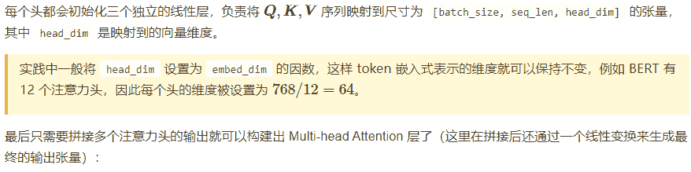

```
**class** Mult**iHe**a**dAttenti****o****n****(**nn.Module):**
 **** **  def __init__(self, config):
 **   **   ** s****u**per(**)._**_**init__(**)
        embed_**d**im = config.hi**d**den_size
 ** **      num_**h**e**ads** = **co****nf**ig.num_att**e**ntion_he**ads
  **      head_dim = embed_dim // num_heads
        self.heads = nn.ModuleList([AttentionHead(embed_dim, head_dim) for _ in range(num_heads)])
        self.output_linear = nn.Linear(embed_dim, embed_dim)
        
    def forward(self, query, key, value, query_mask=None, key_mask=None, mask=None):
        x = torch.cat([h(query, key, value, query_mask, key_mask, mask) for h in self.heads], dim=-1)
        x = self.output_linear(x)
        return x
```

这里使用 BERT-base-uncased 模型的参数初始化 Multi-head Attention 层，并且将之前构建的输入送入模型以验证是否工作正常：

```
**from** transformers **import**** Aut**oConfig
from t**ransfo**rmers impor**t** AutoToken**i**zer

**m**odel_ck**p****t**** **= &quot;bert**-**base-uncas**e**d&quot;
tokenizer =** **AutoTokenizer.f**r**om_pre**t**raine**d**(model_**c**kpt)

text =** **&quot;time flies like an arrow&quot;
inputs = tokenizer(text, return_tensors=&quot;pt&quot;, add_special_tokens=False)
config = AutoConfig.from_pretrained(model_ckpt)
token_emb = nn.Embedding(config.vocab_size, config.hidden_size)
inputs_embeds = token_emb(inputs.input_ids)

multihead_attn = MultiHeadAttention(config)
query = key = value = inputs_embeds
attn_output = multihead_attn(query, key, value)
```